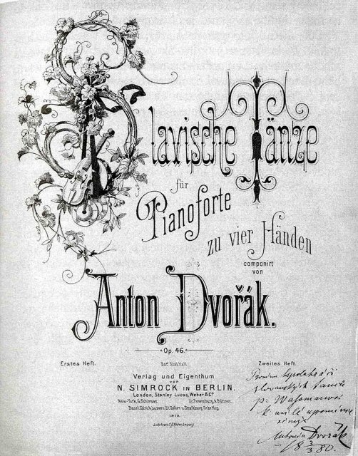

<!--
內容整理自本機筆記〈德弗札克主要作品〉（D:\Books\md\音樂\德弗札克主要作品.md，網頁版在知識圖譜的「9-2.音樂家作品」），做法比照「貝多芬主要作品」。
- 每首作品一則事件，日期採「創作時間」（多年創作的作品以區間呈現；「年代」以十年計、「世紀」以百年計，修訂或出版年份只寫在顯示文字裡），事件顏色依筆記的類別段落區分：交響曲、協奏曲與獨奏樂器管弦樂作品、管弦樂與交響詩、室內樂、歌劇、清唱劇、神劇、彌撒與合唱作品、鋼琴作品、歌曲與聲樂套曲。
- 「約」、「前後」、修訂、出版等不是單純年份的寫法，以原文作為顯示文字。
- 作品編號是目錄編號，不等於創作順序，時間軸依創作時間排序。
- 時期沿用「德弗札克生平」時間軸的主要時期（重疊的細分時期不列）。
- 筆記「優先聆聽」清單中的作品另註明順序。
- 沒有年份、無法放上時間軸的條目未收錄：Op.70／B.141a 弦樂四重奏相關作品與草稿（年代依作品而異）。
- 以 follows 排在「德弗札克生平」之後；生平事件見該時間軸。
圖片來源（皆為 Wikimedia Commons 公有領域作品；註明「共用」者沿用生平時間軸的圖片）：
- dvorak-1893-new-world.jpg（《自新世界》交響曲手稿（與德弗札克生平共用））
- dvorak-1884-stabat-mater.jpg（《聖母悼歌》Novello 版樂譜的封面，上有演出者的簽名（與德弗札克生平共用））
- dvorak-1901-rusalka.jpg（1901年3月31日《水仙女》在布拉格國家劇院首演的海報（與德弗札克生平共用））
- mw-dvorak-slavonic.jpg：Slavonic Dances024.jpg（《斯拉夫舞曲》第一集四手聯彈版的西姆羅克初版書名頁）
-->

# Periods
- 1841 ~ 1857 | 童年@內拉霍澤維斯、茲洛尼采
  父親是旅店老闆、肉販兼齊特琴手，他從小在村裡的樂隊和教堂拉小提琴。13歲被送到茲洛尼采的舅舅家學德語，跟著脾氣暴躁卻很欣賞他的李曼學管風琴、鋼琴與樂理。
- 1857 ~ 1871 | 布拉格的中提琴手@Prague
  進入布拉格管風琴學校，畢業後在咖啡館、舞會演奏，後來成為臨時劇院樂團的中提琴手，在史麥塔納、華格納的指揮下演奏。十年間默默自學作曲，作品幾乎沒有公開演出過。
- 1871 ~ 1877 | 嶄露頭角
  辭去樂團工作專心作曲，結婚後在聖亞德伯教堂擔任管風琴師。愛國清唱劇讓他在布拉格成名，並連年獲得奧地利國家獎學金，評審之一正是布拉姆斯。
- 1877 ~ 1892 | 名揚國際
  布拉姆斯把他推薦給出版商西姆洛克，《斯拉夫舞曲》一出版就風靡歐美。他九度訪問英國指揮自己的作品，也到俄國演出，結識柴可夫斯基，1891年起任教於布拉格音樂院。
- 1892 ~ 1895 | 新世界@New York
  應邀擔任紐約國家音樂院院長，主張美國音樂應該以黑人與原住民音樂為根基。在紐約與愛荷華州的捷克小鎮寫下《新世界》交響曲、《美國》四重奏與大提琴協奏曲。
- 1895 ~ 1904 | 晚年：交響詩與歌劇
  因思鄉與欠薪回到波希米亞，轉向交響詩與歌劇創作，《水仙女》成為他最受歡迎的歌劇。晚年擔任布拉格音樂院院長、獲封奧地利上議院議員，60歲生日被當成全國性的慶典。

# Events

## 1865 | B.9 第1號交響曲《茲洛尼采的鐘聲》 {color=#c92a2a}
類別：交響曲（交響曲）。

## 1865 | Op.4／B.12 第2號交響曲，降B大調 {color=#c92a2a}
類別：交響曲（交響曲）。

## 1873 | Op.10／B.34 第3號交響曲，降E大調 {color=#c92a2a}
類別：交響曲（交響曲）。

## 1874 | Op.13／B.41 第4號交響曲，D小調 {color=#c92a2a}
類別：交響曲（交響曲）。

## 1875 | Op.76／B.54 第5號交響曲，F大調 {color=#c92a2a}
類別：交響曲（交響曲）。

## 1880 | Op.60／B.112 第6號交響曲，D大調 {color=#c92a2a}
類別：交響曲（交響曲）。

## 1884 ~ 1885 | Op.70／B.141 第7號交響曲，D小調 {color=#c92a2a}
類別：交響曲（交響曲）。

## 1889 | Op.88／B.163 第8號交響曲，G大調 {color=#c92a2a}
類別：交響曲（交響曲）。入門推薦聆聽第 4 首。

## 1893 | Op.95／B.178 第9號交響曲《自新世界》（新世界交響曲），E小調 {color=#c92a2a}

類別：交響曲（交響曲）。入門推薦聆聽第 1 首。

## 1876 | Op.33／B.63 G小調鋼琴協奏曲 {color=#1971c2}
類別：鋼琴協奏曲（協奏曲與獨奏樂器管弦樂作品）。

## 1879 ~ 1880 | Op.53／B.108 A小調小提琴協奏曲 {color=#1971c2}
類別：小提琴協奏曲（協奏曲與獨奏樂器管弦樂作品）。

## 1894 ~ 1895 | Op.104／B.191 B小調大提琴協奏曲 {color=#1971c2}
類別：大提琴協奏曲（協奏曲與獨奏樂器管弦樂作品）。入門推薦聆聽第 2 首。

## 1873 ~ 1877 | Op.11／B.39 F小調小提琴與管弦樂《浪漫曲》 {color=#1971c2 label="約1873–1877，後改編"}
類別：協奏性管弦樂（協奏曲與獨奏樂器管弦樂作品）。

## 1879 | Op.49／B.90 E小調小提琴與管弦樂《馬祖卡舞曲》 {color=#1971c2}
類別：協奏性管弦樂（協奏曲與獨奏樂器管弦樂作品）。

## 1891 | Op.94／B.181 G小調大提琴與管弦樂《迴旋曲》 {color=#1971c2}
類別：協奏性管弦樂（協奏曲與獨奏樂器管弦樂作品）。

## 1883 ~ 1884 | Op.68／第5首／B.182 大提琴與管弦樂《寂靜的森林》 {color=#1971c2 label="1883–1884，後改編"}
類別：協奏性管弦樂（協奏曲與獨奏樂器管弦樂作品）。

## 1874 | Op.14／B.44 A小調狂想曲 {color=#e67700}
類別：管弦樂狂想曲（管弦樂與交響詩）。

## 1875 | Op.22／B.52 E大調弦樂小夜曲 {color=#e67700}
類別：弦樂合奏曲（管弦樂與交響詩）。入門推薦聆聽第 7 首。

## 1879 | Op.39／B.93 捷克組曲 {color=#e67700}
類別：管弦樂組曲（管弦樂與交響詩）。

## 1878 | Op.45／B.86 斯拉夫狂想曲（共三首） {color=#e67700}
類別：管弦樂狂想曲（管弦樂與交響詩）。入門推薦聆聽第 6 首。

## 1878 | Op.46／B.78 斯拉夫舞曲，第一集 {color=#e67700}

類別：管弦樂舞曲（管弦樂與交響詩）。入門推薦聆聽第 3 首。

## 1886 | Op.72／B.147 斯拉夫舞曲，第二集 {color=#e67700}
類別：管弦樂舞曲（管弦樂與交響詩）。

## 1878 | Op.44／B.77 D小調管樂小夜曲 {color=#e67700}
類別：管樂合奏曲（管弦樂與交響詩）。

## 1891 | Op.92／B.169 《狂歡節》音樂會序曲 {color=#e67700}
類別：音樂會序曲（管弦樂與交響詩）。入門推薦聆聽第 9 首。

## 1891 | Op.91／B.168 《自然界中》音樂會序曲 {color=#e67700}
類別：音樂會序曲（管弦樂與交響詩）。

## 1891 | Op.93／B.167 《奧賽羅》音樂會序曲 {color=#e67700}
類別：音樂會序曲（管弦樂與交響詩）。

## 1896 | Op.107／B.195 《水妖》 {color=#e67700}
類別：交響詩（管弦樂與交響詩）。

## 1896 | Op.108／B.196 《正午女巫》 {color=#e67700}
類別：交響詩（管弦樂與交響詩）。

## 1896 | Op.109／B.197 《金紡車》 {color=#e67700}
類別：交響詩（管弦樂與交響詩）。

## 1896 | Op.110／B.198 《野鴿》 {color=#e67700}
類別：交響詩（管弦樂與交響詩）。

## 1897 | Op.111／B.199 《英雄之歌》 {color=#e67700}
類別：交響詩（管弦樂與交響詩）。

## 1861 | Op.1／B.7 A小調第一弦樂五重奏 {color=#2f9e44}
類別：弦樂五重奏（室內樂）。

## 1862 | Op.2／B.8 A大調第一弦樂四重奏 {color=#2f9e44}
類別：弦樂四重奏（室內樂）。

## 1873 | Op.12／B.40 F大調第二弦樂四重奏 {color=#2f9e44}
類別：弦樂四重奏（室內樂）。

## 1876 | Op.34／B.75 D小調鋼琴三重奏 {color=#2f9e44}
類別：鋼琴三重奏（室內樂）。

## 1883 | Op.65／B.130 A小調第二鋼琴三重奏 {color=#2f9e44}
類別：鋼琴三重奏（室內樂）。

## 1887 | Op.81／B.155 A大調第二鋼琴五重奏 {color=#2f9e44}
類別：鋼琴五重奏（室內樂）。入門推薦聆聽第 8 首。

## 1893 | Op.96／B.179 F大調第十二弦樂四重奏《美國》 {color=#2f9e44}
類別：弦樂四重奏（室內樂）。入門推薦聆聽第 5 首。

## 1893 | Op.97／B.180 降E大調第三弦樂五重奏 {color=#2f9e44}
類別：弦樂五重奏（室內樂）。

## 1890 ~ 1891 | Op.90／B.166 E小調第四鋼琴三重奏《杜姆卡》 {color=#2f9e44}
類別：鋼琴三重奏（室內樂）。

## 1889 | Op.87／B.162 A大調第二鋼琴四重奏 {color=#2f9e44}
類別：鋼琴四重奏（室內樂）。

## 1878 | Op.48／B.80 A大調弦樂六重奏 {color=#2f9e44}
類別：弦樂六重奏（室內樂）。

## 1870 | B.21 《阿爾弗雷德》 {color=#862e9c}
類別：歌劇（歌劇）。

## 1871 ~ 1874 | Op.14／B.29 《國王與煤炭工》 {color=#862e9c label="1871–1874，後修訂"}
類別：歌劇（歌劇）。

## 1874 | Op.17／B.36 《頑固的農夫》 {color=#862e9c}
類別：喜歌劇（歌劇）。

## 1875 ~ 1876 | Op.25／B.42 《萬達》 {color=#862e9c}
類別：歌劇（歌劇）。

## 1877 | Op.31／B.51 《狡猾的農夫》 {color=#862e9c}
類別：喜歌劇（歌劇）。

## 1887 ~ 1888 | Op.32／B.54 《雅各賓派》 {color=#862e9c}
類別：喜歌劇（歌劇）。

## 1881 ~ 1882 | Op.64／B.125 《迪米特里》 {color=#862e9c label="1881–1882，後修訂"}
類別：歌劇（歌劇）。

## 1887 ~ 1888 | Op.84／B.159 《雅各賓派》修訂版 {color=#862e9c label="1887–1888，後修訂"}
類別：喜歌劇（歌劇）。

## 1898 ~ 1899 | Op.112／B.203 《魔鬼與凱特》 {color=#862e9c}
類別：喜歌劇（歌劇）。入門推薦聆聽第 12 首。

## 1900 | Op.114／B.205 《水仙女》 {color=#862e9c}

類別：抒情歌劇（歌劇）。

## 1902 ~ 1903 | Op.115／B.209 《阿爾米達》 {color=#862e9c}
類別：歌劇（歌劇）。

## 1872 | Op.30／B.27 《白山的繼承者》 {color=#0c8599 label="1872，後修訂"}
類別：合唱清唱劇（清唱劇、神劇、彌撒與合唱作品）。

## 1876 ~ 1877 | Op.58／B.71 《聖母悼歌》（Stabat Mater） {color=#0c8599}

類別：宗教清唱劇（清唱劇、神劇、彌撒與合唱作品）。入門推薦聆聽第 11 首。

## 1879 | Op.79／B.91 第149篇詩篇 {color=#0c8599 label="1879，後修訂"}
類別：合唱與管弦樂（清唱劇、神劇、彌撒與合唱作品）。

## 1884 | Op.69／B.135 《婚禮襯衫》 {color=#0c8599}
類別：清唱劇（清唱劇、神劇、彌撒與合唱作品）。

## 1885 ~ 1886 | Op.71／B.145 《聖盧德米拉》 {color=#0c8599}
類別：神劇（清唱劇、神劇、彌撒與合唱作品）。

## 1890 | Op.89／B.165 《安魂曲》 {color=#0c8599}
類別：宗教合唱作品（清唱劇、神劇、彌撒與合唱作品）。

## 1892 | Op.103／B.176 《讚美頌》（Te Deum） {color=#0c8599}
類別：合唱與管弦樂（清唱劇、神劇、彌撒與合唱作品）。

## 1894 | Op.99／B.185 《聖經歌曲》 {color=#0c8599}
類別：聲樂套曲（清唱劇、神劇、彌撒與合唱作品）。

## 1887 | Op.86／B.175 D大調彌撒曲 {color=#0c8599}
類別：彌撒曲（清唱劇、神劇、彌撒與合唱作品）。

## 1883 | Op.28 《波希米亞森林》 {color=#5f3dc4}
類別：鋼琴曲集（鋼琴作品）。

## 1878 | Op.35 《詼諧曲》 {color=#5f3dc4}
類別：鋼琴獨奏（鋼琴作品）。

## 1880 | Op.52 《即興曲》 {color=#5f3dc4 label="1880前後"}
類別：鋼琴獨奏（鋼琴作品）。

## 1880 | Op.54 《八首幽默曲》相關作品 {color=#5f3dc4 label="1880前後"}
類別：鋼琴曲（鋼琴作品）。

## 1880 ~ 1889 | Op.85 《詼諧曲》及鋼琴小品相關作品 {color=#5f3dc4 label="1880年代"}
類別：鋼琴獨奏（鋼琴作品）。

## 1894 | Op.101／B.187 《幽默曲》 {color=#5f3dc4}
類別：鋼琴曲集（鋼琴作品）。入門推薦聆聽第 10 首。

## 1865 | B.11／B.152等相關版本 《柏樹》（Cypresses） {color=#a61e4d label="1865，後修訂"}
類別：聲樂套曲；另有弦樂四重奏改編（歌曲與聲樂套曲）。

## 1882 | Op.2 四首歌曲 {color=#a61e4d}
類別：藝術歌曲（歌曲與聲樂套曲）。

## 1880 | Op.55／B.104 《吉卜賽歌曲》 {color=#a61e4d}
類別：聲樂套曲（歌曲與聲樂套曲）。

## 1890 ~ 1899 | Op.100 《晚歌》相關作品 {color=#a61e4d label="1890年代"}
類別：聲樂作品（歌曲與聲樂套曲）。
