<!--
內容整理自 D:\Books\md\歷史\人物\科學家\愛因斯坦生平大事記.md（網頁版為 D:\Books\html\8-2.科學家\愛因斯坦生平大事記.html），並整合中文維基百科〈阿爾伯特·愛因斯坦〉條目，以自己的話改寫。
時期依筆記的七個階段歸納：出生與早年、蘇黎世求學、專利局與奇蹟之年、學術地位與廣義相對論的形成、廣義相對論完成與日食、量子論爭辯與納粹崛起、移居美國與晚年。筆記的「重要著作與科學貢獻總表」「與其他科學家的關係」「家庭與個人生活」「歷史地位」「關鍵年份速覽」及與牛頓的比較寫進時期說明與相關事件，不另立事件。
兩份資料出入與處理方式：
- 生卒：筆記與維基百科一致：1879年3月14日生於烏爾姆、1955年4月18日在普林斯頓逝世（維基百科補充4月13日腹主動脈瘤破裂內出血），享年76歲。
- 專利局：筆記寫1902年進入伯恩專利局任技術專家第三級；維基百科寫1902年在格羅斯曼父親協助下成為助理鑑定員、1903年成為正式職員，照兩者，這裡寫成1902年一則並說明1903年轉正。1906年升等取自筆記。
- 婚姻與家人：筆記寫1903年與米列娃結婚、1904年長子漢斯出生、1919年與表親艾爾莎結婚、1936年艾爾莎去世；維基百科補充1903年1月結婚、1904年5月長子在伯恩出生、1910年7月次子愛德華出生、1919年2月14日離婚、6月2日再婚，並提到1902年出生的女兒莉澤爾（1987年發現的信件透露，婚前所生，後來下落不明，可能被收養或死於猩紅熱）。這裡只在婚姻事件略提莉澤爾，不推測她的下落；愛德華後來住精神病院直到1965年過世，不收。
- 1905年：筆記把四篇論文分成3月光量子、5月布朗運動、6月狹義相對論、9月質能等價；維基百科補充1905年的博士論文《分子大小的新測定法》獲接受，寫成獨立事件。維基百科提到米列娃是否參與1905年論文，物理史學者找不到證據，這裡不寫。
- 光量子與諾貝爾獎：維基百科說光量子假說到1919年才被廣為接受，且1921年諾貝爾獎不是因為相對論，而是因為光電效應；獎項延後一年頒發，這裡與筆記合併，寫成：1922年11月宣布1921年的物理獎，他當時正在亞洲旅行，沒有出席12月的頒獎典禮（一般記載）；這項細節維基百科沒有，標為一般記載。
- 柏林：筆記寫1914年柏林大學教授、普魯士科學院；維基百科補充他是新成立的威廉皇家物理研究所第一任所長（1914–1932），1916年當選德國物理學會會長（1916–1918），照兩者。
- 廣義相對論：筆記寫1915年11月25日提出場方程式；維基百科寫1915年11月連續發表四篇論文；1916年預言重力波，2016年2月11日LIGO首次直接探測（100年後），寫進1916年事件與最後的身後事件。1917年宇宙學模型之外，維基百科補充同年提出受激輻射理論（開創雷射領域），一併寫入。
- 日食：筆記寫1919年；維基百科寫愛丁頓觀測1919年5月29日日食，筆記補充觀測隊在普林西比島與巴西索布拉爾，同年11月英國皇家學會與皇家天文學會公布，照此。筆記提醒這不是廣義相對論唯一或最終的證據。
- 1922年亞洲行：筆記寫經過新加坡、香港、上海並訪問日本；維基百科只提到1920年代的東方旅行日記中有對亞洲人與中國人的種族偏見內容，後來他轉向反種族主義，這裡在事件中提一句「日記中有對亞洲人的偏見言論，後來他的態度有所改變」。
- 玻色與凝聚：筆記寫1924年、1925年；維基百科補充1923年玻色把論文寄給愛因斯坦、1924年愛因斯坦發表單原子理想氣體論文、1995年康奈爾與威曼首次觀測到玻色—愛因斯坦凝聚，照此。
- 索爾維會議：筆記寫1927年與1930年的論辯，「上帝不擲骰子」；一般記載這句話是他在信中的意譯，不寫成逐字引文。
- 1933年：筆記寫1月30日希特勒上台，愛因斯坦當時在海外，決定不再返回，辭去普魯士科學院職務、放棄德國國籍；維基百科寫他當時正在美國訪問；一般記載他在10月抵達普林斯頓，這裡合併成一則「1933年」事件。
- 1939年：筆記寫哈恩與施特拉斯曼的核裂變實驗，與西拉德促成他簽署致羅斯福的信，1939年8月；維基百科補充還有泰勒、維格納等流亡物理學家警告美國政府，照兩者。筆記特別強調他沒有參與曼哈頓計畫，照此寫。
- 1940年：筆記寫取得美國國籍並保留瑞士國籍；維基百科寫1940年定居美國並成為公民。
- 1952年婉拒以色列總統；1953年關注核武器；1955年4月11日簽署《羅素—愛因斯坦宣言》，筆記說宣言促成1957年第一次帕格沃什會議；宣言在他去世後的1955年7月9日才公開，這是一般記載，筆記沒有。
- 1944年重抄狹義相對論手稿用於慈善募款、1946年原子科學家緊急委員會、1947年倡議世界政府，取自筆記。
圖片來源（皆為 Wikimedia Commons 公有領域／CC0 作品；繪畫、版畫與插圖多為後世作品，不代表事件當時的樣貌）：
- ei-cover.jpg：Einstein 1921 by F Schmutzer - restoration.jpg（施穆策所攝愛因斯坦，1921）
- ei-ulm.jpg：Ульм. Памятник Эйнштейну.jpg（烏爾姆的愛因斯坦紀念碑）
- ei-child.jpg：Albert Einstein as a child.jpg（少年愛因斯坦，約1893）
- ei-eth.jpg：Hauptgebäude der ETH Zürich and Polyterrasse 2022-09-24 01.jpg（蘇黎世聯邦理工學院主樓）
- ei-mileva.jpg：Albert Einstein and his wife Mileva Maric.jpg（愛因斯坦與米列娃·馬利奇）
- ei-planck.jpg：Max Planck (1858-1947).jpg（馬克斯·普朗克）
- ei-eclipse.jpg：1919 eclipse negative.jpg（1919年日食的觀測底片）
- ei-japan.jpg：Kotaro Honda ,Albert Einstein,Keiichi Aichi,Sirouta Kusukabe.jpg（愛因斯坦在日本，1922）
- ei-bose.jpg：SatyenBose1925.jpg（薩特延德拉·納特·玻色，1925）
- ei-bohr.jpg：Niels Bohr Albert Einstein by Ehrenfest.jpg（波耳與愛因斯坦（埃倫費斯特攝，1925））
- ei-letter.jpg：Einstein-Roosevelt-letter.png（愛因斯坦—西拉德致羅斯福總統的信，1939年8月2日）
- ei-hiroshima.jpg：Atomic cloud over Hiroshima.jpg（廣島上空的原子彈蕈狀雲，1945）
- ei-1947.jpg：Albert Einstein Head cleaned.jpg（愛因斯坦，1947）
- ei-russell.jpg：Bertrand Russell photo.jpg（伯特蘭·羅素）
-->

# Periods
- 1879-03-14 ~ 1896 | 出生與早年 | #868e96
  生於德國烏爾姆的猶太家庭，隨家人搬到慕尼黑；對德國學校的紀律不適應，家人遷往義大利後在瑞士阿勞州立學校完成中學，放棄德國國籍。
- 1896 ~ 1900 | 蘇黎世聯邦理工學院 | #2f9e44
  就讀數學與物理教師課程，遇到未來的合作者格羅斯曼與妻子米列娃，自學馬克士威的電磁學，開始懷疑「以太」。
- 1900 ~ 1905 | 專利局與奇蹟之年 | #e8590c
  畢業後找不到學術職位，在伯恩專利局審查專利，業餘研究物理，1905年一年內發表光量子、布朗運動、狹義相對論與質能等價。
- 1905 ~ 1914 | 學術地位與廣義相對論的形成 | #1971c2
  從講師、副教授到教授，提出等效原理，與格羅斯曼用黎曼幾何建立重力理論，1914年進入柏林。
- 1914 ~ 1922 | 廣義相對論與日食 | #c92a2a
  1915年完成廣義相對論，1919年日食觀測驗證光線偏折，成為世界級的科學偶像，獲得諾貝爾物理學獎。
- 1922 ~ 1933 | 量子論辯與納粹崛起 | #7048e8
  玻色—愛因斯坦統計與凝聚，與波耳在索爾維會議辯論量子力學，反猶與反相對論的運動在德國興起。
- 1933 ~ 1955-04-18 | 移居美國與晚年 | #495057
  定居普林斯頓，提出EPR論文，致信羅斯福，戰後投入反核與世界政府運動，持續研究統一場論。

# Events

## 1879-03-14 | 出生於烏爾姆

阿爾伯特·愛因斯坦生於德意志帝國符騰堡王國的烏爾姆，是一個不嚴格遵守宗教儀式的世俗猶太家庭。父親赫爾曼從事電氣設備的生意，母親保琳·科赫有音樂素養，對他的成長影響很大。

## 1880 | 全家遷往慕尼黑
愛因斯坦一家搬到慕尼黑，父親與叔叔雅各布一起經營電氣工程公司，設計並製造直流電器，他從小接觸電氣設備與技術。

## 1884 | 指南針 {label="約5歲（1884年）"}
父親給了五歲的愛因斯坦一個指南針，他發現不論怎麼轉動，指針總是指向固定的方向，開始思考看不見的力量是否能影響物體的運動。這段童年經歷常被視為他對自然規律產生興趣的起點。他約在1885年開始學小提琴，終其一生都喜愛莫札特與巴赫的音樂。

## 1889 | 接觸幾何學
透過家庭朋友馬克斯·塔爾梅的介紹，愛因斯坦開始閱讀數學與科學讀物，對幾何學的推理與證明產生濃厚的興趣，嚴謹的邏輯方法對他日後的理論物理有重要影響。

## 1894 | 家人遷往義大利
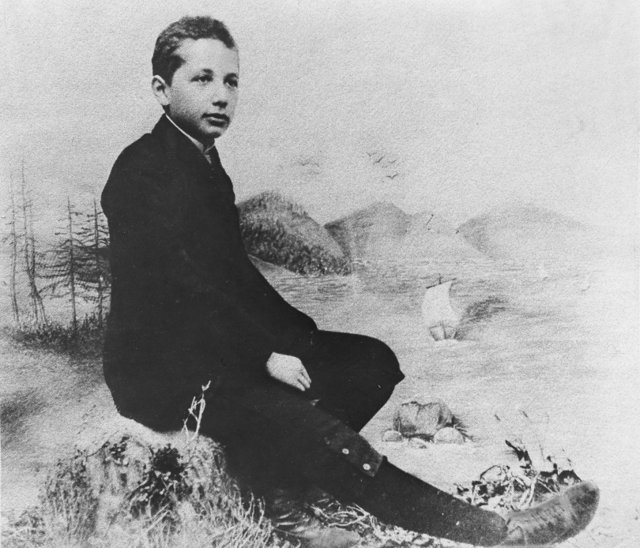
父親與叔叔的電氣公司因無法與大公司競爭而在1894年關閉，全家遷到義大利米蘭（維基百科作帕維亞一帶），只有愛因斯坦留在慕尼黑完成學業。他對德國學校嚴格、軍事化的教育感到不適應。

## 1895 | 報考蘇黎世聯邦理工學院
十六歲的愛因斯坦比一般考生小至少兩歲，在數學與物理上表現優異，其他科目不足，沒有通過入學考試，校方建議他先完成中學。他進入瑞士阿勞州立學校（1895–1896年），那裡重視獨立思考。他在這裡想到一個思想實驗：如果追著一束光跑，會看到什麼？這類問題後來與狹義相對論的形成有關。

## 1896 | 放棄德國國籍，進入蘇黎世聯邦理工學院

愛因斯坦取得阿勞州立學校的畢業資格，放棄德國國籍，一度成為無國籍的人，同年進入蘇黎世聯邦理工學院的數學與物理師範課程。他在那裡讀赫茲與馬克士威的電磁學，遇到馬塞爾·格羅斯曼，也與同學米列娃·馬利奇交往。1899年前後他開始懷疑「以太」，思考是否要重新檢討時間、空間與運動的基本概念。

## 1900 | 大學畢業
愛因斯坦完成學業，取得教師資格，平均分數4.9，在全班五人中排第四。畢業後他沒能留校當助教，接下來兩年都找不到教職。同年，他在《物理年鑑》發表第一篇論文（關於毛細現象），但基本猜想並不正確，對物理的發展沒有實質貢獻。1901年他取得瑞士國籍，因健康原因沒有被徵召入伍。

## 1902 | 進入伯恩專利局
在格羅斯曼的父親協助下，愛因斯坦進入瑞士伯恩的聯邦專利局，任技術專家第三級（助理鑑定員），審查電磁等領域的專利申請，1903年成為正式職員。這份穩定的工作讓他得以在業餘時間研究理論物理。同年，他的父親赫爾曼去世。

## 1903-01 | 與米列娃結婚
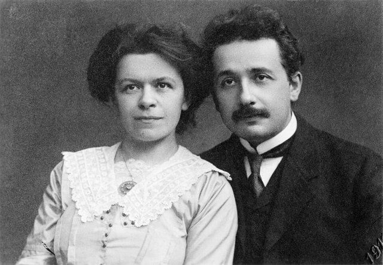
愛因斯坦與米列娃·馬利奇結婚，1904年5月長子漢斯·阿爾伯特出生，1910年次子愛德華出生。1987年發現的信件顯示，兩人婚前在1902年初曾有一個女兒莉澤爾，後來的下落不明。他持續研究熱力學、分子運動與光的性質。

## 1905-03 | 光量子假說
愛因斯坦發表《關於光的產生和轉化的一個啟發性觀點》，提出光除了波動性，也可以表現為一份一份的能量量子，光子的能量與頻率成正比，用以解釋光電效應。這項理論為量子物理奠定了基礎，他後來獲得諾貝爾物理學獎也是因為這項成果。光量子假說到1919年前後才被廣泛接受。

## 1905-04 | 博士論文
愛因斯坦以《分子大小的新測定法》取得蘇黎世大學的博士學位（1905年），以分子運動理論估算分子的大小。

## 1905-05 | 布朗運動
愛因斯坦發表論文，用分子運動論解釋液體中的微小懸浮粒子為何不規則運動：粒子受到液體分子不斷的碰撞。這項研究為原子與分子的真實存在提供了有力的理論證據，也為統計物理與分子科學奠定基礎。

## 1905-06 | 狹義相對論
愛因斯坦發表《論動體的電動力學》，提出狹義相對論，建立在相對性原理（所有慣性參考系中的物理定律形式相同）與光速不變原理（真空中的光速對所有慣性觀察者都相同）上，帶來時間膨脹、長度收縮與同時性的相對性，徹底改變牛頓以來絕對時間與絕對空間的觀念。

## 1905-09 | 質能等價
愛因斯坦發表補充論文《物體的慣性是否與其所含能量有關？》，指出物體的質量與能量等價，即著名的E＝mc²。光速的平方非常巨大，所以少量質量就相當於巨大的能量。這個公式成為核物理與現代物理學的基礎，但並不代表他在1905年就發明了原子彈。
1905年的四篇論文分別在量子物理、統計物理、相對論與質能關係四個領域有所突破，使二十六歲的專利局職員逐漸成為國際物理學界的重要人物，這一年被稱為「奇蹟之年」。

## 1906 | 升任專利局技術專家第二級
愛因斯坦在專利局升任技術專家第二級，開始受到歐洲物理學界更多關注。同年他的論文《普朗克的輻射理論和比熱容理論》提出描述固體比熱的「愛因斯坦模型」。

## 1907 | 等效原理
愛因斯坦開始思考重力與加速度的關係，他後來稱這是自己「一生中最幸福的思想」：在局部實驗中，均勻重力場與適當加速的參考系可以產生相同的物理效果，即等效原理，成為廣義相對論的重要基礎。

## 1908 | 伯恩大學講師
愛因斯坦被公認為物理學領域的頂尖學者，伯恩大學聘他為講師，但薪水微薄，仍需留在專利局工作。

## 1909 | 蘇黎世大學副教授
愛因斯坦離開專利局，出任蘇黎世大學的理論物理副教授，並在德國自然科學家大會上發表演講，闡述光量子的動量與光的波粒二象性，逐漸獲得國際物理學界的重視。

## 1911 | 前往布拉格
愛因斯坦轉任布拉格德語查理大學的教授，同時成為奧匈帝國公民。他提出光線經過大質量天體附近時會因重力而偏折，這個預測後來成為廣義相對論的重要觀測檢驗。

## 1912 | 返回蘇黎世聯邦理工學院
愛因斯坦回到母校，擔任理論物理教授，與好友格羅斯曼合作，格羅斯曼協助他學習黎曼幾何與張量分析，這些數學工具成為廣義相對論的基礎。1913年兩人發表《廣義相對論和引力理論綱要》，愛因斯坦逐漸認識到重力可能不是普通的力，而是與時空的幾何結構有關。

## 1914 | 前往柏林
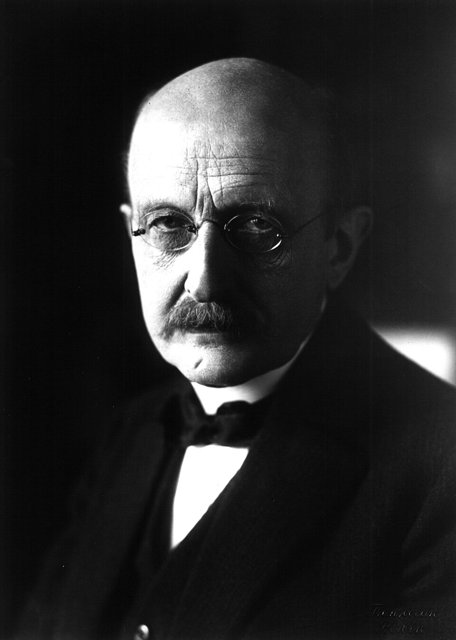
應普朗克與能斯特的邀請，愛因斯坦出任柏林大學教授與普魯士科學院院士，並擔任新成立的威廉皇家物理研究所第一任所長（1914–1932年），不用承擔一般的教學。同年第一次世界大戰爆發，他對民族主義與戰爭抱持批判的態度，與部分德國知識分子的立場不同。1916年他當選德國物理學會會長（任期到1918年）。

## 1915-11-25 | 完成廣義相對論
經過多次修正，愛因斯坦在1915年11月向普魯士科學院連續提出四篇論文，11月25日提出廣義相對論的場方程式。核心思想是：物質與能量會使時空彎曲，物體則沿著彎曲時空中的自然路徑運動；也就是「物質告訴時空如何彎曲，時空告訴物質如何運動」。新理論還成功解釋了水星近日點進動中牛頓力學無法說明的差異。

## 1916 | 發表廣義相對論的完整論述
愛因斯坦發表廣義相對論的系統性論文，並預言重力波的存在。1974年赫爾斯與泰勒發現的脈衝雙星提供了重力波的間接證據，2016年2月11日，在預言發表整整一百年後，LIGO團隊宣布首次直接探測到來自雙黑洞合併的重力波。

## 1917 | 宇宙學模型與受激輻射
愛因斯坦把廣義相對論應用到整個宇宙，當時他傾向認為宇宙在大尺度上是靜態的，為了讓理論符合這個假設，在方程式中引入宇宙學常數；後來1929年哈伯確定宇宙正在膨脹，宇宙學理論因此出現重大變化。同年他在《論輻射的量子性》中提出受激輻射理論，開創了雷射的研究領域。

## 1919-05-29 | 日食觀測驗證光線偏折
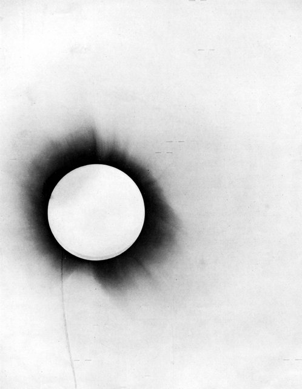
英國天文學家愛丁頓等人組織觀測隊，利用1919年5月29日的日全食，分別在非洲西岸的普林西比島與巴西的索布拉爾，比較太陽附近背景恆星的位置，結果支持廣義相對論預測的光線偏折。同年11月，英國皇家學會與皇家天文學會公布成果，英美媒體大量報導，愛因斯坦成為世界級的科學偶像。不過，從現代科學史來看，1919年的觀測不是廣義相對論唯一或最終的證據，後來更多精密的實驗與觀測才進一步檢驗它。
這一年，他與米列娃在2月14日離婚，6月2日與表親艾爾莎結婚。

## 1920 | 反相對論運動
愛因斯坦成為國際知名人物，在歐洲各地演講，但他的相對論也受到部分科學家與社會人士的質疑，德國國內出現帶有民族主義與反猶色彩的反相對論運動，他公開反駁，堅持用數學與實驗證據判斷科學理論。

## 1922 | 諾貝爾獎與亞洲之行
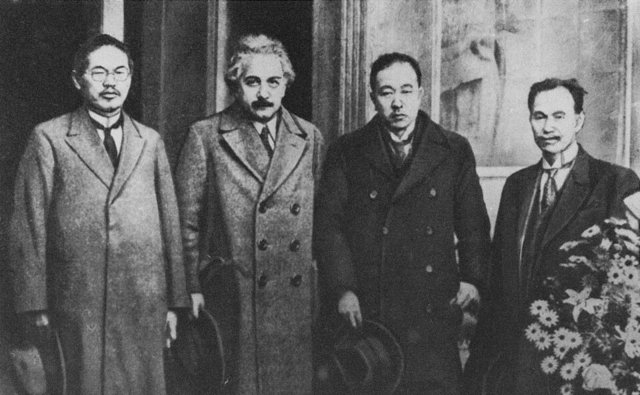
瑞典皇家科學院在1922年宣布，把保留的1921年諾貝爾物理學獎授予愛因斯坦，表彰他「對理論物理的貢獻，特別是發現光電效應定律」，並沒有直接以仍有爭議的相對論作為理由。他當時正前往日本演講與訪問，途經新加坡、香港與上海，沒有出席12月的頒獎典禮。他的旅行日記中有對亞洲人與中國人的偏見言論，這與他後來投入反種族主義的立場形成反差。

## 1924 | 玻色—愛因斯坦統計
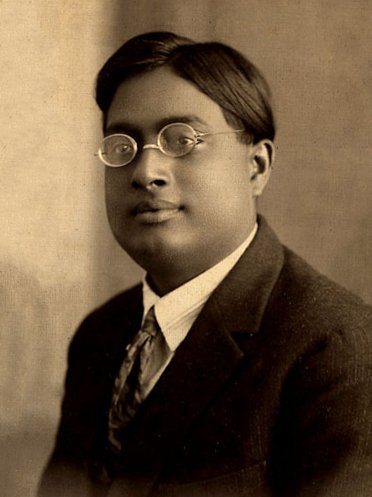
印度物理學家玻色把關於光子統計的論文寄給愛因斯坦，愛因斯坦認同其價值，將它譯成德文並協助發表，並把這套統計方法推廣到有質量的粒子，發表《單原子理想氣體的量子理論》。1925年他又預測：當玻色子冷卻到極低溫時，大量粒子會聚集到同一個最低的量子態，形成新的物態，也就是「玻色—愛因斯坦凝聚」。直到1995年，康奈爾與威曼才在實驗室中以銣原子氣體首次觀測到。

## 1927 | 與波耳論辯量子力學
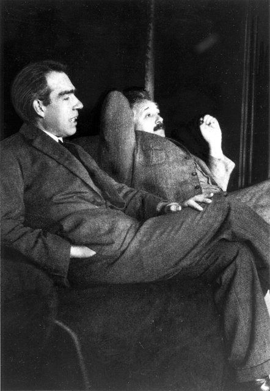
量子力學在1920年代中期逐漸形成完整的數學體系：海森堡的矩陣力學、薛丁格的波動力學，以及波恩對波函數的機率詮釋。愛因斯坦承認它的預測能力，卻不接受機率的詮釋。在1927年的第五屆索爾維會議上，他與丹麥物理學家波耳就量子力學的物理意義展開辯論，質疑它能否提供完整的描述；他不認同自然界有根本的隨機性，這被概括為「上帝不擲骰子」，波耳則為哥本哈根詮釋辯護。1930年兩人在索爾維會議上繼續論辯，愛因斯坦提出思想實驗，波耳逐一回應。

## 1929 | 五十歲生日
愛因斯坦的五十歲生日受到國際社會關注，他已是世界上最知名的科學家之一，除了研究統一重力與電磁力的統一場論（始終沒有取得與相對論同等的成功），也參與和平、教育與社會議題。1931年他往返歐洲與美國，訪問加州理工學院。

## 1932 | 納粹的威脅
納粹黨的勢力快速擴張，愛因斯坦因猶太背景與公開反對軍國主義，成為極端民族主義者攻擊的對象，開始認真考慮離開德國。

## 1933 | 希特勒上台，離開德國
1月30日，希特勒出任德國總理。愛因斯坦當時在美國訪問，決定不再返回德國，辭去普魯士科學院的職務，放棄德國國籍，接受普林斯頓高等研究院的邀請，在普林斯頓度過生命中最後的二十二年。他也長期為猶太難民與流亡學者奔走，建議美國政府向想逃離歐洲的猶太人頒發簽證。

## 1935 | EPR悖論
愛因斯坦與波多爾斯基、羅森發表《能否認為量子力學對物理實在的描述是完整的？》，提出思想實驗：兩個相隔遙遠的粒子仍可能呈現彼此相關的性質；如果測量其中一個會立刻影響另一個，是否代表某種超越距離的作用？他認為完整的物理理論應該具有局域性與實在性，並以「幽靈般的超距作用」形容自己不認同的量子現象。這篇論文成為量子糾纏研究的起點，後來貝爾提出貝爾不等式，1982年阿斯佩的實驗顯示局域實在論與量子力學的預測不符。

## 1936 | 艾爾莎去世
第二任妻子艾爾莎在1936年去世，愛因斯坦此後繼續在普林斯頓從事研究，繼女瑪戈（及後來來訪的妹妹馬婭）是他晚年身邊的親人。

## 1939-08 | 致函羅斯福
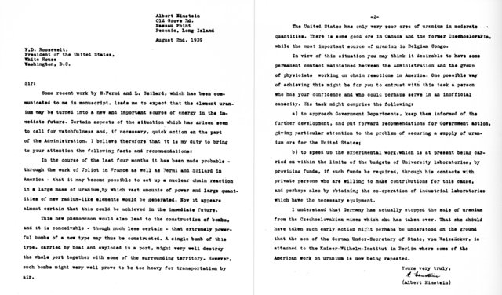
1939年哈恩與施特拉斯曼的實驗為核裂變研究帶來突破，流亡美國的物理學家西拉德、泰勒、維格納等人擔心納粹德國發展核武，促成愛因斯坦在8月簽署致羅斯福總統的信，提醒鈾的核裂變可能產生巨大的能量與新型武器，美國應重視相關研究。這封信使美國政府更加重視核研究，但愛因斯坦並沒有參與後來的曼哈頓計畫。

## 1940 | 取得美國國籍
愛因斯坦正式成為美國公民，同時保有瑞士國籍：出生於德國、曾取得瑞士國籍，最後成為美國人。1944年他重新抄寫1905年的狹義相對論論文，手稿被用於慈善募款。

## 1945 | 原子彈與戰爭結束
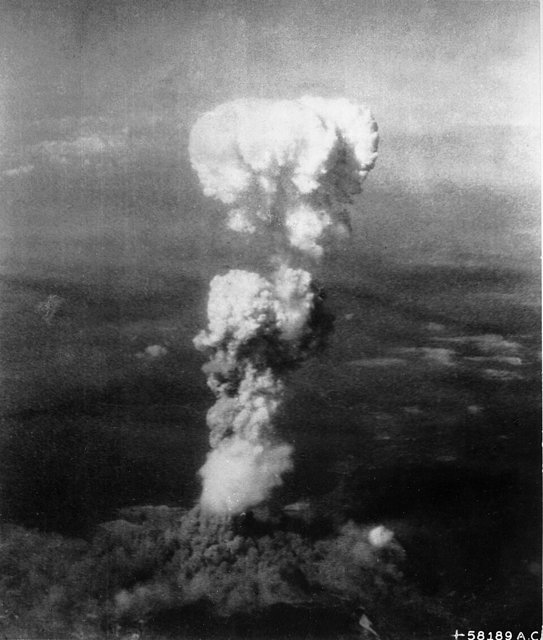
8月美國在廣島與長崎投下原子彈，9月2日日本簽署投降書，第二次世界大戰結束。愛因斯坦對核武器造成的大規模破壞感到憂慮，他雖然因1939年的信與核武器的歷史有所關聯，卻並未參與原子彈的研發。戰後他更加積極主張國際合作與核武管制。

## 1946 | 原子科學家緊急委員會
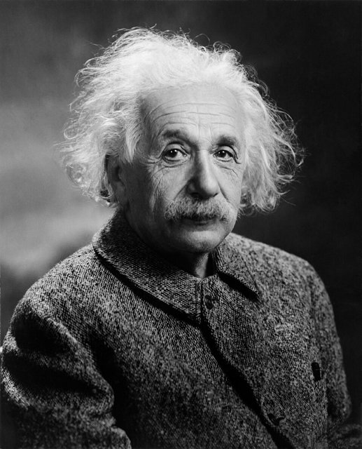
愛因斯坦參與原子科學家緊急委員會，由科學家推動，目的是讓公眾了解核武器的危險，並呼籲各國建立有效的國際合作機制。1947年他公開支持更有效的國際治理制度，倡議世界政府，認為單靠各國彼此競爭，無法解決核武器帶來的全球威脅。

## 1952 | 婉拒以色列總統
以色列總統魏茨曼去世後，以色列政府曾邀請愛因斯坦出任第二任總統，他以自己缺乏從事政治領導工作的經驗與能力為由婉拒。他與猶太民族及以色列建國運動有深厚的關係，卻更願意以學者的身分參與公共事務。1953年他持續公開反對核武競賽，關心美蘇之間的冷戰。

## 1955-04-11 | 《羅素—愛因斯坦宣言》
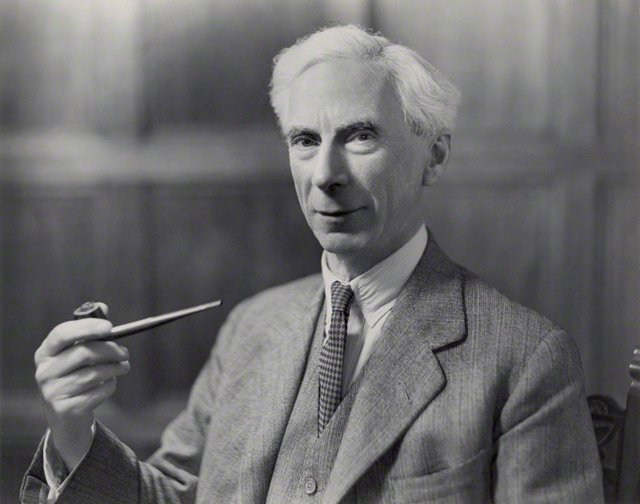
英國哲學家羅素呼籲科學家共同警告人類核戰爭的危險，愛因斯坦在逝世前一週簽署了《羅素—愛因斯坦宣言》，呼籲各國正視核武器對人類文明的威脅，必須學會以和平方式解決國際爭端。宣言在他去世後的7月公開，並促成1957年的第一次帕格沃什科學與世界事務會議。

## 1955-04-18 | 逝世於普林斯頓
愛因斯坦在4月13日腹主動脈瘤破裂內出血，生前拒絕可能延長生命的手術，4月18日在新澤西州普林斯頓逝世，享年76歲，遺體依安排火化，骨灰撒在沒有公開的地點。他的理論持續影響現代物理學、天文學、宇宙學與科技的發展。
從牛頓到愛因斯坦，人類對宇宙的理解經歷了兩次重大的飛躍：牛頓把天上與地上的運動統一在力學之下，愛因斯坦則把時間、空間與重力重新理解為時空的幾何。
