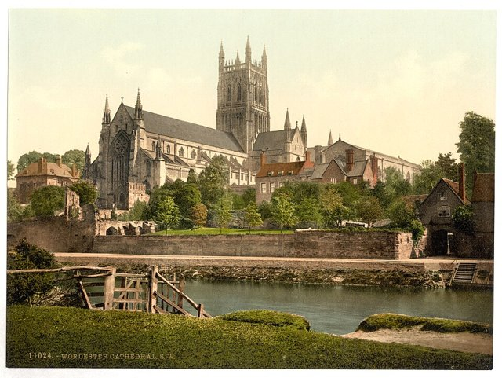
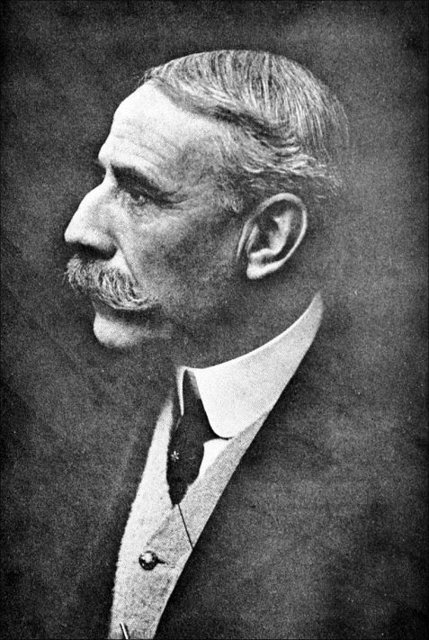
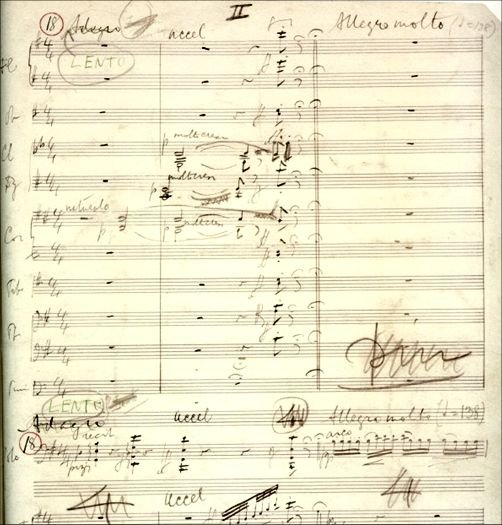

<!--
內容整理自本機筆記〈艾爾加（Edward Elgar）生平大事記〉（D:\Books\md\音樂\艾爾加（Edward Elgar）生平大事記.md），以自己的話改寫。
時期依筆記第一節的生平階段歸納為五段。
處理方式：
- 筆記第一節（階段概述）與第二節（詳細年表）重疊，事件以第二節為準，第一節的內容補進時期說明與相關事件。
- 1860年代、1870年代等約略年代的事件，日期以區間呈現。
- 第三號交響曲由安東尼·佩恩依草稿補完一事，寫進最後一則事件。
圖片來源（皆為 Wikimedia Commons 公有領域作品）：
- elgar-cover.jpg：Edward Elgar.jpg（艾爾加像）
- elgar-worcester.jpg：Cathedral, S. W., Worcester, England-LCCN2002708274.jpg（伍斯特主教座堂，1890年代的彩色照相版）
- elgar-enigma.jpg：Enigma theme.png（《謎語變奏曲》的主題）
- elgar-gerontius.jpg：Edward Elgar - Last page of Gerontius score with quotation.jpg（《傑隆修斯之夢》總譜的最後一頁，艾爾加在上面抄錄了羅斯金的話）
- elgar-pomp.jpg：Land of Hope and Glory by Elgar song cover 1902.jpg（〈希望與榮耀的國土〉樂譜封面，1902）
- elgar-falstaff.jpg：Elgar- Falstaff theme.jpg（《法斯塔夫》的主題）
- elgar-1917.jpg：Edward Elgar 1917.jpg（艾爾加，1917）
- elgar-cello.jpg：Elgar-cello-concerto-manuscript.jpg（大提琴協奏曲手稿）
-->

# Periods
- 1857 ~ 1888 | 自學的地方音樂家@伍斯特 | #868e96
  生在伍斯特郡經營樂器與樂譜店的家庭，沒有機會到萊比錫深造，靠讀譜、研究理論與參與演奏自學；在地方上當小提琴手、指揮與音樂老師，慢慢累積作曲經驗。
- 1889 ~ 1898 | 婚姻與逐漸受到注意 | #1971c2
  娶了支持他創作的愛麗絲·羅伯茨，寫出《弗羅伊薩特》、弦樂小夜曲與大型合唱作品，逐漸受到英國樂界注意，但光靠作曲仍難以維生。
- 1899 ~ 1913 | 成名與創作巔峰 | #c92a2a
  《謎語變奏曲》讓年過四十的他一舉成名，接著是《傑隆修斯之夢》、《威風凜凜進行曲》、兩首交響曲、小提琴協奏曲與《法斯塔夫》，並受封爵士，成為英國最具代表性的作曲家。
- 1914 ~ 1920 | 戰爭與晚期室內樂 | #e8590c
  第一次世界大戰的陰影讓他的音樂轉向內省與憂鬱，寫下小提琴奏鳴曲、鋼琴五重奏與大提琴協奏曲；1920年愛麗絲去世，他大受打擊。
- 1921 ~ 1934 | 晚年與錄音 | #495057
  大型創作明顯減少，但持續指揮並錄製自己的作品；受任王室音樂大師、封世襲男爵，晚年著手的第三號交響曲與歌劇都未能完成。

# Events

## 1857-06-02 | 出生@下布羅德希斯

生於英格蘭伍斯特附近的下布羅德希斯。父親在伍斯特經營樂器與樂譜店，也替人調音、在教堂演奏，他從小就在樂器與樂譜之間長大。

## 1860 ~ 1869 | 音樂啟蒙 {label=1860年代}
開始接觸鋼琴、小提琴與樂譜，並嘗試作曲，很早就對音樂表現出濃厚興趣。

## 1870 ~ 1879 | 自學音樂 {label=1870年代}
離開正規學校後，他沒能到德國萊比錫深造，只能靠閱讀樂譜、研究理論與參加地方樂團演奏自學。1870年代末起，他在地方上擔任小提琴手、樂團指揮與音樂老師，逐步建立人脈與聲譽。

## 1882 | 加入伯明罕的管弦樂團
加入伯明罕的地方管弦樂團，更深入接觸管弦樂團的演奏與指揮實務。

## 1884 | 《塞維利亞》演出
早期管弦樂作品《塞維利亞》獲得演出。

## 1888 | 《愛的致意》
寫下小提琴與鋼琴曲《愛的致意》，成為他最廣為人知的抒情小品之一。

## 1889 | 與愛麗絲結婚
與愛麗絲·羅伯茨結婚。她長期支持艾爾加的作曲事業，在他早年發展中扮演重要角色。兩人曾嘗試在倫敦發展，後來又回到伍斯特郡一帶。

## 1890 | 序曲《弗羅伊薩特》
管弦樂序曲《弗羅伊薩特》獲得重要的演出機會，他開始受到英國樂界注意。

## 1893 | 《E小調弦樂小夜曲》
寫成《E小調弦樂小夜曲》，展現他優美細膩的弦樂寫作。

## 1896 | 神劇《生命之光》
神劇《生命之光》等大型合唱作品陸續問世，他逐漸建立英國合唱音樂作曲家的聲譽，但要靠作曲維生仍不容易。

## 1899 | 《謎語變奏曲》首演

1898年至1899年間寫成的《謎語變奏曲》首演大獲成功。作品以一個主題發展出一連串變奏，每段描繪他身邊的一位朋友，其中的〈寧錄〉尤其動人。年過四十的艾爾加終於得到長期追求的認可，成為英國樂壇的重要人物。同年的聲樂套曲《海之畫》，為女低音與管弦樂團寫下海洋的意象。

## 1900 | 《傑隆修斯之夢》首演

根據約翰·亨利·紐曼的宗教詩作寫成的神劇《傑隆修斯之夢》首演，初演反應不佳，後來卻逐漸被肯定，成為英國宗教音樂的重要里程碑。

## 1901 | 《威風凜凜進行曲》第一、二號

《威風凜凜進行曲》第一、第二號問世。第一號的中段旋律後來配上歌詞〈希望與榮耀的國土〉，成為英國典禮音樂的代表旋律。

## 1902 | 《加冕頌》
為愛德華七世加冕寫作《加冕頌》，他已逐漸成為英國重要的官方典禮作曲家。

## 1903 | 神劇《眾使徒》
完成神劇《眾使徒》，延續他的大型宗教合唱創作。

## 1904 | 受封爵士
受封爵士，音樂成就得到英國官方肯定。

## 1905 | 《弦樂引子與快板》
寫成《弦樂引子與快板》，兼具抒情旋律、複雜對位與宏偉音響，展現成熟的弦樂技巧。

## 1906 | 神劇《天國》
完成神劇《天國》，是他大型宗教音樂的重要成果。

## 1908 | 第一號交響曲首演
降A大調第一號交響曲首演，氣勢宏大、旋律綿長，大獲成功，確立他國際級交響曲作曲家的地位。

## 1909 | 《弦樂輓歌》
寫下情緒沉靜的《弦樂輓歌》，展現他有別於典禮音樂的內省面貌。

## 1910 | 小提琴協奏曲首演
B小調小提琴協奏曲首演，篇幅龐大，既要求高超技巧，也重視獨奏者的情感表達，是20世紀初重要的小提琴協奏曲之一。

## 1911 | 第二號交響曲首演
降E大調第二號交響曲首演，比第一號更個人化、更內省，英雄氣概中夾雜著不安。

## 1913 | 交響研究曲《法斯塔夫》

以莎士比亞筆下的胖騎士為題的交響研究曲《法斯塔夫》問世，展現他以管弦樂敘事的功力。

## 1914 ~ 1918 | 第一次世界大戰

戰爭的沉重氛圍讓他的創作量減少，音樂也透出更深的內省與憂鬱；《英格蘭精神》等作品反映戰爭與民族情感。

## 1918 | 小提琴奏鳴曲
寫下小提琴奏鳴曲，是他晚期室內樂的重要作品，情緒沉思內斂。

## 1919 | 鋼琴五重奏與大提琴協奏曲

寫成鋼琴五重奏與E小調大提琴協奏曲。大提琴協奏曲深沉、哀傷而富歌唱性，後來被視為他最動人的晚期傑作。

## 1920 | 愛麗絲去世
妻子愛麗絲去世，艾爾加深受打擊，此後大型創作明顯減少。1920年代他仍持續指揮，並錄製自己的作品，留下珍貴的錄音紀錄。

## 1924 | 王室音樂大師
受任為英國王室音樂大師，反映他在英國音樂界的崇高地位。

## 1931 | 受封世襲男爵
受封世襲男爵，是英國音樂家獲得重要社會榮譽的代表之一。

## 1932 ~ 1934 | 第三號交響曲
晚年開始構思第三號交響曲，也著手歌劇《西班牙女士》，兩項計畫都未能完成。第三號交響曲後來由作曲家安東尼·佩恩依草稿整理成可演奏的版本。

## 1934-02-23 | 逝世@伍斯特
在伍斯特去世，享年76歲。他沒有受過完整的音樂學院訓練，也沒有很早就成名，卻靠長年的自學、創作與演奏，以交響曲、協奏曲與神劇證明英國作曲家也能寫出國際水準的浪漫派作品。
