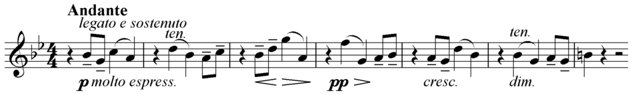
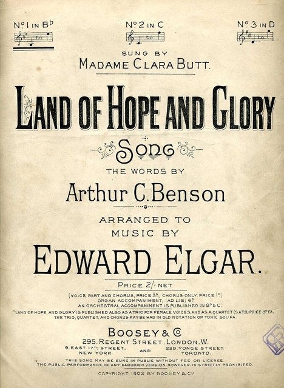
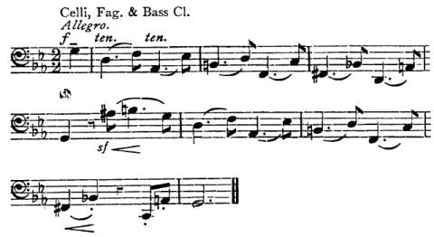
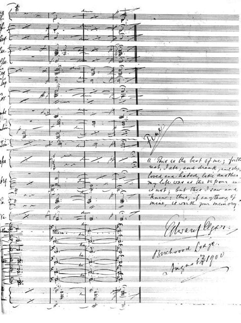

<!--
內容整理自本機筆記〈艾爾加（Edward Elgar）主要作品〉（D:\Books\md\音樂\艾爾加（Edward Elgar）主要作品.md；知識圖譜的「5-2-1.音樂家作品」尚無這份筆記的網頁版），做法比照「貝多芬主要作品」。
- 每首作品一則事件，日期採「創作時間」（多年創作的作品以區間呈現；「年代」以十年計、「世紀」以百年計，修訂或出版年份只寫在顯示文字裡），事件顏色依筆記的類別段落區分：管弦樂作品、交響曲與協奏曲、神劇、清唱劇與大型合唱作品、室內樂作品、歌曲與合唱小品、舞台音樂與其他重要作品。
- 「約」、「前後」、修訂、出版等不是單純年份的寫法，以原文作為顯示文字。
- 作品編號是目錄編號，不等於創作順序，時間軸依創作時間排序；筆記中只是表格序號的「編號」欄不列為作品編號。
- 筆記的推薦清單、依年代整理的總覽與編號說明，和前面的作品表重複，未另立事件。
- 時期沿用「艾爾加生平」時間軸的主要時期（重疊的細分時期不列）。
- 筆記推薦清單中的作品另註明順序。
- 沒有年份、無法放上時間軸的條目未收錄：《總是與處處》（Always and Everywhere）（早期作品）。
- 以 follows 排在「艾爾加生平」之後；生平事件見該時間軸。
圖片來源（皆為 Wikimedia Commons 公有領域／CC0 作品，沿用生平時間軸的圖片）：
- elgar-cover.jpg：Edward Elgar.jpg（艾爾加像）（與艾爾加生平共用）
- elgar-enigma.jpg：Enigma theme.png（《謎語變奏曲》的主題）（與艾爾加生平共用）
- elgar-pomp.jpg：Land of Hope and Glory by Elgar song cover 1902.jpg（〈希望與榮耀的國土〉樂譜封面，1902）（與艾爾加生平共用）
- elgar-falstaff.jpg：Elgar- Falstaff theme.jpg（《法斯塔夫》的主題）（與艾爾加生平共用）
- elgar-gerontius.jpg：Edward Elgar - Last page of Gerontius score with quotation.jpg（《傑隆修斯之夢》總譜的最後一頁，艾爾加在上面抄錄了羅斯金的話）（與艾爾加生平共用）
-->

# Periods
- 1857 ~ 1888 | 自學的地方音樂家@伍斯特 | #868e96
  生在伍斯特郡經營樂器與樂譜店的家庭，沒有機會到萊比錫深造，靠讀譜、研究理論與參與演奏自學；在地方上當小提琴手、指揮與音樂老師，慢慢累積作曲經驗。
- 1889 ~ 1898 | 婚姻與逐漸受到注意 | #1971c2
  娶了支持他創作的愛麗絲·羅伯茨，寫出《弗羅伊薩特》、弦樂小夜曲與大型合唱作品，逐漸受到英國樂界注意，但光靠作曲仍難以維生。
- 1899 ~ 1913 | 成名與創作巔峰 | #c92a2a
  《謎語變奏曲》讓年過四十的他一舉成名，接著是《傑隆修斯之夢》、《威風凜凜進行曲》、兩首交響曲、小提琴協奏曲與《法斯塔夫》，並受封爵士，成為英國最具代表性的作曲家。
- 1914 ~ 1920 | 戰爭與晚期室內樂 | #e8590c
  第一次世界大戰的陰影讓他的音樂轉向內省與憂鬱，寫下小提琴奏鳴曲、鋼琴五重奏與大提琴協奏曲；1920年愛麗絲去世，他大受打擊。
- 1921 ~ 1934 | 晚年與錄音 | #495057
  大型創作明顯減少，但持續指揮並錄製自己的作品；受任王室音樂大師、封世襲男爵，晚年著手的第三號交響曲與歌劇都未能完成。

# Events

## 1867 ~ 1871 | 《青春之杖》組曲第一號素材（The Wand of Youth, Suite No. 1） {color=#c92a2a label="1867–1871；1907修訂配器"}
類別：管弦樂組曲（管弦樂作品）。

## 1867 ~ 1871 | 《青春之杖》組曲第二號素材（The Wand of Youth, Suite No. 2） {color=#c92a2a label="1867–1871；1908修訂配器"}
類別：管弦樂組曲（管弦樂作品）。

## 1884 | Op. 7 《塞維利亞》（Sevillana） {color=#c92a2a label="1884；1889修訂"}
類別：管弦樂小品（管弦樂作品）。

## 1890 | Op. 19 《弗羅伊薩特》（Froissart） {color=#c92a2a}
類別：音樂會序曲（管弦樂作品）。

## 1888 ~ 1892 | Op. 20 《E小調弦樂小夜曲》（Serenade for Strings in E minor） {color=#c92a2a label="1888–1892；後修訂"}
類別：弦樂合奏（管弦樂作品）。

## 1899 | Op. 21 《小步舞曲》（Minuet） {color=#c92a2a label="1899年改編版本"}
類別：管弦樂／改編曲（管弦樂作品）。

## 1897 | Op. 27a 《巴伐利亞舞曲》（Three Bavarian Dances） {color=#c92a2a}
類別：管弦樂舞曲（管弦樂作品）。

## 1897 | Op. 32 《帝國進行曲》（Imperial March） {color=#c92a2a}
類別：管弦樂進行曲（管弦樂作品）。

## 1898 ~ 1899 | Op. 36 《謎語變奏曲》（Variations on an Original Theme, “Enigma”） {color=#c92a2a}

類別：管弦樂變奏曲（管弦樂作品）。入門推薦聆聽第 2 首。

## 1901 ~ 1939 | Op. 39 《威風凜凜進行曲》（Pomp and Circumstance Marches） {color=#c92a2a label="1901–1930年代初"}

類別：管弦樂進行曲組曲（管弦樂作品）。入門推薦聆聽第 5 首。

## 1900 ~ 1901 | Op. 40 《倫敦城》（Cockaigne: In London Town） {color=#c92a2a}
類別：音樂會序曲（管弦樂作品）。入門推薦聆聽第 6 首。

## 1902 | Op. 42 《格拉妮亞與迪亞米德》葬禮進行曲（Grania and Diarmid） {color=#c92a2a}
類別：戲劇配樂／管弦樂（管弦樂作品）。

## 1902 | Op. 43 《夢中孩童》（Dream Children） {color=#c92a2a}
類別：管弦樂雙曲（管弦樂作品）。

## 1904 ~ 1905 | Op. 47 《引子與快板》（Introduction and Allegro） {color=#c92a2a}
類別：弦樂合奏（管弦樂作品）。入門推薦聆聽第 7 首。

## 1903 ~ 1904 | Op. 50 《南方》（In the South: Alassio） {color=#c92a2a}
類別：音樂會序曲（管弦樂作品）。

## 1909 | Op. 58 《弦樂輓歌》（Elegy for Strings） {color=#c92a2a}
類別：弦樂合奏（管弦樂作品）。

## 1913 | Op. 68 《法斯塔夫》（Falstaff） {color=#c92a2a}

類別：交響研究曲（管弦樂作品）。入門推薦聆聽第 11 首。

## 1885 | 《蘇格蘭序曲》（Scottish Overture） {color=#c92a2a}
類別：管弦樂序曲（管弦樂作品）。

## 1888 | 《三首弦樂小品》（Three Pieces for String Orchestra） {color=#c92a2a}
類別：弦樂合奏（管弦樂作品）。

## 1915 | 《玫瑰花》（Rosemary） {color=#c92a2a label="1915；另有早期版本"}
類別：抒情小品（管弦樂作品）。

## 1930 ~ 1931 | 《育兒組曲》（Nursery Suite） {color=#c92a2a}
類別：管弦樂組曲（管弦樂作品）。

## 1878 | 《交響曲》（早期未完成作品） {color=#1971c2 label="約1878"}
類別：交響曲草稿（交響曲與協奏曲）。

## 1907 ~ 1908 | Op. 55 第一號交響曲，降A大調（Symphony No. 1 in A-flat major） {color=#1971c2}
類別：交響曲（交響曲與協奏曲）。入門推薦聆聽第 8 首。

## 1909 ~ 1911 | Op. 63 第二號交響曲，降E大調（Symphony No. 2 in E-flat major） {color=#1971c2}
類別：交響曲（交響曲與協奏曲）。入門推薦聆聽第 10 首。

## 1932 ~ 1934 | 第三號交響曲（Symphony No. 3） {color=#1971c2 label="1932–1934，未完成"}
類別：交響曲草稿；後由安東尼・佩恩整理演奏版本（交響曲與協奏曲）。

## 1909 ~ 1910 | Op. 61 B小調小提琴協奏曲（Violin Concerto in B minor） {color=#1971c2}
類別：小提琴協奏曲（交響曲與協奏曲）。入門推薦聆聽第 9 首。

## 1919 | Op. 85 E小調大提琴協奏曲（Cello Concerto in E minor） {color=#1971c2}
類別：大提琴協奏曲（交響曲與協奏曲）。入門推薦聆聽第 12 首。

## 1901 | Op. 41 鋼琴協奏曲（Concert Allegro） {color=#1971c2 label="1901，未完成／未正式完成為協奏曲"}
類別：鋼琴獨奏作品草稿（交響曲與協奏曲）。

## 1890 | 小提琴協奏曲早期草稿 {color=#1971c2 label="約1890，未完成"}
類別：小提琴協奏曲草稿（交響曲與協奏曲）。

## 1889 ~ 1892 | Op. 25 《黑騎士》（The Black Knight） {color=#e67700}
類別：合唱交響曲／清唱劇（神劇、清唱劇與大型合唱作品）。

## 1895 ~ 1896 | Op. 27 《巴伐利亞高地》（From the Bavarian Highlands） {color=#e67700}
類別：合唱歌曲組曲（神劇、清唱劇與大型合唱作品）。

## 1896 | Op. 29 《生命之光》（The Light of Life／Lux Christi） {color=#e67700}
類別：神劇（神劇、清唱劇與大型合唱作品）。

## 1896 | Op. 30 《奧拉夫王傳奇場景》（Scenes from the Saga of King Olaf） {color=#e67700}
類別：清唱劇（神劇、清唱劇與大型合唱作品）。

## 1897 | Op. 33 《聖喬治旗》（The Banner of St. George） {color=#e67700}
類別：合唱與管弦樂敘事曲（神劇、清唱劇與大型合唱作品）。

## 1897 | Op. 34 《讚美頌與祝福頌》（Te Deum and Benedictus） {color=#e67700}
類別：宗教合唱作品（神劇、清唱劇與大型合唱作品）。

## 1897 ~ 1898 | Op. 35 《卡拉塔庫斯》（Caractacus） {color=#e67700}
類別：清唱劇（神劇、清唱劇與大型合唱作品）。

## 1897 ~ 1899 | Op. 37 《海之畫》（Sea Pictures） {color=#e67700}
類別：女低音與管弦樂歌曲套曲（神劇、清唱劇與大型合唱作品）。入門推薦聆聽第 3 首。

## 1899 ~ 1900 | Op. 38 《傑隆修斯之夢》（The Dream of Gerontius） {color=#e67700}

類別：神劇（神劇、清唱劇與大型合唱作品）。入門推薦聆聽第 4 首。

## 1901 ~ 1902 | Op. 44 《加冕頌》（Coronation Ode） {color=#e67700 label="1901–1902；1911修訂"}
類別：獨唱、合唱與管弦樂（神劇、清唱劇與大型合唱作品）。

## 1902 | Op. 45 《希臘選集五首合唱曲》（Five Part-Songs from the Greek Anthology） {color=#e67700}
類別：男聲合唱（神劇、清唱劇與大型合唱作品）。

## 1903 | Op. 49 《使徒》（The Apostles） {color=#e67700}
類別：神劇（神劇、清唱劇與大型合唱作品）。

## 1906 | Op. 51 《天國》（The Kingdom） {color=#e67700}
類別：神劇（神劇、清唱劇與大型合唱作品）。

## 1915 ~ 1917 | Op. 68以外的晚期合唱作品 《英格蘭精神》（The Spirit of England） {color=#e67700}
類別：合唱與管弦樂（神劇、清唱劇與大型合唱作品）。

## 1915 ~ 1917 | Op. 80 《英格蘭精神》（The Spirit of England） {color=#e67700}
類別：合唱與管弦樂（神劇、清唱劇與大型合唱作品）。

## 1878 | Op. 1 《浪漫曲》（Romance） {color=#2f9e44}
類別：小提琴與鋼琴（室內樂作品）。

## 1883 | Op. 4 《三首小品》（Three Pieces） {color=#2f9e44}
類別：小提琴與鋼琴（室內樂作品）。

## 1878 ~ 1881 | Op. 6 《木管五重奏曲》（Wind Quintets） {color=#2f9e44}
類別：木管室內樂（室內樂作品）。

## 1888 | Op. 12 《愛的致意》（Salut d’Amour） {color=#2f9e44}
類別：小提琴與鋼琴（室內樂作品）。入門推薦聆聽第 1 首。

## 1889 | Op. 13 《愛的話語》與《奇異曲》（Mot d’Amour; Bizarrerie） {color=#2f9e44}
類別：小提琴與鋼琴（室內樂作品）。

## 1897 ~ 1899 | Op. 15 《夜之歌》與《晨之歌》（Chanson de Nuit; Chanson de Matin） {color=#2f9e44}
類別：小提琴與鋼琴；另有管弦樂版本（室內樂作品）。

## 1891 | Op. 17 《任性的女子》（La Capricieuse） {color=#2f9e44}
類別：小提琴與鋼琴（室內樂作品）。

## 1888 ~ 1892 | Op. 20 《E小調弦樂小夜曲》（Serenade for Strings） {color=#2f9e44}
類別：弦樂合奏（室內樂作品）。

## 1892 | Op. 22 《小提琴初級練習曲》（Very Easy Melodious Exercises in the First Position） {color=#2f9e44}
類別：小提琴教學作品（室內樂作品）。

## 1892 | Op. 24 《特性練習曲》（Études caractéristiques） {color=#2f9e44}
類別：獨奏小提琴（室內樂作品）。

## 1895 | Op. 28 G大調第一號管風琴奏鳴曲（Organ Sonata No. 1 in G major） {color=#2f9e44}
類別：管風琴獨奏（室內樂作品）。

## 1918 | Op. 82 E小調小提琴奏鳴曲（Violin Sonata in E minor） {color=#2f9e44}
類別：小提琴與鋼琴（室內樂作品）。

## 1918 | Op. 83 E小調弦樂四重奏（String Quartet in E minor） {color=#2f9e44}
類別：弦樂四重奏（室內樂作品）。

## 1918 ~ 1919 | Op. 84 A小調鋼琴五重奏（Piano Quintet in A minor） {color=#2f9e44}
類別：鋼琴五重奏（室內樂作品）。

## 1877 | 《回憶》（Reminiscences） {color=#2f9e44}
類別：小提琴與鋼琴（室內樂作品）。

## 1886 | 《鋼琴三重奏》（Piano Trio） {color=#2f9e44 label="1886，片段"}
類別：室內樂草稿（室內樂作品）。

## 1887 | Op. 2 《三首經文歌》（Three Motets） {color=#862e9c}
類別：混聲合唱與管風琴（歌曲與合唱小品）。

## 1884 | Op. 5 《戰爭之歌》（A War Song） {color=#862e9c}
類別：男聲合唱（歌曲與合唱小品）。

## 1892 | Op. 16 《三首歌曲》（Three Songs） {color=#862e9c}
類別：獨唱與鋼琴（歌曲與合唱小品）。

## 1890 | Op. 18 《三首合唱曲》（Three Part-Songs） {color=#862e9c}
類別：合唱（歌曲與合唱小品）。

## 1891 ~ 1892 | Op. 23 《西班牙小夜曲》（Spanish Serenade） {color=#862e9c}
類別：合唱（歌曲與合唱小品）。

## 1894 | Op. 26 《雪》與《飛吧，歌唱的小鳥》（The Snow; Fly, Singing Bird） {color=#862e9c}
類別：合唱（歌曲與合唱小品）。

## 1895 | Op. 31 《往後》與《飛翔之歌》（After; A Song of Flight） {color=#862e9c}
類別：獨唱與鋼琴（歌曲與合唱小品）。

## 1901 | Op. 41 《黎明》與《歌唱吧，音樂》（In the Dawn; Speak, Music!） {color=#862e9c}
類別：獨唱與鋼琴（歌曲與合唱小品）。

## 1907 | Op. 53 《四首合唱曲》（Four Part-Songs） {color=#862e9c}
類別：合唱（歌曲與合唱小品）。

## 1907 | Op. 54 《起床號》（The Reveille） {color=#862e9c}
類別：合唱（歌曲與合唱小品）。

## 1872 | 《花語》（The Language of Flowers） {color=#862e9c label="約1872"}
類別：獨唱歌曲（歌曲與合唱小品）。

## 1902 | 《西風的疲憊》（Weary Wind of the West） {color=#862e9c label="約1902"}
類別：合唱歌曲（歌曲與合唱小品）。

## 1902 | Op. 42 《格拉妮亞與迪亞米德》（Grania and Diarmid） {color=#0c8599}
類別：戲劇配樂（舞台音樂與其他重要作品）。

## 1911 | Op. 66 《印度皇冠》（The Crown of India） {color=#0c8599}
類別：歌劇式場景／戲劇配樂（舞台音樂與其他重要作品）。

## 1915 ~ 1916 | Op. 78 《星光快車》（The Starlight Express） {color=#0c8599}
類別：舞台劇配樂（舞台音樂與其他重要作品）。

## 1917 | Op. 81 《風扇》（The Sanguine Fan） {color=#0c8599}
類別：芭蕾舞劇配樂（舞台音樂與其他重要作品）。

## 1928 | 《博·布魯梅爾》（Beau Brummel） {color=#0c8599}
類別：戲劇配樂（舞台音樂與其他重要作品）。

## 1930 ~ 1939 | 《西班牙女士》（The Spanish Lady） {color=#0c8599 label="1930年代，未完成"}
類別：歌劇草稿（舞台音樂與其他重要作品）。
