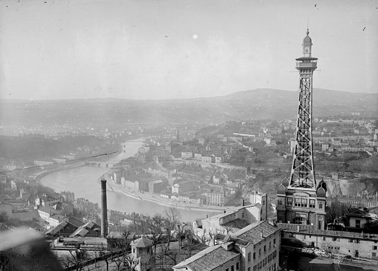
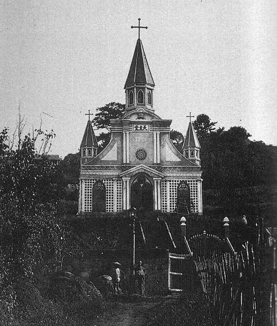
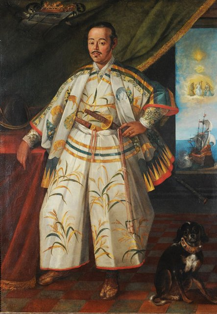

<!--
內容整理自 D:\Books\html\6-4.日本文學家\遠藤周作.html（沒有對應的 md 筆記），並整合中文維基百科〈遠藤周作〉條目，以自己的話改寫。
時期依生平歸納：大連與神戶的童年、戰爭與求學、法國留學、作家出道、大病與《沉默》、晚年。
兩份資料出入與處理方式：
- 生卒：1923年3月27日生於東京巢鴨；1996年9月29日在東京去世，兩份一致，享年73歲。
- 大連：頁面說童年隨父親工作旅居中國東北；一般記載是1926年隨任職銀行的父親遷居大連，照此。父母離婚：維基百科寫1933年離婚後隨母親回到神戶的姨母家，頁面寫「父母離異隨母遷居」，兩份一致。
- 受洗：頁面寫約1934年；一般記載是1935年在兵庫縣的夙川天主教會受洗，採1935年。
- 法國留學：維基百科寫1950至1953年在里昂大學，頁面說是戰後首批赴法留學生、親身感受種族隔閡，兩份合併；1953年因肺結核提前回國，依一般記載補充。
- 芥川賞：維基百科寫《白色人》獲1955年上半年度芥川賞，照此。
- 《沉默》：維基百科寫1966年由新潮社出版，獲谷崎潤一郎賞，照此；馬丁·史柯西斯的電影在2016年上映（頁面與〈日本文學家總覽〉都提到改編），依一般記載補充年份。
- 狐狸庵：頁面說以「狐狸庵」筆名寫幽默散文、銷量往往超過嚴肅作品；一般記載《狐狸庵閒話》在1965年出版，寫在1965年。
- 1996年：頁面說遺言要求以《沉默》與《深河》陪葬，照此。
- 人名與其他時間軸一致：馬丁·史柯西斯、芥川龍之介（芥川賞）、谷崎潤一郎（谷崎潤一郎賞，以 notNames 排除）。
圖片來源（皆為 Wikimedia Commons 公有領域／CC0 作品；註明「共用」者沿用其他時間軸已有的圖片）：
- en-cover.jpg：Shusaku-Endo-1.jpg（遠藤周作，1966年）
- en-lyon.jpg：Lyon vue Fourvière 1917.jpg（從富維耶山眺望里昂（1917年））
- en-oura.jpg：Oura Church 1864.jpg（長崎大浦天主堂（1864年））
- dm-hasekura.jpg（支倉常長在羅馬的肖像，1615（與伊達政宗生平時間軸共用））
-->

# Periods
- 1923-03-27 ~ 1943 | 大連與神戶的童年 | #868e96
  生於東京，在大連度過童年；父母離婚後隨母親回到神戶，在母親的帶領下受洗成為天主教徒。
- 1943 ~ 1950 | 戰爭與求學 | #1971c2
  幾經重考進入慶應義塾大學預科，戰後在法文科讀法國天主教文學，開始寫評論。
- 1950 ~ 1953 | 法國留學 | #e8590c
  作為戰後最早的一批留學生到法國里昂，親身感受到東方人與基督教世界的距離，因肺結核提前回國。
- 1953 ~ 1960 | 作家出道 | #5c940d
  以《白色人》獲芥川賞，與安岡章太郎、吉行淳之介等人被稱為「第三新人」，寫出《海與毒藥》。
- 1960 ~ 1980 | 大病與《沉默》 | #c92a2a
  肺結核復發，三次手術後奇蹟康復，寫出《沉默》；以「狐狸庵」之名寫幽默散文。
- 1980 ~ 1996-09-29 | 晚年 | #495057
  以《武士》《深河》回到信仰的主題，獲文化勳章，因病去世。

# Events

## 1923-03-27 | 出生於東京
遠藤周作生於東京府北豐島郡巢鴨町，父親遠藤常久是銀行員，母親郁是學小提琴的音樂家，上有一個哥哥正介。

## 1926 | 遷居大連
三歲的周作隨父親的工作調動，全家遷居當時日本租借的大連，在那裡讀小學。他後來回憶，在父母失和的日子裡，一條雜種狗是他唯一的玩伴，這段記憶反覆出現在他的作品中。

## 1933 | 父母離婚，回到神戶
父母離婚，周作隨母親回到日本，寄住在神戶的姨母家。母親此後成為他一生最重要的精神支柱，嚴格的母親形象也常出現在他的小說裡。

## 1935 | 受洗
在信仰天主教的姨母影響下，母親帶著周作在兵庫縣的夙川天主教會受洗，洗名保祿。他後來形容這份信仰就像母親替他穿上的「不合身的西服」，一生都在努力讓它合身。

## 1943 | 慶應義塾大學
周作在多次落榜後考進慶應義塾大學文學部預科。戰爭末期他接受徵兵檢查，因肋膜炎延後入伍，沒有上戰場。1945年他進入法文科，受到堀辰雄等人的影響，開始研究法國的天主教文學，1947年發表評論〈諸神與神〉。

## 1950 | 留學法國里昂

遠藤搭船赴法，進入里昂大學研究法國現代天主教文學，是戰後最早的一批日本留學生之一。他在那裡親身感受到種族與文化的隔閡，深化了他對「日本人能否真正接受基督教」的思考。1953年他因肺結核提前回國。

## 1955 | 《白色人》獲芥川賞
遠藤以描寫二戰時法國里昂一名虐待成性的法國青年與天主教神學生的《白色人》，獲得1955年上半年度的芥川賞。他與安岡章太郎、吉行淳之介、庄野潤三等人被稱為「第三新人」。同年他與岡田順子結婚。

## 1957 | 《海與毒藥》
遠藤發表《海與毒藥》，以二戰末期九州帝國大學醫學部對美軍俘虜進行活體解剖的事件為題材，追問沒有唯一神信仰的日本人，如何面對罪與良心，獲新潮社文學賞與每日出版文化賞。

## 1960 | 肺結核復發
遠藤肺結核復發，住院兩年多，接受三次肺部手術，一度病危。康復後他在長崎看到一塊「踏繪」（江戶時代強迫信徒踩踏的聖像），上面留著無數人踩過的痕跡，這成為他寫作《沉默》的起點。

## 1965 | 「狐狸庵」的幽默散文
遠藤出版幽默散文集《狐狸庵閒話》，以「狐狸庵山人」自稱，寫日常生活中的糗事與怪事，大受歡迎，銷量常超過他的嚴肅小說。他也組織業餘劇團「樹座」、合唱團，展現與嚴肅作品截然不同的一面。

## 1966 | 《沉默》

遠藤出版長篇小說《沉默》，以江戶初期的禁教為背景，寫葡萄牙傳教士洛特里哥潛入日本，在信徒受苦而神始終沉默的處境下，最後踩上了聖像。小說提出受苦者與棄教者也能得到神的愛，獲谷崎潤一郎賞，也因為對棄教的同情，一度被部分天主教會列為不宜閱讀的書。為了寫作，他多次走訪長崎等地考證史料。

## 1980 | 《武士》

遠藤發表《武士》，以17世紀隨支倉常長出使墨西哥與西班牙的伊達家武士為題材，獲野間文藝賞，繼續探索日本人與基督教的關係。

## 1993 | 《深河》
遠藤發表最後一部長篇《深河》，寫幾名各懷傷痛的日本人參加印度旅行團，來到恆河畔，探索超越宗教界限的救贖。1995年他獲頒文化勳章。

## 1996-09-29 | 逝世
遠藤因肝炎與腎病住院多時，9月29日在東京去世，享年73歲。依他的遺願，《沉默》與《深河》放進了他的棺木。2000年，長崎縣外海町設立了遠藤周作文學館。

## 2016 | 史柯西斯的《沉默》
美國導演馬丁·史柯西斯把《沉默》拍成電影，歷經二十多年的籌備終於上映，讓這部小說再次受到世界的注意。
