<!--
內容整理自本機筆記《歐洲史》（D:\Books\md\歷史\世界史\歐洲史，網頁版在知識圖譜的「1-6-5.歐洲史」）。
- 49個年份檔各成一則事件，說明採用該檔的「案件摘要」（7個檔案沒有案件摘要，改用「案發現場」），結尾以「→ 對外連結」連到知識圖譜上的完整案件卷宗（在新分頁開啟）；摘要中提到同卷其他案件的連結改為連到知識圖譜，連到其他分類的連結改為純文字。
- 時期依 README「案件卷宗」的前八段。第八段「大戰與冷戰」標為1914–1991年，但筆記本身把1992馬斯垂克條約、1998歐洲央行與2010歐債危機也列在這一段，因此色帶延伸至今。第九段「科技因素」（1974法國核電、1984 ASML、2016 AlphaGo）是主題線，未做成色帶，這三則仍收錄為事件。
- README 年表中沒有獨立年份檔的條目（如1922墨索里尼進軍羅馬、1938慕尼黑協定、1944諾曼第登陸）未收錄。
- 1066諾曼征服、1204君士坦丁堡洗劫、1347黑死病、1453君士坦丁堡陷落、1455古騰堡、1789法國大革命、1870普法戰爭等案件也出現在其他時間軸，各自保留。
圖片來源（皆為 Wikimedia Commons 公有領域／CC0 作品；多為後世繪畫，年份見括號；註明「共用」者沿用其他時間軸已有的圖片）：
- eu-cover.jpg：Europe As A Queen Sebastian Munster 1570.jpg（明斯特〈歐羅巴女王〉地圖，1570年代版）
- gre-salamis.jpg（考爾巴赫〈薩拉米斯海戰〉（與希臘史共用））
- eu-caesar.jpg：Assassination of Julius Caesar MET DP808060.jpg（〈刺殺凱撒〉，18–19世紀版畫）
- eu-milvian.jpg：Battle at Pont Milvius.jpg（拉斐爾工作室〈米爾維安橋之戰〉，1520–1524）
- eu-romulus.jpg：Romulus Augustulus and Odoacer.jpg（羅慕路斯·奧古斯都向奧多亞塞交出帝位（19世紀插圖））
- eu-justinian.jpg：Mosaic of Justinian I - Basilica San Vitale(6th Century).jpg（拉溫納聖維塔教堂的查士丁尼鑲嵌畫，6世紀）
- eu-charlemagne.jpg：Friedrich Kaulbach - Krönung Karls des Großen.jpg（考爾巴赫〈查理曼加冕〉，1903年以前）
- wd-bayeux.jpg（貝葉掛毯上的諾曼騎兵（與世界發展史共用））
- eu-canossa.jpg：Schwoiser Heinrich vor Canossa.jpg（施沃伊澤〈亨利四世在卡諾莎〉，1862）
- eu-jerusalem.jpg：1099 Siege of Jerusalem.jpg（1099年攻陷耶路撒冷，14世紀手抄本插圖）
- gre-1204.jpg（德拉克洛瓦〈十字軍攻入君士坦丁堡〉（與希臘史共用））
- eu-magna.jpg：Magna Carta (1215) - BL Cotton MS Augustus II 106.jpg（1215年《大憲章》（大英圖書館藏））
- wd-crecy.jpg（傅華薩《編年史》中的克雷西戰役（與世界發展史共用））
- pop-tournai.jpg（1349年圖爾奈埋葬黑死病死者（與世界人口共用））
- aod-constantinople.jpg（勒塔維尼耶繪〈君士坦丁堡之圍〉（與大航海時代共用））
- wd-gutenberg.jpg（古騰堡聖經的彩飾頁（與世界發展史共用））
- eu-luther.jpg：Lucas Cranach d.Ä. (Werkst.) - Porträt des Martin Luther (Lutherhaus Wittenberg).jpg（克拉納赫工作室〈馬丁·路德像〉，1528）
- eu-witches.jpg：Hexenverbrennung in Wittenberg 1540.jpg（1540年威登堡的焚燒女巫，木刻版畫）
- eu-munster.jpg：De beëdiging van het vredesverdrag tussen Spanje en de Verenigde Nederlanden in het Raadhuis van Munster, 15 mei 1648, SK-A-405.jpg（特博赫〈明斯特和約的宣誓〉，1648）
- eu-torbay.jpg：Joseph Mallord William Turner - copy of Prince of Orange Landing at Torbay - 82.170 - Indianapolis Museum of Art.jpg（仿透納〈奧蘭治親王在托貝登陸〉，19世紀）
- wd-bastille.jpg（〈攻占巴士底獄〉，1789（與世界發展史共用））
- wd-codecivil.jpg（《法國民法典》1804年版書名頁（與世界發展史共用））
- eu-retreat.jpg：Napoleons retreat from Moscow by Adolph Northen.jpg（諾特恩〈拿破崙自莫斯科撤退〉，1851）
- eu-vienna.jpg：Coloured engraving Vienna Congress.jpg（維也納會議，19世紀彩色版畫）
- eu-1848.jpg：Barrikade in der Breiten Straße.jpg（1848年柏林寬街的街壘）
- eu-kaiser.jpg：A v Werner - Kaiserproklamation am 18 Januar 1871 (3. Fassung 1885).jpg（維爾納〈德意志帝國宣告成立〉，1885）
- wd-berlin.jpg（1884年柏林會議（與世界發展史共用））
- cam-marne.jpg（馬恩河戰役中被炸毀的莫城橋（與卡繆共用））
- eu-versailles.jpg：William Orpen - The Signing of Peace in the Hall of Mirrors, Versailles.jpg（奧彭〈在鏡廳簽署和約〉，1919）
- ind-crash.jpg（1929年10月紐約證交所外的人群（與工業革命史共用））
- eu-yalta.jpg：Yalta Conference 1945 Churchill, Stalin, Roosevelt.jpg（1945年2月雅爾達會議：邱吉爾、羅斯福、史達林）
- eu-berlinwall.jpg：Berlin Wall 1961-11-20.jpg（1961年11月興建中的柏林圍牆）
-->

# Periods
- -800 ~ -27 | 古典世界的誕生 | #b08900
  希臘城邦在波希戰爭中擊退波斯，雅典民主與哲學奠定西方文明的基礎；羅馬從共和國擴張成地中海霸權，最後在內戰中由凱撒走向帝制。
- -27 ~ 500 | 羅馬帝國與基督教 | #c92a2a
  奧古斯都開創帝國與兩百年的羅馬和平；君士坦丁讓基督教取得勝利並遷都君士坦丁堡，西羅馬帝國則在蠻族入侵與財政崩潰中於476年滅亡。
- 500 ~ 1300 | 中世紀的秩序工程 | #862e9c
  查士丁尼的法典讓東羅馬續命，查理曼與神聖羅馬帝國重建西方的帝國秩序；東西教會分裂、諾曼征服、卡諾莎之行的政教之爭、十字軍東征與大憲章，一步步搭起中世紀歐洲的權力結構。
- 1300 ~ 1500 | 危機與文藝復興 | #495057
  百年戰爭與黑死病重創歐洲，卻也瓦解了封建秩序；君士坦丁堡陷落，古騰堡印刷術打開思想市場，文藝復興在義大利城邦興起。
- 1500 ~ 1650 | 大航海與宗教戰爭 | #1971c2
  宗教改革撕裂基督教世界，引發百年的宗教戰爭；小冰期帶來饑荒與巫術審判，最後以西發里亞條約確立主權國家體系。
- 1650 ~ 1815 | 絕對王權與革命時代 | #364fc7
  英國光榮革命確立議會主權，七年戰爭的帳單壓垮法國財政，引爆法國大革命；拿破崙以民法典與省制重塑歐洲，征俄失敗後由維也納會議收拾殘局。
- 1815 ~ 1914 | 民族主義與工業歐洲 | #e67700
  1848年的民族之春席捲歐洲，普法戰爭後德意志統一，拉丁貨幣同盟試驗貨幣整合，柏林會議瓜分非洲，芬蘭女性率先取得參政權。
- 1914 ~ 2026 | 大戰與冷戰 | #343a40
  兩次世界大戰與凡爾賽條約、大蕭條、希特勒上台，讓歐洲兩度淪為戰場；戰後歐洲分裂成東西兩邊，從煤鋼共同體、羅馬條約到馬斯垂克條約一步步整合，柏林圍牆倒塌結束冷戰，歐元與歐債危機則考驗貨幣同盟的極限。

# Events

## -500 | 希臘城邦與波希戰爭
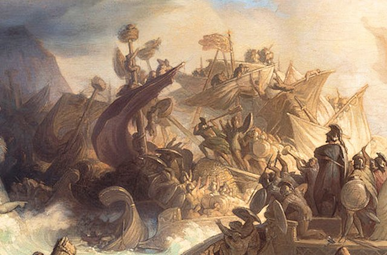
前508年雅典民主確立、前490–前479年波希戰爭爆發——這樁懸案沒有單一兇手。偵探到場後發現：地理破碎造就城邦並立，方陣步兵把「當兵」與「參政」綁在一起，波斯帝國的擴張壓力則逼出雅典的海軍與民主的合成。民主不是理念的恩賜，而是經濟、軍事、地理三股線索咬合後的偵結。

[→ 對外連結：希臘城邦與波希戰爭：地理破碎、海權與公民士兵的多因案件](https://chad-liu.github.io/books/html/1-6-5.歐洲史/-0500-希臘城邦與波希戰爭.html)

## -44 | 凱撒與羅馬共和的終結
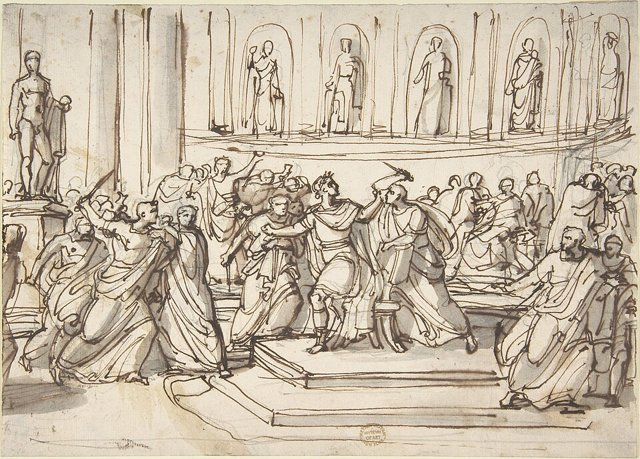
前44年3月15日凱撒遇刺，但真正的死者是羅馬共和本身。這樁案件最吊詭之處在於：兇手（布魯圖斯等共和派）自以為在救共和，刺殺行動反而加速帝國誕生。偵探的鑑識結論：共和不是死於匕首，而是死於格拉古以來一百年的結構性潰爛——職業軍隊效忠將領、行省財富餵養軍閥、元老院制度無法治理帝國。

[→ 對外連結：凱撒與羅馬共和的終結：職業軍隊、行省財富與共和失靈的多因案件](https://chad-liu.github.io/books/html/1-6-5.歐洲史/-0044-凱撒與羅馬共和的終結.html)

## 313 | 君士坦丁與基督教的勝利
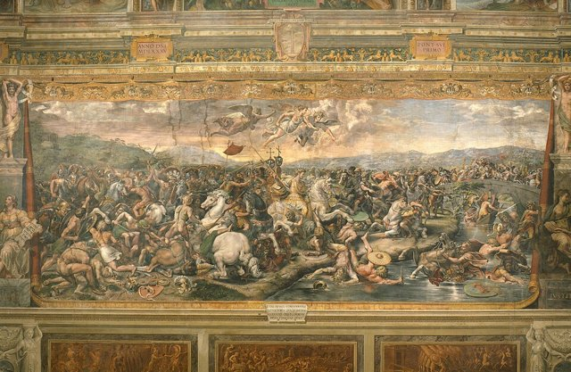
313年米蘭敕令承認基督教合法——這不是一場宗教奇蹟，而是一樁政治案件。偵探鑑識：三百年迫害未能消滅一個猶太邊疆教派，反而證明鎮壓的邊際效益遞減；三世紀危機把帝國逼到牆角，君士坦丁在米爾維安橋之戰（312）前後的宗教選擇，是把一個組織力最強的社會網絡收編為帝國的黏合劑。兇手不是君士坦丁的信仰，而是帝國對「新凝聚力」的急迫需求。

[→ 對外連結：君士坦丁與基督教的勝利：迫害失效、軍隊危機與帝國重整的多因案件](https://chad-liu.github.io/books/html/1-6-5.歐洲史/0313-君士坦丁與基督教的勝利.html)

## 476 | 西羅馬帝國的崩潰
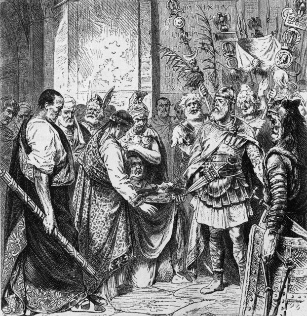
476年，日耳曼雇傭兵首領奧多亞克廢黜少年皇帝羅慕路斯·奧古斯都路斯——史書稱之為西羅馬帝國的滅亡。但這樁案件幾乎沒有「案發現場」：沒有大戰、沒有屠城，只有一次近乎平靜的移交。偵探鑑識結論：兇手不是476年的那一刀，而是兩個世紀的慢性失血——邊疆壓力、財政萎縮、內戰內耗與行省的「離婚」。帝國不是被殺死的，是自己停跳的。

[→ 對外連結：西羅馬帝國的崩潰：邊疆壓力、財政枯竭與制度空轉的多因案件](https://chad-liu.github.io/books/html/1-6-5.歐洲史/0476-西羅馬帝國的崩潰.html)

## 533 | 查士丁尼法典與東羅馬續命

476 年西羅馬滅亡（參見本書 [西羅馬帝國的崩潰](https://chad-liu.github.io/books/html/1-6-5.歐洲史/0476-西羅馬帝國的崩潰.html)），讀者合上案卷會以為「羅馬完了」——但 533–535 年，東羅馬皇帝查士丁尼在君士坦丁堡下令編纂《民法大全》，529 年創辦法學院，537 年聖索菲亞大教堂落成。一個說希臘語的東方朝廷，為何替死去的拉丁帝國寫法典？而 800 年查理曼（參見本書 [查理曼與加洛林帝國](https://chad-liu.github.io/books/html/1-6-5.歐洲史/0800-查理曼與加洛林帝國.html)）自稱「羅馬皇帝」時，依據的正是這套東方保存的羅馬性。

> **帝國死了，法典為何出生？查士丁尼是守墓人，還是備份工程師——西歐斷電的三百年，誰替羅馬按下了存檔鍵？**

[→ 對外連結：查士丁尼法典：西羅馬死了，羅馬法卻活了](https://chad-liu.github.io/books/html/1-6-5.歐洲史/0533-查士丁尼法典與東羅馬續命.html)

## 800 | 查理曼與加洛林帝國
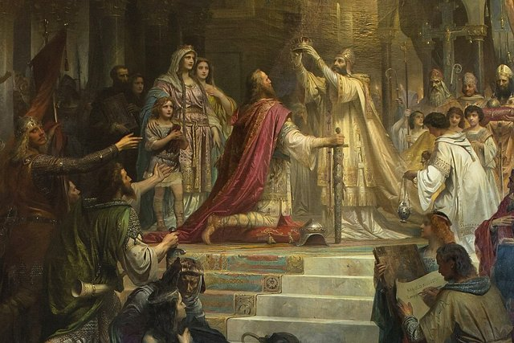
800年聖誕節，教皇利奧三世在羅馬聖彼得大殿為法蘭克國王查理加冕為「羅馬人的皇帝」。這樁案件的吊詭之處：被加冕者未必需要這頂冠冕，加冕者卻迫切需要這場儀式。偵探鑑識：查理的帝國是法蘭克軍事征服、教皇的政治危機與「羅馬」符號遺產三股線索咬合的產物——它既是復興，也是一場各取所需的合謀。

[→ 對外連結：查理曼與加洛林帝國：法蘭克軍事、教皇加冕與羅馬遺產的多因案件](https://chad-liu.github.io/books/html/1-6-5.歐洲史/0800-查理曼與加洛林帝國.html)

## 962 | 神聖羅馬帝國與奧托一世
962年2月2日，教皇若望十二世在羅馬為東法蘭克國王奧托一世加冕為皇帝——「神聖羅馬帝國」自此成形。這樁案件的謎題：一個德意志諸王的聯盟，為何要掛上「羅馬」與「神聖」兩面招牌？偵探鑑識：奧托的帝國是部落公國的內部拉扯、教會官僚的動員能力與義大利—教皇政治三股線索的咬合；「羅馬」頭銜不是榮耀的裝飾，而是馴服內部諸侯的統治工具。

[→ 對外連結：神聖羅馬帝國與奧托一世：教會動員、部落公國與帝國符號的多因案件](https://chad-liu.github.io/books/html/1-6-5.歐洲史/0962-神聖羅馬帝國與奧托一世.html)

## 1054 | 東西教會大分裂
1054 年 7 月，教皇使節洪貝特樞機走進君士坦丁堡聖索菲亞大教堂，把絕罰令（逐出教會）放上聖壇；君士坦丁堡牧首米海爾·凱魯拉里奧斯隨即反擊，絕罰羅馬。史稱「東西教會大分裂」——基督教世界自此分為天主教與東正教兩大系。此案耐人尋味：表面上爭的是一個希臘字（filioque「和聖子」），背後卻是羅馬帝國三百年分裂積累的政治、語言與權力斷層。**宗教分裂從來不是神學案，而是政治案穿了神學的外衣。**

[→ 對外連結：東西教會大分裂：一個被吵架切成兩半的世界](https://chad-liu.github.io/books/html/1-6-5.歐洲史/1054-東西教會大分裂.html)

## 1066 | 諾曼征服英格蘭
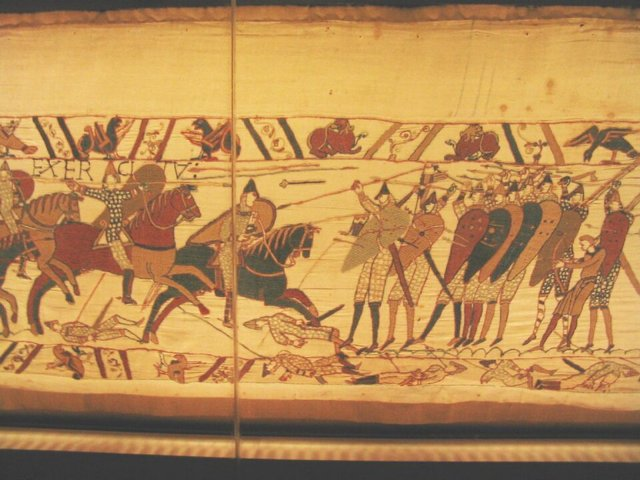
1066 年英格蘭王國的易手，向來被簡化為「征服者威廉一人之功」。但偵探辦案不能只抓一個兇手：這樁案件是**王位繼承危機**（懺悔者愛德華無嗣）、**諾曼底的軍事—封建機器**、**哈囉德的兩線作戰困境**與**風向的運氣**多因素咬合的結果。任何一環鬆脫，黑斯廷斯的結局都可能改寫。

[→ 對外連結：諾曼征服英格蘭：王位繼承、諾曼野心與運氣的多因案件](https://chad-liu.github.io/books/html/1-6-5.歐洲史/1066-諾曼征服英格蘭.html)

## 1077 | 卡諾莎之行與敘任權之爭
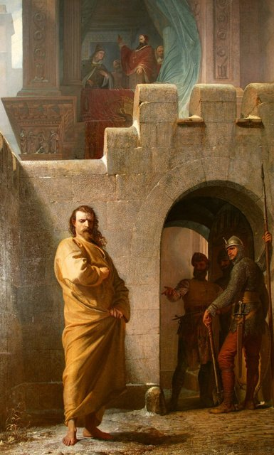
1077 年 1 月，神聖羅馬帝國皇帝亨利四世赤足披氈，在托斯卡納的卡諾莎城堡雪地中跪了三天，求教皇格里高利七世收回絕罰令。偵辦發現：這場「羞辱大戲」不是皇帝認輸，而是棋局中盤的緩兵之計——真正的爭議是**誰有權任命主教**（敘任權，Investiture Controversy）。主教的戒指與牧杖不只是宗教信物，而是土地、稅收與官職：帝國一半的財政與行政靠「主教們」撐著。這場 1075–1122 的四十七年拉鋸，是歐洲「宗教與王權二元拉鋸」主軸的第一場高潮，也是「王在法下」觀念的產房。

[→ 對外連結：卡諾莎之行：跪在雪裡的皇帝與敘任權之爭](https://chad-liu.github.io/books/html/1-6-5.歐洲史/1077-卡諾莎之行與敘任權之爭.html)

## 1081 | 拜占庭傭兵帝國與外包陷阱
1081 年，阿萊克修斯·科穆寧（Alexios）即位——**拜占庭的傭兵帝國**（瓦蘭吉，佩切涅格，諾曼）；此前：1071 曼齊刻特（1071-曼齊刻特，皇帝被俘）、1078–81 內戰；此後：1082 杜拉齊烏姆（諾曼，羅貝爾，敗）、1091 列武尼翁（佩切涅格，勝）、1096 十字軍、1118 阿萊克修斯死——**帝國的迴光**。這樁案件是「軍事力量的外包」：**帝國的軍隊，越來越不是帝國的人**。

[→ 對外連結：雙塔之戰與拜占庭的傭兵化：帝國的僱傭陷阱](https://chad-liu.github.io/books/html/1-6-5.歐洲史/1081-拜占庭傭兵帝國與外包陷阱.html)

## 1096 | 十字軍東征
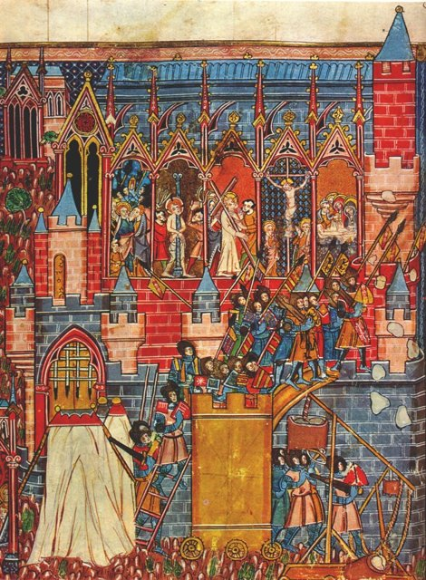
1096 年起的十字軍東征，常被講成「教宗烏爾班二世一場演說煽動的狂熱」。但偵探看案卷：演說只是引信，火藥庫裡裝著**朝聖—贖罪的宗教心理**、**西歐貴族的長子繼承與土地匱乏**、**義大利商業城邦的貿易利益**、**拜占庭的求援**與**教權對皇權的鬥爭**。多因咬合，才有兩百年間八次以上、橫跨階層的大規模軍事朝聖。

[→ 對外連結：十字軍東征：宗教熱情、貴族困境與商業利益的多因案件](https://chad-liu.github.io/books/html/1-6-5.歐洲史/1096-十字軍東征.html)

## 1204 | 第四次十字軍洗劫君士坦丁堡
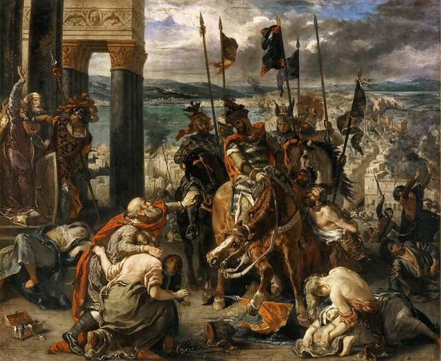
1096 年十字軍東征開案（參見本書 [十字軍東征](https://chad-liu.github.io/books/html/1-6-5.歐洲史/1096-十字軍東征.html)），讀者以為敵人是異教徒——但 1204 年第四次十字軍用威尼斯戰船攻破君士坦丁堡，洗劫三天（聖索菲亞祭壇被劈作戰利品），扶起拉丁帝國（1204–1261）。拜占庭從此只剩半條命，1261 年復國已是空殼，1453 年陷落（參見本書 [君士坦丁堡陷落](https://chad-liu.github.io/books/html/1-6-5.歐洲史/1453-君士坦丁堡陷落.html)）只是拔管。更諷刺的是：1081 年拜占庭的傭兵外包（參見本書 [拜占庭傭兵帝國與外包陷阱](https://chad-liu.github.io/books/html/1-6-5.歐洲史/1081-拜占庭傭兵帝國與外包陷阱.html)）請來的西方人，最後把雇主洗了。

> **十字架為何砍向十字架？當聖戰的軍費不夠，聖戰就改行搶劫——1204 年是意外，還是僱傭兵邏輯的必然？**

[→ 對外連結：第四次十字軍：十字軍洗劫了基督徒——1453的前傳](https://chad-liu.github.io/books/html/1-6-5.歐洲史/1204-第四次十字軍洗劫君士坦丁堡.html)

## 1215 | 大憲章
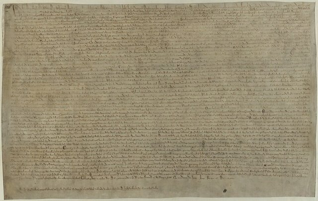
1215 年 6 月 15 日蘭尼米德草地上簽署的《大憲章》（Magna Carta），常被追認為「自由民主的起源」。但偵探還原現場：約翰王不是因為暴政「罪大惡極」被扳倒，而是踩中了**戰爭失敗的財政崩潰**、**封建義務的契約本質**、**教會與倫敦的兩面夾擊**與**貴族集體行動的組織力**。無單一兇手，是一張契約網收緊的結果。

[→ 對外連結：大憲章：王權擴張、封建反彈與教會仲裁的多因案件](https://chad-liu.github.io/books/html/1-6-5.歐洲史/1215-大憲章.html)

## 1337 | 百年戰爭
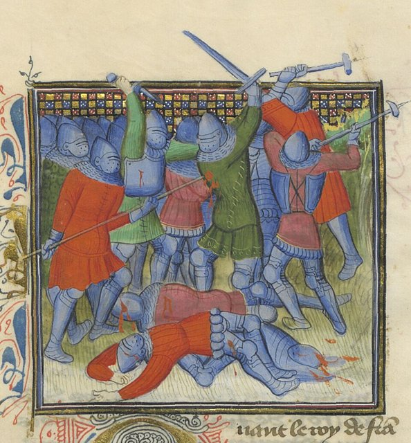
1337–1453 年，英法兩國打了斷斷續續一百一十六年的「百年戰爭」——名字是十九世紀史家取的，當時其實是四場停停打打的戰爭。表面死因：愛德華三世主張繼承法國王位（卡佩王朝絕嗣）。但王位繼承只是宣戰理由，真正的兇手是：法蘭德斯毛紡織經濟、阿基坦封建權利的司法勒索、以及英格蘭「以戰養戰」的騎士紅利。此案耐人尋味的是：**戰爭拖到後來，打的目的全變了——原本為了王位，最後卻打出了兩個民族**。

[→ 對外連結：百年戰爭：戰場上英格蘭的百年擴張與文化認同的裂變](https://chad-liu.github.io/books/html/1-6-5.歐洲史/1337-百年戰爭.html)

## 1347 | 黑死病進入歐洲
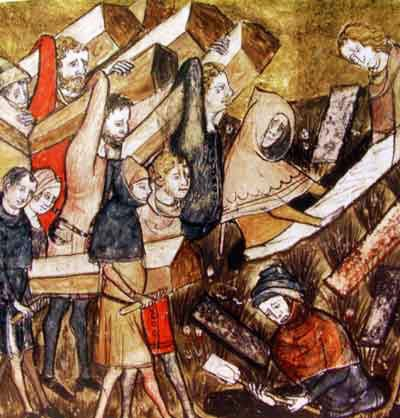
1347–1351 年的黑死病奪走歐洲約三分之一到一半人口，常被簡化為「一場天災」。但偵探追蹤案發路徑：真正的兇手是**鼠疫桿菌（Yersinia pestis）**，但把兇手送進歐洲的是**蒙古帝國統一後的絲路貿易網**、**熱那亞的黑海商站**、**卡法圍城戰的細菌戰傳說**與**中世紀城市的人鼠共生環境**。疾病是刀，貿易與戰爭是遞刀的手。

[→ 對外連結：黑死病進入歐洲：鼠疫桿菌、貿易網絡與戰爭的多因案件](https://chad-liu.github.io/books/html/1-6-5.歐洲史/1347-黑死病進入歐洲.html)

## 1453 | 君士坦丁堡陷落
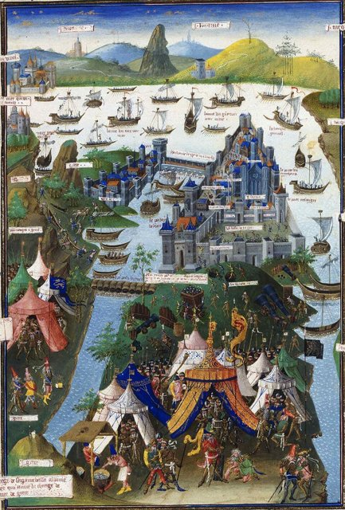
1453 年 5 月 29 日，鄂圖曼蘇丹穆罕默德二世攻陷君士坦丁堡，千年拜占庭帝國終結。偵探辦案不能只歸功於「烏爾班巨砲」：這樁案子是**火藥軍事革命**、**鄂圖曼對達達尼爾海峽的海權封鎖**、**拜占庭的財政與人口枯竭**、**西方援助的失靈**多因咬合的結果。城牆沒有被打穿之前，帝國早已在制度上流血過多。

[→ 對外連結：君士坦丁堡陷落：火藥、海權與帝國財政的多因案件](https://chad-liu.github.io/books/html/1-6-5.歐洲史/1453-君士坦丁堡陷落.html)

## 1455 | 古騰堡印刷術與思想市場
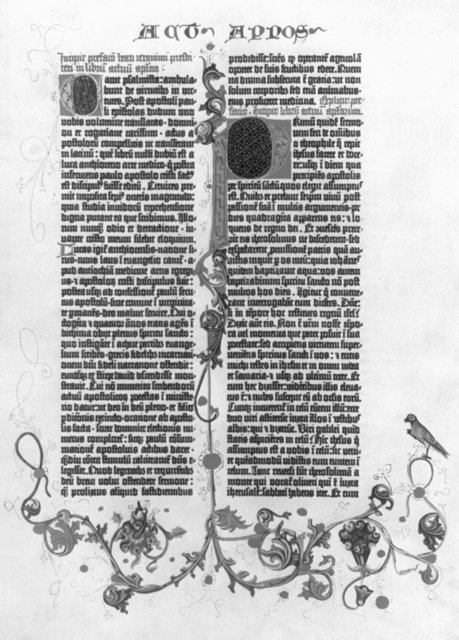
1517 年路德貼出《九十五條論綱》（參見本書 [宗教改革](https://chad-liu.github.io/books/html/1-6-5.歐洲史/1517-宗教改革.html)），兩週內傳遍德意志，一個月傳遍歐洲——中世紀的傳單怎麼有這種速度？答案藏在六十年前：1455 年美因茨的古騰堡印出《四十二行聖經》，此前歐洲只有抄寫坊（修士抄一本聖經要一年）。路德的論綱印了數十萬份，教會的禁書令追不上印刷機的速度。思想市場的爆炸（本卷主軸之五），兇器在本案。

> **路德是作者，古騰堡是軍火商——沒有印刷機的宗教改革會怎樣？一份論綱要靠抄寫員傳播，還能點燃德意志嗎？**

[→ 對外連結：古騰堡印刷：宗教改革的子彈是怎麼造出來的](https://chad-liu.github.io/books/html/1-6-5.歐洲史/1455-古騰堡印刷術與思想市場.html)

## 1517 | 宗教改革

1517 年 10 月 31 日，路德在維滕貝格張貼《九十五條論綱》，常被講成「一人對抗全教會」。但偵探看卷宗：路德是引爆者，火藥庫裡有**贖罪券財政的腐敗**、**印刷術的傳播動力學**、**德意志諸侯的帝國政治**、**人文主義與聖經翻譯**多因素咬合。沒有印刷機，路德只是又一個被迅速撲滅的異端（如 1415 年的胡斯）。

[→ 對外連結：宗教改革：贖罪券、印刷術與帝國政治的多因案件](https://chad-liu.github.io/books/html/1-6-5.歐洲史/1517-宗教改革.html)

## 1600 | 小冰期與巫術審判
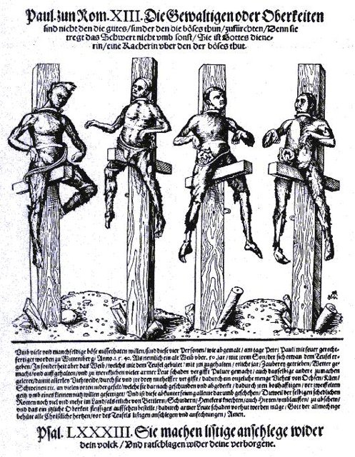
1550–1700 年，歐洲巫術審判高峰：處決數萬（一說 4–6 萬，八成女性），德國西南、蘇格蘭、法國東部最烈。此前：宗教改革分裂（1517）、小冰期加劇（1560s–，歉收連年）、黑麥角病（一說）。此後：啟蒙+司法改革（廢除刑訊），審判式微。**女巫真的存在嗎？如果不存在，燒死的是誰？**

> **寒冷如何燒死女人？當糧食歉收、嬰兒夭折、牛奶變酸，村莊需要一個解釋——解釋的代價是誰的命？**

[→ 對外連結：巫術審判：小冰期、黑麥角與替罪羊](https://chad-liu.github.io/books/html/1-6-5.歐洲史/1600-小冰期與巫術審判.html)

## 1648 | 西發里亞條約
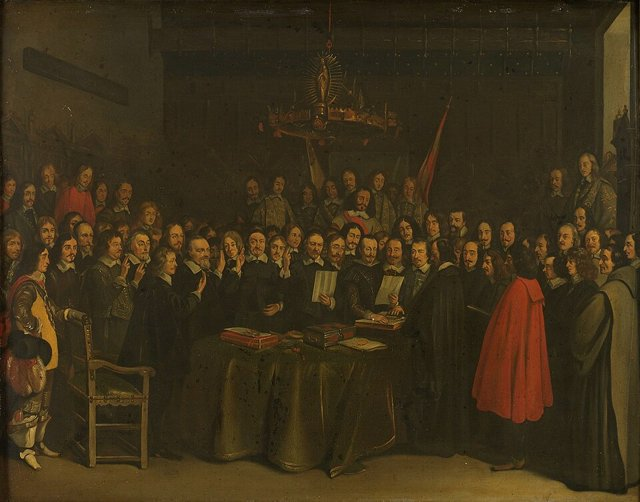
三十年戰爭（1618–1648）沒有單一兇手。波希米亞的擲出窗外事件只是引信，真正的案情是宗教對立、哈布斯堡家族的霸權野心、德意志諸邦的地方自主、法國的制衡盤算與北歐瑞典的擴張利益互相咬合。1648年《西發里亞和約》以奧斯納布魯克與明斯特兩地同時談判收案，確立「教隨國定」的擴大版與近代主權國家體系，開啟了歐洲均勻政治的新秩序。

[→ 對外連結：西發里亞條約：宗教、均勢與主權的多因案件](https://chad-liu.github.io/books/html/1-6-5.歐洲史/1648-西發里亞條約.html)

## 1688 | 英國光榮革命
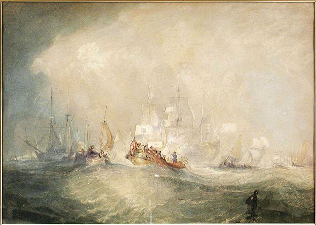
1688年英國的光榮革命（Glorious Revolution）看似一場「不流血的政變」——議會迎立奧蘭治的威廉與瑪麗入主英格蘭。但偵辦此案會發現：沒有單一兇手。詹姆士二世的天主教政策、議會的財政槓桿、新教菁英的恐懼、以及歐陸反法外交的盤算互相咬合。結果是《權利法案》（1689）確立議會主權，英國從此走上君主立憲之路。

[→ 對外連結：英國光榮革命：王權、議會與宗教的多因案件](https://chad-liu.github.io/books/html/1-6-5.歐洲史/1688-英國光榮革命.html)

## 1756 | 七年戰爭與大革命帳單
1688 年光榮革命立起議會財政國家（參見本書 [英國光榮革命](https://chad-liu.github.io/books/html/1-6-5.歐洲史/1688-英國光榮革命.html)），1789 年法國大革命炸開舊制度（參見本書 [法國大革命](https://chad-liu.github.io/books/html/1-6-5.歐洲史/1789-法國大革命.html)）——中間一百年的歐洲年表幾乎空白。空白處躺著一場被低估的大戰：1756–1763 年七年戰爭，戰場從西里西亞燒到北美（英法印第安戰爭）、印度（普拉西 1757）、加勒比與菲律賓，普魯士以彈丸之地單挑法奧俄三強，英國靠海軍摘走整個法屬北美。法國為此背上巨債——正是 1789 年三級會議的直接帳單。

> **大革命的請柬是誰寄的？當法國為普魯士的存亡買單、為美洲的獨立再買單，國庫是什麼時候被兩場戰爭聯手掏空的？**

[→ 對外連結：七年戰爭：真正的第一次世界大戰——大革命的財政前傳](https://chad-liu.github.io/books/html/1-6-5.歐洲史/1756-七年戰爭與大革命帳單.html)

## 1789 | 法國大革命
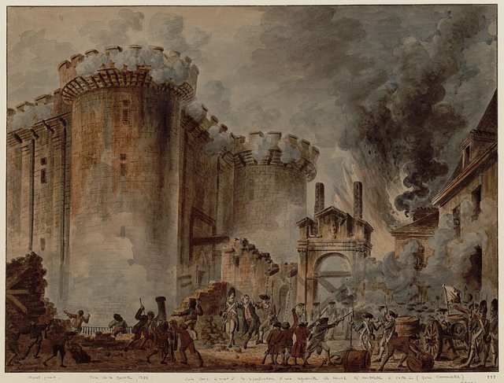
1789年法國大革命沒有單一兇手。攻打巴士底獄只是案發現場，真正的兇器是破產的財政、失衡的三級會議制度、啟蒙思想的武器化、糧食危機與菁英內鬥，五者互相咬合。從三級會議到網球場宣誓、從巴士底到《人權宣言》、再到1793年的恐怖統治——案件一路升級，證明革命不是一夜之案，而是多重因素連環失控的過程。

[→ 對外連結：法國大革命：財政、階級與啟蒙的多因案件](https://chad-liu.github.io/books/html/1-6-5.歐洲史/1789-法國大革命.html)

## 1804 | 拿破崙民法典與省制
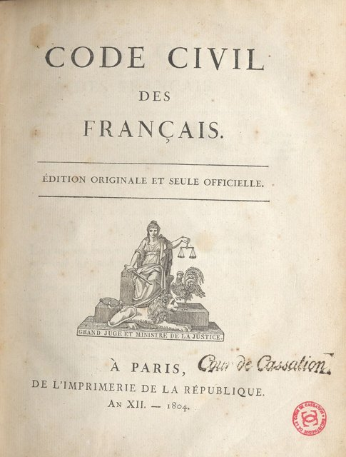
1804 年《法國民法典》頒布，同步鋪開省（département）—區—市鎮三級行政與督學、稅務、徵兵一條鞭。偵辦發現：這不是一部法律彙編，而是一樁「行政集權謀殺封建」的案件——大革命砍了國王的頭，拿破崙用民法典與省制砍了封建的手腳，把三百個習慣法區變成同一個可徵稅、可徵兵、可審判的平面國家。歐洲大陸此後兩百年的官僚制，幾乎都是這份藍圖的翻版。

[→ 對外連結：拿破崙民法典與省制：用行政一統分裂的歐洲](https://chad-liu.github.io/books/html/1-6-5.歐洲史/1804-拿破崙民法典與省制.html)

## 1812 | 拿破崙征俄
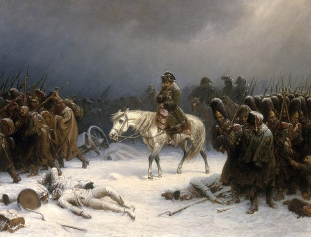
1812 年 6 月，拿破崙率領約六十萬大軍（大陸軍歷史最大規模）渡過涅曼河入侵俄國；12 月，撤回的殘部不足十萬。史稱「1812 年的災難」。表面死因：俄國的嚴冬與焦土。但偵查顯示：**冬季一直都在，真正的兇手是後勤數學**——一個靠「就地徵發」支撐的軍事機器，碰上一個「不與你接觸、退到你的補給極限之外」的對手。此案是「總體戰」概念的先聲：敵人的領土本身就是武器。

[→ 對外連結：拿破崙征俄：總體戰的物理極限與帝國的臨界點](https://chad-liu.github.io/books/html/1-6-5.歐洲史/1812-拿破崙征俄.html)

## 1815 | 維也納會議
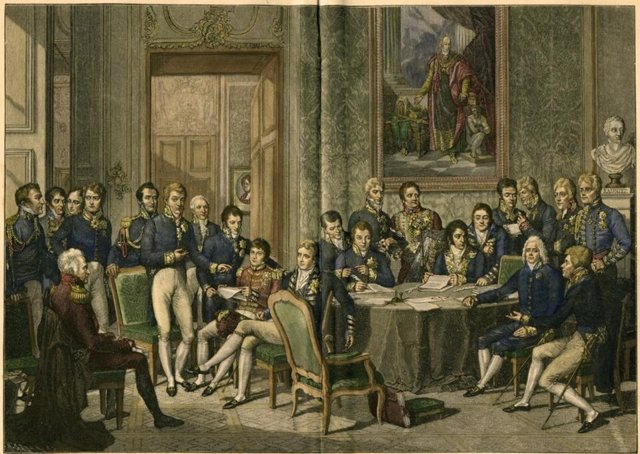
1815年維也納會議是拿破崙戰爭後的「重建現場」。此案沒有單一兇手：拿破崙攪亂的歐洲版圖、英俄奧普四強各自的領土野心、塔列朗舉起的「正統原則」、以及對再次革命潮的集體恐懼互相咬合。會議由梅特涅主持、透過大國協調（Concert of Europe）重劃地圖，締造了近一世紀（1815–1914）無全歐大戰的均勢秩序——雖然它壓抑了民族主義，為日後埋下新案源。

[→ 對外連結：維也納會議：均勢、正統與大國協調的多因案件](https://chad-liu.github.io/books/html/1-6-5.歐洲史/1815-維也納會議.html)

## 1848 | 民族之春
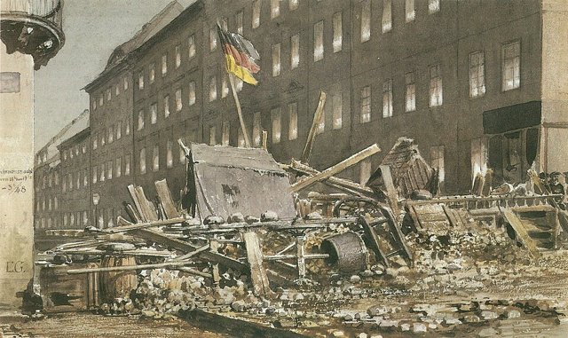
1848年的「民族之春」（Springtime of Nations）是全歐同時引爆的連環案：從巴黎二月革命到維也納、柏林、米蘭、威尼斯、布拉格、布達佩斯，十餘處起義幾乎同時爆發。此案沒有單一兇手：馬鈴薯疫病與糧食危機、經濟蕭條、維也納體系的長期壓抑、通訊革命加速的資訊傳染、以及中產階級的政治訴求互相咬合。但年底之前多數革命被反撲——證明起義容易，建設新秩序難。

[→ 對外連結：民族之春：自由、民族與糧食的多因案件](https://chad-liu.github.io/books/html/1-6-5.歐洲史/1848-民族之春.html)

## 1865 | 拉丁貨幣同盟
1865 年 12 月，法、比、義、瑞四國簽約成立拉丁貨幣同盟（Latin Monetary Union）：金銀複本位、統一鑄幣成色重量、互認流通。偵辦發現：這是歐元最早的「案發現場」——在沒有中央銀行、沒有財政聯盟、沒有退出條款的情況下，四國（後擴至希臘、西班牙等）試圖用一紙鑄幣協議鎖定匯率。它的死亡（1927年正式解散）為一百年後的馬斯垂克條約寫好了驗屍報告：貨幣同盟若無財政與央行之錨，終將被套利與戰爭肢解。

[→ 對外連結：拉丁貨幣同盟：歐元百年前的幽靈實驗](https://chad-liu.github.io/books/html/1-6-5.歐洲史/1865-拉丁貨幣同盟.html)

## 1870 | 普法戰爭與總參謀部
1870–1871 年普法戰爭——**普魯士總參謀部**（毛奇）＋鐵路動員＋Dreyse 針發槍＝**六週勝法**（色當 9.2，拿破崙三世被俘）→ 1871.1.18 凡爾賽鏡廳（德意志帝國，威廉一世）——**德意志統一**；此前：1864 丹—1866 普奧（薩多瓦，七週）——**毛奇三役**。這樁案件是「制度 vs 天才」：**毛奇（「計劃代替天才」）的參謀本部**。

[→ 對外連結：普法戰爭與總參謀部：制度打敗天才](https://chad-liu.github.io/books/html/1-6-5.歐洲史/1870-普法戰爭與總參謀部.html)

## 1871 | 德意志統一
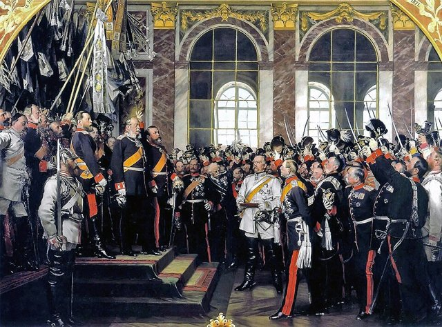
1871年1月18日，普魯士國王威廉一世在凡爾賽鏡廳加冕為德意志皇帝，德意志統一收案。此案沒有單一兇手：1848年自由民族統一運動的失敗、關稅同盟的經濟整合、俾斯麥「鐵與血」的現實政治、三次精準的王朝戰爭、以及法國的外交失誤互相咬合。統一不是民族主義的自然果實，而是經濟整合鋪路、軍事與外交工具到位後，由普魯士主導的國家建設工程。

[→ 對外連結：德意志統一：鐵血、外交與經濟的多因案件](https://chad-liu.github.io/books/html/1-6-5.歐洲史/1871-德意志統一.html)

## 1884 | 柏林會議與瓜分非洲
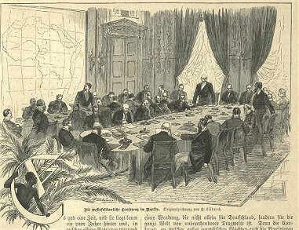
1884 年 11 月至 1885 年 2 月，俾斯麥在柏林召集十四國會議，談判桌上畫出非洲的未來：剛果自由邦國際化、尼日爾與剛果河流域自由通航、「有效佔領」（effective occupation）原則確立——**誰實際控制，誰擁有**。偵辦發現：這樁案件的弔詭在於，與會十四國中沒有一個非洲國家，被瓜分的大陸連旁聽席都沒有；而會議本身不是瓜分的開始，而是給已經失控的搶灘競賽「補辦手續、防止擦槍走火」。三十年後，非洲地圖上只剩衣索比亞與賴比瑞亞兩個主權國家。

[→ 對外連結：柏林會議與瓜分非洲：沒有一個非洲人在場的分贓會](https://chad-liu.github.io/books/html/1-6-5.歐洲史/1884-柏林會議與瓜分非洲.html)

## 1906 | 芬蘭女性參政
1906 年，芬蘭（時為俄羅斯帝國大公國）通過議會改革：普選（一人一票）+女性選舉權與被選舉權（世界首例無財產限制的女性普選），1907 年選出 19 名女議員（世界首批）。此前：1905 年大罷工（俄國革命外溢）、沙皇二月宣言（承諾議會）。一個俄羅斯帝國的邊陲，為何跑到全世界前面？

> **邊陲為何領先？當帝國中心（彼得堡）還在爭論，邊陲小國如何一步到位——女權是目標，還是籌碼？**

[→ 對外連結：芬蘭女性參政：世界第一張無差別選票](https://chad-liu.github.io/books/html/1-6-5.歐洲史/1906-芬蘭女性參政.html)

## 1914 | 第一次世界大戰

1914 年 6 月 28 日塞拉耶佛的一聲槍響，看似「兇手」是普林西普，但偵辦後發現：沒有單一兇手，只有一組互相咬合的齒輪——同盟體系的自動連鎖、英德海軍軍備競賽、巴爾幹民族主義火藥桶、動員時間表暴政與各國決策者的誤判。任何一顆齒輪若能鬆脫，大戰或可不爆發；五顆同時咬緊，歐洲便滑入四年浩劫。

[→ 對外連結：第一次世界大戰：同盟體系、軍備競賽與巴爾幹火藥桶的多因案件](https://chad-liu.github.io/books/html/1-6-5.歐洲史/1914-第一次世界大戰.html)

## 1919 | 凡爾賽條約
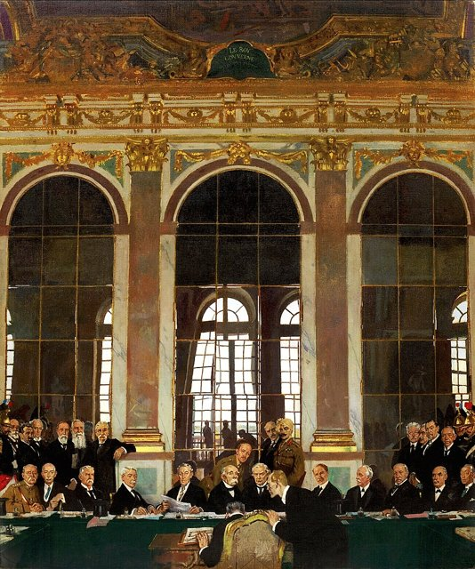
1919 年 6 月 28 日，鏡廳之中簽下的凡爾賽條約，表面「兇手」是克列孟梭的嚴酷條款，深究卻發現：真正的病灶是三種目標的內鬥——法國的懲罰安全觀、威爾遜的理想主義、勞合·喬治的權力平衡——加上德國被排除在談判桌外的羞辱程序，以及美國參議院最後的否決。多因素咬合，造出一份「既太嚴苛無法和解、又太寬鬆無法壓制」的條約。

[→ 對外連結：凡爾賽條約：復仇懲罰、民族自決與權力真空的多因案件](https://chad-liu.github.io/books/html/1-6-5.歐洲史/1919-凡爾賽條約.html)

## 1929 | 大蕭條衝擊歐洲
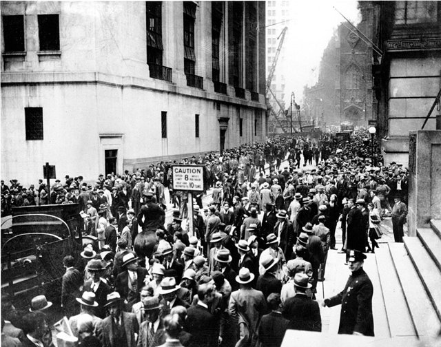
1919 年凡爾賽條約種下怨恨（參見本書 [凡爾賽條約](https://chad-liu.github.io/books/html/1-6-5.歐洲史/1919-凡爾賽條約.html)），1933 年希特勒上台收割怨恨（參見本書 [希特勒上台與魏瑪崩潰](https://chad-liu.github.io/books/html/1-6-5.歐洲史/1933-希特勒上台與魏瑪崩潰.html)）——中間十年的因果鏈缺了最關鍵一環：1929 年華爾街股災如何越過大西洋，把德國失業率推到三成、把納粹從 12 席推到 230 席。沒有本案，讀者會以為德國人 1933 年是突然發瘋。偵探的答案：**發瘋是有價錢的，價錢是六百萬失業人口**。

> **選票是如何變成子彈的？當美國銀行收回短期貸款，德國工廠的煙囪和議會的理性是哪一個先熄滅的？**

[→ 對外連結：大蕭條衝擊歐洲：1933 的子彈是華爾街上膛的](https://chad-liu.github.io/books/html/1-6-5.歐洲史/1929-大蕭條衝擊歐洲.html)

## 1933 | 希特勒上台與魏瑪崩潰
1933 年 1 月 30 日，興登堡總統任命希特勒為總理——不是政變，是**依憲法程序**完成：納粹黨在 1932 年兩次國會選舉中成為最大黨（37.3%、33.1%），舊精英（容克、工業家、軍方）誤以為可以「僱用」這個煽動家。偵辦發現：這樁案件的凶手不是一個人，而是三重疊加的系統故障——經濟崩潰（失業 600 萬）、憲法設計缺陷（緊急命令條款 48 條）、以及反民主精英的「閘門策略」。五個月後國會縱火案授權法通過，魏瑪民主死於自己簽發的手續。

[→ 對外連結：希特勒上台與魏瑪崩潰：民主投票處死民主](https://chad-liu.github.io/books/html/1-6-5.歐洲史/1933-希特勒上台與魏瑪崩潰.html)

## 1940 | 閃電戰與合成戰爭
1940 年 5–6 月，德軍**閃電戰**（Blitzkrieg「鐮刀收割」，曼施坦因—古德里安）——**六週滅法國**（荷比盧降，敦刻爾克，6.22 貢比涅停戰）；此前：1939 波蘭（「白色方案」，坦克—空軍）、1916–18 坦克（1916-坦克，富勒）、1930s 古德里安（「Achtung Panzer！」）——**理論—實踐**。此後：1940 不列顛空戰（敗）、1941 巴巴羅薩（蘇聯）、1943 庫爾斯克（坦克決戰）——**閃電熄滅**。這樁案件是「合成的勝利」：**坦克集中＋無線電＋俯衝轟炸（斯圖卡）＝速度**。

[→ 對外連結：閃電戰：坦克、無線電與俯衝轟炸機](https://chad-liu.github.io/books/html/1-6-5.歐洲史/1940-閃電戰與合成戰爭.html)

## 1945 | 德國投降與歐洲的分裂
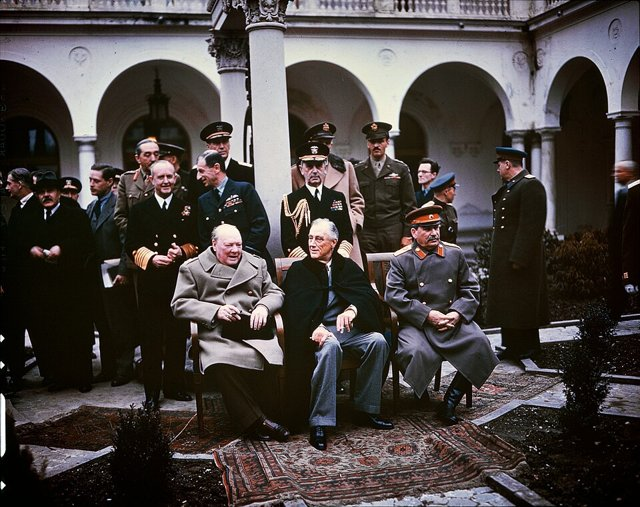
1945 年 5 月 8 日德國無條件投降，歐洲戰爭結束，但「兇手」並未離場——偵辦發現：歐洲隨即被切成兩半，不是哪一國「偷走」了歐洲，而是納粹留下的權力真空、蘇美軍隊的既成占領線、意識形態的不相容與互信崩解（安全困境升級版）共同咬合，在 1945–1949 年間把盟友變成敵人，冷戰鐵幕落地。

[→ 對外連結：德國投降與歐洲的分裂：軍事占領、意識形態與權力真空的多因案件](https://chad-liu.github.io/books/html/1-6-5.歐洲史/1945-德國投降與歐洲的分裂.html)

## 1951 | 煤鋼共同體與舒曼計劃
1951 年 4 月 18 日，法德意荷比盧六國簽《巴黎條約》，把煤鋼產量交給超國家「高級機構」（High Authority）監管。偵辦發現：這不是浪漫的和解秀，而是一樁精密的「制度綁架案」——法國外長舒曼與策劃者莫內（Jean Monnet）用煤鋼（戰爭的原料）做人質，把德國重工業鎖進共同監管：魯爾的煤要運往洛林，產量與價格透明，關稅與補貼由共同體說了算。戰爭的物質基礎被抽走，法德百年世仇第一次在資產負債表上停火。

[→ 對外連結：煤鋼共同體：舒曼計劃如何把大炮變成稅收](https://chad-liu.github.io/books/html/1-6-5.歐洲史/1951-煤鋼共同體與舒曼計劃.html)

## 1957 | 羅馬條約與歐洲整合
1957 年 3 月 25 日，六國在羅馬簽下條約，成立歐洲經濟共同體。偵辦發現：這場整合不是哪一位「建國者」單獨完成，而是功能主義外溢邏輯、德法和解的戰略抉擇、煤鋼共同體的成功示範、冷戰壓力與美國支持等多因素咬合的產物。歐洲人學到一個關鍵教訓：**分裂始於經濟懲罰，整合始於經濟共享**。

[→ 對外連結：羅馬條約與歐洲整合：功能主義、德法和解與經濟外溢的多因案件](https://chad-liu.github.io/books/html/1-6-5.歐洲史/1957-羅馬條約與歐洲整合.html)

## 1961 | 柏林圍牆與冷戰標點
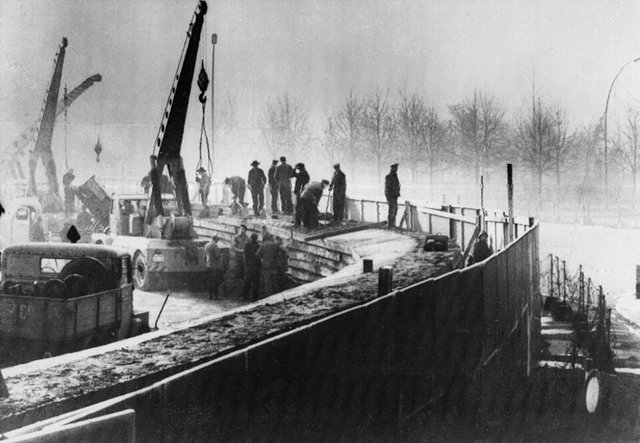
1961 年 8 月 13 日，東德一夜築起**柏林圍牆**（156km）——**冷戰的混凝土**；此前：1949–61 逃潮（300 萬東德人「用腳投票」，知識分子）、1958 赫魯曉夫最後通牒、1961 維也納（甘—赫，失敗）——**西柏林的出血**；此後：1961.10 查理檢查站（坦克對峙）、1971 四國協定—1989.11.9 倒塌（沙博夫斯基）——**28 年**（死 140＋）。這樁案件是「牆的悖論」：**牆是承認失敗的紀念碑**。

[→ 對外連結：柏林圍牆：冷戰的混凝土標點](https://chad-liu.github.io/books/html/1-6-5.歐洲史/1961-柏林圍牆與冷戰標點.html)

## 1974 | 法國核電計劃
1974 年 3 月，石油危機後四個月，法國總理梅斯梅爾（Messmer）宣布大規模核電計劃：以壓水堆（PWR）為單一堆型，十餘年內建成數十座機組，使核電佔法國電力七成以上。偵辦發現：這不是單純的工程決策，而是石油創傷、地質貧乏、國家主義傳統、電力壟斷體制與美法技術交易多因素咬合的產物。法國人學到一句偵探格言：**沒有油田的國家，用反應爐挖油田**。

[→ 對外連結：法國核電計劃：梅斯梅爾的賭局與能源主權的多因案件](https://chad-liu.github.io/books/html/1-6-5.歐洲史/1974-法國核電計劃.html)

## 1984 | ASML成立
1984 年，飛利浦（Philips）與艾斯摩爾（ASM International）合資成立 ASML——一家被母公司半推半就丟出來的小公司，員工僅數十人，連連虧損。三十年後它壟斷全球極紫外光刻（EUV）機，成為半導體產業鏈唯一的咽喉。偵辦發現：這是邊緣創新、美荷日三國錯位競爭、產學研共生（IMEC—蔡司—Cymer）與摩爾定律自我實現多因素咬合的產物。歐洲學到的格言：**巨頭丟掉的邊角料，可能是下一個時代的王座**。

[→ 對外連結：ASML成立：飛利浦的棄子與光刻壟斷的多因案件](https://chad-liu.github.io/books/html/1-6-5.歐洲史/1984-ASML成立.html)

## 1989 | 柏林圍牆倒塌
1989 年 11 月 9 日晚間，東柏林人在檢查哨前蜂擁而過，圍牆在數小時內「失效」。偵辦發現：推倒圍牆的不是誰的一句口誤，而是蘇聯改革失去控制、東德經濟長期失血、匈牙利開放邊界撕開鐵幕、戈巴契夫放棄布里茲涅夫主義、以及官僚通訊失誤的多因素咬合。圍牆的倒塌是一場「沒有指揮者的崩解」——體系自己鬆開了自己。

[→ 對外連結：柏林圍牆倒塌：經濟停滯、開放改革與體系崩解的多因案件](https://chad-liu.github.io/books/html/1-6-5.歐洲史/1989-柏林圍牆倒塌.html)

## 1992 | 馬斯垂克條約與歐盟
1992 年 2 月 7 日，十二國在馬斯垂克小城簽下條約，成立歐洲聯盟並鎖定單一貨幣路線。偵辦發現：推動這場「深度整合」的不是誰的理想主義獨力完成，而是德國統一後的錨定需求、法國對德國霸權的制度制衡、德洛爾的「良性危機」策略、冷戰終結後的歐洲秩序重構與貨幣整合的技術積累共同咬合。後冷戰的歐洲選擇用「制度深化」回答秩序真空。

[→ 對外連結：馬斯垂克條約與歐盟：歐元、德國統一與後冷戰整合的多因案件](https://chad-liu.github.io/books/html/1-6-5.歐洲史/1992-馬斯垂克條約與歐盟.html)

## 1998 | 歐洲央行與歐元
1998 年 6 月 1 日歐洲中央銀行（ECB）在法蘭克福成立，1999年歐元上路。偵辦發現：這是一樁「德國央行文化的制度輸出案」——德國以放棄馬克為代價，把聯邦銀行的基因（獨立性＋物價穩定至上＋禁止貨幣融資財政）寫進《馬斯垂克條約》與 ECB 章程。一個為十幾個財政主權服務、卻不許任何政府指揮的央行就此誕生：它治得住通膨，卻在2010年歐債危機裡暴露了「有貨幣、無財政」的先天殘疾。

[→ 對外連結：歐洲央行：法蘭克福的獨立王國](https://chad-liu.github.io/books/html/1-6-5.歐洲史/1998-歐洲央行與歐元.html)

## 2010 | 歐債危機與財政契約
2010 年 4 月希臘求援、愛爾蘭葡萄牙跟進、2012年西班牙銀行業告急，歐元區差點解體。偵辦發現：這不是單純的「希臘說謊案」（高盛換匯隱藏赤字固然可惡），而是1998年 ECB 殘缺設計的總驗收——單一利率在2000年代給南歐送去廉價信貸，房產與公債泡沫齊飛；危機一到，無匯率可貶、無央行可印鈔的成員國只能「內部貶值」（砍工資砍福利）。歐盟的回答是兩帖猛藥：永久救助基金 ESM＋《財政契約》（赤字剎車入憲），等於把德國的節儉哲學寫成全歐的會計準則。

[→ 對外連結：歐債危機與財政契約：當貨幣同盟收到帳單](https://chad-liu.github.io/books/html/1-6-5.歐洲史/2010-歐債危機與財政契約.html)

## 2016 | AlphaGo
2016 年 3 月，倫敦 DeepMind 的 AlphaGo 以 4:1 擊敗韓國棋聖李世乭（Lee Sedol），首爾決戰全球 6 億人次觀看；第 37 手（第五線肩衝）被稱為「神之一手」。偵辦發現：這不是「電腦變聰明」的單因事件，而是算力指數、深度網路、強化學習、圍棋數據化與英美資本—歐陸人才—東亞棋壇多因素咬合的產物。人類學到的判詞：**直覺是可以被梯度下降逼近的**。

[→ 對外連結：AlphaGo：李世乭的眼淚與深度學習的多因案件](https://chad-liu.github.io/books/html/1-6-5.歐洲史/2016-AlphaGo.html)
