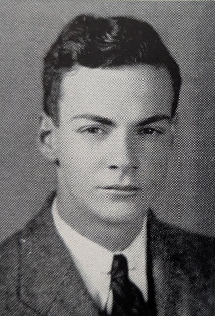
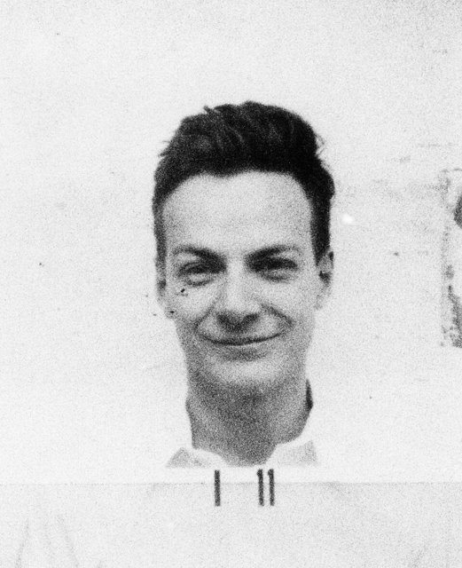
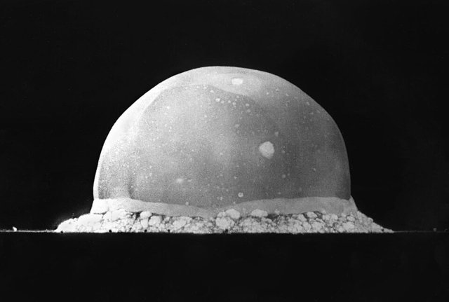
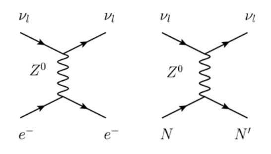
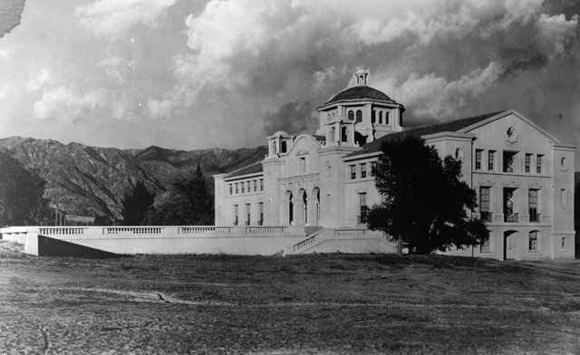
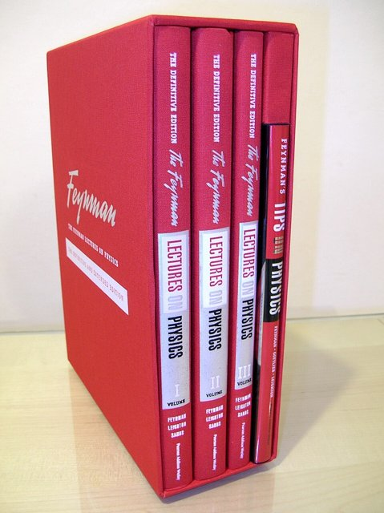
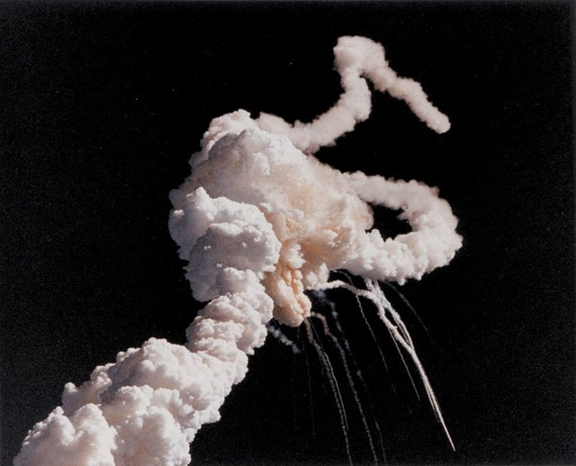
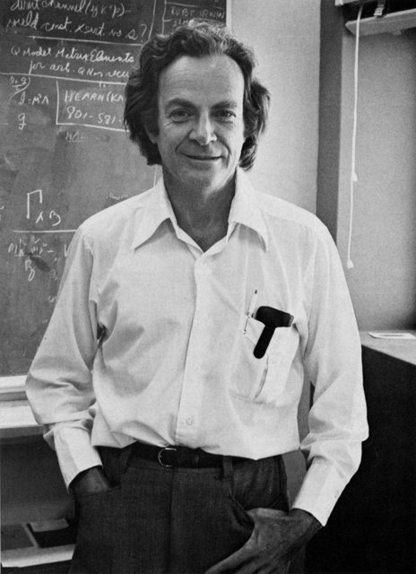

<!--
內容整理自 D:\Books\md\歷史\人物\科學家\費曼（Richard Feynman）生平大事記.md（網頁版為 D:\Books\html\8-2.科學家\理查費曼生平大事記.html，另有知識圖譜頁〈費曼〉），並整合中文維基百科〈理查德·費曼〉條目，以自己的話改寫。
時期依筆記的章節歸納：出生與求學、普林斯頓、曼哈頓計畫、康乃爾與量子電動力學、加州理工與諾貝爾獎、教育與科學思考、晚年。筆記的「主要科學貢獻」（量子電動力學、費曼圖、路徑積分、弱交互作用、量子計算、科學誠信）「重要著作」「重要人物關係」「歷史地位」寫進時期說明與相關事件，不另立事件。「費曼圖」「費曼物理學講義」放入 notNames，避免人名索引把這些名詞算成提到費曼本人。
兩份資料出入與處理方式：
- 譯名：books與筆記作「費曼」，維基百科頁名作「理查德·費曼」，標題採「費曼生平」（與books頁面一致）。
- 生卒：筆記與維基百科一致：1918年5月11日生於紐約，1988年2月15日在洛杉磯逝世，享年69歲。出生地：筆記寫皇后區的法洛克威，維基百科寫「最可信」的說法是曼哈頓的父母公寓出生，有說皇后區，也有說布魯克林，他九歲搬到皇后區的法洛克威，這裡寫「紐約」並說明九歲搬到法洛克威。死因：筆記寫腹膜後脂肪肉瘤的併發症；維基百科補充他晚年罹患脂肪肉瘤與巨球蛋白血症兩種罕見的癌症，與癌症搏鬥十年，最後的話是「我討厭死去兩次，這太無聊了」，照此。
- 家庭：筆記寫父親梅爾維爾從事制服銷售、鼓勵他提問與實驗；維基百科補充父親是對科學有業餘興趣的商人，是他的科學啟蒙老師，妹妹瓊安在他的影響下成為天體物理學家，照此。
- 麻省理工：筆記寫1935年進入MIT、1939年取得學士；維基百科補充他申請哥倫比亞大學，因「猶太配額」已滿而不被接受，轉而申請MIT，且入學需要校友推薦，父親託一位不認識兒子的熟人打通關係，他因此不快；1935年末入學，只拿到每年100美元的部分獎學金，1939年成為普特南會員，照此。
- 普林斯頓：筆記寫1939年進入、師從惠勒、1942年取得博士；維基百科寫1942年6月16日取得博士學位，論文《量子力學中的最小作用原理》，靈感來自惠勒—費曼吸收體理論的量子化，奠定了路徑積分與費曼圖，並補充同年6月29日他與阿琳·格林堡結婚，照此。
- 婚姻：筆記的內文寫1956年與瑪麗·貝爾結婚、1960年離婚，年份總表卻寫1952年結婚，並在補充說明中寫第一任妻子阿琳於1945年因結核病逝世、第二任妻子瑪麗·路易絲·貝爾於1952年結婚、1956年離婚、1960年與第三任妻子格溫妮絲·豪沃斯結婚；筆記的內文與總表自相矛盾，這裡採補充說明與總表的版本（阿琳 1942年結婚、1945年逝世；瑪麗·貝爾1952年結婚、約1956年離婚；格溫妮絲1960年結婚），維基百科只提1942年與阿琳結婚。第二次婚姻的離婚年份，筆記補充說明寫1956年。
- 曼哈頓計畫：筆記寫1943年加入洛斯阿拉莫斯、在貝特領導的理論部門負責核反應與原子彈的理論計算、1945年7月16日參與三位一體試驗，照此。
- 康乃爾：筆記寫1945年受聘於康乃爾大學；維基百科補充費曼謝絕普林斯頓的邀請，隨貝特前往康乃爾，並在1951年轉入加州理工學院，擔任理查德·托爾曼理論物理學教授，並在此執教一生，照此。
- 量子電動力學：筆記寫1947年謝爾特島會議、蘭姆位移、1948年波科諾會議、1949年費曼圖問世、1949–1950年建立系統化的計算方法與重整化；維基百科補充1948年他提出新方法時，遭到玻爾、泰勒與狄拉克的嚴厲抨擊，費曼圖起初也沒有得到很多人的接受，後來發現它能說明的問題越來越多，才逐漸被接受；他也曾在研究蘭姆位移時算錯得到0，與施溫格犯了同樣的錯誤，使維斯科普夫一度不敢發表正確結果（約1947年），照此。
- 其他研究：維基百科補充費曼也以過冷液氦的超流性、粒子物理中的部分子模型的研究聞名，1959年做了關於自上而下的奈米技術的演講〈底部有的是空間〉（There's Plenty of Room at the Bottom），並在日本仁科芳雄紀念會的演講〈未來的計算機〉討論並行計算與量子計算機的可行性；筆記寫1981年在MIT會議提出以量子系統模擬其他量子系統的構想，這裡兩者併寫，1959年的奈米技術演講取自維基百科。
- 《費曼物理學講義》：筆記寫1961–1963年開設本科課程、1963年出版第一卷，第二、三卷在1964、1965年；維基百科寫講義是1962年費曼為大學生講授的課堂即興演講，錄音後整理，由羅伯·雷頓編輯，照此。
- 諾貝爾獎：筆記與維基百科同寫1965年與施溫格、朝永振一郎共獲諾貝爾物理學獎。
- 貨物崇拜科學：筆記寫1974年在加州理工畢業典禮的演講，照此。
- 挑戰者號：筆記寫1986年1月28日爆炸、費曼加入羅傑斯委員會，在公開聽證會上把O形環放入冰水，示範低溫使橡膠失去彈性；維基百科補充他討厭官方設置的繁複手續，決定一個人單獨調查，照此。
- 著作：筆記寫1985年出版《別鬧了，費曼先生！》（拉爾夫·萊頓整理）與《QED》，1988年出版《你管別人怎麼想？》，照此。
- 人名與其他時間軸一致：愛因斯坦、普朗克（量子論的先驅）；惠勒、貝特、施溫格、朝永振一郎、蓋爾曼沒有獨立時間軸。
圖片來源（皆為 Wikimedia Commons 公有領域／CC0 作品；照片與器物不一定與事件同時，僅供對照）：
- rf-cover.jpg：Richard Feynman 1959.png（費曼的照片（1959年））
- rf-mit.jpg：Richard Feynman 1939 MIT yearbook portrait.jpg（費曼的MIT畢業紀念冊肖像（1939年））
- rf-badge.jpg：Richard Feynman's badge photo from Los Alamos National Laboratory.jpg（費曼的洛斯阿拉莫斯識別證照片）
- rf-trinity.jpg：Trinity Test Fireball 16ms.jpg（三位一體試驗的火球（爆炸後16毫秒））
- rf-diagram.jpg：Feynman diagram for neutrino detection via neutral currents.png（費曼圖的例子（中微子的中性流散射））
- rf-caltech.jpg：Throop Hall at Caltech, in Pasadena (00035486).jpg（加州理工學院的思魯普堂（早期照片））
- rf-lectures.jpg：The Feynman Lectures on Physics.jpg（《費曼物理學講義》）
- rf-challenger.jpg：Challenger explosion.jpg（挑戰者號爆炸）
- rf-1988.jpg：Richard Feynman 1988.png（費曼晚年的照片（1988年））
-->

# Periods
- 1918-05-11 ~ 1934 | 出生與早年 | #868e96
  生於紐約的猶太家庭，父親鼓勵他提問與動手實驗，自幼喜歡拆解收音機、修理電器，少年時就自學代數與微積分。
- 1935 ~ 1938 | 麻省理工學院 | #2f9e44
  進入MIT主修物理，不滿足於記憶公式，習慣重新推導，確認自己真正理解。
- 1939 ~ 1942 | 普林斯頓與路徑積分 | #1971c2
  師從惠勒，博士論文發展路徑積分的早期形式，取得博士學位並結婚。
- 1943 ~ 1945 | 曼哈頓計畫 | #c92a2a
  在洛斯阿拉莫斯參與原子彈的理論計算，見證三位一體試驗，妻子阿琳病逝。
- 1945 ~ 1950 | 康乃爾與量子電動力學 | #e8590c
  任教於康乃爾大學，提出費曼圖與QED的系統化計算方法，解決無限大的困難。
- 1951 ~ 1965 | 加州理工與諾貝爾獎 | #f08c00
  轉到加州理工學院，研究弱交互作用，開設本科物理課程，出版《費曼物理學講義》，獲諾貝爾物理學獎。
- 1966 ~ 1988-02-15 | 教育、挑戰者號與晚年 | #7048e8
  推廣物理教育，提出量子計算的構想，調查挑戰者號事故，與癌症搏鬥十年後逝世。

# Events

## 1918-05-11 | 出生於紐約
理查·菲利普斯·費曼生於美國紐約，是猶太家庭的孩子；父親梅爾維爾從事制服銷售，是對科學有業餘興趣的商人，從小鼓勵他以提問、觀察與實驗理解世界；母親露西爾·菲利普斯重視家庭教育，對他的幽默感與性格有重要影響。他九歲搬到皇后區的法洛克威，妹妹瓊安受他的影響後來成為天體物理學家。費曼自幼喜歡拆解收音機、修理電器，嘗試理解機械與自然現象背後的原理，少年時就自學代數與微積分；在經濟大蕭條的日子裡，他也常去打零工。

## 1935 | 進入麻省理工學院

費曼申請哥倫比亞大學，因「猶太配額」（一種歧視性的名額限制）已滿而不被接受，轉而申請麻省理工學院（MIT）；入學需要校友推薦，父親託了一位不認識兒子的熟人才打通關係，這段經歷讓他很不愉快。1935年底，他進入MIT就讀，主修物理，只拿到每年100美元的部分獎學金。他接受數學、電磁學、量子力學與理論物理的訓練，逐漸養成一個重要的習慣：不滿足於記憶公式，而是重新推導公式，確認自己真正理解其物理意義。1939年，他取得物理學學士學位，也被任命為普特南會員。

## 1939 | 進入普林斯頓大學
費曼進入普林斯頓大學研究所，成為年輕學者約翰·惠勒的學生，同學之間流傳著有個厲害的新生，在專業上的知識多到完全不用上任何課，同學遇到難題問了幾位教授也算不出來，問了費曼，他很快給出完整的解答。1940至1941年，費曼與惠勒合作，研究量子力學與電磁作用的數學描述，以及量子力學中的作用量原理，嘗試把經典力學的變分思想運用到量子理論。

## 1942-06-16 | 博士學位與結婚
費曼完成博士論文《量子力學中的最小作用原理》（The Principle of Least Action in Quantum Mechanics），取得普林斯頓大學的理論物理學博士學位，論文導師仍是惠勒；論文的靈感來自惠勒—費曼吸收體理論的量子化，發展出路徑積分表述的早期形式：量子系統的演化，可以透過對所有可能路徑的振幅求和來描述。同年6月29日，他與阿琳·格林堡結婚；阿琳後來因結核病在1945年逝世。

## 1943 | 加入曼哈頓計畫

費曼前往新墨西哥州的洛斯阿拉莫斯，參與原子彈的研發，加入漢斯·貝特領導的理論部門，負責核反應與原子彈設計的理論計算與數值分析，以快速計算、尋找計算錯誤與改進工作流程的能力受到同事的注意；他也研究洛斯阿拉莫斯的計算機設備，與其他研究人員合作處理複雜的數值計算。

## 1945-07-16 | 三位一體試驗

費曼參與原子彈「三位一體試驗」的相關工作，見證人類第一次核爆炸；8月，美國對日本的廣島與長崎投下原子彈，戰爭結束後，他對核武器與科學家應承擔的社會責任有更深刻的思考。同年他的第一任妻子阿琳因結核病去世。

## 1945 | 受聘於康乃爾大學
費曼謝絕了名家雲集的普林斯頓大學的邀請，隨漢斯·貝特前往康乃爾大學任教，展開戰後的研究，重新思考量子力學與電磁場理論之間的矛盾。

## 1947 | 謝爾特島會議
費曼參與謝爾特島會議（Shelter Island Conference），會議聚焦量子電動力學的理論困難；同年蘭姆位移與電子反常磁矩的實驗結果，顯示當時的量子電動力學需要進一步的修正。費曼曾在研究蘭姆位移時算出錯誤的結果0，與以計算能力聞名的施溫格犯了同樣的錯誤，使維斯科普夫（得到了正確的非零結果）一度不敢發表。

## 1948 | 波科諾會議
費曼在波科諾會議（Pocono Conference）上介紹新的量子電動力學計算方法，但當時其他的物理學家尚難以理解，玻爾、泰勒與狄拉克都提出嚴厲的抨擊，費曼習慣用自己獨特的方法解釋事物，並不太在意別人是否習慣他的思考方式；同年他發表以時空觀點重新表述量子力學的論文（路徑積分的系統表述）。

## 1949 | 費曼圖

費曼發展並推廣以圖形表示粒子相互作用的工具，後來稱為費曼圖（Feynman Diagrams）：外部線代表進入或離開的粒子、內部線代表傳播子、頂點代表交互作用發生的位置，每一張圖都對應特定的數學表達式，依微擾階數加總不同的圖形，就能計算物理過程的機率振幅。他陸續在《物理評論》發表帶有費曼圖的論文，一開始沒有得到很多人的接受，後來同行們發現費曼圖能說明的問題越來越多，觀念才逐漸改變。1949至1950年，他建立一套處理電子與光子相互作用的系統化計算方法，推進了量子電動力學的重整化。與施溫格、朝永振一郎分別發展的QED表述，在物理內容上等價，解決了早期理論計算中出現的無限大問題。

## 1951 | 加入加州理工學院

費曼離開康乃爾大學，加入加州理工學院（Caltech），擔任理查德·托爾曼理論物理學教授，並在此執教一生。1952年他與瑪麗·路易絲·貝爾結婚（約1956年離婚），1957年與蓋爾曼等人研究弱交互作用，推進基本粒子理論。1959年，他發表演講〈底部有的是空間〉，提出自上而下的奈米技術的構想，樂觀地分析技術實現的可行性，並向學生懸賞攻克相關的難題；1960年他與第三任妻子格溫妮絲·豪沃斯結婚。

## 1963 | 《費曼物理學講義》

費曼在1961至1963年為加州理工學院的本科生講授力學、電磁學與量子力學，這些課堂即興演講經錄音整理，由羅伯·雷頓編輯成冊，出版《費曼物理學講義》（The Feynman Lectures on Physics），第一卷於1963年出版，第二、第三卷在1964、1965年出版，以概念理解、數學推導與物理直覺為核心，成為世界各地物理教育的經典，影響了數代的物理學生。

## 1965 | 諾貝爾物理學獎
費曼與朱利安·施溫格、朝永振一郎共同獲得諾貝爾物理學獎，表彰他們在量子電動力學方面的基礎工作，對基本粒子物理學影響深遠；他的許多老友都寫信祝賀，包括貝特、泰勒，以及他的中學物理老師巴德。同年出版《物理定律的本質》（The Character of Physical Law）。

## 1974 | 「貨物崇拜科學」
費曼在加州理工學院的畢業典禮演講中，提出著名的「Cargo Cult Science」（貨物崇拜科學）的概念，提醒研究者不要只模仿科學的形式，而忽略誠實面對證據、誤差與不確定性；他強調科學研究必須具備「絕對誠實」，研究者應該主動揭露可能推翻自己結論的證據，而不是只挑選支持自己觀點的資料。

## 1981 | 量子計算的構想
費曼在MIT舉行的會議上提出，若要有效模擬量子世界，量子系統本身可能比傳統的經典計算機更合適，這項想法成為量子計算研究的重要先驅之一，但他並沒有建立今日完整的量子計算機體系；他也在日本的演講〈未來的計算機〉討論了並行計算與量子計算機的可行性。

## 1985 | 《別鬧了，費曼先生！》
費曼出版自傳式作品《別鬧了，費曼先生！》（Surely You're Joking, Mr. Feynman!），由拉爾夫·萊頓整理，記錄他的求學、研究、生活與各種趣事，使他成為廣受大眾認識的科學家；同年他也出版以通俗方式介紹量子電動力學的《QED：光與物質的奇妙理論》。

## 1986-01-28 | 挑戰者號調查

美國太空梭挑戰者號升空後爆炸，七名太空人罹難，費曼受邀加入美國總統的調查委員會（羅傑斯委員會）。他討厭官方設置的繁複程序，決定一個人單獨調查；在電視轉播的公開聽證會上，他把太空梭固體火箭助推器的橡膠O形環密封圈放入冰水中，展示低溫使橡膠失去彈性、無法及時密封接合處，這個簡單的示範使他聲名遠播。他也批評NASA管理階層與工程人員之間資訊的落差，並指出安全判斷不應受到行政壓力的左右，調查經歷寫進1988年出版的《你管別人怎麼想？》。

## 1988-02-15 | 逝世於洛杉磯

費曼晚年罹患兩種罕見的癌症（脂肪肉瘤與巨球蛋白血症），與癌症搏鬥十年，仍然參與學術活動與科學討論，1988年2月15日因腹膜後脂肪肉瘤的併發症，在加州洛杉磯逝世，享年69歲，最後的話是「我討厭死去兩次，這太無聊了」。他被視為20世紀最傑出、最具影響力的科學家之一，他的核心思想是：「我不能創造的東西，我就不理解。」真正理解一個問題，必須能夠從基本原理重新推導。
