<!--
內容整理自本機筆記《金融經濟史》（D:\Books\md\歷史\世界史\金融經濟史，網頁版在知識圖譜的「1-6-6.金融經濟史」）。
- 76個年份檔各成一則事件，說明採用該檔的「案件摘要」，數學式轉成文字；結尾以「→ 對外連結」連到知識圖譜上的完整案件卷宗（在新分頁開啟），摘要中提到同卷其他案件的連結也改連到知識圖譜。
- 「前3000」「前600」兩檔的年份是約略年代，以「約前…年」顯示。
- 時期依 README「案件卷宗」的七段，以下一段第一個事件的年代為界首尾相接。README 有幾個案件放在年代不相符的段落（1755里斯本大地震、1911科學管理放在「古典經濟學的誕生」，1892葡萄牙破產放在「危機與中央銀行時代」，1950戰後黃金年代、1990日本泡沫也各放在下一段），時間軸上依年份落入對應的時期；因此「古典經濟學的誕生」從1755年起算，延伸到1907年。
- 1545波托西白銀、1602東印度公司、1694英格蘭銀行、1720南海泡沫、1776國富論、1971尼克森震撼等案件，也出現在世界發展史、大航海時代等時間軸，各自保留。
圖片來源（皆為 Wikimedia Commons 公有領域／CC0 作品；註明「共用」者沿用其他時間軸已有的圖片）：
- fe-beurs.jpg：Job Berckheyde - Amsterdam exchange with stockbrokers gri 33125001303870 0037.jpg（約伯·貝克海德〈阿姆斯特丹交易所的證券經紀人〉，17世紀）
- fe-hammurabi.jpg：Hammurabi code.jpg（羅浮宮的漢摩拉比法典石碑，法典中規定了利率上限）
- fe-jiaozi.jpg：Jiao zi.jpg（宋代交子的拓印）
- fe-rialto.jpg：Vittore Carpaccio - The Miracle of the Relic of the Cross at the Ponte di Rialto - Gallerie dell'Accademia Venice.jpg（卡巴喬〈里亞托橋的十字架聖物奇蹟〉，1496，威尼斯的商業中心）
- fe-bardi.jpg：Giotto. Bardi Chapel. Vision of the Ascension of St Francis. 19th-century restoration.jpg（喬托在佛羅倫斯聖十字聖殿巴迪禮拜堂的壁畫，由巴迪家族出資）
- fe-pacioli.jpg：Jacopo de' Barbari - Portrait of Fra Luca Pacioli and an Unknown Young Man - WGA1269.jpg（傳巴爾巴里所繪〈帕西奧利與一位年輕人〉，1495）
- fe-seville.jpg：La sevilla del sigloXVI.jpg（16世紀的塞維亞港）
- aod-potosi.jpg（謝薩·德·萊昂《秘魯編年史》中的波托西銀山，1553（與大航海時代時間軸共用））
- fe-alcacer.jpg：Battle of alcacer quibir.jpg（1578年阿爾卡塞爾基比爾之戰）
- fe-stadhuis.jpg：Gerrit Adriaensz. Berckheyde - Het stadhuis op de Dam - SA 7454 - Amsterdam Museum.jpg（格里特·貝克海德〈水壩廣場上的市政廳〉，匯兌銀行就設在市政廳內）
- fe-tulip.jpg：Semper Augustus Tulip 17th century.jpg（17世紀的「永遠的奧古斯都」鬱金香圖譜，鬱金香狂熱中最昂貴的品種）
- fe-lloyds.jpg：Lloyds-coffee-house-london-by-william-holland.jpg（霍蘭〈倫敦勞埃德咖啡館〉，1789）
- fe-boe.jpg：Bank of England Charter sealing 1694.jpg（1694年英格蘭銀行特許狀用印（19世紀插圖））
- fe-methuen.jpg：Assinatura do Tratado de Methuen – História de Portugal, Popular e Ilustrada.jpg（梅休恩條約的簽署（《葡萄牙史》插圖））
- fe-utrecht.jpg：An Allegory, Probably of the Peace of Utrecht of 1713 MET 1976.100.11.jpg（里瓦茲〈寓意畫〉，可能描繪1713年的烏得勒支和約）
- fe-southsea.jpg：William Hogarth, The South Sea Scheme, 1721, NGA 30435.jpg（霍加斯〈南海泡沫計畫〉，1721）
- fe-lisbon.jpg：1755 Lisbon earthquake.jpg（1755年里斯本大地震與海嘯的銅版畫）
- fe-smith.jpg：Wealth of Nations title.jpg（《國富論》初版書名頁，1776）
- fe-sancarlos.jpg：Banco Nacional de San Carlos 1782.jpg（聖卡洛斯國家銀行1782年的股票）
- fe-gillray.jpg：Political-ravishment, or the old lady of Threadneedle-street in danger! (BM J,3.68).jpg（吉爾雷〈政治強暴，或身陷危險的針線街老婦人〉，1797，諷刺英格蘭銀行停止兌換黃金）
- fe-sovereign.jpg：1817 sovereign reverse.jpg（1817年的英國金幣「索維林」）
- fe-peel.jpg：Portrait of Robert Peel (4674713).jpg（推動銀行特許法的首相皮爾）
- fe-cbot.jpg：Chicago Board of Trade 1885.jpg（1885年落成的芝加哥期貨交易所大樓）
- fe-hsbc.jpg：1st Generation Hong Kong HSBC Building 第一代香港匯豐總行大廈, 1865 - 1882.jpg（1860年代的香港中環海旁，第一代匯豐總行即在此）
- fe-panic1873.jpg：The Great Financial Panic of 1873 - Closing the door of the Stock Exchange on its members, Saturday, Sept. 20th LCCN99614016.jpg（《法蘭克·萊斯利畫報》描繪1873年9月20日紐約證交所關門）
- fe-morgan.jpg：J. P. Morgan in 1902 (cropped 3x4).jpg（J·P·摩根，1902）
- fe-taylor.jpg：Frederick Winslow Taylor crop.jpg（泰勒）
- fe-fed.jpg：Fed Reserve.JPG（1913年12月24日報紙報導威爾遜總統簽署聯邦準備法）
- fe-weimar.jpg：In a Berlin Bank LCCN2014716642.jpg（1923年柏林一家銀行堆積如山的紙鈔）
- fe-crash.jpg：Crowds gathering outside New York Stock Exchange (3).jpg（1929年10月股災時聚集在紐約證交所外的人潮）
- fe-smoot.jpg：Smoot and Hawley standing together, April 11, 1929.jpg（斯姆特參議員與霍利眾議員，1929）
- fe-fdr.jpg：FDR-March-12-1933.jpg（1933年3月12日羅斯福總統發表第一次爐邊談話，說明銀行危機）
- fe-keynes.jpg：John Maynard Keynes (1929).jpg（凱因斯，1929）
- fe-bretton.jpg：Morgenthau Bretton Woods opening 1944.jpg（美國財政部長摩根索在布雷頓森林會議開幕致詞）
- fe-nasdaq.jpg：NASA Mars Perseverance on Nasdaq MarketSite (NHQ202102180118).jpg（紐約時報廣場的那斯達克 MarketSite，2021）
- fe-oil.jpg：FLAG POLICY DURING THE 1973 oil crisis.gif（1973年石油危機期間加油站以旗號標示供油狀況）
- fe-volcker.jpg：President Ronald Reagan Paul Volcker Meeting to Discuss Monetary Policy with Paul Volker in Oval Office - DPLA - e04117f4897610a724c267cdf855ce73.jpg（雷根總統與聯準會主席沃克在白宮橢圓形辦公室會談）
- fe-euro.jpg：Euro coins line.jpg（歐元硬幣）
- fe-enron.jpg：December 2017- Enron Code of Ethics.jpg（安隆2000年版的《道德規範》手冊）
- fe-bitcoin.jpg：Bitcoin-Genesis-block.jpg（比特幣創世區塊的原始資料，內含《泰晤士報》2009年1月3日的頭條）
- fe-fomc.jpg：March 3, 2020 FOMC Press Conference NZ73153 (49614546592).jpg（2020年3月3日聯準會主席鮑爾在記者會宣布緊急降息）
-->

# Periods
- -3000 ~ 1602 | 前奏：古代與中世紀的金融 | #b08900
  美索不達米亞的放貸與漢摩拉比法典的利率管制、呂底亞的第一枚硬幣、宋朝交子、威尼斯公債與複式簿記，奠定了信用的基本工具；巴迪銀行倒閉是第一次主權違約連鎖倒閉，波托西白銀則引發第一次全球貨幣衝擊。
- 1602 ~ 1755 | 近代金融革命 | #e67700
  荷蘭東印度公司與阿姆斯特丹交易所開創股份公司與證券市場，匯兌銀行、勞合社與英格蘭銀行建立結算、保險與國家信用；鬱金香狂熱與1720年南海、密西西比雙泡沫則是投機的第一課。
- 1755 ~ 1907 | 古典經濟學的誕生 | #2f9e44
  《國富論》提出看不見的手，英國以金本位、所得稅、文官制與國庫審計建立可信的財政；鐵路狂熱、期貨交易所與歐弗倫格尼危機之後，巴吉特寫下「最後貸款人」的教義。
- 1907 ~ 1950 | 危機與中央銀行時代 | #c92a2a
  摩根以私人之力救市後，美國成立聯準會；德國超級通膨、大崩盤、關稅戰與金本位的崩解之後，凱因斯的總體需求管理、存款保險與證券監管成為危機的補丁，布雷頓森林則建立美元本位的戰後秩序。
- 1950 ~ 1990 | 現代金融理論與浮動匯率 | #1971c2
  戰後黃金年代之中，馬可維茲、CAPM 與布萊克–休斯把風險數學化；歐洲美元市場掏空資本管制，尼克森關閉黃金窗口，法幣、創投、石油美元與沃克的升息相繼登場，1987年黑色星期一示範了程式交易的正回饋。
- 1990 ~ 2000 | 全球化的危機 | #862e9c
  日本泡沫崩潰、索羅斯狙擊英鎊、巴林銀行倒閉、亞洲金融風暴與 LTCM，暴露了固定匯率、短期外債與槓桿的脆弱；歐元則展開最適貨幣區的世紀實驗。
- 2000 ~ 2026 | 21世紀：危機與革命 | #0c8599
  網路泡沫、安隆舞弊與2008年金融海嘯之後，比特幣、高頻交易、歐債危機、疫情的無限寬鬆、迷因股與加密崩潰接連登場，2023年矽谷銀行在手機 App 時代遭到史上最快的擠兌。

# Events

## -3000 | 美索不達米亞利息 {label="約前3000年"}

西元前 3000 年左右，美索不達米亞（蘇美）的神廟與商人開始**放貸收息**——
人類史上第一筆有紀錄的利息交易。前 1754 年，**漢摩拉比法典**把利率寫進法律：
**銀貸款上限 20%、穀物貸款上限 33.3%**——
貸款 + 利息 —時間→ 債務 (並導致歷史上第一次「債務危機」)
這是金融史的**第一案**：利息的發明創造了「時間的價格」，
也創造了人類文明最古老的經濟病灶——**債務螺旋**。

[→ 對外連結：前3000 - 美索不達米亞的利息（第一筆貸款與第一次利率管制）](https://chad-liu.github.io/books/html/1-6-6.金融經濟史/前3000-美索不達米亞利息.html)

## -600 | 呂底亞鑄幣 {label="約前600年"}
西元前 7 世紀，小亞細亞的**呂底亞王國（Lydia）**鑄出**第一枚標準化硬幣**——
電金（electrum，金銀合金）獅子幣；前 550 年左右 **Croesus 國王**鑄出
**第一組金銀複本位硬幣**：
以物易物 / 稱重金屬 —國家鑄幣（面額 + 印記）→ 硬幣（token money）
貨幣從「**稱重的金屬**」變成「**數數的印記**」——
**國家信用從此成為貨幣的本質**——這一步是所有法幣（fiat money）的祖先。

[→ 對外連結：前600 - 呂底亞鑄幣（第一枚硬幣：貨幣從商品變成國家信用）](https://chad-liu.github.io/books/html/1-6-6.金融經濟史/前600-呂底亞鑄幣.html)

## 1024 | 交子紙幣
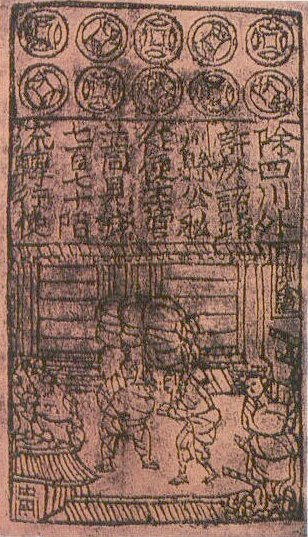
1024 年，北宋四川發行**官方交子**——**世界第一張政府紙幣**：
鐵錢（重，難運） —兌換券（交子）→ 紙幣（部分準備）
16 家錢鋪的私交子（真宗年間）→ 交子務（1024 官方化）→ **準備金約 28–36%**——
**部分準備銀行（fractional reserve）的第一次實驗**。
結果：濫發 → 貶值 → 元朝寶鈔崩潰 → 明朝寶鈔崩潰——
**紙幣的價值取決於「不濫發」的承諾**——這是法幣的第一次大考。

[→ 對外連結：1024 - 交子紙幣（世界第一張紙幣與部分準備的實驗）](https://chad-liu.github.io/books/html/1-6-6.金融經濟史/1024-交子紙幣.html)

## 1157 | 威尼斯公債
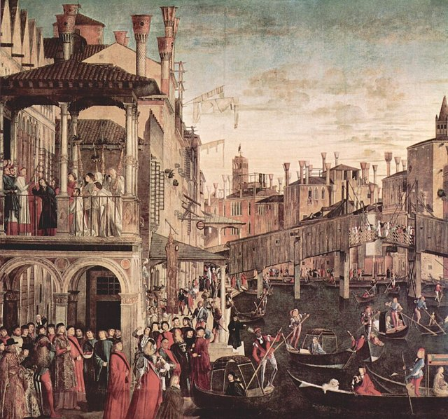
1157 年起，威尼斯為戰爭融資開始**強制公債（prestiti）**；
1262 年整合為 **Monte Vecchio（舊山公債）**——
**第一支可轉讓、附息、永續的政府債券**：
戰爭需要現金 —強制公債 + 可轉讓 + 永續附息→ 現代公債的誕生
利率 ~5%（法條規定），持有人可在市場轉讓——**政府信用從此成為可交易的資產**——
這是**現代債券市場的誕生**，也是「國家把未來稅收賣成現金」的發明。

[→ 對外連結：1157 - 威尼斯公債（第一支可轉讓政府公債：把「未來」賣成「現金」）](https://chad-liu.github.io/books/html/1-6-6.金融經濟史/1157-威尼斯公債.html)

## 1340 | 巴迪銀行倒閉
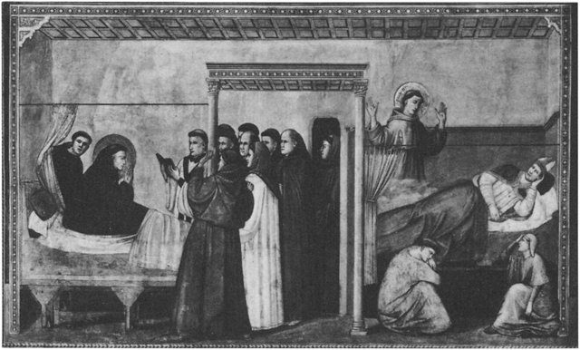
1340 年代，佛羅倫斯的兩大銀行——**Bardi（1272 創立）與 Peruzzi（1275）**——
接連倒閉，導火線是**英王愛德華三世在百年戰爭中直接違約**：
銀行（借短貸長） + 主權違約 —連鎖→ 佛羅倫斯金融危機
這是**史上第一次「主權違約 → 銀行連鎖倒閉」**的完整樣本——
比 2008 年早 670 年；而美第奇銀行（1397）的興起，
正是對這一案的「制度補丁」（分散、夥伴制、關係銀行）。

[→ 對外連結：1340 - 巴迪銀行倒閉（史上第一次主權違約連鎖倒閉）](https://chad-liu.github.io/books/html/1-6-6.金融經濟史/1340-巴迪銀行倒閉.html)

## 1494 | 複式簿記

1494 年，**Luca Pacioli** 在威尼斯出版《算術、幾何、比與比例概要》（Summa），
系統化**複式簿記（double-entry bookkeeping）**——
每筆交易**記兩次**（借方 = 貸方），帳本**自我校驗**：
資產 = 負債 + 權益 (A = L + E)
這不是數學發明（威尼斯商人已用 200 年），而是**標準化與出版**——
讓「可驗證的帳本」從商人祕技變成**資本主義的基礎設施**：
**沒有複式簿記，就沒有大企業、沒有審計、沒有股份有限公司**。

[→ 對外連結：1494 - 複式簿記（資本主義的會計引擎）](https://chad-liu.github.io/books/html/1-6-6.金融經濟史/1494-複式簿記.html)

## 1503 | 塞維亞貿易壟斷
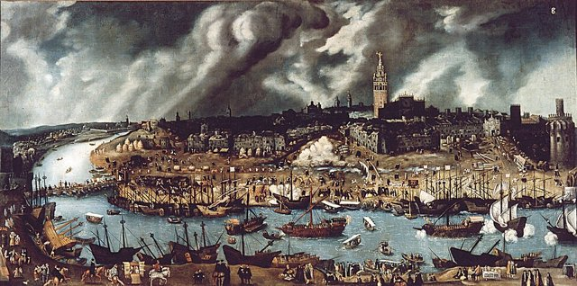
1503 年，西班牙王室在**塞維亞**設立印度貿易院（Casa de Contratación）——
全美洲的貿易只能進出這一個港口，而且塞維亞還是個**內河港**（瓜達爾基維爾河上游，
大船得在下游換小船駁運），外加 **20% 的五一稅**（quinto real）、王室特許的護航艦隊、
以及「外國人不得參與、殖民地之間不得互貿」的禁令：
單一港口 + 20\%重稅 + 特許壟斷 → 走私 ↑ → 稅基腐蝕
偵探要問的謎題是：**壟斷明明是為了把錢留在西班牙，為什麼錢漏得比誰都快？**

[→ 對外連結：1503 - 塞維亞貿易壟斷（一個內河港如何壟斷全世界）](https://chad-liu.github.io/books/html/1-6-6.金融經濟史/1503-塞維亞貿易壟斷.html)

## 1545 | 價格革命與白銀

1545 年，西班牙人在上秘魯（今玻利維亞）發現**波托西銀山**——
一座「會吃人、也會吐錢」的山，加上墨西哥薩卡特卡斯銀礦，
讓歐洲的貨幣存量在 16 世紀暴增數倍，物價跟著漲了整整一百多年：
美洲白銀 ↑ → 歐洲貨幣存量 M ↑ → 物價 P ↑ （百年）
這是**史上第一次被記錄的全球性貨幣衝擊**——「價格革命」。
偵探要問的謎題是：**錢變多了，為什麼物價漲、經濟卻沒有等比例變富？**

[→ 對外連結：1545 - 波托西白銀與價格革命（美洲金銀如何引爆歐洲百年通膨）](https://chad-liu.github.io/books/html/1-6-6.金融經濟史/1545-價格革命與白銀.html)

## 1580 | 葡萄牙併入西班牙
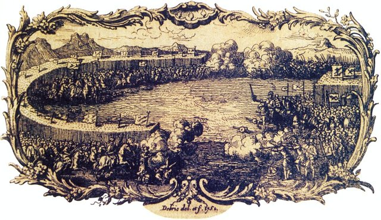
1578 年，葡萄牙國王塞巴斯蒂安率兩萬大軍遠征摩洛哥，
在**阿爾卡塞爾基比爾**（三大戰役的「三王之戰」）全軍覆沒——
國王戰死、貴族團滅、王位只剩一個老樞機主教。
兩年後，西班牙菲利普二世兵不血刃吞併葡萄牙，托馬爾議會（1580）加冕共主：
國王戰死 + 貴族團滅 + 香料利潤↓ → 王國被併購
偵探要問的謎題是：**一個靠香料富了一百年的王國，為什麼一場敗仗就抵擋不住被收購？**

[→ 對外連結：1580 - 葡萄牙併入西班牙（一場戰役如何輸掉一個王國）](https://chad-liu.github.io/books/html/1-6-6.金融經濟史/1580-葡萄牙併入西班牙.html)

## 1602 | 荷蘭東印度公司

1602 年，荷蘭議會特許 **VOC（荷蘭東印度公司）**——
**第一家具有永久資本的股份公司（joint-stock company）**；
同年**阿姆斯特丹證券交易所**開始交易 VOC 股票——
**世界上第一個正式的證券市場**：
遠洋貿易的風險 —有限責任 + 永久資本 + 可轉讓股份→ 現代公司制的誕生
三個發明（有限責任、永久資本、二級市場）合流——
**人類史上最強的融資機器誕生**——資本主義的公司制基礎從此定型。

[→ 對外連結：1602 - 荷蘭東印度公司（第一家股份公司與證券市場：資本的永續化）](https://chad-liu.github.io/books/html/1-6-6.金融經濟史/1602-荷蘭東印度公司.html)

## 1609 | 阿姆斯特丹匯兌銀行
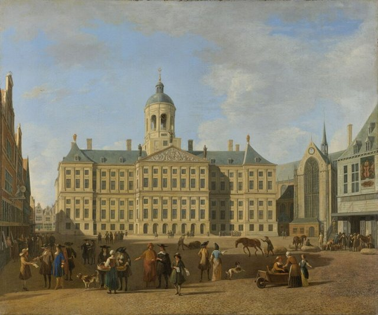
1609 年，**阿姆斯特丹匯兌銀行（Amsterdamsche Wisselbank）**成立——
世界上第一家**公共存款匯兌銀行**（chartered municipal bank）：
商人把各國雜亂的硬幣**存入銀行**，改用**帳面貨幣（bank money / bank florin）**結算：
雜幣（成色不一、剪損、外國幣） \Longrightarrow 單一「帳面盾」 (信用統一)
這是大航海時代最被低估的金融制度——VOC（1602，見 `1602-荷蘭東印度公司.md`）
需要**可靠的結算系統**才能把全歐洲的資本匯進阿姆斯特丹：
**交易所解決「誰來投資」，匯兌銀行解決「錢怎麼進來、怎麼結算」**——
**波士頓聯儲、威斯康辛學派稱它為「17 世紀的央行雛形」**。

[→ 對外連結：1609 - 阿姆斯特丹匯兌銀行（大航海時代：城市信用代替金屬信用）](https://chad-liu.github.io/books/html/1-6-6.金融經濟史/1609-阿姆斯特丹匯兌銀行.html)

## 1637 | 鬱金香狂熱
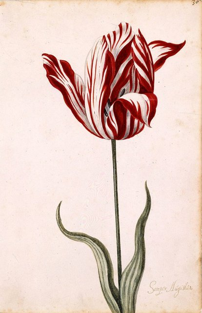
1636–37 年，荷蘭的**鬱金香球莖**價格瘋狂飆漲——
一顆稀有球莖（Semper Augustus）價格相當於**阿姆斯特丹運河豪宅**；
1637 年 2 月，價格**在一週內崩跌 90%**：
球莖（基本面：花） —期貨 + 槓桿 + 追漲→ 泡沫（價格 ≫ 基本面）
這是**史上第一場有紀錄的投機泡沫**——
「**價格與基本面脫鉤**」的第一次完整樣本——
之後 400 年的所有泡沫（南海、1929、2000、2008、2021）都是它的重演。

[→ 對外連結：1637 - 鬱金香狂熱（第一場投機泡沫：價格與基本面的脫鉤）](https://chad-liu.github.io/books/html/1-6-6.金融經濟史/1637-鬱金香狂熱.html)

## 1688 | 勞合社海上保險
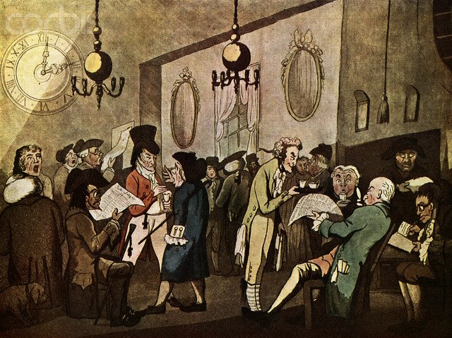
1688 年前後，倫敦泰晤士河畔 **Edward Lloyd 的咖啡館**成為
船東、船長、商人交換**航運情報與承保**的市場——
**勞合社（Lloyd's of London）**由此誕生：
一艘船的沉沒 \Longrightarrow 數十名承保人分攤 (風險的切片化與定價)
這是大航海時代的第三塊拼圖（交易所管資本、匯兌銀行管結算、
勞合社管**風險**）：
**保險把「天災與海盜的隨機性」變成「可計算的保費」**——
**風險定價是資本主義的第三根支柱**（與 1952 年 Markowitz、
1973 年 BSM 的風險數學化一脈相承）。

[→ 對外連結：1688 - 勞合社海上保險（大航海時代：風險第一次被定價）](https://chad-liu.github.io/books/html/1-6-6.金融經濟史/1688-勞合社海上保險.html)

## 1694 | 英格蘭銀行

1694 年，**William Paterson** 提案、英國議會通過——**英格蘭銀行（Bank of England）**成立：
政府需要打仗的錢 —永久資本的銀行 + 國債→ 英國的信用革命
1,200 位股東集資 **£120 萬**借給政府（年息 8%）——**銀行與國家的共生**：
**國家拿到的不只是錢，是「能持續借錢」的機器**——
英國從此以 3% 的利率打仗，法國要 6%+——**融資成本決定帝國勝負**。

[→ 對外連結：1694 - 英格蘭銀行（財政-軍事國家的信用革命）](https://chad-liu.github.io/books/html/1-6-6.金融經濟史/1694-英格蘭銀行.html)

## 1703 | 梅休恩條約
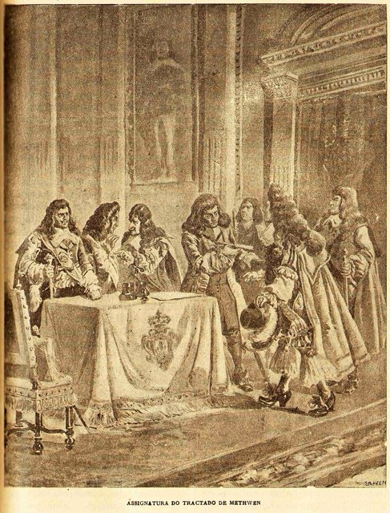
1703 年，葡萄牙與英國簽訂**梅休恩條約**：葡萄牙葡萄酒低關稅進英國，
英國呢絨低關稅進葡萄牙。條款看似對等，結果卻是——
巴西挖出的黃金經里斯本**直流倫敦**，葡萄牙本土呢絨業被扼殺，
而英格蘭銀行（見 `1694-英格蘭銀行.md`）的金庫卻越堆越滿：
巴西黃金 → 里斯本 → 倫敦 → 英格蘭銀行準備金 → 工業革命融資
偵探要問的謎題是：**金子是葡萄牙挖的，為什麼最後變成英國的資本？**

[→ 對外連結：1703 - 梅休恩條約（窮國的金子如何變成富國的資本）](https://chad-liu.github.io/books/html/1-6-6.金融經濟史/1703-梅休恩條約.html)

## 1713 | 烏得勒支條約
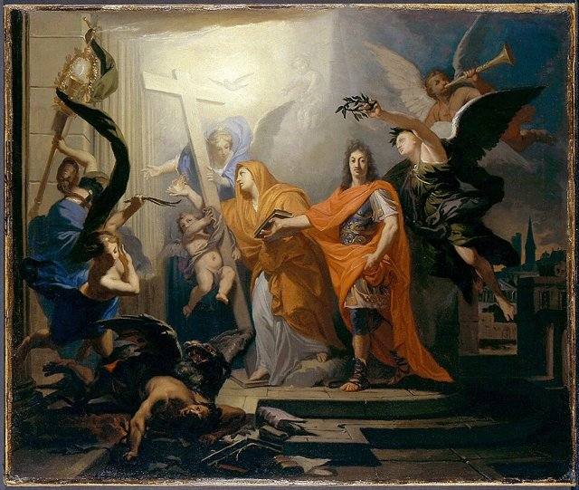
1713 年，西班牙王位繼承戰爭以**烏得勒支條約**收場——
波旁的腓力五世保住了西班牙王冠，卻交出了尼德蘭、米蘭、那不勒斯、撒丁，
還把為期 **30 年的黑奴貿易特許**（asiento）連同**年度許可船**（navío de permiso）
雙手奉送給英國：
王冠保住 - 歐洲屬地 - 貿易特許 = 帝國變半島國家
偵探要問的謎題是：**打了十二年仗保住王位，為什麼資產負債表上全是虧損？**

[→ 對外連結：1713 - 烏得勒支條約（帝國縮水成半島國家的資產負債表）](https://chad-liu.github.io/books/html/1-6-6.金融經濟史/1713-烏得勒支條約.html)

## 1720 | 南海泡沫
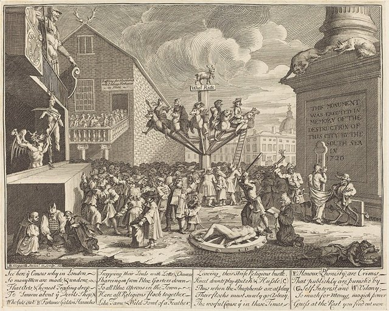
1720 年，兩場泡沫同年爆炸——**法國密西西比泡沫**（John Law 的紙幣實驗）
與**英國南海泡沫**（South Sea Company 的債轉股龐氏）：
政府債務 —債轉股 + 紙幣擴張 + 特許濫發→ 雙泡沫同年崩潰
**牛頓**在南海泡沫中虧掉 £20,000（約 3,000 萬今日美元）：
「我能算出天體的運行，卻算不出人性的瘋狂」——
**史上第一次「央行 + 財政 + 股市」三重泡沫**——
這一案定義了之後 300 年的**金融監管史**。

[→ 對外連結：1720 - 南海泡沫與密西西比泡沫（同年雙爆：槓桿、紙幣與龐氏結構）](https://chad-liu.github.io/books/html/1-6-6.金融經濟史/1720-南海泡沫.html)

## 1755 | 里斯本大地震

1755 年 11 月 1 日，萬聖節的早晨，里斯本連遭三劫——
大地震、海嘯、大火，市中心夷為平地，死亡逾萬人，皇宮、海關、印度之家（Casa da Índia）連同**全部關稅帳冊與海外貿易檔案俱焚**：
地震 + 海嘯 + 大火 → 財政資訊歸零 → 強人加稅重建
這是**史上第一次「主權資產負債表被物理銷毀」**——會計失明的物理版。
偵探要問的謎題是：**一場天災，為什麼反而讓專制宰相龐巴爾（Pombal）的權力更大、稅收更多？**

[→ 對外連結：1755 - 里斯本大地震（天災如何燒掉一個帝國的帳本）](https://chad-liu.github.io/books/html/1-6-6.金融經濟史/1755-里斯本大地震.html)

## 1776 | 國富論

1776 年 3 月 9 日，**Adam Smith** 出版《國富論》（The Wealth of Nations）——
**經濟學作為一門學科誕生**：
重商主義（貿易 = 零和） —分工 + 市場 + 看不見的手→ 財富 = 分工 × 交換
兩大發明：**分工理論**（別針工廠 10 人日產 48,000 支 vs 1 人 20 支）
與**看不見的手**（自利 → 市場價格協調）——
**價格 = 分散資訊的協調機制**——這是 200 年後 Hayek「知識在社會中的使用」的前身。

[→ 對外連結：1776 - 國富論（看不見的手與分工理論：經濟學的誕生）](https://chad-liu.github.io/books/html/1-6-6.金融經濟史/1776-國富論.html)

## 1782 | 聖卡洛斯銀行
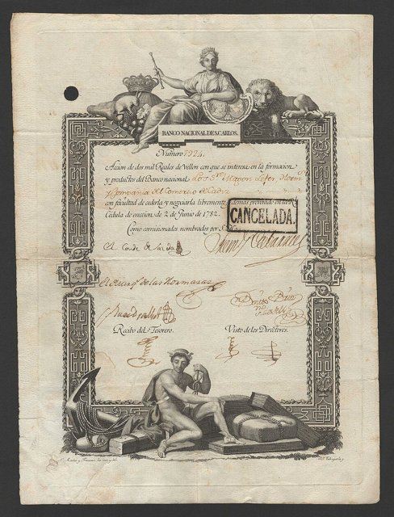
1782 年，西班牙啟蒙大臣卡瓦魯斯（Cabarrús）創辦**聖卡洛斯銀行（Banco de San Carlos）**——
西班牙第一家國家銀行，任務是貼現王室發行的紙幣公債（vales reales）、供應戰費、振興商業：
戰費透支 → 發 vales → 銀行貼現 vales → vales 貶值 → 銀行跟著沉
開張時學的是倫敦（`1694-英格蘭銀行.md`），結局卻是印鈔——
偵探要問的謎題是：**為什麼同樣的「國家銀行」招牌，在倫敦是信用，在馬德里是通膨？**

[→ 對外連結：1782 - 聖卡洛斯銀行（同樣的招牌，為何在馬德里是印鈔機）](https://chad-liu.github.io/books/html/1-6-6.金融經濟史/1782-聖卡洛斯銀行.html)

## 1792 | 梧桐協議
1792 年 5 月 17 日，二十四名股票經紀人在紐約華爾街 68 號梧桐樹下簽約：互給優先報價、固定最低佣金（0.25%）——**紐約證券交易所的前身**。前一年漢密爾頓的合眾國第一銀行（1791）與聯邦債券重組放出 8,000 萬美元可交易證券，投機狂熱（威廉・杜爾做空國債未遂、1792 年恐慌）剛把全城燒了一遍。經紀人們在廢墟上立規矩：與其在咖啡館被倒帳，不如結盟做市。本案偵破的是市場的悖論——**交易所誕生於恐慌，而非繁榮**：
恐慌 —違約創傷→ 報價聯盟 → 流動性 → 更大的投機

[→ 對外連結：1792-梧桐協議：二十四經紀人、五元樹下的證券市場案](https://chad-liu.github.io/books/html/1-6-6.金融經濟史/1792-梧桐協議.html)

## 1797 | 銀行休兌與紙鎊
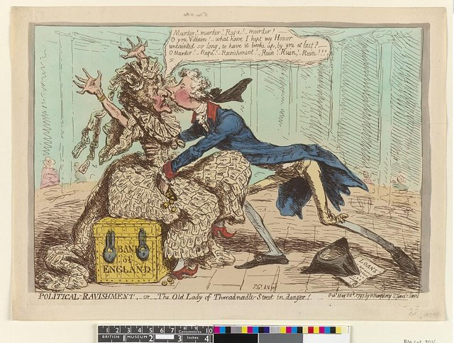
1797 年 2 月，法國入侵恐慌引發擠兌，英格蘭銀行黃金儲備一週蒸發三分之一。
首相皮特下令**銀行休兌（Bank Restriction）**——
英鎊與黃金脫鉤，**不可兌現的紙幣（紙鎊）**被迫流通，
一休就是 24 年（1797–1821）：
戰爭財政 —擠兌→ 休兌 —紙幣擴張→ 通膨 + 黃金溢價 —李嘉圖數量論→ 1821 重返金本位
這是**法幣時代的第一次全國實驗**——
李嘉圖的貨幣數量論、惡性通膨的全部劇本，
都在這 24 年裡預演了一遍。

[→ 對外連結：1797 - 銀行休兌（紙鎊時代與法幣的第一次實驗）](https://chad-liu.github.io/books/html/1-6-6.金融經濟史/1797-銀行休兌與紙鎊.html)

## 1799 | 所得稅的誕生
1799 年，英國首相小皮特（William Pitt the Younger）為支應對法戰爭，開徵人類史上第一個全國性**所得稅（income tax）**：起徵點 60 鎊、最高稅率 10%。本案的謎題是：一個被承諾「戰爭結束即廢」的臨時稅，為何兩百年後變成各國最大稅源？答案是一條制度因果鏈：

戰爭財政缺口 → 直接稅實驗 → 預扣與申報技術 → 稅基常態化 → 累進＋福利國家

[→ 對外連結：1799-所得稅的誕生：皮特的戰時稅如何變成現代財政地基](https://chad-liu.github.io/books/html/1-6-6.金融經濟史/1799-所得稅的誕生.html)

## 1806 | 大陸封鎖與走私
1806 年，拿破崙頒《柏林敕令》：歐洲大陸不得與英國貿易（大陸封鎖）。英國回敬樞密院令（海上封鎖+許可證制）。結果：英國轉向美洲（棉花、糧食），歐洲物價飛漲（糖、咖啡），走私橫行（赫爾戈蘭島、馬耳他、巴爾幹），1810 年俄國退出封鎖（英俄貿易重開），1812 年拿破崙征俄（部分為執行封鎖）。**封鎖餓死了誰？英國、歐洲，還是拿破崙自己？**

> **經濟戰打得贏嗎？當封鎖令下達，走私船就出港——封鎖的裂縫從第一天就開始漏，漏的是誰的血？**

[→ 對外連結：1806 大陸封鎖：拿破崙的經濟戰與走私者的盛宴](https://chad-liu.github.io/books/html/1-6-6.金融經濟史/1806-大陸封鎖與走私.html)

## 1821 | 金本位

1821 年，英國正式恢復**金本位**（貨幣可按固定比率兌換黃金）——
紙幣（戰爭濫發） —金本位（固定兌換黃金）→ 貨幣的「金屬錨」
事實上牛頓 1717 年任鑄幣局長時已定下金銀比價（英國走向金本位）；
1821 年正式化。金本位統治世界貨幣 **1871–1914**（國際金本位黃金年代）——
**匯率固定、物價長期平穩、但通縮與緊縮的代價**——
**第一個全球貨幣體系的百年實驗**。

[→ 對外連結：1821 - 英國金本位（貨幣錨定的百年實驗）](https://chad-liu.github.io/books/html/1-6-6.金融經濟史/1821-金本位.html)

## 1844 | 銀行特許法

1844 年，英國首相 **Robert Peel** 通過**銀行特許法（Bank Charter Act）**——
英格蘭銀行的**紙幣發行必須 100% 黃金準備**（超額部分以公債為限額）：
紙幣發行權 —100\% 黃金準備（通貨學派）→ 貨幣紀律
這是**「規則 vs 權衡（rules vs discretion）」**的第一次立法——
**通貨學派**（貨幣量決定一切，必須綁黃金）對決**銀行學派**（信用需求決定，不必綁）。
結果：1847/1857/1866 三次危機都**被迫暫停該法**——
**剛性規則在危機中失效**——這是「泰勒規則」之前 150 年的教訓。

[→ 對外連結：1844 - 銀行特許法（通貨學派 vs 銀行學派：規則 vs 權衡的百年辯論）](https://chad-liu.github.io/books/html/1-6-6.金融經濟史/1844-銀行特許法.html)

## 1845 | 鐵路股泡沫
1845–1847 年，英國國會收到**上千件鐵路法案**，鐵路股價在兩年內翻倍再翻倍，
全民——公爵到女傭——排隊認購。1847 年 10 月，泡沫連同穀物歉收的貨幣衝擊一起爆破，
銀行利率升到 10%，**1844 年皮爾銀行法被迫暫停**：
真實革命（鐵路） + 金融泡沫（股份認購） → 同一場危機的兩張臉
本案是金融史上最弔詭的案件：**泡沫破裂了，鐵路卻留了下來**。

[→ 對外連結：1845 - 英國鐵路狂熱（鐵路股泡沫：實體革命與金融泡沫的雙面案件）](https://chad-liu.github.io/books/html/1-6-6.金融經濟史/1845-鐵路股泡沫.html)

## 1848 | 芝加哥期貨交易所
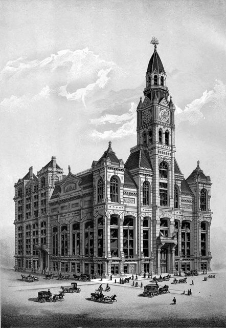
1848 年，82 位芝加哥商人成立**芝加哥期貨交易所（CBOT）**——
1865 年標準化**期貨契約**（數量、品質、交割日、保證金）：
遠期合約（一對一議價） —標準化 + 結算所 + 保證金→ 期貨（可交易的風險）
**風險第一次被拆成商品**：避險者（農民）與投機者（承擔風險者）的市場——
**衍生品革命的起點**——1973 年 CBOE（見 `1973-布萊克休斯選擇權.md`）
與 2008 年的 CDO 都是它的後代。

[→ 對外連結：1848 - 芝加哥期貨交易所（標準化期貨：把「風險」變成可交易的商品）](https://chad-liu.github.io/books/html/1-6-6.金融經濟史/1848-芝加哥期貨交易所.html)

## 1854 | 文官制改革
1854 年《諾斯科特–屈維廉報告》（Northcote–Trevelyan Report）主張：英國文官應以**公開競爭考試**錄用、**功績晉升**、**政治中立**。此前官職靠恩庇（patronage）分贓，克里米亞戰爭後勤潰敗成為導火線。本案追查：考試制如何把「官僚」從成本變成國家能力？

恩庇分贓 → 行政無能曝光 → 考試＋常任文官 → 政策連續性 → 財政金融可信

[→ 對外連結：1854-諾斯科特文官制：考試如何取代賣官鬻爵](https://chad-liu.github.io/books/html/1-6-6.金融經濟史/1854-文官制改革.html)

## 1865 | 匯豐銀行
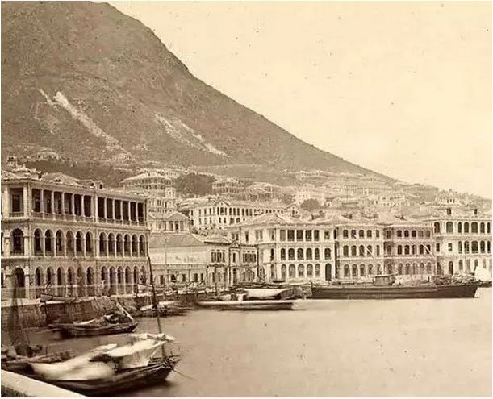
1865 年 3 月，**香港上海匯理銀行（HSBC）**在香港與上海同時開業——
由**英、美、德、印度、丹麥商人合資**（創始股東多為鴉片洋行巨頭），
專做**中英印三角貿易的匯兌與融資**：
中國（絲茶出口） ↔ 印度（鴉片/棉花） ↔ 英國（工業品/資本）
這是「**銀行視角**」的殖民案例——帝國的擴張不只靠軍艦與條約，
更靠**在貿易節點上生根的銀行**：
**匯豐不是「英國的銀行在亞洲」，而是「亞洲貿易自己的銀行」**——
**外資銀行本土化（nominal local capital）是殖民金融的絕妙發明**。

[→ 對外連結：1865 - 匯豐銀行成立（銀行視角：殖民貿易的金融血管）](https://chad-liu.github.io/books/html/1-6-6.金融經濟史/1865-匯豐銀行.html)

## 1866 | 國庫審計法
1866 年《國庫及審計部法》（Exchequer and Audit Departments Act）創設**主計審計長（Comptroller and Auditor General, C&AG）**＋國庫帳戶二元制：錢未經議會授權不得支出，花了還要被獨立審計。本案謎題：議會早就有「錢袋權」，為何錢照樣亂花？答案是**事前控制＋事後審計**必須同體：

議會授權（事前） → 國庫單一帳戶 → 獨立審計（事後） → 公開帳目 → 公債信用 ↑

[→ 對外連結：1866-國庫審計法：預算與審計如何馴服國王的錢包](https://chad-liu.github.io/books/html/1-6-6.金融經濟史/1866-國庫審計法.html)

## 1866 | 歐弗倫格尼危機
1866 年 5 月 10 日，倫敦貼現行歐弗倫格尼公司（Overend, Gurney & Co.）以「流氓有限責任公司」之名註冊上市後兩年倒閉，負債 1,100 萬鎊，引發倫敦金融城史上最猛烈的一天恐慌。英格蘭銀行違反慣例大規模放款，女王准許違反《銀行特許法》發鈔——本案是 1873 年巴吉特《倫伯德街》教義的臨床實驗，也是「貼現行」這個影子銀行物種的第一份驗屍報告。

[→ 對外連結：1866-歐弗倫格尼危機：貼現行、雙層銀行體系與巴吉特教義的臨床實驗](https://chad-liu.github.io/books/html/1-6-6.金融經濟史/1866-歐弗倫格尼危機.html)

## 1873 | 巴吉特最後貸款人
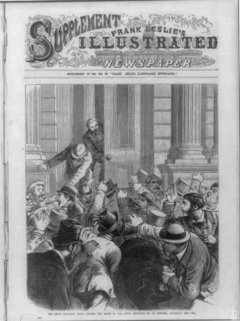
1873 年，**Walter Bagehot**（經濟學人主編）出版《Lombard Street》，
同時**美國爆發 1873 年大恐慌**（Jay Cooke 鐵路債倒閉）——
**恐慌的臨床 + 理論的處方**同年出現。Bagehot 的教義：
最後貸款人 = \underbrace自由放款不猶豫 + \underbrace懲罰性高利率防道德風險 + \underbrace好擔保防損失
**「恐慌時要借錢給所有持有好擔保的人，但利率要高」**——
現代中央銀行的操作手冊從此定型——**1873 恐慌 → 2008 年 Fed 的操作**，
同一本劇本。

[→ 對外連結：1873 - 巴吉特最後貸款人（Lombard Street：恐慌中的「高利率自由放款」）](https://chad-liu.github.io/books/html/1-6-6.金融經濟史/1873-巴吉特最後貸款人.html)

## 1892 | 葡萄牙破產
1892 年 6 月，葡萄牙王國宣布**部分主權違約**——外債利息砍掉一半（只付一成半而非三成），
里斯本股市崩盤，貨幣 escudo 前身（real）大貶：
殖民 prestige 歸零 + 外債付息斷炊 + 關稅—僑匯—殖民三斷 → 1892 部分違約
距離 1890 年英國最後通牒（粉紅地圖夢碎）不到兩年，距離鄰居西班牙丟掉古巴（1898）只剩六年——
偵探要問的謎題是：**一個沒有打大仗的國家，為什麼和打敗仗的鄰居同時結帳？**

[→ 對外連結：1892 - 葡萄牙破產（小帝國的最後一張帳單）](https://chad-liu.github.io/books/html/1-6-6.金融經濟史/1892-葡萄牙破產.html)

## 1907 | 尼克博克恐慌
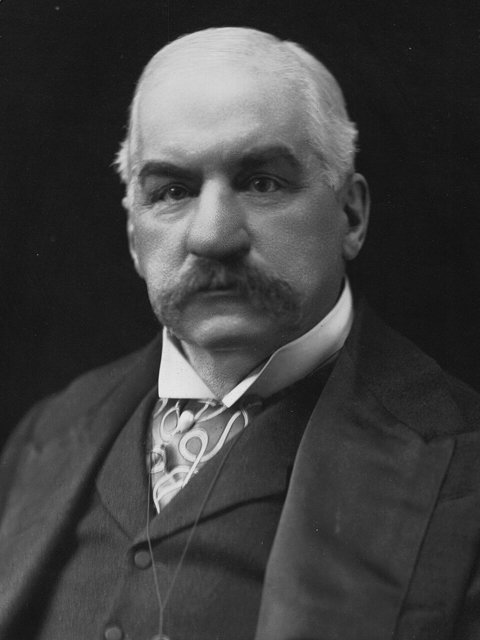
1907 年 10 月，美國信託公司尼克博克（Knickerbocker Trust）遭擠兌，恐慌三週內席捲全國：股市單日腰斬式下挫、存款人排隊提現、兩百家銀行償付靠期票過關。救市者不是央行——美國根本沒有央行——而是 70 歲的 J.P. 摩根把華爾街圖書館變成作戰室，調度銀行家、財長與教堂牧師。本案審理的問題是：為什麼美國金融體系在 1895、1907 兩度需要一個私人來行使央行職能？以及，這份答案如何直接寫出 1913 年《聯邦儲備法》？

[→ 對外連結：1907-尼克博克恐慌：私人最後貸款人的最後一舞](https://chad-liu.github.io/books/html/1-6-6.金融經濟史/1907-尼克博克恐慌.html)

## 1911 | 科學管理
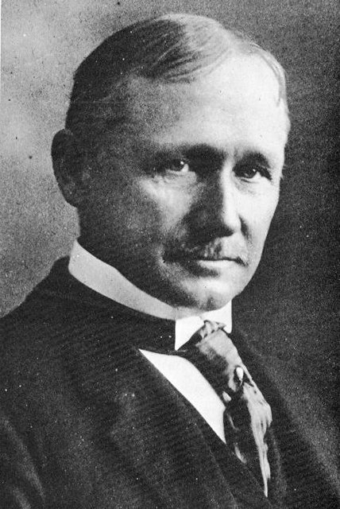
1911 年，**Frederick Taylor** 出版《科學管理原理》（The Principles of Scientific Management），
用**秒錶、動作研究、標準作業程序**把工人的每一個動作**分解、測量、最佳化**：
產出 = f(動作標準化) \Longrightarrow 生產力 ↑ ↑
這是「**管理視角**」的誕生——財富不再只靠貿易與信用創造，
而是靠**組織內部的效率**創造。管理從「經驗與鞭子」變成**可測量、可複製的科學**：
**沒有科學管理，就沒有流水線、沒有大型企業、沒有 20 世紀的量產經濟**。

[→ 對外連結：1911 - 科學管理（管理視角：把「工作」變成可測量的科學）](https://chad-liu.github.io/books/html/1-6-6.金融經濟史/1911-科學管理.html)

## 1913 | 聯準會成立

1907 年 10 月，**尼可波克信託（Knickerbocker Trust）**擠兌倒閉，
**J.P. Morgan** 私人組織救市——**史上最後一次私人最後貸款人**；
1913 年 12 月，**聯邦準備法（Federal Reserve Act）**通過——
私人救市（1907 摩根） —制度化→ 聯準會（1913）
**恐慌的臨床（1907）+ 制度的處方（1913）**——
美國終於有中央銀行（第三次嘗試：1791 第一銀行、1816 第二銀行都死了）——
**央行從「私人恩惠」變成「公共制度」**。

[→ 對外連結：1913 - 聯準會成立（1907 摩根救市 → 中央銀行的制度化）](https://chad-liu.github.io/books/html/1-6-6.金融經濟史/1913-聯準會成立.html)

## 1923 | 德國超通膨
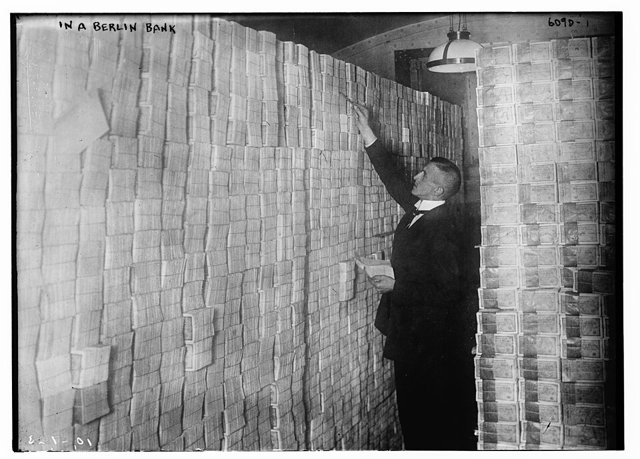
1923 年 11 月，德國馬克**徹底崩潰**——
物價指數相較 1914 年上漲約 **10¹² 倍**（一兆倍），
一條麵包 2,000 億馬克，薪水一天發兩次（怕晚發就貶值）：
戰爭賠款 + 印鈔融資 —數量方程→ 超級通膨（每月 \pi > 50\%）
1923 年 11 月**Rentenmark（地租馬克）**改革 +魯爾危機解決——
**穩定回歸**。這是**現代通膨理論的臨床樣本**——
Cagan（1956）的**超通膨模型**、**鑄幣稅的 Laffer 曲線**都由此而生。

[→ 對外連結：1923 - 德國超級通貨膨脹（印鈔機的物理極限）](https://chad-liu.github.io/books/html/1-6-6.金融經濟史/1923-德國超通膨.html)

## 1929 | 大崩盤

1929 年 10 月，**道瓊指數崩跌**（黑色星期四 10/24、黑色星期一 10/28、
黑色星期二 10/29）——兩週跌掉 1/3：
保證金槓桿（10:1）+ 投資信託 —Fed 緊縮 + 恐慌→ 大崩盤 —銀行連鎖倒閉→ 大蕭條
1929–33 年：道瓊 -89%、9,000 家銀行倒閉、失業 25%、GDP -30%——
**史上最深的金融崩潰**。Fisher 的**債務通縮理論**（1933）
與 Friedman-Schwartz 的**貨幣史解讀**（1963）——
**兩個理論（實體槓桿 vs 貨幣量）解讀同一場災難**——至今的爭論。

[→ 對外連結：1929 - 大崩盤（保證金槓桿與債務通縮的完美風暴）](https://chad-liu.github.io/books/html/1-6-6.金融經濟史/1929-大崩盤.html)

## 1930 | 斯姆特霍利關稅

1930 年 6 月 17 日，胡佛簽署《斯姆特-霍利關稅法》（Smoot-Hawley Tariff Act），將 2 萬餘項進口品關稅提到歷史頂點（平均稅率逾 40%）。時值 1929 年大崩盤之後、1931 年英國脫離金本位之前——本書年表此處正是斷裂帶：股災如何變成全球大蕭條？兇手之一就是這紙關稅：各國報復性築牆，1929–1934 年世界貿易量萎縮三分之二，債務通縮疊加貿易窒息。本案偵破的是**傳導機制**：
股災 —關稅戰→ 貿易崩潰 —金本位→ 通縮輸出 → 大蕭條全球化

[→ 對外連結：1930-斯姆特霍利關稅：大蕭條的貿易加速器案](https://chad-liu.github.io/books/html/1-6-6.金融經濟史/1930-斯姆特霍利關稅.html)

## 1931 | 英國脫離金本位
1931 年 9 月 19 日晚，英格蘭銀行黃金外流失血不止，內閣在幾小時內決定：放棄 1925 年重建的金本位。次日鎊匯自由落體，全球貿易與金融體系的錨鬆動——兩年內三十餘國跟進。本案追問：為什麼大蕭條最深的傷口在「守金本位」的國家？以及，為什麼第一個跳船的帝國反而率先復甦？

[→ 對外連結：1931-英國脫離金本位：金色枷鎖的斷裂與通縮螺旋的破解](https://chad-liu.github.io/books/html/1-6-6.金融經濟史/1931-英國脫離金本位.html)

## 1933 | 格拉斯斯蒂格爾法

1933 年 6 月，**Glass-Steagall 法**（1933 銀行法）通過——
**商業銀行與投資銀行分業**；同年成立 **FDIC（聯邦存款保險公司）**——
銀行擠兌（1929–33，9,000 家倒閉） —存款保險 + 分業 + 證券監管→ 擠兌的終結
1934 年 **證券交易法（SEC）**——**揭露制度**的立法化。
**存款保險是 20 世紀最成功的金融發明**：1933–2008 年美國幾乎沒有系統性擠兌——
**FDIC 用「保險」解決了 Diamond-Dybvig 的擠兌均衡**。

[→ 對外連結：1933 - 格拉斯斯蒂格爾法（FDIC、SEC：危機的制度補丁）](https://chad-liu.github.io/books/html/1-6-6.金融經濟史/1933-格拉斯斯蒂格爾法.html)

## 1936 | 凱因斯一般理論

1936 年 2 月，**John Maynard Keynes** 出版《就業、利息與貨幣的一般理論》——
古典學派（市場自動回到充分就業） —凱因斯（需求不足 → 長期蕭條）→ 總體經濟學的誕生
三大發明：**有效需求不足**、**乘數效應**、**流動性陷阱**——
**政府干预的正當性第一次有了理論**——戰後 40 年的經濟政策架構
（凱因斯主義）由此誕生——**經濟學的分水嶺**。

[→ 對外連結：1936 - 凱因斯一般理論（總體需求管理：經濟學的分水嶺）](https://chad-liu.github.io/books/html/1-6-6.金融經濟史/1936-凱因斯一般理論.html)

## 1944 | 布雷頓森林

1944 年 7 月，44 國代表聚集**新罕布夏州布雷頓森林**——
設計戰後金融秩序：
1930s 的混亂（貶值競賽 + 關稅戰） —美元-黃金本位 + IMF + 世界銀行→ 戰後秩序
三件套：**固定匯率（美元掛黃金 $35/oz，各國掛美元）**、
**IMF（國際收支融資）**、**資本管制**——
**「黃金匯兌本位」**——**美元成為世界的貨幣**——
1960 年 **Triffin 困境**：這個設計內含**自我毀滅的種子**——
1971 年爆炸（見 `1971-尼克森震撼.md`）。

[→ 對外連結：1944 - 布雷頓森林（美元本位：戰後金融秩序的設計圖）](https://chad-liu.github.io/books/html/1-6-6.金融經濟史/1944-布雷頓森林.html)

## 1950 | 戰後黃金年代
1944 年布雷頓森林畫好了藍圖（見 `1944-布雷頓森林.md`），但藍圖不會自己長出繁榮。
1950 年前後，西歐的馬歇爾計畫、日本的道奇路線、美國的退伍軍人法案同時啟動，
一場**史無前例的成長浪潮**——法國人叫「光輝三十年」、德國人叫「經濟奇蹟」——
把世界帶進 1950–1973 的黃金年代：
戰後重建成長 ≈ 4–5\%/年（西歐）, 失業率 < 2\%, 通膨溫和
謎題：**同樣的資本主義，為什麼 1930 年代是大蕭條、1950 年代卻是黃金年代？**

[→ 對外連結：1950 - 戰後黃金年代（布雷頓森林之後：資本主義最好的三十年從哪裡來）](https://chad-liu.github.io/books/html/1-6-6.金融經濟史/1950-戰後黃金年代.html)

## 1952 | 馬可維茲投資組合
1952 年，25 歲的芝加哥大學博士生 **Harry Markowitz** 發表
〈Portfolio Selection〉——**風險第一次被數學化**：
「別把雞蛋放同一籃」（格言） —均值-變異數最佳化→ 分散的數學
投資組合的風險不是個股風險的加總，而是**相關性加權**：
\sigmap² = w^→p \Sigma w
**分散化 = 免費的午餐**（correlation < 1 時風險低於加權平均）——
**現代金融理論的誕生**——1990 年諾貝爾獎。

[→ 對外連結：1952 - 馬可維茲投資組合理論（風險第一次被數學化）](https://chad-liu.github.io/books/html/1-6-6.金融經濟史/1952-馬可維茲投資組合.html)

## 1953 | 主權基金起源
1953 年，英國殖民當局為科威特酋長國設立 **Kuwait Investment Board（KIB）**，石油美元不再躺在倫敦往來帳戶吃活存利息，而是買英美股票債券——這是世界第一支**主權財富基金（SWF）**。謎題：賣石油的一次性橫財，為何能變成跨世代年金？

耗竭性租金 → 跨代儲蓄規則 → 全球分散投資 → 永續提領 → 去石油化緩衝

[→ 對外連結：1953-科威特主權基金：石油租金如何變成永續年金](https://chad-liu.github.io/books/html/1-6-6.金融經濟史/1953-主權基金起源.html)

## 1954 | 增值稅發明
1954 年，法國稅務官 **Maurice Lauré** 發明**增值稅（TVA/VAT）**：每道生產環節就「增值部分」課稅、進項可抵扣，稅負最終由消費者承擔而中間商無重複課稅。此稅今為 170＋國主力稅種、歐盟財源基石。本案追查：一張發票抵扣鏈如何馴服逃稅？

cascade 重複課稅 → 進銷項抵扣鏈 → 廠商互為稽查 → 稅收中性＋豐沛 → 福利國家財源

[→ 對外連結：1954-增值稅的發明：法國人如何課到每一道加值](https://chad-liu.github.io/books/html/1-6-6.金融經濟史/1954-增值稅發明.html)

## 1958 | MM資本結構
1958 年，**Modigliani 與 Miller** 發表〈The Cost of Capital, Corporation Finance and the Theory of Investment〉，
證明了一個違反直覺的命題：**在完美市場中，公司用股東權益融資或用債務融資，公司價值完全相同**：
VL = VU (有槓桿價值 = 無槓桿價值)
這是「**財務視角**」的誕生——公司的價值來自**資產產生的現金流**，
而不是融資的「包裝方式」：
**財務管理的本題是投資決策（現金流），資本結構只是分配切法**。

[→ 對外連結：1958 - Modigliani–Miller 定理（財務視角：資本結構無關論）](https://chad-liu.github.io/books/html/1-6-6.金融經濟史/1958-MM資本結構.html)

## 1960 | 歐洲美元市場
1960 年前後，倫敦出現一批「不在美國的美元」——蘇聯銀行怕美元資產被凍結而存倫敦（傳說中的 Eurodollar 起源之一）、美國《Q 條例》壓低境內存款利率、英國 1957 年禁止英鎊貿易融資後銀行改做美元生意。三股細流匯成體外美元 ocean：不受聯準會準備金與利率管制、24 小時接力（倫敦→巴林→新加坡）。結果是布雷頓森林（美元與黃金掛鉤、資本管制）的體制被自己的貨幣掏空——**美元在體制外自由繁殖，體制內卻假裝管得住**。本案偵破的是**規避創新**：
管制 —離岸→ 體外貨幣 → 貨幣政策漏損 → 布雷頓森林解體

[→ 對外連結：1960-歐洲美元市場：布雷頓森林的體外循環案](https://chad-liu.github.io/books/html/1-6-6.金融經濟史/1960-歐洲美元市場.html)

## 1964 | CAPM
1964 年，**William Sharpe**（Markowitz 的學生）發表 **CAPM**
（Sharpe、Lintner、Mossin 各自獨立提出）：
「風險如何定價？」 —單因子（市場風險）→ E(Ri) = Rf + \betai (E(Rm) - Rf)
**資產的期望報酬 = 無風險利率 + β × 市場風險溢酬**——
**只有「系統性風險」（β）被定價，非系統性風險（個別風險）沒有報酬**——
**「分散化」的定價意義**——1990 年諾貝爾獎。

[→ 對外連結：1964 - CAPM 資本資產定價模型（風險定價的單因子革命）](https://chad-liu.github.io/books/html/1-6-6.金融經濟史/1964-CAPM.html)

## 1971 | 尼克森震撼
1971 年 8 月 15 日，**尼克森**總統宣布**關閉黃金窗口**——
美元不再兌換黃金——布雷頓森林（見 `1944-布雷頓森林.md`）的死亡：
美元-黃金本位 —Triffin 困境兌現→ 純法幣（fiat money）時代
1973 年固定匯率終結，全球**浮動匯率**——
**人類史上第一次全球純法幣體系**——
**通膨的十年（1970s）、浮動匯率、衍生品革命**（1973 CBOE）——
**貨幣的錨從「黃金」變成「央行的信用」**。

[→ 對外連結：1971 - 尼克森震撼（法幣時代的誕生：黃金窗口的關閉）](https://chad-liu.github.io/books/html/1-6-6.金融經濟史/1971-尼克森震撼.html)

## 1971 | 那斯達克電子報價

1971 年 2 月 8 日，那斯達克（NASDAQ）開盤——全球第一個全電子報價市場，沒有交易大廳、沒有喊價員，只有電話線另一端的做市商報價機。首日掛牌 2,500 檔場外證券，報價從「粉紅單的口耳相傳」變成「螢幕上的全國聯播」。兇手不是單一的電腦，而是場外市場詐欺頻傳、SEC 整頓壓力、電子通訊技術成熟與做市商制度設計四者咬合。金融交易第一次脫離物理場所，「電子＋報價＋做市」三合一，為五十年後的高頻交易埋下第一行程式碼。

[→ 對外連結：1971-那斯達克電子報價：把交易所搬進電話線的案件](https://chad-liu.github.io/books/html/1-6-6.金融經濟史/1971-那斯達克電子報價.html)

## 1972 | 紅杉資本與創投制度
1972 年，唐·瓦倫丁（Don Valentine）在沙丘路創辦紅杉資本（Sequoia Capital）；同年 KPCB 成立，有限合夥＋2/20 收費＋ERISA 鬆綁預期，三者合流，「矽谷創投體制」定型。兇手不是單一的伯樂眼光，而是 ARD（1946）證明封閉基金可行、仙童系出走潮提供案源、有限合夥解決 GP/LP 誘因、1979 年 ERISA 澄清允許退休金入場四者咬合。創投從「富豪副業」變成「制度化量產獨角獸的機器」——蘋果（1978 紅杉投資）、甲骨文、思科、Google、Airbnb 皆出此門。

[→ 對外連結：1972-紅杉資本與創投制度：2/20 公式如何量產矽谷](https://chad-liu.github.io/books/html/1-6-6.金融經濟史/1972-紅杉資本與創投制度.html)

## 1973 | 布萊克休斯選擇權
1973 年 5 月，**Fischer Black 與 Myron Scholes** 發表
〈The Pricing of Options and Corporate Liabilities〉——**BSM 公式**；
同年 4 月**芝加哥選擇權交易所（CBOE）**開張：
選擇權（議價、無理論） —BSM 公式（閉式解）→ 衍生品的工業化
C = S N(d1) - K e^-rT N(d2)
**風險第一次有了「公式價格」**——衍生品市場從零到
**名目本金 $600+ 兆**（2020s）——**金融史上最大的理論-實務合流**——
1997 年諾貝爾獎（Scholes、Merton）。

[→ 對外連結：1973 - 布萊克–休斯選擇權定價（衍生品革命：把「風險」算成價格）](https://chad-liu.github.io/books/html/1-6-6.金融經濟史/1973-布萊克休斯選擇權.html)

## 1974 | 石油美元循環

1973–74 年，油價從 3 美元跳到 12 美元——產油國瞬間坐擁金山，
進口國瞬間出現鉅額赤字。謎題是：**這些美元去哪了？赤字國怎麼活？**
答案是 1974 年基辛格與沙烏地達成的隱形協議：
沙國只用美元計價賣油、石油收入回收進美國國債——
**石油美元循環（petrodollar recycling）**誕生：
油價 ↑ → OPEC 盈餘 → 存入紐約/倫敦 → 貸給赤字國 → 買油再回流
這台機器撐起了 1970 年代的全球需求，也埋下了 1982 年拉美債務危機的引信。

[→ 對外連結：1974 - 石油美元循環（尼克森震撼之後：回收油元的隱形機器）](https://chad-liu.github.io/books/html/1-6-6.金融經濟史/1974-石油美元循環.html)

## 1976 | 尤努斯微型貸款
1976 年，孟加拉吉大港大學教授穆罕默德·尤努斯借給 42 名婦女共 27 美元（做竹凳本錢），免抵押、靠小組連保還款；1983 年創鄉村銀行；2006 年獲諾貝爾和平獎。此前：孟加拉 1974 年饑荒、高利貸（月息一成上下，一說）盤剝農民。此後：微型貸款全球複製（拉美、非洲、印度，成敗參半）、商業化爭議（利率、小額信貸危機 2010 印度安得拉邦）。**27 美元如何變成諾貝爾獎？窮人缺的是錢，還是缺抵押品？**

> **窮人還得起錢嗎？當銀行說窮人沒信用，尤努斯說窮人最有信用——誰對？**

[→ 對外連結：1976 尤努斯：27 美元與鄉村銀行](https://chad-liu.github.io/books/html/1-6-6.金融經濟史/1976-尤努斯微型貸款.html)

## 1979 | 沃克衝擊
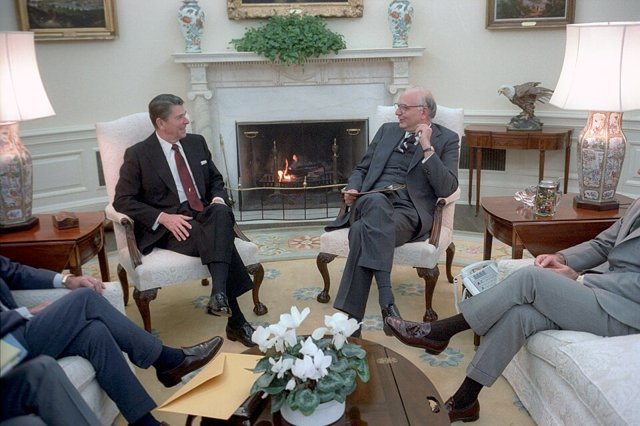
1979 年 10 月 6 日，**Paul Volcker**（聯準會主席）宣布——
聯準會改以**控制貨幣量（M1）**為目標，**容忍利率飆升**：
通膨 13.5\%（1980） —聯邦基金利率 20\%→ 通膨 4\%（1983）
代價：1981–82 蕭條（失業 10.8%、農民開曳引機包圍聯準會）——
**貨幣主義的實戰實驗**——**「央行信用 = 通膨錨」**——
**法幣時代（1971 後）的第一次大考**——**通膨目標制的種子**。

[→ 對外連結：1979 - 沃克衝擊（貨幣主義的升息實驗：用 20% 利率殺死通膨）](https://chad-liu.github.io/books/html/1-6-6.金融經濟史/1979-沃克衝擊.html)

## 1987 | 黑色星期一
1987 年 10 月 19 日，道瓊指數**單日 -22.6%**（史上最大單日跌幅）——
無戰爭、無衰退、無信用危機——
投資組合保險（synthetic put） —下跌 → 自動賣出 → 更跌→ 正回饋崩盤
**投資組合保險**（Leland–O'Brien–Rubinstein，1981）——
用**動態複製選擇權**（見 `1973-布萊克休斯選擇權.md` 的 delta 避險）保護投資組合——
**所有人都用同一個策略 → 下跌時所有人同時賣 → 崩盤**——
**「策略的同質性 = 新的系統性風險」**——第一次由「金融工程本身」造成的崩盤。

[→ 對外連結：1987 - 黑色星期一（投資組合保險的正回饋：程式交易的第一場災難）](https://chad-liu.github.io/books/html/1-6-6.金融經濟史/1987-黑色星期一.html)

## 1990 | 日本泡沫崩潰
1989 年 12 月 29 日，日經指數登頂 38,915 點——
隨後 9 個月跌掉 40%，1992 年跌破 15,000 點，
東京皇居地價一度號稱「可買下整個加州」：
低利率 + 土地抵押 —股地循環→ 泡沫 —三重野緊縮→ 股地雙殺 —殭屍銀行→ 失落三十年
1985 年廣場協議後日圓升值、1987 年黑色星期一後全球降息——
日本把過剩儲蓄灌進股票與土地；
1989–90 年央行三度加息刺破泡沫——
**史上最大的資產負債表衰退**就此開始。

[→ 對外連結：1990 - 日本泡沫崩潰（日經腰斬與失落三十年的起點）](https://chad-liu.github.io/books/html/1-6-6.金融經濟史/1990-日本泡沫崩潰.html)

## 1992 | 索羅斯對決英鎊
1992 年 9 月 16 日（Black Wednesday），**George Soros 的量子基金**做空英鎊 $100 億，
**英格蘭銀行**一天內升息 10%→12%→15%（未宣布）仍擋不住——
**英鎊退出歐洲匯率機制（ERM）**、英國損失 £33 億，Soros 賺 ~$10 億：
固定匯率（ERM）+ 內部失衡 —投機攻擊→ 準備金耗盡 → 貶值
**Krugman（1979）投機攻擊模型**的第一次大型實戰——
**「基本面與匯率錨不一致時，投機攻擊是必然」**——
**ERM 危機 → 歐元加速誕生**（見 `1999-歐元誕生.md`）。

[→ 對外連結：1992 - 索羅斯對決英鎊（Black Wednesday：投機攻擊模型的實戰）](https://chad-liu.github.io/books/html/1-6-6.金融經濟史/1992-索羅斯對決英鎊.html)

## 1995 | 巴林銀行倒閉
1995 年 2 月，**233 年歷史的英國巴林銀行（Barings Bank）**破產——
死因不是市場崩潰、不是主權違約，而是**新加坡分行一名 28 歲交易員
Nick Leeson** 的未授權日經期貨部位：
帳面虧損 ≈ £8.6 億 > 銀行資本 ≈ £9 億（幾乎全滅）
這是「**銀行視角**」的經典案例——**銀行的資產負債表可以很健康，
但只要「內部控制」破了一個洞，整個機構一夜滅亡**：
**銀行的真正資本是「控管風險的能力」，不是帳面上的資產**。

[→ 對外連結：1995 - 巴林銀行倒閉（銀行視角：一名交易員擊沉 233 年老銀行）](https://chad-liu.github.io/books/html/1-6-6.金融經濟史/1995-巴林銀行倒閉.html)

## 1997 | 亞洲金融風暴
1997 年 7 月 2 日，**泰國央行放棄泰銖對美元的固定匯率**——泰銖腰斬；
**印尼、韓國、馬來西亞**接連淪陷——
固定匯率 + 短期美元外債 + 資本帳開放 —突然停損（sudden stop）→ 雙重危機
**貨幣危機 + 銀行危機同時爆發**（twin crises）——
IMF 接手紓困（$40–570 億），**資本帳開放的代價**——
**「原罪」（original sin）**：新興市場**無法用本幣借外債**——
**1997 → 2008 → 2022，新興市場危機的模板**。

[→ 對外連結：1997 - 亞洲金融風暴（短期美元債 + 固定匯率：雙重危機的完美配方）](https://chad-liu.github.io/books/html/1-6-6.金融經濟史/1997-亞洲金融風暴.html)

## 1998 | LTCM崩潰
1998 年 9 月，**LTCM（長期資本管理公司）**——
由**Merton、Scholes（1997 諾貝爾獎得主）**與**Meriwether**（所羅門兄弟債券之神）
組成的對沖基金——**在俄羅斯違約後崩潰**：
25:1 槓桿 + 收斂交易 + 流動性消失 —俄債違約（1998.8）→ 帳戶歸零
**NY Fed 召集 14 家銀行私人紓困 $3.6 億**（「太大不能倒」的先例）——
**「危機時相關性趨近 1」**——**Markowitz 分散的極限**
（見 `1952-馬可維茲投資組合.md`）——**2008 年金融海嘯的預演**。

[→ 對外連結：1998 - LTCM 崩潰（諾貝爾獎團隊的槓桿災難：相關性趨近 1 的世界）](https://chad-liu.github.io/books/html/1-6-6.金融經濟史/1998-LTCM崩潰.html)

## 1999 | 歐元誕生

1999 年 1 月 1 日，**歐元**問世——11 國貨幣統一，
**ECB（歐洲央行）**接管貨幣政策：
多國多幣（1970s ERM 的中間態） —單一貨幣→ 歐元（1999）
**Mundell（1961）最適貨幣區理論**的世紀實驗——
**「勞動力流動 + 財政轉移 + 同步景氣」三個條件**——
**歐元只滿足部分**——2010 年歐債危機（見 `1999-歐元誕生.md` 的後續
`2008-全球金融海嘯.md`）是理論條件的臨床檢驗——
**貨幣統一 ≠ 財政統一** 的核心矛盾。

[→ 對外連結：1999 - 歐元誕生（最適貨幣區的世紀實驗）](https://chad-liu.github.io/books/html/1-6-6.金融經濟史/1999-歐元誕生.html)

## 2000 | 網路泡沫與科技股
2000 年 3 月 10 日，那斯達克綜合指數衝上 5048 點歷史頂峰；隨後一年暴跌近八成，Pets.com、Webvan、WorldCom 等明星接連倒地，5 兆美元市值蒸發。兇手不是單一的騙局，而是瀏覽器點火（1995）、創投燒錢賽局、眼球估值法、散戶保證金融資與聯準會升息五者咬合。這不是普通的股災，而是一場「科技因素＋金融因素」的複合案件：真技術（光纖、瀏覽器、電商）＋假價格（零營收天價市值）——泡沫破了， جاده光纖還在。

[→ 對外連結：2000-網路泡沫與科技股：眼球定價法的破滅現場](https://chad-liu.github.io/books/html/1-6-6.金融經濟史/2000-網路泡沫與科技股.html)

## 2001 | 安隆會計舞弊

2001 年 12 月，**美國能源巨擘安然（Enron）**破產——
市值曾達 700 億美元的公司，靠**特殊目的個體（SPE）、表外融資、公允價值認列**
把數百億負債藏到帳外：
帳面 = 漂亮損益 真實 = 負債入表 \Longrightarrow 瞬間破產
這是「**會計視角**」的世紀案例——1494 年 Pacioli 的複式簿記
（見 `1494-複式簿記.md`）告訴我們帳本可以自我校驗；
安隆告訴我們：**帳本可以「合法地」欺騙——只要負債不進帳**：
**審計、揭露、會計準則的整條信任鏈同時失靈**。

[→ 對外連結：2001 - 安隆會計舞弊（會計視角：表外魔術與審計失靈）](https://chad-liu.github.io/books/html/1-6-6.金融經濟史/2001-安隆會計舞弊.html)

## 2005 | IFRS全球準則
2005 年 1 月 1 日，歐盟 7000＋家上市公司強制改用 **IFRS（國際財務報導準則）** 編表，一夜之間「利潤」的定義權從各國政府移交倫敦的 IASB。本案是安隆案（見 `2001-安隆會計舞弊.md`）的續集：美國 GAAP 以規則防弊卻養出表外魔術，IFRS 改以原則＋公允價值重建信任。

安隆＋世通信任崩 → 準則趨同壓力 → 歐盟強制 IFRS → 可比性 ↑ → 跨境資本成本 ↓

[→ 對外連結：2005-IFRS全球準則：誰有權定義「利潤」](https://chad-liu.github.io/books/html/1-6-6.金融經濟史/2005-IFRS全球準則.html)

## 2008 | 全球金融海嘯
2008 年 9 月 15 日，**雷曼兄弟（Lehman Brothers）**破產——
158 歲的投資銀行、$6,000 億資產——**史上最大破產案**：
次貸 —證券化（MBS→CDO→CDS）→ 槓桿 33:1 的影子銀行體系 —房價下跌→ 總崩潰
**Minsky 時刻**（見 `1720-南海泡沫.md` 的週期）的教科書重演——
**Fed/Bagehot 教義的復活**（見 `1873-巴吉特最後貸款人.md`）：
**零利率 + QE + TARP**——**1930s 以來最大的制度反應**。

[→ 對外連結：2008 - 全球金融海嘯（次貸、CDO 與影子銀行：槓桿體系的總崩潰）](https://chad-liu.github.io/books/html/1-6-6.金融經濟史/2008-全球金融海嘯.html)

## 2009 | 比特幣創世

2009 年 1 月 3 日，**中本聰（Satoshi Nakamoto）**挖出**比特幣創世區塊**——
區塊內嵌一行字：
「The Times 03/Jan/2009 Chancellor on brink of second bailout for banks」
（財政大臣瀕臨對銀行第二輪紓困）——**創世區塊 = 對 2008 年的抗議宣言**
（見 `2008-全球金融海嘯.md`）：
中心化信用（銀行/央行） —PoW 共識 + 有限供給 2,100 萬→ 去中心化貨幣
**「不濫發」的承諾從「央行的信用」變成「演算法的必然」**——
（見 `1024-交子紙幣.md` 的紙幣承諾問題的算法解法）——
**貨幣史上第一次「無發行人的貨幣」**。

[→ 對外連結：2009 - 比特幣創世（去中心化帳本：把「央行」變成「演算法」）](https://chad-liu.github.io/books/html/1-6-6.金融經濟史/2009-比特幣創世.html)

## 2010 | 閃崩與高頻交易
2010 年 5 月 6 日下午，道瓊**在 20 分鐘內暴跌近 1,000 點（-9%）**又迅速反彈——
**閃崩（Flash Crash）**：
高頻交易（HFT）做市 —異常賣單 + 做市商撤單→ 流動性瞬間蒸發
SEC 調查歸因於**共同基金的巨型賣單**（75,000 張 E-mini，不顧價格的演算法賣出）
+ **「stub quote」（$0.01 假報價）**——
**流動性的假象**：HFT 的報價**可以瞬間撤銷**——
**「流動性 ≠ 流動性承諾」**——**熔斷升級 + Dodd-Frank（同月簽署）**。

[→ 對外連結：2010 - 閃崩與高頻交易（Flash Crash：機器做市的流動性假象）](https://chad-liu.github.io/books/html/1-6-6.金融經濟史/2010-閃崩與高頻交易.html)

## 2012 | 歐債危機
2009 年底希臘新政府承認赤字造假（12.7% 而非 3.7%）——
2010–12 年危機從雅典燒到都柏林、里斯本、馬德里、羅馬，
西班牙十年債殖利率破 7%、義大利破 6.5%，歐元解體論甚囂塵上。
2012 年 7 月 26 日，歐洲央行總裁德拉吉一句
**「Whatever it takes（不惜一切）」** + OMT 購債承諾——
殖利率應聲崩跌，歐元得救：
無財政聯盟的貨幣聯盟 —主權-銀行死亡螺旋→ 解體危機 —央行做莊→ 存續
這是**最適貨幣區理論（Mundell 1961）最貴的一次臨床考試**。

[→ 對外連結：2012 - 歐債危機（Whatever it takes 與貨幣聯盟的成人禮）](https://chad-liu.github.io/books/html/1-6-6.金融經濟史/2012-歐債危機.html)

## 2020 | 疫情QE與負油價
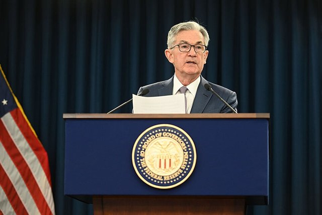
2020 年 3 月，COVID 引爆全球拋售——美股**兩週熔斷四次**（史上首次）；
**Fed 兩週內降息至零 + 宣布「無限 QE」**（3.23）——首次買**公司債**；
4 月 20 日，**WTI 原油期貨結算價 -$37**——**史上首見負油價**：
疫情衝擊 —零利率 + 無限 QE + 財政 $5 兆→ 資產全面重定價
**零利率下限（ZLB）**時代的臨床——**凱因斯流動性陷阱**（1936）的回歸
（見 `1936-凱因斯一般理論.md`）——**貨幣與財政的融合（MMT 的邊緣）**。

[→ 對外連結：2020 - 疫情 QE 與負油價（零利率下限：央行成為市場的最大買家）](https://chad-liu.github.io/books/html/1-6-6.金融經濟史/2020-疫情QE與負油價.html)

## 2021 | GameStop軋空
2021 年 1 月，**GameStop（GME）**股價從 20 飆到 483（+2,000%）——
**Reddit「華爾街賭場」（WSB）**散戶集體買入 + **140% 空頭部位**——
空頭 140\% + 散戶集體買入 + 買權熱潮 —軋空 + 伽瑪擠壓→ 歷史級逼空
**Melvin Capital 月虧 53%**、Robinhood 停止買入（流動性危機）——
**散戶 vs 機構的第一次正面戰役**——
**「空頭擠壓 + 伽瑪擠壓」的雙引擎**——
**社群媒體時代的市場微結構**。

[→ 對外連結：2021 - GameStop 軋空（散戶集體行動：迷因股與伽瑪擠壓）](https://chad-liu.github.io/books/html/1-6-6.金融經濟史/2021-GameStop軋空.html)

## 2022 | 加密崩潰與升息衝擊
2022 年三場崩潰同時發生：
Terra/Luna（5 月，-\40B） → FTX（11 月，-\8B） → 英國 LDI 危機（9 月）
**Fed 全年升息 425bp**（1980 年以來最快，見 `1979-沃克衝擊.md` 的對照）——
**穩定幣的擠兌**（UST 脫鉤）+ **存續期風險**（英國退休基金的 LDI 槓桿）+
**交易對手的欺詐**（FTX）——
**「零利率時代」的槓桿結構在升息中的總清算**——
**2023 SVB（見 `2023-SVB倒閉.md`）的序曲**。

[→ 對外連結：2022 - 加密崩潰與升息衝擊（穩定幣擠兌與存續期風險的雙重崩潰）](https://chad-liu.github.io/books/html/1-6-6.金融經濟史/2022-加密崩潰與升息衝擊.html)

## 2023 | SVB倒閉
2023 年 3 月 10 日，**矽谷銀行（SVB）**倒閉——
**42 天前還是全球最佳銀行獎得主**；3 月 9 日一天內**客戶提領 $42 億**（史上最快）：
長債（存續期 6 年）+ 未保險存款 90\% —升息 + App 擠兌→ 48 小時倒閉
**存續期風險 vs 信用風險**——**銀行沒有壞帳，只有「利率的錯配」**——
**2022 LDI 危機**（見 `2022-加密崩潰與升息衝擊.md`）的銀行版——
**Diamond-Dybvig 擠兌**（見 `1933-格拉斯斯蒂格爾法.md`）的 App 時代極速版——
**FDIC + Fed BTFP（銀行定期融資計畫）的止血**。

[→ 對外連結：2023 - SVB 倒閉（App 時代的銀行擠兌：存續期風險與史上最快擠兌）](https://chad-liu.github.io/books/html/1-6-6.金融經濟史/2023-SVB倒閉.html)
