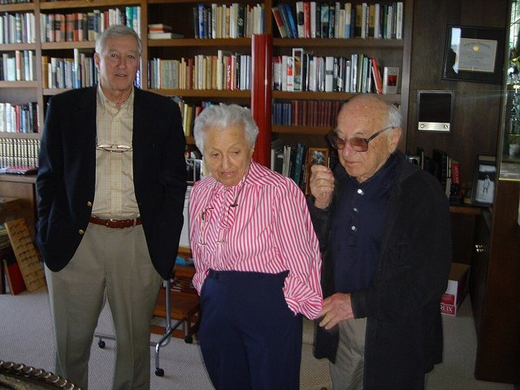
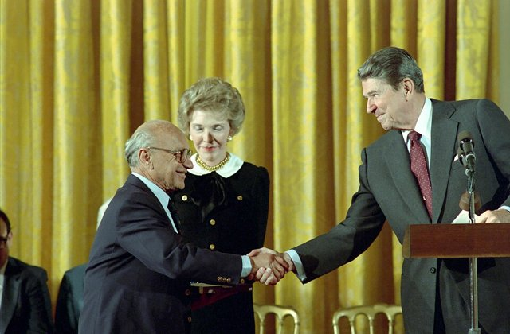

<!--
內容整理自 D:\Books\md\歷史\人物\思想家\傅利曼（Milton Friedman）生平大事記.md（Books 的人物頁為 D:\Books\html\4-1-2.經濟學家\傅利曼(1912~2006).html），並整合中文維基百科〈米爾頓·傅利曼〉條目，以自己的話改寫。
時期依筆記的生平時間軸歸納：求學與大蕭條、政府與戰時研究、芝加哥的學術高峰、胡佛研究所與公共影響。
兩份資料出入與處理方式：
- 生卒：筆記寫1912年7月31日生於布魯克林、2006年11月16日卒於舊金山，依此。
- 戰時財政部：維基百科補充他協助推行薪資的預扣所得稅制度，照此。
- 1986年日本授勳：筆記寫「旭日大綬章」；傅利曼獲頒的是瑞寶大綬章，這裡依此。
- 智利：維基百科說他1975年訪問智利、與皮諾契特會面，引發「擔任獨裁者顧問」的爭議，他本人否認擔任顧問，照此說明。
- 中國：維基百科補充他在1980、1988、1993年三度訪問中國，照此。
- 筆記1950、1958、1960、1970、1973年等概括性的條目寫進相鄰事件。
- 貨幣學派與芝加哥學派的整體發展見 Monetarism、ChicagoSchool，這條以他本人的生平為主。
- 人名與其他時間軸一致：海耶克（Hayek）、凱因斯（Keynes）；妻子蘿絲·傅利曼、安娜·史瓦茲沒有獨立時間軸。
圖片來源（皆為 Wikimedia Commons 公有領域／CC0 作品，縮成最長邊 640px）：
- mo-friedman.jpg：Portrait of Milton Friedman (4x5 cropped).jpg（米爾頓·傅利曼（與貨幣學派時間軸共用））
- mf-rose.jpg：Tom Skinner - Milton and Rose Friedman.jpg（晚年的蘿絲與米爾頓·傅利曼（中、右））
- mf-medal.jpg：President Ronald Reagan and Nancy Reagan in The East Room Congratulating Milton Friedman Receiving The Presidential Medal of Freedom - DPLA - 185d0a10c1b918fb02b27e4d4d56f2be.jpg（1988年雷根總統在白宮東廳頒授傅利曼總統自由勳章（美國國家檔案館））
-->

# Periods
- 1912 ~ 1934 | 移民之子與大蕭條 | #868e96
  東歐猶太移民的兒子，在紐澤西長大，大蕭條中讀完羅格斯大學，到芝加哥大學攻讀經濟學，結識一生的伴侶蘿絲。
- 1935 ~ 1945 | 政府與戰時研究 | #1971c2
  在華盛頓參與新政的消費研究，加入國家經濟研究局；二戰期間在財政部設計稅制，在哥倫比亞大學從事武器統計研究。
- 1946 ~ 1976 | 芝加哥的學術高峰 | #e67700
  回芝加哥任教三十年，提出實證經濟學方法論、恆常所得假說、重新表述貨幣數量論，寫成《美國貨幣史》，預言停滯性通膨，獲諾貝爾獎。
- 1977 ~ 2006 | 自由市場的代言人 | #5f3dc4
  轉往胡佛研究所，以電視節目《選擇的自由》推廣自由市場，影響雷根與柴契爾的政策，晚年致力於教育券運動。

# Events

## 1912-07-31 | 出生於布魯克林
米爾頓·傅利曼生於紐約布魯克林，父母是來自奧匈帝國喀爾巴阡地區的猶太移民，在紐澤西州拉威經營小雜貨店。他是家中第四個孩子、唯一的男孩，十五歲時父親去世，家境清寒。

## 1928 | 羅格斯大學
傅利曼靠獎學金與打工進入羅格斯大學，原本打算當保險精算師，在伯恩斯與瓊斯兩位老師的影響下轉向經濟學。1932年畢業時正值大蕭條最嚴重的時期，他後來說，正是大蕭條的失業問題讓他決定研究經濟學。

## 1932 | 芝加哥大學與蘿絲

傅利曼到芝加哥大學攻讀經濟學碩士，在奈特、維納、西蒙斯等人門下學習價格理論。在維納的課堂上，他因座位按姓氏排列而坐在羅絲·迪雷克特旁邊，兩人在1938年結婚，蘿絲後來成為他一生最重要的合作者。1933年他取得碩士學位，隔年到哥倫比亞大學進修統計學。

## 1935 | 參與新政研究
傅利曼到華盛頓的國家資源委員會參與大規模的消費者預算研究，這些資料後來成為消費者物價指數的基礎，也是他日後消費函數研究的起點。他後來說，當時的就業計畫讓他這個失業的年輕人找到了工作。

## 1937 | 國家經濟研究局
傅利曼加入國家經濟研究局，與庫茲涅茲合作研究專業人員的所得，指出醫師公會限制執業人數，使醫師的收入偏高。這項研究在1945年出版，引起爭議，也讓他的博士學位延遲多年才取得。

## 1941 | 財政部與預扣所得稅
第二次世界大戰期間，傅利曼在美國財政部研究戰時稅制，協助設計從薪資中預先扣繳所得稅的制度，讓政府能及時取得稅收、支應戰費。日後倡議縮小政府的他承認，這是他一生中讓政府變大最有效的貢獻。1943年至1945年他在哥倫比亞大學的統計研究小組，為軍方研究武器測試與抽樣檢驗。

## 1946 | 回到芝加哥任教
傅利曼取得哥倫比亞大學博士學位，回到芝加哥大學任教，此後三十年在這裡帶領「貨幣與銀行研討會」，與史蒂格勒等人形成芝加哥學派。1947年他與海耶克等人在瑞士創立朝聖山學社。1950年他曾參與馬歇爾計畫，在巴黎研究歐洲的匯率問題，主張浮動匯率。

## 1953 | 〈實證經濟學方法論〉
傅利曼出版《實證經濟學論文集》，其中的〈實證經濟學方法論〉主張理論的價值在於預測是否準確，而不在假設是否符合現實，引起經濟學界長期的方法論爭論。

## 1957 | 恆常所得假說
傅利曼在1956年發表〈貨幣數量論：一個重新表述〉，1957年出版《消費函數理論》，提出「恆常所得假說」：人們的消費取決於長期的預期所得，而不是當期所得，因此一時的減稅或補助對消費的刺激有限。這動搖了凱因斯消費函數與乘數效果的推論。

## 1962 | 《資本主義與自由》
傅利曼與妻子合著《資本主義與自由》，主張經濟自由是政治自由的基礎，提出教育券、負所得稅、浮動匯率、廢除徵兵與職業執照等主張。1964年他擔任共和黨總統候選人高華德的經濟顧問；1966年起為《新聞週刊》撰寫專欄長達十八年，影響遍及一般讀者。

## 1963 | 《美國貨幣史》
傅利曼與安娜·史瓦茲出版《美國貨幣史，1867－1960》，以近百年的資料說明貨幣數量與景氣的密切關係，指出大蕭條的主因是聯準會坐視貨幣供給大幅收縮，徹底改變了學界對大蕭條的理解。

## 1967-12 | 自然失業率
傅利曼在美國經濟學會會長演說〈貨幣政策的角色〉中提出「自然失業率」：通膨與失業的取捨只是短期現象，長期失業率會回到自然水準，政府若持續以通膨壓低失業，只會換來加速的通膨。1970年代的停滯性通膨印證了他的預言。他也參與尼克森政府的委員會，推動以志願兵制取代徵兵，美國在1973年結束徵兵。

## 1976-10 | 諾貝爾經濟學獎
傅利曼以消費分析、貨幣史與貨幣理論，以及闡明穩定政策的複雜性，獲得諾貝爾經濟學獎。頒獎時有人在會場抗議，指他在前一年訪問智利、與皮諾契特會面，是軍政府的顧問；他否認擔任顧問，說自己只是去演講，也曾對其他國家的政府提出同樣的建議。

## 1977 | 胡佛研究所
傅利曼從芝加哥大學退休，與妻子搬到舊金山，擔任史丹佛大學胡佛研究所的資深研究員。他此後把更多心力放在公共政策的倡議上。

## 1980 | 《選擇的自由》
傅利曼夫婦推出十集電視節目《選擇的自由》與同名書籍，向大眾介紹自由市場、批評政府干預，書籍成為當年美國最暢銷的非小說類作品，節目在多國播出。同年他第一次訪問中國，1988年、1993年又兩度訪華，與當時的領導人討論市場改革。1981年起他擔任雷根總統經濟政策顧問委員會的成員。

## 1988 | 總統自由勳章

傅利曼獲雷根總統頒授總統自由勳章與國家科學獎章；1986年他已獲日本政府頒授瑞寶大綬章。1996年他與妻子成立基金會，推動讓家長自由選擇學校的教育券運動。1998年夫婦合著回憶錄《兩個幸運的人》。

## 2006-11-16 | 逝世於舊金山
傅利曼在舊金山因心臟衰竭去世，享年九十四歲。他是20世紀下半葉最有影響力的經濟學家之一，貨幣政策、浮動匯率、志願兵制與教育券等主張，深刻改變了各國的經濟與公共政策，至今仍充滿爭議。
