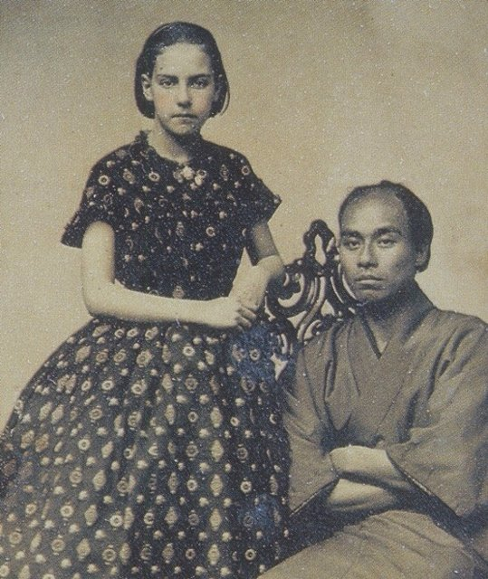
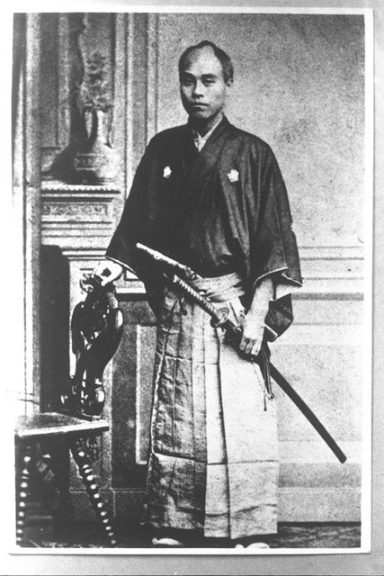
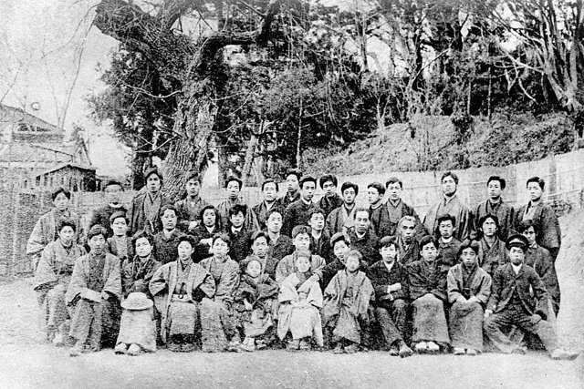
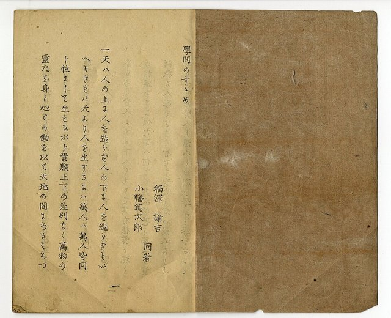
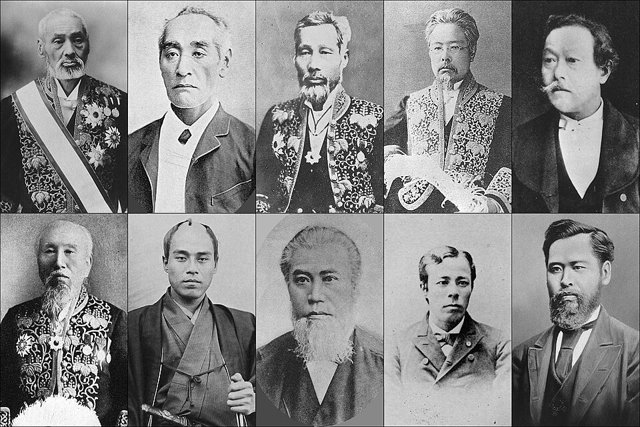
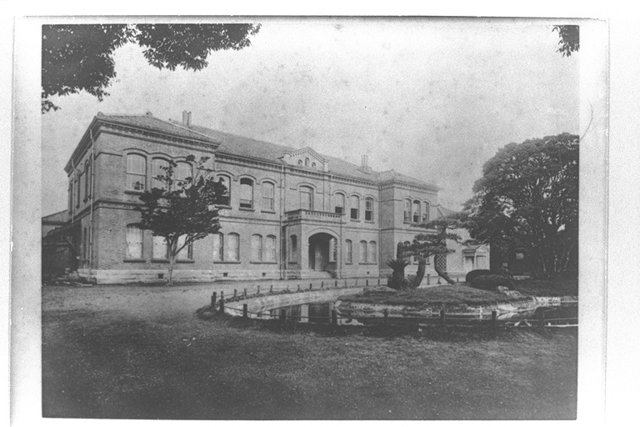

<!--
內容整理自 D:\Books\html\1-3-1.日本歷史人物\福澤諭吉(1835~1901).html（沒有對應的 md 筆記），並整合中文維基百科〈福澤諭吉〉條目，以自己的話改寫。
時期依頁面的七個階段：出生與少年、長崎與適塾、三度出訪歐美、創立慶應義塾、啟蒙思想成熟、民間政治參與與《時事新報》、大學部成立與晚年。
兩份資料出入與處理方式：
- 生卒：天保五年十二月十二日（西曆1835年1月10日）生於大坂堂島的中津藩藏屋敷；1901年2月3日因腦溢血去世，享年66歲，兩份一致。頁面寫「出生於大阪」，這裡用當時的寫法「大坂」。
- 長崎學蘭學：頁面寫1853年，維基百科作1854年（19歲），採1854年；1855年入緒方洪庵的適塾、1857年任塾長，取自頁面。
- 出訪：頁面寫1860年隨咸臨丸赴美、1862年隨幕府遣歐使節（實際在西曆1862年1月出發、同年12月返國）、1867年再赴美國東部；維基百科摘要沒有第三次赴美，照頁面。
- 著作年份：維基百科摘要多沒有出版年份，照頁面：《西洋事情》初編1866年、《學問之勸》1872—1876年、《文明論之概略》1875年、〈脫亞論〉1885年（〈明治維新大事記〉時間軸作1885年3月16日）、《福翁自傳》1899年。
- 《時事新報》：頁面給出1882年3月1日創刊，維基百科只寫1882年，採頁面日期。
- 1984年一萬日圓紙鈔：維基百科摘要說是1984年的計劃；福澤肖像的一萬日圓券自1984年11月起發行，到2024年才由澀澤榮一取代，這裡寫成身後事件並說明。
- 頁面的「思想」「歷史評價」寫進時期說明與相關事件；〈脫亞論〉頁面提醒後世評價分歧，照此謹慎寫法。
- 人名與其他時間軸一致：緒方洪庵、勝海舟、森有禮、西周、中村正直、大隈重信、伊藤博文、北里柴三郎、馬修·培里（頁面作「佩里」，與其他時間軸一致改為培里）。
圖片來源（皆為 Wikimedia Commons 公有領域／CC0 作品；註明「共用」者沿用其他時間軸已有的圖片）：
- fy-cover.jpg：Fukuzawa Yukichi.jpg（福澤諭吉）
- fy-girl.jpg：Fukuzawa Yukichi with the girl of the photo studio.jpg（1860年在舊金山照相館與館主女兒的合影）
- fy-berlin.jpg：Yukichi Fukuzawa Berlin.jpg（隨文久遣歐使節在柏林，1862）
- fy-students.jpg：Fukuzawa Yukichi and Keio Gijuku's students.jpg（福澤諭吉與慶應義塾的學生）
- fy-gakumon.jpg：Gakumon-no-susume.jpg（《學問之勸》初編）
- fy-meirokusha.jpg：Original Members of the Meirokusha.jpg（明六社的創始成員）
- fy-keio1891.jpg：Main building of Keio University 1891.jpg（慶應義塾大學部的本館，1891）
-->

# Periods
- 1835-01-10 ~ 1854 | 出生與少年 | #868e96
  生於大坂的中津藩藏屋敷，父親是下級藩士，一歲半喪父後隨母親回到九州中津；接受漢學教育，對封建身分制度的限制有切身體會。
- 1854 ~ 1859 | 長崎蘭學與適塾 | #2f9e44
  到長崎學荷蘭語，再入大坂緒方洪庵的適塾學習西方醫學與自然科學，升任塾長，奉藩命到江戶開設蘭學塾。
- 1859 ~ 1868 | 英學與三度出訪 | #1971c2
  在橫濱發現荷蘭語已不實用，自學英語；隨咸臨丸赴美、隨遣歐使節遊歷歐洲、再赴美國東部，出版《西洋事情》。
- 1868 ~ 1882 | 慶應義塾與啟蒙思想 | #e8590c
  把私塾定名慶應義塾，拒絕新政府任官，以《學問之勸》《文明論之概略》提倡獨立與實學，參與明六社，推動演說與公共討論。
- 1882 ~ 1901-02-03 | 《時事新報》與晚年 | #495057
  創辦《時事新報》評論政治與外交，發表〈脫亞論〉，慶應義塾設立大學部，晚年口述《福翁自傳》。

# Events

## 1835-01-10 | 出生於大坂
福澤諭吉生於大坂堂島的中津藩藏屋敷，父親福澤百助是中津藩（今大分縣）的下級武士，在大坂處理藩的財政事務，家境並不富裕。

## 1836 | 父親去世，回到中津
福澤一歲半時父親去世，母親阿順帶著孩子回到中津藩生活。他在中津接受漢學教育，學習漢文經典；出身下級武士家庭，讓他對封建社會依出身安排地位的制度有切身體會，日後他說「門閥制度是父親的仇敵」。

## 1854 | 長崎學蘭學
培里艦隊來航，西方的軍事與科技成為各藩關注的焦點。十九歲的福澤到長崎學習蘭學，也就是透過荷蘭語研究西方的科學與技術，逐漸認識到西方文明不只有武器與船艦，還有醫學、數學、物理、法律與社會制度。

## 1855 | 入適塾
福澤到大坂進入緒方洪庵的適塾，學習荷蘭語、西方醫學與自然科學。適塾重視原文閱讀、翻譯與討論，而不是背誦經典；福澤表現突出，1857年擔任塾長，開始具備教育者的經驗。

## 1858 | 江戶開設蘭學塾
中津藩命福澤到江戶，在築地鐵砲洲的中津藩邸內開設蘭學塾，這所私塾就是後來慶應義塾的起源。

## 1859 | 橫濱發現英語
日本開放橫濱等港口，福澤到橫濱觀察外國人的生活與交易，發現自己苦讀的荷蘭語在國際交流中已不如英語實用，決定改學英語；當時缺乏合適的老師，他主要靠字典與英文書自學。

## 1860 | 隨咸臨丸赴美

幕府派使節赴美，福澤爭取成為咸臨丸艦長的隨從，前往舊金山，親身觀察美國的城市、交通、商業、教育與社會生活，帶回韋氏英文字典等資料。1861年他娶中津藩士土岐太郎八之女錦為妻。

## 1862 | 隨遣歐使節遊歷歐洲

福澤隨幕府的文久遣歐使節出發，經過法國、英國、荷蘭、普魯士、俄羅斯、葡萄牙等國，觀察各國的政治制度、軍事、教育、醫療、金融與社會設施，特別注意政府如何組織行政機關、人民如何透過法律與制度參與社會，年底返國。當時國內攘夷思想盛行，研究西學的人有時會遭到攻擊，他在公開活動上也必須注意安全。1864年，他任幕府外國奉行的翻譯。

## 1866 | 《西洋事情》
福澤出版《西洋事情》初編，介紹西方國家的政治制度、議會、法律、學校、醫院、銀行與公共設施，受到廣泛閱讀，成為幕末日本人了解西方文明的重要讀物，他也因此成為知識界的重要人物。

## 1867 | 第三次赴美
福澤隨幕府購買軍艦的使節團再度赴美，到華盛頓、費城與紐約等東部城市，觀察教育、商業與政治制度，大量購買英文原書與教材帶回日本，作為教學與研究之用。

## 1868 | 定名慶應義塾

福澤把私塾遷到芝新錢座，以當時的年號命名為「慶應義塾」，教學從蘭學轉向英學與西方近代知識，重視經濟、政治、數學、自然科學與外語。戊辰戰爭期間江戶局勢緊張，傳說上野戰爭的炮聲中他仍照常講授經濟學。
明治政府多次邀請他任官，他都拒絕，認為民間教育與知識傳播同樣是國家近代化不可缺少的工作。1871年慶應義塾遷到東京三田。

## 1872 | 《學問之勸》

福澤開始陸續出版《學問之勸》（至1876年），開篇說「天不在人之上造人，也不在人之下造人」，主張人的地位不該由出身決定，而應靠學問與能力改善處境；他特別強調能改善生活、促進社會的實用之學，鼓勵民眾學習外語、數學、地理、經濟與自然科學。這部書以通俗的語言寫成，銷量極大。

## 1873 | 明六社

福澤參與森有禮發起的明六社，與西周、中村正直等啟蒙思想家透過演講、出版與討論介紹西方思想與近代制度。1874年起，他在慶應義塾推動演說與辯論，形成三田演說會，認為人民也應培養表達、討論與判斷公共事務的能力。

## 1875 | 《文明論之概略》
福澤出版《文明論之概略》，從歷史與社會的角度分析文明發展的條件，認為近代化不能只靠購買機器、建立工廠或引進軍事技術，更重要的是人民的知識、思想、社會制度與公共精神，強調國家的獨立建立在個人的獨立之上。

## 1880 | 交詢社
福澤參與創立交詢社，聚集政治人物、企業人士與知識分子，以知識交流與公共討論促進民間社會的發展。1881年明治十四年政變，與他有往來的大隈重信離開政府，伊藤博文等人掌握主導權。

## 1882-03-01 | 創辦《時事新報》
福澤創辦《時事新報》，報導政治、經濟、外交、社會與教育，評論政府政策，逐漸成為明治時代有影響力的報刊；他也透過這份報紙討論國會制度、外交、國防與國民教育。

## 1885 | 〈脫亞論〉
《時事新報》刊出後世稱為〈脫亞論〉的社論，主張日本不應因亞洲鄰國的制度狀況而延誤自身的近代化，應採取與歐美文明國家相近的發展方向。這篇文章成為研究福澤思想與日本近代對亞洲觀念的重要材料，後世評價分歧很大。1886至1888年，他也出版《男女交際論》等書，討論近代社會的男女關係與公共倫理。

## 1890 | 慶應義塾大學部成立

慶應義塾設立大學部，設置文學、法律、理財三科，從以西方語言與知識為主的私塾，發展成具有高等教育體系的學校。1891年他寫〈瘠我慢之說〉，討論勝海舟、榎本武揚等幕臣在政權更替中的氣節（後來才公開發表）；1892年他協助北里柴三郎設立傳染病研究所。

## 1898 | 腦溢血病倒
福澤因腦溢血病倒，此後逐漸減少日常工作，仍關心慶應義塾的發展。1899年他口述的《福翁自傳》出版，生動記錄了自己從下級武士到啟蒙思想家的一生。

## 1901-02-03 | 逝世
福澤諭吉因腦溢血再度發作，在東京去世，享年66歲。他以教育、著述與報刊，把西方文明的知識、獨立自尊的觀念與實學精神帶進明治日本；他的對外觀點也成為後世討論日本近代思想與帝國擴張時的重要研究對象。

## 1984-11 | 一萬日圓紙鈔
福澤諭吉的肖像出現在新版一萬日圓紙鈔上，自1984年11月發行，沿用到2024年才由澀澤榮一取代，是日本流通時間最長的紙鈔肖像人物之一。
