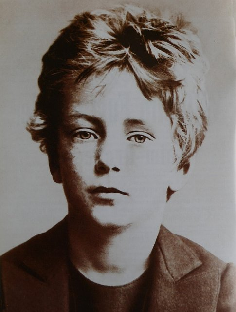
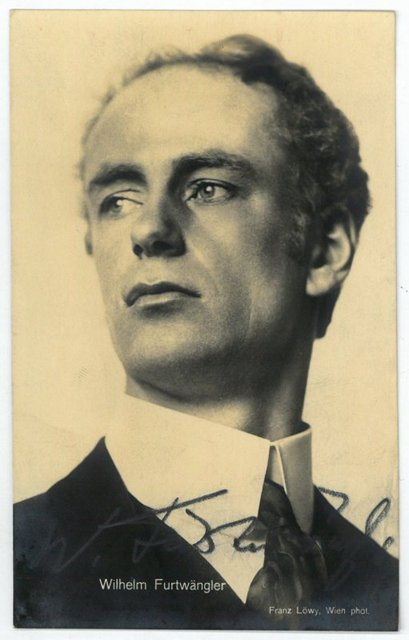
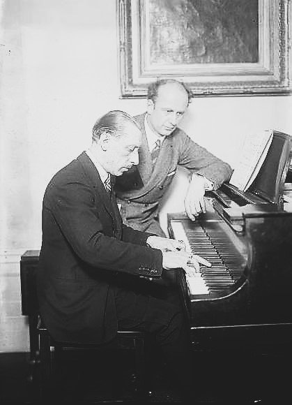

<!--
內容整理自本機筆記〈福特萬格勒（Wilhelm Furtwängler）生平大事記〉（D:\Books\md\音樂\表演家\福特萬格勒（Wilhelm Furtwängler）生平大事記.md），以自己的話改寫。
時期依筆記的六個階段。
處理方式：
- 筆記的標題把出生地寫成「柏林」，內文是柏林近郊的舍訥貝格（Schöneberg，今屬柏林），這裡寫舍訥貝格。
- 筆記說他1933年「曾擔任帝國音樂院副院長」、1934年因欣德米特事件辭去官方職務，1935年重返柏林愛樂，這裡依筆記並陳，不另作評斷。
- 筆記對1939年「接掌維也納愛樂相關指揮工作」、1928年「轉向維也納」的職務描述含糊，這裡照筆記只寫「參與維也納音樂界的指揮工作」。
- 筆記的「重要作品與錄音」「與托斯卡尼尼、卡拉揚的比較」「歷史評價」寫成時期說明與最後一則事件，不另立事件。
- 人名用·分隔（筆記作・）。
圖片（Wikimedia Commons 公有領域或 CC0）：
- furt-cover.jpg：Wilhelm Furtwängler by Emil Orlik.jpeg（奧利克所繪福特萬格勒側面像）
- furt-1896.jpg：Wilhelm Furtwangler circa 1896.jpg（約十歲的福特萬格勒，約1896）
- furt-1912.jpg：Wilhelm Furtwängler by Franz Löwy, c. 1912.jpg（福特萬格勒的簽名明信片，約1912，背面題「布拉姆斯音樂節 1912年5月27–30日」）
- furt-stravinsky.jpg：Stravinsky and Fulwaagder at piano.jpg（史特拉汶斯基與福特萬格勒在鋼琴前，年份不詳（Bain 新聞社））
-->

# Periods
- 1886 ~ 1904 | 知識分子家庭與早年訓練@柏林 | #868e96
  生於柏林近郊，父親是知名考古學家，在重視古典文化的環境中長大；十三歲起接受私人音樂課，不只學鋼琴，也學作曲與樂理，少年時就寫下第一首交響曲。
- 1905 ~ 1921 | 從劇院到德國樂壇 | #1971c2
  從排演助理做起，歷經布雷斯勞、蘇黎世、慕尼黑、史特拉斯堡、呂北克與曼海姆，一步步累積歌劇與管弦樂的實務經驗，1920年在柏林接替理查·史特勞斯指揮國立歌劇院管弦樂團的音樂會。
- 1922 ~ 1932 | 柏林愛樂的首席指揮 | #2f9e44
  接替尼基施出任柏林愛樂首席指揮，同時領導萊比錫布商大廈管弦樂團；以彈性的速度、長線條與整體結構的詮釋，建立德奧交響曲的演出傳統，並走出德國，登上倫敦與紐約。
- 1933 ~ 1945 | 納粹統治下的藝術與政治 | #c92a2a
  納粹上台後，他既是德國最有聲望的指揮家，也被政權拿來塑造文化形象；他為欣德米特發聲、協助受迫害的音樂家，卻始終留在德國繼續演出，成為評價最大的爭議。
- 1946 ~ 1950 | 去納粹化與重返舞台 | #e8590c
  戰後接受盟軍審查，一度被禁止指揮；1947年獲准重回柏林愛樂的指揮台，逐步恢復歐洲各地的演出。
- 1951 ~ 1954 | 戰後的巔峰與晚年 | #5f3dc4
  指揮戰後首屆拜魯特音樂節的貝多芬《第九》，1952年重新取得柏林愛樂的首席指揮地位，1954年11月在巴登－巴登附近去世。

# Events

## 1886-01-25 | 出生@舍訥貝格
生於柏林近郊的舍訥貝格（今屬柏林）。父親阿道夫·福特萬格勒是著名的古典考古學家，曾任慕尼黑大學教授，母親也有藝術背景。他在重視古典文化、歷史、文學與藝術的知識分子家庭長大，這份人文素養日後影響了他理解交響曲的結構、思想與精神內涵。

## 1899 | 開始接受音樂訓練

自1894年起在慕尼黑接受人文中學教育，學的是古希臘、古羅馬文化、哲學、文學與歷史。1899年開始上私人音樂課，學鋼琴、作曲與樂理。與以演奏或指揮為主要訓練的音樂家不同，他對作曲與音樂結構的投入相當深。

## 1902 | 第一首交響曲
十六歲左右就寫下《D大調第一號交響曲》，顯示他很早就把交響曲看作最重要的音樂表達形式。他並不是只靠指揮技巧成名的人，而是先對作曲、結構與交響曲傳統抱有強烈的興趣。

## 1905 ~ 1907 | 進入職業音樂界
開始在劇院擔任排演助理等職務，1906年至1907年前後曾在布雷斯勞任職，接觸歌劇排演、管弦樂團運作與舞台音樂。他並非一出道就站上國際名團的指揮台，而是從劇院與地方音樂機構一步步走上來。

## 1908 | 蘇黎世、慕尼黑與史特拉斯堡
先後在蘇黎世、慕尼黑工作，之後擔任史特拉斯堡市立劇院的第三指揮，逐漸熟悉不同樂團的演奏風格與歌劇、交響樂的排演方式。

## 1911 | 呂北克音樂之友協會

開始領導呂北克音樂之友協會的音樂演出，在這裡長期經營樂團曲目，累積對管弦樂音響、排練方式與作品整體架構的掌握。

## 1915 | 曼海姆國立劇院
轉往曼海姆國立劇院，1915年至1920年間擔任重要的歌劇指揮。此時正值第一次世界大戰，歐洲秩序劇烈變動，他持續累積歌劇與管弦樂的演出經驗，漸漸成為德國音樂界受重視的指揮家。

## 1920 | 進入柏林樂壇
接替理查·史特勞斯，指揮柏林國立歌劇院管弦樂團的音樂會，並在法蘭克福等地參加重要演出，進入德國主要音樂中心的核心圈。1921年前後，他逐步形成個人風格：不滿足於照著樂譜表面的節拍與力度演奏，希望讓指揮呈現音樂的發展過程，使每個樂句都與全曲的結構相關。

## 1922 | 出任柏林愛樂首席指揮
前任指揮阿圖爾·尼基施去世，福特萬格勒接任柏林愛樂首席指揮，同年也開始領導萊比錫布商大廈管弦樂團。他的風格有幾個特點：速度有彈性，隨情緒、樂句與結構調整；重視長線條，不只追求個別樂句的美，也在乎整個樂章如何逐步形成高潮；強調音樂內部的張力；把交響曲視為有內在發展邏輯的完整作品。這與追求精確、節奏穩定的指揮風格形成對比。

## 1924 | 在倫敦演出
開始在倫敦舉行重要的客席演出，和英國音樂界建立更密切的往來，聲望超出德國，進入歐洲主要音樂中心。

## 1925 | 首次赴美

赴美與紐約愛樂合作，受到矚目，卻因與美國音樂界的合作與管理問題，後來決定不再繼續在美國演出。

## 1927 | 海德堡大學榮譽博士
海德堡大學授予他哲學學院的榮譽博士學位，顯示他不只被視為演奏者，也受到學術與文化界的重視。

## 1928 | 結束萊比錫的職務，轉向維也納
結束與萊比錫布商大廈管弦樂團的合作，轉而參與維也納音樂界的指揮工作；他希望保留與柏林愛樂的密切關係，所以沒有接受維也納國立歌劇院的全面領導職務。1929年獲普魯士功勳勳章，逐漸成為德國音樂文化的重要代表。

## 1931 | 拜魯特華格納音樂節
開始擔任專門演出華格納作品的拜魯特音樂節的重要音樂領導工作，顯示他在德國歌劇與音樂文化中的地位。此時他持續擔任柏林愛樂的主要指揮，貝多芬交響曲的詮釋也成為他藝術形象的核心。

## 1933 | 納粹上台
希特勒掌握政權，福特萬格勒獲任柏林國立歌劇院的重要指揮職務，也曾擔任帝國音樂院副院長。納粹希望借德國古典音樂的國際聲望塑造國家文化形象。他並非單純接受納粹文化政策，曾公開為猶太音樂家與受政治壓力的藝術家發聲；但反對部分政策，不等於脫離了納粹體制的政治影響。

## 1934 | 欣德米特事件
作曲家欣德米特的歌劇《畫家馬蒂斯》受到納粹文化當局的壓力，演出被阻止。福特萬格勒公開撰文支持欣德米特，與當局的衝突加深，1934年辭去重要的官方音樂職務。這顯示他並非毫無保留地服從納粹的文化指令，不過他沒有離開德國，這也成為戰後爭議的一部分。

## 1935 | 回到柏林愛樂
與納粹政權達成某種妥協，重新指揮柏林愛樂，但不再擔任先前的正式官方職位，也繼續協助部分受迫害的音樂家。一面曾與當局衝突，一面仍在納粹統治下維持重要的公開音樂活動，處境充滿矛盾。1936年至1937年他曾減少指揮，把更多精力放在作曲。

## 1939 | 第二次世界大戰爆發
參與維也納音樂界的領導工作；同年大戰爆發，隨著德國擴大對歐洲的軍事控制，音樂演出更容易被納入政治宣傳。1940年至1942年，他仍在德國與部分歐洲地區指揮，曲目以貝多芬、布拉姆斯與布魯克納為核心；納粹政府也利用著名指揮家與樂團的演出，展現德國文化的延續。較準確的理解是：他沒有加入納粹黨，曾反對迫害藝術家的部分政策、也協助過受迫害的音樂家，但他留在德國公開演出，客觀上也可能被政權利用。

## 1943 | 再婚
與第二任妻子伊麗莎白·阿克曼結婚，仍繼續指揮維也納愛樂等樂團，環境隨戰況惡化而日益艱難。

## 1944-01-30 | 柏林愛樂音樂廳被炸毀
1月，他在柏林愛樂的原音樂廳指揮了最後一場音樂會；1月30日，音樂廳在盟軍空襲中被炸毀，樂團只能轉往其他場地。這象徵德國戰時文化生活遭到破壞，也讓柏林愛樂在戰後必須面對場地、經費與組織的重建。

## 1945 | 戰敗，指揮中斷
納粹德國戰敗，他因戰時活動受到盟軍審查，一度被禁止指揮，並接受去納粹化程序。他的歷史評價始終圍繞一個難題：藝術家在極權統治下，該如何面對藝術自主、個人道德責任與政治體制的關係。

## 1946 | 去納粹化審查
審查的核心是他為何在納粹統治期間留在德國，以及他的國際聲望是否被政權利用。支持者指出他沒有加入納粹黨、協助過猶太音樂家，也與政權發生過衝突。這場審查不只是行政程序，也牽涉到藝術家在極權時代的道德定位。

## 1947-05-25 | 重返柏林愛樂
在去納粹化程序中獲得有利裁定，5月25日重新指揮柏林愛樂，象徵他逐步恢復公開演出的資格。音樂界並未毫無爭議地接受他：有人認為他留在納粹德國，難以完全擺脫責任；也有人認為他在困難環境中保護了音樂傳統。

## 1949 | 恢復國際聲望
重新參與歐洲各地的音樂活動，在威斯巴登等地指揮；他的貝多芬與布拉姆斯詮釋仍受樂迷重視。1950年他繼續活躍於歐洲樂壇，以現場演出中的即時張力與整體感見長的風格，在新興的錄音室文化裡依然鮮明。

## 1951 | 戰後首屆拜魯特音樂節
拜魯特華格納音樂節在1951年恢復舉辦，他在開幕演出中指揮貝多芬《第九號交響曲》。《歡樂頌》長期被視為人類團結的象徵，在戰後的背景下，這場演出具有超越音樂本身的意義。

## 1952 | 柏林愛樂終身首席指揮
重新取得柏林愛樂首席指揮的地位。他與樂團的關係跨越戰前、戰時與戰後，成為柏林愛樂歷史的重要篇章；這項任命肯定了他的藝術成就，但戰時的政治爭議並未就此消失。1953年他仍持續指揮與作曲，演出以德奧交響曲為核心。

## 1954-11-30 | 逝世@埃伯施泰因堡
在巴登－巴登附近的埃伯施泰因堡去世，享年68歲，安葬於海德堡山地公墓。他以貝多芬、布拉姆斯、布魯克納與華格納的德奧傳統聞名，認為指揮家不應機械地重現樂譜，而要透過對作品結構的理解，讓音樂的內在邏輯在演出中重新呈現。他也留下三首交響曲等作品，但名聲主要建立在指揮上；留下的歷史錄音多為單聲道，音質受限，卻保存了不同於現代錄音室製作習慣的處理方式。與托斯卡尼尼的精確明晰、卡拉揚的整齊音響相比，他是浪漫主義指揮傳統最重要的代表。
