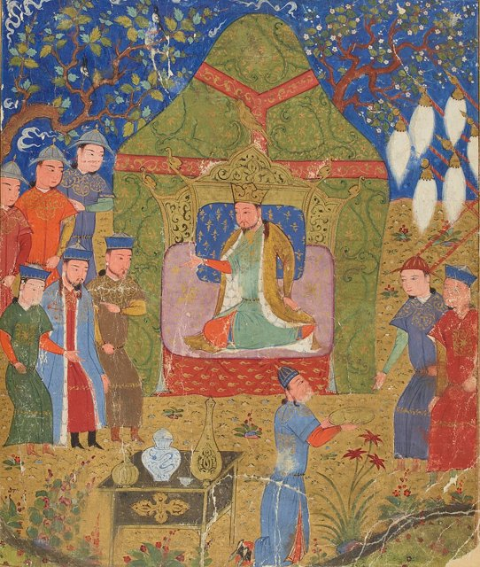
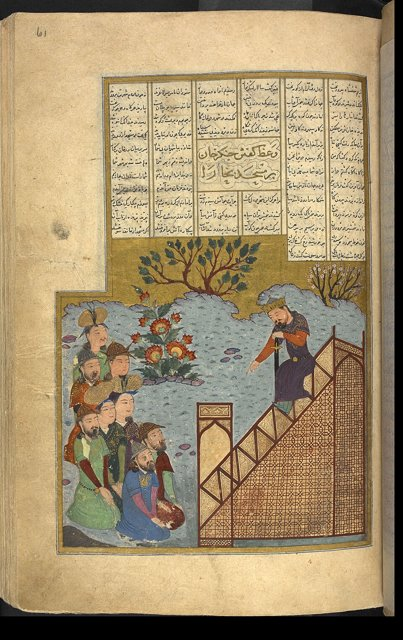
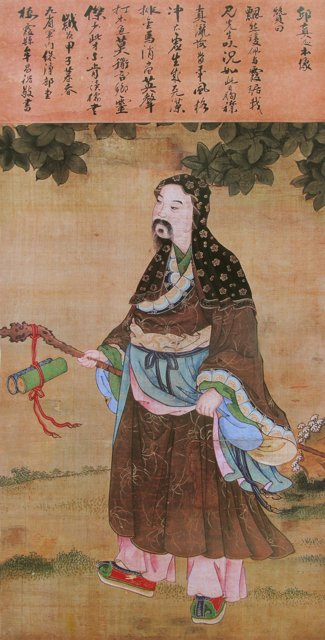
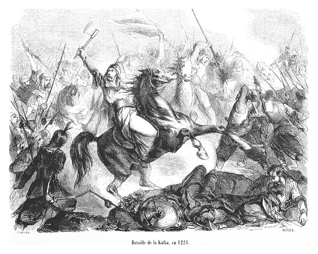
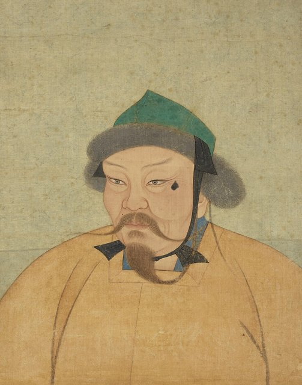

<!--
內容整理自 D:\Books\html\1-2-1.中國歷史人物\成吉思汗(約1162~1227).html（沒有對應的 md 筆記），並整合中文維基百科〈成吉思汗〉條目，以自己的話改寫。
時期依頁面的五個階段：童年與家族困境、建立勢力與統一蒙古、建國與征服金夏、花剌子模戰爭與西征、晚年與最後一次遠征。
兩份資料出入與處理方式：
- 出生年：頁面採傳統的1162年；維基百科列出1155（趙珙、拉施德丁）、1162（《元史》《聖武親征錄》，多數學者採用）、1167（伯希和）三說，信息框作1162年5月31日。born 採1162年，事件的年齡因此是大約值；早年事件依《蒙古秘史》重建，年代多有爭議，以「約」顯示。
- 父親也速該之死：頁面作約1170–1171年、鐵木真九歲左右；維基百科說八歲時訂婚、也速該在返途被塔塔兒人毒害，兩者相近，寫成約1171年。
- 娶孛兒帖：頁面寫約1180年代，維基百科說約1178年，採「約1178年」並註明；孛兒帖被蔑兒乞人擄走、借王汗與札木合之力奪回，兩份一致。
- 十三翼之戰：頁面沒有，維基百科作約1187年，鐵木真戰敗；維基百科也提到1187至1196年間他可能在華北為金朝臣屬，此說有爭議，只在說明中提及。
- 1196年：頁面寫「與王汗等人參與對塔塔兒人的軍事行動」；維基百科補充是配合金朝出兵，並獲授「札兀惕忽里」的稱號。
- 1201–1205年：頁面寫1201年札木合被推為古兒汗、1202年大敗塔塔兒、1203年擊敗王汗、1204年擊敗乃蠻太陽汗、約1205年札木合落敗；維基百科補充1203年先在合蘭真沙陀慘敗、後擊敗克烈部，1204年5月納忽山崖前擊敗乃蠻，同年札木合被部下出賣處死。札木合之死採維基百科的1204年，頁面的「約1205年」在說明中保留。
- 西夏：頁面寫1209年「西夏接受臣服條件」；維基百科補充1209年圍攻中興府、引黃河水灌城失敗，1210年1月堤壩決口後西夏才投降獻女，這裡寫成1209年的事件並說明。
- 金朝：頁面寫1211年攻金、1214年和議、1214–1215年金朝遷都汴京、1215年攻陷中都；維基百科補充1211年野狐嶺（會河堡）之戰、1212年圍攻西京時成吉思汗中箭、1215年5月中都投降，採維基百科的月份。
- 西征：頁面與維基百科大致一致；月份採維基百科（1219年秋圍訛答剌、1220年2月攻克布哈拉、次月撒馬爾罕陷落、1221年春玉龍傑赤陷落、1221年11月印度河之戰）。頁面沒有印度河之戰與1222年會見丘處機，取自維基百科；卡爾卡河之戰（1223年）頁面有，維基百科因篇幅截斷未讀到，照頁面。
- 去世：頁面只寫1227年於攻西夏期間去世，死因有爭議；維基百科正文作1227年8月18日或25日，信息框採8月25日，地點在六盤山一帶的薩里川哈老徒行宮；died 採8月25日。葬地不明，伊金霍洛旗的成吉思汗陵是衣冠塚性質，有爭議。
- 追尊：頁面說元朝的建立主要與忽必烈有關；維基百科補充1265年忽必烈追尊廟號太祖、1266年上諡號聖武皇帝，寫進最後一則事件。
- 頁面的「重要制度與軍事改革」「與世界歷史的關係」「重要年份速查表」「歷史評價」寫進時期說明與相關事件，不另立事件。大札撒的具體法典內容與形式有史料爭議，照頁面謹慎寫法。
- 譯名：王汗（脫斡鄰勒）、札木合、孛兒帖、者別（頁面作哲別，採維基百科與蒙古秘史常見寫法「者別」並註明）、速不台、木華黎、拖雷、窩闊台、朮赤；花剌子模、訛答剌、布哈拉、撒馬爾罕、玉龍傑赤照頁面。
圖片來源（皆為 Wikimedia Commons 公有領域／CC0 作品；註明「共用」者沿用其他時間軸已有的圖片）：
- war-genghis.jpg（元代帝后像冊中的成吉思汗像（與武器與戰法時間軸共用））
- gk-kurultai.jpg：Temüjin proclaimed as Genghis Khan in 1206 Jami' al-tawarikh manuscript (trimmed).jpg（拉施德丁《史集》抄本插圖：1206年鐵木真被推舉為成吉思汗）
- gk-bukhara.jpg：Genghis Khan's sermon to the people of Bukhara.jpg（成吉思汗在布哈拉清真寺向民眾訓話（波斯抄本插圖））
- gk-qiu.jpg：丘處機.jpg（丘處機像）
- gk-kalka.jpg：Bataille de la Kalka, en 1224.jpg（19世紀版畫：卡爾卡河之戰）
- gk-ogedei.jpg：YuanEmperorAlbumOgedeiPortrait.jpg（元代帝后像冊中的窩闊台像）
-->

# Periods
- 1162 ~ 1180 | 童年與家族困境 | #868e96
  父親也速該被塔塔兒人毒害後，部眾離散，鐵木真與母親訶額侖在貧困與排擠中長大，殺死異母兄別克帖兒，逐漸培養出強烈的權力意識。
- 1180 ~ 1206 | 建立勢力與統一蒙古 | #f08c00
  靠婚姻、結義與聯盟起家，與札木合由安答變成對手，先後擊敗塔塔兒、克烈、乃蠻，把被征服部落的戰士重新編入自己的體系，削弱舊部族貴族的獨立權力。
- 1206 ~ 1218 | 建立帝國與征服金夏 | #c92a2a
  1206年稱成吉思汗，以千戶制整編軍民、擴充怯薛；攻西夏迫其臣服，大舉攻金、攻陷中都，蒙古軍學會了攻城與運用被征服地區的工匠人才。
- 1218 ~ 1225 | 花剌子模戰爭與西征 | #1971c2
  訛答剌商隊被殺引發西征，布哈拉、撒馬爾罕、玉龍傑赤相繼陷落，花剌子模瓦解；者別、速不台遠征伊朗與高加索，在卡爾卡河擊敗羅斯聯軍。
- 1225 ~ 1227-08-25 | 晚年與最後一次遠征 | #7048e8
  回到蒙古後再征西夏，在戰爭期間去世，西夏隨即滅亡；征服由子孫繼續推進。

# Events

## 1162 | 出生於斡難河流域 {label="約1162年"}
鐵木真出生於蒙古高原斡難河上游、不兒罕山一帶，屬孛兒只斤氏族。出生年份有1155、1162、1167年三說，多數學者採用1162年；他本人可能也不確定。當時蒙古各部落還沒有形成統一的國家。

## 1171 | 父親也速該之死 {label="約1171年"}
大約八、九歲時，父親也速該帶鐵木真到弘吉剌部，為他與孛兒帖訂婚，返途中遭塔塔兒人下毒，不久去世。家族失去領導者，部眾大多離去，鐵木真與母親訶額侖和弟妹陷入貧困與排擠。
少年時，他在家族爭執中殺死異母兄弟別克帖兒，反映了草原社會資源競爭的激烈，也顯示他爭取家族主導權時的強硬手段。他大約十一歲時與札木合結為安答（結義兄弟）。

## 1178 | 迎娶孛兒帖 {label="約1178年"}
鐵木真迎娶孛兒帖，與弘吉剌部結為姻親；婚姻與親族關係是草原政治聯盟的重要基礎。不久孛兒帖被蔑兒乞部擄走，鐵木真聯合克烈部首領脫斡鄰勒（王汗）與札木合出兵奪回。長子朮赤在這段時間出生，生父身分有疑，但鐵木真視如己出。
他藉這次軍事聯盟擴大影響力，逐漸從弱小的氏族成員變成有追隨者的草原領袖。

## 1187 | 十三翼之戰 {label="約1187年"}
鐵木真與札木合從結義兄弟分道揚鑣，雙方為部眾與領導權爭奪，在十三翼之戰交戰，鐵木真明顯戰敗。兩人的競爭成為蒙古統一過程中最重要的衝突之一。
維基百科提到，1187到1196年間他大部分時間可能在華北依附金朝，這個說法仍有爭議。

## 1196 | 助金攻塔塔兒
鐵木真與王汗配合金朝出兵攻打塔塔兒部，獲授「札兀惕忽里」的稱號，約同時幫助王汗奪回克烈部的統治權。透過共同作戰，他擴大了影響力，也和金朝對草原部落的政策產生關聯。

## 1201 | 札木合被推為古兒汗
札木合被多個部落推舉為古兒汗，聯合諸部對抗鐵木真與王汗，在闊亦田之戰大敗。草原上的競爭者開始形成較明確的政治陣營，爭奪的已是整個草原的領導權。

## 1202 | 大敗塔塔兒部
鐵木真擊敗泰赤烏部與塔塔兒部，處決部族首領，收編其戰士，名將者別也在這時歸附。他削弱了重要敵對勢力，擴大了對蒙古東部的控制。

## 1203 | 擊敗克烈部王汗
昔日盟友王汗轉為主要對手，先在合蘭真沙陀突襲鐵木真，使他慘敗；鐵木真與少數追隨者在班朱尼河盟誓，重整後擊敗克烈部，王汗逃亡途中被乃蠻人所殺，克烈部瓦解。

## 1204-05 | 擊敗乃蠻部太陽汗
鐵木真在納忽山崖前擊敗乃蠻部，首領太陽汗被殺，蒙古高原西部的重要對手被消滅或吸收。同年他又消滅蔑兒乞部；札木合被部下出賣，交給鐵木真處死（頁面作約1205年落敗）。
他的統一策略不只是消滅對手，也把被征服部落的戰士納入新的軍事體系，重組部眾與指揮關係。

## 1206 | 稱成吉思汗，建立大蒙古國

1206年春，蒙古各部首領在斡難河源頭舉行忽里勒台大會，推舉鐵木真為「成吉思汗」，大蒙古國建立，這是他一生最重要的轉折。
他建立千戶制，把軍民依十戶、百戶、千戶、萬戶編組，以削弱舊有的部落認同；擴充怯薛（護衛軍）從一千多人到一萬人；大封功臣，博爾朮與木華黎為萬戶。他重視個人能力、忠誠與戰功，把草原內部爭霸的軍事力量，轉化為對外征服的工具。

## 1209 | 征西夏，西夏臣服
蒙古軍圍攻西夏都城中興府，築壩引黃河水灌城，1210年1月堤壩決口，蒙古軍營反被淹沒；但西夏襄宗仍選擇投降，納貢並獻上公主。蒙古取得西北方向的戰略優勢，為攻金創造了條件。
西夏是以黨項族為核心的政權，位於今中國西北。

## 1211 | 大舉攻金
1211年春，成吉思汗召開忽里勒台決定攻金，5月三路入侵女真人建立的金朝，同年秋木華黎在野狐嶺（會河堡）之戰取勝。1212年圍攻西京（大同）時，成吉思汗中箭受傷。
蒙古軍在攻金的過程中，從擅長草原機動作戰的騎兵，逐漸學會運用攻城器械、工程技術與被征服地區的人才。

## 1215-05 | 攻陷金中都
1214年蒙古與金朝暫時議和，金朝獻上財物，蒙古解除中都之圍；同年金宣宗遷都汴京（今開封），蒙古軍再度南下。1215年5月中都（今北京一帶）投降，遭到洗劫。
成吉思汗本人並沒有完成征服整個中國；1217年前後，他把對金的戰事交給木華黎主持，自己把精力轉向西方。蒙古滅金在他死後才完成，元朝的建立則主要與孫子忽必烈有關。

## 1218 | 滅西遼與訛答剌事件
者別攻入契丹人建立的西遼，殺死篡位的屈出律，蒙古勢力進入中亞，直接接近花剌子模帝國。
同年，蒙古派往花剌子模的商隊在邊境城市訛答剌被扣留殺害，成吉思汗遣使交涉，使者也遭殺害或嚴重侮辱。他認為這是重大挑釁，決定發動大規模遠征。

## 1219 | 西征花剌子模

1219年秋，成吉思汗親率大軍西征，圍攻訛答剌五個月後城破。1220年2月攻克布哈拉，次月撒馬爾罕陷落，花剌子模的政治、經濟與軍事體系遭受重創；花剌子模沙摩訶末（穆罕默德二世）逃亡，約在1220至1221年之交病死於裏海的島上。
者別、速不台率軍向西追擊，進入伊朗高原與高加索，展開持續約四年的「大遠征」。

## 1221 | 玉龍傑赤陷落與印度河之戰
1221年春，花剌子模的都城玉龍傑赤經激烈巷戰後陷落；11月，成吉思汗在印度河畔擊敗花剌子模王子札蘭丁，札蘭丁渡河南逃。1221到1222年，拖雷在呼羅珊屠城，死亡人數的記載雖有誇大，仍造成巨大的人口損失。
西征改變了中亞的政治版圖，也帶來屠殺、城市破壞、強制遷徙與灌溉農業的長期衰退；征服帶來的交流與整合，不能抵銷戰爭造成的人道災難。

## 1222 | 會見丘處機

成吉思汗率主力撤到阿姆河以西，在興都庫什山會見全真道士丘處機，詢問長生之道。他在不同地區對多種宗教採取一定程度的容忍與實用安排，但實際政策並非處處一致。

## 1223 | 卡爾卡河之戰

者別、速不台率領的蒙古軍在卡爾卡河（今烏克蘭一帶）擊敗基輔羅斯諸侯與庫曼人的聯軍，蒙古軍首次大規模進入東歐的政治舞台。這並不代表成吉思汗征服了歐洲，蒙古大規模入侵東歐與中歐，是他死後1230至1240年代由拔都、速不台推進的。
同年，木華黎與長子朮赤去世。

## 1225 | 回到蒙古
1225年初，成吉思汗結束西征回到蒙古核心地區，帝國進入整頓征服成果與安排下一步軍事行動的階段。蒙古與西夏的關係再度惡化。

## 1226 | 最後一次遠征西夏
1226年初，成吉思汗再征西夏，攻克黑水城，12月大敗西夏援軍。1226年末到1227年初，他在打獵時墜馬，病情逐漸加重。

## 1227-08-25 | 逝世，西夏滅亡

成吉思汗在攻打西夏期間，於六盤山一帶的薩里川哈老徒行宮去世，日期有8月18日與25日兩說。死因說法不一，包括疾病、墜馬受傷、中箭等，沒有一種可視為定論。不久西夏都城中興府陷落，西夏滅亡。
他的葬地至今不明，一說在不兒罕合勒敦山附近；內蒙古伊金霍洛旗的成吉思汗陵有爭議。1229年，三子窩闊台即位。1265年，孫子忽必烈追尊他為元太祖，次年上諡號聖武皇帝。
成吉思汗結束了蒙古高原長期分裂的局面，建立高度組織化的帝國，改變了中國北方、中亞與東歐的政治格局；他的征服也伴隨大量平民死亡、城市被毀與社會秩序的崩解。
