<!--
內容整合自「德意志統一運動大事記（1806—1871）」（D:\Books\md\歷史\西方歷史\德意志統一運動大事記（1806—1871）.md；html 版在 D:\Books\html\1-1.西方歷史），以自己的話改寫。
時期依大事記的六個階段，第五、六階段（三場戰爭、帝國建立）合併。
處理方式：
- 大事記的背景（神聖羅馬帝國的分裂結構、1648年西發里亞和約、普奧兩強的崛起）寫進1806年事件與時期說明，不另立事件。
- 1806年萊茵邦聯、神聖羅馬帝國解體與1813年萊比錫會戰，「拿破崙戰爭」時間軸已有記載，這裡從德意志統一的角度改寫。
- 大事記提醒的幾點寫進內文：文化上的民族認同不等於建立統一國家的政治共識；關稅同盟不等於政治統一；「鐵與血」不代表俾斯麥只靠戰爭；埃姆斯電報是觸發因素而非唯一原因；1871年的帝國採小德意志方案，不包括奧地利，也不是完整的議會民主。
- 1863年11月丹麥新憲法一節，大事記標題寫丹麥國王簽署新憲法，內文說丹麥加強對石勒蘇益格的控制，這裡合併敘述。
- 譯名依大事記：俾斯麥、威廉一世、腓特烈·威廉四世、柯尼希格雷茨；人名用·分隔（大事記作・）。
圖片來源（皆為 Wikimedia Commons 公有領域／CC0 作品；註明「共用」者沿用其他時間軸已有的圖片）：
- gu-fichte.jpg：Reden an die deutsche Nation.png（費希特《對德意志民族的演講》書名頁（1824年版））
- gu-wartburg.jpg：Buecherverbrennung Wartburg.jpg（瓦特堡集會中的焚書，19世紀版畫）
- gu-hambach.jpg：Hambacher Fest 1832.jpg（〈1832年漢巴赫節〉，當時的版畫，黑紅金旗出現在遊行隊伍中）
- gu-march.jpg：Barrikadenkampf Alexanderplatz 1848.jpg（〈1848年3月柏林亞歷山大廣場的巷戰〉）
- gu-paulskirche.jpg：Frankfurt Am Main-Jakob Fuerchtegott Dielmann-FFMADIUSAAUNZ-021-Das Innere der Paulskirche als Parlamentshaus.jpg（迪爾曼〈作為議會的聖保羅教堂內部〉，1848）
- gu-crown.jpg：FrWIV-Karikatur-1849-Farbe.jpg（諷刺腓特烈·威廉四世拒絕皇冠的漫畫，1849）
- ss-bismarck.jpg：Bundesarchiv Bild 146-2005-0057, Otto von Bismarck (cropped).jpg（俾斯麥（與社會結構史時間軸共用））
- gu-duppel.jpg：8 brigades angreb ved Dybbøl 1864.jpg（〈第八旅進攻迪博爾〉，1864）
- gu-koniggratz.jpg：Die Schlacht von Königgrätz am 3. Juli 1866 (Bleibtreu).jpg（布萊布特羅伊〈柯尼希格雷茨戰役，1866年7月3日〉）
- gu-ems.jpg：Wilhelm I at Bad Ems.jpg（威廉一世在埃姆斯（後來的照片））
- gu-gravelotte.jpg：Ernst Zimmer - Das Lauenburgische Jäger-Bataillon Nr. 9 bei Gravelotte.jpg（恩斯特·齊默〈勞恩堡獵兵營在格拉沃洛特〉）
- gu-sedan.jpg：Wilhelm Camphausen - Napoleon III and Bismarck after the Battle of Sedan.jpg（坎普豪森〈色當戰役後的拿破崙三世與俾斯麥〉，1878）
- gu-proclamation.jpg：Anton von Werner - Kaiserproklamation am 18. Januar 1871 (3. Fassung 1885).jpg（安東·馮·維爾納〈1871年1月18日德意志帝國宣告成立〉（1885年第三版））
-->

# Periods
- 1806 ~ 1814 | 舊秩序瓦解 | #868e96
  德意志地區數百年來是由眾多王國、公國與自由城市組成的神聖羅馬帝國，皇帝權力有限；拿破崙的戰爭讓帝國解體、小邦被合併，普魯士在慘敗後改革，民族意識在反法戰爭中萌芽。
- 1815 ~ 1847 | 民族主義與經濟整合 | #1971c2
  維也納會議只給了鬆散的德意志邦聯；學生與自由派在瓦特堡、漢巴赫高喊統一與自由，卻遭卡爾斯巴德決議壓制；普魯士主導的關稅同盟則默默把各邦的經濟綁在一起。
- 1848 ~ 1849 | 自由主義的統一嘗試 | #c92a2a
  三月革命後，法蘭克福國民議會試圖以民選議會與憲法建立統一國家，制定了基本權利與帝國憲法，但普魯士國王拒絕由議會授予的皇冠，革命遭到鎮壓。
- 1850 ~ 1863 | 普奧爭霸與俾斯麥上台 | #5f3dc4
  普魯士想另組聯盟，在奧爾米茨向奧地利低頭；1850年代普魯士靠關稅同盟與工業化壯大，威廉一世為軍事改革與議會僵持，任命主張「鐵與血」的俾斯麥為首相。
- 1864 ~ 1871 | 三場戰爭與帝國建立 | #2f9e44
  俾斯麥先聯合奧地利打敗丹麥，再以七週戰爭把奧地利逐出德意志，組成北德意志邦聯，最後在普法戰爭中讓南德各邦加入；1871年1月18日，威廉一世在凡爾賽宮被宣布為德意志皇帝。

# Events

## 1806-08-06 | 神聖羅馬帝國解體
德意志地區名義上屬於神聖羅馬帝國，實際上由眾多邦國各自擁有政府、法律與軍隊，1648年的西發里亞和約更確認了各邦的高度自主；18世紀起，霍亨索倫家族的普魯士與哈布斯堡家族的奧地利成為兩大中心。拿破崙擊敗奧地利後，7月12日讓巴伐利亞、符騰堡等邦組成受法國保護的萊茵邦聯；8月6日，法蘭茲二世放棄神聖羅馬皇帝的稱號，延續數百年的帝國終結。德意志失去了共同的框架，卻沒有因此成為統一國家。

## 1807 | 普魯士改革
普魯士在1806年耶拿—奧爾施泰特戰役慘敗，暴露了軍事、行政與社會制度的弱點。施泰因推動行政與地方自治改革，哈登貝格改革國家行政與經濟，沙恩霍斯特改造軍隊組織與人才任用。這些改革的目的不是統一德意志，卻大幅提升了普魯士的國家能力。

## 1808 | 費希特《對德意志民族的演講》
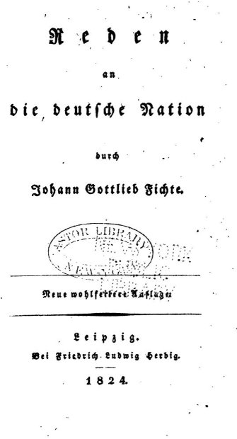
哲學家費希特在法軍占領下的柏林發表演講，強調教育、文化與民族精神，希望德意志人重建共同的認同。這類思想推動了民族主義，但文化上的民族認同，還不等於建立統一國家的政治共識。

## 1813-10-16 | 萊比錫會戰
10月16日至19日，普魯士、奧地利、俄國等聯軍擊敗拿破崙，法國勢力退出德意志。後世民族主義者把這場「民族會戰」視為反抗外國統治的象徵；但參戰的各邦並沒有因此放棄自己的君主與獨立。

## 1815-06-08 | 德意志邦聯成立
維也納會議重建歐洲秩序，在德意志地區只成立了一個由39個邦國與自由城市組成的鬆散邦聯：各邦保有主權，沒有中央政府與全國議會，奧地利居於主導，普魯士的部分領土還在邦聯之外。它是維也納會議的安排，也是民族主義者此後不斷要求改革的對象。

## 1817-10-18 | 瓦特堡集會
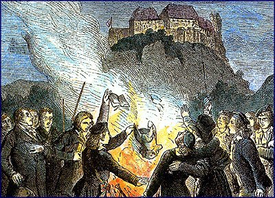
大學生與民族主義者在瓦特堡集會，紀念宗教改革與反拿破崙戰爭，表達對統一、自由與政治改革的期待。民族主義開始與自由主義結合，但參加者的理想各不相同，有人要立憲君主制，有人要更廣泛的民主，有人只講文化民族。

## 1819-08 | 卡爾斯巴德決議
邦聯內的保守勢力通過卡爾斯巴德決議，監督大學教師與學生團體、嚴格審查出版、打擊被視為威脅君主秩序的政治活動。統一問題不只是邦國之間的外交，也牽涉人民是否有權參與政治。

## 1830 | 法國七月革命的衝擊
法國七月革命推翻復辟的波旁王朝，重新點燃歐洲自由派的希望，德意志各邦也出現要求憲法、言論自由與政治參與的運動，統一的主張與憲政、人民權利結合得更緊密。

## 1832-05-27 | 漢巴赫節
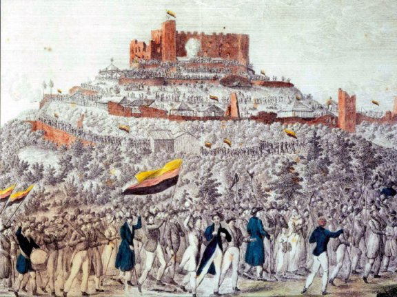
兩萬多人聚集在漢巴赫城堡附近，要求德意志統一、政治自由與人民參與。黑、紅、金三色旗在這場集會中廣受矚目，後來成為統一運動的象徵，也是今日德國國旗的由來。統一運動從少數知識分子的討論，變成廣泛的公共議題。

## 1834-01-01 | 關稅同盟
普魯士主導的關稅同盟開始運作，逐步取消成員邦之間的關稅壁壘，擴大市場，帶動鐵路、煤礦、鋼鐵與製造業發展，也擴大了普魯士的影響力。奧地利沒有加入；關稅同盟也不等於政治統一，但各邦在經濟上越來越互相依賴。

## 1848-03 | 三月革命
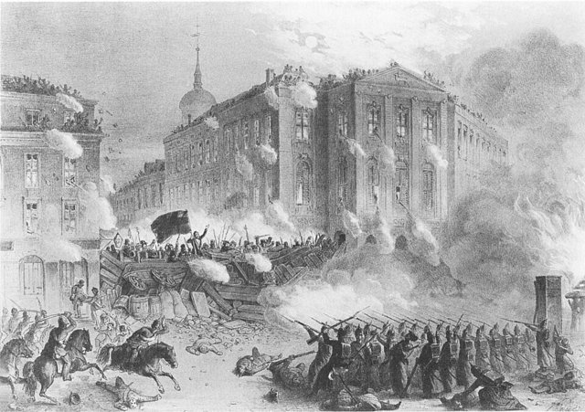
2月，法國二月革命推翻七月王朝、建立第二共和，革命浪潮湧向中歐。3月，柏林、維也納等城市爆發示威與街頭衝突，柏林的民眾與軍隊流血對峙，普魯士國王腓特烈·威廉四世一度讓步、承諾憲政改革，各邦也放寬審查、允許政治活動。革命者要憲法、新聞自由、民選議會與統一，但君主仍握有軍隊，革命派內部也意見分歧。

## 1848-05-18 | 法蘭克福國民議會開幕
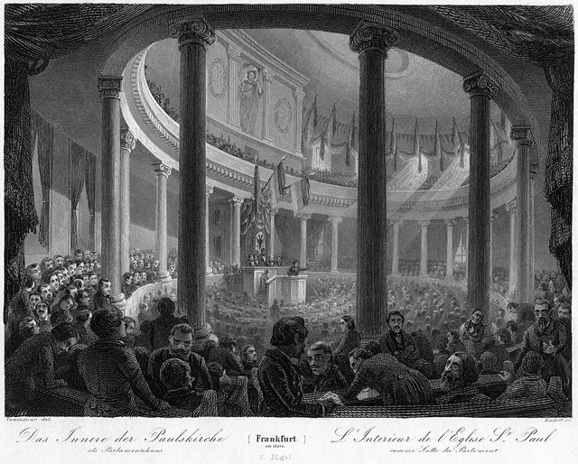
德意志第一個全國性民選議會在法蘭克福聖保羅教堂開會，統一不再只靠君主外交，而是透過選舉、議會辯論與制憲來追求。議員多是受過教育的中產階級、法律與學術界人士，面對的難題包括：統一國家要不要包括奧地利？君主制還是共和？皇帝與議會如何分權？如何讓各邦君主接受？辯論因此曠日持久。

## 1848-12-21 | 《德意志人民基本權利法》
國民議會通過基本權利法：法律之前人人平等，廢除部分身分特權，保障人身、言論、出版、集會與結社自由。統一被賦予了建立法治與公民權利的理想，但議會沒有軍隊與行政力量，無法讓各邦執行。

## 1849-03-27 | 法蘭克福憲法
國民議會通過帝國憲法，建立有世襲皇帝與議會的聯邦國家，採取不包括奧地利、以普魯士為核心的「小德意志方案」。這需要普魯士國王接受皇位，各邦也必須承認新秩序。

## 1849-04 | 普魯士國王拒絕皇冠
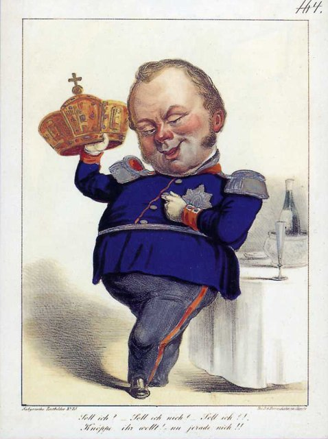
腓特烈·威廉四世拒絕接受國民議會獻上的皇冠，他不願接受由議會革命、而非君主正統授予的皇位。保守勢力隨即恢復控制，5月至7月，部分激進派以武裝起義捍衛憲法，被軍隊鎮壓，統一計畫宣告失敗。缺乏軍隊、內部分裂、君主反撲與奧普之爭無解，讓單靠議會與民族熱情的道路走不通；但它留下了憲法、基本權利與民選議會的遺產。

## 1850-11-29 | 奧爾米茨協定
革命失敗後，普魯士另起爐灶，1849年與薩克森、漢諾威組成三王同盟，1850年召開愛爾福特聯盟議會，想建立排除奧地利、由普魯士領導的聯盟。奧地利反對、俄國不支持，巴伐利亞等邦也不願服從普魯士。在奧地利施壓與俄國介入下，普魯士在奧爾米茨同意放棄計畫、恢復德意志邦聯。這是普魯士的一次重大挫敗，也證明統一必須先解決普奧之爭。

## 1861 | 威廉一世即位
1850年代，普魯士靠關稅同盟與工業化在鐵路、煤鋼與軍工上快速成長；奧地利則忙於統治多民族帝國，它的利益本就不等於建立以德語人口為核心的民族國家。誰來統一、範圍包不包括奧地利，就是所謂的「德意志問題」。1861年威廉一世即位，他重視擴軍與徵兵制度改革，但軍事預算需要議會批准，與自由派議員陷入憲政衝突。

## 1862-09-23 | 俾斯麥出任首相

軍事預算的僵局無解，威廉一世任命保守派的奧托·馮·俾斯麥為普魯士首相。俾斯麥不打算走自由派的議會路線，而要以君權、外交與軍事實力，建立以普魯士為中心的德意志國家。

## 1862-09-30 | 「鐵與血」演說
俾斯麥在議會預算委員會表示，當前的重大問題不是靠演說與多數決，而是要靠「鐵與血」來解決。這句話成了他權力政治的代名詞，與1848年的議會理想形成強烈對比；不過他並非只靠戰爭，孤立對手、爭取盟友、控制戰爭目標與適時議和，同樣是他的手段。

## 1864-02-01 | 普丹戰爭
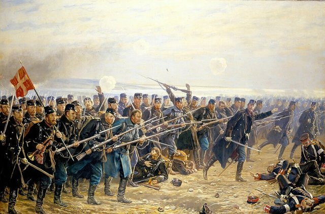
石勒蘇益格與荷爾斯泰因兩公國與丹麥王室關係密切，法律地位各不相同，當地也有不少德語居民；1863年11月丹麥頒布新憲法、加強控制石勒蘇益格，引起德意志民族主義者反對。俾斯麥先與奧地利合作，兩國聯軍進攻丹麥，4月18日普軍攻破迪博爾防線。

## 1864-10-30 | 維也納和約
丹麥戰敗，放棄石勒蘇益格、荷爾斯泰因與勞恩堡；兩公國由普奧共管，勞恩堡歸普魯士。普魯士的軍事實力與國際地位提升，但兩公國如何管理，成了普奧日後衝突的導火線。

## 1865-08-14 | 加斯坦協定
普奧約定由普魯士管理石勒蘇益格、奧地利管理荷爾斯泰因，暫時避免開戰，卻沒有解決兩國爭奪德意志領導權的根本矛盾。

## 1866-04-08 | 普魯士與義大利結盟
義大利想從奧地利手中取得威尼斯，普魯士想削弱奧地利在德意志的地位，兩國達成軍事合作，讓奧地利腹背受敵。6月，普奧在邦聯與公國問題上全面開戰，因主要戰事很快就分出勝負，又稱「七週戰爭」。

## 1866-07-03 | 柯尼希格雷茨戰役
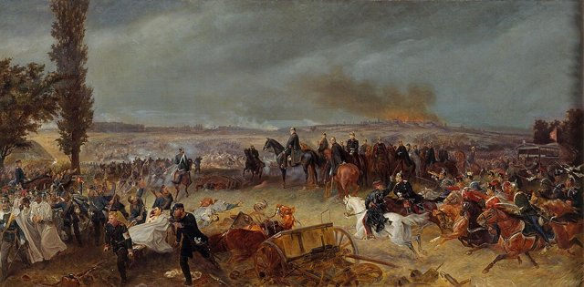
又稱薩多瓦戰役，普軍擊敗奧地利及其盟軍。普魯士在動員、鐵路運輸、組織與後膛裝填步槍上的優勢都發揮了作用，勝利不是靠單一武器決定的。

## 1866-08-23 | 布拉格和約
奧地利退出德意志的政治體系，德意志邦聯解散，普魯士吞併漢諾威、黑森選侯國、拿騷與法蘭克福，開始以自己為核心重組北德意志。俾斯麥刻意不要求割讓奧地利本土，避免把奧地利永遠推向復仇。排除奧地利的「小德意志方案」從此取得決定性優勢，這是整個統一運動的轉折點。

## 1867 | 北德意志邦聯
普魯士與北德意志各邦組成北德意志邦聯，有共同的聯邦憲法、代表各邦政府的聯邦參議會，以及選舉產生的帝國議會，由普魯士國王擔任聯邦主席，軍事與外交由普魯士主導。這套制度比1848年的方案更合普魯士君主制的需要；巴伐利亞、符騰堡、巴登與南黑森等南德各邦還沒有加入。

## 1868 | 西班牙王位問題
西班牙革命推翻原有王朝，霍亨索倫家族支系的利奧波德親王被提名為王位候選人。法國擔心東西兩側都出現霍亨索倫家族的國王，強烈反對；候選人後來撤回，緊張卻沒有消失。

## 1870-07 | 埃姆斯電報
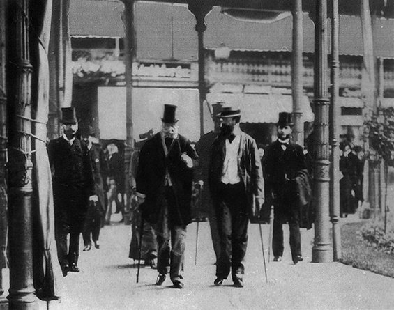
法國大使在埃姆斯要求威廉一世保證永不再支持霍亨索倫家族的候選人。俾斯麥把國王回報交涉的電報刪節後公開，讓雙方看起來都被對方羞辱，兩國輿論沸騰。它不是普法矛盾的唯一原因，卻把既有的對立推向戰爭。

## 1870-07-19 | 法國向普魯士宣戰
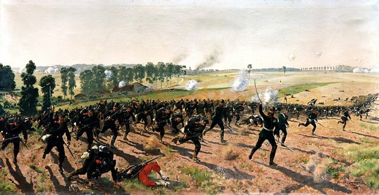
法國宣戰，普法戰爭爆發。俾斯麥讓普魯士看起來是被挑釁的一方，原本對普魯士有所保留的南德各邦，面對法國的威脅也願意並肩作戰。8月，德意志聯軍在格拉沃洛特等地與法軍激戰，動員、鐵路運輸與參謀組織的優勢讓法軍陷入劣勢。

## 1870-09-02 | 色當戰役
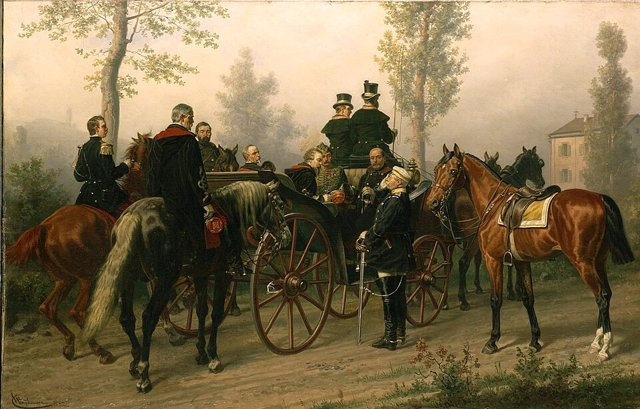
9月1日至2日，法軍在色當被德意志聯軍擊敗，皇帝拿破崙三世被俘。9月4日，第二帝國在巴黎垮台，法蘭西第三共和國成立，但新政府繼續抵抗；德軍從9月起包圍巴黎，直到1871年初法國被迫求和。

## 1870-11 | 南德各邦同意加入
在戰爭中，巴伐利亞、符騰堡、巴登與南黑森與普魯士談判加入新的德意志國家。各邦對普魯士的主導仍有保留，加入是透過政治協商與制度安排達成，而不是戰爭自動決定的。

## 1871-01-18 | 德意志帝國成立
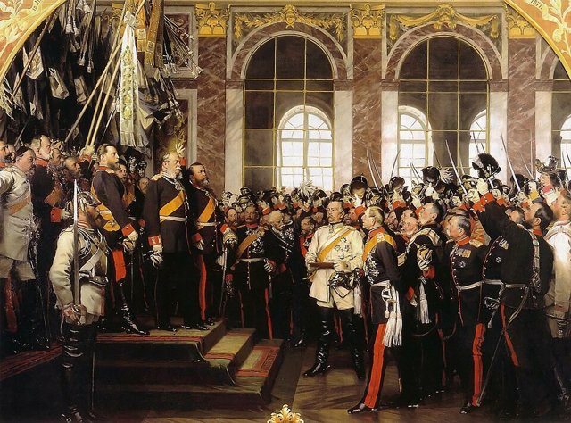
威廉一世在凡爾賽宮鏡廳被宣布為德意志皇帝，以普魯士為核心、結合北德與南德各邦的德意志帝國成立。在戰敗的法國王宮宣告建國，讓新帝國的誕生從一開始就與法德敵對綁在一起。帝國是由普魯士主導的聯邦制君主立憲國：皇帝由普魯士國王兼任，宰相由皇帝任命、不必依賴議會信任，帝國議會雖由成年男性普遍、平等、秘密選舉產生，權力卻受到皇帝、宰相與聯邦制度限制。統一完成了，1848年自由派期待的議會民主卻沒有隨之實現；多民族的奧地利被排除在外，許多德語人口仍留在奧匈帝國。

## 1871-05-10 | 法蘭克福和約
普法戰爭正式結束，法國賠款，並把阿爾薩斯大部分與洛林部分地區割讓給德意志帝國。割地加深了法國的民族屈辱，為日後的法德衝突埋下長期的種子。
