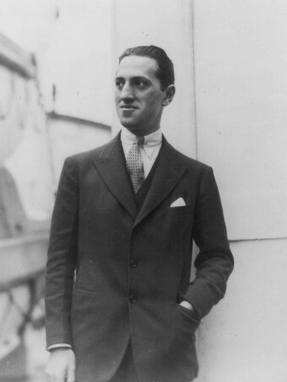
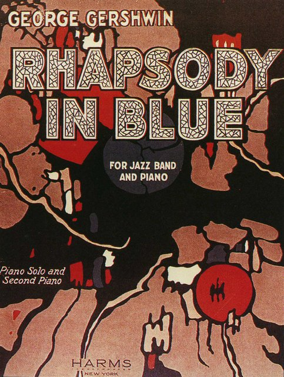
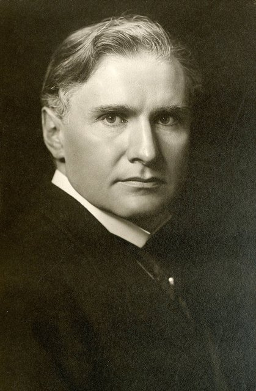
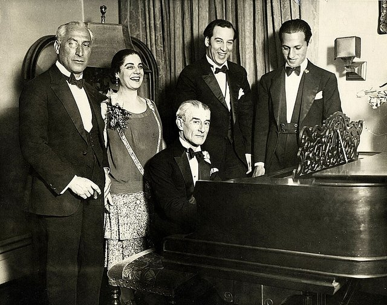
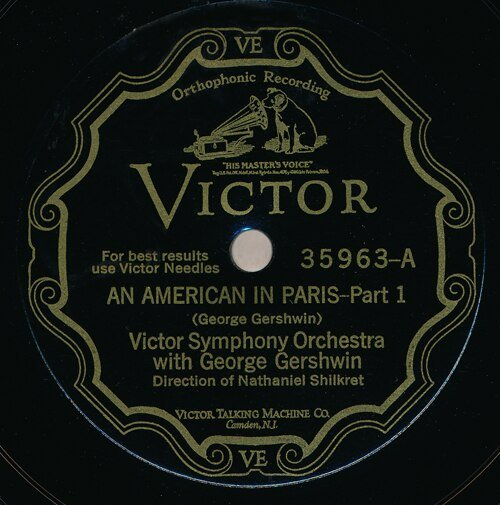
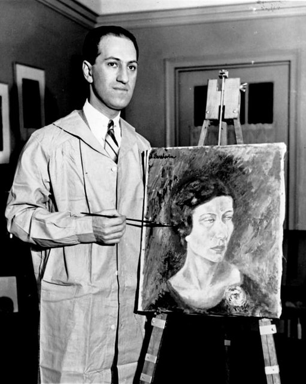
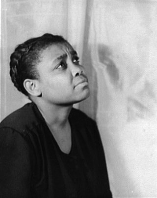
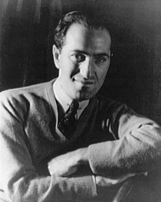

<!--
內容整理自中文維基百科「喬治·蓋西文」與英文維基百科「George Gershwin」條目（CC BY-SA 4.0），並以台灣用語改寫摘要。
https://zh.wikipedia.org/zh-tw/乔治·格什温
https://en.wikipedia.org/wiki/George_Gershwin
中文條目較簡略，生平細節主要參考英文條目。
《藍色狂想曲》、F大調鋼琴協奏曲、《乞丐與蕩婦》等作品的首演日期，條目只寫年份，係依一般公認的史實補充。
圖片皆為 Wikimedia Commons 上的公有領域作品（封面：約1935年的簽名宣傳照）。
-->

# Periods
- 1898 ~ 1913 | 布魯克林的少年
  俄國猶太移民之子，在紐約的意第緒劇院區長大。10歲前對音樂毫無興趣，聽到同學拉小提琴後才著了迷，霸占了父母買給哥哥艾拉的鋼琴。
- 1913 ~ 1923 | 錫盤巷與百老匯@New York
  15歲輟學到「錫盤巷」當歌曲推銷員，錄製自動鋼琴紙捲，開始為百老匯寫歌。〈斯旺尼河〉讓他一炮而紅。
- 1924 ~ 1928 | 從爵士到音樂廳
  《藍色狂想曲》把爵士帶進音樂廳，之後與哥哥艾拉合作一連串百老匯名作，並寫出F大調鋼琴協奏曲與《一個美國人在巴黎》。
- 1929 ~ 1935 | 《乞丐與蕩婦》
  音樂劇《我為你歌唱》成為第一部獲普立茲戲劇獎的音樂劇，〈我有節奏〉等歌曲成為爵士標準曲。1935年完成他的代表作、美國歌劇《乞丐與蕩婦》。
- 1936 ~ 1937 | 好萊塢的最後歲月@Hollywood
  移居好萊塢，為佛雷·亞斯坦與琴吉·羅傑斯主演的電影寫配樂，和荀白克一起打網球。38歲時因腦瘤驟逝。

# Events

## 1898-09-26 | 出生@布魯克林
生於紐約布魯克林斯內迪克大道的公寓，出生證明上的名字是雅各·蓋西溫，沒有中間名，後來大家都叫他喬治。父母都是從俄羅斯帝國移民來的猶太人：父親莫里斯原本是女鞋皮革裁剪工，為了逃避兵役到美國；母親羅絲的家人則是為了躲避反猶情緒而移民。祖父曾在俄國陸軍當了25年機械師，才換得猶太人自由居住與旅行的權利。

## 1908 | 愛上音樂
他從小在紐約的公寓區長大，和朋友到處亂跑、溜直排輪、在街頭惡作劇，對音樂毫無興趣。10歲時聽到朋友的小提琴演奏，深深著迷。差不多同時，父母為哥哥艾拉買了一台鋼琴，結果彈得最多的反而是喬治，讓艾拉鬆了一口氣。

## 1913 | 拜漢比策為師；輟學當歌曲推銷員
經人介紹跟鋼琴老師漢比策學琴，漢比策教他正統的鋼琴技巧，帶他認識歐洲古典音樂，還鼓勵他去聽管弦樂音樂會。據中文條目，漢比策極為看好他，甚至免費教他，說：「這孩子是個天才。」同年他15歲輟學，到紐約「錫盤巷」的音樂出版社當歌曲推銷員，週薪15美元。

## 1916 | 第一首出版歌曲；自動鋼琴紙捲
第一首出版的歌曲只讓17歲的他賺了50美分。他開始為唱片公司錄製、編曲自動鋼琴紙捲，用本名和化名錄了成百上千捲。他的歌首次在百老匯演唱，1917年的鋼琴拉格〈里亞托漣漪〉也賣得不錯。

## 1918 | 恩師漢比策去世
漢比策直到去世前都是他的音樂導師。

## 1919 | 〈斯旺尼河〉一炮而紅

百老匯巨星艾爾·喬森在派對上聽到他彈這首歌，決定在自己的演出中演唱，成為他第一首全國暢銷曲。這時期他也結識了作曲家兼指揮戴利，戴利後來常為他編曲、配器、指揮，兩人成為多年好友。

## 1922 | 爵士獨幕歌劇《藍色星期一》
與作詞家德西爾瓦合作，以紐約哈林區為背景，被視為日後《乞丐與蕩婦》的先驅。

## 1924-02-12 | 《藍色狂想曲》首演

他的第一部重要作品，由格羅菲配器，在紐約由保羅·懷特曼的樂團首演，他親自彈奏鋼琴。這首曲子以前所未有的方式融合爵士與古典音樂，奠定了他的招牌風格，也成為他最受歡迎的作品。

## 1924-12 | 與艾拉合作《女士，請好心》
兄弟倆合作的音樂喜劇，劇中的〈迷人的節奏〉等歌曲後來都成為標準曲。此後艾拉作詞、喬治作曲，又推出《哦，凱伊！》、《滑稽臉》、《奏樂吧》等作品。

## 1925-12-03 | F大調鋼琴協奏曲首演

由指揮家丹羅許委託，並指揮紐約交響樂團在卡內基音樂廳首演，他親自擔任獨奏，這首協奏曲後來成為古典音樂的常備曲目。

## 1926 | 凱伊·史威夫特與《哦，凱伊！》
他和作曲家凱伊·史威夫特交往了十年，常向她請教音樂。據說兩人沒有結婚，是因為他的母親不滿意史威夫特不是猶太人。1926年的音樂劇《哦，凱伊！》就是以她命名。同年他也寫了三首鋼琴前奏曲。

## 1928 | 想拜師被拒；《一個美國人在巴黎》

他在巴黎短暫停留，想跟名師娜迪亞·布朗熱學作曲，卻被拒絕，理由是擔心嚴格的古典訓練會毀了他的爵士風格；他問拉威爾能否拜師，拉威爾也以類似理由婉拒，說怕他「寫出拙劣的拉威爾，失去自己的旋律天賦」。他和拉威爾是在這年3月拉威爾訪美期間、紐約一場為拉威爾慶生的派對上認識的。他在巴黎寫下交響詩《一個美國人在巴黎》。

## 1928-12-13 | 《一個美國人在巴黎》首演

在卡內基音樂廳首演，評價好壞參半，但很快就成為歐美的常備曲目。

## 1930 | 《瘋狂女孩》：〈我有節奏〉
音樂劇《瘋狂女孩》由琴吉·羅傑斯演唱〈擁抱你〉，另一首〈我有節奏〉更成為爵士樂手最愛的標準曲之一。

## 1932-05 | 《我為你歌唱》獲普立茲獎

1931年的政治諷刺音樂劇《我為你歌唱》成為第一部獲得普立茲戲劇獎的音樂喜劇。得獎者是編劇考夫曼、里斯金德與作詞的艾拉，身為作曲家的喬治反而不在得獎名單上。

## 1934 | 福利島之夏
應小說《波吉》的作者海沃德之邀，到南卡羅來納州的福利島度過夏天，在那裡得到寫作歌劇《乞丐與蕩婦》的靈感。

## 1935-10-10 | 《乞丐與蕩婦》百老匯首演

與艾拉、海沃德合作的歌劇，劇中的〈夏日時光〉成為傳世名曲，首演由全黑人演員擔綱，女高音露比·艾爾齊飾演瑟琳娜。當時樂評搞不清楚該把它當歌劇還是百老匯音樂劇來評價，戲劇史學者說它「跨越了界線」。首演在商業上失敗，後來卻被公認為20世紀最重要的美國歌劇之一。

## 1936 | 移居好萊塢
《乞丐與蕩婦》票房失利後，他搬到加州好萊塢，和荀白克成為朋友，常一起打網球。他接受雷電華電影公司委託，為佛雷·亞斯坦與琴吉·羅傑斯主演的電影《我們跳舞吧》配樂，以新的方式結合芭蕾與爵士，花了好幾個月才完成。

## 1937 | 最後的電影歌曲
兄弟倆為電影《我們跳舞吧》、《落難少女》與《高德溫歌舞團》寫歌，其中〈他們都笑了〉、〈別再說了〉、〈他們無法從我身邊奪走〉、〈霧天〉、〈愛會長存〉等都成為爵士標準曲。

## 1937-02-11 | 舞台上的異狀
與舊金山交響樂團和指揮家蒙都合作演出自己的F大調鋼琴協奏曲，一向演奏出色的他在台上出現協調問題，還短暫失去意識。這年初他開始劇烈頭痛，還常聞到不存在的燒焦橡膠味。艾拉的妻子發現他情緒起伏不定、吃飯時常把食物灑出來，懷疑他有精神疾病，把他搬到附近作詞家哈伯格的空屋，由貼身男僕照顧。

## 1937-07-11 | 逝世@洛杉磯

7月9日晚上，他在為《高德溫歌舞團》作曲時倒下，最後說的話是「佛雷·亞斯坦」。送醫陷入昏迷後，醫生才判斷是腦瘤。朋友透過白宮派海岸防衛隊快艇，去海上找正在和州長釣魚的神經外科權威丹迪，但丹迪還沒趕到，醫生就在11日清晨動了手術，他仍在當天早上去世，年僅38歲。作家約翰·歐哈拉說：「喬治·蓋西文死於1937年7月11日，但只要我不想，我就不必相信。」他安葬於紐約州哈斯廷斯的西徹斯特山公墓。

## 1937-09-08 | 好萊塢露天劇場紀念音樂會
指揮家克倫培勒在紀念音樂會上，指揮了自己為蓋西文第二號前奏曲配器的版本。艾拉此後繼續與其他作曲家合作，完成了《高德溫歌舞團》，並在哥哥死後持續推廣他的作品。
