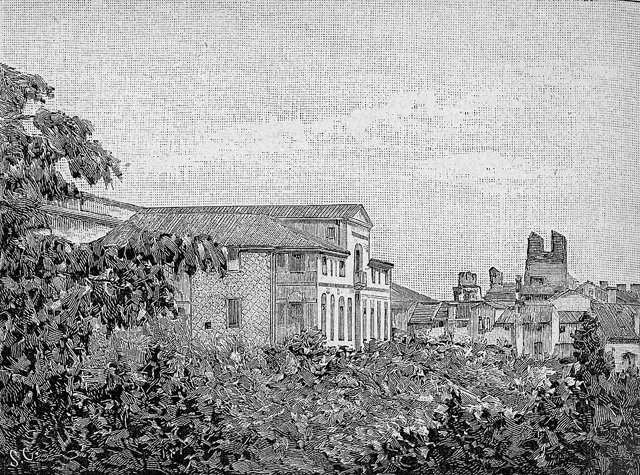
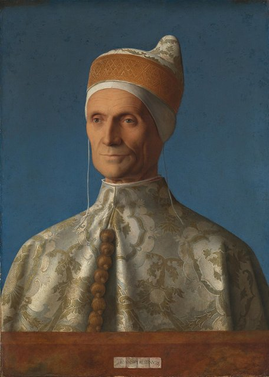
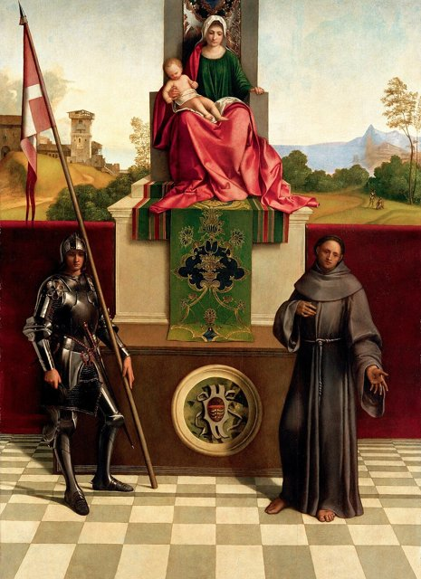
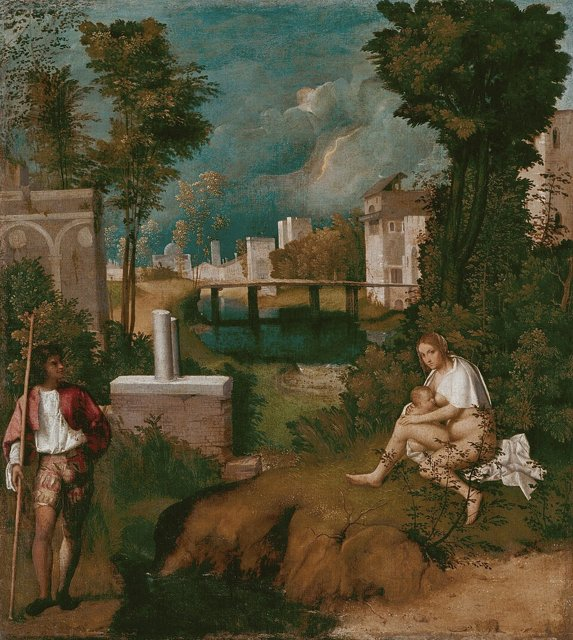
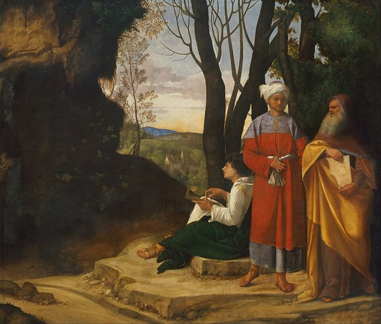
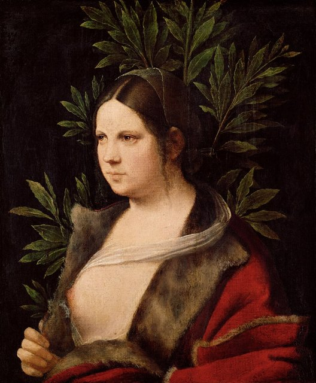
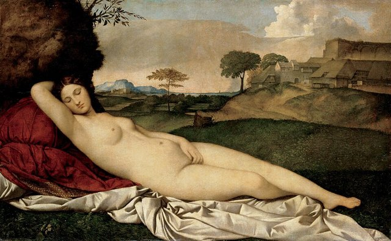

<!--
內容整理自 D:\Books\html\9-2.藝術家\喬久內生平大事記.html（沒有對應的 md 筆記），以自己的話改寫。
時期依頁面的分段歸納為兩段：早年與學藝、創作成熟期（含晚年與身後）。
處理方式：
- 頁面強調喬久內的生平資料有限：確切的出生年份（約1477或1478年）、部分作品的年代與若干名畫的作者歸屬都有學術爭議。born 採1477，事件的年齡因此只是大約值；逝世年份寫1510（「1510年前後」，常見說法是死於瘟疫、年紀約三十出頭），沒有月日。
- 《暴風雨》《三位哲學家》的題材沒有公認的定論，《沉睡的維納斯》涉及喬久內與提香的作者歸屬或合作，頁面已一一說明，這裡照寫，不選定一種解釋。
- 1507年的總督宮委託原作未能完整保存，1508年的德國商館外牆壁畫大多已因風化失傳，僅存殘片與記錄，內文照寫。
- 頁面的「藝術風格與創新」「與提香比較」「歷史地位與影響」寫進時期說明與最後一則事件，不另立事件；「閱讀與研究提醒」的內容已分散在各事件的內文。
- 譯名：喬凡尼·貝里尼依頁面；aliases 加上常見的另一種譯名喬爾喬內；人名用·分隔（頁面作・）。
圖片（皆為 Wikimedia Commons 上的公有領域或 CC0 作品，縮成最長邊 640px 的 JPEG）：
- gio-cover.jpg：Giorgione, Self-Portrait braunschweig.jpg（〈大衛〉（布倫瑞克），傳統上認為是喬久內的自畫像）
- gio-house.jpg：Castelfranco Veneto, Casa di Giorgione (xilografia).jpg（卡斯泰爾弗蘭科的喬久內之家（木刻版畫））
- gio-bellini.jpg：Giovanni Bellini, portrait of Doge Leonardo Loredan.jpg（喬凡尼·貝里尼〈總督萊昂納多·洛雷丹肖像〉）
- gio-altarpiece.jpg：Giorgione - Pala di Castelfranco.jpg（《卡斯特弗蘭科祭壇畫》）
- gio-tempest.jpg：Giorgione, The tempest.jpg（《暴風雨》）
- gio-philosophers.jpg：Giorgione - Three Philosophers - Google Art Project.jpg（《三位哲學家》）
- gio-laura.jpg：Giorgione - Young Woman (“Laura”) - Google Art Project.jpg（《勞拉》，1506前後）
- gio-venus.jpg：Giorgione - Sleeping Venus - Google Art Project 2.jpg（《沉睡的維納斯》，約1508–1510）
-->

# Periods
- 1477 ~ 1499 | 早年與學藝 | #868e96
  生於卡斯特弗蘭科，早年生活缺乏完整文獻，1490年代進入威尼斯的藝術環境，可能受貝里尼影響。
- 1500 ~ 1510 | 創作成熟期與去世 | #2f9e44
  約1500年前後形成個人風格，創作《卡斯特弗蘭科祭壇畫》《暴風雨》《三位哲學家》《勞拉》，並獲總督宮委託、與提香參與德國商館外牆壁畫；1510年前後去世，常見說法是死於瘟疫，作品聲望延續，但收藏與作者歸屬問題長期受到討論。

# Events

## 1477 | 出生於卡斯特弗蘭科 {label=約1477／1478年}

出生於義大利北部威尼托地區的卡斯特弗蘭科（Castelfranco Veneto）。他的名字通常記作 Giorgio Barbarelli da Castelfranco；早年生活與學藝過程缺乏完整的文獻，因此許多細節只能依作品、同時代的記錄與後世傳記推估。

## 1490 | 進入威尼斯藝術環境，可能受貝里尼影響 {label=1490年代}

逐漸進入威尼斯的藝術圈。學者通常認為他受到喬凡尼·貝里尼與威尼斯繪畫傳統的影響，但他具體的師承與訓練經過，並沒有足夠的文獻可以完全確認。

## 1500 | 逐漸形成個人風格 {label=約1500年前後}
他的繪畫開始展現柔和的色彩層次、細膩的光線，以及人物與自然環境相互呼應的構圖。相較於清楚講述宗教故事的傳統作品，他的畫面常保留較多含蓄與曖昧的空間。

## 1500 ~ 1504 | 《卡斯特弗蘭科祭壇畫》

《卡斯特弗蘭科祭壇畫》（Castelfranco Altarpiece）是他較具代表性的早期作品之一，畫面以聖母子為中心，人物姿態安定，色彩與空間有沉靜、柔和的氣質，也顯示他如何在傳統的宗教題材中融入個人化的氣氛營造。

## 1504 ~ 1508 | 《暴風雨》

《暴風雨》（The Tempest）是他最著名、也最常引發討論的作品之一：畫中有一名抱著嬰兒的女子、一名持杖的男子，以及遠方的城市與閃電。畫面究竟描繪何種故事，至今沒有公認的定論；作品的重要性在於風景不再只是人物故事的背景，而成為情緒與意義的核心。

## 1505 ~ 1509 | 《三位哲學家》

《三位哲學家》（The Three Philosophers）描繪三名年齡與形象各異的人物，站在岩洞與風景前。畫中人物究竟代表哲學家、天文學家、賢士，或有其他的象徵意義，學界曾提出多種解釋；作品以人物、洞穴、遠景與光線構成沉思而神祕的氛圍。

## 1506 | 《勞拉》肖像 {label=1506年前後}

《勞拉》（Laura）是他少數具有明確日期或題記線索的作品之一，常被視為其肖像畫的重要例子。人物以柔和的光線呈現，形象既具體，又帶有含蓄的心理感受，反映當時威尼斯肖像畫的革新。

## 1507 | 受委託為威尼斯總督宮創作
文獻記載他曾受委託為威尼斯總督宮（Doge's Palace）創作作品，相關作品後來沒有完整保存，因此今天無法直接從原作全面評估其面貌。這項委託顯示他在當時的威尼斯藝術界已受到重視。

## 1508 | 參與德國商館外牆壁畫計畫 {label=1508年前後}

他與提香曾參與威尼斯德國商館（Fondaco dei Tedeschi）的外牆壁畫裝飾。壁畫大多因風化而失傳，僅存部分殘片與記錄；這項合作也反映兩位畫家在威尼斯藝術環境中的交會，作品的具體分工仍有討論空間。約1508至1510年的《沉睡的維納斯》常與他聯繫，也被認為可能由提香完成或續作：作品把裸女與寧靜的風景結合，對後世威尼斯繪畫影響深遠。

## 1510 | 逝世，年紀約三十出頭 {label=1510年前後}
在威尼斯去世，常見說法認為他死於當時的瘟疫，年紀約三十出頭。由於生命短暫、存世作品有限，他的藝術生涯留下許多空白，也使作品歸屬與創作年代成為藝術史研究的重要課題。

## 1510 | 作品聲望延續，作者歸屬引發討論 {label=1510年後}
他逝世後，作品仍受到收藏家與藝術愛好者的重視。早期作品的歸屬問題，以及他與提香的風格關係，長期影響後世對其作品的認定；由於當時畫家之間存在合作、模仿與工作坊製作，並非所有傳統上歸於他的畫作，都能確定由他親筆完成。他的重要性不只在於幾幅名畫，而在於使風景、色彩、光線與情緒成為繪畫意義的主要來源之一：風景不再只是陪襯，能與人物共同構成作品的主題；柔和的色彩關係與光線營造難以用文字完全說明的情緒；作品的含蓄與不確定性持續吸引藝術史家與觀者提出不同解讀；他的探索與提香等畫家的創作，共同推動威尼斯畫派在色彩、風景與人物表現上的革新。與提香相比，他的生涯短暫（約1477／1478至1510年）、作品不多，畫面常帶有詩意、含蓄、神祕與沉思的氛圍；提香的生涯漫長，題材廣泛，表現力與變化豐富。兩人的關係不宜簡化為單純的師徒：他的風格對提香早期的創作有重要影響，兩人也曾參與同一壁畫計畫，但具體的合作方式與部分作品的歸屬仍有研究上的討論。
