<!--
內容整理自本機筆記〈歌德生平大事記〉（圖表\歌德生平大事記.md）與中文維基百科「約翰·沃爾夫岡·馮·歌德」條目（CC BY-SA 4.0），以台灣用語改寫摘要。
https://zh.wikipedia.org/zh-tw/约翰·沃尔夫冈·冯·歌德
史料與日期說明：
- 地名依其他時間軸統一寫作「威瑪」（筆記作「魏瑪」）。
- 與席勒的友誼：維基百科寫1795年開始，筆記寫1794年；一般說法是1794年7月兩人在耶拿的一場自然研究學會後長談，從此結為好友，此處採1794年。
- 抵達威瑪：筆記寫1775年，維基百科寫1776年開始為公國服務；他1775年11月抵達威瑪，1776年6月正式出任樞密參贊，此處分別寫出。
- 獲封貴族：1782年4月，當時他還沒過33歲生日，以月份計算為32歲。
- 《浮士德》第二部：筆記寫1833年由後人整理出版；這部作品在他死後收入遺著集第一卷，一般記為1832年出版，此處寫作「他去世那年」出版。
- 臨終遺言「更多的光！」是在場者轉述的說法，文中標明「據說」。
- 1763年聽莫札特演奏、1792年隨軍目睹瓦爾密砲戰、1806年耶拿戰役後與克里斯蒂安娜結婚、1808年在艾福特會見拿破崙、1812年在特普利采會見貝多芬、1823年馬倫巴的戀情與艾克曼開始記錄談話、1830年兒子奧古斯特死於羅馬等細節，係依維基百科與一般公認的史實補充；戰爭只作背景，不描寫戰鬥場面。
圖片來源（皆為 Wikimedia Commons 公有領域／CC0 作品）：
- goe-cover.jpg：Goethe (Stieler 1828).jpg
- goe-birthhouse.jpg：Goethehaus 1850.jpg
- goe-werther.jpg：GoetheDieLeidenDesJungenWerthersTitelblatt1774S51.jpg
- goe-gartenhaus.jpg：Weimar Goethe Gartenhaus 1900.jpg
- goe-campagna.jpg：Johann Heinrich Wilhelm Tischbein - Goethe in the Roman Campagna - Google Art Project.jpg
- goe-naples.jpg：Bucht von Neapel mit Blick auf den Vesuv - Kniep.jpg
- goe-schiller.jpg：Anton Graff - Friedrich Schiller.jpg
- goe-napoleon.jpg：Audienz Goethe Napoleon.jpg
- goe-kuegelgen.jpg：Goethe, Kügelgen, 1810.jpg
- goe-teplitz.jpg：Beethoven and Goethe 1812.jpg
- goe-ulrike.jpg：Ulrike von Levetzow.jpg
- goe-monument.jpg：GoetheAndSchillerMonumentAtWeimar.jpg
-->

# Periods
- 1749 ~ 1765 | 法蘭克福的童年 | #f08c00
  生於帝國自由城市法蘭克福的富裕家庭，由父親與家庭教師親自教育，學習多種語言、繪畫與音樂，很早就愛上文學與戲劇。
- 1765 ~ 1775 | 求學與狂飆突進 | #c92a2a
  先後在萊比錫與史特拉斯堡攻讀法律，結識赫爾德後找到自己的聲音，以《葛茲》與《少年維特的煩惱》成為狂飆突進運動的旗手。
- 1775 ~ 1786 | 威瑪的大臣 | #1c7ed6
  應卡爾·奧古斯特公爵之邀來到威瑪，擔任大臣處理財政、礦業與道路，同時投入植物學與解剖學研究。
- 1786 ~ 1788 | 義大利之旅 | #e67700
  不告而別前往義大利，在羅馬與西西里研究古典藝術，文學風格從激情轉向古典的均衡與和諧。
- 1788 ~ 1805 | 與席勒的古典時代 | #2f9e44
  回到威瑪後與席勒結為摯友，兩人互相激勵，共同開創德國文學的「威瑪古典主義」。
- 1805 ~ 1832 | 威瑪的智者 | #0b7285
  席勒死後他獨力撐起德國文壇，寫出《親和力》《詩與真》《西東詩集》，晚年完成《浮士德》第二部，成為全歐洲朝聖的文化偶像。

# Events

## 1749-08-28 | 出生@法蘭克福
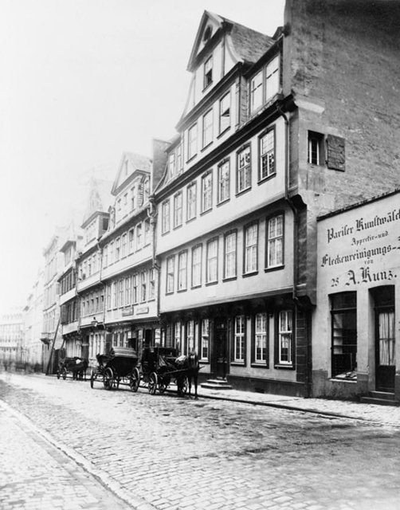
生於帝國自由城市法蘭克福的鹿溝街，難產的他出生時幾乎沒有呼吸。父親約翰·卡斯帕是學過法律、遊歷過義大利的皇家參議，嚴格而博學；母親卡塔琳娜·伊莉莎白是法蘭克福市長之女，嫁給父親時才17歲，生性開朗、擅長說故事。他後來形容自己從父親那裡繼承了認真的態度，從母親那裡得到了「說故事的樂趣」。

## 1759 | 法軍佔領下的劇院 {label=1759～1763年}
七年戰爭期間法軍佔領法蘭克福，一位法國軍官的指揮部就設在他家。他趁機天天跑法國劇院看戲，學會了法語，也迷上了戲劇。父親除了讓他學拉丁文、希臘文、法文、義大利文、英文與希伯來文，還教他繪畫、騎術與擊劍。

## 1763-08-18 | 聽七歲的莫札特演奏
在法蘭克福的一場音樂會上，聽了年僅七歲的神童莫札特演奏。他到晚年還記得那個「戴著假髮、佩著劍的小男孩」。

## 1765-09-30 | 萊比錫大學
16歲離開家鄉，依父親的意願到萊比錫大學攻讀法律。他對法律課程興趣缺缺，反而去聽詩人蓋勒特的課、學畫畫，並以輕快的洛可可風格寫詩獻給初戀對象。萊比錫的奧爾巴赫地窖酒館與流傳在那裡的浮士德傳說，日後成為《浮士德》第一部中唯一真實存在的場景。

## 1768-08-28 | 大病返鄉
在19歲生日當天，因嚴重咯血被迫中斷學業返回法蘭克福，養病一年半。病中他受到母親友人克勒滕貝格小姐的影響，接觸虔信主義、神秘主義與煉金術，這些思想後來在《浮士德》中留下痕跡。

## 1770-04 | 史特拉斯堡與赫爾德
到史特拉斯堡繼續攻讀法律，結識思想家赫爾德。赫爾德引導他欣賞民歌、莎士比亞與哥德式建築，讓他相信文學應該來自真摯的情感與民族的土壤，而不是死守法國式的古典規則。他愛上鄉村牧師的女兒弗里德里克·布里翁，寫下〈歡會與離別〉〈野玫瑰〉等抒情詩，卻在取得學位後離她而去，為此內疚了很久。

## 1772-05 | 韋茨拉爾與夏綠蒂
到韋茨拉爾的帝國最高法院實習，愛上已經訂婚的夏綠蒂·布夫，痛苦地不告而別。幾個月後，他在當地認識的年輕外交官耶路撒冷因為愛上有夫之婦而輕生，這兩件事結合起來，成為《少年維特的煩惱》的素材。

## 1773 | 《葛茲·馮·伯利欣根》
自費出版歷史劇《葛茲·馮·伯利欣根》，以宗教改革時代一位反抗諸侯的「鐵手騎士」為主角，完全不理會古典戲劇的三一律，被視為德國「狂飆突進運動」的代表作。這場文學運動強調天才、情感、自然與個人的自由。

## 1774 | 《少年維特的煩惱》
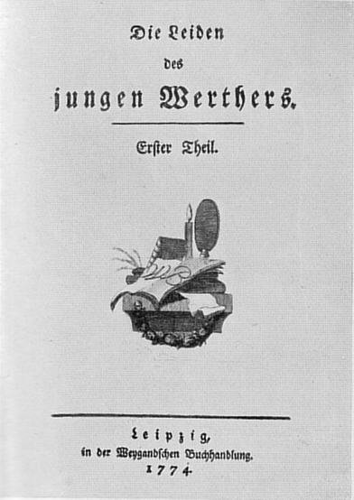
只花了約四週寫成的書信體小說《少年維特的煩惱》出版，描寫敏感的青年維特愛上已有婚約的綠蒂而陷入絕望。小說轟動全歐洲，年輕人紛紛模仿維特的藍色燕尾服與黃色背心，甚至傳出有人模仿書中結局，引起衛道人士的抨擊。25歲的他從此成為國際名人，據說拿破崙遠征埃及時都帶著這本書，讀了七遍。

## 1775-11 | 來到威瑪
應18歲的薩克森－威瑪公國公爵卡爾·奧古斯特之邀，來到人口只有約六千人的小城威瑪。本來只打算短暫作客，結果在這裡住了將近六十年。他結識了比他年長七歲的宮廷貴婦夏洛特·馮·施泰因，兩人維持了十年精神上的親密關係，他寫給她的信多達一千七百多封。

## 1776-06 | 出任樞密參贊
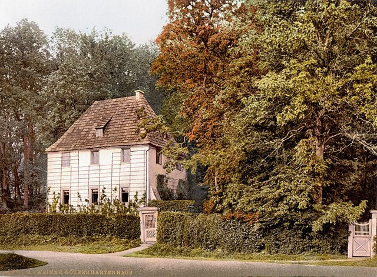
正式進入公國政府，出任樞密參贊，後來陸續主管礦業、道路、軍事與財政，1779年升任樞密顧問。他希望在這個小國實踐改革，嘗試重開伊爾梅瑙的銀礦，但成效有限。繁重的公務讓他的文學創作幾乎停頓，卻也讓他開始研究礦物、地質與植物。

## 1782-04 | 獲封貴族
受神聖羅馬皇帝冊封為貴族，姓名從此加上「馮」（von）。同年搬進婦女廣場旁的大宅，在這裡一直住到去世，今天是歌德故居博物館。同年父親去世。

## 1784-03 | 發現人類的顎間骨
透過比較解剖，證明人類也有顎間骨，當時一般認為這塊骨頭只有動物才有、可作為人與動物的區別。他據此主張人與動物在構造上是連續的，被視為比較形態學的先驅。

## 1786-09 | 不告而別前往義大利
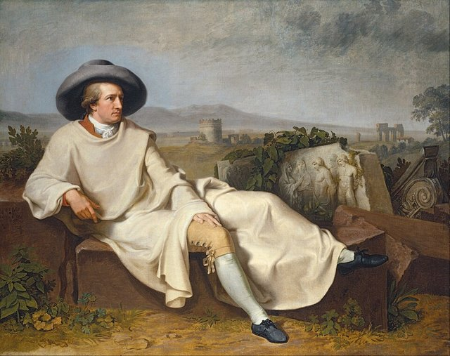
厭倦了宮廷與公務，37歲生日後不久，他凌晨悄悄離開卡爾斯巴德，化名「菲利普·米勒」前往義大利，只有秘書知道他的去向。他在羅馬與畫家蒂施拜因同住，畫家為他畫下著名的〈歌德在羅馬近郊〉。

## 1787 | 那不勒斯與西西里
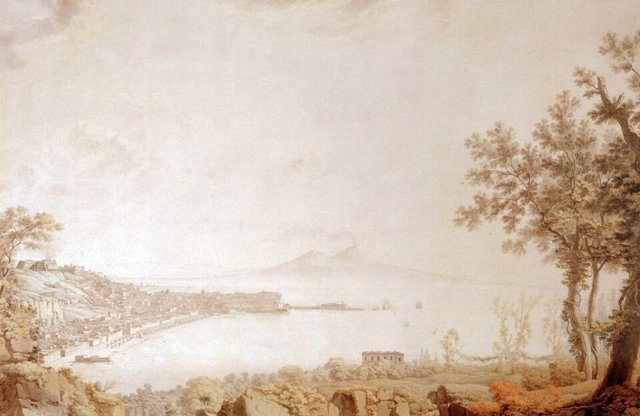
南下那不勒斯，攀登維蘇威火山，參觀龐貝遺址，再渡海到西西里。在巴勒莫的植物園裡，他構想出「原型植物」的概念：一切植物都是從同一個基本形式變化而來。他也在義大利完成了詩劇《伊菲革涅亞在陶里斯》的韻文版與《艾格蒙特》，後者日後由貝多芬譜寫配樂。

## 1788-07 | 返回威瑪，結識克里斯蒂安娜
回到威瑪，請求公爵免除大部分行政職務，只保留文化與科學方面的工作，包括督導耶拿大學與宮廷劇院。他結識了出身平凡的造花女工克里斯蒂安娜·福爾皮烏斯，兩人同居，讓威瑪上流社會議論紛紛，也讓他與施泰因夫人決裂。隔年12月，兒子奧古斯特出生。

## 1790 | 《植物變形記》
出版《試論植物的變形》，主張葉子是植物的基本器官，花瓣、雄蕊等都是葉子的變形，這是他在自然科學上最受肯定的成果之一。同年他出版了《浮士德》的片段，並完成劇作《托夸多·塔索》。

## 1792-09 | 隨軍出征法國
隨公爵參加普魯士與奧地利聯軍對法國大革命的干涉戰爭。據他後來的回憶，在瓦爾密一役聯軍受挫的當晚，他對軍官們說：「從此時此地，開啟了世界史的新紀元。」

## 1794-07 | 與席勒結為摯友
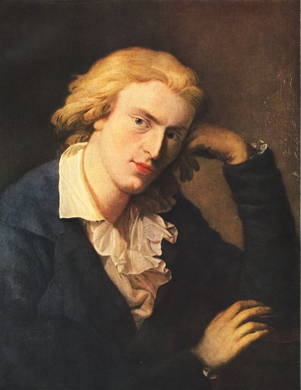
在耶拿一場自然研究學會的聚會後，與詩人席勒邊走邊談，從植物的變形談到藝術，兩人一見如故。此後十年他們幾乎天天通信或見面，互相批評、激勵彼此的創作，共同開創「威瑪古典主義」。1797年被稱為兩人的「敘事謠之年」，他寫下〈魔法師的學徒〉〈掘寶者〉等作品；在席勒的催促下，他也重拾擱置多年的《浮士德》。

## 1796 | 《威廉·麥斯特的學習時代》
完成長篇小說《威廉·麥斯特的學習時代》，描寫一位熱愛戲劇的商人之子透過種種經歷逐步成長，成為德國「成長小說」的典範。小說中迷娘的歌〈你可知道那檸檬花開的地方〉被許多作曲家譜成歌曲。

## 1805-05 | 席勒去世
席勒在威瑪去世，年僅45歲。他寫信給朋友說：「我失去了一個朋友，也失去了我存在的一半。」此後他獨自成為德國文壇的領袖。

## 1806-10 | 耶拿戰役與結婚
拿破崙在耶拿大敗普魯士軍隊，法軍湧入威瑪，闖進他的住宅，據說是克里斯蒂安娜挺身而出才保住了他。幾天後，他在宮廷教堂與同居十八年的克里斯蒂安娜正式結婚。

## 1808 | 《浮士德》第一部
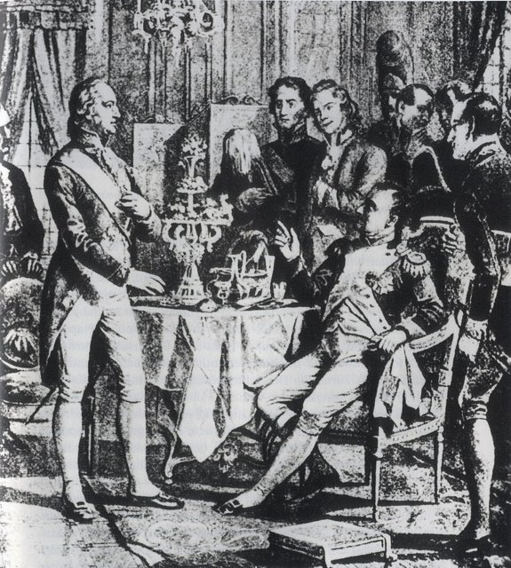
出版《浮士德：悲劇第一部》。學者浮士德厭倦了書本上的學問，與魔鬼梅菲斯特訂約：只要他有一刻滿足地說出「停一停吧，你真美」，靈魂就歸魔鬼所有。故事中浮士德引誘少女葛麗卿，最後導致她的悲劇。同年10月，拿破崙在艾福特召見他，兩人談論了《少年維特的煩惱》，拿破崙見到他時說：「這才是個人物！」並頒給他榮譽軍團勳章。9月，母親去世。

## 1809 | 《親和力》
出版小說《親和力》，借用化學中物質會互相吸引、分離與重組的概念，描寫兩對男女之間的感情轉移與婚姻困境。

## 1810-05 | 《色彩論》
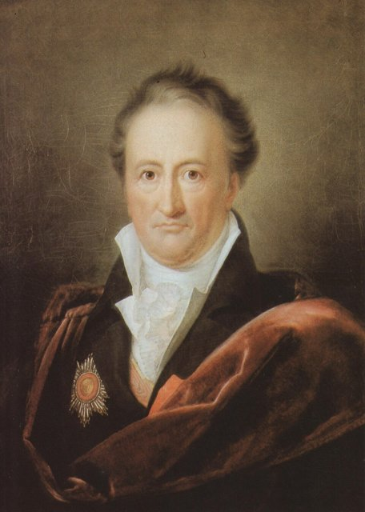
出版耗費二十年研究的《色彩論》，反對牛頓認為白光由各種色光組成的理論，強調顏色與人眼感知、明暗交界的關係。他的物理學論點被證明是錯的，但對色彩心理與視覺的觀察影響了後來的畫家與哲學家，他本人卻認為這是比詩作更重要的成就。

## 1811 | 自傳《詩與真》
出版自傳《詩與真》第一部，回顧自己從出生到前往威瑪的青年時代；書名表明，這是事實與詩意重構交織的生命故事。

## 1812-07 | 在特普利采會見貝多芬
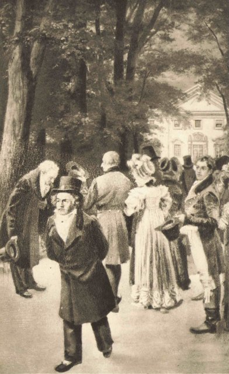
在波希米亞的溫泉鄉特普利采與貝多芬見面。他讚嘆貝多芬的才華，卻覺得對方「是個完全不受控制的人」；貝多芬則嫌他太喜歡宮廷氣氛。據說兩人並肩散步時遇到皇室成員，他退到路旁脫帽行禮，貝多芬卻昂首直行（這則軼事的真實性有疑問）。

## 1816-06 | 妻子去世
妻子克里斯蒂安娜病逝。同年起，他根據當年的日記與書信整理出版《義大利遊記》。

## 1819 | 《西東詩集》
出版《西東詩集》，靈感來自十四世紀波斯詩人哈菲茲的德譯本，以東方的意象抒寫愛情、智慧與信仰，其中不少詩是與年輕的友人之妻瑪麗安娜·馮·維勒默唱和而成。他晚年提出「世界文學」的概念，主張各民族的文學應該互相交流。

## 1823 | 馬倫巴的哀歌與艾克曼
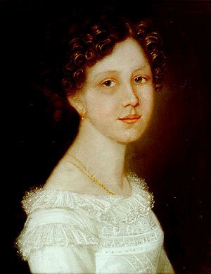
年過七旬的他在溫泉鄉馬倫巴愛上19歲的烏爾麗克·馮·萊維佐，甚至請公爵代為求婚，遭到婉拒後在歸途的馬車上寫下〈馬倫巴哀歌〉。同年，年輕詩人艾克曼來到威瑪擔任他的助手，此後九年記錄他的言談，寫成《歌德談話錄》。

## 1830-10 | 兒子去世
獨子奧古斯特在義大利旅行途中死於羅馬，葬於當地的新教徒墓園。他強忍悲痛繼續工作，不久卻大量咯血，病倒在床。

## 1831-07 | 完成《浮士德》第二部
在82歲生日前完成《浮士德》第二部，把手稿封存起來，交代在他死後才能出版。第二部時空跨越古希臘到近代，浮士德經歷宮廷、愛情、戰爭與填海造陸的事業，最後在為人類開拓新土地的願景中說出「停一停吧」，靈魂卻因不斷的追求與愛而得救。這部作品從他二十多歲起構思，前後跨越了六十年。

## 1832-03-22 | 逝世@威瑪
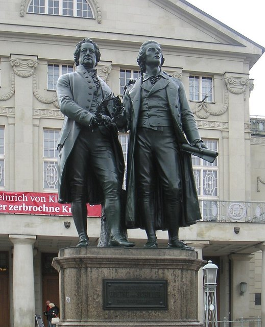
因心臟衰竭在婦女廣場的家中去世，享年82歲；據說他的最後一句話是：「多一點光！」他被安葬在威瑪的公爵墓園，與席勒並排長眠。《浮士德》第二部在他去世當年作為遺作出版。今天德國推廣德語與文化的機構就以他命名為「歌德學院」。
