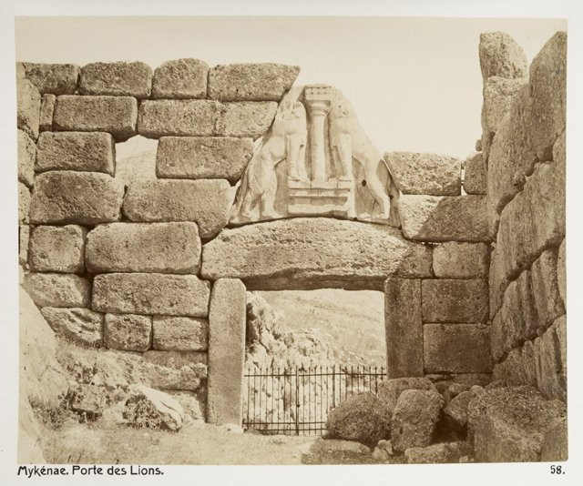
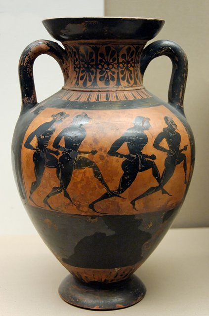
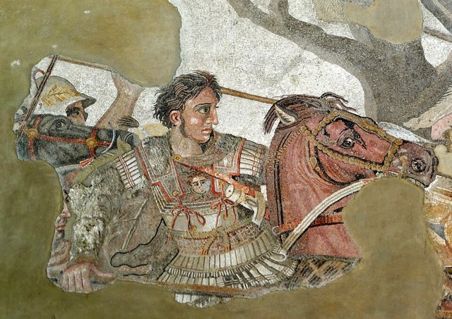
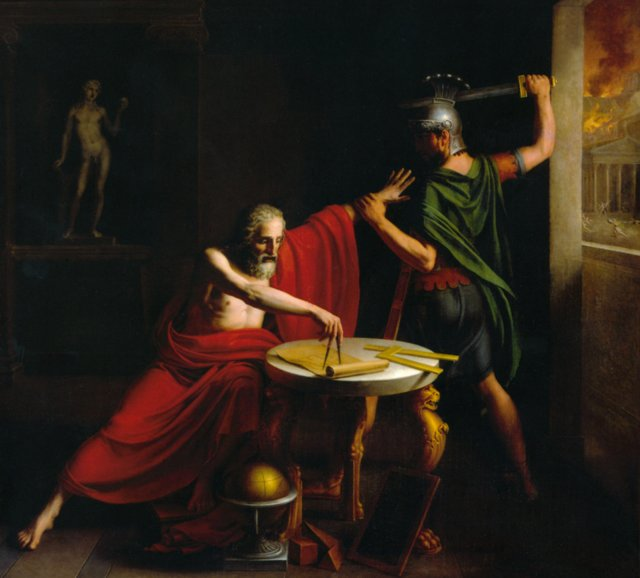
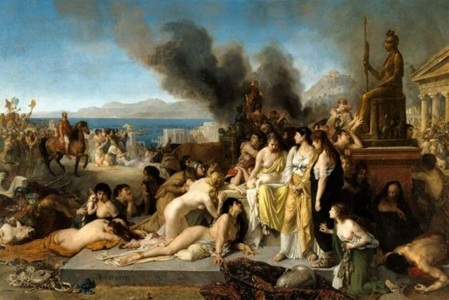
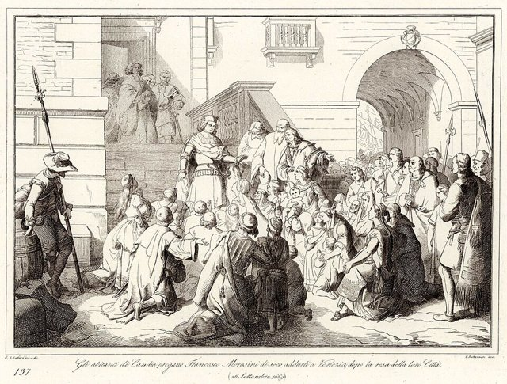
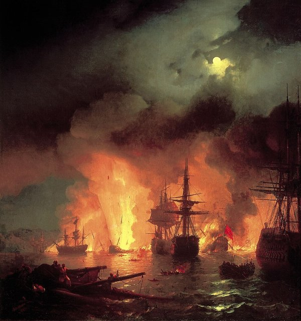
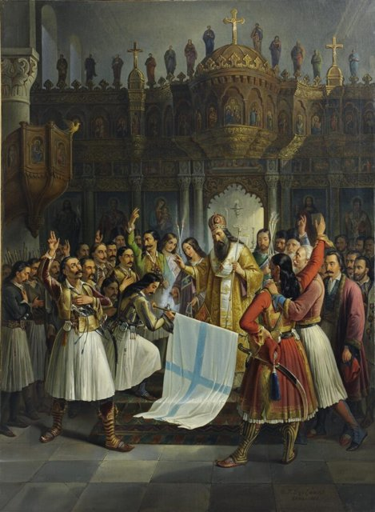
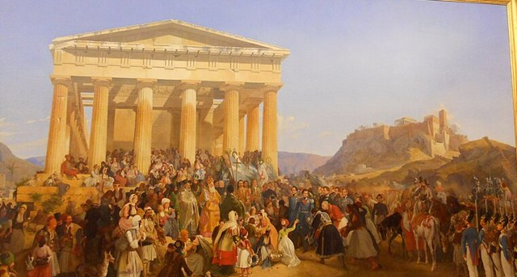
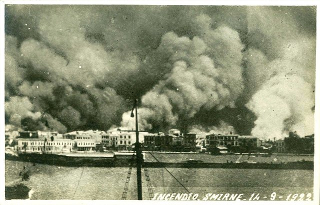

<!--
內容整理自本機筆記《希臘史》（D:\Books\md\歷史\世界史\希臘史，網頁版在知識圖譜的「1-6-2.希臘史」）。
- 34個年份檔各成一則事件。這一卷的案件檔都沒有「案件摘要」，說明改用各檔的「案發現場」；結尾以「→ 對外連結」連到知識圖譜上的完整案件卷宗（在新分頁開啟）。摘要中提到同卷其他案件的連結改為連到知識圖譜，連到其他分類（如國家滅亡史）的連結改為純文字。
- README 年表中「已在其他卷立案」的條目也一併收錄：前283年亞歷山大圖書館取自世界發展史卷的案件檔（README 標為前300年，這裡依案件檔作約前283年）；米諾斯文明崩潰（約前1450年）、克利斯提尼改革（前508年）、伯羅奔尼撒戰爭爆發（前432年）、君士坦丁堡洗劫（1204年）、君士坦丁堡陷落與烏爾班大炮（1453年，兩列合為一則）、債務危機引爆（2009年）所屬的國家滅亡史、世界簡史等卷尚未寫成，只有 README 的一行說明，沒有對外連結。
- 時期依 README 的五個分段；最後一段「鄂圖曼統治與現代希臘」橫跨1453年至今，以1821年獨立戰爭為界分成「鄂圖曼統治」與「現代希臘」兩段。古典雅典一段結束於前336年亞歷山大即位。
圖片來源（皆為 Wikimedia Commons 公有領域作品；多為後世繪畫，年份見括號）：
- gre-cover.jpg：Akropolis by Leo von Klenze.jpg（克倫澤〈雅典衛城〉，1846）
- gre-liongate.jpg：Fotografi på Lejonporten i Mykene, Grekland - Hallwylska museet - 104616.tif（邁錫尼獅子門的老照片）
- gre-amphora.jpg：Panathenaic amphora BM B137.jpg（泛雅典娜賽會獎品陶罐上的賽跑者，約前530年）
- gre-marathon.jpg：Phidippides.jpg（梅爾松〈馬拉松的士兵〉，1869）
- gre-salamis.jpg：Battle of Salamis by Wilhelm von Kaulbach.jpg（考爾巴赫〈薩拉米斯海戰〉，19世紀）
- gre-pericles.jpg：Discurso funebre pericles.PNG（福爾茨〈伯里克利的葬禮演說〉，19世紀）
- soc-death.jpg：David - The Death of Socrates.jpg（大衛〈蘇格拉底之死〉，1787（與蘇格拉底時間軸共用））
- gre-academy.jpg：MANNapoli 124545 plato's academy mosaic.jpg（龐貝出土的〈柏拉圖學園〉鑲嵌畫，1世紀）
- gre-alexander.jpg：Alexander and Bucephalus - Battle of Issus mosaic - Museo Archeologico Nazionale - Naples BW.jpg（龐貝出土的〈亞歷山大鑲嵌畫〉中的亞歷山大，約前100年）
- gre-library.jpg：Ancientlibraryalex.jpg（19世紀想像的亞歷山大圖書館版畫）
- gre-archimedes.jpg：Death of Archimedes (1815) by Thomas Degeorge.png（德喬治〈阿基米德之死〉，1815）
- gre-corinth.jpg：Robert-fleury-Le Dernier Jour de Corinthe.jpg（羅伯特-弗勒里〈科林斯的最後一日〉，1870）
- gre-1204.jpg：Eugène Delacroix - Prise de Constantinople par les croisés (12 avril 1204).jpg（德拉克洛瓦〈十字軍攻入君士坦丁堡〉，1840）
- aod-constantinople.jpg：Le siège de Constantinople (1453) by Jean Le Tavernier after 1455.jpg（勒塔維尼耶繪〈君士坦丁堡之圍〉，1455年後（與大航海時代時間軸共用））
- gre-candia.jpg：137. Gli abitanti di Candia pregano Francesco Morosini di seco addurli a Venezia, dopo la resa della loro Citta, 26 Settembre 1669.jpg（坎迪亞居民請求莫羅西尼帶他們前往威尼斯，1669（1863年版畫））
- gre-chesma.jpg：Chesmabattle.jpg（艾瓦佐夫斯基〈切什梅海戰〉，1848）
- gre-germanos.jpg：Βρυζάκης, Θεόδωρος - Ο Παλαιών Πατρών Γερμανός ευλογεί τη σημαία της Επανάστασης, 1865.jpg（弗里扎基斯〈帕特雷主教日耳曼諾斯祝福革命旗幟〉，1865）
- gre-otto.jpg：Peter von Hess - The Entry of King Otto of Greece in Athens - WAF 353 - Bavarian State Painting Collections.jpg（赫斯〈奧托國王進入雅典〉，1839（美術館展場照片，裁出畫面部分））
- gre-olympics.jpg：1896 Olympic marathon.jpg（1896年第一屆現代奧運的馬拉松賽）
- gre-smyrna.jpg：Great Fire of Smyrna.jpg（1922年9月士麥那大火）
-->

# Periods
- -1450 ~ -508 | 青銅時代與城邦崛起 | #b08900
  米諾斯與邁錫尼的宮殿文明相繼崩潰，經過黑暗時代後，城邦在奧林匹亞賽會中建立泛希臘認同，向地中海與黑海大舉殖民；雅典先有德拉古的成文法，再有梭倫廢除債務奴隸的改革。
- -508 ~ -336 | 古典雅典：民主與帝國 | #1971c2
  克利斯提尼改革奠定雅典民主，城邦聯軍在馬拉松與薩拉米斯擊退波斯，提洛同盟變成雅典帝國，伯羅奔尼撒戰爭讓希臘世界兩敗俱傷；蘇格拉底被判死、柏拉圖創立學園，最後馬其頓在喀羅尼亞終結城邦的獨立。
- -336 ~ -146 | 亞歷山大與希臘化時代 | #6741d9
  亞歷山大十年東征直抵印度，死後帝國由繼業者瓜分，希臘語與希臘文化隨之擴散到埃及與西亞；亞歷山大圖書館把知識收歸國家，阿基米德死於羅馬攻陷敘拉古。
- -146 ~ 1453 | 羅馬與拜占庭的希臘 | #c92a2a
  羅馬毀滅科林斯、併吞希臘，卻在文化上「被征服者征服」；拜占庭以希臘語延續東羅馬，查士丁尼關閉雅典學院，第四次十字軍洗劫君士坦丁堡，最終在1453年被鄂圖曼攻陷。
- 1453 ~ 1821 | 鄂圖曼統治 | #495057
  希臘人在鄂圖曼帝國下生活近四百年，威尼斯守了二十四年的克里特在1669年失陷；俄國慫恿的奧爾洛夫起義失敗，但民族意識逐漸覺醒。
- 1821 ~ 2026 | 現代希臘 | #0c8599
  獨立戰爭後由列強扶植巴伐利亞王子為王，借貸建國留下財政隱患；歷經小亞細亞災難與人口交換、德軍佔領與內戰、上校軍政府，到加入歐洲共同體與歐元區，再經債務危機與十年緊縮，近年才重回投資級評等。

# Events

## -1450 | 米諾斯文明崩潰 {label=約前1450年}
米諾斯文明崩潰（火山與邁錫尼征服）。

## -1200 | 邁錫尼崩潰與黑暗時代

約 -1200 前後，希臘本土的邁錫尼宮殿體系在半世紀內接連崩潰：皮洛斯（約 -1180 毀於大火）、邁錫尼、提林斯、底比斯相繼棄守，獅子門後的巨石王庭無人打掃。隨之而來的是約四百年的「黑暗時代」（-1200 至 -800）：人口銳減、聚落縮小、對外貿易中斷——最致命的是**線形文字B失傳，希臘人忘記了如何書寫**，直到 -800 年前後從腓尼基借來字母才重新提筆。一個會記帳（泥板記錄羊毛、香料、奴隸）的宮殿文明，整個回到無字狀態。

> **宮殿為何倒塌？文字為何斷線？——而荷馬的史詩，是憑什麼替一個不識字的民族記住了四百年的事？**

[→ 對外連結：邁錫尼崩潰與黑暗時代：書寫的斷層](https://chad-liu.github.io/books/html/1-6-2.希臘史/-1200-邁錫尼崩潰與黑暗時代.html)

## -776 | 奧林匹亞賽會與泛希臘認同

-776 年（傳統紀年），埃利斯城邦在奧林匹亞宙斯聖域舉辦賽會，埃利斯的科羅布斯贏得唯一項目——一段斯塔迪昂（約 192 公尺）賽跑。此後每四年一屆，從一項賽跑長成五天大賽：角力、拳擊、潘克拉辛（自由搏擊）、五項全能、戰車賽、長跑、武裝賽跑。奧林匹亞是三大泛希臘賽會之首（皮托、地峽、尼米亞），也是希臘人**共同的時間刻度**：歷史學家寫「奧林匹亞第X屆」如我們寫西元年。賽會期間行神聖休戰，全希臘的選手與觀眾穿越敵對城邦的疆界赴會。

> **一群天天互相開戰的城邦，憑什麼共用一個日曆、一座聖域、一頂野橄欖冠？——希臘人是誰，這個問題的答案竟藏在一場體育比賽裡？**

[→ 對外連結：奧林匹亞賽會與泛希臘認同：希臘人的紀年系統](https://chad-liu.github.io/books/html/1-6-2.希臘史/-0776-奧林匹亞賽會與泛希臘認同.html)

## -750 | 大殖民時代
約 -750 至 -550 年，希臘城邦在地中海與黑海沿岸掀起大殖民（apoikia，意为「家在別處」）：母邦派出公民團，跨海建立新邦，前後約八百座——東至黑海沿岸（拜占庭 -667、奧爾比亞），西至西班牙（恩波里翁）、高盧（馬賽，-600 由福基斯人所建），南至北非（昔蘭尼 -631），北至亞得里亞海。殖民者不是逃難，是**編制出海**：母邦指定領袖（oikist）、携聖火（取自母邦公共爐灶的火種）、占卜定址、分地立邦。新邦政治獨立、不納貢、不聽命，但宗教上認祖歸宗。

> **同時代的帝國用軍隊吞併土地，希臘人卻用船把「希臘」複製了八百份——為什麼希臘的擴張是去中心化的，而且越分越富？**

[→ 對外連結：大殖民時代：八百殖民地的去中心化擴張](https://chad-liu.github.io/books/html/1-6-2.希臘史/-0750-大殖民時代.html)

## -621 | 德拉古立法
-621 年（傳統紀年），雅典執政官德拉古（Draco）受命將法律寫下公布——雅典第一部成文法問世。後世對其內容記得最牢的只有一點：**重**。殺人處死、多數罪行（偷竊菜蔬之類）亦處死，羅馬史家普魯塔克轉述其言：「小罪該死，我不知道還有什麼比這更重的罰。」色諾芬註家則稱法典「以血寫成」。但真正的革命不在刑罰之重，而在**成文與公布**：貴族口耳相傳的習慣法，第一次變成全體公民可讀、可引、可辯的公開文本。

> **刑罰重得離譜的法典，為何是雅典法治的第一步？——「德拉古式」成為嚴酷的代名詞，可若沒有這部法，連「嚴酷」都無從談起？**

[→ 對外連結：德拉古立法：用血寫下的第一部雅典法典](https://chad-liu.github.io/books/html/1-6-2.希臘史/-0621-德拉古立法.html)

## -594 | 梭倫改革
-594 年，梭倫（Solon）獲選為雅典執政官，獲授權修改法律。此時雅典瀕臨內戰：土地兼併嚴重，自耕農以自身人身作借貸擔保（債奴制），欠債即淪為債主田莊的奴工，外邦人買走雅典農地與雅典人；窮人（thetes）要求重分土地，貴族要求保護產權。梭倫的答卷是三箭齊發：解負令（seisachtheia，債務搖脫——廢除以人身為擔保的債，釋放債奴、追回賣往海外的雅典人）、按財產分四級（廢除按血統的權利分配）、設立四百人會議與陪審法庭開放給三、四級。他自己說：這塊土地上豎起了解放碑。

> **同時得罪窮人（不分地）與富人（廢債）的改革者，憑什麼活著離開雅典？——「不偏袒」是政治智慧還是政治算術？**

[→ 對外連結：梭倫改革：解負令與階級政治的數學](https://chad-liu.github.io/books/html/1-6-2.希臘史/-0594-梭倫改革.html)

## -508 | 克利斯提尼改革
克利斯提尼改革：雅典民主的區劃工程（德謨、部落重劃、陶片放逐伏筆）。

## -490 | 馬拉松戰役

-490 年夏末，波斯大王大流士一世的遠征軍在雅典東北的馬拉松海灣登陸，約兩萬人（一說兩萬五千）；雅典全城動員約一萬重裝步兵，外加普拉提亞盟軍一千——**一比二的兵力劣勢**。雅典將領米太亞德（Miltiades）在戰爭會議上力主決戰，全票（一說以一票多數）通過。戰術是反常規的：希臘中路減薄、兩翼加厚，衝鋒接敵（跑完約一點五公里的弓箭射程）；結果兩翼擊潰波斯軍並向內旋轉，包夾中路，波斯軍潰退上船，陣亡約六千四百對希臘約一百九十二。信使斐迪庇第斯跑回雅典報捷（約四十公里）後倒地而死——馬拉松自此成為距離單位。

> **城邦的農民兵如何以一敵二打敗帝國的職業軍？——兵力劣勢之下，雅典為什麼「不等」斯巴達援軍，當天就衝了？**

[→ 對外連結：馬拉松戰役：一萬一對兩萬的物理學](https://chad-liu.github.io/books/html/1-6-2.希臘史/-0490-馬拉松戰役.html)

## -480 | 薩拉米斯海戰

-480 年，薛西斯傾波斯帝國之力水陸並進（陸軍號稱數百萬、實約二十萬上下；艦隊一千二百餘艘）。溫泉關三百斯巴達勇士與其盟軍死守隘口三日後全滅，雅典棄城，波斯進入阿提卡。雅典人已按地米斯托克利（Themistocles）的計畫全體遷往薩拉米斯島與艦上，聯軍艦隊（約三百七十艘）泊於薩拉米斯與本土之間的窄海峽。波斯艦隊入峽合圍，一夜對峙後，次日（9 月末）決戰：波斯的數量優勢在窄水裡無法展開，希臘三列槳艦撞角戰術收割，波斯潰敗、艦隊折損過半，薛西斯主力撤回亞洲。次年普拉提亞陸戰，希臘全勝——波斯入侵希臘徹底失敗。

> **希臘人是被逼到絕路，還是地米斯托克利把絕路設計成了陷阱？——數量優勢為什麼會在窄水裡反過來殺死自己？**

[→ 對外連結：薩拉米斯海戰：窄水裡的數學題](https://chad-liu.github.io/books/html/1-6-2.希臘史/-0480-薩拉米斯海戰.html)

## -478 | 提洛同盟
-478 年，薩拉米斯大捷後，雅典與愛琴海諸城邦結成防波同盟：目的明文是「劫掠大王（波斯）的領土」——盟邦共出船艦或代以貢金（phoros），金庫設於提洛島（聖島，居中且神聖），初次評定貢金四百六十塔蘭特。雅典統帥亞里斯泰德（以公正留名）主持評定。同盟初戰連捷（歐里梅敦河大捷，-466，殲波斯艦隊陸軍），但四十年內，同盟蛻變為雅典帝國：金庫遷雅典（-454，名義「防波斯奪取」）、鎮壓退盟（那克索斯、薩索斯）、強推雅典錢幣度量衡、盟邦案件移審雅典法庭。修昔底德說：雅典人「把同盟變成了霸權」。

> **防禦同盟是如何一步步變成帝國的？——是雅典蓄謀已久，還是同盟結構自身長出的必然？**

[→ 對外連結：提洛同盟：從同盟到帝國的蛻變](https://chad-liu.github.io/books/html/1-6-2.希臘史/-0478-提洛同盟.html)

## -432 | 伯羅奔尼撒戰爭爆發

伯羅奔尼撒戰爭爆發（修昔底德陷阱的原型）。

## -399 | 蘇格拉底之死

-399 年春，雅典公民法庭審判蘇格拉底：罪名兩項——不敬城邦之神、引入新神，以及腐化青年。陪審團五百人（一說五百零一），原告三人（詩人梅勒托、任何呂科弗隆、政客阿尼托）。第一輪表決定罪：票數約二八〇對二二〇（多數僅約三十票）；依雅典程序，由原告與被告各提刑罰、陪審團二選一——蘇格拉底不認罪反提「免費公餐」（類似奧運冠軍待遇），激怒陪審團，第二輪約三六〇對一四〇判死刑。月餘後（因聖船節延後行刑），他當著朋友的面飲下毒堇汁而死，享年七十。

> **雅典剛打輸一場漫長的戰爭、經歷兩次政變，為什麼最終把毒杯端給城邦最著名的「牛虻」？——多數決可以合法地殺死一個沒有罪的人嗎？**

[→ 對外連結：蘇格拉底之死：五百人法庭的毒堇汁](https://chad-liu.github.io/books/html/1-6-2.希臘史/-0399-蘇格拉底之死.html)

## -387 | 柏拉圖學園

-387 年前後，柏拉圖在雅典西北郊的赫卡德穆斯聖林（Academy，學園）置產辦學：有場地、有食堂、有宿舍、有講堂，成員共同生活共同研究——一個**制度化的永久學術共同體**就此誕生，此後連續運作約九百年（直到 529 年查士丁尼關閉雅典異教學校）。學園門口傳說掛牌：「不懂幾何者勿入」。柏拉圖在此寫對話錄、教學、培養學員（亞里士多德於 -367 十七歲入學，一待二十年）；學員被各城邦請去立法（為多城邦立法而聞名的歐多克索斯、阿里斯通等皆是學園系統）。

> **老師死於民主的投票，學生於是發明一個不投票的知識機構——大學為什麼誕生在希臘，而且長成這個形狀？**

[→ 對外連結：柏拉圖學園：永久研究共同體的發明](https://chad-liu.github.io/books/html/1-6-2.希臘史/-0387-柏拉圖學園.html)

## -338 | 喀羅尼亞戰役
公元前 338 年 8 月，玻俄提亞的喀羅尼亞平原。馬其頓國王腓力二世（18 歲的亞歷山大指揮左翼騎兵）擊潰雅典—底比斯聯軍。雅典重裝步兵方陣在薩里沙長矛前崩解，「希臘的自由」當場陣亡。此後：科林斯同盟成立（337），希臘城邦名義自治、實際聽命馬其頓。兩百年來（自波斯戰爭以來）擋住帝國的城邦體系，被一個「半希臘」的邊陲王國一次性打包。

> **為什麼打贏波斯、發明民主、孕育哲學的希臘城邦，會輸給自己眼裡的鄉下人？自由是輸在演說台，還是輸在練兵場？**

[→ 對外連結：喀羅尼亞戰役：城邦獨立時代的葬禮](https://chad-liu.github.io/books/html/1-6-2.希臘史/-0338-喀羅尼亞戰役.html)

## -334 | 亞歷山大東征

公元前 334 年春，亞歷山大率約四萬人（馬其頓方陣與騎兵三萬餘+希臘盟軍）渡赫勒斯滂，十年、約四萬公里，經格拉尼庫斯（334）、伊蘇斯（333）、高加米拉（331，大流士三世再敗，波斯帝國實質崩解）、波斯波利斯（330，焚城）、直至印度河（326，希達斯佩斯河戰），323 年死於巴比倫，年三十三。人類史上最大的帝國（約五百萬平方公里）由一個三十歲以下的人建立。

> **四萬人怎麼打穿一個千萬人口的帝國？靠的是天才、父親留下的機器，還是補給的數學？**

[→ 對外連結：亞歷山大東征：四萬人的極限測試](https://chad-liu.github.io/books/html/1-6-2.希臘史/-0334-亞歷山大東征.html)

## -323 | 繼業者戰爭
公元前 323 年 6 月，巴比倫尼宮，亞歷山大猝死，年三十三（死因：瘧疾、酗酒、毒殺三說並存，屍體多日不腐反加劇陰謀論）。遺言（傳稱）：「給最強者。」帝國橫跨三大洲、約五百萬平方公里，繼承人：異母兄阿里達烏斯（智能不足）+遺腹子亞歷山大四世。將軍們立即分贓：巴比倫分封（323，帕迪卡攝政，諸將各省督）——此後四十年（拉米亞戰爭 323–322 起至伊普蘇斯 301、再至科魯佩迪烏姆 281），馬其頓將領互相屠殺，最終三足鼎立。

> **一個征服了已知世界的人，為什麼留下「給最強者」這種遺言？帝國的裂縫，是誰鑿開的？**

[→ 對外連結：繼業者戰爭：沒有繼承人的帝國](https://chad-liu.github.io/books/html/1-6-2.希臘史/-0323-繼業者戰爭.html)

## -283 | 亞歷山大圖書館 {label=約前283年}

約前 283 年，亞歷山大港（埃及）。亞歷山大的繼業者托勒密一世與二世建起**博物館**（Mouseion——繆司的神殿：國家出錢的學者院，學者領俸、食宿由王宮）與**圖書館**——目標狂妄而明確：**蒐集世上所有的書**（宣稱藏卷四十萬至七十萬卷莎草紙卷）。

這是繼業者戰爭（Diadochi——亞歷山大死後諸將分裂帝國）的產物：各王朝以「文化」競爭正統性——誰擁有亞歷山大的知識遺產，誰就是繼承人。

> **為什麼「藏書」成為王朝的政治工程？索引（Pinakes）如何把幾十萬卷的死書變成可檢索的活知識？埃拉托色尼如何在圖書館裡量出地球的周長？**

[→ 對外連結：亞歷山大圖書館：把「所有的書」變成一座制度](https://chad-liu.github.io/books/html/1-6.世界發展史/-0283-亞歷山大圖書館.html)

## -212 | 阿基米德與敘拉古

公元前 212 年，西西里敘拉古。羅馬軍（執政官馬賽盧斯）經兩年圍城破城，縱兵劫掠。阿基米德——當時最偉大的幾何學家——死於一名羅馬士兵之手，傳稱正蹲在地上畫幾何圖形，留下一句（各版本）：「別踩壞我的圓。」馬賽盧斯事先下令：活捉阿基米德。七十五歲的數學家死了，羅馬人為他建墓（墓碑刻圓柱內切球，他自選的定理）。

> **為什麼羅馬人要活捉一個七十五歲的老數學家？為什麼又沒人執行這道命令？知識與權力的第一次正面相撞，誰輸了？**

[→ 對外連結：阿基米德與敘拉古：數學之死](https://chad-liu.github.io/books/html/1-6-2.希臘史/-0212-阿基米德與敘拉古.html)

## -146 | 羅馬併希臘

公元前 146 年：羅馬軍（執政官穆米烏斯）攻破科林斯，屠城、男丁盡戮、藝術品成船運往羅馬，希臘本土劃入羅馬治下（馬其頓行省轄區，正式行省化於前 27 年的阿卡迪亞/亞該亞建制）。同年，非洲迦太基被小西庇阿夷平（參見 ../國家滅亡史/-0146-迦太基.md）——地中海兩大古文明在同一年被同一個共和國終結。此前的劇本：四次馬其頓戰爭（前 214–148），皮德納（前 168）方陣對軍團的決定性一敗，馬其頓王國被拆為四區（前 167）；亞該亞同盟（希臘城邦聯盟）抗羅馬，一年即潰。

> **兩百年前還能打贏波斯的希臘人，怎麼在皮德納一戰被羅馬軍團切割殆盡？誰征服了誰——羅馬拿走土地，希臘拿走了什麼？**

[→ 對外連結：羅馬併希臘：雙滅之年](https://chad-liu.github.io/books/html/1-6-2.希臘史/-0146-羅馬併希臘.html)

## 529 | 雅典學院關閉
529 年，東羅馬皇帝查士丁尼下令關閉雅典的異教哲學學校（學園、呂克昂等最後殘存）。自柏拉圖創學園（前 387，參見 ../希臘史/-0387-柏拉圖學園.md）算起，約九百年的雅典學術傳統由一道行政命令終結。末代學者（達馬修斯、辛普里丘等七人）流亡波斯，投奔薩珊庫思老一世；532 年和約中特列條款允其返回，但學園未復。同一皇帝同時頒布《學說彙編》（533）與《查士丁尼法典》（參見 ../世界發展史/0534-查士丁尼法典.md）——異教哲學關門，羅馬法成典，同一支筆。

> **一個延續九百年、熬過羅馬兼併與多神教滅亡的學術機構，為什麼會輸給一道敕令？死因是行政命令，還是早已停跳？**

[→ 對外連結：雅典學院關閉：一紙敕令與九百年學園](https://chad-liu.github.io/books/html/1-6-2.希臘史/0529-雅典學院關閉.html)

## 1204 | 君士坦丁堡洗劫

君士坦丁堡洗劫（拜占庭希臘的斷層線）。

## 1453 | 君士坦丁堡陷落

君士坦丁堡陷落（雙頭鷹的終章）；同年烏爾班大炮轟開狄奧多西城牆，城牆時代終結（技術因素）。

## 1669 | 坎迪亞圍城

1648–1669 年，鄂圖曼帝國圍攻威尼斯統治下的克里特島首府坎迪亞（今伊拉克利翁），二十一年圍城（若從 1645 年登島之戰起算二十四年），軍事史上最長的圍城戰。結果：坎迪亞開城，威尼斯保留若干島外據點，克里特割讓鄂圖曼。雙方兵力累計逾二十萬，死亡估計逾十萬（含瘟疫），坎迪亞城區幾乎夷平——一座城用一個世代，量出了兩個帝國的極限。

> **為什麼一個「衰落中的」鄂圖曼帝國，能耗死一個海權共和國二十四年？圍城的勝負，到底由城牆決定，還是由帳本決定？**

[→ 對外連結：坎迪亞圍城：二十四年的消耗會計](https://chad-liu.github.io/books/html/1-6-2.希臘史/1669-坎迪亞圍城.html)

## 1770 | 奧爾洛夫起義

1770 年，俄土戰爭（1768–1774）期間，葉卡捷琳娜二世授意格里戈里·奧爾洛夫兄弟率波羅的海艦隊半支遠征地中海，鼓動希臘人起義。2 月起伯羅奔尼撒的馬尼人與克萊夫特遊擊隊起事（號稱「希臘計劃」：多瑙河畔建親俄的希臘—斯拉夫國），7 月切什梅海戰俄艦全殲鄂圖曼艦隊；但陸上起義無後續支援，數月內被阿爾巴尼亞僱傭軍鎮壓，希臘村鎮遭屠殺劫掠。俄國取走制海權（庫楚克開納吉和約，1774），希臘人拿到報復與廢墟。

> **海戰大勝、陸上崩盤——為什麼盟友的艦隊放完了煙火就開走？葉卡捷琳娜要的究竟是希臘的自由，還是希臘的航線？**

[→ 對外連結：奧爾洛夫起義：俄國的希臘牌](https://chad-liu.github.io/books/html/1-6-2.希臘史/1770-奧爾洛夫起義.html)

## 1821 | 希臘獨立戰爭

1821 年 3 月 25 日（傳統紀念日），伯羅奔尼撒總起義；此前 3 月亞歷山大·伊普斯蘭蒂斯率友誼社（Filiki Eteria）在摩爾達維亞起事（借道俄屬比薩拉比亞，迅速失敗）。鄂圖曼報復：君士坦丁堡宗主教格里高利五世被絞於主教座堂門前（復活節），希俄斯島屠殺（1822，四萬餘死或擄）。歐洲輿論炸裂：拜倫 1823 親赴米索隆基（1824 病逝軍中）、繪畫（德拉克羅瓦）與詩歌使希臘成為全歐洲的道德議題。1827 年納瓦里諾海戰（英法俄聯合艦隊殲鄂圖曼—埃及艦隊），1830 倫敦議定書承認希臘獨立，1832 倫敦條約定界立王（參見 ../希臘史/1832-倫敦條約與奧托王朝.md）。四百年統治結束。

> **1770 年借俄國的刀失敗了，為什麼 1821 年同樣弱小的希臘人贏了？這次靠的是武器、輿論，還是列強的算盤？**

[→ 對外連結：希臘獨立戰爭：浪漫主義的動員力](https://chad-liu.github.io/books/html/1-6-2.希臘史/1821-希臘獨立戰爭.html)

## 1821 | 希臘語言之爭
1901 年 11 月，雅典：一份《新約》白話譯本（女記者帕拉瑪在報紙連載）引爆街頭暴動——大學生視之為「對神聖語言的褻瀆」，連續多日示威、攻擊報社與譯者住所，總理德拉庫利斯下令軍隊開槍鎮壓，**八人死亡**，總理與雅典大學校長雙雙下台（史稱「福音書事件」Evangelika）。爭議焦點不是神學，是**該用什麼語言翻譯《新約》**：純淨語（katharevousa，官方再造的古典化希臘語）還是民眾語（dimotiki，人民實際說的話）。一個獨立不到七十年的國家，為什麼會為「說話的方式」開槍殺人？

> **語言之爭是憲政危機——一個國家為「官方文件該用哪種希臘語」打了兩百年，開了槍、廢了憲、直到 1976 年才結案。**

[→ 對外連結：希臘語言之爭：從柏拉圖嘴裡學說話](https://chad-liu.github.io/books/html/1-6-2.希臘史/1821-希臘語言之爭.html)

## 1832 | 倫敦條約與奧托王朝

1832 年 5 月，倫敦條約：英法俄三國與巴伐利亞簽約，巴伐利亞王子奧托（十七歲，維特爾斯巴赫家次子）出任希臘國王，希臘為獨立王國、領土定於伯羅奔尼撒—中希臘一帶（阿提卡劃入），三國保護、巴伐利亞攝政團（三人）代政至 1835。首任進口君主乘英艦於 1833 年抵納夫普利翁，帶來三千巴伐利亞傭兵與一整套德式宮廷。三十年後（1862），奧托被不流血政變逐走——列強照單再送一位（丹麥的喬治一世）。

> **一個剛用八年血戰趕走外來統治者的民族，為什麼接受了十七歲的德國孩子當國王？進口的君主，能穩定本土的政治嗎？**

[→ 對外連結：倫敦條約與奧托王朝：進口君主實驗](https://chad-liu.github.io/books/html/1-6-2.希臘史/1832-倫敦條約與奧托王朝.html)

## 1893 | 希臘第一次破產
1893 年 12 月 10 日，希臘首相特里庫皮斯在國會說出那句名言：「可憐的小希臘，很不幸地，我已無能為力——我們破產了。」政府宣布停付外債本息。此時距獨立建國僅六十二年：1833 年獨立之初即借英法俄六千萬法郎貸款，此後五十年借新還舊，橡樹林與無花果的出口稅基根本養不起歐洲式的宮廷、軍隊與外傷。堂堂「歐洲文明的祖源」，為何一出生就欠債，六十年後賴帳？

> **借貸建國：獨立即欠債！一個靠無花果出口還宮廷貸款的國家，破產是意外還是宿命？**

[→ 對外連結：希臘第一次破產：可憐的小希臘](https://chad-liu.github.io/books/html/1-6-2.希臘史/1893-希臘第一次破產.html)

## 1896 | 第一屆現代奧運

1896 年 4 月 6 日，雅典帕納辛奈科體育場（全大理石重建），第一屆現代奧林匹克運動會開幕，十四國兩百餘名運動員參賽。場面體面的背後是一個荒謬的事實：**主辦國三年前才宣布破產**（1893 停付外債），政府窮到連體育場都修不起，最後靠一個希臘裔埃及富豪阿維羅夫獨資出資九十萬德拉克馬重建。一個欠債不還的國家，為何要砸錢辦一場全球嘉年華？

> **破產國家的名片工程：辦奧運的錢從哪來？馬拉松項目為何「恰好」被發明？**

[→ 對外連結：第一屆現代奧運：大理石體育場與國家名片](https://chad-liu.github.io/books/html/1-6-2.希臘史/1896-第一屆現代奧運.html)

## 1922 | 小亞細亞災難與人口交換

1922 年 9 月，土耳其軍隊攻入士麥那（伊茲密爾），希臘軍隊崩潰，隨後城區大火，亞美尼亞與希臘街區被焚，數萬至十萬人死亡，二十五萬希臘人擠在碼頭等待撤離。1923 年洛桑條約確認人口交換：約一百二十萬希臘正教徒自土耳其遷入希臘，約四十萬穆斯林自希臘遷往土耳其。兩千年歷史的小亞細亞希臘社群，三年內連根拔起。希臘為何要在剛贏得巴爾幹戰爭的頂點上，去賭一場收復君士坦丁堡的戰爭？

> **偉大理想（Megali Idea）：收復「第二羅馬」是民族使命還是民族自殺？以宗教界定的民族，為何能被整批搬運？**

[→ 對外連結：小亞細亞災難與人口交換：偉大理想的終結](https://chad-liu.github.io/books/html/1-6-2.希臘史/1922-小亞細亞災難與人口交換.html)

## 1941 | 德國佔領與大饑荒
1941 年 4 月，德軍閃電攻入希臘：突破梅塔克薩斯防線，希軍與協同的英聯邦軍潰退，國王與政府流亡，德意保三國分區佔領。接下來那個冬天（1941–42），希臘爆發歐洲佔領區最嚴重的大饑荒：估計約三十萬人死亡，雅典街頭餓殍倒臥、當街斷氣。戰敗可以解釋恥辱，但無法直接解釋三十萬具屍體——**是誰，用什麼數學，把佔領變成了飢荒？**

> **佔領的帳本：軸心國要糧、英國封鎖糧、紅十字送不進糧——三十萬人的死亡，是意外還是算出來的？**

[→ 對外連結：德國佔領與大饑荒：佔領經濟的死亡數學](https://chad-liu.github.io/books/html/1-6-2.希臘史/1941-德國佔領與大饑荒.html)

## 1946 | 希臘內戰
1946–1949 年，希臘內戰：政府軍（倫敦/雅典政府，英國後為美國支持）對抗希臘共產黨領導的民主軍。戰死逾十萬人，約八十萬人流離失所，戰後約五萬至十萬共產黨人與其家屬流亡東歐（含著名的「兒童移送」）。1947 年 3 月，杜魯門在國會宣布援助希臘與土耳其——「杜魯門主義」誕生，冷戰的意識形態宣言在希臘的山頭上找到第一個戰場。**二戰的戰火剛熄，為何希臘立刻燃起另一場更撕裂的戰爭？**

> **冷戰第一熱戰：誰背叛了誰？英國為何先出錢出兵、再繳械撤退？希臘是不是「自由世界」的第一塊多米諾？**

[→ 對外連結：希臘內戰：冷戰的第一場熱戰](https://chad-liu.github.io/books/html/1-6-2.希臘史/1946-希臘內戰.html)

## 1967 | 上校政變
1967 年 4 月 21 日凌晨，希臘陸軍上校帕帕多普洛斯等人發動政變：坦克包圍雅典戰略要點，逮捕政要數千人，軍政府以「皇家法令」名義宣布戒嚴——法律由政變者自己簽發給自己。國王康斯坦丁二世與合法政府一夜失效，軍政府統治希臘七年（1967–1974），以「反共救國」為名。**一個內戰勝利方陣營執政近二十年的議會民主國家，為何會被幾個上校開著坦克接管？**

> **反共保壘的自我政變：北約為何默許？國王為何反政變失敗？「拯救民主」的坦克如何毀滅民主？**

[→ 對外連結：上校政變：坦克與傀儡法律](https://chad-liu.github.io/books/html/1-6-2.希臘史/1967-上校政變.html)

## 1974 | 塞浦路斯與第三共和
1974 年 7 月 15 日，雅典軍政府策動塞浦路斯希臘裔政變，總統馬卡里奧斯大主教死裡逃生；7 月 20 日，土耳其以「保證國」身分出兵塞浦路斯，兩波進攻後佔島北約三成七土地。政權的冒險五天內炸回本國：7 月 23 日軍政府垮台，流亡巴黎的前首相卡拉曼利斯被請回國主持過渡。年底：12 月 8 日君主制公投被否決（約 69% 贊成共和）、1975 年第三共和憲法生效。**一場八百公里外的島嶼政變，為何能五天內拆掉雅典的軍事政權、半年內拆掉千年君主制？**

> **外生危機的政權更替公式：軍政府為何要冒險刺殺馬卡里奧斯？土耳其為何恰好等在門口？民主化為何能一步到位？**

[→ 對外連結：塞浦路斯與第三共和：政變的帳單](https://chad-liu.github.io/books/html/1-6-2.希臘史/1974-塞浦路斯與第三共和.html)

## 1981 | 加入歐洲共同體
1981 年 1 月 1 日，希臘正式成為歐洲共同體第十個成員國——比西班牙、葡萄牙早五年，是共同體第一次納入「經濟發展水平明顯較低」的國家。當時的希臘：人均 GDP 約為共同體平均的一半，農業人口占四分之一，剛剛結束軍政府與民主化（1974），邊界上還蹲著北約內部的假想敵土耳其。卡拉曼利斯（保守派總理）力排黨內疑慮促成入會；同年 10 月，民粹左翼帕潘德里歐以「變革」贏得選舉，赤字政治時代開幕。**一個剛民主化的窮國，為何擠破頭加入一個「富國俱樂部」？入會究竟是投資還是成癮？**

> **錨定歐洲：整合基金買來的是發展，還是依賴？「與土耳其的邊界就是歐洲的邊界」這筆帳該怎麼算？**

[→ 對外連結：加入歐洲共同體：脫離巴爾幹、錨定歐洲](https://chad-liu.github.io/books/html/1-6-2.希臘史/1981-加入歐洲共同體.html)

## 2001 | 加入歐元區
2001 年 1 月 1 日，希臘加入歐元區——歐盟十二國中唯一在「第二次申請」時才達標的國家。達標成績單：通膨、赤字、債務、利率、匯率五項趨近馬斯垂克標準。多年後真相陸續揭穿：當年申報的財政赤字被反覆重述（2004 年重述 2000–2002 年數據，赤字全部超標）；2010 年再爆出高盛貨幣互換交易把部分債務移出表外（2001 年入會年簽訂、2005 年續作）。**一個靠數字化妝入會的國家，會員資格本身就是第一筆違約準備金。**

> **入會的數學：3% 的赤字線是防線還是門檻？單一貨幣的紅利期，是不是違約的倒數計時？**

[→ 對外連結：加入歐元區：達標數字的藝術](https://chad-liu.github.io/books/html/1-6-2.希臘史/2001-加入歐元區.html)

## 2009 | 債務危機引爆
債務危機引爆（會計失明的極限版）。

## 2010 | 三駕馬車與緊縮
2010 年 5 月，歐盟與 IMF 批准第一輪紓困：三年 1100 億歐元貸款，條件是史無前例的緊縮與結構改革；歐盟委員會、歐洲央行、IMF 的聯合考察團進駐雅典，希臘媒體稱之為「三駕馬車」（troika）——這個詞上一代希臘人用來稱呼 1897 年的國際財政監督委員會。此後八年三輪紓困：GDP 收縮約四分之一、失業率峰值近 28%（青年失業逾五成）、工資與養老金大幅下調。**紓困救的是誰？緊縮治的是什麼病？為什麼 IMF 後來自己承認藥方算錯了？**

> **緊縮的數學：乘數被低估 50%，是多少條人命的誤差？逃稅、免稅航運、軍購——這個國家的帳本到底哪裡漏了？**

[→ 對外連結：三駕馬車與緊縮：1100 億的處方箋](https://chad-liu.github.io/books/html/1-6-2.希臘史/2010-三駕馬車與緊縮.html)

## 2015 | 公投與第三次紓困
2015 年 7 月 5 日，希臘就債權人的紓困條件舉行公投：61.3% 投下「不」（NO）——選民拒絕更多緊縮。此前一週：銀行關閉、提款機每人每日限 60 歐元、資本管制登場，歐盟領袖公開警告「說不等於脫離歐元」。公投後一週，齊普拉斯政府接受第三輪紓困協議（至多 860 億歐元），條款比被公投否決的那份更苛刻：更高的增值稅、養老金改革、私有化基金、監督延長。**用民主投票否決的方案，為何在投票後以更重的形式回來？「不」到底是拒絕還是邀請？**

> **公投的賽局：61% 的「不」是民主授權還是談判自殺？齊普拉斯與瓦魯法基斯賭的是什麼，輸掉的又是什麼？**

[→ 對外連結：公投與第三次紓困：說不的人說了什麼](https://chad-liu.github.io/books/html/1-6-2.希臘史/2015-公投與第三次紓困.html)

## 2023 | 坦皮谷鐵路災難
2023 年 2 月 28 日深夜，希臘中部坦皮谷（Tempi）：一列載客火車（約 350 人，多為返校學生）與一列貨運火車，在**同一條軌道上對面相撞**，57 人死亡（多為二十歲上下的年輕人）。事故直接原因：客車被錯誤放上「下行本線」，與貨車對撞——而讓它上錯線的，是一個**手動放行的車站站長**。全國震怒：街頭示威、大學佔領、總理為「無可辯駁的人為錯誤」道歉。一個歐盟成員國、二十一世紀的現代國家，為什麼會出「兩列火車同一條鐵軌」這種**十九世紀等級的事故**？

> **客車與貨車同線對撞——不是天災，不是機械故障，而是一套「安全系統無人值守」的國家欠帳，用 57 條命結清。**

[→ 對外連結：坦皮谷鐵路災難：無人值守的死亡信號](https://chad-liu.github.io/books/html/1-6-2.希臘史/2023-坦皮谷鐵路災難.html)

## 2024 | 希臘經濟復甦與評級回升
2024 年 3 月，穆迪將希臘主權評級上調至 B1（展望正向），此前 2023 年 9—10 月標普（BB+，展望正向）與 DBRS 已率先上調——市場開始計價**希臘重返投資級**的時點。同時：2023 年旅遊收入與入境人數全面超越 2019 年疫前峰值（入境約 3,270 萬人次，**超過希臘人口的三倍**）；2023 年 GDP 實質成長約 2%（歐元區前列），失業率降至 2010 年代初以來最低。從 2009 年底債務危機引爆（參見 ../國家滅亡史/2009-希臘債務危機.md）到 2024 年評級回歸——一個「破產」標籤貼了十四年的國家，是怎麼爬回來的？

> **十四年垃圾債、GDP 蒸發四分之一、百萬人出走的國家，靠什麼讓評級機構改口——復甦是真的，還是緊縮的止痛藥起效了？**

[→ 對外連結：希臘經濟復甦與評級回升：十四年曲線的收尾](https://chad-liu.github.io/books/html/1-6-2.希臘史/2024-希臘經濟復甦與評級回升.html)
