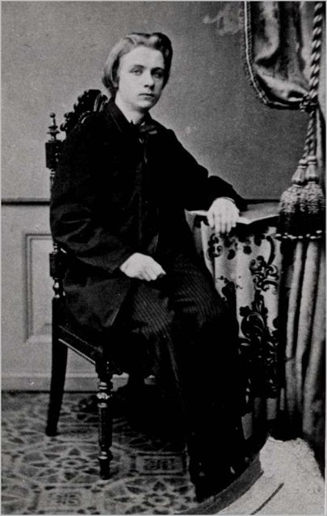
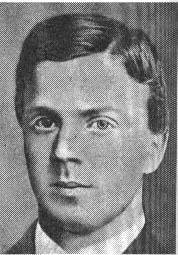
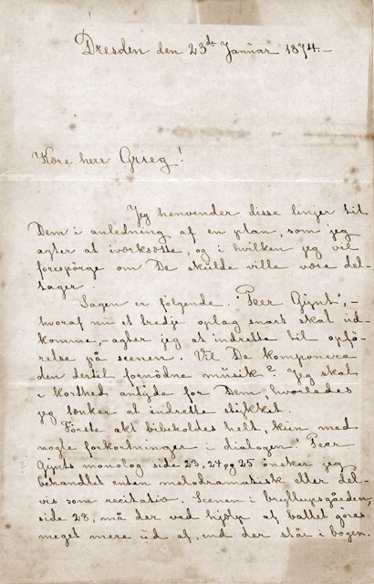
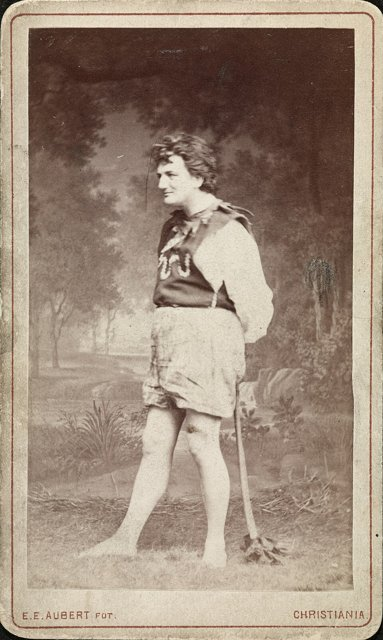
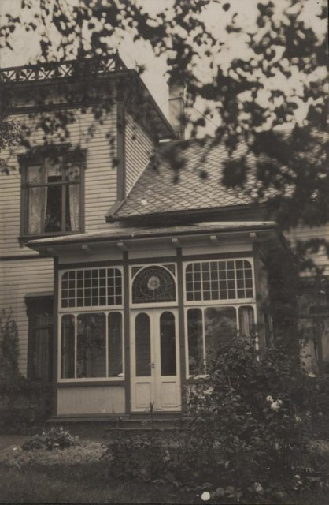
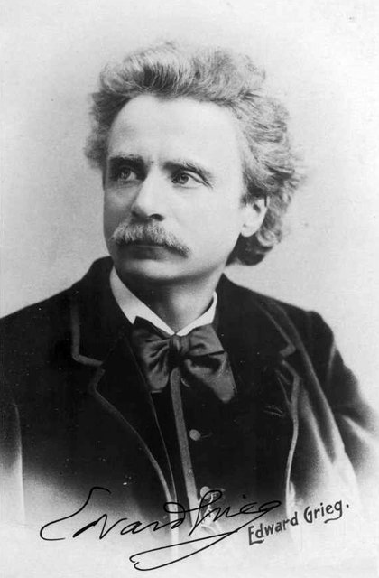
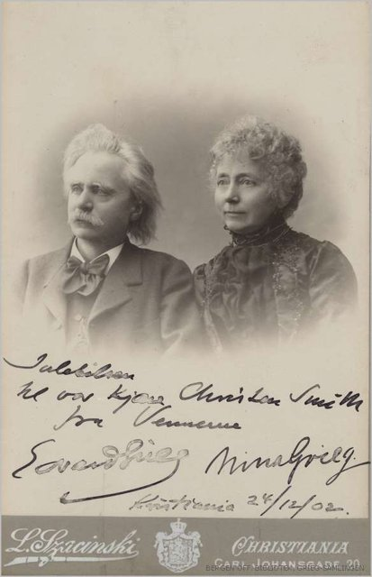

<!--
內容整理自中文維基百科「愛德華·葛利格」與英文維基百科「Edvard Grieg」條目（CC BY-SA 4.0），並以台灣用語改寫摘要。
https://zh.wikipedia.org/zh-tw/爱德华·格里格
https://en.wikipedia.org/wiki/Edvard_Grieg
中文條目很簡略，生平細節主要參考英文條目。
《皮爾金》首演日期、1858年在萊比錫聽克拉拉·舒曼演奏、特羅爾豪根別墅落成年份、《霍爾堡組曲》年份，係依一般公認的史實補充。
圖片皆為 Wikimedia Commons 上的公有領域（含CC0）作品（封面：佩德森1891年所繪肖像）。
-->

# Periods
- 1843 ~ 1858 | 童年@卑爾根
  生於挪威卑爾根的商人家庭，祖先來自蘇格蘭。母親是音樂老師，6歲就開始教他鋼琴。
- 1858 ~ 1862 | 萊比錫音樂院@Leipzig
  在小提琴名家奧勒·布爾的建議下，15歲到萊比錫音樂院學鋼琴。他不喜歡學院的嚴格課程，還在這裡染上肺病，一側肺從此損壞，終身體弱多病。
- 1863 ~ 1874 | 哥本哈根與挪威民族樂派
  在哥本哈根結識丹麥作曲家與挪威國歌作曲者諾爾德拉克，立志發揚挪威音樂。與表妹妮娜結婚，寫出A小調鋼琴協奏曲，並得到李斯特的賞識與推薦。
- 1874 ~ 1907 | 《皮爾金》與國際聲望
  為易卜生的戲劇《皮爾金》寫配樂，〈山魔王的宮殿〉、〈清晨〉家喻戶曉。定居卑爾根郊外的特羅爾豪根，以鋼琴家與指揮家身分巡演歐洲，結識柴可夫斯基，成為挪威最受愛戴的音樂家。

# Events

## 1843-06-15 | 出生@卑爾根
父親亞歷山大是商人兼英國駐卑爾根副領事，母親蓋西娜是音樂老師、律師兼政治家的女兒。家族原姓「格雷格」，源自蘇格蘭的麥格雷戈氏族，曾祖父約在1770年移居挪威，在卑爾根經商。

## 1849 | 6歲跟母親學鋼琴
在音樂家庭中長大，母親是他的第一位鋼琴老師。

## 1858 | 奧勒·布爾的推薦
夏天，挪威的小提琴名家、也是家族朋友的奧勒·布爾發現了15歲少年的才華，說服他的父母送他到萊比錫音樂院學習。

## 1858-10 | 進入萊比錫音樂院

主修鋼琴，喜歡萊比錫豐富的音樂會，卻不喜歡學院的紀律，唯一的例外是鋼琴學生必修的管風琴課。他後來說自己離開學院時「和入學時一樣笨」。在萊比錫，他聽了克拉拉·舒曼演奏舒曼的鋼琴協奏曲，舒曼的音樂對他影響深遠。

## 1860 | 兩度病危
春天接連罹患胸膜炎與肺結核，雖然撐了過來，但左肺從此損壞、胸椎嚴重變形，一生飽受呼吸道感染所苦，常到挪威與國外的療養院休養，好幾位醫生都成了他的朋友。

## 1861 | 鋼琴家首演
在瑞典的卡爾斯港首次以鋼琴家身分登台。

## 1862 | 萊比錫畢業，返鄉演出
完成萊比錫的學業，在家鄉卑爾根舉行第一場音樂會，曲目包括貝多芬的《悲愴》奏鳴曲。

## 1863 | 哥本哈根與諾爾德拉克
到丹麥哥本哈根住了三年，結識丹麥作曲家哈特曼與蓋德，以及挪威作曲家諾爾德拉克（挪威國歌的作曲者）。諾爾德拉克成為他的好友與靈感來源，激勵他發揚挪威民族音樂。

## 1866 | 諾爾德拉克去世

摯友諾爾德拉克英年早逝，他寫了一首〈送葬進行曲〉紀念他。四十年後，這首曲子在他自己的葬禮上演奏。

## 1867-06-11 | 與妮娜結婚
娶了表妹、抒情女高音妮娜·哈蓋魯普，她後來常演唱他寫的歌曲。這一年他也開始寫作鋼琴曲集《抒情小品》，往後三十多年陸續寫了十冊。

## 1868 | 女兒出生；寫下鋼琴協奏曲
女兒亞歷山德拉出生，卻在隔年死於腦膜炎，兩人此後沒有再生孩子。夏天他在丹麥度假時寫下A小調鋼琴協奏曲。這一年，素未謀面的李斯特寫了推薦信給挪威教育部，讓他得到一筆旅行補助。

## 1869-04-03 | 鋼琴協奏曲首演
由鋼琴家諾伊佩特在哥本哈根的賭場劇院首演，他本人因為在克里斯蒂安尼亞（今奧斯陸）有指揮工作而無法出席。這首協奏曲成為他最著名的作品之一。

## 1870 | 在羅馬拜訪李斯特
第一次見面時，李斯特看了他的第一號小提琴奏鳴曲非常高興。4月第二次拜訪時，他帶著鋼琴協奏曲的手稿，李斯特當場視譜彈奏，連管弦樂部分都一起彈出來，讓在場的人大為驚嘆，葛利格卻委婉地說第一樂章彈得太快了。李斯特還建議把第一樂章的第二主題交給小號獨奏，他沒有採納。

## 1872 | 與比昂松合作
1870年代他和詩人比昂松成為好友，兩人都支持挪威自治。他為比昂松的多首詩作譜曲，包括《西古爾德十字軍》的戲劇配樂。兩人計畫合寫一部歌劇，卻因為先寫音樂還是先寫歌詞而起爭執。

## 1874 | 易卜生委託《皮爾金》

易卜生請他為戲劇《皮爾金》寫配樂，他因此擱下了和比昂松的歌劇計畫，讓比昂松很不高興，所幸兩人後來和好。他寫信給朋友說，〈山魔王的宮殿〉「充滿牛糞味、誇張的挪威民族主義和山魔的自鳴得意，我自己都聽不下去」，卻成了他最有名的曲子之一。

## 1876-02-24 | 《皮爾金》首演

在克里斯蒂安尼亞首演，他的配樂為戲劇的成功貢獻良多，後來改編成兩套管弦樂組曲，〈清晨〉、〈山魔王的宮殿〉、〈蘇爾維格之歌〉家喻戶曉。同年夏天他到拜魯特觀賞了華格納《指環》的首演。

## 1880 | 卑爾根和諧管弦樂團音樂總監
他和卑爾根愛樂樂團（「和諧」）關係密切，1880到1882年擔任音樂總監。

## 1884 | 《霍爾堡組曲》
為紀念出生於卑爾根的劇作家霍爾堡誕生200週年而寫，原本是鋼琴曲，後來改編為弦樂團版本，以巴洛克舞曲的形式寫成。

## 1885 | 定居特羅爾豪根

在卑爾根郊外的湖畔蓋了別墅「特羅爾豪根」（意思是「山妖之丘」），在這裡度過餘生，今天是葛利格博物館。

## 1888 | 在萊比錫結識柴可夫斯基

兩人一見如故，柴可夫斯基非常推崇他的音樂，讚美其中的美感、原創性與溫暖。

## 1894 | 劍橋大學榮譽博士
1906年又獲頒牛津大學榮譽博士。

## 1897-12-06 | 在溫莎城堡為維多利亞女王演奏

和妻子妮娜在溫莎城堡的私人音樂會上，為維多利亞女王與宮廷演出他的作品。

## 1899 | 抗議德雷福斯事件
法國爆發反猶冤案德雷福斯事件，他取消在法國的音樂會表示抗議，希望法國人「很快回到1789年的精神，捍衛基本人權」，結果收到大量來自法國的仇恨信件。

## 1903 | 灌錄唱片
春天在巴黎錄了九張自己演奏鋼琴作品的78轉唱片，也為多種自動鋼琴系統錄製了紙捲，這些錄音至今仍聽得到。挪威政府在他屆退休年齡時發給他年金。

## 1906 | 結識葛蘭傑
在倫敦認識澳洲作曲家兼鋼琴家葛蘭傑，兩人一見投緣。他說：「我寫的挪威農民舞曲，在我的國家沒人彈得了，結果來了這個澳洲人，彈得恰如其分！他是我們斯堪地那維亞人不得不愛的天才。」

## 1907-09-04 | 逝世@卑爾根
長期病痛後，因心肺衰竭在卑爾根市立醫院去世，享年64歲，最後一句話是：「好吧，如果非如此不可。」葬禮吸引了三、四萬人走上街頭，依他的遺願演奏了他為諾爾德拉克寫的〈送葬進行曲〉，以及蕭邦第二號鋼琴奏鳴曲的〈送葬進行曲〉。他在卑爾根當年才啟用的挪威第一座火葬場火化，骨灰安放在特羅爾豪根附近的山壁墓穴中，妻子妮娜去世後也與他同葬。
