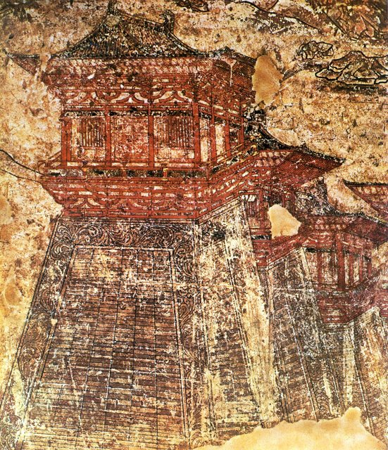
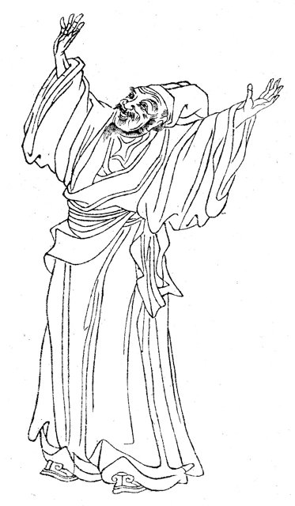
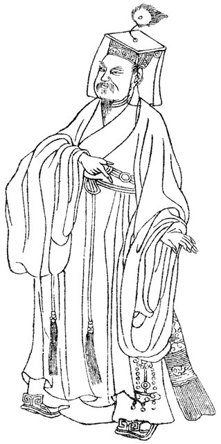

<!--
內容整理自 D:\Books\md\歷史\人物\中國\韓愈生平大事記.md（Books 的人物頁為 D:\Books\html\1-2-1.中國歷史人物\韓愈(768~824).html），並整合中文維基百科〈韓愈〉條目，以自己的話改寫。
時期依筆記的人生轉折歸納：童年喪親與求學、科舉求仕與幕府、任官與貶陽山、古文運動與朝廷任官、貶潮州與晚年。筆記的「核心思想」（古文運動、文以載道、儒家道統、尊儒排佛、師道思想、人才觀）「重要文學作品」「古文運動與柳宗元」「名言」「唐宋古文八大家」寫進時期說明與相關事件，不另立事件。
兩份資料出入與處理方式（韓愈早年的許多年份依史傳與年譜整理，筆記與維基百科都說部分年份是概略的）：
- 生卒：筆記只寫公元768年與824年；維基百科寫768年—824年12月25日，這裡 born 採768（年份），died 採維基百科的824-12-25。筆記的「享年57歲」是虛歲；網站依 born／died 自動算出的歲數會少一至兩歲。
- 出生地與籍貫：筆記寫唐代河陽（今河南孟州）；維基百科同，並補充他自稱郡望昌黎，世稱韓昌黎，晚年任吏部侍郎又稱韓吏部，諡號「文」、世稱韓文公，照此列入 aliases。
- 父兄：筆記寫773年（六歲）父親韓仲卿去世、777年（十歲）兄長韓會去世；維基百科寫「三歲喪父」，並說母親在他出生不久就過世，由長兄韓會與嫂嫂鄭氏撫養長大，隨兄長為官轉徙長安、韶州，韓會病逝韶州後，隨嫂護喪返回河陽，又避難宣城，與侄子韓老成（十二郎）同由鄭氏撫養，兩說相差三年，這裡寫「約771–773年」並說明。
- 讀書：維基百科補充他七歲才開始讀書、十三歲能寫文章，照此併入。
- 科舉：筆記寫786年左右赴長安、792年第四次應試登進士第、793–795年多次參加博學宏詞科未取官職；維基百科寫貞元二年（786年）赴長安應試，無門第資蔭，三試不第，貞元八年（792年）古文家陸贄、梁肅知貢舉，韓愈多次交遊梁肅門下，因此中進士，吏部試又三次不中，795年三次上書宰相而不得薦舉，照兩者併寫。
- 幕府：筆記寫796年入董晉幕府任觀察推官、799年董晉去世後轉往徐州；維基百科補充是因汴州宣武軍亂、隨宣武軍節度使董晉赴任，期間認識孟郊，李翱、張籍入門下；董晉卒後改任武寧節度使張建封的節度推官，張建封死後遷居洛邑，照此。
- 國子監：筆記寫802年任國子監四門博士；維基百科寫貞元十七年（801年）經李翱引薦給陸傪、獲得薦選任四門博士，並說《師說》約作於803年前，這裡寫801–802年。
- 貶陽山：筆記寫803年上書論關中旱災與民生，觸怒權貴，被貶陽山令；維基百科寫貞元十九年（803年）任監察御史，上〈御史臺上論天旱人饑狀〉，糾彈國戚京兆尹李實，被貶陽山令，深受百姓愛戴，百姓甚至以「韓」字為兒取名，同年侄子韓老成去世，寫〈祭十二郎文〉，照此；筆記未寫〈祭十二郎文〉的年份。
- 赦還：筆記寫805年遇赦離開陽山，後歷任江陵等地幕職；維基百科寫永貞元年（805年）憲宗即位大赦，改任荊州江陵府法曹參軍，韓愈甚感失望，寫「棲棲法曹掾，何處事卑陬」，照此。806年奉召入朝任國子博士（筆記）。
- 〈進學解〉：維基百科寫元和六年（811年）任國子博士，作〈進學解〉，受裴度賞識，擢為禮部郎中，照此。筆記只寫「810年代在中央官場歷任多種職務」。
- 平淮西：維基百科寫「815年隨裴度征淮西、因功擢任刑部侍郎、作〈平淮西碑〉」，碑文因推崇裴度，被李愬的妻子控訴不實，李愬的部下推倒碑文，憲宗只好命段文昌重撰；按一般史書，裴度平定淮西在元和十二年（817年），維基百科的815年疑為誤植，這裡寫「約817年」，並說明碑文的風波，筆記沒有這一項。
- 論佛骨：筆記寫819年上〈論佛骨表〉反對憲宗迎佛骨入宮，被貶潮州刺史；維基百科寫元和十四年（819年）正月，因反對憲宗迎釋迦牟尼佛骨而被貶潮州，路上愛女因病去世，到藍關時遇侄孫韓湘（傳說即八仙之一的韓湘子），寫下〈左遷至藍關示侄孫湘〉，照此。
- 潮州：筆記寫〈祭鱷魚文〉的典故，說他傳說曾為潮州驅鱷；維基百科補充他與潮州大顛和尚成為好友，往河裡扔一豬一羊，組織百姓獵殺鱷魚，投入生石灰、硫磺等，《舊唐書》說鱷魚就此絕跡，但後來李德裕、陳堯佐到潮州時仍見鱷魚，鱷魚到明代才徹底絕跡，韓愈卒後當地建韓文公廟供奉，照此。
- 晚年：筆記寫820年任袁州刺史、821年入朝任國子祭酒、822年任兵部侍郎、823年任京兆尹兼御史大夫、824年去世，朝廷追贈禮部尚書，諡號「文」；照此。
- 評價與後世：維基百科補充蘇軾稱讚他「文起八代之衰，道濟天下之溺，忠犯人主之怒，勇奪三軍之帥」，這裡寫在身後事件，時間依蘇軾〈潮州韓文公廟碑〉（元祐七年，1092年）；著作收入《昌黎先生集》。筆記補充他被列為唐宋古文八大家之首，並影響歐陽修、蘇軾、王安石、曾鞏等宋代文學家，及宋代理學的形成。
- 人名與其他時間軸一致：歐陽修、蘇軾（Data 的標題為蘇東坡）、孟郊與柳宗元沒有獨立時間軸。
圖片來源（皆為 Wikimedia Commons 公有領域／CC0 作品；畫像、手抄本與雕像多為後世的作品，不代表事件當時的樣貌）：
- hn-cover.jpg：至聖先賢半身像 冊-110-韓愈.jpg（韓愈像（清代《至聖先賢半身像》冊））
- hn-han.jpg：Han Yu.jpg（韓愈像（線描））
- hn-changan.jpg：Tours de la ville Tang de Changan.jpg（唐代長安城的城樓（壁畫））
- hn-liu.jpg：Liu Zongyuan.jpg（柳宗元像（線描））
-->

# Periods
- 768 ~ 791 | 童年喪親與求學 | #868e96
  生於河陽，幼年喪父、由兄嫂撫養，兄長在韶州去世後隨嫂嫂返鄉避難，七歲讀書、十三歲能文，勤奮學習儒家經典與古文。
- 792 ~ 802 | 科舉與幕府 | #1971c2
  經三次落第，792年登進士，卻在吏部試中屢屢受挫，只能依附節度使的幕府，建立文名。
- 803 ~ 818 | 貶陽山與朝官時期 | #e8590c
  任監察御史，因直言被貶陽山令，大赦後回朝任國子博士、刑部侍郎，古文運動逐漸形成影響。
- 819 ~ 824-12-25 | 貶潮州與晚年 | #c92a2a
  因〈論佛骨表〉被貶潮州，之後返朝任國子祭酒、兵部侍郎與京兆尹，57歲逝世。

# Events

## 768 | 出生於河陽
韓愈字退之，生於唐代河南府河陽縣（今河南孟州），自稱郡望昌黎，世稱韓昌黎。他出生後不久母親過世，父親韓仲卿也很早去世，由長兄韓會與嫂嫂鄭氏撫養長大。

## 771 | 父親去世 {label="約771–773年（筆記寫773年，六歲）"}
韓愈三歲左右（筆記寫六歲）父親韓仲卿去世，由兄長韓會照顧，跟著兄長為官轉徙長安與韶州。777年（十歲）韓會病逝於韶州，韓愈隨嫂嫂鄭氏護喪返回河陽，又避難到宣城，與侄子韓老成（十二郎）一同由鄭氏撫養成人，情同手足。他七歲才開始讀書，十三歲能寫文章，自述「前古之興亡，未嘗不經於心也，當世之得失，未嘗不留於意也」，在少年時期刻苦讀書，廣泛研習儒家經典與古代文章。

## 786 | 赴長安求仕 {label="貞元二年（約786年，十九歲）"}

韓愈前往長安應試，沒有門第蔭庇，三次考試都沒有考中，開始尋求仕途的出路。

## 792 | 登進士第 {label="貞元八年（792年）"}
經過第四次應試，韓愈登進士第；當年古文家陸贄、梁肅主持貢舉，韓愈多次出入梁肅門下，喜歡寫古文的他因此得以中選。之後他參加吏部的博學宏詞科，連續三次（793–795年）都沒有成功，憤慨之餘自稱「為考官所辱」，打算搭船東下；795年他三次上書宰相，希望得到薦舉，同樣沒有結果。

## 796 | 進入董晉幕府
汴州的宣武軍作亂，韓愈跟隨宣武軍節度使董晉赴任，擔任「觀察推官」，開始幕府生涯；期間他結識孟郊，李翱、張籍也入他門下。799年董晉去世，他改任武寧節度使張建封屬下的節度推官，轉往徐州；張建封去世後，他遷居洛陽。800年前後，他逐漸以文章與文學主張受到注意，開始建立文壇聲望。

## 801 | 任國子監四門博士 {label="約801–802年"}
經李翱引薦給陸傪，韓愈獲得薦選，任國子監四門博士，進入中央教育與文化機構，大約在這個時期前後寫成〈師說〉：「師者，所以傳道、受業、解惑也」，批判當時士大夫恥於從師的風氣，並說「聞道有先後，術業有專攻」「師不必賢於弟子，弟子不必不如師」，提升了教師的地位與教育的意義。

## 803 | 直言被貶陽山
韓愈任監察御史，因關中旱災，上〈御史臺上論天旱人饑狀〉，糾彈國戚、京兆尹李實，觸怒權貴，被貶為陽山令（今廣東陽山）；他在地方深受百姓愛戴，百姓甚至用「韓」字給孩子取名。同年，他的侄子韓老成（十二郎）去世，韓愈寫下情感真摯的〈祭十二郎文〉，被視為唐代最著名的祭文，文中說「自今已往，吾其無意於人世矣」。

## 805 | 赦還江陵、入朝 {label="805–806年"}

憲宗即位大赦，韓愈離開陽山，改任荊州江陵府法曹參軍，他感到失望，寫下「棲棲法曹掾，何處事卑陬」；806年他奉召入朝，任國子博士，其後在中央官場歷任國子博士、都官員外郎等職，古文運動逐漸形成影響。他與柳宗元是古文運動最具代表性的人物，合稱「韓柳」：反對六朝以來注重對仗、聲律與辭藻的駢文，提倡先秦兩漢的散文傳統，主張文章不只是文字技巧，也應承載思想與道德（「文以載道」）。

## 811 | 〈進學解〉 {label="元和六年（811年）"}
韓愈任國子博士，作〈進學解〉，以問答的形式討論勤學、修業與仕途不遇，受到裴度的賞識，被擢為禮部郎中。他的〈原道〉（闡述儒家以仁義為核心的道統）、〈原毀〉、〈雜說四·馬說〉（「世有伯樂，然後有千里馬」）與〈送孟東野序〉（「大凡物不得其平則鳴」）也寫於這段時期前後，其中〈原道〉所提出的道統觀，對宋代理學的形成影響深遠。

## 817 | 隨裴度平淮西 {label="約元和十二年（817年）"}
韓愈隨裴度征討淮西，因功擢升刑部侍郎，並寫下〈平淮西碑〉；碑文因推崇裴度，被實際作戰的李愬的妻子控訴不實，李愬的部下推倒了碑文，唐憲宗只好命段文昌重撰。（維基百科寫815年，史書一般記載為元和十二年。）

## 819 | 〈論佛骨表〉與貶潮州 {label="元和十四年（819年）"}
唐憲宗要迎接佛骨入宮供奉，韓愈上〈論佛骨表〉（〈諫迎佛骨表〉）強烈反對，表達儒家的立場，批判佛教與道教對社會與政治的部分影響，憲宗大怒，把他貶為潮州刺史。在赴任途中，已經生病的愛女因為不堪路程折磨而去世；到了藍關（今陝西藍田），大雪紛飛，他遇見侄孫韓湘（傳說即八仙之一的韓湘子），寫下〈左遷至藍關示侄孫湘〉：「雲橫秦嶺家何在？雪擁藍關馬不前。」

## 819 | 治理潮州與〈祭鱷魚文〉 {label="819–820年"}
韓愈到潮州後，推動地方的教育與民生，與潮州的大顛和尚成為好友；傳說他寫〈祭鱷魚文〉，把一豬一羊投入河裡祭告，並組織百姓獵殺鱷魚，投入生石灰與硫磺，《舊唐書》說鱷魚從此絕跡，其實後來李德裕、陳堯佐到潮州時仍見鱷魚，一直到明代才完全絕跡。他去世後，當地建了韓文公廟供奉。820年他奉召北歸，任袁州刺史。

## 821 | 國子祭酒 {label="821–823年"}
韓愈入朝任國子祭酒，參與教育與文教事務；822年任兵部侍郎，參與朝廷政務；823年任京兆尹兼御史大夫，處理京城的行政與治安，晚年也任吏部侍郎，故稱「韓吏部」。

## 824-12-25 | 逝世

韓愈去世，享年57歲（虛歲），朝廷追贈禮部尚書，諡號「文」，世稱韓文公，著作收入《昌黎先生集》。他的一生可概括為「勤學求仕、直言遭貶、倡導古文、復興儒學」。

## 1092 | 蘇軾的評價與唐宋八大家 {label="北宋元祐七年（1092年）"}
蘇軾為潮州的韓文公廟寫下碑文，稱讚韓愈「文起八代之衰，道濟天下之溺，忠犯人主之怒，勇奪三軍之帥」。韓愈被列為「唐宋古文八大家」之首（唐：韓愈、柳宗元；宋：歐陽修、蘇洵、蘇軾、蘇轍、王安石、曾鞏），他的文學革新影響了歐陽修、蘇軾、王安石、曾鞏等宋代文學家，〈師說〉〈馬說〉〈祭十二郎文〉至今仍是重要的教材。
