<!--
內容整理自中文維基百科「格奧爾格·弗里德里希·韓德爾」與英文維基百科「George Frideric Handel」條目（CC BY-SA 4.0），並以台灣用語改寫摘要。
https://zh.wikipedia.org/zh-tw/格奥尔格·弗里德里希·亨德尔
https://en.wikipedia.org/wiki/George_Frideric_Handel
日期採當時德國與英國通行的儒略曆（舊曆），與巴赫時間軸一致；出生日依新曆為1685年3月5日。
韓德爾童年的記載幾乎都出自1760年梅恩華林所寫的第一本傳記，其中不少細節未經證實，文中以「據說」標示。
圖片皆為 Wikimedia Commons 上的公有領域作品（封面：巴爾塔薩·丹納約1727年所繪肖像）。
-->

# Periods
- 1685 ~ 1703 | 童年與求學@哈雷
  父親是年過六十的宮廷理髮外科醫生，希望他將來當律師，一度禁止他接觸音樂。在魏森費爾斯公爵的建議下，他跟哈雷的管風琴師查豪學音樂，這是他唯一的老師。17歲進入哈雷大學，同時擔任大教堂管風琴師。
- 1703 ~ 1706 | 漢堡歌劇院
  到德國最重要的歌劇重鎮漢堡，在鵝市歌劇院擔任小提琴手與大鍵琴手，結識馬特森，寫出最早的歌劇《阿爾米拉》。
- 1706 ~ 1710 | 義大利@Italy
  在佛羅倫斯、羅馬、拿坡里、威尼斯之間往來，為樞機主教與貴族寫清唱劇與宗教音樂，結識柯瑞里與史卡拉第父子。歌劇《阿格麗嬪娜》在威尼斯轟動一時，觀眾稱他為「親愛的薩克森人」。
- 1710 ~ 1717 | 漢諾威樂長，落腳倫敦@London
  受聘為漢諾威選侯的宮廷樂長，卻很快前往倫敦，以歌劇《里納爾多》一炮而紅，1712年起定居英國。不久漢諾威選侯繼承英國王位，成為喬治一世。
- 1717 ~ 1719 | 坎農斯莊園
  擔任錢多斯公爵的駐府作曲家，寫下《錢多斯讚美詩》與《阿西斯與嘉拉提亞》，為日後的神劇合唱打下基礎。
- 1719 ~ 1734 | 皇家音樂學院：義大利歌劇的全盛期
  主持貴族出資成立的歌劇公司「皇家音樂學院」，在國王劇院推出《凱撒大帝》等名作，1727年入籍英國，並為喬治二世加冕寫了〈祭司撒督〉。
- 1734 ~ 1741 | 柯芬園：歌劇事業的尾聲
  與對手「貴族歌劇院」激烈競爭，轉到柯芬園劇院另起爐灶，首創在幕間演奏管風琴協奏曲。1737年中風後漸漸轉向英文神劇，1741年寫完最後一部歌劇。
- 1741 ~ 1752 | 英文神劇的時代
  《彌賽亞》在都柏林首演，之後《參孫》、《猶大·馬加比》、《所羅門》等神劇接連問世，並寫下《皇家煙火》。他把《彌賽亞》的收益捐給倫敦棄兒醫院。
- 1752 ~ 1759 | 失明的晚年
  白內障手術失敗後完全失明，仍繼續指揮演出自己的神劇，直到去世前一週還出席了《彌賽亞》演出。

# Events

## 1685-02-23 | 出生@哈雷
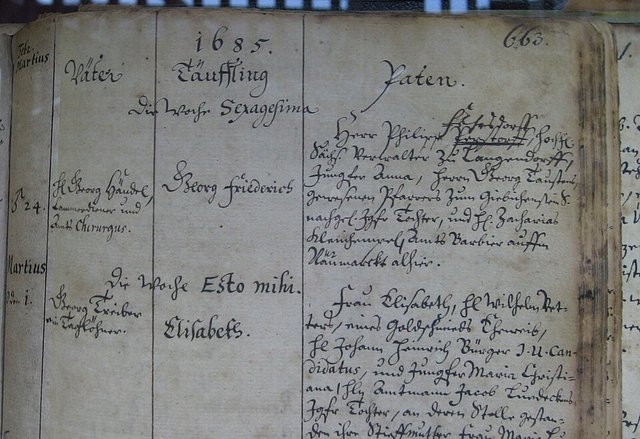
生於當時屬於布蘭登堡－普魯士的哈雷，和巴赫、多梅尼科·史卡拉第同一年出生。父親格奧爾格是63歲的理髮外科醫生，曾服務於魏森費爾斯宮廷；母親多蘿西亞是牧師的女兒。他是這段婚姻的第二個孩子，哥哥一出生就夭折，後來還有兩個妹妹。

## 1692 | 據說：閣樓上的古鋼琴
據第一本傳記記載，父親擔心他沉迷音樂，禁止家中出現任何樂器。他偷偷把一台小古鋼琴搬到閣樓，趁家人熟睡時練習。不少學者認為這是後人渲染的浪漫故事，但他確實在正式拜師前就已有相當的鍵盤基礎。

## 1693 | 魏森費爾斯公爵發掘才華
七到九歲間隨父親到魏森費爾斯宮廷，在宮廷禮拜堂彈奏管風琴，讓約翰·阿道夫公爵大為驚訝。公爵建議父親讓他學音樂，他一生都視公爵為恩人。

## 1694 | 拜查豪為師
父親請哈雷聖母教堂的管風琴師查豪教他，這也是韓德爾唯一的老師。查豪讓他抄寫大量德國與義大利作曲家的樂譜，學習各家風格；他晚年回憶當時「寫得像魔鬼一樣拚命」。他也學了大鍵琴、小提琴和管風琴，最喜歡的卻是雙簧管。

## 1697-02-11 | 父親去世
11歲的他依德國習俗寫了一首悼念詩，署名時還特地註明自己「獻身於人文學科」，遵從父親要他讀書的心願。

## 1702-02-10 | 進入哈雷大學
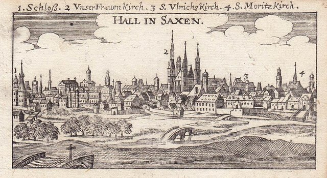
在剛成立不久的哈雷大學註冊。據中文條目，他依父親遺願攻讀法律，並受教於思想開明的法學家托馬修斯。同年3月成為哈雷喀爾文派大教堂的見習管風琴師。這段時期他也結識了正在萊比錫讀法律的泰勒曼，兩人常互相拜訪、通信切磋旋律寫作。

## 1703-07 | 前往漢堡
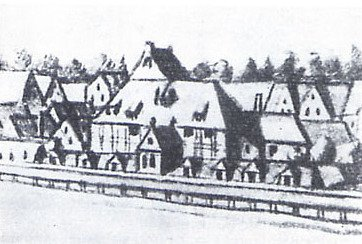
大教堂見習期滿後，他沒有留在普魯士，而是到擁有固定歌劇團的自由城市漢堡，在鵝市歌劇院擔任小提琴手與大鍵琴手，並結識作曲家馬特森與凱澤。

## 1704-12 | 與馬特森決鬥
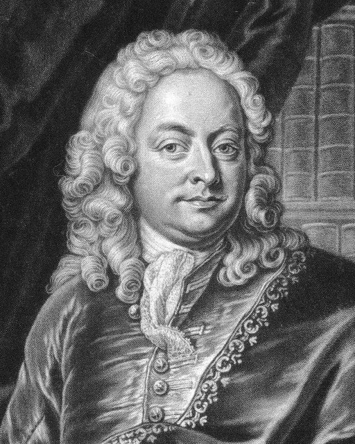
演出馬特森的歌劇時，兩人為了誰來彈大鍵琴起了爭執，馬特森拔劍刺向他，幸好被他外套上一顆大鈕扣擋下。兩人事後和好，一生保持通信；韓德爾死後，馬特森還自費出版了他的傳記德文版。

## 1705-01 | 第一部歌劇《阿爾米拉》
在漢堡首演，同年又推出《尼祿》。

## 1706 | 前往義大利
應梅迪奇家族邀請到佛羅倫斯。當時教宗國禁止演出歌劇，他在羅馬改為樞機主教們寫宗教音樂與清唱劇，名作〈主如此說〉就寫於這個時期。據中文條目，他曾在一位樞機主教的安排下與多梅尼科·史卡拉第比賽鍵盤演奏，從此兩人惺惺相惜。

## 1707 | 第一部義大利歌劇《羅德里戈》
在佛羅倫斯首演。同年寫了第一部神劇《時間與覺醒的勝利》。

## 1708-04 | 神劇《復活》在羅馬首演
以聖經故事為題材，在魯斯波利親王府中演出，由柯瑞里帶領樂團。

## 1709-12 | 《阿格麗嬪娜》轟動威尼斯
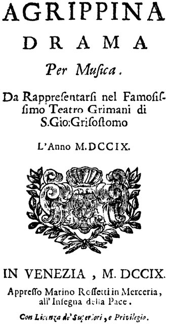
在威尼斯的聖喬凡尼·格里索斯托莫劇院連演27晚。觀眾被他宏偉的風格震懾，高喊「親愛的薩克森人萬歲」。

## 1710-06 | 漢諾威宮廷樂長
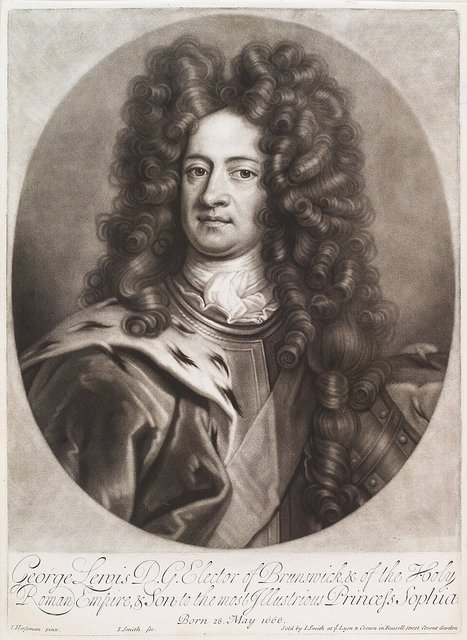
受聘為漢諾威選侯喬治的宮廷樂長，但年底就請假前往倫敦。

## 1711-02 | 《里納爾多》征服倫敦
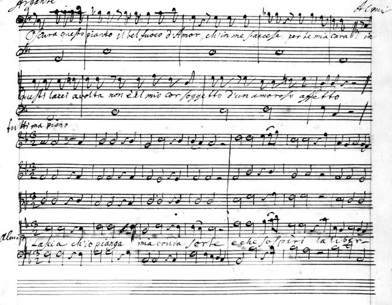
取材自塔索的史詩，在倫敦乾草市場的女王劇院首演，大獲成功。雖然是倉促寫成、大量沿用他在義大利的舊作，劇中的詠嘆調〈讓我哭泣吧〉至今仍廣為傳唱。

## 1712 | 定居英國
回哈雷參加妹妹的婚禮後，決定長住英國，讓漢諾威選侯十分不滿。他住進年輕富有的伯靈頓伯爵府邸，1713年又以《烏得勒支感恩讚》獲得安妮女王每年200英鎊的年金。

## 1714-08 | 漢諾威選侯成為英王喬治一世
安妮女王去世，遠親漢諾威選侯繼承英國王位，正是先前被韓德爾不告而別的那位老闆。

## 1717-07-17 | 《水上音樂》
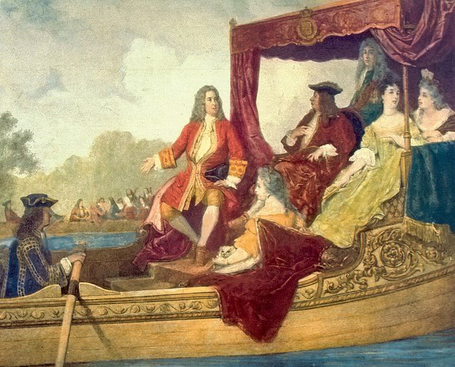
喬治一世與賓客乘船遊泰晤士河時，樂師們在另一艘船上演奏這組樂曲，國王聽得非常高興，要求重複演奏了三次以上。據說這次演出讓國王原諒了他當年擅離漢諾威，中文條目並記載他的年金因此倍增為400英鎊。

## 1717 | 錢多斯公爵的駐府作曲家
在倫敦郊外的坎農斯莊園工作兩年，寫下十一首《錢多斯讚美詩》與田園劇《阿西斯與嘉拉提亞》，後者是他生前演出次數最多的作品。

## 1719-05 | 皇家音樂學院成立
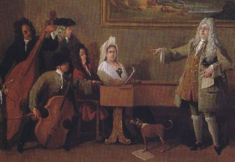
一群貴族出資成立專演義大利正歌劇的公司，他奉命到德勒斯登等地招募歌手。這一年巴赫曾到哈雷想拜訪他，卻因他已離開而錯過，兩人終生未曾謀面。

## 1720 | 南海泡沫
他在1716年南海公司股價低時買進，並在1720年泡沫破滅前賣出。同年他也投資了從事奴隸貿易的皇家非洲公司，和許多贊助他的貴族一樣，這段投資今天常被拿出來檢討。

## 1723 | 遷入布魯克街25號
在這棟喬治亞式住宅排練、抄譜、賣票，一直住到去世。這裡現在是韓德爾故居博物館。

## 1724-02 | 《凱撒大帝》首演
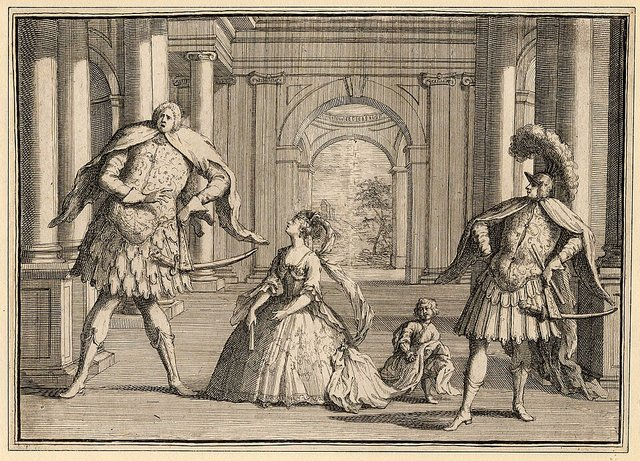
接下來一年內又推出《帖木兒》與《羅德琳達》，三部都是他義大利歌劇的巔峰之作。

## 1727-02 | 入籍英國
英國國會通過法案，讓他正式成為英國臣民。

## 1727-10-11 | 〈祭司撒督〉：喬治二世加冕
為喬治二世加冕典禮寫了四首加冕頌歌，其中〈祭司撒督〉此後在每一位英國君主的加冕典禮上都會演唱。

## 1728-01 | 《乞丐歌劇》與歌劇公司解散
蓋伊的《乞丐歌劇》用通俗英文歌曲嘲諷他帶動的義大利歌劇風潮，連演62場，創下當時戲劇史上的最長紀錄。同年皇家音樂學院停止營運，但他很快與劇院經理海德格另組新公司。

## 1732 | 英文神劇《以斯帖》公開演出
因為有人盜演他早年的《以斯帖》，他決定自己推出公開演出版本，大受歡迎，接著又寫了《底波拉》與《亞他利雅》，奠定了英文神劇的合唱傳統。

## 1734 | 轉往柯芬園劇院
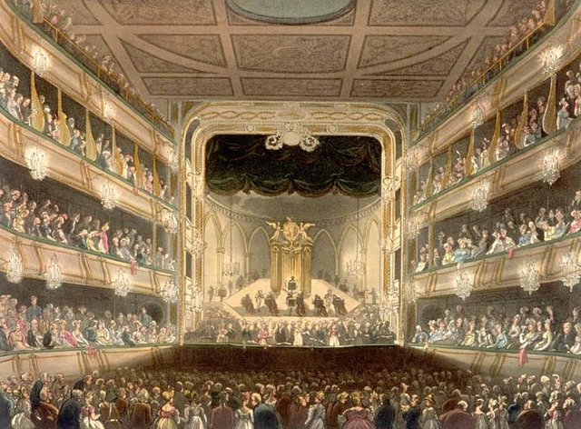
「貴族歌劇院」在威爾斯親王支持下延攬名閹伶法里內利與他打對台，他的合約到期後轉到柯芬園劇院另起爐灶，在那裡推出《阿里歐當特》與《阿爾契娜》等加入芭蕾的歌劇。

## 1735 | 首創管風琴協奏曲
在神劇演出的幕間親自演奏管風琴協奏曲，開創了這個新曲種。

## 1736-02 | 《亞歷山大的盛宴》
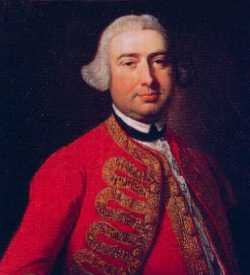
根據德萊頓的詩作寫成，大受歡迎，促使他從義大利歌劇轉向英文合唱作品。男高音比爾德從此成為他終身合作的獨唱者。

## 1737-04 | 中風
長期過勞下輕微中風，右手與右臂暫時癱瘓，5月病情惡化，連思考能力都受影響。秋天他勉強聽從醫生建議到亞琛溫泉療養，11月症狀完全消失。年底為卡洛琳王后寫了葬禮頌歌。

## 1738-04 | 《賽爾斯》：唯一的喜歌劇
劇中的開場詠嘆調〈親愛的樹蔭〉後來以「韓德爾的廣板」聞名，是他死後少數仍持續流傳的歌劇曲目。同年沃克斯豪爾花園為他立了一尊大理石像，這是在世音樂家罕見的殊榮。

## 1739 | 《掃羅》與《以色列人在埃及》
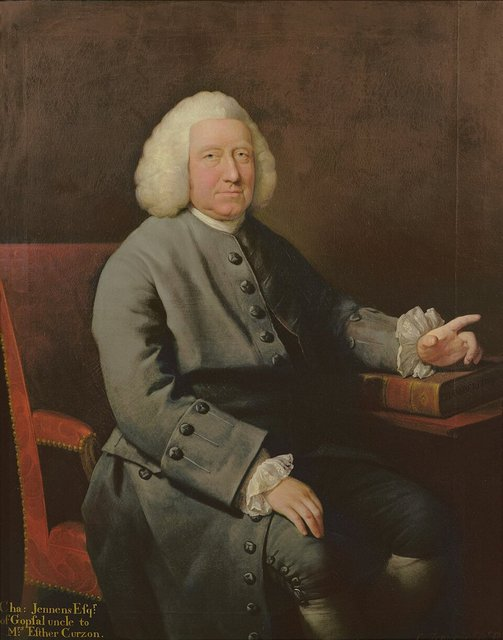
與劇作家詹寧斯合作的《掃羅》用上三支長號、鐘琴，還向倫敦塔借來超大型軍用定音鼓。《以色列人在埃及》幾乎全由合唱組成。這兩部是他成熟期神劇的代表作。

## 1741-01 | 最後一部歌劇《戴達米婭》
只演出三場。此後他告別歌劇事業，專心創作英文神劇。

## 1741-08-22 | 24天寫成《彌賽亞》
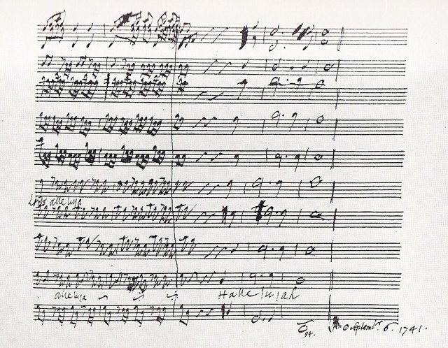
應愛爾蘭總督德文郡公爵邀請到都柏林為慈善醫院舉辦音樂會。在出發前，他從8月22日到9月14日只用了24天就完成《彌賽亞》。

## 1742-04-13 | 《彌賽亞》都柏林首演
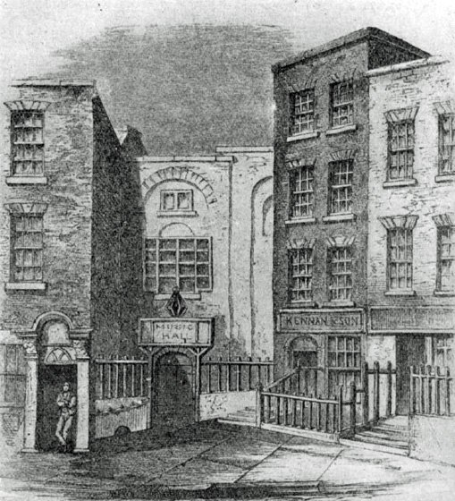
在都柏林漁夫街的新音樂廳首演，由兩座大教堂的唱詩班參與演出。他在這部作品中對獨唱與合唱的平衡拿捏得恰到好處。成功之後，他再也沒寫過義大利歌劇。

## 1743-03 | 《彌賽亞》倫敦首演；「哈利路亞」起立的傳說
據中文條目流傳的軼事，英王喬治二世聽到〈哈利路亞〉大合唱時激動得站了起來，全場觀眾也跟著起立，從此演出這首合唱時聽眾起立便成為慣例。同年他也推出了神劇《參孫》。

## 1747-04 | 《猶大·馬加比》
1746到1747年間寫了一系列軍事題材的神劇，慶祝英軍擊敗詹姆斯黨叛亂，《猶大·馬加比》是其中最受歡迎的一部。

## 1749-03-17 | 《所羅門》首演
劇中第三幕的器樂小段〈示巴女王的駕臨〉至今仍是音樂會常客。

## 1749-04-27 | 《皇家煙火》
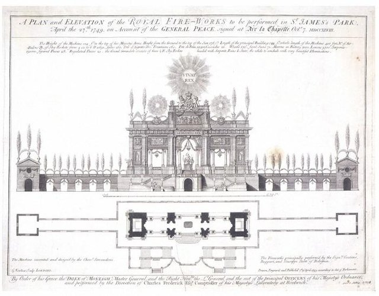
為慶祝結束奧地利王位繼承戰爭的和約，在倫敦綠園舉辦煙火大會。光是公開彩排就吸引了一萬兩千人。

## 1750-05 | 為棄兒醫院演出《彌賽亞》
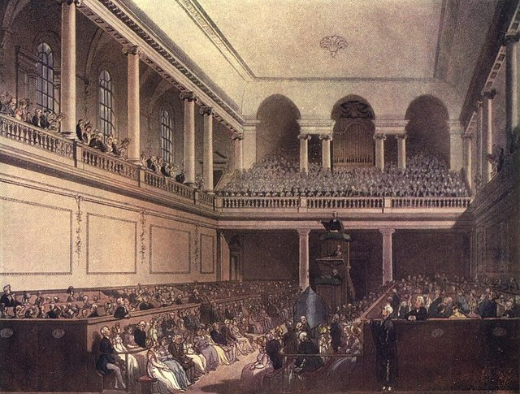
在倫敦收容棄兒的育幼院舉辦《彌賽亞》慈善演出，大獲成功，此後年年舉辦。院方隔天就推舉他為理事，他過世時還把一份《彌賽亞》總譜遺贈給醫院。

## 1750-08 | 荷蘭馬車意外
從德國返回倫敦途中，在海牙與哈倫之間遭遇馬車翻覆，身受重傷。這也是他最後一次回到故鄉一帶。

## 1752-02-26 | 最後一部神劇《耶弗他》；雙眼失明
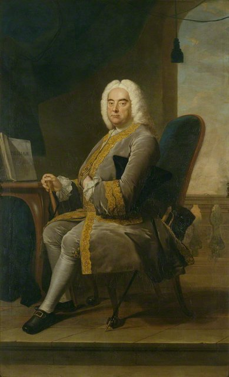
寫作《耶弗他》期間一隻眼睛開始失明，總譜上留下「左眼失明，無法繼續」的筆跡。白內障被江湖醫生泰勒開刀後不但沒改善，可能還更惡化，到1752年底已完全失明。（同一位泰勒也曾為巴赫動過眼睛手術。）

## 1759-04-06 | 最後一次出席《彌賽亞》
在柯芬園劇院出席《彌賽亞》演出，這是他生前聽的最後一場音樂會。

## 1759-04-14 | 逝世@倫敦
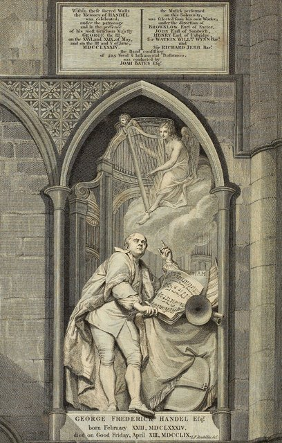
在布魯克街的家中去世，享年74歲。他終身未婚，生活極為低調，遺產大多留給姪女、親友、僕人與慈善機構。安葬於西敏寺，有三千多人參加國葬規格的葬禮。

## 1784 | 西敏寺韓德爾紀念音樂會
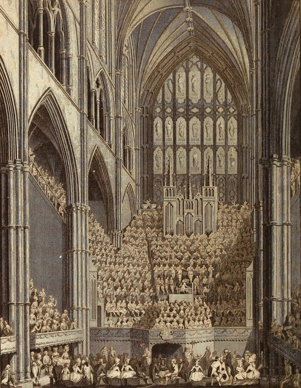
為紀念他（誤算的）百年誕辰，在西敏寺舉行盛大的紀念演出，帶動了英國的大型合唱傳統。前來倫敦的海頓後來聽了這類大型演出深受感動，啟發他寫出神劇《創世記》。
