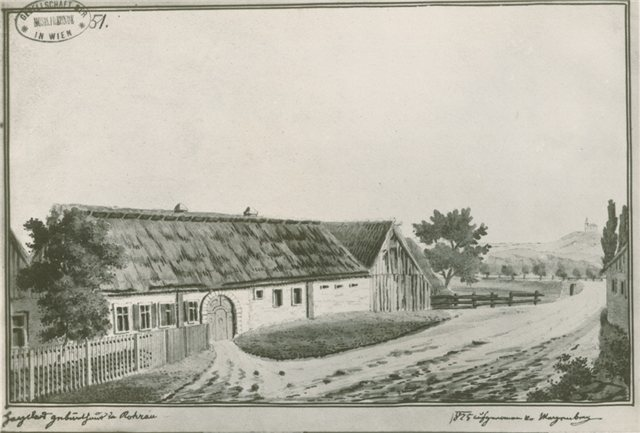
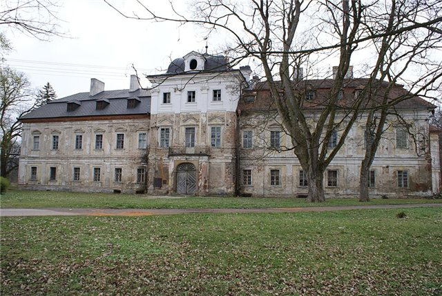
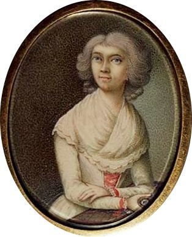
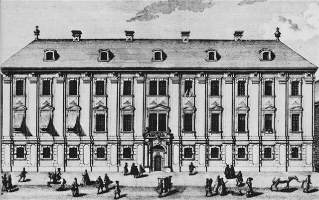
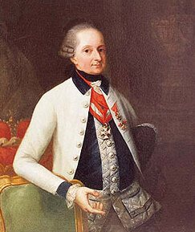
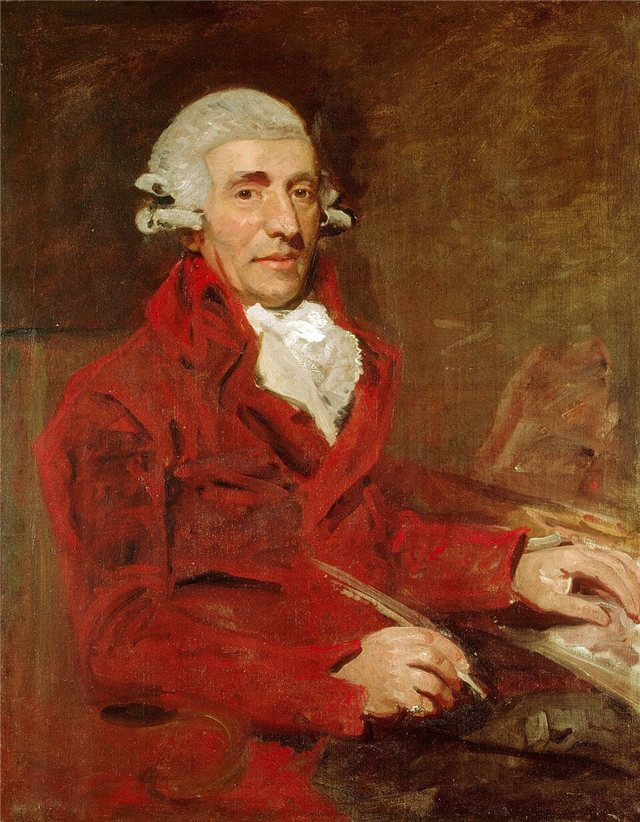
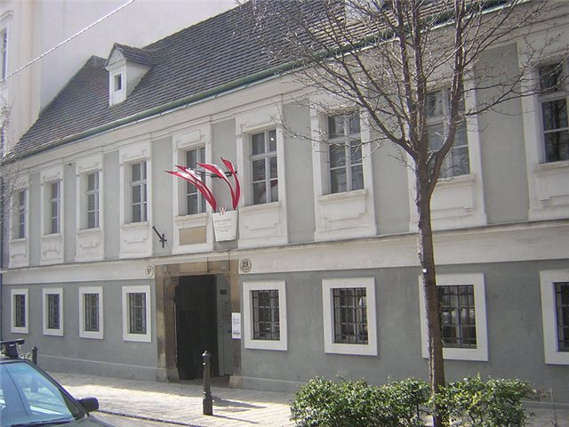

<!--
內容整理自中文維基百科「約瑟夫·海頓」條目（CC BY-SA 4.0），並以台灣用語改寫摘要。
https://zh.wikipedia.org/zh-tw/約瑟夫·海頓
圖片皆為 Wikimedia Commons 上的公有領域作品（封面：托馬斯·哈代 1791 年所繪肖像）。
-->

# Periods
- 1732 ~ 1737 | 童年@羅勞(Rohrau)
  出生在奧地利與匈牙利邊境的小村莊羅勞，父親是車匠。父母雖然不識譜，但全家人和鄰居常常一起唱歌，海頓很小就顯露出音樂天分。
- 1737 ~ 1740 | 唱詩班訓練@海恩堡(Hainburg)
  五、六歲時被送到海恩堡的親戚家，在當地教堂唱詩班接受音樂訓練。
- 1740 ~ 1749 | 聖史蒂芬大教堂兒童合唱團@維也納
  被大教堂音樂總監魯特相中帶到維也納，在兒童合唱團唱了九年，學習歌唱、鍵盤與小提琴。魯特沒有正式教他作曲，海頓大多靠自學，也在維也納濃厚的音樂環境中耳濡目染。
- 1749 ~ 1757 | 自由音樂人時期@維也納
  變聲後被合唱團請走，開始十年的艱苦歲月：打零工、擔任義大利作曲家波爾波拉的隨從，一邊努力自修補足專業，寫出第一首弦樂四重奏和第一部歌劇。
- 1757 ~ 1761 | 莫爾津伯爵樂長
  第一份重要職位，在莫爾津伯爵的城堡指揮一支小樂隊，並為它寫出第一批交響曲、弦樂三重奏與弦樂四重奏。伯爵不久因財務困難解散樂隊。
- 1761 ~ 1790 | 埃斯特哈齊宮廷樂長
  在顯赫的埃斯特哈齊家族擔任樂長近三十年，隨宮廷往返艾森施塔特、維也納與新建的艾斯特哈茲宮。歷任親王都懂音樂、支持他的創作；固定編制的宮廷樂團讓他能不斷試驗，名聲也逐漸傳遍歐洲。
- 1791 ~ 1792 | 第一次倫敦之旅
  應音樂經理人所羅門之邀赴倫敦演出，轟動一時，名利雙收。
- 1794 ~ 1795 | 第二次倫敦之旅
  再度赴英，完成「倫敦交響曲」的後半，包括「軍隊」、「時鐘」、「擂鼓」與「倫敦」。
- 1795 ~ 1809 | 晚年@維也納
  回到維也納定居，轉向氣勢宏大的合唱作品，完成神劇《創世紀》、《四季》與最後一批弦樂四重奏。

# Events

## 1732-03-31 | 出生@羅勞

出身貧窮的車匠家庭，隔天（4月1日）受洗。弟弟米歇爾·海頓日後也成為作曲家。

## 1737 | 前往海恩堡接受唱詩班訓練
因音樂天分被送到海恩堡的親戚家，在教堂唱詩班學習。

## 1740 | 進入聖史蒂芬大教堂兒童合唱團
維也納聖史蒂芬大教堂音樂總監格奧爾格·魯特到鄉間挑選童聲時相中海頓，帶他到維也納。最後四年弟弟米歇爾也加入了合唱團。

## 1749 | 變聲離開合唱團
嗓音成熟後再也唱不出童聲，被找了個藉口請出合唱團。據說他在公園長椅上過了一夜，後來才被朋友收留。

## 1754 | 擔任瑪麗安娜·馬丁內斯的鋼琴老師
住在學生家中，以教琴抵房租。當時10歲的馬丁內斯日後也成為作曲家。

## 1757 | 擔任莫爾津伯爵樂長

在這個職位上寫出他的第一首交響曲，以及弦樂三重奏、嬉遊曲與弦樂四重奏，這些作品大多以手稿流傳。

## 1760 | 與瑪麗亞·安娜·凱勒結婚

有了穩定工作後結婚，但婚姻並不美滿，兩人也沒有孩子。

## 1761 | 進入埃斯特哈齊家族任副樂長

莫爾津伯爵解散樂隊後，海頓很快在地位顯赫的埃斯特哈齊家族找到副樂長的職位，從此展開近三十年的宮廷生涯。

## 1766 | 升任埃斯特哈齊宮廷正樂長
老樂長維爾納去世後升任正職，負責作曲、領導合唱團、演奏室內樂與籌辦歌劇演出。

## 1772 | 「太陽」弦樂四重奏 Op. 20

處於所謂「狂飆運動」時期，作品充滿尖銳的和弦與少見的小調和聲。這組四重奏的終樂章嘗試以賦格寫成。

## 1781 | 弦樂四重奏 Op. 33；與莫札特結為好友
海頓宣稱 Op. 33 是「全新的、另類的」作品，樂句過渡更流暢、各聲部更獨立，影響了他之後的四重奏創作。同年與小他24歲的莫札特成為好友，兩人常一起演奏四重奏，莫札特後來把一組四重奏題獻給他。

## 1785-02-11 | 加入共濟會
加入維也納的共濟會會所「真誠和諧」。莫札特也是共濟會員，這層關係讓兩人的友誼更加深厚。

## 1785 ~ 1786 | 「巴黎交響曲」
應巴黎的邀約寫下第82至87號交響曲，顯示他已開始為宮廷以外的大眾創作。

## 1790 | 尼古勞斯親王去世，宮廷樂團解散

繼任的親王對音樂毫無興趣，解散樂團並讓海頓退休，他從此成為自由之身。

## 1791 | 首度訪英；獲牛津大學音樂博士

應所羅門之邀前往倫敦，演出大受歡迎，並獲牛津大學頒授音樂博士。期間開始創作12首「倫敦交響曲」，第94號「驚愕」交響曲中突然響起的強音，是他音樂幽默的著名例子。

## 1792 | 收貝多芬為學生
返回維也納途中經過波昂，之後年輕的貝多芬前往維也納跟隨他學習。

## 1794 | 第二次訪英

完成「倫敦交響曲」的後半，包括第100號「軍隊」、第101號「時鐘」、第103號「擂鼓」與第104號「倫敦」。他曾考慮定居英國，最後仍回到維也納。

## 1797 | 《皇帝》四重奏與《帝皇頌》

懷著愛國熱情寫下《帝皇頌》，並把旋律用在《皇帝》四重奏的慢板樂章。這段旋律後來成為今日德國國歌《德意志之歌》的曲調。

## 1798 | 神劇《創世紀》首演
受韓德爾神劇啟發的大型合唱作品，是他晚年最重要的作品之一。

## 1801 | 神劇《四季》首演
繼《創世紀》之後的第二部大型神劇。

## 1802 | 健康惡化，停止作曲
多年的病痛加劇，身體再也無法負荷作曲。他自言仍有許多新的樂思源源湧來，卻無法完成，病中常彈奏《帝皇頌》來安慰自己。

## 1809-05-31 | 逝世@維也納

在拿破崙攻陷維也納後不久去世，享年77歲。臨終前，鄰近遭到砲擊，他還安慰僕人們不要害怕。

## 1820 | 遷葬艾森施塔特，發現頭顱失蹤
埃斯特哈齊親王決定把海頓遷葬到艾森施塔特，開棺時才發現頭顱不見了：下葬後不久，親王的秘書羅森鮑姆因迷信顱相學，買通他人盜走了頭顱。頭骨幾經轉手，1895年起由維也納音樂之友協會收藏，直到1954年才送回艾森施塔特與遺體合葬，前後歷經145年。
