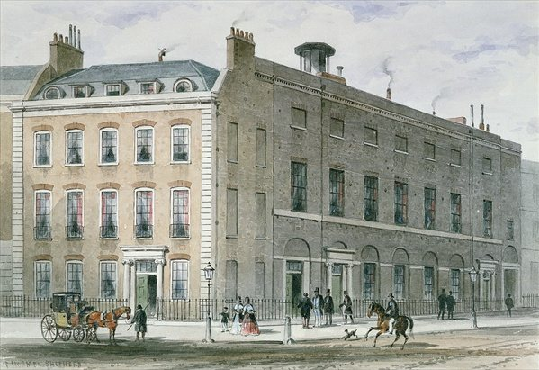
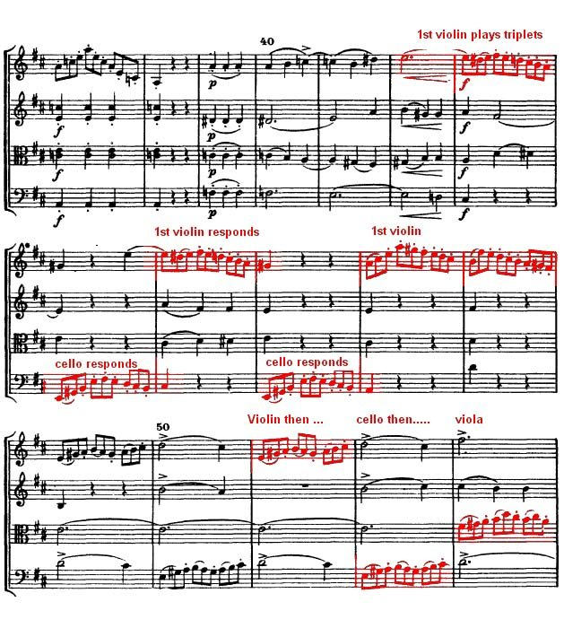
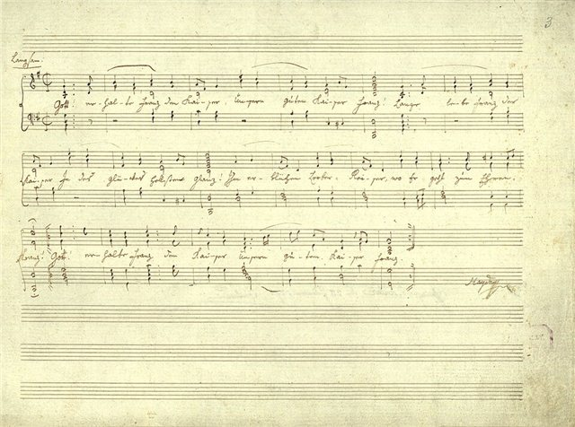

<!--
內容整理自本機筆記〈海頓主要曲目〉（D:\Books\md\音樂\海頓主要曲目.md，網頁版在知識圖譜的「9-2.曲目」），做法比照「貝多芬主要曲目」。
- 每首作品一則事件，日期採「創作時間」（多年創作的作品以區間呈現；「年代」以十年計、「世紀」以百年計，修訂或出版年份只寫在顯示文字裡），事件顏色依筆記的類別段落區分：交響曲、弦樂四重奏、鋼琴奏鳴曲與鍵盤作品、協奏曲、清唱劇與神劇、彌撒曲與其他宗教音樂、鋼琴三重奏與室內樂、歌劇。
- 「約」、「前後」、修訂、出版等不是單純年份的寫法，以原文作為顯示文字。
- 作品編號是目錄編號，不等於創作順序，時間軸依創作時間排序。
- 時期依筆記「依創作年代觀察海頓的音樂發展」的三段。
- 筆記「最值得優先聆聽」清單中的作品另註明順序。
- 以 follows 排在「海頓生平」之後；生平事件見該時間軸。
圖片來源（皆為 Wikimedia Commons 公有領域作品，多為手稿、初版樂譜與首演海報；封面為《皇帝讚歌》手稿（與海頓生平共用）；註明「共用」者沿用生平時間軸的圖片）：
- haydn-1791-london.jpg（倫敦漢諾瓦廣場音樂廳，《驚愕》交響曲1792年在此首演（與海頓生平共用））
- haydn-1772-op20.jpg（Op. 20 四重奏的樂譜片段，標出各聲部輪流擔任主角（與海頓生平共用））
- haydn-1797-kaiserlied.jpg（《皇帝讚歌》手稿，《皇帝》四重奏第二樂章即以此為主題（與海頓生平共用））
-->

# Periods
- 1750 ~ 1769 | 早期探索 | #2f9e44
  代表曲目：早期交響曲、Op. 1 弦樂四重奏、早期協奏曲。海頓逐步建立古典器樂的結構與樂章布局，並在宮廷環境中發展自己的創作風格。
- 1770 ~ 1789 | 成熟與實驗 | #1971c2
  代表曲目：《告別》交響曲、Op. 20 四重奏、Op. 33 四重奏、《熊》交響曲。音樂表現更具戲劇性，並大量運用動機發展、對位與幽默性的音樂效果。
- 1790 ~ 1803 | 晚期巔峰 | #862e9c
  代表曲目：倫敦交響曲、《創世紀》、《四季》、Op. 76 四重奏、晚期鋼琴奏鳴曲。作品規模、管弦樂色彩與情感深度都進一步提升，充分展現古典樂派成熟的形式與表達能力。

# Events

## 1761 | Hob. I:6 第 6 號交響曲《早晨》（Le Matin） {color=#c92a2a}
類別：交響曲（交響曲）。

## 1761 | Hob. I:7 第 7 號交響曲《中午》（Le Midi） {color=#c92a2a}
類別：交響曲（交響曲）。

## 1761 | Hob. I:8 第 8 號交響曲《傍晚》（Le Soir） {color=#c92a2a}
類別：交響曲（交響曲）。

## 1764 | Hob. I:22 第 22 號交響曲《哲學家》（Der Philosoph） {color=#c92a2a}
類別：交響曲（交響曲）。

## 1768 | Hob. I:26 第 26 號交響曲《哀悼》（Lamentatione） {color=#c92a2a label="約1768"}
類別：交響曲（交響曲）。

## 1765 | Hob. I:31 第 31 號交響曲《號角信號》（Hornsignal） {color=#c92a2a}
類別：交響曲（交響曲）。

## 1772 | Hob. I:45 第 45 號交響曲《告別》（Farewell） {color=#c92a2a}
類別：交響曲（交響曲）。入門推薦聆聽第 2 首。

## 1768 | Hob. I:49 第 49 號交響曲《受難》（La Passione） {color=#c92a2a}
類別：交響曲（交響曲）。

## 1786 | Hob. I:82 第 82 號交響曲《熊》（The Bear） {color=#c92a2a}
類別：交響曲（交響曲）。

## 1785 | Hob. I:83 第 83 號交響曲《母雞》（The Hen） {color=#c92a2a}
類別：交響曲（交響曲）。

## 1785 ~ 1786 | Hob. I:85 第 85 號交響曲《王后》（La Reine） {color=#c92a2a label="約1785–1786"}
類別：交響曲（交響曲）。

## 1789 | Hob. I:92 第 92 號交響曲《牛津》（Oxford） {color=#c92a2a}
類別：交響曲（交響曲）。

## 1791 | Hob. I:94 第 94 號交響曲《驚愕》（Surprise） {color=#c92a2a}

類別：交響曲（交響曲）。入門推薦聆聽第 1 首。

## 1791 | Hob. I:96 第 96 號交響曲《奇蹟》（The Miracle） {color=#c92a2a}
類別：交響曲（交響曲）。

## 1793 ~ 1794 | Hob. I:100 第 100 號交響曲《軍隊》（Military） {color=#c92a2a}
類別：交響曲（交響曲）。

## 1793 ~ 1794 | Hob. I:101 第 101 號交響曲《時鐘》（The Clock） {color=#c92a2a}
類別：交響曲（交響曲）。入門推薦聆聽第 3 首。

## 1795 | Hob. I:103 第 103 號交響曲《鼓聲》（Drumroll） {color=#c92a2a}
類別：交響曲（交響曲）。

## 1795 | Hob. I:104 第 104 號交響曲《倫敦》（London） {color=#c92a2a}
類別：交響曲（交響曲）。入門推薦聆聽第 4 首。

## 1755 ~ 1757 | Hob. III:1，Op. 1 No. 1 降 B 大調弦樂四重奏《狩獵》 {color=#1971c2 label="約1755–1757"}
類別：弦樂四重奏（弦樂四重奏）。

## 1769 | Hob. III:17，Op. 9 No. 2 降 E 大調弦樂四重奏 {color=#1971c2 label="約1769"}
類別：弦樂四重奏（弦樂四重奏）。

## 1772 | Hob. III:32，Op. 20 No. 4 D 大調弦樂四重奏 {color=#1971c2}

類別：弦樂四重奏（弦樂四重奏）。

## 1772 | Hob. III:33，Op. 20 No. 5 F 小調弦樂四重奏 {color=#1971c2}
類別：弦樂四重奏（弦樂四重奏）。

## 1781 | Hob. III:37，Op. 33 No. 1 降 B 大調弦樂四重奏 {color=#1971c2}
類別：弦樂四重奏（弦樂四重奏）。

## 1781 | Hob. III:38，Op. 33 No. 2 降 E 大調弦樂四重奏《玩笑》 {color=#1971c2}
類別：弦樂四重奏（弦樂四重奏）。入門推薦聆聽第 6 首。

## 1781 | Hob. III:39，Op. 33 No. 3 C 大調弦樂四重奏《鳥》 {color=#1971c2}
類別：弦樂四重奏（弦樂四重奏）。

## 1788 | Hob. III:57，Op. 54 No. 2 C 大調弦樂四重奏 {color=#1971c2}
類別：弦樂四重奏（弦樂四重奏）。

## 1788 | Hob. III:61，Op. 55 No. 2 F 小調弦樂四重奏《剃刀》 {color=#1971c2}
類別：弦樂四重奏（弦樂四重奏）。

## 1797 | Hob. III:75，Op. 76 No. 1 G 大調弦樂四重奏 {color=#1971c2}
類別：弦樂四重奏（弦樂四重奏）。

## 1797 | Hob. III:76，Op. 76 No. 2 D 小調弦樂四重奏《五度》 {color=#1971c2}
類別：弦樂四重奏（弦樂四重奏）。

## 1797 | Hob. III:77，Op. 76 No. 3 C 大調弦樂四重奏《皇帝》 {color=#1971c2}

類別：弦樂四重奏（弦樂四重奏）。入門推薦聆聽第 5 首。

## 1797 | Hob. III:78，Op. 76 No. 4 降 B 大調弦樂四重奏《日出》 {color=#1971c2}
類別：弦樂四重奏（弦樂四重奏）。

## 1797 | Hob. III:79，Op. 76 No. 5 D 大調弦樂四重奏 {color=#1971c2}
類別：弦樂四重奏（弦樂四重奏）。

## 1797 | Hob. III:80，Op. 76 No. 6 降 E 大調弦樂四重奏 {color=#1971c2}
類別：弦樂四重奏（弦樂四重奏）。

## 1799 | Hob. III:81，Op. 77 No. 1 G 大調弦樂四重奏 {color=#1971c2}
類別：弦樂四重奏（弦樂四重奏）。

## 1799 | Hob. III:82，Op. 77 No. 2 F 大調弦樂四重奏 {color=#1971c2}
類別：弦樂四重奏（弦樂四重奏）。

## 1803 | Hob. III:83，Op. 103 G 小調弦樂四重奏（未完成） {color=#1971c2}
類別：弦樂四重奏（弦樂四重奏）。

## 1771 | Hob. XVI:20 C 小調鋼琴奏鳴曲 {color=#e67700 label="約1771"}
類別：鋼琴奏鳴曲（鋼琴奏鳴曲與鍵盤作品）。

## 1782 | Hob. XVI:34 E 小調鋼琴奏鳴曲 {color=#e67700 label="約1782"}
類別：鋼琴奏鳴曲（鋼琴奏鳴曲與鍵盤作品）。

## 1780 | Hob. XVI:35 C 大調鋼琴奏鳴曲 {color=#e67700 label="約1780"}
類別：鋼琴奏鳴曲（鋼琴奏鳴曲與鍵盤作品）。

## 1780 | Hob. XVI:37 D 大調鋼琴奏鳴曲 {color=#e67700 label="約1780"}
類別：鋼琴奏鳴曲（鋼琴奏鳴曲與鍵盤作品）。

## 1784 | Hob. XVI:40 G 大調鋼琴奏鳴曲 {color=#e67700}
類別：鋼琴奏鳴曲（鋼琴奏鳴曲與鍵盤作品）。

## 1789 ~ 1790 | Hob. XVI:49 降 E 大調鋼琴奏鳴曲 {color=#e67700 label="約1789–1790"}
類別：鋼琴奏鳴曲（鋼琴奏鳴曲與鍵盤作品）。

## 1794 ~ 1795 | Hob. XVI:50 C 大調鋼琴奏鳴曲 {color=#e67700 label="約1794–1795"}
類別：鋼琴奏鳴曲（鋼琴奏鳴曲與鍵盤作品）。

## 1794 | Hob. XVI:52 降 E 大調鋼琴奏鳴曲 {color=#e67700}
類別：鋼琴奏鳴曲（鋼琴奏鳴曲與鍵盤作品）。

## 1793 | Hob. XVII:6 F 小調變奏曲 {color=#e67700 label="約1793"}
類別：鍵盤變奏曲（鋼琴奏鳴曲與鍵盤作品）。

## 1761 ~ 1765 | Hob. VIIb:1 C 大調第一號大提琴協奏曲 {color=#2f9e44 label="約1761–1765"}
類別：大提琴協奏曲（協奏曲）。入門推薦聆聽第 7 首。

## 1760 ~ 1769 | Hob. VIIa:1 C 大調第一號小提琴協奏曲 {color=#2f9e44 label="約1760年代"}
類別：小提琴協奏曲（協奏曲）。

## 1780 ~ 1789 | Hob. XVIII:11 D 大調鋼琴協奏曲 {color=#2f9e44 label="約1780年代"}
類別：鍵盤協奏曲（協奏曲）。

## 1783 | Hob. VIIb:2 D 大調第二號大提琴協奏曲 {color=#2f9e44}
類別：大提琴協奏曲（協奏曲）。

## 1760 ~ 1769 | Hob. VIIa:4 G 大調第四號小提琴協奏曲 {color=#2f9e44 label="約1760年代"}
類別：小提琴協奏曲（協奏曲）。

## 1796 | Hob. VIIe:1 降 E 大調小號協奏曲 {color=#2f9e44}
類別：小號協奏曲（協奏曲）。入門推薦聆聽第 8 首。

## 1756 ~ 1760 | Hob. XVIII:1 C 大調鍵盤協奏曲 {color=#2f9e44 label="約1756–1760"}
類別：鍵盤協奏曲（協奏曲）。

## 1774 ~ 1775 | Hob. XXI:1 《托比亞歸來》（Il ritorno di Tobia） {color=#862e9c}
類別：神劇（清唱劇與神劇）。

## 1796 ~ 1798 | Hob. XXI:2 《創世紀》（Die Schöpfung） {color=#862e9c}
類別：神劇（清唱劇與神劇）。入門推薦聆聽第 9 首。

## 1799 ~ 1801 | Hob. XXI:3 《四季》（Die Jahreszeiten） {color=#862e9c}
類別：神劇（清唱劇與神劇）。入門推薦聆聽第 10 首。

## 1786 ~ 1787 | Hob. XX:1 《基督受難七言》（Die sieben letzten Worte unseres Erlösers am Kreuze） {color=#862e9c}
類別：宗教器樂作品；另有合唱版本（清唱劇與神劇）。

## 1766 | Hob. XXII:5 C 大調《塞倫彌撒》（Missa Cellensis） {color=#0c8599}
類別：彌撒曲（彌撒曲與其他宗教音樂）。

## 1772 | Hob. XXII:6 G 大調《聖尼古拉彌撒》（Missa Sancti Nicolai） {color=#0c8599}
類別：彌撒曲（彌撒曲與其他宗教音樂）。

## 1796 | Hob. XXII:9 C 大調《戰時彌撒》（Missa in tempore belli） {color=#0c8599}
類別：彌撒曲（彌撒曲與其他宗教音樂）。

## 1796 | Hob. XXII:10 降 B 大調《聖伯納德彌撒》（Heiligmesse） {color=#0c8599}
類別：彌撒曲（彌撒曲與其他宗教音樂）。

## 1798 | Hob. XXII:11 D 小調《納爾遜彌撒》（Nelson Mass） {color=#0c8599}
類別：彌撒曲（彌撒曲與其他宗教音樂）。

## 1799 | Hob. XXII:12 降 B 大調《特蕾莎彌撒》（Theresienmesse） {color=#0c8599}
類別：彌撒曲（彌撒曲與其他宗教音樂）。

## 1801 | Hob. XXII:13 降 B 大調《創世紀彌撒》（Schöpfungsmesse） {color=#0c8599}
類別：彌撒曲（彌撒曲與其他宗教音樂）。

## 1802 | Hob. XXII:14 降 B 大調《管樂彌撒》（Harmoniemesse） {color=#0c8599}
類別：彌撒曲（彌撒曲與其他宗教音樂）。

## 1795 | Hob. XV:25 G 大調鋼琴三重奏《吉普賽》（Gypsy Rondo） {color=#5f3dc4}
類別：鋼琴三重奏（鋼琴三重奏與室內樂）。

## 1795 | Hob. XV:27 C 大調鋼琴三重奏 {color=#5f3dc4 label="約1795"}
類別：鋼琴三重奏（鋼琴三重奏與室內樂）。

## 1795 | Hob. XV:28 E 大調鋼琴三重奏 {color=#5f3dc4 label="約1795"}
類別：鋼琴三重奏（鋼琴三重奏與室內樂）。

## 1795 | Hob. XV:29 降 E 大調鋼琴三重奏 {color=#5f3dc4 label="約1795"}
類別：鋼琴三重奏（鋼琴三重奏與室內樂）。

## 1760 ~ 1779 | Hob. XI 系列 巴里頓三重奏（Baryton Trios） {color=#5f3dc4 label="約1760–1770年代"}
類別：室內樂（鋼琴三重奏與室內樂）。

## 1773 | Hob. XXVIII:5 《受騙的不忠》（L'infedeltà delusa） {color=#a61e4d}
類別：喜歌劇（歌劇）。

## 1775 | Hob. XXVIII:6 《意外的相逢》（L'incontro improvviso） {color=#a61e4d}
類別：喜歌劇（歌劇）。

## 1777 | Hob. XXVIII:7 《月球世界》（Il mondo della luna） {color=#a61e4d}
類別：喜歌劇（歌劇）。

## 1779 | Hob. XXVIII:9 《荒島》（L'isola disabitata） {color=#a61e4d}
類別：歌劇（歌劇）。

## 1780 | Hob. XXVIII:10 《忠貞獲得回報》（La fedeltà premiata） {color=#a61e4d}
類別：歌劇（歌劇）。

## 1783 | Hob. XXVIII:12 《阿爾米達》（Armida） {color=#a61e4d}
類別：英雄歌劇（歌劇）。

## 1791 ~ 1794 | Hob. XXVIII:13 《哲學家的靈魂，或俄耳甫斯與尤麗狄茜》（L'anima del filosofo） {color=#a61e4d}
類別：歌劇（歌劇）。
