<!--
內容整理自本機筆記〈海明威生平大事記〉（圖表\海明威生平大事記.md）與中文維基百科「歐內斯特·海明威」條目（CC BY-SA 4.0），以台灣用語改寫摘要。
https://zh.wikipedia.org/zh-tw/欧内斯特·海明威
史料與日期說明：
- 書名：依筆記與台灣常見譯名作《太陽照常升起》（又譯《太陽依舊升起》，維基百科作《妾似朝陽又照君》）、《戰地春夢》、《戰地鐘聲》、《老人與海》、《渡河入林》；人名依台灣常見譯名作葛楚·史坦、費茲傑羅（《大亨小傳》）。
- 筆記把他前往巴黎、成為《多倫多星報》通訊記者都寫在1921年；他1920年起就為《多倫多星報》撰稿，1921年9月與海德莉結婚後，12月才抵達巴黎，此處分寫。
- 維基百科稱他「1939年至1960年間在古巴定居」；筆記寫1940年前後轉向古巴。他1939年起租住芬卡·維希亞莊園，1940年買下，此處採1939年。
- 1922年海德莉在巴黎里昂車站遺失裝滿手稿的手提箱、1925年結識費茲傑羅、1944年隨盟軍目睹諾曼第登陸與巴黎解放、1954年非洲墜機後各國報紙誤登訃聞、1959年古巴革命、1960年底接受住院治療、身後出版的《流動的饗宴》等細節，係依維基百科與一般公認的史實補充。
- 父親與他本人的自殺只陳述事實，不描寫方式與細節；戰爭只作背景交代。
圖片來源（皆為 Wikimedia Commons 公有領域／CC0 作品）：
- hem-cover.jpg：ErnestHemingway.jpg
- hem-baby.jpg：ErnestHemingwayBabyPicture.jpg
- hem-milan.jpg：Ernest Hemingway recuperates from wounds in Milan, 1918.jpg
- hem-passport.jpg：Ernest Hemingway 1923 passport photo.jpg
- hem-pamplona.jpg：HemingwayLoeb.jpg
- hem-pauline.jpg：Ernest and Pauline Hemingway, Paris, 1927.jpg
- hem-keywest.jpg：Ernest Hemingway Fishing, Key West, 1928.jpg
- hem-spain.jpg：Ernest Hemingway Visiting 15th International Brigade, December, 1937.jpg
- hem-finca.jpg：Ernest Hemingway at the Finca Vigia, Cuba 1946 - NARA - 192660.jpg
- hem-kittens.jpg：Ernest Hemingway with sons Patrick and Gregory with kittens in Finca Vigia, Cuba.jpg
- hem-lanham.jpg：Hemlatham-1.jpg
- hem-yacht.jpg：Ernest Hemingway 1950.jpg
- hem-oldman.jpg：The Old Man and the Sea (1952) front cover, first edition.jpg
- hem-safari.jpg：Ernest and Mary Hemingway on safari, 1953-54.jpg
-->

# Periods
- 1899 ~ 1917 | 奧克帕克與密西根的少年 | #f08c00
  生於芝加哥郊區的醫生家庭，夏天在密西根州的瓦隆湖畔跟父親學釣魚、打獵，高中時在校刊上寫作。
- 1917 ~ 1921 | 記者與戰爭的洗禮 | #495057
  沒有上大學，到《堪薩斯城星報》當記者，隨後志願赴義大利開救護車，在前線受重傷，戀愛又失戀。
- 1921 ~ 1928 | 巴黎與「迷惘的一代」 | #1c7ed6
  帶著新婚妻子到巴黎當特派記者，在葛楚·史坦、龐德、費茲傑羅等人的圈子裡磨練文字，以《太陽照常升起》一舉成名。
- 1928 ~ 1939 | 西嶼、非洲與西班牙 | #e67700
  定居佛羅里達州的西嶼，寫出《戰地春夢》，到非洲狩獵、到西班牙看鬥牛，並親赴西班牙內戰前線採訪。
- 1939 ~ 1960 | 古巴的瞭望山莊 | #087f5b
  在哈瓦那郊外定居二十年，寫出《戰地鐘聲》與《老人與海》，奪得普立茲獎與諾貝爾文學獎，健康卻因傷病每況愈下。
- 1960 ~ 1961 | 凱徹姆的最後歲月 | #862e9c
  離開古巴，定居愛達荷州的凱徹姆，身心狀況急遽惡化，不久後辭世。

# Events

## 1899-07-21 | 出生@奧克帕克
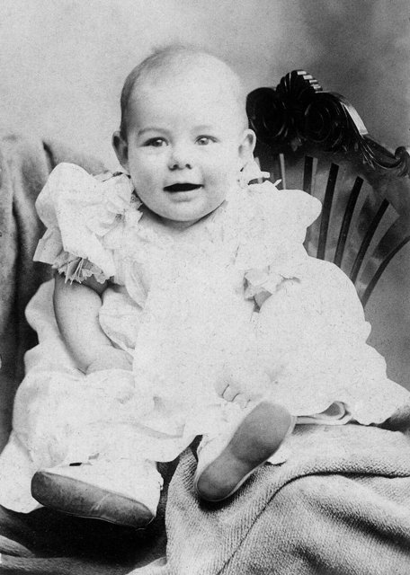
生於芝加哥西郊的奧克帕克，是家中六個孩子中的老二、長子。父親克拉倫斯是醫生，熱愛打獵、釣魚與自然觀察；母親葛蕾絲是聲樂家，希望兒子學大提琴。母親還曾把他打扮成和姊姊一樣的女孩模樣，稱兩人是「雙胞胎」，他日後對母親始終心懷怨恨。

## 1900 | 瓦隆湖畔的夏天 {label=1900～1916年}
每年夏天全家都到密西根州北部瓦隆湖畔的度假小屋。父親教他釣魚、打獵、划獨木舟、在森林裡露營，他也在附近的印第安人部落見識到生與死。這些經驗後來成為他筆下尼克·亞當斯系列短篇小說的背景，例如〈大雙心河〉。

## 1913-09 | 奧克帕克高中
進入奧克帕克與里弗福里斯特高中，打拳擊、踢美式足球，英文成績特別優異。他為校刊撰寫新聞與短篇故事，模仿當時流行的幽默專欄作家林·拉德納的筆調，這是他第一次發表作品。

## 1917-10 | 《堪薩斯城星報》記者
沒有上大學，18歲到《堪薩斯城星報》當見習記者，跑警察局、醫院與火車站的新聞。報社的寫作守則要求「用短句、短的第一段、有力的英文、肯定而非否定的說法」，他說這是他學過最好的寫作規則，奠定了他日後簡潔的文風。

## 1918-07-08 | 義大利前線負傷
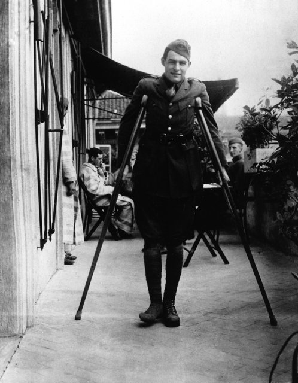
因視力不佳無法從軍，他加入美國紅十字會的救護隊前往義大利。到前線不久，他在皮亞韋河畔分送巧克力與香菸給士兵時，被奧軍的迫擊砲擊中，雙腿嵌入兩百多片碎片。他負傷後仍把一名受傷的義大利士兵拖到安全處，獲義大利政府頒發銀製英勇勳章，當時他還差兩週才滿19歲。在米蘭養傷時，他愛上了比他大七歲的美國護士艾格妮絲·馮·庫羅斯基。

## 1919-03 | 返鄉與失戀
1月以戰爭英雄的身分回到奧克帕克，3月卻收到艾格妮絲的信，說她已愛上一位義大利軍官。這次失戀讓他大受打擊。他在家中難以適應平靜的生活，後來在短篇〈士兵之家〉中寫下退伍軍人與家庭格格不入的心情。

## 1920-01 | 《多倫多星報》
到加拿大多倫多工作，開始為《多倫多星報》撰寫專欄與報導。同年秋天在芝加哥結識了比他大八歲的海德莉·理查森，作家舍伍德·安德森建議他：要當作家，就去巴黎。

## 1921-12 | 前往巴黎
9月與海德莉結婚，12月以《多倫多星報》駐歐特派記者的身分抵達巴黎。他們住在拉丁區簡陋的公寓，他靠著安德森的介紹信結識了作家葛楚·史坦與詩人龐德，在他們的指點下磨練文字；他也常到莎士比亞書店借書。他後來把這段清貧而快樂的歲月寫成回憶錄《流動的饗宴》。

## 1922-12 | 遺失手稿
海德莉帶著他幾乎所有的手稿要到瑞士與他會合，裝稿件的手提箱卻在巴黎里昂車站被偷走，連複寫本也在裡面，他多年的心血幾乎全部化為烏有。他後來說，這反而逼他重新開始，寫出更好的作品。

## 1923-10 | 第一本書與長子出生
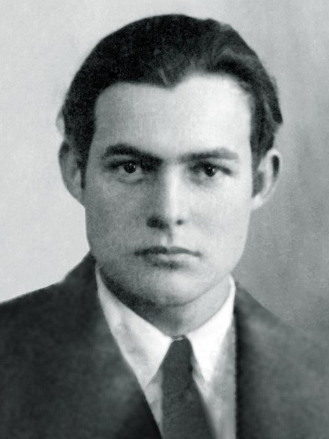
出版第一本書《三個故事和十首詩》，只印了三百本。同年10月長子約翰在多倫多出生，葛楚·史坦當了孩子的教母。為了專心寫作，他隔年辭去報社工作，回到巴黎過著更拮据的日子。

## 1925-10 | 《我們的時代》與費茲傑羅
在美國出版短篇小說集《我們的時代》，以簡短的戰爭片段穿插尼克·亞當斯的成長故事，簡潔的風格開始受到文壇注意。同年4月，他在巴黎的酒吧結識剛出版《大亨小傳》的費茲傑羅，兩人成為好友與對手，費茲傑羅還向自己的編輯柏金斯推薦了他。

## 1926-10 | 《太陽照常升起》
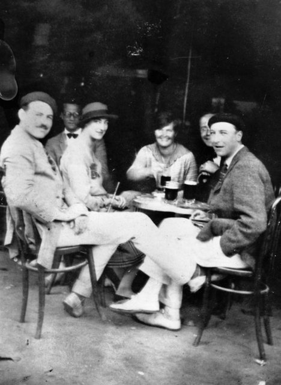
出版第一部長篇小說《太陽照常升起》，以前一年到西班牙潘普洛納參加奔牛節的經歷為藍本，寫一群在戰爭中受傷、在巴黎與西班牙之間飲酒、看鬥牛、找不到人生方向的英美青年。書前引用葛楚·史坦的話「你們都是迷惘的一代」，這個詞從此成為一整代戰後作家的代稱。

## 1927-05 | 與寶琳再婚
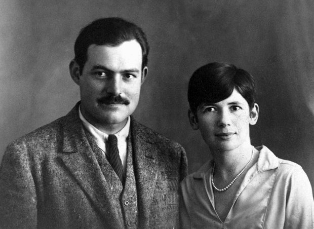
與海德莉離婚，再娶時尚雜誌記者、家境富裕的寶琳·菲佛，並為此改信天主教。他把《太陽照常升起》的版稅全部給了海德莉。

## 1928-12 | 父親去世
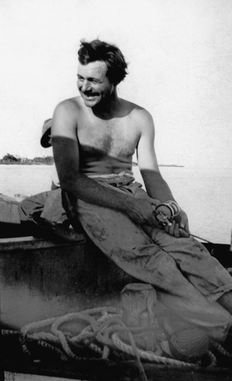
年初，他帶著懷孕的寶琳回到美國，定居佛羅里達州最南端的西嶼。12月，長年受糖尿病與財務困境所苦的父親在奧克帕克自殺身亡，這件事對他是沉重的打擊，他日後也常在作品中思索死亡與勇氣。

## 1929-09 | 《戰地春夢》
出版以自己在義大利的經歷為素材的《戰地春夢》（又譯《永別了，武器》）。美國救護隊軍官亨利與英國護士凱薩琳在戰火中相戀，他逃離崩潰的戰線，兩人逃到瑞士，凱薩琳卻在生產時死去。小說結尾他改寫了三十九次，才找到滿意的版本。這本書成為暢銷書，讓他在經濟上獨立。

## 1932-09 | 《午後之死》
出版討論西班牙鬥牛的非小說作品《午後之死》，他把鬥牛看成是勇氣、技巧與死亡交織的悲劇藝術。書中他提出著名的「冰山理論」：冰山之所以雄偉，是因為只有八分之一露出水面——作家如果真正了解所寫的東西，就可以省略其餘部分，讓讀者自己感受到。在西嶼，他常駕船出海釣大魚，在「邋遢喬」酒吧與朋友喝酒。

## 1933-11 | 非洲狩獵
到東非的肯亞與坦尚尼亞展開狩獵之旅，寫成紀實作品《非洲的青山》，並把旅途中的見聞化為短篇名作〈吉力馬札羅山的雪〉與〈法蘭西斯·麥康伯短暫的幸福生活〉。

## 1937-03 | 採訪西班牙內戰
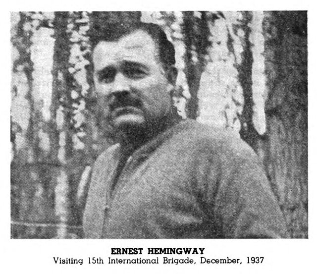
以北美報業聯盟特派記者的身分前往西班牙，報導共和政府對抗佛朗哥將軍叛軍的內戰，並協助拍攝紀錄片《西班牙大地》。他與同為記者的瑪莎·蓋爾洪在戰地相戀，也因對共和派內部問題的看法與老友多斯·帕索斯決裂。

## 1939-04 | 定居古巴瞭望山莊
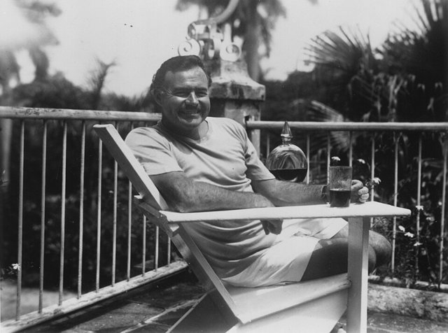
與寶琳的婚姻破裂後，他搬到古巴哈瓦那郊外的「瞭望山莊」（芬卡·維希亞），隔年買下這座莊園，此後在古巴住了二十年，自稱是「普通的古巴人」。

## 1940-10 | 《戰地鐘聲》
出版以西班牙內戰為背景的《戰地鐘聲》，寫美國志願者羅伯特·喬丹奉命與游擊隊一起炸毀一座橋，在三天之中經歷愛情、恐懼與犧牲。書名取自英國詩人鄧恩的詩句：「不要問喪鐘為誰而鳴，它為你而鳴。」小說成為他最暢銷的作品之一。11月，他與瑪莎結婚。

## 1942-06 | 在加勒比海巡邏
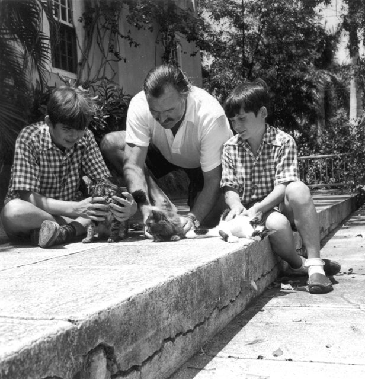
美國參戰後，他把自己的漁船「皮拉爾號」改裝成巡邏船，帶著朋友在古巴北岸的海域搜尋德國潛艇的蹤跡，雖然始終沒有遇上潛艇，美國聯邦調查局卻從此開始注意他。

## 1944-06 | 諾曼第登陸與巴黎解放
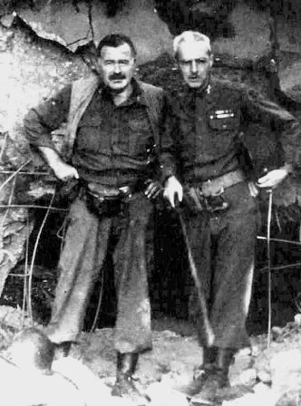
以《科利爾週刊》戰地記者的身分前往歐洲，6月6日在登陸艇上目睹諾曼第登陸，之後隨美軍步兵師推進。8月巴黎解放時，他帶著一群法國游擊隊員「解放」了麗池飯店的酒吧。他也因為以記者身分攜帶武器、指揮游擊隊而一度接受調查。在倫敦，他結識了記者瑪麗·威爾許。

## 1946-03 | 與瑪麗結婚
與瑪莎離婚後，與瑪麗·威爾許結婚，這是他第四次、也是最後一次婚姻。瑪麗陪伴他度過了晚年。

## 1950-09 | 《渡河入林》
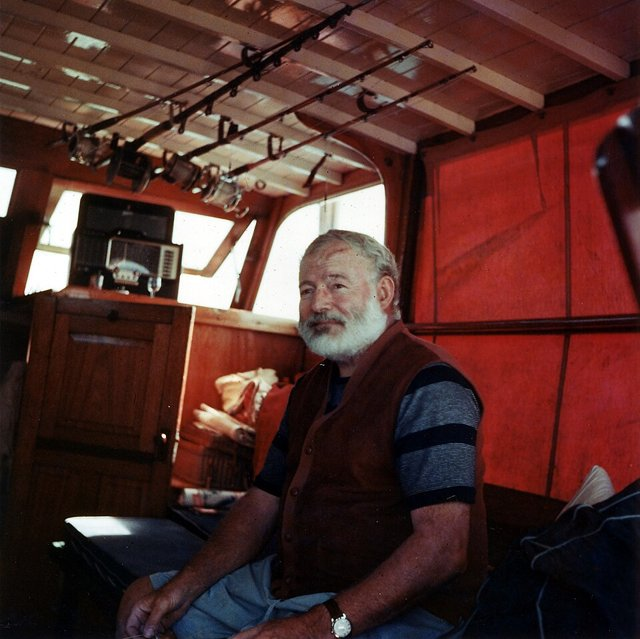
出版以戰後威尼斯為背景的《渡河入林》，寫一位垂死的美國上校與年輕義大利女伯爵的戀情。評論界幾乎一致惡評，認為他已經江郎才盡。

## 1952-09 | 《老人與海》
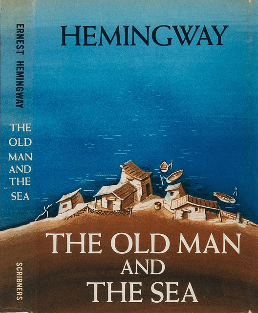
《生活》雜誌一次刊出中篇小說《老人與海》全文，兩天內賣出五百多萬本。古巴老漁夫聖地牙哥連續八十四天沒有捕到魚，獨自出海後與一條巨大的馬林魚搏鬥了三天，好不容易捕到牠，回程時卻被鯊魚啃得只剩骨架。書中名句「一個人可以被毀滅，但不能被打敗」打動了無數讀者，他也因此重回文壇巔峰。

## 1953-05 | 普立茲小說獎
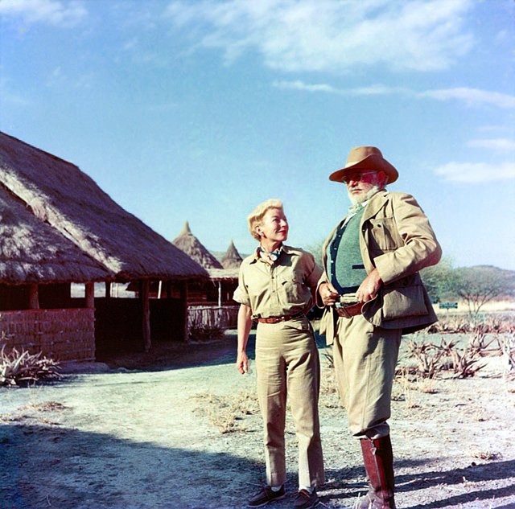
以《老人與海》獲得普立茲小說獎。同年他帶著瑪麗再度前往東非狩獵。

## 1954-01 | 非洲兩次墜機
在烏干達搭乘觀光小飛機，兩天內接連發生兩次墜機，第二次他用頭撞開著火的機門才逃出來，造成頭骨骨折、內臟受傷。世界各地的報紙一度誤登他的訃聞，他後來在病床上讀著自己的訃聞自娛。這兩次事故嚴重損害了他的健康，此後他長年受到疼痛折磨。

## 1954-10 | 諾貝爾文學獎
獲得諾貝爾文學獎，表彰他「精通敘事藝術，近作《老人與海》尤其突出，以及對當代文體的影響」。他因傷無法前往斯德哥爾摩領獎，由美國駐瑞典大使代讀他的得獎感言：「寫作，在最好的時候，是一種孤寂的生活……作家應當獨自工作。」

## 1959-01 | 古巴革命
卡斯楚領導的革命推翻了巴蒂斯塔政權，他起初抱持同情態度，也曾與卡斯楚會面。同年他在愛達荷州的凱徹姆買下房子，並到西班牙追蹤兩位鬥牛士的對決，寫成《危險的夏天》。

## 1960-07 | 離開古巴
隨著美國與古巴關係惡化，他和瑪麗離開古巴，再也沒有回去，莊園裡的藏書、手稿與畫作都留在當地。他的健康急遽惡化，高血壓、肝病與憂鬱症纏身，常疑心自己遭到聯邦調查局監視（後來公開的檔案證實，聯邦調查局確實長期在注意他）。同年底他住進明尼蘇達州的梅約診所接受治療，記憶與寫作能力卻因此衰退。

## 1961-07-02 | 逝世@凱徹姆
在愛達荷州凱徹姆的家中自殺身亡，享年61歲，距離他62歲生日還有不到三週。他被安葬在凱徹姆的墓園。他死後，瑪麗整理他的遺稿，出版了回憶巴黎歲月的《流動的饗宴》等作品。他簡潔、節制、以對話與動作暗示情感的寫作風格，深刻影響了二十世紀的英語小說；古巴的瞭望山莊與西嶼的故居，今天都已成為紀念館。
