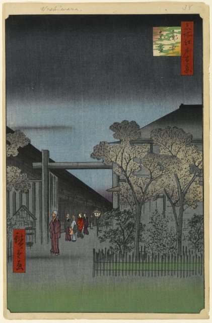
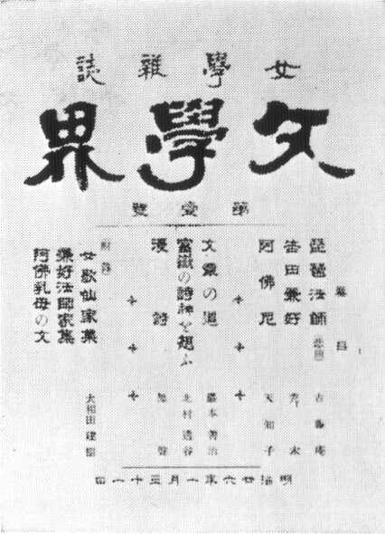
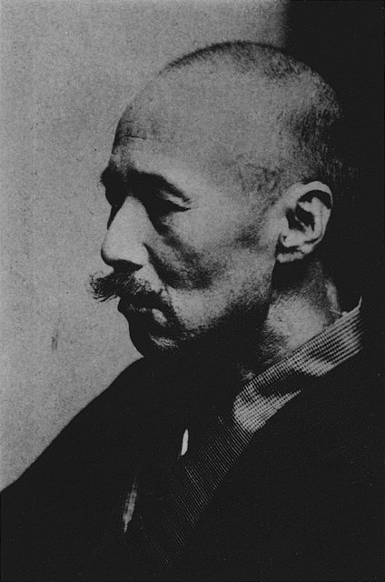

<!--
內容整理自 D:\Books\html\6-4.日本文學家\樋口一葉.html（沒有對應的 md 筆記），並整合中文維基百科〈樋口一葉〉條目，以自己的話改寫。
時期依生平歸納：士族之女、家道中落、拜師與出道、龍泉寺町的雜貨店、奇蹟的十四個月。
兩份資料出入與處理方式：
- 生卒：明治五年三月二十五日（西曆1872年5月2日）生於東京；1896年11月23日死於肺結核，兩份一致，得年24歲。
- 父親去世：頁面寫1889年，一般記載為1889年7月，照此。
- 拜師半井桃水：維基百科寫1891年，同年取「一葉」為筆名發表作品；一般記載她1892年3月在《武藏野》發表出道作《闇櫻》，這裡寫1891年拜師、1892年出道兩則。頁面說兩人的師生關係被傳為醜聞、後世說法不一，照頁面審慎寫法。
- 雜貨店：頁面與維基百科都寫1893年7月搬到下谷龍泉寺町開雜貨店，維基百科補充只經營九個月；1894年5月遷往本鄉丸山福山町（維基百科寫3月，一般記載為5月，只寫1894年）。
- 「奇蹟的十四個月」：頁面以1894年12月的《大年夜》為起點；《青梅竹馬》頁面寫1895–1896年連載，照此；1896年4月在《文藝俱樂部》一次刊出全文，受森鷗外等人激賞，依一般記載補充。維基百科寫「1895年9月……有『現代紫式部』之譽」，寫進1895年事件。
- 五千圓紙鈔：頁面寫2004年改版，維基百科補充2004年11月1日發行、是日本紙鈔上第一位女性人物（神功皇后的肖像早年曾用於明治初期紙幣，這裡照維基百科的說法寫「現行」紙鈔的第一位女性）。
- 人名與其他時間軸一致：森鷗外、紫式部。
圖片來源（皆為 Wikimedia Commons 公有領域／CC0 作品；註明「共用」者沿用其他時間軸已有的圖片）：
- hi-cover.jpg：Higuchi Ichiyo in 1895.jpg（樋口一葉，1895年）
- hi-yoshiwara.jpg：Brooklyn Museum - Dawn Inside the Yoshiwara No. 38 in One Hundred Views of Edo - Utagawa Hiroshige (Ando).jpg（歌川廣重〈吉原仲之町夜櫻〉，《名所江戶百景》）
- hi-bungakukai.jpg：Bungakukai(Meiji).jpg（《文學界》雜誌（明治時期））
- mo-1916.jpg：Mori Ogai in the atelier of Sculptor Takeishi Kozaburo in 1916.jpg（森鷗外，1916（與森鷗外生平時間軸共用））
-->

# Periods
- 1872-05-02 ~ 1889 | 士族之女 | #868e96
  生於東京下級士族家庭，本名奈津，從小喜愛讀書，入歌塾「萩之舍」學習和歌與古典文學。
- 1889 ~ 1893 | 家道中落與出道 | #1971c2
  父親事業失敗後去世，十七歲的一葉成為戶主，靠針線活與寫作養家，拜半井桃水學寫小說，以《闇櫻》出道。
- 1893 ~ 1894-12 | 龍泉寺町的雜貨店 | #e8590c
  為了生計搬到吉原附近開雜貨店，近距離觀察底層的生活，九個月後收掉店面。
- 1894-12 ~ 1896-11-23 | 奇蹟的十四個月 | #c2255c
  接連發表《大年夜》《青梅竹馬》《濁江》《十三夜》，受到文壇激賞，不久即因肺結核去世。

# Events

## 1872-05-02 | 出生於東京
樋口一葉生於東京府內幸町的東京府廳官舍，本名樋口奈津，也寫作夏子。父親樋口則義出身甲斐國的農家，幕末時買得武士身分，維新後在東京府任下級官吏，家境一度小康。

## 1886 | 入歌塾萩之舍
十四歲的一葉進入中島歌子主持的歌塾「萩之舍」，學習和歌與《源氏物語》等古典文學。同門多是上流社會的千金，出身寒微的她在其中格外自卑，卻在和歌上嶄露頭角。

## 1889 | 父親去世，成為戶主
父親投資的事業失敗後病逝，留下債務；長兄早在前一年去世，十七歲的一葉成為樋口家的戶主，與母親、妹妹靠洗衣、縫紉等零工度日。原本談好的婚約也因家道中落而被對方取消。

## 1891 | 拜半井桃水為師
同門學姊田邊花圃以小說賺得稿費，啟發一葉以寫作養家。她拜《朝日新聞》的記者兼通俗小說家半井桃水為師，並取「一葉」為筆名。兩人往來頻繁，在萩之舍引起閒話，一葉在1892年被迫與桃水斷絕往來；兩人關係的性質，後世說法不一。

## 1892 | 出道作《闇櫻》
一葉在半井桃水創辦的雜誌《武藏野》上發表短篇小說《闇櫻》，正式出道。此後她的作品陸續登上《都之花》《文學界》，結識了島崎藤村、平田禿木等《文學界》同人。

## 1893-07 | 在吉原附近開雜貨店

稿費不足以維持生活，一家人搬到下谷龍泉寺町（今台東區竜泉），在吉原遊廓附近開了一家賣零食與日用品的小店。店只開了九個月，但她在這裡看到的遊廓周邊孩子與底層女性，日後成為《青梅竹馬》的素材。1894年，一家人收掉店面，搬到本鄉丸山福山町。

## 1894-12 | 《大年夜》

一葉在《文學界》發表《大年夜》，寫一名女傭在除夕夜為了替貧困的叔父籌錢，偷了主人家的錢。這篇作品標誌她創作高峰的開始，此後約十四個月間，她接連寫出所有的代表作，被後人稱為「奇蹟的十四個月」。

## 1895-01 | 連載《青梅竹馬》
一葉在《文學界》連載《青梅竹馬》（至1896年1月），以吉原遊廓旁的孩子為主角，寫注定要成為妓女的少女美登利與寺廟之子信如之間若即若離的感情，細膩描繪孩子們即將告別童年的時刻。

## 1895-09 | 《濁江》與《十三夜》
一葉在《文藝俱樂部》發表《濁江》，寫銘酒屋（私娼館）女子阿力的命運；年底又發表《十三夜》，寫一名受丈夫冷落的妻子想要離婚的心境。她的擬古文體與對女性處境的描寫，讓她被譽為「現代紫式部」。

## 1896-04 | 《青梅竹馬》受森鷗外激賞

《青梅竹馬》在《文藝俱樂部》一次刊出全文，森鷗外、幸田露伴等人在評論雜誌上大加讚賞，鷗外甚至說不惜被人譏為一葉的信徒也要稱讚它。一葉一躍成為文壇的焦點，但這時她的身體已經出現異狀。

## 1896-11-23 | 病逝
一葉在8月被診斷出肺結核，11月23日在本鄉丸山福山町的家中去世，得年24歲。她留下的日記在死後出版，記錄了她在貧困中寫作的生活，也成為研究明治女性處境的重要史料。

## 2004-11-01 | 五千圓紙鈔
日本銀行發行新版五千日圓紙鈔，以樋口一葉為肖像，她成為現行日本紙鈔上的第一位女性人物。這項選擇被視為對明治時期女性寫作者的一種遲來肯定。
