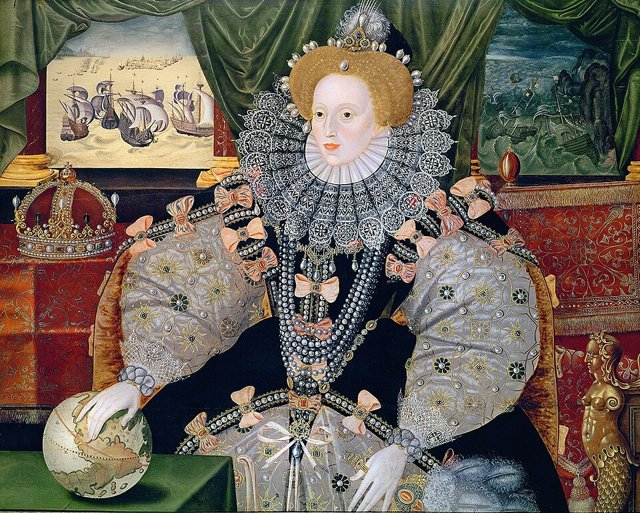
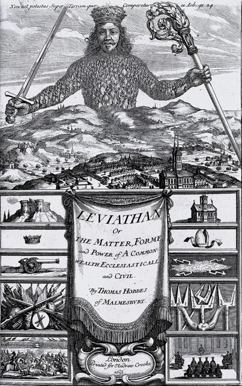
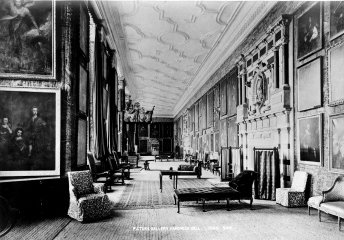

<!--
內容整理自本機筆記〈霍布斯生平大事記（1588–1679）〉（圖表\霍布斯生平大事記（1588–1679）.md）與中文維基百科「托馬斯·霍布斯」條目（CC BY-SA 4.0），以台灣用語改寫摘要。
https://zh.wikipedia.org/zh-tw/托马斯·霍布斯
史料與日期說明：
- 牛津的學院：維基百科寫「莫德林學院」（Magdalen College），他實際就讀的是莫德林學堂（Magdalen Hall，後來的赫特福德學院），此處依筆記。
- 《論物體》：維基百科寫1654年出版，一般說法是1655年，此處採1655年。
- 維基百科稱《利維坦》的初版名為 Elementa philosophica de cive，這其實是《論公民》1647年阿姆斯特丹版的書名，未採用；又寫他「1688年的著作」在阿姆斯特丹出版，他1679年已去世，應是1668年拉丁文版《利維坦》之誤。
- 擔任威爾斯親王查理的數學教師：維基百科寫1647年起，筆記寫1646–1648年；親王1646年夏天抵達巴黎，此處採1646年。
- 維基百科稱保王派「試圖殺掉他」，一般說法是他因《利維坦》批評天主教與教會權力，擔心在法國遭到報復而返國，此處依此。
- 1629年在日內瓦一帶愛上歐幾里得幾何學、1636年在佛羅倫斯拜訪伽利略、1641年對笛卡兒《沉思集》提出反駁、1672年拉丁文詩體自傳、1683年牛津大學焚燒他的著作等細節，係依奧布里的記載與一般公認的史實補充。
- 《比希莫特》1681年身後出版、1683年牛津焚書等身後事，併入相關事件與最後一則事件。
圖片來源（皆為 Wikimedia Commons 公有領域／CC0 作品）：
- hob-cover.jpg：Thomas Hobbes by John Michael Wright (colour) (3x4 cropped).jpg
- hob-armada.jpg：Elizabeth I (Armada Portrait).jpg
- hob-leviathan.jpg：Leviathan frontispiece cropped British Library.jpg
- hob-hardwick.jpg：Hardwick Hall - picture gallery by George Washington Wilson (d 1893).jpg
-->

# Periods
- 1588 ~ 1608 | 從馬姆斯伯里到牛津 | #f08c00
  西班牙無敵艦隊來襲那年生於威爾特郡，由伯父撫養，在當地學會希臘文與拉丁文，十四五歲進入牛津大學。
- 1608 ~ 1640 | 卡文迪許家族的家庭教師 | #1c7ed6
  畢業後擔任卡文迪許家族的家庭教師與秘書，三度陪學生遊歷歐陸，翻譯修昔底德，四十歲才愛上幾何學並轉向哲學。
- 1640 ~ 1651 | 巴黎流亡與《利維坦》 | #862e9c
  英國內戰前夕逃往巴黎，加入梅森的學術圈，寫成《論公民》，擔任流亡王子查理的數學老師，並完成《利維坦》。
- 1651 ~ 1679 | 回國後的爭議與晚年 | #495057
  回到克倫威爾治下的英國，與數學家、神學家論戰不斷；王政復辟後受查理二世庇護，卻被禁止出版，以九十一歲高齡去世。

# Events

## 1588-04-05 | 出生@馬姆斯伯里

生於英格蘭威爾特郡馬姆斯伯里附近的威斯特波特，父親是當地一位學識不高的牧師。據說母親聽到西班牙無敵艦隊即將入侵的消息而受驚早產，他後來在自傳中說：「我母親生了一對雙胞胎——我和恐懼。」不過，不宜只憑這個故事來解釋他整套重視安全與秩序的哲學。

## 1592 | 伯父撫養與古典教育 {label=約1592～1603年}
父親因與其他牧師在教堂門口鬥毆，被迫逃離家鄉，三個孩子交由經營手套生意的富裕伯父撫養。他四歲起在教堂學校讀書，後來跟隨一位牛津出身的老師學習，十四歲時就把希臘悲劇《米蒂亞》譯成拉丁文詩。

## 1603 | 進入牛津大學
約15歲進入牛津大學的莫德林學堂。他對以亞里斯多德為主的經院課程毫無興趣，寧可去書店看地圖、天文圖，或去捕捉寒鴉；他後來在《利維坦》中猛烈批評大學的經院哲學，說那是「空洞的言詞」。1608年2月取得學士學位。

## 1608 | 卡文迪許家族的家庭教師
經院長推薦，成為卡文迪許男爵（後來的德文郡伯爵）之子威廉的家庭教師，年紀只比學生大兩三歲，兩人更像朋友。從此他與卡文迪許家族結下七十年的緣分，家族的藏書、人脈與資助，是他一生學術生涯的依靠。

## 1610 | 第一次歐陸之旅
陪同威廉遊歷法國、德意志與義大利，前後約五年。他發現歐陸學者正熱烈討論克卜勒的行星運動定律與伽利略用望遠鏡的新發現，相較之下，牛津教給他的經院哲學顯得過時又空洞。

## 1620 | 擔任培根的秘書 {label=約1620年代}
回國後擔任威廉的秘書，並透過這層關係替晚年的培根工作，在花園散步時記錄培根口述的想法，還協助把培根的《隨筆集》譯成拉丁文。據說培根最喜歡由他來記錄，因為他最能理解培根的意思。他也結識了劇作家本·瓊森等文人。

## 1628-06 | 恩主去世
他的學生兼恩主、第二代德文郡伯爵威廉年僅三十多歲便去世，伯爵夫人一度辭退了他。同年英國國會通過《權利請願書》，國王查理一世與國會的衝突日益升高。

## 1629 | 修昔底德譯本
出版第一部重要作品：古希臘史家修昔底德《伯羅奔尼撒戰爭史》的英譯本，這也是第一部直接從希臘文譯成英文的版本。他選擇此時出版，是想藉雅典民主政治因群眾煽動而導致災難的歷史，警告英國人議會派系鬥爭的危險。

## 1630 | 愛上幾何學 {label=約1629～1630年}
擔任另一位貴族之子的家庭教師，陪同遊歷歐陸。據奧布里記載，他在一位紳士的書房裡偶然翻開歐幾里得《幾何原本》，看到畢氏定理時大呼「這不可能！」，於是倒回去一條條追溯證明，直到完全信服，從此「愛上了幾何學」。他決心用幾何學那樣從定義出發、步步推論的方法來研究人與國家。1631年他重回卡文迪許家族，教導前學生的兒子。

## 1636 | 拜訪伽利略，加入梅森學圈
第三次陪學生遊歷歐陸，在巴黎加入神父梅森主持的學術圈，結識當時最活躍的科學家與哲學家；在義大利佛羅倫斯，他拜訪了晚年被軟禁的伽利略。回國後，他構思出一套三部曲的哲學體系：論物體、論人、論公民，主張自然、人與國家都可以用「運動中的物體」來解釋。

## 1640-05 | 《法律要義》
英國政局危機加深，他寫成《法律要義：自然法與政治法》，在私下傳閱的手稿中為國王的主權辯護。這部手稿讓他成為國會派眼中的保王派理論家；他自稱是「第一個逃跑的人」。

## 1640-11 | 流亡巴黎
長期國會召開，國會與國王的衝突迅速惡化，他擔心遭到政治迫害，在11月逃往巴黎，從此流亡十一年。他重新加入梅森的學術圈，並應梅森之邀，對笛卡兒的《第一哲學沉思集》提出反駁（收錄於1641年出版的書中，即「第三組反駁」），但兩人始終互不欣賞。

## 1642 | 《論公民》
在巴黎以拉丁文出版《論公民》，原本只少量印刷給朋友傳閱，1647年在阿姆斯特丹擴充再版後廣泛流傳。同年英國內戰正式爆發，國王與國會兵戎相見，他最擔心的「內亂」成為現實。

## 1646 | 流亡王子的數學老師
英國王位繼承人威爾斯親王查理（後來的查理二世）流亡到巴黎，他受聘擔任親王的數學老師，直到1648年親王離開法國。這段師生情誼日後救了他好幾次。1647年他大病一場，臥床半年，康復後全力撰寫《利維坦》。

## 1651 | 《利維坦》

在倫敦出版英文巨著《利維坦》，書名取自《聖經》中的海中巨獸。他主張：在沒有共同權力的「自然狀態」下，人人為了自保而互相猜疑，陷入「所有人對所有人的戰爭」，人生「孤獨、貧困、齷齪、野蠻而短暫」；為了和平與安全，人們彼此訂約，把權利交給一個主權者，由它維持秩序。著名的扉頁畫著一位頭戴王冠的巨人，身體由無數小小的人民組成。書中對天主教與教會干政的批評，讓他同時得罪了流亡的保王派與法國天主教當局；他擔心遭到報復，年底悄悄返回英國，向克倫威爾領導的共和政府表示順服，在倫敦定居。

## 1655 | 《論物體》與數學論戰
出版三部曲的第一部《論物體》，用機械論解釋自然。書中他自稱解決了「化圓為方」的古老難題，牛津大學的數學家沃利斯立刻撰文指出錯誤，兩人展開長達二十多年的筆戰，他始終不肯認輸，成了他晚年最大的笑柄。同時他也與主教布蘭豪公開辯論自由意志與必然性，主張人的意志同樣由先前的原因決定。

## 1658 | 《論人》
出版三部曲的第二部《論人》，討論感覺、語言、情感與人性，完成了他計畫二十年的哲學體系。這年克倫威爾去世，英國政局再度陷入不安。

## 1660 | 王政復辟，查理二世的庇護
王政復辟，查理二世回國即位。據說新王在倫敦街頭看見昔日的老師，認出他並脫帽致意，隨後召他入宮，賜予每年一百英鎊的年金。國王很欣賞他的機智，稱他為「熊」，朝臣們常在他面前「逗熊」取樂。不過「霍布斯主義」已成為無神論與道德敗壞的代名詞。

## 1666 | 被指控無神論
倫敦經歷大瘟疫與大火後，國會有人認為這是上帝對英國的懲罰，下議院通過法案調查無神論與褻瀆的著作，點名《利維坦》。年近八十的他擔心被當成異端燒死，燒掉了許多手稿，並研究英國關於異端的法律為自己辯護。在查理二世的庇護下，法案沒有對他造成實際傷害，但他從此不得在英國出版討論人類行為與宗教的著作。

## 1668 | 拉丁文版《利維坦》與《比希莫特》
在阿姆斯特丹出版拉丁文版《利維坦》，附錄中辯稱只有違反尼西亞信經的主張才算異端。同年寫成英國內戰史《比希莫特》，書名取自《聖經》中的陸上巨獸，分析長期國會與內戰的起因；但國王不准出版，直到他死後1681年才問世。

## 1672 | 拉丁文詩體自傳
以拉丁文詩寫成自傳，回顧自己與「恐懼」這位雙胞胎兄弟共度的一生。八十多歲的他依然每天散步、打網球，還常在夜裡獨自高歌，認為這對肺有益。

## 1675 | 翻譯荷馬史詩
完成荷馬《伊利亞德》與《奧德賽》的英文全譯本，說自己「沒有更好的事可做」。同年他離開倫敦，搬到德比郡卡文迪許家族的查茨沃斯莊園與哈德威克莊園，在那裡度過最後的歲月。

## 1679-12-04 | 逝世@哈德威克莊園

因膀胱疾病與中風，在德比郡的哈德威克莊園去世，享年91歲，葬於附近的奧特哈克納爾教堂。據說臨終前他說：「我即將踏上最後的旅程，一次在黑暗中的大躍進。」1683年，牛津大學把《利維坦》與《論公民》列為危險書籍公開焚燒；但他的社會契約論經過洛克、盧梭等人的繼承與批判，成為近代政治哲學的基石。
