<!--
內容整合自兩份資料，以自己的話改寫：
- 知識圖譜「好萊塢傳記 Hollywood (1908-)」（D:\Books\html\4-4.國外公司\好萊塢傳記.html，五章十五節）
- 中文維基百科「好萊塢」（https://zh.wikipedia.org/zh-tw/好萊坞）
1908年以前的地名由來與建鎮經過、1923年的山坡看板、1929年第一屆奧斯卡取自維基；1908年以後的產業史以傳記為主。
時期依傳記的五章，另加維基的「小鎮好萊塢」一段。
資料出入與更正：
- 第一批電影公司：傳記說1911年 Nestor 在日落大道與高爾街口租下好萊塢第一間工作室；維基說卡勒姆（Kalem）是1908年最早到加州的電影公司、1911年第一個在洛杉磯製片。兩者不衝突，一併寫入。
- MPPDA：傳記沒有寫成立年份，海斯受聘、協會成立是1922年。
- MCA 收購環球：傳記一處作1962年、一處作1966年，這裡採1962年。
- 華特·迪士尼去世：傳記作1967年，實為1966年12月，這裡採1966年。
- 2023年編劇罷工的協議：傳記作「2023-9/11達成」，編劇工會的罷工實際在9月27日結束，這裡只寫罷工起訖日期。
傳記中的數學式與「因果鏈」段落未收錄；票房、成本等金額照傳記的數字（當年幣值）。
圖片來源（皆為 Wikimedia Commons 公有領域／CC0 作品，多為未續展著作權的電影海報與宣傳照）：
- hw-sign.jpg：Hollywoodland Sign.jpg（1920年代的 HOLLYWOODLAND 看板）
- hw-wilcox.jpg：Wilcox, H.H..jpg（哈維·威爾考克斯像）
- hw-hotel.jpg：Hollywood-hotel-1905.jpg（1905年的好萊塢酒店）
- hw-kinetograph.jpg：Drawing for a Kinetographic Camera - NARA - 595495 (page 2).jpg（愛迪生的電影攝影機（Kinetograph）專利圖）
- hw-nestor.jpg：Nestor studio 1911.jpg（1911年 Nestor 公司在日落大道與高爾街口的工作室）
- hw-squaw.jpg：Squaw Man 1907 theatre poster.jpg（《The Squaw Man》原著舞台劇的海報，電影即改編自此劇）
- hw-birth.jpg：Poster for The Birth of a Nation (1915) 05.jpg（格里菲斯《國家的誕生》（1915）海報；這部片在技術上影響深遠，但美化三K黨而飽受批評）
- hw-ua.jpg：United Artists Studio Corporation 1929.jpg（聯美片廠公司1929年的股票，由瑪麗·畢克馥持有並簽名）
- hw-hays.jpg：Will-H-Hays.jpg（威爾·海斯）
- hw-goldrush.jpg：Gold rush poster.jpg（卓別林《淘金記》（1925）海報）
- hw-jazz.jpg：The Jazz Singer 1927 Poster.jpg（《爵士歌手》（1927）海報）
- hw-code.jpg：Motion Picture Production Code.png（《電影製作法典》（海斯法典）的小冊子）
- hw-gwtw.jpg：Gone With the Wind Poster 1939.jpg（《亂世佳人》（1939）海報）
- hw-dehavilland.jpg：Olivia de Havilland Publicity Photo 1940s.jpg（奧麗薇·狄·哈維蘭的宣傳照，1940年代）
- hw-roman.jpg：Roman Holiday (1953 poster).jpg（《羅馬假期》（1953）海報，編劇川普當時在黑名單上，以他人名義掛名）
- hw-tv.jpg：Wing Co. ...RCA Victor..TV..., 1041 E. Colorado St., Pasadena, California (85182).jpg（1950年代加州帕薩迪納 RCA 電視經銷店的明信片）
- hw-cinerama.jpg：This Is Cinerama 03.jpg（Cinerama 弧形巨幕放映《這就是 Cinerama》）
- hw-spartacus.jpg：Spartacus - 1960 - poster.png（《萬夫莫敵》（1960）海報）
- hw-easyrider.jpg：Goli v sedlu.jpg（《逍遙騎士》（1969）的南斯拉夫版海報）
- hw-jaws.jpg：Jaws movie poster.jpg（《大白鯊》（1975）海報）
- hw-betamax.jpg：Sony-Betamax-Recorder.jpg（新力 Betamax 錄影機）
- hw-blockbuster.jpg：Blockbuster Video store - Byres Road - Glasgow circa 2011.jpg（格拉斯哥的百視達錄影帶店，約2011年）
-->

# Periods
- 1886 ~ 1908 | 小鎮好萊塢 | #868e96
  地產商威爾考克斯買下農地、取名好萊塢、規劃大街；這個禁酒的小鎮在1910年為了水源併入洛杉磯。
- 1908 ~ 1927 | 西逃與片廠誕生 | #b08900
  獨立製片人為了躲避愛迪生的專利托拉斯西逃加州，陽光、便宜的土地與多樣的地貌讓好萊塢成為電影之都；逃亡者後來以垂直整合建立「八大片廠」，默片橫掃全球。
- 1927 ~ 1948 | 黃金年代 | #c92a2a
  有聲片改寫產業，大蕭條的債務讓銀行家與中央製片人掌權；海斯法典自我審查、逃避主義的歌舞與喜劇、明星制與流水線量產，在二戰後達到觀影人次的歷史巔峰。
- 1948 ~ 1969 | 電視衝擊與反托拉斯 | #1971c2
  派拉蒙判決拆散製片與戲院，電視與郊區化讓觀眾流失，黑名單壓抑了思想；寬銀幕、彩色與史詩巨片短暫抵擋，1960年代末老片廠相繼易主。
- 1969 ~ 2000 | 新好萊塢與大片時代 | #862e9c
  電影學院出身的作者導演短暫掌權，《大白鯊》《星際大戰》開創大片公式；錄影帶與 DVD 帶來新的現金流，片廠被跨國集團收購，獨立電影與 CGI 同時興起。
- 2000 ~ 2026 | 宇宙與串流 | #0c8599
  漫威電影宇宙與中國市場支撐越來越貴的大片，Netflix 帶動串流戰爭，疫情加速戲院沒落；2023年編劇與演員大罷工，替 AI 時代寫下第一份勞工合約。

# Events

## 1886 | 威爾考克斯買下農地
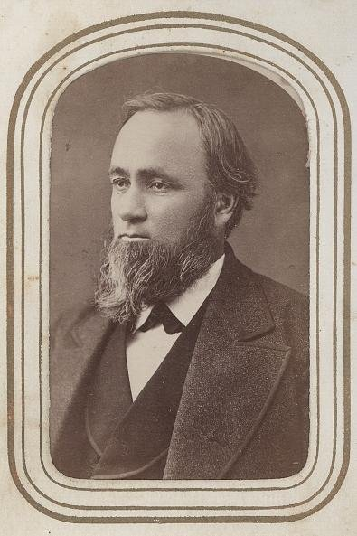
1853年這裡只有一棟房子，到1870年已是一片農田。1886年，靠房地產致富的哈維·威爾考克斯在此買下約0.6平方公里的土地。

## 1887-02-01 | 「好萊塢」得名
威爾考克斯的夫人在旅途中聽說俄亥俄州有個叫好萊塢（Hollywood，冬青林）的地方，便把丈夫的農莊改名為好萊塢，1887年2月1日正式登記。夫婦倆鋪設了今天的好萊塢大道、種植胡椒樹並開始出售土地，還引進英國冬青，但冬青在加州氣候下沒能存活。

## 1903 | 好萊塢建鎮
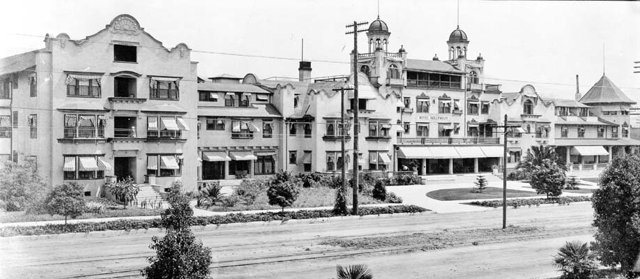
好萊塢成為自治市，當時的法令禁止藥房以外的商店賣酒，也不准在街上趕超過兩百頭牛。1902年好萊塢酒店開業，1904年通往洛杉磯的電車通車。

## 1908 | 愛迪生的專利托拉斯
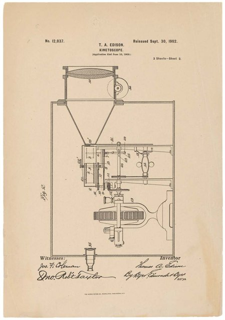
愛迪生聯合 Biograph、Vitagraph 等公司成立電影專利公司（MPPC），掌握攝影機、放映機與底片的關鍵專利，向所有製片商收取授權費，只准用柯達底片，並僱用偵探與律師沒收獨立業者的器材、提出訴訟，兩年內打了五百多場官司。同年，卡勒姆公司成為第一家來到加州的電影公司。

## 1910 | 併入洛杉磯
好萊塢居民為了取得足夠的飲水與排水設施，投票併入洛杉磯市；併入後，鎮上原本禁止室內電影院的規定也隨之解除。同年，格里菲斯為 Biograph 來到加州拍片。

## 1911 | 第一間片廠
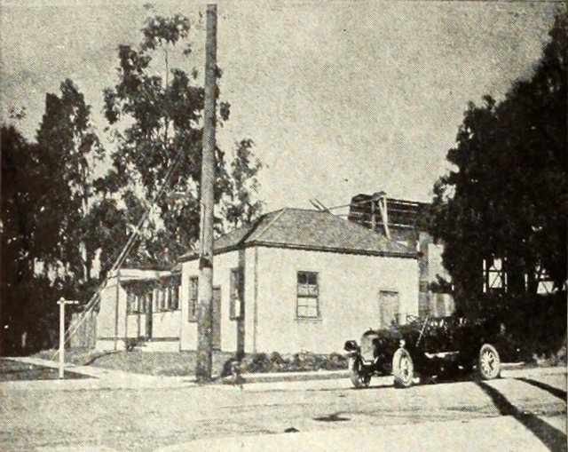
Nestor 公司在好萊塢日落大道與高爾街口開設第一間電影工作室，同年又有十多家公司跟進。獨立製片人西逃的理由很實際：加州離紐澤西的法院遙遠，被查抄還能越境到墨西哥；南加州一年三百多天晴天，默片靠自然光可以全年開拍；地價只有紐約的五分之一；一小時車程內就有沙漠、海灘、雪山與城鎮。

## 1913 | 第一部故事長片
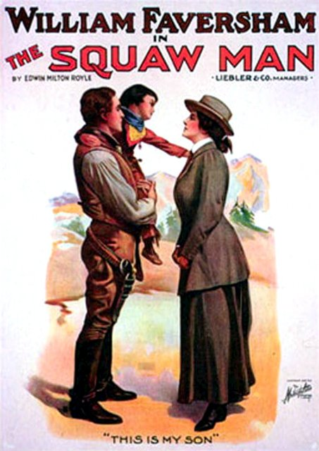
德米爾與拉斯基原本要去亞利桑那拍片，聽說太貴，轉往洛杉磯拍出《The Squaw Man》，成為在好萊塢拍攝的第一部故事長片。

## 1914 ~ 1918 | 一次大戰與 MPPC 解散
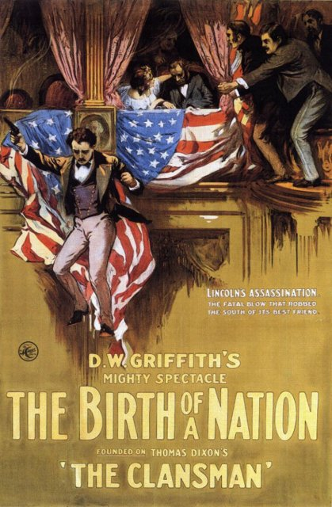
一次大戰讓巴黎、柏林等歐洲電影中心停擺，美國片趁虛而入，到1918年已占全球市場約八成。1915年聯邦法院判定 MPPC 違反反托拉斯法，1918年解散——愛迪生贏了專利，卻把電影趕到了他管不到的地方。

## 1916 ~ 1924 | 八大片廠的形成
逃過愛迪生的獨立製片人，建立了更大的帝國。他們用「垂直整合」同時掌握製片、發行與放映，以「搭售制」強迫戲院整季買片，並直接買下全美首輪戲院：派拉蒙、米高梅、華納兄弟、福斯、雷電華五大擁有院線，環球、哥倫比亞、聯美三小則沒有。創辦人多是東歐猶太移民，朱克、洛伊、華納兄弟、萊默爾等人從皮草商、遊樂場與巡迴放映起家，懂的是現金流。

## 1919 | 聯美成立
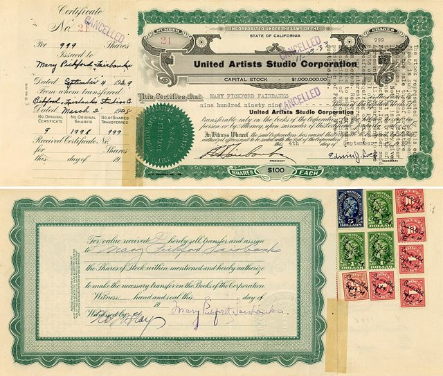
卓別林、格里菲斯、瑪麗·畢克馥與道格拉斯·范朋克成立聯美（United Artists），是藝術家反抗片廠的第一槍，但因為沒有院線，始終居於弱勢。

## 1922 | 海斯辦公室
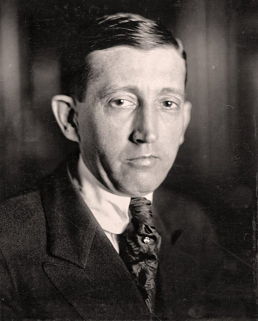
連串明星醜聞讓好萊塢被報紙描繪成罪惡之城，片廠請來前郵政總長威爾·海斯，成立美國電影製片與發行人協會（MPPDA），以自律換取免於政府審查。

## 1923 | HOLLYWOODLAND 看板
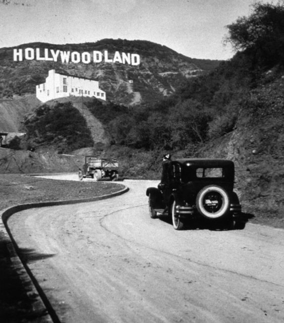
建商為推銷新住宅區，在好萊塢後山豎起白色大字「HOLLYWOODLAND」。看板後來無人維護，1949年好萊塢商會拆掉「LAND」四個字母並修復其餘字母，成為今天的好萊塢地標。

## 1924 ~ 1927 | 默片的巔峰
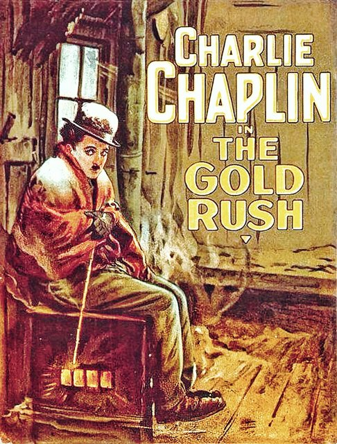
卓別林《淘金記》、基頓《將軍號》、穆瑙《日出》等默片達到藝術高峰。默片沒有語言障礙，換上當地字卡就能全球發行，1926年英國銀幕上95%是美國片，各國紛紛立法限制。好萊塢年產約八百部長片，以明星制與類型片的流水線生產。

## 1927-10-06 | 《爵士歌手》
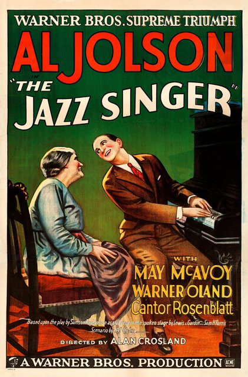
五大片廠都不想冒險改拍有聲片，瀕臨破產的華納兄弟卻不賭即死。華納先以《唐璜》（1926）試水，再推出《爵士歌手》，喬森一句「你們還沒聽到呢！」讓觀眾瘋狂；全片只有約兩分鐘對白，卻以50萬美元成本換得350萬美元票房。全美有聲戲院從1927年不到一百家，增加到1929年的八千多家。

## 1927 ~ 1934 | 有聲革命
攝影機被關進隔音棚，運鏡一度停擺；不少默片明星因口音、嗓音被淘汰，百老匯演員大舉西進。歌舞片、黑幫片、恐怖片應運而生，片廠還以同一套佈景輪流拍英、西、法、德語版本。為了改裝戲院，片廠大舉借債，正好撞上1929年股災：派拉蒙、雷電華在1933年破產重整，福斯在1935年與二十世紀合併，萊默爾家族在1936年失去環球，銀行家與中央製片人從此掌權。

## 1929-05-16 | 第一屆奧斯卡金像獎
第一屆奧斯卡金像獎頒獎，門票十美元，約兩百五十人出席。

## 1930 ~ 1934 | 海斯法典
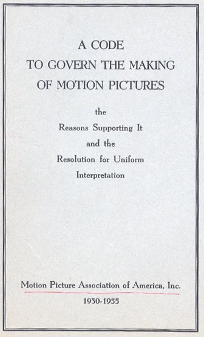
天主教「體面軍團」號召抵制，各州審查法案林立，大蕭條又讓觀影人次腰斬，片廠決定與其被政府管，不如自己管。1930年頒布、1934年起由布林主持強制執行的製作法典規定：不得同情犯罪、不得嘲弄宗教與法律、性只能暗示；沒有核准章，八大院線就不排片。法典同時抬高了獨立製片的門檻，鞏固了八大的壟斷。

## 1930 ~ 1939 | 大蕭條的逃避主義
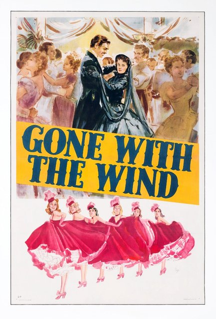
觀眾每週花二十五美分買兩小時的忘憂。歌舞片、《一夜風流》等神經喜劇、童星秀蘭·鄧波兒，以及迪士尼的《白雪公主》（1937）都大受歡迎。1939年《亂世佳人》《綠野仙蹤》《史密斯先生到華盛頓》《驛馬車》同年上映，被譽為史上最偉大的電影年。

## 1935 ~ 1948 | 製片人制度與明星制
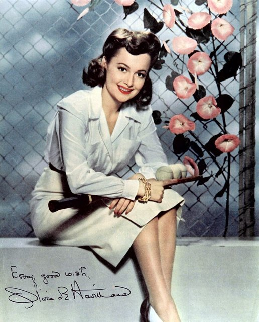
塔爾伯格、塞茨尼克等中央製片人主導一切，導演只是執行者，片廠像工廠一樣年產五百到七百部片。明星被七年合約綁住，改名、整形、包裝形象都由片廠決定；1944年奧麗薇·狄·哈維蘭控告華納勝訴，終結合約自動延長的條款。

## 1946 | 觀影人次的巔峰
二戰期間口袋有錢、無處可去的軍人與後方工人湧進戲院，1946年全美年觀影人次約四十億，創下歷史巔峰；黑色電影也在此時成形。但退伍軍人返鄉後的郊區化、電視的出現與反托拉斯訴訟，即將動搖片廠體制。

## 1947 | 好萊塢黑名單
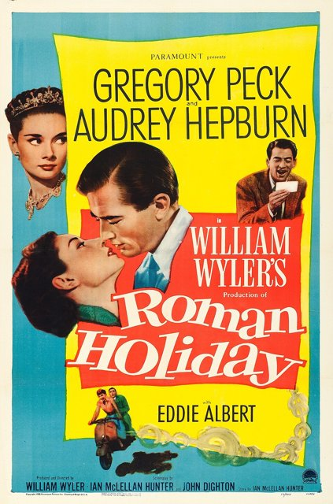
眾議院非美活動委員會傳喚好萊塢人士，拒絕回答是否為共產黨員的「好萊塢十君子」被判藐視國會入獄。11月25日，片廠大亨發表華爾道夫聲明，開除十君子並設立黑名單，數百人被列入、數千人受牽連，被點名者必須指認他人才能復工。編劇川普用假名寫出《羅馬假期》（1953），奧斯卡上台領獎的卻不是他。

## 1948-05-03 | 派拉蒙判決
最高法院在美國訴派拉蒙案中判決：擁有院線的五大必須賣掉戲院，禁止搭售與固定票價。片廠失去放映端的穩定現金流，年產量從五百多部降到三百部左右，B 級片部門首先被裁撤，雷電華在1957年停止製片。片廠從「工廠」變成「銀行加發行商」，明星與經紀公司趁勢崛起，改以票房分成取代週薪。

## 1948 ~ 1955 | 電視與郊區化
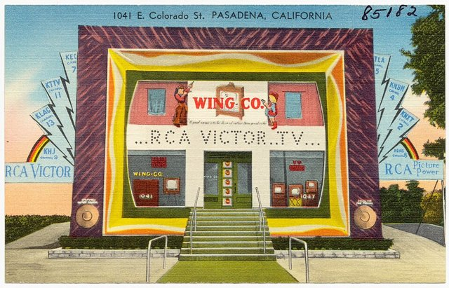
全美電視機從1948年的17萬台增加到1955年的3,200萬台，年觀影人次從1946年的40億降到1953年的25億、1962年的12億。片廠起初拒絕替電視製作節目，直到1955年後迪士尼、華納才開始為電視製片。

## 1952 ~ 1957 | 寬銀幕與彩色
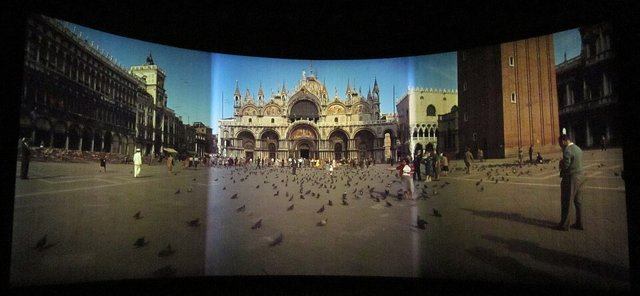
好萊塢以電視給不了的奇觀反擊：1952年的 Cinerama 三機投影、1953年福斯以 CinemaScope 寬銀幕推出《聖袍千秋》，加上70毫米、立體電影與立體聲；1955年後彩色片過半。《十誡》《賓漢》《阿拉伯的勞倫斯》等史詩巨片短暫拉回觀眾，但《埃及豔后》（1963）嚴重超支，幾乎拖垮福斯。

## 1960 | 黑名單破冰
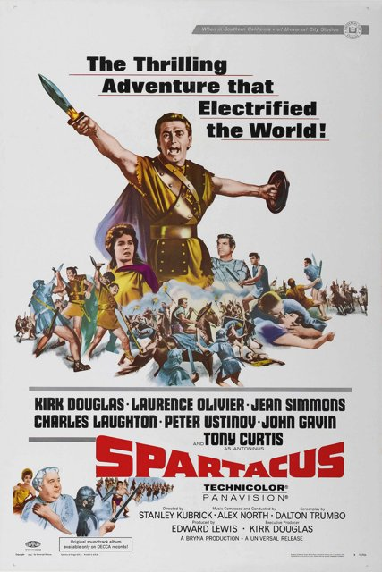
寇克·道格拉斯堅持在《萬夫莫敵》掛上川普的編劇名字，普雷明格也為《出埃及記》署名川普，甘迺迪總統公開觀賞《萬夫莫敵》，黑名單就此瓦解。被電影界排擠的人才轉往紐約的電視直播劇，反而成就了電視的黃金年代。

## 1962 | MCA 收購環球
經紀公司 MCA 打包明星、劇本與導演向片廠「批發」項目，1962年更直接收購環球——經紀人變成了片廠老闆。

## 1966 ~ 1969 | 老片廠易主
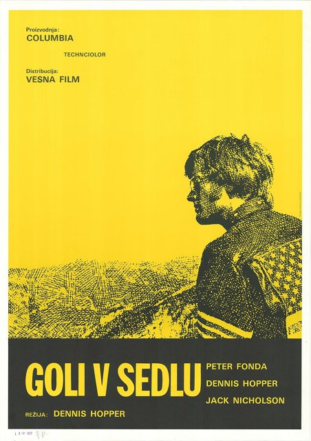
1966年華特·迪士尼去世，1967年華納被七藝公司併購，1969年投資人柯克瑞安（Kirk Kerkorian）買下米高梅並拆賣片庫與地產。《杜立德醫生》《我愛紅娘》等巨製接連虧損，嬰兒潮世代要的是《我倆沒有明天》《畢業生》，1969年《逍遙騎士》以36萬美元成本換得6,000萬美元票房，宣告舊制度的死亡。

## 1968 | 分級制取代海斯法典
美國電影協會推出分級制，海斯法典走入歷史，性與暴力可以入鏡。

## 1969 ~ 1977 | 新好萊塢
片廠把鑰匙交給電影學院出身的年輕導演：柯波拉、史柯西斯、史蒂芬·史匹柏、喬治·盧卡斯等人取得最終剪輯權，拍出《法國販毒網》《教父》（1972）《唐人街》《飛越杜鵑窩》《計程車司機》。但《現代啟示錄》等片嚴重超支，華爾街開始質疑放權的代價。

## 1975 | 《大白鯊》與暑期大片
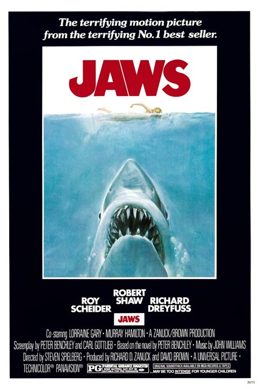
史匹柏的《大白鯊》在全美409家戲院同步上映，搭配電視黃金時段密集廣告，開創暑期大片。「一句話講得清的高概念、大規模行銷、全面發行」從此壓過作者導演的深沉。

## 1977 | 《星際大戰》
盧卡斯的《星際大戰》全球票房7.75億美元。他只要了周邊商品權與續集權，玩具、遊戲與書籍的收入遠超票房；片廠從此寧可花大錢拍能賣玩具的普遍級奇幻片，也不拍十部限制級劇情片，續集化就此開始。

## 1975 ~ 1987 | 錄影帶
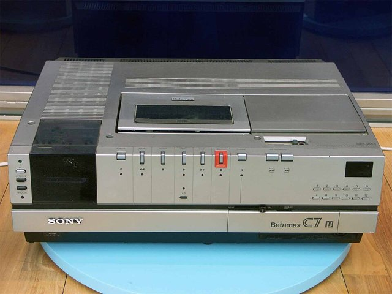
Betamax 與 VHS 錄影機普及，片廠起初控告新力，1984年最高法院判定家用錄影合法。錄影帶隨後成為比戲院更大的金礦，1987年收入超過戲院分成；「戲院、錄影帶、付費電視、無線電視」依序上映的窗口制度就此確立。

## 1982 ~ 1990 | 片廠的跨國併購
大片與錄影帶讓片廠再度值錢：可口可樂在1982年買下哥倫比亞，梅鐸在1985年買下福斯，1989年新力買下哥倫比亞、時代與華納合併，1990年松下買下 MCA／環球。到1989年，主要片廠只剩迪士尼仍是獨立的美國公司，好萊塢成為跨國集團的內容部門。

## 1989 ~ 1994 | 聖丹斯與獨立電影
被大片擠出大廠的中成本劇情片，在聖丹斯影展與米拉麥克斯找到出路：《性、謊言、錄影帶》（1989）、《黑色追緝令》（1994）以低成本換得高票房。1993年迪士尼收購米拉麥克斯，各大片廠紛紛成立獨立電影部門。

## 1991 ~ 1995 | CGI 的黎明
《魔鬼終結者2》（1991）的液態金屬人證明電腦動畫可與實拍結合，《侏羅紀公園》（1993）的電腦恐龍全球票房破十億美元，皮克斯與迪士尼的《玩具總動員》（1995）是第一部全電腦動畫長片。同期夢工廠在1994年成立。

## 1997 | DVD 與《鐵達尼號》
DVD 上市，毛利率高達八成，片廠把老片重新修復再賣一次，DVD 也養活了最後一批中成本電影。同年卡麥隆的《鐵達尼號》以2億美元成本換得18.4億美元全球票房。1999年《駭客任務》的「子彈時間」預示了新世紀的美學。

## 2001 ~ 2012 | 中國市場
中國加入世貿組織後逐步擴大進口片配額，2012年增至34部；中國票房從2003年的1億美元成長到2015年的68億美元。好萊塢以中美合拍、加入中國演員的特供版與自我審查爭取市場，萬達等中國資本也收購 AMC 與傳奇影業，直到2017年後退潮。

## 2006 ~ 2012 | 迪士尼三大收購
迪士尼先後收購皮克斯（2006，74億美元）、漫威（2009，40億美元）與盧卡斯影業（2012，40億美元），靠這些品牌登上各大片廠之首。

## 2007 | Netflix 推出串流

以 DVD 郵寄租片擊垮百視達（2010年破產）的 Netflix 推出串流服務。片廠起初把片庫便宜授權給它，以為只是多一個上映窗口。

## 2008 | 《鋼鐵人》與漫威電影宇宙
漫威把蜘蛛人、X 戰警的版權賣光後，2005年以剩下的二線角色為抵押借款5.25億美元自立片廠。2008年《鋼鐵人》的片尾彩蛋預告「復仇者計畫」，開創電影宇宙：每部片都像劇集的一集，2012年《復仇者聯盟》全球票房15億美元。各片廠紛紛仿效，多數以失敗收場。

## 2013 | 《紙牌屋》與原創串流
Netflix 以1億美元投資《紙牌屋》並一次上架整季，開啟原創與追劇時代，訂戶從2012年的三千萬成長到2020年的兩億。訂閱制追求的是訂戶的終身價值而非單片盈虧，讓《羅馬》《愛爾蘭人》《魷魚遊戲》等題材得以實現。

## 2019-11-12 | Disney+ 與串流戰爭
迪士尼推出 Disney+，首日一千萬訂戶，HBO Max、Apple TV+、Paramount+、Peacock 相繼加入戰局，亞馬遜也收購米高梅。各家燒錢搶訂戶，戲院的獨家上映期從90天縮短到與串流同步。

## 2020 ~ 2021 | 疫情與戲院危機
新冠疫情讓全球戲院關閉半年到一年半，2020年全球票房從前一年的420億美元跌到120億美元，中國首度超越北美成為全球最大票倉。中小型電影觀眾從此留在串流，只有「事件級」大片值得出門；2022年 Regal 的母公司 Cineworld 破產。

## 2023 | 編劇與演員大罷工
編劇工會（5月2日至9月27日）與演員工會（7月14日至11月9日）自1960年以來首次同時罷工，抗議串流買斷制讓重播分紅消失、迷你編劇室斷絕新人的晉升之路，以及 AI 取代編劇與掃描演員肖像的威脅。新合約規定 AI 不能列為編劇、使用演員的數位分身須經同意並付費，串流平台也首次依收視成績發放獎金——被稱為 AI 時代的第一份勞工合約。同年《芭比》與《奧本海默》合計全球票房約24億美元，證明原創的事件級電影仍能吸引觀眾進戲院。
