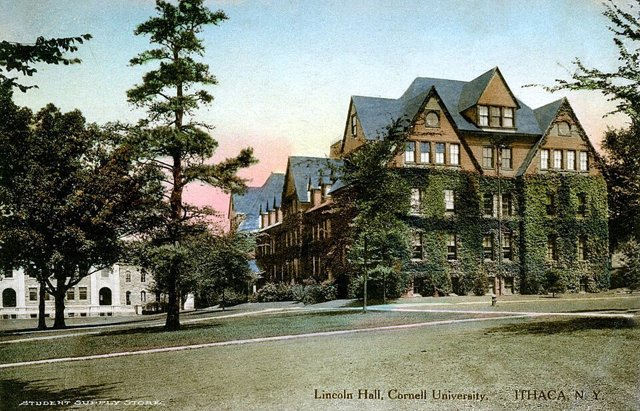
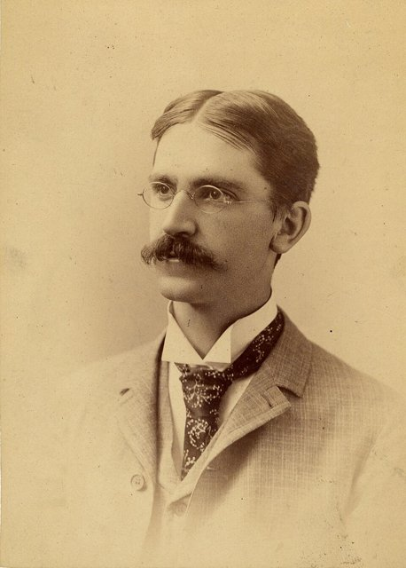
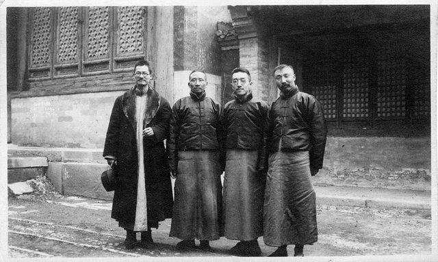
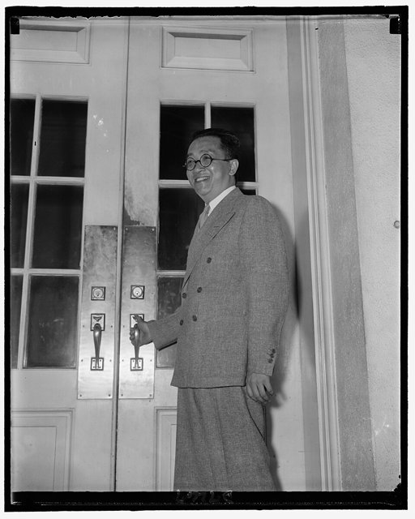
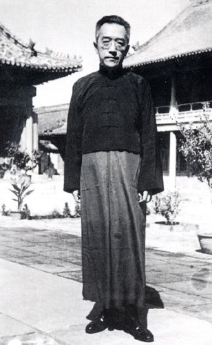

<!--
內容整理自 D:\Books\html\1-2-1.中國歷史人物\胡適(1891~1962).html（沒有對應的 md 筆記），並整合中文維基百科〈胡適〉條目，以自己的話改寫。
時期依頁面「思想發展脈絡」的四個階段並拆細：童年與求學、留學美國、新文化運動與文學革命、學術研究與公共參與、抗戰外交、戰後北大與離開大陸、旅美與晚年返臺。
兩份資料出入與處理方式：
- 生卒：兩份一致，1891年12月17日生，1962年2月24日卒於臺北南港，享年70歲（實歲）。出生地頁面寫上海，維基百科寫江蘇松江府川沙廳（今上海市浦東新區），兩者相容。
- 臺灣：頁面寫1893年隨母親到臺灣、1895年離臺且父親同年病逝；維基百科補充父親胡傳在臺灣任臺南鹽務、代理臺東直隸州知州，1895年8月22日病歿於廈門，採維基百科。
- 上海求學：頁面寫1904年赴上海、1905年進新式學校、1908年任教；維基百科補充1904年與江冬秀訂婚、1905年入澄衷學堂、1906年考取中國公學、1908年入中國新公學兼英文教員，採維基百科。
- 留美：頁面寫1912年由農學院轉文學院、1914年得文學士；維基百科補充1915年轉入哥倫比亞大學哲學系師從杜威、1917年通過博士最後考試（學位十年後才正式取得），兩份相容。
- 1917年：頁面列1月〈文學改良芻議〉、5月博士考試、7月回國、9月任北大教授、12月與江冬秀結婚；維基百科沒有月份，照頁面。
- 頁面1923–1937年多為概括敘述；維基百科補充1919年7月20日〈多研究些問題，少談些主義〉、1922年《努力週報》、1928–1930年中國公學校長、1929年〈人權與約法〉與人權論戰、1932年5月創辦《獨立評論》，採維基百科。北大文學院院長：頁面寫1932年，維基百科經歷欄作1932年至1937年，一致。
- 駐美大使：頁面寫1938–1942年，維基百科給出1938年9月17日至1942年9月8日，採維基百科。
- 北大校長與離開大陸：頁面寫1946年出任、1948年底離開北平；維基百科給出1948年12月15日離開北平、1949年4月6日自上海赴美，北大校長任期條目內有兩種說法，採1946年就任、1948年12月離開。
- 《自由中國》：頁面寫1949年11月創刊、胡適任發行人，1951年因政治爭議辭去發行人；維基百科說是名義上的發行人，照頁面並註明。
- 中央研究院：頁面寫1957年獲任命、1958年就任；維基百科給出1957年11月4日任命、1958年4月回臺就任，採維基百科。
- 雷震案（1960年9月）：頁面寫胡適「持續關注」，維基百科補充他參與營救未果，併入1960年的事件。
- 頁面的「學術方法」「重要著作」「思想發展脈絡」「歷史地位與評價」寫進時期說明與相關事件，不另立事件。
- 人名與其他時間軸一致：杜威、陳獨秀、蔡元培、魯迅、李大釗、梁啟超、雷震。
圖片來源（皆為 Wikimedia Commons 公有領域／CC0 作品；註明「共用」者沿用其他時間軸已有的圖片）：
- hs-cover.jpg：Hu Shih 1960 color.jpg（胡適，1960）
- hs-cornell.jpg：Cornell University - Lincoln Hall, 1910s.jpg（1910年代的康乃爾大學林肯堂（明信片））
- hs-dewey.jpg：John Dewey, studio portrait, ca 1890.jpg（約翰·杜威，約1890）
- hs-four.jpg：Jiang Menglin, Cai Yuanpei, Hu Shih and Li Dazhao.jpg（蔣夢麟、蔡元培、胡適與李大釗）
- hs-ambassador.jpg：Chinese Ambassador to U.S., Dr. Hu Shih, Sept. 1939 LCCN2016876181.jpg（駐美大使胡適，1939年9月，美國國會圖書館藏）
- hs-1946.jpg：Hu Shih 1946.jpg（胡適，1946）
-->

# Periods
- 1891-12-17 ~ 1904 | 童年：臺灣與績溪 | #868e96
  生於上海，兩歲隨母親到臺灣，父親胡傳任臺東直隸州知州；甲午戰後離臺，父親病逝，在安徽績溪接受母親嚴格的私塾教育。
- 1904 ~ 1910 | 上海求學 | #2f9e44
  到上海進新式學堂，讀澄衷學堂、中國公學，接觸新知識，也兼任英文教員。
- 1910 ~ 1917-07 | 留學美國 | #1971c2
  以庚款留美，在康乃爾大學由農學轉文學，再到哥倫比亞大學師從杜威，接受實用主義，與友人討論文學革命。
- 1917-07 ~ 1937 | 文學革命與學術、公共參與 | #c92a2a
  任北大教授，推動白話文與新文學，出版《中國哲學史大綱》《嘗試集》，以期刊參與問題與主義、人權等論戰，成為自由主義的代表。
- 1937 ~ 1946 | 抗戰與駐美大使 | #e8590c
  抗戰爆發後出任駐美大使，爭取美國對中國抗戰的支持，卸任後留在美國從事學術。
- 1946 ~ 1949-04 | 北大校長與離開大陸 | #7048e8
  戰後回國任北大校長，國共內戰中於1948年底離開北平，1949年赴美。
- 1949-04 ~ 1962-02-24 | 旅美與晚年返臺 | #0c8599
  任《自由中國》發行人、普林斯頓大學東亞圖書館館長，1958年回臺就任中央研究院院長，倡言「容忍與自由」，在院士酒會上心臟病發逝世。

# Events

## 1891-12-17 | 出生於上海
胡適生於江蘇松江府川沙廳（今上海市浦東新區），祖籍安徽績溪，原名嗣穈，後改名適，字適之。他出生在清朝末年內憂外患、制度變革的年代。

## 1893 | 隨母親到臺灣
兩歲的胡適隨母親馮順弟到臺灣，父親胡傳在臺灣任職，先管臺南鹽務，後代理臺東直隸州知州，胡適因此幼年曾在臺灣生活。

## 1895 | 離臺，父親病逝
《馬關條約》簽訂、臺灣割讓日本，胡適隨母親離開臺灣；父親胡傳在8月22日病逝於廈門。他回到安徽績溪，在家鄉的私塾研讀經書、古文與詩詞；守寡的母親嚴格督促他讀書，對他的成長影響深遠。

## 1904 | 赴上海求學，與江冬秀訂婚
十三歲的胡適依家中安排與江冬秀訂婚，之後到上海求學，從傳統教育轉向近代學校教育。1905年入澄衷學堂，1906年考取中國公學，1908年入中國新公學並兼任英文教員，開始累積教育與公共事務的經驗。

## 1910 | 庚款留美，入康乃爾大學

胡適考取庚子賠款獎學金，赴美進康乃爾大學，起初選讀農科，1912年轉入文學院，1914年取得文學士學位。這是他人生的重要轉折，正式進入西方高等教育體系。

## 1915 | 哥倫比亞大學，師從杜威

胡適轉入哥倫比亞大學哲學系，師從約翰·杜威，系統接觸實用主義：重視經驗、實驗、證據與解決問題，以實際檢驗觀念。1916年起，他與友人討論文學革命，思考中國文學改革的方向。
他後來倡導的不是單純否定傳統，而是重新檢驗傳統、整理文化遺產，以新方法建立學術成果。

## 1917-01 | 〈文學改良芻議〉
胡適在《新青年》發表〈文學改良芻議〉，主張文學要言之有物、不摹仿古人、講求文法、不避俗字俗語，能真實表達現代人的思想與情感，成為白話文運動的重要標誌；陳獨秀隨即發表〈文學革命論〉響應。
白話文不是他一人推動的，陳獨秀、蔡元培、魯迅等人也從不同方向促進了現代文學。他的貢獻在於把白話文改革變成一套有明確論述的文學主張，並透過大學、期刊與著作推動實踐。

## 1917-09 | 回國任北京大學教授
胡適5月通過哥倫比亞大學的博士最後考試（學位十年後才正式取得），7月回國，9月任北京大學教授，講授中國哲學史，12月與江冬秀結婚。1918年他發表〈建設的文學革命論〉，提出「國語的文學，文學的國語」，把文學革命從批判舊文學推向建立新文學。

## 1919 | 《中國哲學史大綱》與問題與主義

胡適出版《中國哲學史大綱》上卷，以現代學術方法把古代思想家放在歷史脈絡中分析，影響後來的哲學史研究。五四運動爆發，他的白話文與思想改革主張成為公共討論的一部分。
7月20日，他在《每週評論》發表〈多研究些問題，少談些主義〉，主張具體研究社會問題、漸進改革，引發與李大釗等人的「問題與主義」論戰。

## 1920 | 《嘗試集》
胡適出版白話詩集《嘗試集》，是中國現代白話新詩的重要早期作品。新文學逐漸從倡議變成實際的創作與教育活動，他也開始系統研究白話文學的歷史，後來寫成《白話文學史》。

## 1922 | 《努力週報》
胡適創辦《努力週報》，討論政治與社會問題，主張理性、漸進的社會改革，並任北大教務長兼代理文科學長。他的關懷從文學擴展到政治與社會制度，逐漸成為有廣泛影響力的公共知識分子。
他的學術方法可以概括為「大膽假設，小心求證」：提出可檢驗的假設，蒐集文獻與史料驗證，不因權威或成見接受結論，有新證據就修正判斷。

## 1928 | 中國公學校長與《新月》
胡適任中國公學校長（至1930年），並參與《新月》月刊的文化活動，新月派成為當時重要的文學與思想群體。

## 1929 | 人權論戰
胡適發表〈人權與約法〉，批評國民政府侵犯人權、要求以憲法保障人民權利，引發人權論戰，自由主義成為他公共論述的重要部分。

## 1932-05 | 《獨立評論》與北大文學院院長
胡適創辦《獨立評論》週刊，評論政治局勢與社會改革；同年任北京大學文學院院長（至1937年），參與現代大學的學術與教育建設。他研究清代思想家戴震等人，擴大現代學術方法在中國人文研究中的應用。

## 1938-09-17 | 出任駐美大使

抗日戰爭全面爆發後，胡適從學者轉向外交，出任中華民國駐美大使，爭取美國政府與社會對中國抗戰的理解與支持。1941年太平洋戰爭爆發，中國抗戰與國際反法西斯戰爭緊密結合。1942年9月他卸任，留在美國從事學術並與美國學界保持聯繫。

## 1946 | 出任北京大學校長

胡適1946年7月回到中國，出任北京大學校長，參與戰後大學的重建，試圖維持學術發展。1948年3月，他當選中央研究院第一屆院士。

## 1948-12-15 | 離開北平
國共內戰局勢急轉，胡適離開北平南下南京，結束北大校長的任期；1949年1月獲聘總統府資政，4月6日自上海搭船赴美，開始長期旅居海外。

## 1949-11 | 《自由中國》創刊
中華人民共和國成立、中華民國政府遷臺。《自由中國》半月刊在臺北創刊，胡適擔任（名義上的）發行人，為臺灣戰後的自由主義思想與政治討論留下重要線索。1951年，他因刊物的政治爭議辭去發行人。
1950年9月至1952年6月，他任普林斯頓大學葛思德東亞圖書館館長，持續研究中國思想與文獻。

## 1952 | 返臺演講
胡適回到臺灣，在臺灣大學、臺灣師範學院等處演講，與臺灣學術界建立更密切的聯繫，此後往返美國與臺灣，從事學術與文化活動。

## 1958-04 | 就任中央研究院院長
胡適在1957年11月獲任命為中央研究院院長，1958年4月回臺定居就任，將晚年的精力投入臺灣學術研究機構的建設，成為戰後臺灣學術發展的重要領導人。

## 1959 | 〈容忍與自由〉
胡適發表〈容忍與自由〉，認為思想自由不只是自己能發表意見，也包括容許別人持有不同觀點；一旦有人認定自己掌握絕對真理而剝奪異議者的表達權，自由就容易被破壞。人的判斷可能有錯，不同意見的交流有助於理解複雜問題，言論自由與容忍異議是自由社會的條件。

## 1960-09 | 雷震案
《自由中國》的雷震被捕，胡適沒有受到牽連，但營救未果。這件事顯示他對言論自由與政治自由的重視，也顯示自由主義在當時臺灣的處境。

## 1962-02-24 | 逝世於臺北南港
胡適在臺北南港主持中央研究院院士會議後的酒會上心臟病發，逝世，享年70歲。
他推動白話文與新文學，以現代學術方法重新研究中國哲學與歷史，並堅持自由與容忍，是理解中國從傳統走向現代的重要人物。他對傳統文化的解釋、漸進改革的路線，以及自由主義在中國的實踐條件，也一直受到不同立場的批評與討論。
