<!--
內容整理自本機筆記〈雨果生平大事記〉（圖表\雨果生平大事記.md）與中文維基百科「維克多·雨果」條目（CC BY-SA 4.0），以台灣用語改寫摘要。
https://zh.wikipedia.org/zh-tw/维克多·雨果
史料與日期說明：
- 劇名依筆記作《歐那尼》（維基百科作《艾那尼》），威爾第據此改編的歌劇則依威爾第時間軸作《埃爾納尼》；詩集 Les Contemplations 依維基百科作《靜觀集》，並註明筆記的譯名《沉思集》；《悲慘世界》人物依台灣常見譯名作芳婷、珂賽特、賈維爾。
- 筆記稱1881年為「八十歲生日」，實際上是79歲生日（見下）。
- 維基百科稱他1855年起住在根西島、又寫「1856到1870年間流亡根西」；他1855年10月從澤西島移居根西，1856年用《靜觀集》的稿費買下歐特維爾故居，此處依此。
- 1881年2月26日的慶典常被說成「八十大壽」，實際上是他79歲生日、進入第80個年頭，此處依實際年齡。
- 《悲慘世界》出版時與英國出版商以「？」「！」互通電報的軼事，維基百科也註明是不可靠的傳聞，未採用。
- 1811年隨母親前往西班牙、1819年與兄長創辦文學刊物、1822年婚禮上哥哥歐仁精神失常、1833年結識茱麗葉·德魯埃、1843年長女萊奧波爾迪娜溺水、1853年在澤西島的招魂會、1859年拒絕大赦、1871年兒子夏爾去世、1883年茱麗葉去世等細節，係依一般公認的史實補充。
- 威爾第的歌劇《埃爾納尼》《弄臣》分別改編自他的《歐那尼》與《國王尋樂》，與威爾第時間軸呼應。
- 普法戰爭、巴黎公社與長女的意外只作背景交代，不描寫細節。
圖片來源（皆為 Wikimedia Commons 公有領域／CC0 作品）：
- hug-cover.jpg：Bonnat Hugo001z.jpg
- hug-1822.jpg：Portrait de Victor Hugo sur fond de Notre-Dame de Reims - Jean Alaux.jpg
- hug-1829.jpg：Achille Devéria, Victor Hugo, 1829, NGA 208390.jpg
- hug-juliette.jpg：Maison de Victor Hugo Juliette Drouet Champmartin 27122012.jpg
- hug-leopoldine.jpg：Léopoldine lisant, Adèle Foucher, 1837, dessin, 19,2 x 27 cm , Maison de Victor Hugo, Paris.png
- hug-1848.jpg：Maison natale Victor Hugo 079.JPG
- hug-rock.jpg：Charles Hugo - Victor Hugo on the Rock of the Exiles - Google Art Project.jpg
- hug-hauteville.jpg：Hauteville House Victor Hugo in Guernsey.jpg
- hug-cosette.jpg：Emile Bayard - Cosette.jpg
- hug-pieuvre.jpg：Hugo-Travailleurs de la Mer-Pieuvre hugolienne.jpg
- hug-tourgue.jpg：Victor Hugo La Tourgue.jpg
- hug-grandkids.jpg：Victor Hugo et ses petits-enfants Georges et Jeanne.jpg
- hug-funeral.jpg：Vue du catafalque sous l'Arc de Triomphe depuis l'avenue de la Grande Armée.jpg
- hug-hernani.jpg：Jean-Jacques Grandville - Frenzied Romans at the First Performance of Hernani - WGA10359.jpg
- hug-hunchback.jpg：Victor Hugo-Hunchback.jpg
-->

# Periods
- 1802 ~ 1822 | 將軍之子與少年詩人 | #f08c00
  父親是拿破崙麾下的將軍、母親是保皇派，他隨父親的駐地輾轉義大利、西班牙，在巴黎長大；少年時就屢獲詩歌獎，立志成為「夏多布里昂，否則什麼都不是」。
- 1822 ~ 1843 | 浪漫主義的領袖 | #c92a2a
  結婚、出版詩集獲國王津貼，以《克倫威爾》序言與《歐那尼》的劇場之戰成為浪漫主義的旗手，《鐘樓怪人》使他名滿歐洲。
- 1843 ~ 1851 | 喪女、議員與轉向共和 | #495057
  長女驟逝讓他十年沒有出版新作，轉而投入政治：從法蘭西貴族院議員到第二共和的國會議員，逐漸從保皇派轉向共和派。
- 1851 ~ 1870 | 海峽群島的流亡 | #1c7ed6
  反對路易·拿破崙的政變而流亡布魯塞爾、澤西島與根西島，在海邊寫出《懲罰集》《靜觀集》與《悲慘世界》。
- 1870 ~ 1885 | 共和國的國民詩人 | #364fc7
  拿破崙三世垮台後凱旋返國，經歷巴黎圍城與巴黎公社，晚年被尊為第三共和的精神象徵，死後舉行國葬、安葬於先賢祠。

# Events

## 1802-02-26 | 出生@貝桑松
生於法國東部的貝桑松，是家中第三個兒子。父親萊奧波德是隨拿破崙征戰的軍官，後來升為將軍；母親索菲則是虔誠的保皇派，兩人感情不睦，長期分居。他後來寫道，自己的出生是「父親是老藍軍（共和派），母親是旺代人（保皇派）」，這種分裂也反映在他一生的政治轉變中。

## 1811 | 前往西班牙
童年隨著父親的駐地遷徙，1807至1808年曾住在義大利的那不勒斯；1811年隨母親到父親當時任職的西班牙，在馬德里的貴族學校讀了一年書。西班牙的城市、語言與歷史深深吸引了他，日後《歐那尼》等作品都以西班牙為背景。隔年回到巴黎，與母親和哥哥住在有大花園的斐揚丁修道院舊址，這座花園成了他童年最美好的回憶。

## 1817 | 法蘭西學術院詩歌比賽
15歲參加法蘭西學術院舉辦的詩歌比賽，獲得榮譽獎，評審甚至懷疑他謊報年齡。他在筆記本上寫下志向：「我要成為夏多布里昂，否則什麼都不是。」

## 1819 | 少年詩人
在土魯斯歷史悠久的「百花詩賽」中獲獎，並與哥哥一起創辦文學刊物《文學保守者》，以保皇派、天主教的立場寫評論與詩。同時他愛上了童年玩伴阿黛兒·富歇，但母親反對這門婚事。

## 1821-06 | 母親去世
母親去世，他陷入貧困與悲傷，在閣樓中靠寫作勉強度日，並終於向阿黛兒求婚。

## 1822-10 | 結婚與《頌詩集》
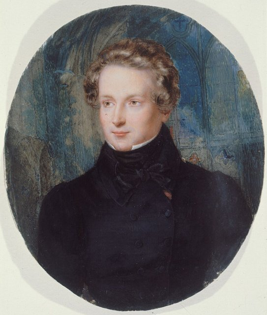
同年6月出版第一部詩集《頌詩與雜詠集》，歌頌波旁王朝的復辟，獲得國王路易十八每年一千法郎的津貼，經濟有了著落，10月便與阿黛兒結婚。婚禮當天，同樣暗戀阿黛兒的二哥歐仁精神崩潰，此後在療養院度過餘生。隔年他出版第一部小說《冰島凶漢》。

## 1827-12 | 《克倫威爾》序言
出版劇本《克倫威爾》，劇本本身無法上演，但長篇序言主張打破古典主義的三一律，讓崇高與滑稽、美與醜並存於舞台，被視為法國浪漫主義的宣言。他的巴黎住處成為浪漫派文人聚會的「文社」中心，大仲馬、繆塞、維尼等人都常來往。

## 1829 | 《死囚末日記》
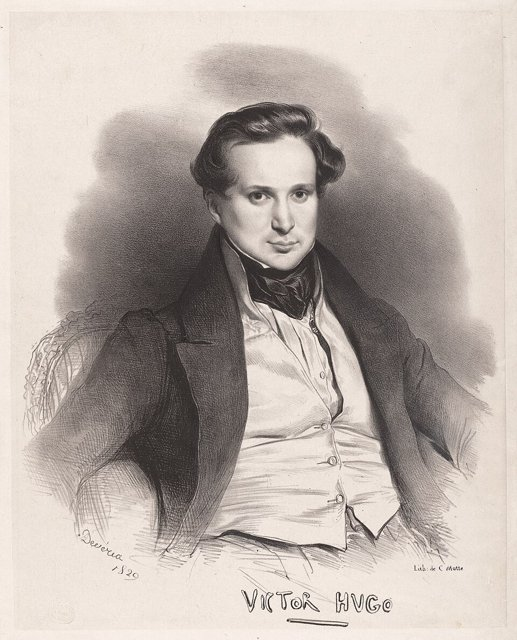
出版小說《死囚末日記》，以第一人稱寫一名死刑犯在行刑前最後一天的恐懼與煎熬，刻意不交代他犯了什麼罪，好讓讀者把焦點放在死刑本身的殘酷。這是他終生反對死刑的開端。同年出版充滿異國情調的詩集《東方集》。

## 1830-02-25 | 《歐那尼》首演
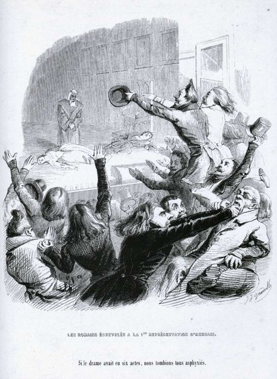
詩劇《歐那尼》在法蘭西喜劇院首演。劇中大膽打破古典詩劇的格律與規範，支持古典派與浪漫派的觀眾在劇院裡叫罵、互丟東西，史稱「歐那尼之戰」；他的年輕支持者們穿著奇裝異服，在戲院坐了一整晚助陣。浪漫派大獲全勝，他從此成為浪漫主義的領袖。這場論戰不只是戲劇形式之爭，更象徵新舊文學觀念與藝術自由的衝突。這部戲後來被威爾第改編成歌劇《埃爾納尼》。

## 1831-03 | 《鐘樓怪人》
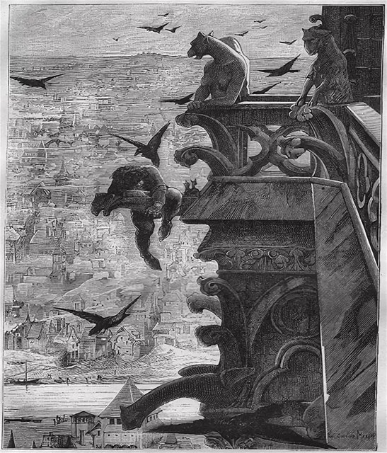
出版小說《巴黎聖母院》（台灣通稱《鐘樓怪人》），以十五世紀的巴黎為背景，描寫外貌醜陋的敲鐘人加西莫多對吉普賽少女艾絲梅拉達的愛。他寫作時把自己關在房裡，只穿一件灰色的毛衣，據說還把外出的衣服鎖起來，逼自己趕稿。小說轟動全歐，也喚起了大眾對年久失修的巴黎聖母院的重視，促成了後來的大規模修復。

## 1832 | 《國王尋樂》遭禁
劇作《國王尋樂》以諷刺國王的荒淫為題材，首演隔天就被七月王朝政府以「有傷風化」為由禁演。二十年後，威爾第把它改編成歌劇《弄臣》，成為經典。

## 1833-02-16 | 結識茱麗葉·德魯埃
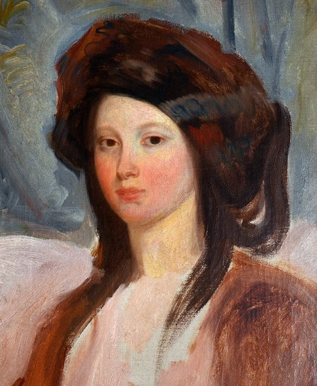
在排演劇作《盧克雷齊亞·波吉亞》時，結識了劇中的女演員茱麗葉·德魯埃。她從此成為他的情人與抄寫員，追隨他半個世紀，包括十九年的流亡，寫給他的信多達兩萬多封。他與妻子阿黛兒的婚姻此時已名存實亡。

## 1841-01 | 當選法蘭西學術院院士
經過三次落選後，終於當選法蘭西學術院院士，確立了他在法國文壇的地位。

## 1843-09 | 長女萊奧波爾迪娜去世
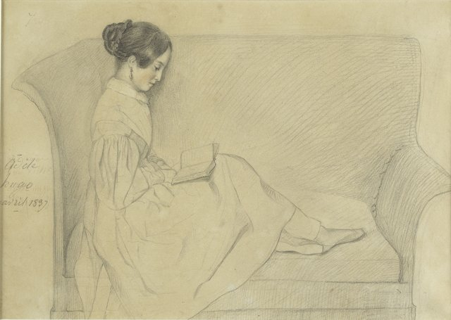
同年3月，他的劇作《城堡衛戍官》演出失敗，浪漫派戲劇的時代宣告結束。9月，新婚不久的長女萊奧波爾迪娜與丈夫夏爾·瓦克里在塞納河上划船時翻覆，雙雙溺水身亡，正在旅行的他是在咖啡館看報紙才得知噩耗。此後將近十年他沒有出版新作，日後在《靜觀集》中寫下許多悼念女兒的詩，例如〈明天，天一亮……〉。

## 1845-04 | 法蘭西貴族院議員
國王路易－菲利普冊封他為貴族院議員。他在議會發言反對死刑、主張出版自由，並支持波蘭的獨立運動。同年他開始動筆寫一部關於苦難與救贖的長篇小說，當時暫名《苦難》，也就是後來的《悲慘世界》。

## 1848 | 二月革命與國會議員
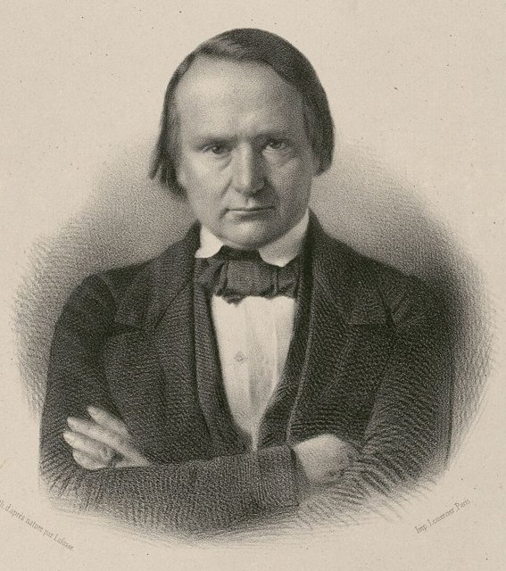
二月革命推翻七月王朝，第二共和成立，他當選國會議員。他在議會中呼籲廢除死刑：「你們已經推翻了王座，現在推翻斷頭台吧！」也為消除貧困、普及免費義務教育發聲，逐漸從保皇派轉向共和派。起初他支持拿破崙的姪子路易·拿破崙當選總統，很快就與他決裂。

## 1849-08 | 呼籲建立「歐羅巴合眾國」
擔任巴黎國際和平大會的主席，在開幕演說中預言：有一天，法國、俄國、義大利、英國與德國等歐洲國家將會結合成一個更高的共同體，就像美國一樣，成為「歐羅巴合眾國」。

## 1851-12 | 反對政變，流亡布魯塞爾
路易·拿破崙發動政變、解散國會，準備稱帝。他與共和派議員試圖組織抵抗失敗，遭到通緝，喬裝成工人、拿著假護照搭火車逃往布魯塞爾，從此開始長達十九年的流亡。

## 1852-08 | 澤西島與《小拿破崙》
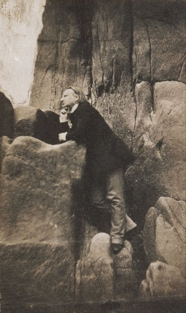
出版抨擊政變的小冊子《小拿破崙》，被比利時政府要求離境，於是遷居英屬海峽群島的澤西島。隔年出版詩集《懲罰集》，以猛烈的詩句痛罵已稱帝為拿破崙三世的路易·拿破崙。在澤西島期間，他迷上了「轉桌」招魂會，聲稱與死去的女兒、但丁、莎士比亞等人的亡靈對話，留下大量紀錄。

## 1855-10 | 移居根西島
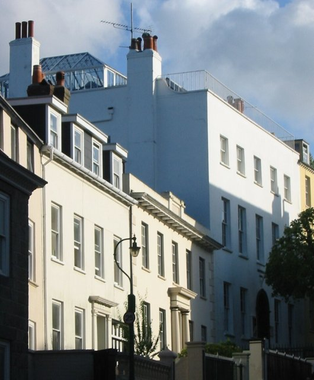
因支持流亡者批評維多利亞女王的報紙，被澤西當局驅逐，移居附近的根西島。隔年他用《靜觀集》的豐厚稿費買下面海的歐特維爾故居，親手設計室內裝潢，在頂樓的玻璃書房裡面對大海、站著寫作。

## 1856-04 | 《靜觀集》
出版詩集《靜觀集》（又譯《沉思集》），分為「往日」與「今日」兩部分，以1843年女兒之死為分界，從青春、愛情與自然寫到喪女的哀痛、死亡與信仰，被視為他最偉大的抒情詩集。與三年前痛斥拿破崙三世的《懲罰集》並讀，正好呈現他創作的兩個面向：對公共權力的抗議，以及對個人生命與失落的沉思。詩集大賣，讓他得以買下根西島的故居。

## 1859-08 | 拒絕大赦
拿破崙三世宣布大赦所有政治流亡者，他公開拒絕：「當自由回來時，我就回來。」同年出版史詩《歷代傳說》第一輯，以詩的形式描寫人類從創世到未來的歷史。

## 1862-04 | 《悲慘世界》
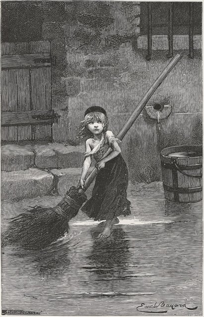
經過近二十年斷斷續續的寫作，在布魯塞爾出版長篇小說《悲慘世界》，在歐洲各大城市同步發售。故事描寫因偷一塊麵包而坐牢十九年的尚萬強，出獄後受到主教的感化而重生，卻始終被警探賈維爾追捕；書中穿插了芳婷、珂賽特、馬留斯與1832年巴黎的街壘起義。評論界褒貶不一，福樓拜、波特萊爾都不以為然，讀者卻瘋狂搶購。他在序言中寫道：只要世上還有貧困與愚昧，這樣的書就不會是無用的。

## 1866 | 《海上勞工》
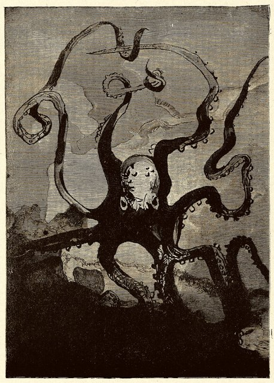
出版以根西島為背景的小說《海上勞工》，描寫一名漁夫為了贏得心上人，獨自冒險從礁岩間搶救失事的輪船，與大海和巨大的章魚搏鬥。書中根西方言的「章魚」一詞因此進入了法語。1869年他又出版批判英國貴族社會的《笑面人》。

## 1868-08 | 妻子去世
妻子阿黛兒在布魯塞爾去世。他陪著靈柩送到法國邊境，自己因為仍在流亡而無法入境，只能目送棺木運往維勒基耶，與女兒萊奧波爾迪娜合葬。

## 1870-09-05 | 凱旋返回巴黎
普法戰爭中拿破崙三世在色當投降被俘，第三共和成立。他在流亡十九年後回到巴黎，數萬名群眾在北站迎接。隨即普魯士軍隊包圍巴黎，他留在城中與市民共度圍城的寒冬，糧食短缺時甚至吃過動物園的動物，並把作品的收入捐出來購買大砲。

## 1871 | 巴黎公社與家庭悲劇
當選國民議會議員，不久因議會拒絕承認義大利英雄加里波底的當選資格而憤然辭職。3月，兒子夏爾猝逝，就在出殯當天，巴黎公社起義爆發。他譴責公社與政府軍雙方的暴行，事後卻公開為遭到鎮壓的公社成員請求特赦，並在布魯塞爾提供庇護，因此被比利時驅逐出境。隔年，他把這一年的經歷寫成詩集《兇年集》。

## 1874 | 《九三年》
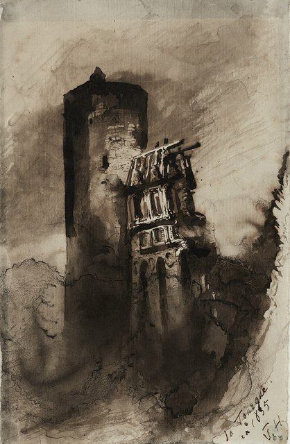
出版最後一部小說《九三年》，以1793年法國大革命恐怖統治時期的旺代叛亂為背景，描寫革命與人道之間的衝突，提出「在絕對正確的革命之上，還有絕對正確的人道」。

## 1876-01-30 | 當選參議員
當選第三共和的參議員，持續為大赦公社成員與廢除死刑發聲。1878年6月，他在一場慶祝伏爾泰百年忌的演說後不久輕微中風，此後幾乎停止寫作，只出版舊稿，並由茱麗葉照顧他的生活。

## 1881-02-26 | 全國慶祝他的生日
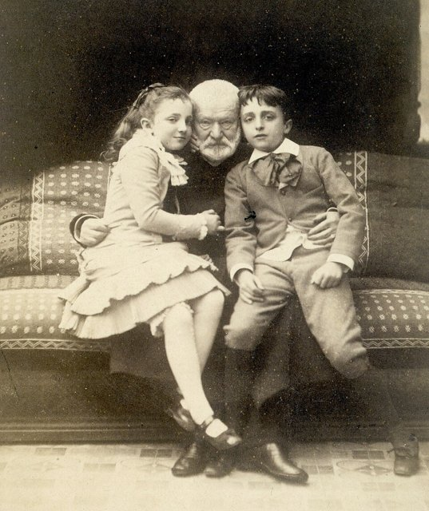
在他79歲生日、進入第八十個年頭這天，政府為他舉行盛大慶典，約六十萬人從他的住處窗前遊行經過，他所住的艾洛大道隨後被改名為「維克多·雨果大道」，他的通信地址從此變成「巴黎，維克多·雨果先生，於他的大道上」。

## 1883-05-11 | 茱麗葉去世
相伴五十年的茱麗葉·德魯埃因癌症去世，他悲傷得無法出席葬禮。同年他寫下遺囑：「我留給窮人五萬法郎，希望以窮人的柩車送我到墓地。我拒絕所有教會的祈禱，我信仰上帝。」

## 1885-05-22 | 逝世@巴黎
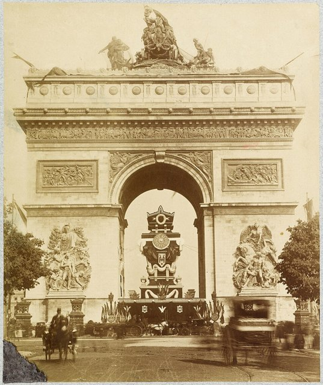
因肺炎在巴黎去世，享年83歲；據說他最後的話是：「我看見了黑色的光。」政府為他舉行國葬，遺體在凱旋門下停靈一夜，6月1日依他的遺願以窮人的柩車運往先賢祠，超過兩百萬人沿途送行。原本已改為教堂的先賢祠，為了安葬他而重新世俗化。他的肖像日後出現在法國的鈔票上；他留下的四千多幅畫作，也讓他被視為傑出的業餘畫家。
