<!--
內容整理自本機筆記《工業革命史——AI 偵探風格》（D:\Books\md\歷史\世界史\工業革命史，網頁版在知識圖譜的「8-6.工業革命史」）。
- 104個年份檔各成一則事件，說明採用該檔的「案件摘要」（1842礦山法案沒有案件摘要，改用「案發現場」），結尾以「→ 對外連結」連到知識圖譜上的完整案件卷宗（在新分頁開啟）；摘要中提到其他案件的連結也改為連到知識圖譜，連到其他分類筆記的連結改為純文字。
- 「1851-萬國博覽會」與「1851-水晶宮萬國博覽會」是同一主題的兩份卷宗，合併為一則事件，兩份卷宗都附上連結。
- 摘要中以 LaTeX 寫的因果鏈（如 $$\text{變壓器} \Rightarrow \text{高壓輸電}$$），時間軸無法顯示數學式，改寫為「變壓器 ⇒ 高壓輸電」這樣的純文字。
- 時期依筆記 README「案件卷宗」的前七個分段；「鐵路＋電報」（1830–1870）與第一次工業革命（1760–1840）在筆記中本來就重疊十年。README 第八、九段「制度、金融與法律」橫跨1474–2018年，是主題分類而非時期，未做成色帶。
- README 年表中沒有獨立年份檔的條目（如1779走錠紡紗機、1848共產黨宣言、1867諾貝爾炸藥）未收錄。
圖片來源（皆為 Wikimedia Commons 公有領域作品；部分為後世插圖或複製品，年份不一定與事件相同，見括號）：
- ind-cover.jpg：Philipp Jakob Loutherbourg d. J. - Coalbrookdale by Night - WGA13730.jpg（盧戴爾堡〈夜色中的柯爾布魯克代爾〉，1801）
- ind-pacioli.jpg：Jacopo de' Barbari - Portrait of Fra Luca Pacioli and an Unknown Young Man - WGA1269.jpg（巴爾巴里〈帕喬利像〉，約1495）
- ind-voc.jpg：VOC aandeel 9 september 1606.jpg（1606年荷蘭東印度公司的股票）
- ind-newcomen.jpg：Newcomen atmospheric engine (Heat Engines, 1913).jpg（紐科門大氣蒸汽機的構造圖（1913年書籍插圖））
- ind-southsea.jpg：The South Sea Scheme (BM 1841,0809.230).jpg（霍加斯〈南海泡沫〉，1721）
- ind-barton.jpg：Penny Magazine 1836 364 Aqueduct Over the Irwell.jpg（布里奇沃特運河的巴頓高架水道（1836年《便士雜誌》插圖））
- ind-jenny.jpg：Penny Magazine 1836 269 Hargreaves' Spinning Jenny.jpg（哈格里夫斯的珍妮紡紗機（1836年《便士雜誌》插圖））
- ind-watt.jpg：SteamEngine Boulton&Watt 1784.png（1784年的博爾頓–瓦特蒸汽機（1878年圖））
- ind-wealth.jpg：Wealth of Nations title.jpg（《國富論》1776年初版第二卷書名頁）
- ind-loom.jpg：Baines 1835-Weaving Shed.png（動力織布機的織布廠（1835年貝恩斯書中插圖））
- ind-gin.jpg：Cotton gin harpers.jpg（使用軋棉機的情景（1869年《哈潑週刊》））
- ind-trevithick.jpg：WP Trevithick - Newcastle Locomotive.jpg（特里維西克1804年的蒸汽機車圖）
- ind-clermont.jpg：Fig. 49, - the "Clermont," 1807 LCCN2006691758.jpg（富爾頓的克萊蒙特號（1881年插圖））
- ind-luddite.jpg：Luddite.jpg（〈盧德派首領〉，1812年版畫）
- ind-locomotion.jpg：PSM V12 D283 Stockton and darlington engine no 1 1825.jpg（斯托克頓–達靈頓鐵路的1號機車（19世紀末插圖））
- ind-rocket.jpg：PSM V12 D283 The rocket 1829.jpg（史蒂芬生的火箭號（1829，19世紀末插圖））
- ind-mines.jpg：Women bearing coal, 1842.jpg（1842年礦山調查報告中背煤的女工）
- ind-morse.jpg：Prof. S.F.B. Morse. The great inventor of the telegraph LCCN2003674300.jpg（紐約中央公園摩斯雕像的石版畫（1870年代））
- ind-crystal.jpg：Crystal Palace from the northeast from Dickinson's Comprehensive Pictures of the Great Exhibition of 1851. 1854.jpg（1851年萬國博覽會的水晶宮（1852年迪金森畫冊））
- ind-bessemer.jpg：Bessemer converter Blowing.jpg（運作中的貝塞麥轉爐（1917年照片））
- ind-thames.jpg：FaradayFatherThames.jpg（1855年《笨拙》雜誌漫畫：法拉第把名片遞給泰晤士老爹）
- ind-drake.jpg：First U.S. oil rig with Edwin Drake, crop.jpg（德雷克（右）與他的第一口油井）
- ind-suez.jpg：L'inauguration du canal de Suez, 17 November 1869 Gal18 riou 001f.jpg（1869年蘇伊士運河通航典禮（里烏繪））
- ind-telephone.jpg：Bell Centennial telephone receiver & transmitter 1876.png（貝爾1876年百年博覽會展出的電話收發器（後世圖））
- ind-edison.jpg：Edison incandescent lights.jpg（愛迪生的白熾燈泡（1904年圖））
- ind-benz.jpg：1885Benz.jpg（1885年的賓士專利汽車）
- ind-tesla.jpg：TeslaPOLYPHASEColumbianEXPO1893rwLIPACKownerA.jpg（特斯拉多相交流電系統在1893年芝加哥世博會展出）
- ind-wright.jpg：First flight2.jpg（1903年12月17日萊特兄弟首飛）
- ind-taylor.jpg：Frederick Taylor 1911.jpg（泰勒，1911）
- ind-ford.jpg：Assembly line at the Ford Motor Company's Highland Park plant LCCN2011661021.jpg（1913年福特高地公園工廠的組裝線）
- ind-tank.jpg：British Mark I male tank Somme 25 September 1916 (cropped4to3).jpg（1916年9月索姆河戰役中的英國Mark I戰車）
- ind-crash.jpg：Crowds gathering outside New York Stock Exchange.jpg（1929年10月24日紐約證券交易所外聚集的人群）
- ind-brettonwoods.jpg：Morgenthau Bretton Woods opening 1944.jpg（1944年布雷頓森林會議開幕，摩根索致詞）
- ind-transistor.jpg：Replica-of-first-transistor.jpg（第一個電晶體的複製品）
- ind-idealx.jpg：Ideal X.jpg（第一艘貨櫃船理想X號）
-->

# Periods
- 1500 ~ 1760 | 前傳：為什麼是英國 | #868e96
  圈地運動把自耕農變成雇工，東印度公司帶來海外市場與印度棉布的競爭，光榮革命與英格蘭銀行壓低了資本成本；森林耗盡逼出焦炭煉鐵，礦場排水催生紐科門蒸汽機，運河讓內陸運費先崩跌一輪。
- 1760 ~ 1840 | 第一次工業革命：紡織＋蒸汽＋鐵 | #e67700
  珍妮紡紗機、水力紡紗廠、動力織布機讓紡織業機械化，瓦特蒸汽機提供旋轉動力，攪拌法讓熟鐵量產；機床與可互換零件出現，蒸汽機車與汽船登場，工廠法開始管制童工與工時。
- 1830 ~ 1870 | 鐵路＋電報：距離的死亡 | #c92a2a
  鐵路網與電報讓運輸和資訊的成本同時崩跌，鐵路狂熱留下泡沫也留下路網；貝塞麥煉鋼、石油、蘇伊士運河接連出現，倫敦萬國博覽會是「世界工廠」的加冕，也是德美追趕的起跑槍。
- 1870 ~ 1914 | 第二次工業革命：鋼鐵＋電力＋化工 | #1971c2
  德國、美國以關稅與技術教育後來居上；電話、白熾燈與電力網、交流電、汽車、飛機相繼出現，化工巨頭把實驗室搬進工廠，泰勒的科學管理與福特流水線改寫了生產方式。
- 1914 ~ 1970 | 大量生產與消費社會 | #2f9e44
  汽車、家電與分期付款撐起消費社會，大蕭條暴露生產過剩的迴路斷裂；戰爭加速了雷達、青黴素與原子彈，電晶體、積體電路與貨櫃為下一輪成本崩跌埋下種子。
- 1970 ~ 2010 | 第三次工業革命：半導體＋網路 | #6741d9
  微處理器讓電腦進入晶片，豐田生產方式帶來精實的組織革命，全球資訊網讓資訊成本趨近於零；全球供應鏈把「世界工廠」轉移到亞洲，金融與公司治理的制度也隨之全球化。
- 2010 ~ 2026 | 第四次工業革命：AI 與智慧製造 | #0c8599
  深度學習在 GPU、大數據與演算法的咬合下爆發，工業 4.0 把工廠資訊化，生成式 AI 進入消費市場，電動車與電池成本崩跌開啟能源迴路的新一輪。

# Events

## 1474 | 威尼斯專利法
1474 年 3 月 19 日威尼斯元老院通過《發明人法》（Parte Veneziana），兇手不是單一開明議長，而是「工匠外流—行會保密—商業競爭—國家財政」多股力量咬合。它以「新穎性＋十年排他＋強制公開」改變了發明誘因，把技術從行會密室拉進國家登記簿，大幅降低了模仿糾紛與技術引進的交易成本。

[→ 對外連結：威尼斯專利法：技術外流、行會保密與新穎發明的多因案件](https://chad-liu.github.io/books/html/8-6.工業革命史/1474-威尼斯專利法.html)

## 1494 | 複式簿記

1494 年盧卡·帕喬利在威尼斯出版《算術幾何比與比例全書》，兇手不是他一人，而是「地中海合夥貿易—借貸平衡技術—印刷術普及」三力咬合。此案把威尼斯商人的祕傳記帳術變成歐洲通用的商業語言，一舉降低了合夥的信任成本與損益核算成本，是財務會計的起點。

[→ 對外連結：複式簿記：威尼斯商法、帕喬利全書與借貸平衡的多因案件](https://chad-liu.github.io/books/html/8-6.工業革命史/1494-複式簿記.html)

## 1602 | 東印度公司與股份制

1602 年荷蘭聯合東印度公司（VOC）成立，兇手不是某位商人天才，而是「遠洋貿易高風險—單航次合夥不敷使用—股份可轉讓—阿姆斯特丹交易所」四股力量咬合。此案的核心制度創新是把「一次性合夥」變成「永久性股本＋可交易股份」，一舉降低了遠洋貿易的資本動員成本與風險分攤成本。

[→ 對外連結：東印度公司與股份制：遠洋風險、鉅額資本與可轉讓股份的多因案件](https://chad-liu.github.io/books/html/8-6.工業革命史/1602-東印度公司與股份制.html)

## 1609 | 阿姆斯特丹銀行
1609 年阿姆斯特丹匯兌銀行（Wisselbank）成立，兇手不是市議會一道命令，而是「劣幣氾濫—國際匯兌需求—記帳貨幣技術」三力咬合。此案用一本帳、一種「銀行盾」馴服了數百種混亂鑄幣，一舉降低了國際貿易的兌換成本與違約風險，是荷蘭金融霸權的地基，也是穩定幣的遠古前傳。

[→ 對外連結：阿姆斯特丹銀行：劣幣氾濫、記帳貨幣與匯兌壟斷的多因案件](https://chad-liu.github.io/books/html/8-6.工業革命史/1609-阿姆斯特丹銀行.html)

## 1624 | 壟斷法與專利制度
1624 年英國《壟斷法》（Statute of Monopolies）通過，兇手不是單一開明議員，而是「王權濫發壟斷—議會反彈—普通法判例—威尼斯專利前傳」多股力量咬合。它把專利從「國王恩賜的壟斷」改造成「新穎發明的定期獎勵」，一舉降低了創新者的被掠奪風險與模仿成本糾紛。

[→ 對外連結：壟斷法與專利制度：王權尋租、威尼斯前傳與新穎發明的多因案件](https://chad-liu.github.io/books/html/8-6.工業革命史/1624-壟斷法與專利制度.html)

## 1651 | 航海條例
1651 年 10 月克倫威爾護國政府頒布《航海條例》（Navigation Acts），兇手不是單一海軍野心，而是「重商主義—英荷貿易戰—殖民地走私—海軍財政」多股力量咬合。它以「英國船＋英國人運英國貨」重寫貿易誘因，用法律壟斷把運費與關稅鎖在國內，運輸與殖民交易成本看似下降、實則轉嫁給殖民地與荷蘭人。

[→ 對外連結：航海條例：重商主義、海權爭霸與殖民地壟斷的多因案件](https://chad-liu.github.io/books/html/8-6.工業革命史/1651-航海條例.html)

## 1661 | 歐洲第一張紙幣
1661 年斯德哥爾摩銀行（Stockholms Banco）發行歐洲第一張紙幣，兇手不是一張紙，而是「瑞典銅幣太重—財政戰爭開銷—存款收據流通」三力咬合。此案把「存銅條換收據」變成「拿收據當錢花」，一舉降低了大額交易的搬運成本，卻也因超發引爆人類首次紙幣擠兌，是紙幣信用的第一堂實驗課。

[→ 對外連結：歐洲第一張紙幣：銅幣之重、信用實驗與擠兌教訓的多因案件](https://chad-liu.github.io/books/html/8-6.工業革命史/1661-歐洲第一張紙幣.html)

## 1688 | 勞合社與保險市場
1688 年愛德華·勞埃德咖啡館（Edward Lloyd's Coffee House）首次見報，兇手不是一杯咖啡，而是「遠洋海難頻仍—船貨資本巨大—咖啡館資訊匯聚」三力咬合。此案把「熟人擔保」變成「陌生人競價承保」，一舉降低了遠洋貿易的風險成本，是風險定價市場的誕生地。

[→ 對外連結：勞合社與保險市場：咖啡館、海難風險與風險定價的多因案件](https://chad-liu.github.io/books/html/8-6.工業革命史/1688-勞合社與保險市場.html)

## 1694 | 英格蘭銀行與國債
1694 年英格蘭銀行成立、國債體系誕生，兇手不是某位銀行家，而是「對法戰爭缺錢—光榮革命限王權—倫敦商人有錢—荷蘭金融模板」四股力量咬合。議會以國家信用為抵押借入 120 萬鎊，一舉把政府違約風險關進籠子，英格蘭的資本成本從此崩跌。

[→ 對外連結：英格蘭銀行與國債：光榮革命、可信承諾與低利率的多因案件](https://chad-liu.github.io/books/html/8-6.工業革命史/1694-英格蘭銀行與國債.html)

## 1709 | 達比焦炭煉鐵
1709 年，什羅普郡科爾布魯克谷（Coalbrookdale）的亞伯拉罕・達比一世（Abraham Darby I）用焦炭（coke）成功冶煉生鐵——此前煉鐵全靠木炭，英格蘭森林為鐵爐砍到「木材荒」，鐵價高企、產量卡死。達比把煤乾餾成焦炭替代木炭，看似一次燃料替換，實則是工業革命的「第一塊倒下的骨牌」：沒有廉價焦炭鐵，就沒有後來的攪拌法熟鐵、便宜鐵軌與蒸汽機汽缸。本案偵破的問題是：為什麼偏偏是 1709、偏偏是一個貴格會鍋具商人，解開了困擾全歐兩百年的燃料結？

[→ 對外連結：達比焦炭煉鐵：木炭危機、科爾布魯克谷與廉價鐵的第一案](https://chad-liu.github.io/books/html/8-6.工業革命史/1709-達比焦炭煉鐵.html)

## 1710 | 安妮法令
1710 年 4 月英國《安妮法令》（Statute of Anne）生效，兇手不是單一開明女王，而是「出版商壟斷—作者貧困—蘇格蘭盜版—啟蒙需求」多股力量咬合。它把版權從書商公會的永久壟斷改造成作者的 14＋14 年定期權利，一舉降低了知識交易的授權成本，讓書價可預期、盜版可訴究。

[→ 對外連結：安妮法令：出版壟斷、作者權利與啟蒙市場的多因案件](https://chad-liu.github.io/books/html/8-6.工業革命史/1710-安妮法令.html)

## 1712 | 紐科門大氣蒸汽機
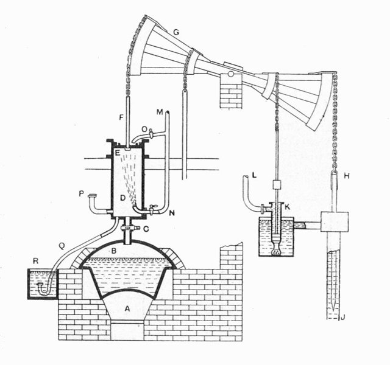
1712 年德文郡鐵匠湯瑪斯・紐科門（Thomas Newcomen）與助手約翰・考利（John Calley）在史塔福郡提普頓（Tipton）康尼格里煤礦立起第一具實用大氣蒸汽機，兇手不是單一發明天才，而是「深礦淹水—坑口廉價煤—真空科學—鍋爐工匠」四股力量同時咬合，缺其一則蒸汽時代不會在此時破門。

[→ 對外連結：紐科門大氣蒸汽機：煤礦水患、廉價煤與真空科學的多因案件](https://chad-liu.github.io/books/html/8-6.工業革命史/1712-紐科門大氣蒸汽機.html)

## 1720 | 南海泡沫

1720 年南海公司股價自 128 鎊飆至 1000 鎊再崩至 150 鎊，兇手不是單一騙子，而是「戰後國債難銷—債轉股置換—分期付款槓桿—跨海峽從眾」多因素咬合。連牛頓都賠掉 2 萬鎊（嘆「能算星辰算不得人心」）。泡沫催生的《泡沫法案》（Bubble Act）試圖一舉降低金融欺詐與盲目投機的監督成本。

[→ 對外連結：南海泡沫：國債置換、從眾槓桿與泡沫法案的多因案件](https://chad-liu.github.io/books/html/8-6.工業革命史/1720-南海泡沫.html)

## 1733 | 飛梭與紗荒
1733 年蘭開夏布里織工約翰・凱伊（John Kay）取得飛梭（Flying Shuttle）專利，一名織工即可織闊幅布，織布效率倍增，真正的兇手卻是織快紡慢的失衡——飛梭撕開布匹產能，棉紗瞬間告缺，史稱「紗荒」，直接為此後三十年的珍妮機、水力紡紗機與騾機預告了懸賞令。

[→ 對外連結：飛梭與紗荒：織布加速、棉花解禁與市場擴張的多因案件](https://chad-liu.github.io/books/html/8-6.工業革命史/1733-飛梭與紗荒.html)

## 1761 | 運河狂熱
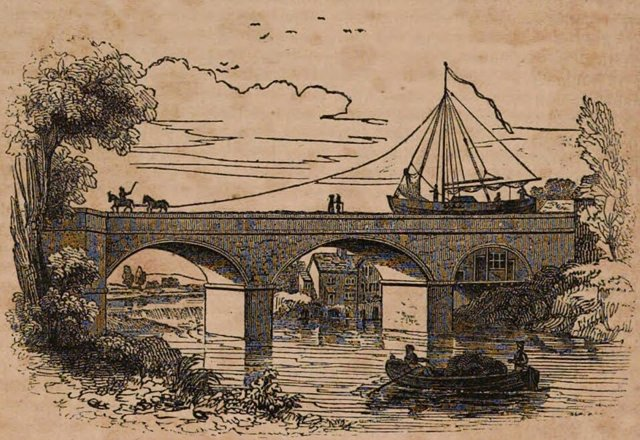
1761 年 7 月，布里奇沃特公爵的**沃爾斯利—曼徹斯特運河**通航：
沃爾斯利煤礦的煤價在曼徹斯特**腰斬**——8 噸煤由兩匹馬拖著走完全程，
而陸路用馬車一噸煤的成本比煤本身還貴。十餘年間英國掀起**運河狂熱**（canal mania）：
煤運需求 + 水路成本 ≈ 1/4 ～ 1/8 陸運 → 議會法案潮 → 運河網成形
本案是鐵路狂熱（1825、1845）的**前傳**：英國第一次體驗
「運輸成本崩跌 → 市場規模放大 → 分工深化」的正迴路——用煤點火的迴路。

[→ 對外連結：運河狂熱（布里奇沃特公爵與內陸運費的第一次崩跌）](https://chad-liu.github.io/books/html/8-6.工業革命史/1761-運河狂熱.html)

## 1764 | 珍妮紡紗機
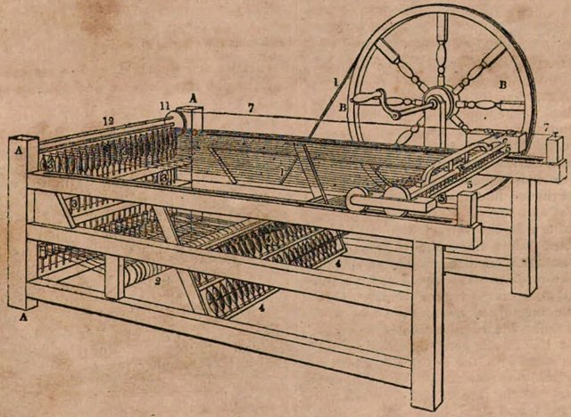
1764 年蘭開夏斯坦希爾木匠詹姆斯・哈格里夫斯（James Hargreaves）造出 8 錠珍妮紡紗機（Spinning Jenny），以一輪多錠一次紡出多縷紗線，破案關鍵不在一人靈光，而是飛梭造成的紗荒高懸賞、廉價木機可進農舍、緯紗需求先行的三重咬合，讓珍妮成為第一台走進千家萬戶的工業革命機器。

[→ 對外連結：珍妮紡紗機：紗荒懸賞、木匠巧思與家庭工廠的多因案件](https://chad-liu.github.io/books/html/8-6.工業革命史/1764-珍妮紡紗機.html)

## 1769 | 瓦特蒸汽機

1769 年格拉斯哥儀器匠詹姆斯・瓦特（James Watt）取得分離冷凝器專利，但真兇並非一紙專利——格拉斯哥大學修理紐科門模型的一瞥、約翰・威爾金森（John Wilkinson）軍炮鏜床的精度、馬修・博爾頓（Matthew Boulton）的資本與商網三者咬合，才把實驗室省煤構想變成 1776 年起橫掃礦場、鐵廠與紡廠的通用動力。

[→ 對外連結：瓦特蒸汽機：分離冷凝器、精密鏜缸與伯明罕資本的多因案件](https://chad-liu.github.io/books/html/8-6.工業革命史/1769-瓦特蒸汽機.html)

## 1776 | 國富論與市場制度

1776 年亞當・斯密出版《國富論》，兇手不是一人一書，而是「工廠分工萌芽—重商管制失靈—蘇格蘭啟蒙—美洲獨立震盪」多因素咬合。斯密把零散的市場實踐提煉為「分工＋競爭＋自由貿易」三定理，一舉降低了全社會的分工協調成本與政策辯論的交易成本。

[→ 對外連結：國富論與市場制度：分工、看不見的手與反重商主義的多因案件](https://chad-liu.github.io/books/html/8-6.工業革命史/1776-國富論與市場制度.html)

## 1784 | 攪拌法煉鐵
1784 年漢普郡方特利（Fontley）鐵商亨利・科特（Henry Cort）取得溝輥軋製專利，與 1783 年攪拌法（puddling）合為煉鐵革命，兇手不是單一爐火——焦炭冶煉的生鐵洪流、英國海軍對熟鐵的無底訂單、木炭短缺與瑞典俄鐵斷供風險四面夾擊，逼出「煤火不觸鐵」的反射爐妙計。

[→ 對外連結：攪拌法煉鐵：焦煤反射爐、海軍訂單與木炭危機的多因案件](https://chad-liu.github.io/books/html/8-6.工業革命史/1784-攪拌法煉鐵.html)

## 1785 | 卡特萊特動力織布機
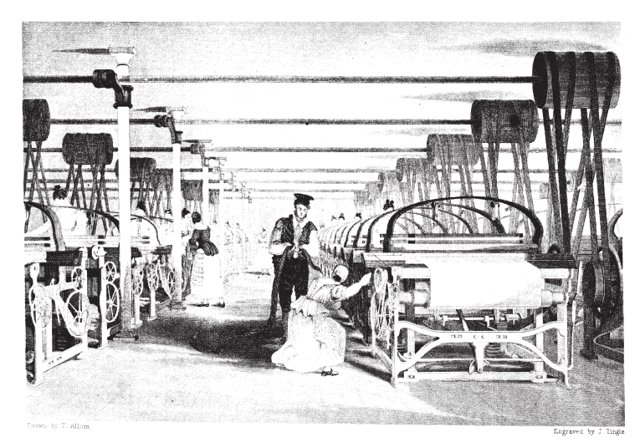
1785 年，肯特郡教區牧師埃德蒙・卡特萊特（Edmund Cartwright）取得動力織布機（power loom）專利——此前珍妮機（1764）、水力機、走錠機（1779）把紡紗效率推高數十倍，織布仍靠手工梭，紗多布少、紗價跌布價挺。一個不懂機械的牧師受「機器紡紗、豈無機器織布」一句閒話刺激，造出笨拙的蒸汽織機，屢敗屢改，終在 19 世紀初引爆織布機械化。本案偵破的是紡織鏈的「瓶頸漂移」：每解開一環，下一環立刻成為新的兇手。

[→ 對外連結：卡特萊特動力織布機：紗線過剩、教區牧師與織布瓶頸案](https://chad-liu.github.io/books/html/8-6.工業革命史/1785-卡特萊特動力織布機.html)

## 1790 | 美國專利法
1790 年 4 月 10 日華盛頓簽署美國首部《專利法》，兇手不是單一建國熱情，而是「技術落後—歐洲封鎖—發明人遊說—傑佛遜理念」多股力量咬合。它以高門檻審查制把專利變成「共和國的榮譽勳章」，卻因成本過高三年即崩，1793 年改登記制的教訓證明：誘因太嚴等於無誘因，交易成本決定制度生死。

[→ 對外連結：美國專利法：傑佛遜審查、登記教訓與技術擴散的多因案件](https://chad-liu.github.io/books/html/8-6.工業革命史/1790-美國專利法.html)

## 1793 | 軋棉機
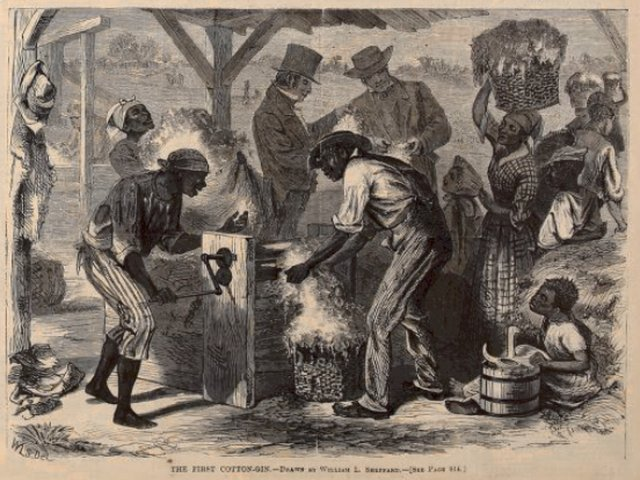
1793 年耶魯畢業生伊萊・惠特尼（Eli Whitney）在喬治亞莫伯利格羅莊園造出鋸齒軋棉機（cotton gin），將去籽效率提高約 50 倍，真兇卻是三重咬合——蘭開夏紡機對原棉的無底需求、美國南方短絨陸地棉去籽太難、長絨海島棉無地可種，惠特尼一台小機器意外把工業革命與奴隸制綁成共犯。

[→ 對外連結：軋棉機：短絨棉瓶頸、專利盜版與奴隸擴張的多因案件](https://chad-liu.github.io/books/html/8-6.工業革命史/1793-軋棉機.html)

## 1797 | 銀行休兌與紙鎊
1797 年英格蘭銀行暫停現金兌付沒有單一兇手，它是英法戰爭軍費外流、鄉村銀行擠兌傳染與政府舉債透支三者咬合的產物。此事件催生了長達二十四年的不可兌現「紙鎊」時代，並以紙鎊貶值爭論逼出了李嘉圖貨幣數量論，永久改變了紙幣信用的正當性基礎。

[→ 對外連結：銀行休兌與紙鎊：戰爭擠兌、暫停兌現與數量論的多因案件](https://chad-liu.github.io/books/html/8-6.工業革命史/1797-銀行休兌與紙鎊.html)

## 1799 | 公制與度量衡標準
1799 年，法國封存「檔案米」（mètre des archives）：子午線四千萬分之一為 1 米，白金棒為準。此後兩百年，度量衡從封建領主各搞一套變成全球同一把尺。本案追查：統一單位如何降低交易成本、引爆可互換零件與大量生產？

度量衡分裂 → 國家標準＋十進制 → 可互換零件 → 大量生產 → 全球供應鏈

[→ 對外連結：公制與度量衡：革命如何統一每一把尺](https://chad-liu.github.io/books/html/8-6.工業革命史/1799-公制與度量衡標準.html)

## 1801 | 倫敦證交所
1801 年倫敦證券交易所（London Stock Exchange）立約成立，兇手不是一紙章程，而是「國債膨脹—經紀人驅逐投機客—鐵路融資飢渴」三力咬合。此案把咖啡館裡的漫天喊價變成會員制的有組織市場，一舉降低了股權融資的搜尋成本與違約風險，是現代價格發現機制的起點。

[→ 對外連結：倫敦證交所：喬納森咖啡館、成立章程與鐵路股權的多因案件](https://chad-liu.github.io/books/html/8-6.工業革命史/1801-倫敦證交所.html)

## 1804 | 民法典與財產權
1804 年 3 月 21 日《拿破崙民法典》頒布，兇手不是單一皇帝意志，而是「封建混亂—革命土改—商業統一—行政集權」多股力量咬合。它以「所有權神聖絕對＋契約自由＋平等繼承」重寫誘因，把三百種習慣法拼成一本交易手冊，一舉把土地、勞動、資本的流轉交易成本砍半。

[→ 對外連結：民法典與財產權：大革命亂局、所有權絕對與契約自由的多因案件](https://chad-liu.github.io/books/html/8-6.工業革命史/1804-民法典與財產權.html)

## 1804 | 蒸汽機車的誕生
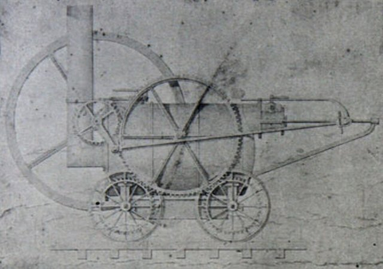
1804 年 2 月，特里維西克（Richard Trevithick）在威爾斯 Pen-y-darren 讓蒸汽機車拉動了 10 噸鐵與 70 名乘客，兇手不是單一天才靈感，而是瓦特專利到期、高壓蒸汽技術突破、煤鐵運輸瓶頸與鑄鐵軌道工業四股力量咬合，才把「會動的蒸汽機」推上鐵軌。

[→ 對外連結：蒸汽機車的誕生：高壓蒸汽、煤鐵需求與專利到期的多因案件](https://chad-liu.github.io/books/html/8-6.工業革命史/1804-蒸汽機車的誕生.html)

## 1807 | 汽船時代
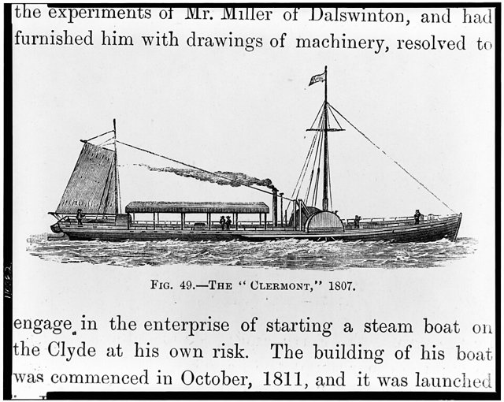
1807 年富爾頓（Robert Fulton）的克萊蒙特號（Clermont）不是第一艘汽船，卻是第一艘賺錢的汽船。本案兇手有三：Boulton & Watt 可靠船用引擎、哈德遜河的地理運輸紅利，以及李文斯頓（Livingston）的紐約水域壟斷＋定期航班商業模式，三者咬合才把 refere 階段的發明變成產業。

[→ 對外連結：汽船時代：引擎、壟斷與哈德遜河的多因案件](https://chad-liu.github.io/books/html/8-6.工業革命史/1807-汽船時代.html)

## 1810 | 機床與可互換零件
1797 年前後，**亨利·莫茲利（Henry Maudslay）**在伯蒙德賽的鐵匠舖裡
造出**溜板刀架（slide rest）螺紋車床**：刀具被機器本身夾持並自動進給——
車出的螺絲**每一顆都一樣**。1810 年前後，他的工坊產出英國工程界的
整整一代宗師（惠特沃斯、內史密斯、羅伯茨），把「工匠的手感」變成「機器的精度」：
母機（machine tool） → 可互換零件 → 批量製造 → 機器的機器可以自我複製
謎題：蒸汽機（1769）早就有了，為什麼工業革命要等三十年才「工業化」？
答案在車床的刀架上。

[→ 對外連結：莫茲利機床工坊（螺絲、車床與「製造機器的機器」）](https://chad-liu.github.io/books/html/8-6.工業革命史/1810-機床與可互換零件.html)

## 1811 | 盧德運動與技術性失業
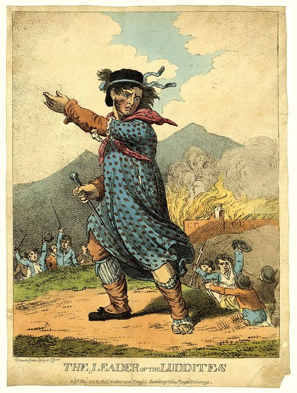
1811 年 3 月諾丁漢郡阿諾德鎮，織襪工匠深夜砸毀寬幅針織機，署名「內德・盧德將軍（General Ludd）」的恐嚇信寄往各工廠。1811–1816 年間，英格蘭中北部約上千台紡織機器被搗毀，國會 1812 年通過《毀機法案》以死刑鎮壓，1813 年約克郡公開絞死十餘名盧德分子。本案的兇手不是無知，而是一條精確的經濟方程式：機器讓織工計件工資五年內腰斬，而利潤全進了廠主口袋——在沒有工會、沒有社保、沒有選票的年代，鐵鎚就是談判桌。

[→ 對外連結：盧德運動：機器破壞者、技術性失業與補償的第一樁案件](https://chad-liu.github.io/books/html/8-6.工業革命史/1811-盧德運動與技術性失業.html)

## 1819 | 達特茅斯學院校案
1819 年美國最高法院在達特茅斯學院訴伍德沃德案中裁定，州政府授予的公司特許狀即受憲法契約條款保護的契約，州不得單方改寫。這起案件沒有單一兇手，而是宗教政治、聯邦主義與商業需求三重咬合：它把公司從州的附庸變成受契約神聖性保護的獨立法人，徹底降低了長期集資的制度性融資成本，為美國公司爆炸奠定了地基。

[→ 對外連結：達特茅斯學院校案：特許狀、契約條款與法人獨立的多因案件](https://chad-liu.github.io/books/html/8-6.工業革命史/1819-達特茅斯學院校案.html)

## 1825 | 鐵路時代開啟
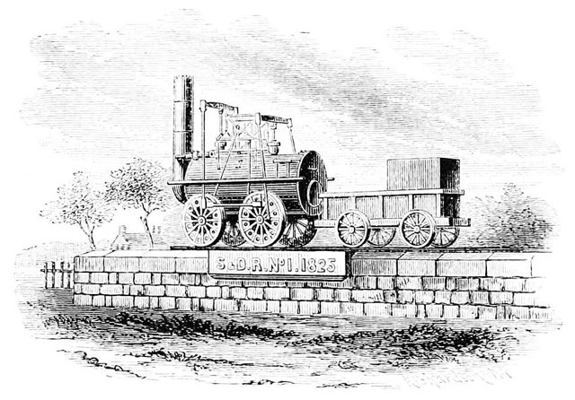
1825 年 9 月 27 日，史蒂芬生（George Stephenson）的 Locomotion No.1 牽引 36 節車在 Stockton–Darlington 鐵路上以時速 24 公里奔馳，現場 4 萬人圍觀。破案關鍵不在一台機車，而是煤礦運輸剛需、議會特許的公共鐵路、熟鐵軌＋標準軌距與固定式引擎之爭落幕，四案併破才開啟鐵路時代。

[→ 對外連結：鐵路時代開啟：煤礦、軌距與機車的多因案件](https://chad-liu.github.io/books/html/8-6.工業革命史/1825-鐵路時代開啟.html)

## 1830 | 利物浦曼徹斯特鐵路

1825 年斯托克頓–達靈頓鐵路只是煤運支線的前奏，真正的兇手在 1830 年 9 月 15 日現身：利物浦–曼徹斯特鐵路（L&MR）以客貨兩用、固定時刻表、純蒸汽牽引、雙線單向行車開業，首次證明鐵路是「會賺錢的通用運輸系統」。此案不審「誰發明了鐵路」，而審「誰讓鐵路從煤礦器械變成產業革命的主幹道」。

[→ 對外連結：利物浦曼徹斯特鐵路：時刻表、商業驗證與現代鐵路模板的案件](https://chad-liu.github.io/books/html/8-6.工業革命史/1830-利物浦曼徹斯特鐵路.html)

## 1833 | 工廠法與勞工
1833 年英國《工廠法》（Factory Act）首次規定 9 歲以下不得進紡織廠、9–13 歲每週至多 48 小時並須上學，還派出四名巡視員（Inspector）全國執法。兇手不是單一善人，而是不堪的童工傷亡證詞、輝格黨改革政治、經濟週期動盪與 inspections 制度創新四線交纏，國家從此走進工廠大門。

[→ 對外連結：工廠法與勞工：童工、工時與國家干預的多因案件](https://chad-liu.github.io/books/html/8-6.工業革命史/1833-工廠法與勞工.html)

## 1837 | 戶籍統計與現代國家
1837 年，英格蘭與威爾斯實施民事出生、婚姻、死亡強制登記（General Register Office, GRO），統計學家 William Farr 據此編出第一套現代生命表。此前國家不知一年生死多少人；此後「人口」變成可治理的數字。本案追查：統計如何把人變成政策？

強制登記 → 死因＋年齡結構可見 → 精算＋公衛＋社保 → 現代治理

[→ 對外連結：戶籍統計與現代國家：出生紙如何發明「人口」](https://chad-liu.github.io/books/html/8-6.工業革命史/1837-戶籍統計與現代國家.html)

## 1842 | 礦山法案
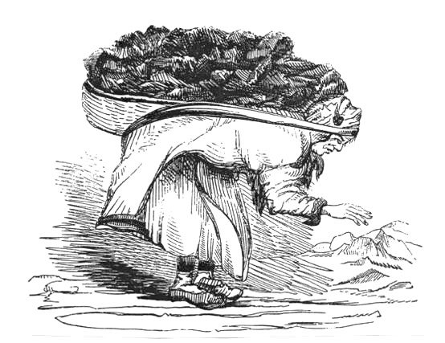
1842 年，英國《礦山法案》：禁止 10 歲以下童工、禁止女性下井。此前：阿什利勳爵調查委員會（童工拖煤車、孕婦裸身拉礦車，證詞震驚全國）、礦難頻發（1838 赫斯頓 26 童工溺斃）。此前已有 1833 年工廠法（參見 [工廠法與勞工](https://chad-liu.github.io/books/html/8-6.工業革命史/1833-工廠法與勞工.html)）。工業革命的光鮮（蒸汽機、鐵路）之下，是誰在流血？

> **進步的代價誰付？當 8 歲孩子在黑暗中拖煤車，議會的紳士們為何花了十年才立法？**

[→ 對外連結：礦山法案：女工童工與工業的底層](https://chad-liu.github.io/books/html/8-6.工業革命史/1842-礦山法案.html)

## 1844 | 皮爾銀行法
1844 年《皮爾銀行法》（Bank Charter Act）沒有單一作者，它是通貨學派對 1825、1839 年危機的診斷、皮特爾首相重建貨幣紀律的政治意志與銀行學派的反對妥協三者咬合的產物。此法以發行部與銀行部分立的硬枷鎖馴服了紙幣超發，卻在 1847、1857、1866 年三次被迫暫停，逼出了白芝浩「最後貸款人」的破局心法。

[→ 對外連結：皮爾銀行法：通貨學派、發行紀律與白芝浩時刻的多因案件](https://chad-liu.github.io/books/html/8-6.工業革命史/1844-皮爾銀行法.html)

## 1844 | 電報革命
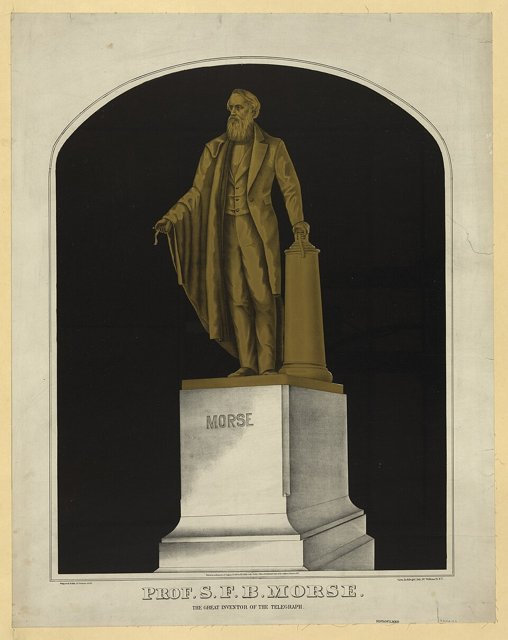
1844 年 5 月 24 日，莫爾斯（Samuel Morse）在華盛頓敲出“What hath God wrought”，40 英里外的巴爾的摩即時收到；英國惠斯通（Wheatstone）—庫克（Cooke）針式電報 1837 年已沿鐵路運行。兇手是電磁學突破、鐵路調度剛需、廉價編碼＋繼電器與國家郵政壟斷鬆動四力共犯，把資訊速度從馬蹄變成光速。

[→ 對外連結：電報革命：電磁學、鐵路與編碼的多因案件](https://chad-liu.github.io/books/html/8-6.工業革命史/1844-電報革命.html)

## 1845 | 鐵路狂熱與泡沫
1845–1847 年，英國爆發史上第一次全國性基建泡沫——「鐵路狂熱」（Railway Mania）：國會一年批准逾兩千英里新線，鐵路股認購只需付一成保證金，教區牧師、寡婦、僕人全民炒股，股價一年翻倍再腰斬。1847 年貨幣緊縮＋1848 年大饑荒轉口需求退潮，泡沫破裂，數十萬中產血本無歸。但諷刺的是：泡沫留下全世界第一張全國鐵路網——1840 年 1,300 英里，1850 年逾 6,600 英里。本案偵破的是泡沫的雙面性：金融上是騙局，實體上是路網；罵泡沫的人坐的正是泡沫修的火車。

[→ 對外連結：鐵路狂熱與泡沫：五分錢保證金、國會私案與路網遺產案](https://chad-liu.github.io/books/html/8-6.工業革命史/1845-鐵路狂熱與泡沫.html)

## 1846 | 穀物法廢除
1846 年 6 月英國廢除《穀物法》（Corn Laws），兇手不是單一飢餓愛爾蘭，而是「工業資產階級—反穀物法同盟—馬鈴薯疫病—皮爾背叛地主」多股力量咬合。它以關稅滑尺制終結改為低關稅＋三年落日，把麵包定價權從地主議會還給世界市場，一舉降低了勞工餬口與工廠出口的雙重交易成本。

[→ 對外連結：穀物法廢除：地主尋租、饑荒衝擊與自由貿易的多因案件](https://chad-liu.github.io/books/html/8-6.工業革命史/1846-穀物法廢除.html)

## 1848 | 芝加哥期貨市場
1848 年芝加哥期貨交易所（CBOT）成立，兇手不是一間交易所，而是「中西部穀物洪流—價格暴漲暴跌—分級與電報」三力咬合。此案把「一包一議價的現貨」變成「標準品級的遠期」，再變成保證金清算的期貨，一舉降低了農民與麵粉商的價格風險，是套期保值的誕生地。

[→ 對外連結：芝加哥期貨市場：穀物洪流、分級標準與套期保值的多因案件](https://chad-liu.github.io/books/html/8-6.工業革命史/1848-芝加哥期貨市場.html)

## 1851 | 水晶宮萬國博覽會
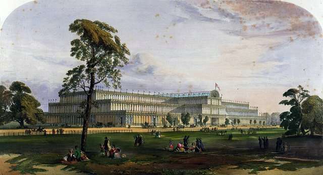
1851 年 5 月至 10 月，海德公園內一座長 564 公尺的鑄鐵玻璃建築接待了 630 萬人次，展出 13 萬件展品。兇手不是「博覽會」，而是「展示平台」：阿爾伯特親王與皇家藝術學會把工業革命的成果第一次彙編成可比較、可評獎、可交易的全球清單。本案追問：為什麼世界工廠需要一場展覽？

[→ 對外連結：水晶宮萬國博覽會：世界工廠的加冕典禮與展示平台的案件](https://chad-liu.github.io/books/html/8-6.工業革命史/1851-水晶宮萬國博覽會.html)

[→ 對外連結：水晶宮萬國博覽會（世界工廠的加冕與警報）](https://chad-liu.github.io/books/html/8-6.工業革命史/1851-萬國博覽會.html)

## 1855 | 有限責任法
1855 年英國《有限責任法》（Limited Liability Act）通過，兇手不是單一改革家，而是「鐵路需鉅資—無限責任嚇退中產—1844 年登記制鋪路—自由貿易思潮」多因素咬合。它把股東責任鎖定在出資額內，一舉降低了陌生人合資的風險溢價與資本動員成本。

[→ 對外連結：有限責任法：鐵路鉅資、合夥枷鎖與風險不對稱的多因案件](https://chad-liu.github.io/books/html/8-6.工業革命史/1855-有限責任法.html)

## 1856 | 貝塞麥煉鋼法
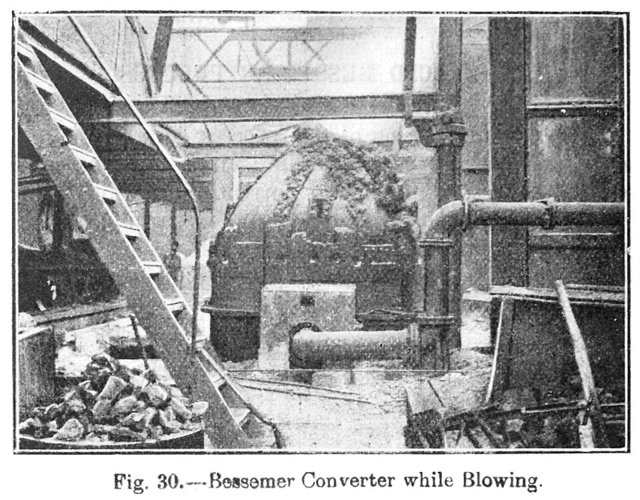
1856 年 8 月，貝塞麥（Henry Bessemer）在 Cheltenham 英國科學年會上宣布：往熔鐵水吹空氣 20 分鐘即成鋼，成本從每噸 50 英鎊掉到 7 英鎊。兇手不是一人靈光，而是克里米亞戰爭軍火需求、焦炭高爐鐵水充沛、 Mushet 脫氧補錳與專利授權商業戰四力咬合，把實驗室噴火轉爐變成鋼鐵時代引擎。

[→ 對外連結：貝塞麥煉鋼法：空氣、焦炭與軍火訂單的多因案件](https://chad-liu.github.io/books/html/8-6.工業革命史/1856-貝塞麥煉鋼法.html)

## 1858 | 倫敦大惡臭與公共衛生法

1858 年 6 月，倫敦泰晤士河在高溫下蒸出史稱「大惡臭」的毒霧，國會被臭味驅散，八週內火速通過《大都會地方稅法》，撥款 300 萬鎊交給巴澤爾杰特（Joseph Bazalgette）修建 1,300 公里下水道。兇手不是臭味，而是「外部性」：三百萬人把污物倒進飲水源，私人成本與社會成本的缺口終於大到連立法者都聞得到。

[→ 對外連結：倫敦大惡臭與公共衛生法：外部性、糞水與城市作業系統的案件](https://chad-liu.github.io/books/html/8-6.工業革命史/1858-倫敦大惡臭與公共衛生法.html)

## 1859 | 石油時代開啟
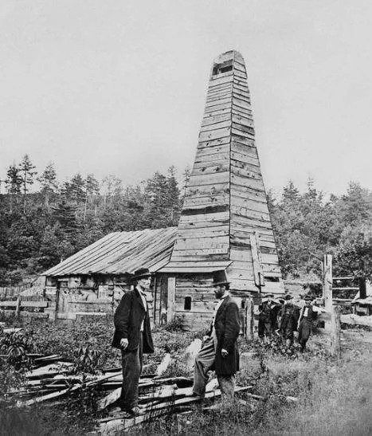
1859 年不是一個人挖到石油這麼簡單，真正的兇手是三股力量同時咬合：照明需求逼出煤油、鹽井鑽探技術轉用到油井、以及資本敢於下注。德雷克油井只是引爆點，石油時代是被「點亮黑夜」的需求叫出來的。

[→ 對外連結：石油時代開啟：鯨油危機、鑽井技術與煤油需求的多因案件](https://chad-liu.github.io/books/html/8-6.工業革命史/1859-石油時代開啟.html)

## 1860 | 英法商約與最惠國
1860 年科布登–舍瓦利埃條約沒有單一兇手，它是法國威權自由化、英國自由貿易攻勢與無條件最惠國條款設計三者咬合的產物。此法律以雙邊讓利加 MFN 自動擴散，大幅降低了歐洲關稅談判的交易成本，卻以各國讓渡關稅自主為代價。

[→ 對外連結：英法商約與最惠國：拿破崙三世、科布登與關稅自主讓渡的多因案件](https://chad-liu.github.io/books/html/8-6.工業革命史/1860-英法商約與最惠國.html)

## 1863 | 綠背鈔與國民銀行
美國統一貨幣沒有單一兇手，它是南北戰爭巨額軍費、黃金暫停兌付的財政絕境與各州銀行券雜亂無章三者咬合的產物。此事件以法定貨幣「綠背鈔」（greenbacks）與《國民銀行法》強行縫合了分裂的貨幣版圖，代價是通膨與違憲爭議，卻奠定了美元一統天下的起點。

[→ 對外連結：綠背鈔與國民銀行：戰爭財政、法定貨幣與統一貨幣的多因案件](https://chad-liu.github.io/books/html/8-6.工業革命史/1863-綠背鈔與國民銀行.html)

## 1869 | 蘇伊士運河

1869 年地球一口氣被縫了兩針：11 月蘇伊士運河通航、5 月美國橫貫鐵路貫通。沒有單一工程師能獨攬功勞，真正的兇手是帝國競爭要捷徑、蒸汽船與鐵路要路權、國際資本要回報，三者咬合才把好望角繞行史送進墳墓。

[→ 對外連結：蘇伊士運河：帝國野心、蒸汽動力與全球時間壓縮的多因案件](https://chad-liu.github.io/books/html/8-6.工業革命史/1869-蘇伊士運河.html)

## 1870 | 全能銀行與德國追趕
1870 年德意志銀行（Deutsche Bank）在柏林成立，兇手不是一家銀行，而是「德意志統一—重化工業資本飢渴—全能銀行制度」三力咬合。此案把「英國式分業小銀行」變成「德國式全能大銀行」，一舉降低了追趕工業化的資本動員與監督成本，是格申克龍後發優勢論的金融版。

[→ 對外連結：全能銀行與德國追趕：統一市場、德意志銀行與後發優勢的多因案件](https://chad-liu.github.io/books/html/8-6.工業革命史/1870-全能銀行與德國追趕.html)

## 1871 | 金本位時代
國際金本位沒有單一兇手，它是德國統一的政治決斷、英國霸權的網路效應與休謨自動調節信念三者咬合的產物。此制度以可兌換承諾大幅降低了國際貿易的匯率風險與交易成本，卻以犧牲國內物價與就業穩定為代價。

[→ 對外連結：金本位時代：德國統一、英國霸權與休謨機制的多因案件](https://chad-liu.github.io/books/html/8-6.工業革命史/1871-金本位時代.html)

## 1873 | 長蕭條與股災
1873 年大崩盤沒有單一兇手，它是德奧創業者狂熱、美國鐵路過度建設與歐美貨幣緊縮三者咬合的產物。此事件終結了 1850-1873 年的繁榮年代，開啟長達二十三年（1873-1896）的物價長跌與利潤擠壓，迫使列強以卡特爾、關稅與帝國主義另尋出路。

[→ 對外連結：長蕭條與股災：鐵路泡沫、維也納股災與金本位緊縮的多因案件](https://chad-liu.github.io/books/html/8-6.工業革命史/1873-長蕭條與股災.html)

## 1876 | 電話
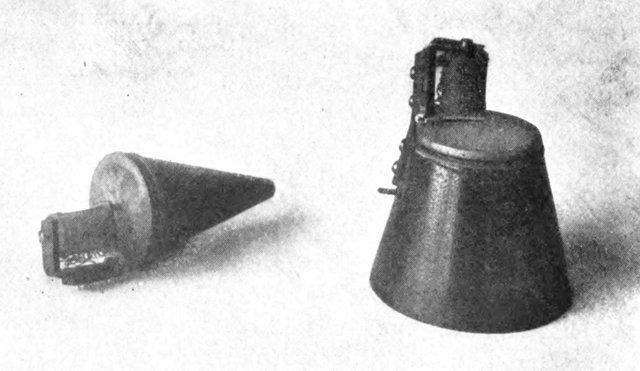
電話不是貝爾一個人在閣樓裡靈光一閃，而是聾啞教育帶來的聲學執念、電報塞車帶來的複式電報競賽、以及美國專利制度的時間差共同作案。1876 年 3 月那紙專利，只是多重咬合後浮出水面的刀尖。

[→ 對外連結：電話：聾啞教育、電報瓶頸與專利閃擊的多因案件](https://chad-liu.github.io/books/html/8-6.工業革命史/1876-電話.html)

## 1879 | 白熾燈與電力網
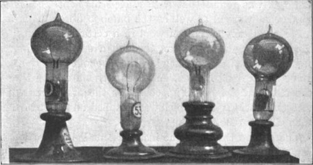
愛迪生並未「發明電燈」，他發明的是整套電力系統：高電阻燈絲、並聯迴路、電表、保險絲與中央發電站。1879 年燈絲點亮只是破門，1882 年珍珠街發電站送電、以及隨後的交直流之爭，才是把煤氣燈真正送上斷頭台的連環計。

[→ 對外連結：白熾燈與電力網：燈絲、發電站與交直流之爭的多因案件](https://chad-liu.github.io/books/html/8-6.工業革命史/1879-白熾燈與電力網.html)

## 1883 | 俾斯麥社會保險
俾斯麥社會保險沒有單一兇手，它是反社會主義鎮壓、工業化工伤危機與容克官僚國家能力三者咬合的產物。此制度以強制納保大幅降低了勞工疾病與老年的不確定性成本（預防性儲蓄與社會動盪成本），卻開啟了國家干預勞動市場的福利國家之路。

[→ 對外連結：俾斯麥社會保險：鎮壓、收買與官僚化的多因案件](https://chad-liu.github.io/books/html/8-6.工業革命史/1883-俾斯麥社會保險.html)

## 1883 | 巴黎公約
1883 年《保護工業產權巴黎公約》沒有單一兇手，它是跨國仿冒失控、發明博覽會的專利恐慌與國民待遇法律發明三者咬合的產物。此法律以外國人享有本國人同等待遇，大幅降低了跨國申請專利商標的交易成本，奠定全球智財體系地基。

[→ 對外連結：巴黎公約：仿冒、國民待遇與優先權的多因案件](https://chad-liu.github.io/books/html/8-6.工業革命史/1883-巴黎公約.html)

## 1886 | 伯恩公約
1886 年《伯恩公約》沒有單一兇手，它是跨國盜版猖獗、雨果文人外交與自動保護法律發明三者咬合的產物。此法律以無須註冊即受保護，大幅降低了作家藝術家的跨國維權成本，首次把版權從特權變成天賦人權。

[→ 對外連結：伯恩公約：雨果、盜版與自動保護的多因案件](https://chad-liu.github.io/books/html/8-6.工業革命史/1886-伯恩公約.html)

## 1886 | 汽車誕生
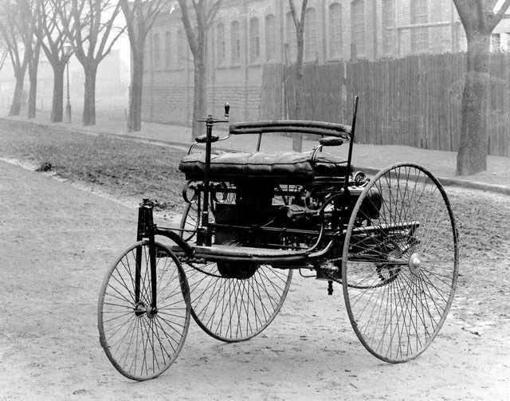
汽車不是哪天被發明出來的，而是在德國西南角被兩組人馬同時拼出來的：賓士造出三輪專利車，戴姆勒與邁巴赫造出高速汽油機加四輪馬車。沒有單一兇手，兇手是奧托循環引擎、石油副產品汽油、以及精密機械加工三環咬死。

[→ 對外連結：汽車誕生：汽油引擎、橡膠輪胎與德國工匠的多因案件](https://chad-liu.github.io/books/html/8-6.工業革命史/1886-汽車誕生.html)

## 1888 | 交流電大戰
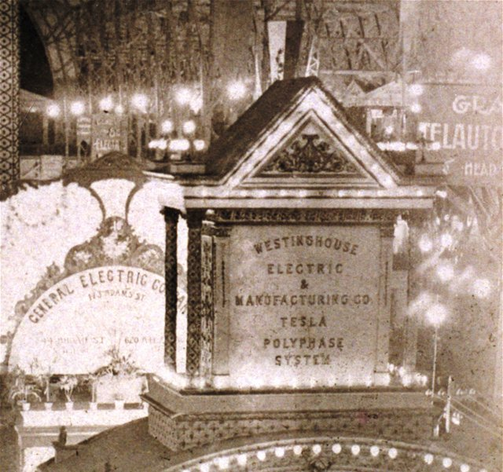
1888 年，喬治·威斯汀豪斯買下**特斯拉的多相交流電專利**；
愛迪生則發動公開抹黑——當街電死大象、推動用交流電行刑（電椅）——
「**電流戰爭（War of the Currents）**」全面開打。1893 年芝加哥世博會
與 1896 年尼亞加拉水電站兩役，交流電系統完勝：
變壓器 ⇒ 高壓輸電 ⇒ 傳輸損耗 ∝ I²R 銳減 ⇒ 工廠擺脫河流與煤堆
謎題：直流電明明「更安全、技術已成熟」，為什麼輸了？
因為這不是電池之爭，而是**電力網的拓撲之爭**。

[→ 對外連結：交流電大戰（特斯拉、西屋與「電力網的拓撲之爭」）](https://chad-liu.github.io/books/html/8-6.工業革命史/1888-交流電大戰.html)

## 1890 | 謝爾曼反托拉斯法
1890 年《謝爾曼法》沒有單一兇手，它是托拉斯組織創新、農民中小企業憤怒與聯邦權力擴張野心三者咬合的產物。此法律以「限制貿易違法＋壟斷化違法」改變了併購與卡特爾的誘因，卻因條文模糊與執法鬆緊擺盪，演出二十年紙老虎、後三十年利牙的反轉劇。

[→ 對外連結：謝爾曼反托拉斯法：標準石油、托拉斯與執法擺盪的多因案件](https://chad-liu.github.io/books/html/8-6.工業革命史/1890-謝爾曼反托拉斯法.html)

## 1903 | 飛機
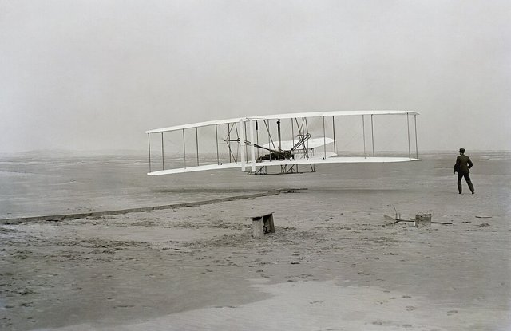
萊特兄弟不是第一個離地的人，卻是第一個能駕駛著回來的人。1903 年 12 月 17 日的 12 秒飛行，兇手不是大馬力引擎，而是李林塔爾的升力遺產、自製風洞的正確數據、與三軸控制的專利絕招三者咬合，動力反而是最弱的一環。

[→ 對外連結：飛機：滑翔血淚、風洞數據與三軸控制的多因案件](https://chad-liu.github.io/books/html/8-6.工業革命史/1903-飛機.html)

## 1911 | 泰勒科學管理
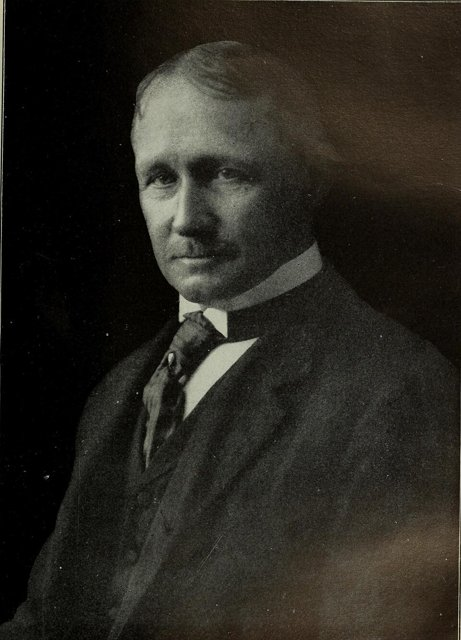
1911 年，費雷德里克·泰勒（Frederick W. Taylor）出版《科學管理原理》，把「工人偷懶」從道德問題改判為組織設計問題。兇手不是單一的懶惰或貪婪，而是大工廠時代裡經驗壟斷、計件工資失靈與協調成本飆升三者咬合，逼出一套用碼錶與工作單重寫勞資關係的新技術。

[→ 對外連結：泰勒科學管理：勞動怠工、規模工廠與組織技術的多因案件](https://chad-liu.github.io/books/html/8-6.工業革命史/1911-泰勒科學管理.html)

## 1913 | 福特流水線

1913 年底特律海蘭公園（Highland Park）工廠裡，底盤在傳動帶上流動起來，汽車組裝時間從 12 小時墜落至 90 分鐘。兇手不是亨利·福特一人的天才，而是 T 型車的單一設計、可互換零件、泰勒式時間研究與龐大中產市場四者咬合，外加 1914 年「五元日薪」這枚穩定軍心的釘子。

[→ 對外連結：福特流水線：T型車、規模經濟與五元日薪的多因案件](https://chad-liu.github.io/books/html/8-6.工業革命史/1913-福特流水線.html)

## 1913 | 聯邦準備法案
美聯儲的誕生沒有單一兇手，它是1907年大恐慌、缺乏最後貸款人的結構缺陷與進步主義政治妥協三者咬合的產物。此制度以彈性貨幣與貼現窗口大幅降低了銀行擠兌的流動性成本，卻在成立十六年後迎來大蕭條的終極考驗。

[→ 對外連結：聯邦準備法案：恐慌、私人救市失靈與最後貸款人的多因案件](https://chad-liu.github.io/books/html/8-6.工業革命史/1913-聯邦準備法案.html)

## 1916 | 坦克與陸戰革命

1916 年 9 月 15 日，索姆河（Flers！）——英軍 49 輛 Mark I 坦克（「水櫃」！Water tank！保密代號！）首次參戰——**坦克登場**；此前：1914–15 塹壕僵持（機槍—鐵絲網！「無人區」！）、1915 丘吉爾「陸地艦」（Landship委員會！海軍！）、Tritton—Wilson（農業機械！拖拉機履帶！）——**拖拉機穿上盔甲**。此後：1917 康布雷（300 輛！突進 10km！）、1918 亞眠（600 輛！「德軍黑日」！）、1919 計劃（Plan 1919！富勒！）、1920s–30s 閃電戰理論（富勒—利德爾哈特—圖哈切夫斯基—古德里安！）——**機械化戰爭**。這樁案件是「內燃機的戰場化」：**拖拉機＋裝甲＋火炮＝陸戰革命**。

[→ 對外連結：坦克：內燃機走上戰場](https://chad-liu.github.io/books/html/8-6.工業革命史/1916-坦克與陸戰革命.html)

## 1920 | 事業部制與杜邦分析
1920 年前後，杜邦的唐納森·布朗發明 ROI 分解公式，通用汽車的斯隆則以事業部制（M-form）重組帝國，兩者咬合成現代管理會計的誕生。本案無單一兇手：火藥與汽車的多角化失控、家族資本亟需可比較的績效語言、會計技術恰好成熟，共同把「憑感覺經營」變成「用數字治理」，從此改寫了大公司的內部融資成本與資本配置邏輯。

[→ 對外連結：事業部制與杜邦分析：ROI公式、轉撥計價與分權管理的多因案件](https://chad-liu.github.io/books/html/8-6.工業革命史/1920-事業部制與杜邦分析.html)

## 1924 | 海牙規則
1924 年《海牙規則》沒有單一兇手，它是船東免責條款失控、貨方保險業反撲與提單標準化技術成熟三者咬合的產物。此法律以承運人最低責任＋免責清單，大幅降低了海上貨運的糾紛與保險成本，首次把航海习惯法變成全球成文法。

[→ 對外連結：海牙規則：提單、承運人責任與航海法國際化的多因案件](https://chad-liu.github.io/books/html/8-6.工業革命史/1924-海牙規則.html)

## 1929 | 大蕭條與金本位解體

大蕭條沒有單一兇手，它是美國股災泡沫破裂、聯準會緊縮失誤與金本位跨國傳染三者咬合的產物。此事件以 1931 年英國脫離金本位為轉折，證明硬匯率錨會把一國緊縮變成全球通縮，也催生了艾克格林與弗里德曼學派關於「金本位束縛 vs 貨幣政策失誤」的世紀爭論。

[→ 對外連結：大蕭條與金本位解體：股災緊縮、金本位束縛與理論對決的多因案件](https://chad-liu.github.io/books/html/8-6.工業革命史/1929-大蕭條與金本位解體.html)

## 1933 | 格拉斯-斯蒂格爾法案
1933年銀行改革沒有單一兇手，它是1929年股災傳染、證券投機掏空商業銀行與擠兌心理崩潰三者咬合的產物。此制度以分業經營與聯邦存款保險大幅降低了普通儲戶的資訊不對稱與監督成本，卻也種下金融壓抑與日後影子銀行規避的種子。

[→ 對外連結：格拉斯-斯蒂格爾法案：大蕭條、銀行分業與存款保險的多因案件](https://chad-liu.github.io/books/html/8-6.工業革命史/1933-格拉斯-斯蒂格爾法案.html)

## 1934 | SEC與資訊揭露
美國證券交易委員會（SEC）沒有單一父親，它是 1929 年股災詐欺敗露、州藍天法失靈與羅斯福新政聯邦化意志三者咬合的產物。此制度以強制揭露與反詐欺大幅降低了散戶與發行人間的資訊不對稱，卻也開啟了「揭露 vs 實質審查」的百年監管辯論。

[→ 對外連結：SEC與資訊揭露：股災詐欺、強制揭露與聯邦監管的多因案件](https://chad-liu.github.io/books/html/8-6.工業革命史/1934-SEC與資訊揭露.html)

## 1936 | 凱因斯革命
1936 年凱因斯出版《就業、利息與貨幣通論》，刺破古典經濟學「供給創造需求」的迷夢，直指大蕭條的兇手不是單一 bank run，而是有效需求不足、流動性陷阱與動物精神崩盤的連環咬合。此案把政府從市場的守夜人變成總體調控者，改寫了國家融資與財政赤字的正當性，為戰後三十年榮景提供了理論地基。

[→ 對外連結：凱因斯革命：有效需求、流動性陷阱與財政政策的多因案件](https://chad-liu.github.io/books/html/8-6.工業革命史/1936-凱因斯革命.html)

## 1944 | 布雷頓森林體系

布雷頓森林沒有單一兇手，它是戰間期貨幣戰爭的創傷、美國壓倒性經濟霸權與懷特-凱因斯藍圖競爭三者咬合的產物。此制度以「美元錨＋固定匯率＋IMF 融通」大幅降低了戰後貿易的匯率不確定性成本，卻內藏特里芬難題的自毀裝置。

[→ 對外連結：布雷頓森林體系：懷特、凱因斯與美元本位的多因案件](https://chad-liu.github.io/books/html/8-6.工業革命史/1944-布雷頓森林體系.html)

## 1946 | 創投的誕生
1946 年哈佛商學院教授喬治·多里奧創立美國研究與發展公司（ARD），把戰時技術、商學院管理術與華爾街資金縫合成第一家機構化創投。本案沒有單一發明家兇手，而是英雄資本家、多角化雷達技術與封閉型基金結構三者咬合：ARD 對數位設備公司（DEC）7 萬美元投資翻成 3.55 億美元的傳奇，證明高風險早期股權可以系統化獲利，也埋下了有限合夥制取代公司制的種子。

[→ 對外連結：創投的誕生：多里奧、ARD與DEC豪賭的多因案件](https://chad-liu.github.io/books/html/8-6.工業革命史/1946-創投的誕生.html)

## 1947 | GATT
1947 年《關稅暨貿易總協定》沒有單一兇手，它是 1930 年代報復性關稅的創傷、美國霸權的設計與嵌入式自由主義妥協三者咬合的產物。此法律以 MFN＋約束稅率＋多邊回合，大幅降低了貿易政策的背叛誘因與談判成本，為戰後三十年榮景立約。

[→ 對外連結：GATT：大蕭條、美國霸權與嵌入式自由主義的多因案件](https://chad-liu.github.io/books/html/8-6.工業革命史/1947-GATT.html)

## 1947 | 電晶體

1947 年 12 月 16 日，貝爾實驗室的巴丁（John Bardeen）與布拉頓（Walter Brattain）在鍺晶體上聽到放大的電訊號，真空管的百年獨裁開始倒數。兇手不是三位天才的靈光一閃，而是量子力學、戰時雷達冶金術與 AT&T 通訊網擴容壓力三方咬合，在蕭克利（William Shockley）領軍的固體物理組裡引爆。

[→ 對外連結：電晶體：貝爾實驗室、量子物理與通訊需求的多因案件](https://chad-liu.github.io/books/html/8-6.工業革命史/1947-電晶體.html)

## 1956 | 清潔空氣法
1956 年英國《清潔空氣法》是全球第一部現代空氣污染成文法，兇手不是單一煙囪，而是 1952 年倫敦大煙霧的數千條人命、戰後燃煤依賴與自由放任公害體制三者咬合；此法律把「呼吸乾淨空氣」從免費公共財變成受管制的稀缺財，用煙霧管制區與無煙燃料把外部成本打回排放者帳上，大幅降低健康損害的交易成本。

[→ 對外連結：清潔空氣法：濃霧、燃煤與外部性內部化的多因案件](https://chad-liu.github.io/books/html/8-6.工業革命史/1956-清潔空氣法.html)

## 1956 | 貨櫃革命
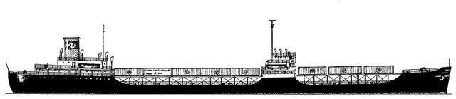
1956 年 4 月 26 日，美國紐華克港，「理想X號（Ideal X）」油輪甲板上載著 58 個 35 英尺鐵箱子啟航駛往休士頓。卡車大亨馬爾科姆・麥克萊恩（Malcom McLean）的構想極其粗暴：不要把貨物裝上船，把整輛卡車車廂裝上船。裝卸成本從每噸 5.86 美元跌到 0.16 美元，港口停靠從數日縮到數小時。本案的兇手不是引擎，而是一個標準尺寸的鐵箱——運費崩跌一個數量級，全球供應鏈與「世界工廠」轉移自此開始。

[→ 對外連結：貨櫃革命：麥克萊恩的鐵箱子如何吃掉半個運費世界](https://chad-liu.github.io/books/html/8-6.工業革命史/1956-貨櫃革命.html)

## 1958 | 積體電路
1958 年 9 月 12 日，德州儀器（TI）的傑克·基爾比（Jack Kilby）在一塊鍺片上把電阻、電容與電晶體連在一起，按下開關，示波器上出現穩定的正弦波——人類第一塊積體電路（IC）通電成功。半年後，仙童半導體（Fairchild）的羅伯特·諾伊斯（Robert Noyce）用平面工藝與鋁互連做出可量產的版本。兇手不是單一的天才靈光，而是軍方小型化需求、電晶體「數量暴政」（tyranny of numbers）困境、平面工藝成熟與專利競賽四者咬合，把「一堆零件焊在一起」變成「在一塊石頭上長出整台機器」。

[→ 對外連結：積體電路：基爾比、諾伊斯與「把整台機器塞進石頭」的案件](https://chad-liu.github.io/books/html/8-6.工業革命史/1958-積體電路.html)

## 1971 | 微處理器
1971 年 11 月 15 日，英特爾發表 4004——指甲蓋大的晶片上塞進 2300 個電晶體，完整裝下一顆 4 位元 CPU。兇手不是單一的電路天才，而是積體電路成熟、計算器廠商的客製需求、矽閘極工藝突破與摩爾定律自我實現的預期四者咬合，把「一台電腦」壓縮成「一顆晶片」。

[→ 對外連結：微處理器：英特爾4004、積體電路與摩爾定律的多因案件](https://chad-liu.github.io/books/html/8-6.工業革命史/1971-微處理器.html)

## 1972 | 矽谷創投體制
1972 年紅杉資本（Sequoia）與凱鵬華盈（KPCB）在沙丘路同年掛牌，標誌創投從東岸 ARD 式公司制轉向西岸有限合夥制。本案兇手不是單一明星合夥人，而是組織創新（10 年期有限合夥＋2/20 收費）、資金供給（ERISA 鬆綁前夜＋小企業投資法教訓）與技術需求（半導體＋個人電腦浪潮）三重咬合，一舉把高風險科技融資的成本與治理標準化，矽谷從此有了印鈔生產線。

[→ 對外連結：矽谷創投體制：有限合夥、紅杉KPCB與退休金活水的多因案件](https://chad-liu.github.io/books/html/8-6.工業革命史/1972-矽谷創投體制.html)

## 1973 | 浮動匯率與石油美元
浮動匯率與石油美元沒有單一兇手，它是特里芬難題爆發、尼克森政治決斷與 OPEC 石油武器三者咬合的產物。此制度以匯率彈性大幅降低了各國維持平價的儲備耗損與緊縮成本，卻以匯率波動風險與美元霸權更隱形的形式為代價。

[→ 對外連結：浮動匯率與石油美元：尼克森衝擊、牙買加體系與石油危機的多因案件](https://chad-liu.github.io/books/html/8-6.工業革命史/1973-浮動匯率與石油美元.html)

## 1973 | 選擇權定價革命
1973 年 Black-Scholes 公式發表與芝加哥選擇權交易所（CBOE）開業同年相遇，把選擇權從賭場籌碼變成可定價、可複製的金融工程零件。本案兇手不是單一數學天才，而是偏微分方程定價、集中撮合交易與浮動匯率時代避險需求三重咬合：風險中性定價一舉改寫了風險的融資成本，衍生品名目本金從此爆炸式成長，也為 1987 與 2008 的災難埋下引線。

[→ 對外連結：選擇權定價革命：Black-Scholes、CBOE與風險中性的多因案件](https://chad-liu.github.io/books/html/8-6.工業革命史/1973-選擇權定價革命.html)

## 1974 | 主權基金與工業政策
1974 年，新加坡把能源、電信、港口、銀行等國企股權注入新設的**淡馬錫（Temasek）**，以商業公司法治理由是：部長不應兼任董事長。50 年後淡馬錫躋身全球十大主權基金，星展、新航、勝科皆其子。本案追查：主權基金如何從產油國專利變成工業政策工具？

國企 politicized → 控股公司隔離 → 商業董事會＋財報 → 產業升級資本 → 全球收益反哺

[→ 對外連結：淡馬錫與主權工業資本：小國如何用基金造產業](https://chad-liu.github.io/books/html/8-6.工業革命史/1974-主權基金與工業政策.html)

## 1975 | 華爾街五一革命
1975 年 5 月 1 日「五一革命」（May Day）沒有單一兇手，它是機構投資人反叛、司法部反托拉斯壓力與折扣經紀技術三者咬合的產物。此案以佣金自由化大幅降低了交易成本與散戶參與門檻，卻以經紀商倒閉潮、研究補貼模式崩解為代價，重塑了華爾街的獲利方程式。

[→ 對外連結：華爾街五一革命：固定佣金終結、折扣經紀商與機構化的多因案件](https://chad-liu.github.io/books/html/8-6.工業革命史/1975-華爾街五一革命.html)

## 1979 | 伏爾克衝擊
1979-1982 年伏爾克衝擊（Volcker Shock）沒有單一兇手，它是停滯性通膨失控、貨幣主義上位與央行可信度崩潰三者咬合的產物。此役以聯邦基金利率 20%、失業率 10.8% 的劇痛，大幅降低了通膨預期與長期利率的風險貼水，卻以拉美債務危機與鐵鏽帶蕭條為代價，重建了央行說到做到的信任資本。

[→ 對外連結：伏爾克衝擊：貨幣主義、二十厘利率與停滯性通膨終結的多因案件](https://chad-liu.github.io/books/html/8-6.工業革命史/1979-伏爾克衝擊.html)

## 1980 | 豐田生產方式
1980 年前後，底特律終於發現油耗醜、毛病多的日本小車搶走了美國市場，兇手不是廉價勞工，而是豐田的大野耐一（Taiichi Ohno）用二十年磨出的生產方式：以看板拉動的 JIT、內建品質的自働化（jidoka），把福特「以量取勝」的邏輯整個翻面——不靠規模，靠消滅浪費取勝。

[→ 對外連結：豐田生產方式：JIT、看板與精實革命的多因案件](https://chad-liu.github.io/books/html/8-6.工業革命史/1980-豐田生產方式.html)

## 1986 | 倫敦金融大爆炸
1986 年 10 月 27 日「Big Bang」，倫敦城一夜拆掉百年行規，兇手不是單一法案，而是柴契爾去管制、美日競爭壓力與電子報價技術三股力量咬合；此案的制度紅利在於大幅降低交易成本與跨境資本流動成本，讓倫敦從紳士俱樂部變成全球金融超市。

[→ 對外連結：倫敦金融大爆炸：去管制、電子交易與金融全球化的多因案件](https://chad-liu.github.io/books/html/8-6.工業革命史/1986-倫敦金融大爆炸.html)

## 1989 | 全球資訊網
1989 年 3 月，歐洲核子研究組織（CERN）工程師提姆・伯納斯-李（Tim Berners-Lee）提交一份備忘錄《資訊管理：一個提案》，設想用超文本連結散落各處的物理學家文件。1990 年底首個瀏覽器與伺服器上線，1991 年 8 月對外開放，1993 年 CERN 宣布 Web 技術永久免費。本案的奇點在於：與電話、電報皆由壟斷資本經營相反，資訊時代最關鍵的基礎設施是一份放棄專利的贈與——資訊成本自此趨近於零，平台帝國與網路泡沫都是它的後代。

[→ 對外連結：全球資訊網：伯納斯-李的免費贈與與資訊成本歸零案](https://chad-liu.github.io/books/html/8-6.工業革命史/1989-全球資訊網.html)

## 1989 | 垃圾債券與LBO
1980 年代垃圾債券與槓桿收購（LBO）狂潮沒有單一兇手，它是高利率資金缺口、代理成本理論與米爾肯造市三者咬合的產物。此案以高槓桿大幅降低了收購融資門檻與經理人怠惰成本，卻以違約潮、德崇倒閉與社會「貪婪」罵名為代價，永遠改寫了公司治理的權力版圖。

[→ 對外連結：垃圾債券與LBO：米爾肯、德崇證券與RJR納貝斯克的多因案件](https://chad-liu.github.io/books/html/8-6.工業革命史/1989-垃圾債券與LBO.html)

## 1992 | 卡德伯里公司治理
1992 年，英國 **Cadbury Report** 在 BCCI、Maxwell、Polly Peck 連環醜聞後開出藥方：董事會要有獨立非執行董事、審計委員會、董事長與 CEO 分設、「遵守或解釋」（comply-or-explain）。此後「公司治理」（corporate governance）從學術詞變成全球上市規則。本案追查：幾頁軟法如何馴服大股東與經理人？

醜聞＋掏空 → 治理守則 → 董事會制衡 → 醜聞成本 ↑ → 權益成本 ↓

[→ 對外連結：卡德伯里報告：董事會如何被關進籠子](https://chad-liu.github.io/books/html/8-6.工業革命史/1992-卡德伯里公司治理.html)

## 1994 | WTO與TRIPS
1994 年《馬拉喀什協定》催生 WTO 並把專利綁進貿易（TRIPS），兇手不是單一強權，而是美國 301 條款壓力、烏拉圭回合一攬子交易與跨國藥廠遊說三股力量咬合；此法律用「貿易制裁＋專利最低標準」大幅降低跨國技術交易的執行成本，卻也把藥價與人命綁上談判桌，引爆南北之爭與學名藥大戰。

[→ 對外連結：WTO與TRIPS：貿易、專利與南北之爭的多因案件](https://chad-liu.github.io/books/html/8-6.工業革命史/1994-WTO與TRIPS.html)

## 1995 | 瀏覽器大戰
1995 年 8 月 9 日，網景（Netscape）上市，首日股價從 28 美元飆到 75 美元，市值 20 億美元——一家成立僅 16 個月、零獲利的公司，靠一個免費瀏覽器點燃網路泡沫的第一把火。兇手不是單一的程式天才，而是全球資訊網開放協定、Mosaic 圖形化突破、Windows 壟斷地位的防衛戰與華爾街追逐「入口」四者咬合。瀏覽器從「看網頁的工具」變成「作業系統的替代品」，微軟以免費的 IE 迎戰，三年內把網景絞殺，卻也引來美國史上最大的反托拉斯案。

[→ 對外連結：瀏覽器大戰：Mosaic、網景與微軟的「入口絞殺戰」](https://chad-liu.github.io/books/html/8-6.工業革命史/1995-瀏覽器大戰.html)

## 1997 | 亞洲金融風暴
1997-1998 年亞洲金融風暴沒有單一兇手，它是實質盯住美元、短期外幣負債與政商裙帶資本主義三者咬合的產物。此案以貨幣重貶與 IMF 緊縮大幅提高了外債的本幣償還成本與政策信任成本，卻以「第三代危機模型」與外匯存底囤積為遺產，改寫了新興市場的融資戒律。

[→ 對外連結：亞洲金融風暴：泰銖、短期外債與IMF條件性的多因案件](https://chad-liu.github.io/books/html/8-6.工業革命史/1997-亞洲金融風暴.html)

## 1998 | 歐洲央行治理
1998 年 6 月，**歐洲中央銀行（ECB）**在法蘭克福開張，1999 年接管 11 國貨幣政策：物價穩定為首要目標、理事會一人一票、任期 8 年不得連任、禁止向政府透支。本案是央行治理的頂點：如何讓政客碰不到印鈔機？

通膨記憶＋三元悖論 → 條約鎖死獨立性 → 預期錨定 → 通膨溢價 ↓ → 單一貨幣可行

[→ 對外連結：歐洲央行治理：把印鈔權鎖進條約](https://chad-liu.github.io/books/html/8-6.工業革命史/1998-歐洲央行治理.html)

## 1999 | 歐元誕生
1999 年 1 月 1 日歐元帳面誕生，兇手不是經濟學家的共識，而是一場政治壓過經濟的豪賭：法德以貨幣換統一，多國明知未達最適貨幣區門檻仍攜手跳船；此制度以降匯兌與避險成本為餌，代價是交出匯率與貨幣政策的救生艇。

[→ 對外連結：歐元誕生：馬斯垂克、歐洲央行與最適貨幣區之爭的多因案件](https://chad-liu.github.io/books/html/8-6.工業革命史/1999-歐元誕生.html)

## 2000 | 網路泡沫
2000-2002 年網路泡沫破裂沒有單一兇手，它是低利率資金氾濫、創投燒錢競規模與會計失靈三者咬合的產物。此案以股價蒸發 5 兆美元大幅提高了股權融資與信任成本，卻以薩班斯法案、寬頻遺產與倖存者（Amazon、Google）為遺產，留下一道泡沫識別的考題。

[→ 對外連結：網路泡沫：創投燒錢、那斯達克五千點與泡沫識別的多因案件](https://chad-liu.github.io/books/html/8-6.工業革命史/2000-網路泡沫.html)

## 2002 | SOX與審計獨立
2002 年 7 月，美國《沙賓–歐克斯利法案》（Sarbanes–Oxley, SOX）生效：CEO/CFO 具名背書財報、404 內控審計、審計與諮詢分業、設 PCAOB 管會計師。這是 1934 年 SEC（見 `1934-SEC與資訊揭露.md`）以來最大補丁，直接回應安隆—世通連環爆。本案追查：信任崩潰後如何重建簽證鏈？

表外＋做假 → 審計失靈 → 具名＋內控＋輪換 → 舞弊成本 ↑ → 權益成本 ↓

[→ 對外連結：SOX與審計獨立：安隆之後，誰為財報背書](https://chad-liu.github.io/books/html/8-6.工業革命史/2002-SOX與審計獨立.html)

## 2007 | iPhone與行動革命
2007 年 1 月 9 日，賈伯斯（Steve Jobs）在 Macworld 舉起一台裝置：「一部 iPod、一支電話、一台上網器——不是三台，這是一台。」6 月 29 日 iPhone 開賣，售價 499 美元起，AT&T 門市大排長龍。兇手不是單一的觸控螢幕，而是電容觸控成熟、ARM 低功耗晶片、3G 與 App Store 商業模式、電信補貼與消費電子供應鏈（康寧玻璃、三星面板、富士康組裝）五者咬合，把「電腦＋通訊＋感測」壓進口袋。手機從通話工具變成通用運算平台，行動網路時代開啟。

[→ 對外連結：iPhone與行動革命：三合一裝置與「口袋裡的工廠」](https://chad-liu.github.io/books/html/8-6.工業革命史/2007-iPhone與行動革命.html)

## 2008 | 金融海嘯
2008 年金融海嘯沒有單一兇手，它是次貸濫發、證券化鏈條斷裂與影子銀行擠兌三者咬合的產物。此案以信用凍結大幅提高了融資流動性成本與社會對金融的信任成本，卻以總體審慎監理（macroprudential）與央行非常手段為遺產，成為明斯基時刻的教科書現場。

[→ 對外連結：金融海嘯：次貸、證券化鏈條與雷曼時刻的多因案件](https://chad-liu.github.io/books/html/8-6.工業革命史/2008-金融海嘯.html)

## 2009 | 比特幣
2009 年 1 月 3 日創世區塊挖出，兇手不是某個天才的靈光，而是 2008 金融海嘯摧毀銀行信任、密碼龐克二十年鋪路、工作量證明點燃引線的三重咬合；比特幣以降「信任中介成本」為武器，證明沒有銀行也能轉帳。

[→ 對外連結：比特幣：白皮書、創世區塊與去中心化信任的多因案件](https://chad-liu.github.io/books/html/8-6.工業革命史/2009-比特幣.html)

## 2012 | AlexNet與深度學習
2012 年 9 月，ImageNet 競賽（ILSVRC）成績公布：多倫多大學的 AlexNet 以 16.4% 的前五錯誤率把亞軍（26.2%）遠遠甩開，沉寂二十年的神經網路一夜復活。兇手不是單一的神來之筆，而是 GPU 算力、ImageNet 大數據與卷積網路＋ReLU＋Dropout 老藥新用三者咬合，引爆了此後十年的深度學習革命。

[→ 對外連結：AlexNet與深度學習：演算法、算力與數據的多因案件](https://chad-liu.github.io/books/html/8-6.工業革命史/2012-AlexNet與深度學習.html)

## 2015 | 以太坊與智慧契約
2015 年以太坊上線沒有單一兇手，它是比特幣腳本受限、群眾募資需求與密碼龐克信任危機三者咬合的產物。此案以「程式即契約」大幅降低了募資與履約的信任中介成本，卻以 DAO 被駭、ICO 詐騙為學費，留下了契約自動執行究竟能否取代法律的永恆辯題。

[→ 對外連結：以太坊與智慧契約：圖靈完備區塊鏈、ICO與DAO事件的多因案件](https://chad-liu.github.io/books/html/8-6.工業革命史/2015-以太坊與智慧契約.html)

## 2018 | GDPR與數據法
2018 年 5 月 25 日歐盟《一般資料保護規則》（GDPR）生效，兇手不是單一醜聞，而是平台數據壟斷、歐美隱私觀衝突與臉書劍橋分析案三力咬合；此法律把「個人數據」從平台免費油田重新界定為有主之物，用同意、數據可攜與被遺忘權大幅提高數據濫用的成本，首次把數據作為生產要素做了產權級的劃界。

[→ 對外連結：GDPR與數據法：隱私、產權與平台權力的多因案件](https://chad-liu.github.io/books/html/8-6.工業革命史/2018-GDPR與數據法.html)
