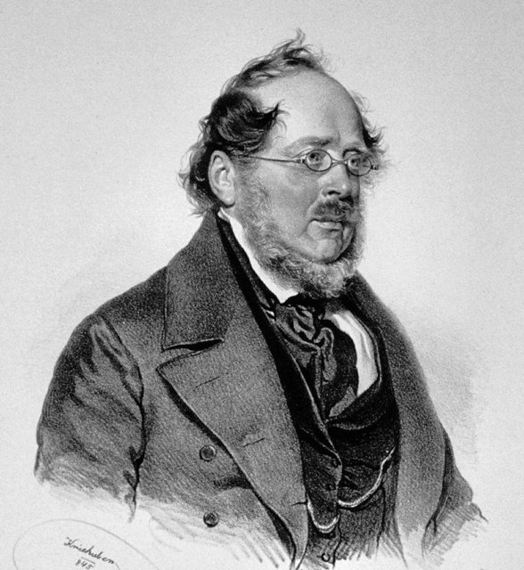
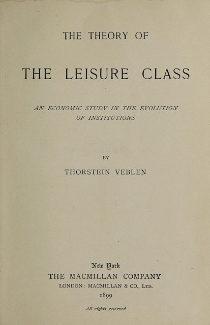
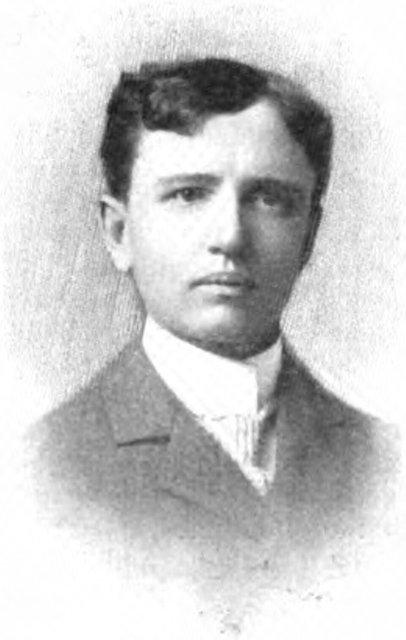

<!--
內容整理自本機筆記〈制度經濟學（Institutional Economics）〉（D:\Books\md\歷史\術語\經濟學\制度經濟學（Institutional Economics）.md；html 版在 D:\Books\html\4-1-1.經濟學派），並參考中文維基百科〈制度經濟學〉條目（篇幅很短，只用來核對新舊制度經濟學的區分），以自己的話改寫。
時期依筆記的「五大發展階段」：思想淵源、舊制度經濟學、轉型期、新制度經濟學、當代制度研究。
處理方式：
- 筆記總年表的前四項（1690洛克《政府論》、1748孟德斯鳩《論法的精神》、1759與1776斯密）是思想淵源，寫進第一則事件，不另立事件；洛克、孟德斯鳩各有時間軸。
- 筆記1892年「芝加哥大學成為早期制度研究中心」與凡勃倫到芝加哥任教合為一則。
- 1919年漢密爾頓在美國經濟學會發表〈經濟理論的制度學派方法〉，「制度經濟學」一詞由此正式使用，這裡依此說明。
- 筆記2020年以後的條目（疫情與制度韌性、AI 與數位制度治理、地緣經濟）是研究方向的概述，寫進最後一則事件。
- 人名依 Books 原稿：凡勃倫、康芒斯、米契爾、寇斯、諾斯、威廉森、奧斯特羅姆、阿西莫格魯；人名用·分隔。
圖片來源（皆為 Wikimedia Commons 公有領域／CC0 作品，縮成最長邊 640px）：
- ie-veblen.jpg：Veblen3a.jpg（托斯丹·凡勃倫）
- ie-list.jpg：Friedrich List 1845 crop.jpg（李斯特像，1845年的石版畫）
- ie-leisure.jpg：The Theory of the Leisure Class first edition title page.jpg（《有閒階級論》1899年初版書名頁）
- ie-commons.jpg：John R Commons 001.jpg（約翰·康芒斯）
-->

# Periods
- 1841 ~ 1891 | 思想淵源與德國歷史學派 | #868e96
  李斯特與德國歷史學派反對古典經濟學的普遍法則，主張經濟要放在各國的歷史、法律與制度中理解，影響了一代留德的美國經濟學家。
- 1892 ~ 1936 | 舊制度經濟學 | #0b7285
  凡勃倫、康芒斯、米契爾在美國建立制度學派，研究習慣、法律、企業與景氣循環，主張經濟是演化中的制度體系，在羅斯福新政中影響最大。
- 1937 ~ 1969 | 轉型期 | #1971c2
  寇斯以交易成本解釋企業的存在與外部性問題，賽蒙提出有限理性，布坎南發展公共選擇；舊制度學派式微，新的制度分析逐漸成形。
- 1970 ~ 2000 | 新制度經濟學 | #2f9e44
  產權理論、代理理論、威廉森的交易成本經濟學與諾斯的制度變遷理論相繼成熟，奧斯特羅姆研究公共資源的自主治理，寇斯與諾斯先後獲諾貝爾獎。
- 2001 ~ 2026 | 制度與國家的長期發展 | #5f3dc4
  阿西莫格魯等人以殖民歷史證明制度決定國家的貧富，《國家為什麼會失敗》廣受討論；2024年三人獲諾貝爾獎，制度韌性與數位治理成為新課題。

# Events

## 1841 | 李斯特《政治經濟學的國民體系》

制度經濟學的思想淵源可上溯到洛克的財產權理論（1690）、孟德斯鳩對法律與社會的分析（1748），以及斯密對法律與道德如何支撐市場的討論。1841年，德國的李斯特出版《政治經濟學的國民體系》，批評英國的自由貿易論只適合已經工業化的國家，落後國家需要以關稅保護「幼稚產業」。此後以羅雪爾、施莫勒為代表的德國歷史學派，主張從歷史與制度的比較中歸納經濟規律，1880年代與奧地利學派的門格爾爆發「方法論之爭」。

## 1892 | 芝加哥大學與凡勃倫
新成立的芝加哥大學聘請凡勃倫任教，《政治經濟學期刊》在這年創刊。凡勃倫出身挪威移民農家，性格孤僻、言語尖刻。1898年他發表〈經濟學為什麼不是一門演化的科學〉，批評主流經濟學把人看成計算快樂與痛苦的機器，主張借鏡達爾文，研究習慣與制度如何累積演化。

## 1899 | 凡勃倫《有閒階級論》

凡勃倫出版《有閒階級論》，分析富裕階級以「炫耀性消費」與「炫耀性休閒」展示地位：購買昂貴的物品不是因為好用，而是為了讓別人看見自己的財力。這本書以人類學的眼光諷刺鍍金時代的美國上層社會，「炫耀性消費」至今仍是常用的概念。1904年的《企業論》則區分追求生產效率的「工業」與追求金融獲利的「企業」，批評投機與壟斷。

## 1913 | 米契爾《景氣循環》
米契爾出版《景氣循環》，以大量統計資料實證分析景氣的波動，而不是從抽象假設推演。1920年他參與創立美國國家經濟研究局（NBER），奠定了以數據研究總體經濟的傳統，NBER 至今仍負責認定美國經濟衰退的起訖時間。

## 1919 | 「制度經濟學」的命名
經濟學家沃爾頓·漢密爾頓在美國經濟學會發表〈經濟理論的制度學派方法〉，正式使用「制度經濟學」一詞，主張經濟學應研究制度如何塑造經濟行為，並與政策問題結合。同年凡勃倫參與創辦紐約新社會研究學院；1923年他出版《缺席所有權與現代企業》，批評遠離經營的股東與金融資本，1929年在股災前夕去世。

## 1924 | 康芒斯《資本主義的法律基礎》

威斯康辛大學的康芒斯出版《資本主義的法律基礎》，以法院判決分析財產權與契約如何隨時代演變。他把「交易」視為經濟分析的基本單位，並長年參與威斯康辛州的勞工立法、工傷補償與失業保險設計，他的學生後來起草了美國1935年的《社會安全法》。1934年他出版集大成的《制度經濟學》。

## 1932 | 《現代公司與私人財產》
法學家伯利與經濟學家米恩斯出版《現代公司與私人財產》，以統計指出美國最大的兩百家企業掌握了大量財富，股權高度分散，公司實際上由不持有多少股份的經理人控制，「所有權與控制權分離」。這本書影響了新政時期的證券法規，也是日後公司治理與代理理論的起點。

## 1937 | 寇斯〈企業的本質〉
二十六歲的英國經濟學家寇斯發表〈企業的本質〉：如果市場這麼有效率，為什麼還需要企業？他的回答是，透過市場交易需要搜尋價格、談判、訂約與監督，這些「交易成本」使某些活動在企業內部以指揮協調更便宜，企業的規模就取決於兩者的取捨。這篇論文當時沒有受到重視，數十年後成為新制度經濟學的基石。

## 1947 | 賽蒙《行政行為》
賽蒙出版《行政行為》，指出組織中的人受限於資訊與計算能力，只能做出「有限理性」的決策，追求「滿意」而非「最佳」。這個概念挑戰了主流經濟學的完全理性假設，賽蒙在1978年獲諾貝爾經濟學獎，也影響了後來的行為經濟學與交易成本理論。

## 1960 | 寇斯〈社會成本問題〉
已轉往美國任教的寇斯發表〈社會成本問題〉，以牧場的牛踐踏鄰近農地等例子指出：只要財產權界定清楚、交易成本為零，無論權利歸給哪一方，雙方都能透過協商達到有效率的結果，這就是後來所稱的「寇斯定理」。但現實中交易成本不為零，因此法律如何界定權利就很重要。這篇論文開創了法律經濟學，是史上被引用最多的經濟學論文之一。

## 1962 | 《同意的計算》
布坎南與塔洛克出版《同意的計算》，把經濟學的分析方法用在政治決策上：選民、政客與官僚同樣追求自身利益，政府也會「失靈」，因此要重視憲法層次的規則設計。公共選擇理論由此成形，布坎南在1986年獲諾貝爾獎。1968年，生態學家哈丁發表〈公地悲劇〉，指出開放給所有人使用的資源會因過度使用而枯竭。

## 1972 | 產權理論
阿爾奇安與德姆塞茨發表〈生產、資訊成本與經濟組織〉，以團隊生產中監督偷懶的問題解釋企業的權利結構；1976年詹森與麥克林發表代理理論的經典論文，分析經理人（代理人）與股東（委託人）利益不一致的成本。產權、合約與組織成為經濟學的核心研究對象。

## 1973 | 諾斯《西方世界的興起》
經濟史學家諾斯與湯瑪斯出版《西方世界的興起》，主張近代歐洲的經濟成長，關鍵不在技術而在有效率的產權制度：荷蘭與英國較早保障產權、降低交易成本，所以率先富強。1981年的《經濟史中的結構與變遷》進一步把國家、意識形態納入分析。

## 1975 | 威廉森《市場與層級組織》
威廉森延續寇斯的問題，出版《市場與層級組織》，以有限理性、投機行為與「資產專用性」分析交易何時在市場進行、何時納入企業內部；1985年的《資本主義的經濟制度》建立完整的交易成本經濟學，影響了企業併購、管制與反托拉斯的分析。「新制度經濟學」一詞也是他提出的。

## 1990 | 諾斯與奧斯特羅姆
諾斯出版《制度、制度變遷與經濟績效》，把制度定義為「社會的遊戲規則」，包括正式的法律與非正式的習俗，並以「路徑依賴」說明為什麼低效率的制度會長期延續。同年政治學者奧斯特羅姆出版《治理公地》，以瑞士的高山牧場、日本的入會地、西班牙的灌溉系統等實例，證明社群可以自行訂立規則、永續管理公共資源，不一定需要私有化或政府管制，回應了「公地悲劇」。

## 1991 | 寇斯獲諾貝爾獎
寇斯以交易成本與財產權的研究獲得諾貝爾經濟學獎；1993年諾斯與福格爾以經濟史研究同獲此獎。新制度經濟學由此進入主流，1997年寇斯、諾斯、威廉森等人成立國際新制度經濟學會。

## 2001 | 殖民起源與制度
阿西莫格魯、強森與羅賓森發表〈比較發展的殖民起源〉，以歐洲殖民者在各地的死亡率作為工具，說明殖民者在不適合定居的地方建立掠奪性的制度，在適合定居的地方建立保障產權的制度，這些制度的差異延續至今，決定了國家的貧富；2002年的〈命運的逆轉〉指出，五百年前較富裕的殖民地，今天反而較窮。

## 2009 | 威廉森與奧斯特羅姆獲諾貝爾獎
威廉森與奧斯特羅姆同獲諾貝爾經濟學獎，表彰他們對經濟治理的研究：前者分析企業的邊界，後者分析公共資源的治理。奧斯特羅姆是第一位獲得諾貝爾經濟學獎的女性。

## 2012 | 《國家為什麼會失敗》
阿西莫格魯與羅賓森出版《國家為什麼會失敗》，把國家分為「包容性」與「榨取性」的政治經濟制度：前者保障產權、開放競爭與政治參與，能帶來持續成長；後者讓少數菁英壟斷權力與財富，終將停滯，並以南北韓、美墨邊境兩側的諾加萊斯為例。這本書成為制度經濟學最廣為人知的通俗著作。

## 2024 | 阿西莫格魯等人獲諾貝爾獎
阿西莫格魯、強森與羅賓森以「制度如何形成並影響繁榮」的研究獲得諾貝爾經濟學獎。疫情後的制度韌性、供應鏈與地緣經濟、人工智慧與數位平台的治理，成為制度經濟學當前的重要研究方向。
