<!--
內容整理自本機筆記〈日本歷史時間列表：從繩文時代到令和時代〉（圖表\日本歷史時間列表：從繩文時代到令和時代.md）與中文維基百科「日本歷史」條目（CC BY-SA 4.0），以台灣用語改寫摘要。
https://zh.wikipedia.org/zh-tw/日本历史
兩份資料的分期略有出入，處理方式如下：
- 彌生時代的起點：筆記採傳統的「約前300年」，維基百科採近年碳定年研究的「約前10世紀」；時期色帶採較新的說法，並在事件中註明兩說。
- 佛教傳入有538年與552年兩說；鎌倉幕府成立常見1185年與1192年兩說，時期色帶以1185年劃分。
- 南北朝（1336～1392）與室町時代重疊，時期色帶以南北朝合一（1392）與應仁之亂（1467）切分。
- 神武天皇即位（前660年）出自《古事記》與《日本書紀》的神話，並非信史。
各事件的精確日期為補充。
2026年10月起與本機《日本史——AI 偵探風格》筆記（D:\Books\md\歷史\世界史\日本史，網頁版在知識圖譜的「1-3.日本歷史」）整合：
- 筆記的71個年份檔中，與原有事件同一主題的45則，說明改用該檔的「案件摘要」（1915山口組、1918米騷動沒有案件摘要，改用「案發現場」），保留原有的日期、標題與配圖；其餘20則新增為事件；「1592b-壬辰戰爭-東亞觀點」改為1592～1598年的時期色帶。每則事件末尾以「→ 對外連結」連到知識圖譜上的完整案件卷宗（在新分頁開啟），摘要中提到其他案件的連結也改為連到知識圖譜。
- 沒有對應年份檔的原有事件（如57年金印、1404年勘合貿易、1879年琉球處分）維持原本的說明。
- 日期出入：筆記把繩紋定為約前1萬年起、彌生定為約前300年起，時間軸維持較新的約前1.4萬年與約前10世紀，並在彌生事件中註明兩說；鎖國體制筆記以1639年（禁止葡萄牙船）為準，時間軸維持1641年（荷蘭商館遷入出島）；舊金山和約筆記以1951年簽訂為準，時間軸維持1952年生效；岩倉使節團筆記寫「1871年11月」是陰曆，換算為西曆1871年12月。
- 太閣檢地筆記放在1598年，實際推行於1582～1598年，以區間事件呈現；本能寺之變改用西曆日期1582年6月21日，排在同年3月的甲州征伐之後；明治維新改標1868年4月（五條御誓文），排在1月爆發的戊辰戰爭之後。
- 時期另依知識圖譜〈日本歷史總覽〉的「權威與權力分離」表，加上實際掌權者的分期（灰色色帶，與時代色帶重疊顯示）：律令國家（710–967）、攝關政治（967–1086）、院政（1086–1185）、幕府（1185–1867）、帝國（1868–1945）、戰後（1947至今）。
圖片皆為 Wikimedia Commons 上的公有領域（含CC0）作品（封面：葛飾北齋〈神奈川沖浪裏〉）。部分配圖年份與事件不完全相同：化政文化配歌川廣重〈東海道五十三次・日本橋〉（1830年代）、黑船來航配1854年培里再訪時的日本繪卷、明治維新配1873年的明治天皇、大政奉還配後世所繪的二條城大政奉還圖、新憲法施行配1946年公布時銀座街頭的照片、日本投降配密蘇里號上的降書簽字照片。
2026年10月整合時新增的配圖（皆為 Wikimedia Commons 公有領域／CC0 作品）：
- japan-yoshifusa.jpg：Fujiwara no Yoshifusa.jpg（菊池容齋《前賢故實》中的藤原良房像）
- japan-masakado.jpg：Hei shinno masakado LCCN2008660911.jpg（19世紀浮世繪〈平親王將門〉）
- japan-katsuyori.jpg：Katsuyori died at Mt.Tenmoku 01.jpg（19世紀浮世繪〈武田勝賴天目山自盡〉）
- japan-kenchi.jpg：Land survey book of Japan 2022-12-25.jpg（江戶時代的檢地帳（博物館展品照片，CC0））
- japan-sadanobu.jpg：Matsudaira Sadanobu (cropped).jpg（松平定信像）
- japan-toba-fushimi.jpg：Battle of Toba–Fushimi.jpg（1868年描繪鳥羽・伏見之戰的錦繪）
- japan-chiken.jpg：Ageo Chiken Saitama Face 1.jpg（1877年埼玉縣上尾的地券）
- japan-itagaki.jpg：ITAGAKI Taisuke.jpg（板垣退助像）
- japan-boj.jpg：Former Bank of Japan Head Office 1.gif（1896年以前的日本銀行舊總行）
- japan-alliance.jpg：Anglo-Japanese Alliance. Yamatohime and Britannia.jpg（1902年慶祝日英同盟的插畫（大和姬與不列顛尼亞））
- japan-yamaguchi.jpg：Harukichi Yamaguchi.jpg（山口組創立者山口春吉）
- japan-bankrun.jpg：Bank run during the Showa Financial Crisis.JPG（1927年昭和金融恐慌時的銀行擠兌）
- japan-taisei.jpg：Establishment of Imperial Rule Assistance Association.JPG（大政翼贊會的招牌）
- japan-tarawa.jpg：Marine wounded at Tarawa being taken off in rubber boat.JPEG（1943年11月塔拉瓦登陸戰的美軍傷兵（美國海軍陸戰隊照片））
- japan-tokyo-raid.jpg：After Bombing of Tokyo on March 1945 19450310.jpg（1945年3月10日東京大空襲後的下町）
部分配圖年份與事件不完全相同：昭和恐慌（1930）配1927年昭和金融恐慌的擠兌照片，大政翼贊會（1940）配1941年初的會館招牌照片。
-->

# Periods
- 約3.8萬～1.6萬年前 | 舊石器時代 | #8d6e63
  人類以狩獵採集維生，使用打製石器；約3萬4千年前起，小刀型石器與後來由西伯利亞傳入的細石刃在列島各地流傳。
- -14000 ~ -1000 | 繩文時代 | #b08900
  冰期結束、氣候轉暖，人們製作繩紋陶器，住在豎穴式住居，以狩獵、採集、漁撈為生，留下大量貝塚與土偶。
- -1000 ~ 250 | 彌生時代 | #5c940d
  水田稻作、青銅器與鐵器從大陸與朝鮮半島傳入，聚落擴大、貧富分化，各地出現小「國」，邪馬台國女王卑彌呼見於中國史書。
- 250 ~ 592 | 古墳時代 | #2b8a3e
  各地興建巨大的前方後圓墳，以近畿為中心的大和王權逐漸擴張，倭五王遣使中國南朝，佛教與漢字傳入。
- 592 ~ 710 | 飛鳥時代 | #0b7285
  聖德太子與大化革新仿效隋唐制度，建立以天皇為中心的中央集權律令國家。
- 710 ~ 794 | 奈良時代 | #1864ab
  以平城京為都，律令制度鼎盛，佛教成為國家宗教，編纂《古事記》與《日本書紀》。
- 794 ~ 1185 | 平安時代 | #5f3dc4
  遷都平安京（京都），藤原氏攝關政治與院政相繼，假名文學與國風文化興盛，武士勢力崛起。
- 1185 ~ 1333 | 鎌倉時代 | #862e9c
  源賴朝在鎌倉建立第一個武家政權，北條氏以執權掌握實權，兩度擊退蒙古來襲。
- 1333 ~ 1392 | 建武新政與南北朝 | #a61e4d
  後醍醐天皇推翻鎌倉幕府、恢復天皇親政，但很快失敗；足利尊氏另立北朝、開設室町幕府，南北兩朝對立近60年。
- 1392 ~ 1467 | 室町時代 | #c92a2a
  足利義滿統一南北朝，與明朝勘合貿易，北山文化、東山文化與禪宗、能樂、茶道、水墨畫發展。
- 1467 ~ 1573 | 戰國時代 | #e8590c
  應仁之亂後幕府權威崩解，各地大名「下剋上」、群雄割據，鐵砲與天主教傳入。
- 1573 ~ 1603 | 安土桃山時代 | #f59f00
  織田信長、豐臣秀吉相繼統一天下，推行檢地與刀狩，豐臣政權兩度出兵朝鮮。
- 1592 ~ 1598 | 東亞地緣大重組 | #c92a2a
  1592 至 1598 年間爆發的東亞七年大戰（明稱「萬曆朝鮮之役」、日稱「文祿・慶長之役」、朝稱「壬辰倭亂」），是**近代早期（16 世紀末）全球動員規模最大、火器密度最高的國際衝突**。這場戰爭跨越了陸權與海權的邊界，動員總兵力逾四十萬人，牽涉中、日、朝三國核心政權，並直接誘發了第四方勢力（女真／後金）的崛起。

  本案並非單純的「侵略與救援」，而是**東亞以大明為核心的「朝貢封冊體系」，與日本戰國統一後試圖建立「以京都為中心的新亞洲朝貢秩序」之間不可調和的體系碰撞**。戰爭以三國皆輸、元氣大傷告終，並引發骨牌效應：豐臣政權崩解催生德川鎖國體制、朝鮮陷入精神依附與國力殘破、大明因財政透支與遼東防務空虛，最終在 1644 年被關外的滿清鐵騎奪取天下。

  [→ 對外連結：壬辰之役與近代早期世界體系的碰撞](https://chad-liu.github.io/books/html/1-3.日本歷史/1592b-壬辰戰爭-東亞觀點.html)
- 1603 ~ 1868 | 江戶時代 | #364fc7
  德川幕府以幕藩體制統治兩百六十多年，實行鎖國，町人文化、浮世繪與歌舞伎繁榮，末期因黑船來航被迫開國。
- 1868 ~ 1912 | 明治時代 | #c2255c
  明治維新推動廢藩置縣、殖產興業、富國強兵與立憲，日本迅速工業化，並在甲午、日俄戰爭後走向帝國擴張。
- 1912 ~ 1926 | 大正時代 | #ae3ec9
  政黨政治與「大正民主」發展，一戰帶來經濟繁榮，但也經歷米騷動與關東大地震。
- 1926 ~ 1989 | 昭和時代 | #495057
  前期軍部崛起、發動侵略戰爭並在二戰戰敗；戰後在新憲法下民主化，經濟高速成長成為世界第二大經濟體。
- 1989 ~ 2019 | 平成時代 | #1c7ed6
  泡沫經濟破滅後經歷「失落的年代」，55年體制瓦解，並遭遇阪神與東日本兩次大地震。
- 2019 ~ 2026 | 令和時代 | #0ca678
  德仁天皇即位，面對新冠疫情、人口減少與高齡化、財政負擔與安全環境變化等長期挑戰。

- 710 ~ 967 | 律令國家（天皇親政） | #868e96
  名義權威與實際掌權者都是天皇與朝廷，統治權由成文的律令規定，名實合一。
- 967 ~ 1086 | 攝關政治（藤原氏掌權） | #5c636a
  藤原氏以天皇外祖父的身分，用攝政、關白的名義代理天皇行使權力。
- 1086 ~ 1185 | 院政（上皇掌權） | #868e96
  天皇讓位後以上皇（治天之君）身分掌權，退位反而擺脫了朝廷與藤原氏的束縛。
- 1185 ~ 1867 | 幕府（將軍掌權） | #5c636a
  天皇任命的征夷大將軍掌握實權，武力在先、任命在後；鎌倉、室町、江戶三個幕府前後近七百年，都與朝廷並存而沒有取代它。
- 1868 ~ 1945 | 帝國（藩閥、元老、軍部掌權） | #868e96
  天皇在形式上親政，實際由藩閥、元老與軍部代天皇行使大權；統帥權獨立於內閣之外，日後成為軍部失控的制度缺口。
- 1947 ~ 2026 | 戰後（內閣與國會掌權） | #5c636a
  《日本國憲法》確立國民主權，天皇成為國家的象徵；一千三百年來，權威第一次不再從天皇身上取得。

# Events

## 約3.8萬年前 | 列島上的早期人類
日本列島較可靠的人類定居證據可追溯到距今約3.8萬至3.9萬年前。沖繩出土的「港川人」化石約有1萬8千年歷史。

## -14000 | 繩文時代開始 {label=約前1.4萬年}
約西元前 10000 年起，日本群島進入**繩紋時代**（縄文時代，約前 10000–前 300）：土器（繩文陶器）出現、村落定居、採集漁獵高度發達。全球史的角度看，這是一樁「反常案件」：依照標準的文明進化公式，「定居←農業剩餘」，沒有農業就不該有定居——但繩紋人**不靠農業就定居了上萬年**。兇手（也是恩人）是日本群島的特殊生態：溫帶海洋性氣候＋豐富的海洋資源＋堅果林（橡樹、栗樹）——**採集的邊際成本低到可以替代農業**。

[→ 對外連結：繩紋時代的定居革命：島嶼的「豐富採集」奇蹟](https://chad-liu.github.io/books/html/1-3.日本歷史/-10000-繩紋時代的定居革命.html)

## -1000 | 彌生時代開始 {label=約前10世紀}

約西元前 300 年起，日本進入**彌生時代**（約前 300–250）：濕地稻作從朝鮮半島東傳九州，兩百年內擴散至關東。這是日本史上第一次「革命速度」的社會重寫：**稻作剩餘 → 人口爆炸 → 階層分化 → 村落戰爭 → 政治體**。繩紋一萬年沒長出的東西，彌生六百年全部補齊——兇手是一株植物：水稻。

[→ 對外連結：彌生革命與稻作東傳：一條河（稻）改寫整座群島](https://chad-liu.github.io/books/html/1-3.日本歷史/-0300-彌生革命與稻作東傳.html)

彌生時代的起點傳統上定為約前300年，近年碳定年研究則把它往前推到約前10世紀，這裡的時間軸採用較新的說法。

## -660 | 神武天皇即位的傳說 {label=前660年（傳說）}
依《古事記》與《日本書紀》的記載，第一代天皇神武天皇在前660年2月11日即位，這被當作傳統的建國之始。這主要是神話而非信史，但今天日本仍以2月11日為「建國紀念之日」。

## 57 | 漢委奴國王金印

倭奴國遣使東漢朝貢，光武帝賜予金印。1784年在九州志賀島出土的「漢委奴國王」金印，被認為就是這枚印。

## 239 | 卑彌呼遣使曹魏
三世紀（約 200–250），《三國志・魏志倭人傳》記載了一個謎樣的政體：**邪馬台國**，由女巫王**卑彌呼**（Himiko）統治，「事鬼道、能惑眾」，統轄三十餘國，遣使向曹魏朝貢（239）獲「親魏倭王」金印。這樁案件的兩大謎題：**邪馬台國在哪裡？卑彌呼為何是女人？**——前者至今是日本考古學最大懸案；後者卻可以用組織理論解開。

[→ 對外連結：邪馬台國與卑彌呼：宗教女王的組織工程](https://chad-liu.github.io/books/html/1-3.日本歷史/0250-邪馬台國與卑彌呼.html)

## 250 | 古墳時代開始 {label=約3世紀中葉}
約3世紀末至6世紀，列島出現5000座前方後圓墳——箸墓（280m級）到大仙陵（486m、世界最大墳丘之一）。**沒有文字、沒有律令，卻出現跨區域的統一規格**。前案 [邪馬台國與卑彌呼](https://chad-liu.github.io/books/html/1-3.日本歷史/0250-邪馬台國與卑彌呼.html) 的宗教女王死後，權力如何從祭祀共同體變成世襲王權？本案追查：**墳墓即國家發票，規格統一之日就是王權成立之時**。

[→ 對外連結：古墳時代與大和王權：墳丘堆出來的國家](https://chad-liu.github.io/books/html/1-3.日本歷史/0400-古墳時代與大和王權.html)

## 400 | 好太王碑與倭五王 {label=約4世紀末～5世紀}
高句麗的好太王碑記載，4世紀末倭國曾與高句麗交戰。5世紀初，大阪的百舌鳥、古市古墳群興建，其中大仙陵古墳（傳仁德天皇陵）是日本最大的古墳；同時「倭五王」多次遣使中國南朝。

## 538 | 佛教傳入
538 年（一說 552），百濟聖明王獻釋迦佛像與經論給欽明天皇——**佛教正式傳入日本**。這樁案件的表面是宗教傳播，實質是**政治工程的進口競標**：佛教連同其整套「中國式國家技術」（文字、律令、建築、官僚觀念）一起抵達。蘇我氏擁佛、物部氏排佛的「崇佛之爭」（587 滅亡），本質是**要不要全盤引進大陸國家體制**的路線之爭。此後飛鳥時代（592–710）的聖德太子改革與隋唐交流，都是這場競標的後果。

[→ 對外連結：佛教東傳與飛鳥時代：宗教作為國家工程的進口](https://chad-liu.github.io/books/html/1-3.日本歷史/0538-佛教東傳與飛鳥時代.html)

## 593 | 聖德太子攝政

推古天皇即位，姪子聖德太子擔任攝政，與蘇我馬子共同執政。他興建四天王寺、法隆寺，弘揚佛教。

## 603 | 冠位十二階與十七條憲法

聖德太子制定冠位十二階（603）與十七條憲法（604），依才能而非出身任用官員，奠定漢式官僚制度的基礎，並開始使用「天皇」名號。

## 607 | 遣隋使
小野妹子出使隋朝，國書中「日出處天子致書日沒處天子」一句讓隋煬帝不悅。此後日本持續派遣使節與留學生學習中國制度。

## 645 | 乙巳之變與大化革新
645 年 6 月，中大兄皇子與中臣鐮足在宮中儀式上刺殺權臣**蘇我入鹿**——史稱「乙巳之變」。政變翌日即開始新政，年號「大化」，接連頒布改新之詔：**廢除氏族私地私民、實行公地公民、仿唐制建立班田收授與租庸調**。這是日本史上第一次「一夜政變、數年安裝整套制度」的奇蹟——而安裝的原始碼，是遣隋唐使培養三十年的留學官僚集團帶回的**唐朝律令制**。

[→ 對外連結：大化革新：一場政變安裝整套律令帝國](https://chad-liu.github.io/books/html/1-3.日本歷史/0645-大化革新.html)

## 646 | 班田收授法
646 年正月，改新之詔頒布「公地公民制」；同年班田收授法雛形確立——**廢除豪族私地私民、土地人民一律國有，再由國家按口分田、六年一班**。這是日本史上第一次「制度移植大手術」：把唐朝均田制的原始碼整套搬進列島。然而列島沒有關中平原、只有山地水田；移植十年即變異，百年後即崩解。這樁案件是理解律令國家（[平城京與律令國家](https://chad-liu.github.io/books/html/1-3.日本歷史/0710-平城京與律令國家.html)）財政根基的鑰匙。

[→ 對外連結：班田收授法：大化改新的土地國有化實驗](https://chad-liu.github.io/books/html/1-3.日本歷史/0646-班田收授法.html)

## 663 | 白村江之戰
663 年 8 月，日本（倭國）為救援復興的百濟，派四萬餘水軍進入朝鮮半島，在白村江口與唐・新羅聯軍決戰——**四百餘艘戰船在兩天內被焚燬殆盡**。這是日本史上第一次大規模國際戰爭，也是第一次慘敗。敗戰後日本全面放棄半島野心，轉入近千年的「防衛內轉」：築朝鮮式山城、設防人、造全國戶籍——律令制的完成，竟是**恐懼的產物**。

[→ 對外連結：白村江之戰：一場慘敗如何把帝國打成防衛型國家](https://chad-liu.github.io/books/html/1-3.日本歷史/0663-白村江之戰.html)

## 672 | 壬申之亂
天智天皇死後，其弟大海人皇子起兵擊敗天智之子大友皇子，即位為天武天皇，強化天皇權威。這時期鑄造了日本最早的錢幣「富本錢」。

## 701 | 大寶律令
頒布大寶律令，律令國家的體制正式完成。

## 710 | 遷都平城京
710 年，元明天皇遷都**平城京**（奈良）——一座以唐長安城為範本、面積約其四分之一的棋盤式都城。奈良時代（710–794）是日本律令國家的「安裝完成期」：大寶律令（701）與養老律令（757）、全國戶籍與班田、正倉院與東大寺大佛（752 開眼）——**一個「唐式帝國」在群島上全速運轉**。但這樁案件的核心線索藏在反方向：**運轉的同時，體系已開始失靈**——班田制的人口極限、寺院經濟的失控、藤原氏的權力壟斷，都是平安時代的伏筆。

[→ 對外連結：平城京與律令國家：長安的縮小複製品](https://chad-liu.github.io/books/html/1-3.日本歷史/0710-平城京與律令國家.html)

## 712 | 《古事記》與《日本書紀》
現存最古老的史書《古事記》（712）與第一部官修正史《日本書紀》（720）相繼完成，記錄神話與天皇系譜。

## 752 | 東大寺大佛開眼

聖武天皇為以佛法鎮護國家，在各地興建國分寺，並在平城京建東大寺、鑄造盧舍那大佛。753年唐朝高僧鑑真歷經五次失敗終於東渡日本，傳授戒律。

## 794 | 遷都平安京
794 年，桓武天皇遷都**平安京**（京都）——此後一千餘年（至 1868）日本的首都不再移動。平安時代（794–1185）的前半是律令制的「最後榮光」：最澄與空海開創日本佛教、遣唐使最後的輝煌。但這樁案件的真相是：**838 年最後一次遣唐使之後，日本開始「文化上的獨立宣言」**——假名文字、國風文化、物語文學（《源氏物語》）——帝國在政治上仿唐，在文化上開始做自己。

[→ 對外連結：平安遷都與貴族文化：帝國的「文化化」](https://chad-liu.github.io/books/html/1-3.日本歷史/0794-平安遷都與貴族文化.html)

## 858 | 攝關政治與藤原氏
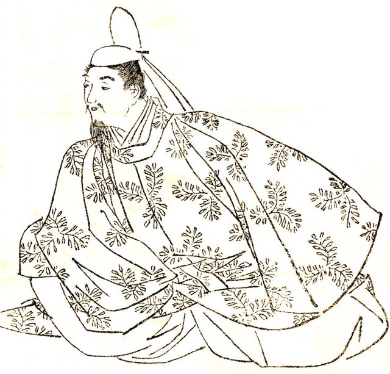
858 年清和天皇即位（九歲），外祖父**藤原良房**任攝政——日本史上第一個非皇族攝政。其後藤原北家以「攝政—關白」制度壟斷實權二百餘年（866 應天門之變→1160 平治之亂前）：藤原道長「一家立三后」（995–1018）是極致。這樁案件的兇手是**婚姻的組織技術**：藤原氏把「女兒—皇后—外祖父—攝政」變成一條權力生產線——**不篡位而壟斷皇權**的兩百年工程。

[→ 對外連結：攝關政治與藤原氏：實權代理的極致工程](https://chad-liu.github.io/books/html/1-3.日本歷史/0858-攝關政治與藤原氏.html)

## 894 | 停派遣唐使
894 年，菅原道真以「唐國內亂、海路凶險」為由上奏**停派遣唐使**，朝廷准奏——持續約二百六十年的對唐制度採購正式終止。但偵探要指出：這不是文化閉關，而是**移植階段的完成宣言**。最後一批遣唐使（838）以來日本已「學滿畢業」；停止輸入後，貴族文化沒有枯萎，反而開出假名文學與國風文化的花——**移植→消化→變異**迴路（本卷核心命題）在此第一次完整走完。

[→ 對外連結：廢止遣唐使：文化獨立的宣告與「移植休止符」](https://chad-liu.github.io/books/html/1-3.日本歷史/0894-廢止遣唐使與國風文化.html)

## 939 | 承平天慶之亂與武士崛起 {label=939～941年}
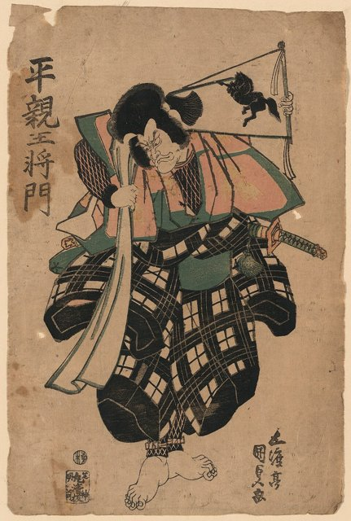
930–940 年代，兩場叛亂幾乎同時爆發：**平將門**在關東自稱「新皇」（939）、**藤原純友**在瀨戶內海率海賊叛亂——史稱承平・天慶之亂。朝廷無力鎮壓，**靠地方武士團平亂**——這樁案件是日本史上「暴力私有化」的開端：中央放棄暴力壟斷，地方武士團崛起，五百年後武士將取代貴族統治日本。

[→ 對外連結：承平天慶之亂與武士崛起：暴力成本的私有化](https://chad-liu.github.io/books/html/1-3.日本歷史/0940-承平天慶之亂與武士崛起.html)

## 1008 | 《源氏物語》

宮廷女官紫式部寫成長篇小說《源氏物語》，與清少納言的隨筆《枕草子》同為平安時代女性假名文學的代表。這時藤原道長權傾一時，攝關政治達到全盛。

## 1086 | 院政開始
1086 年，白河天皇讓位給年僅八歲的堀河天皇、自任**上皇**（太上皇）開設「院廳」——此後約百年（1086–1156 前後，乃至平穩期至 1221），上皇以「治天之君」（統治的天皇）身份親政，架空藤原攝關。這樁案件是藤原壟斷（[攝關政治與藤原氏](https://chad-liu.github.io/books/html/1-3.日本歷史/0858-攝關政治與藤原氏.html)）的反擊：**天皇家族內部發明第三軌——「退位者的實權」**，用院政繞過攝關。

[→ 對外連結：院政時代：上皇的反擊與「權力的第三軌」](https://chad-liu.github.io/books/html/1-3.日本歷史/1086-院政時代.html)

## 1167 | 平清盛出任太政大臣
在保元、平治之亂中崛起的平清盛，成為第一位出任太政大臣的武士，並透過聯姻成為天皇的外戚，建立第一個武家政權「平氏政權」。

## 1185 | 壇之浦之戰，源平合戰結束
1167 年**平清盛**以太政大臣權力組建首個武士政權（平氏政權），1180 年**源賴朝**在伊豆舉兵，1185 年壇浦合戰平家滅亡（安德天皇抱劍投海），1192 年賴朝任**征夷大將軍**、開設**鎌倉幕府**。這樁案件是[承平天慶之亂與武士崛起](https://chad-liu.github.io/books/html/1-3.日本歷史/0940-承平天慶之亂與武士崛起.html) 的兌現：**暴力供給者從朝廷手中接管政權**——日本政治從此進入「雙重政府」（Dual Polity：京都朝廷＋鎌倉幕府）近七百年。

[→ 對外連結：平家滅亡與鎌倉幕府：武士集團的第一次親政](https://chad-liu.github.io/books/html/1-3.日本歷史/1185-平家滅亡與鎌倉幕府.html)

## 1192 | 源賴朝受封征夷大將軍

源賴朝受封征夷大將軍，這也是過去常用來標示鎌倉幕府成立的年份。

## 1221 | 承久之亂
後鳥羽上皇起兵討伐幕府，被北條義時、泰時父子擊敗，三位上皇被流放。北條氏以「執權」身分世襲掌握幕府實權，將軍淪為傀儡。

## 1274 | 文永之役（第一次蒙古來襲）
1274（文永之役）與 1281（弘安之役），元世祖忽必烈兩次派**蒙古—高麗—漢軍聯軍**（最大時約 14 萬人）渡海攻日——鎌倉幕府的九州武士團迎擊，兩次皆遇颱風（**神風**）覆滅元軍。這樁案件的表面是「神的庇佑」，實質是**武士體制的一次全面審計**：幕府贏了戰爭，卻輸了財政——勝利的成本壓垮了御恩制度，間接導致鎌倉崩潰（[鎌倉幕府崩潰與建武新政](https://chad-liu.github.io/books/html/1-3.日本歷史/1333-鎌倉幕府崩潰與建武新政.html)）。

[→ 對外連結：蒙古襲來：神風與武士體制的意外審計](https://chad-liu.github.io/books/html/1-3.日本歷史/1274-蒙古襲來.html)

## 1281 | 弘安之役（第二次蒙古來襲）
元朝再派十多萬大軍來襲，遭遇颱風損失慘重而敗退，日本人稱之為「神風」。戰後幕府無力賞賜出征的御家人，統治基礎逐漸動搖。

## 1333 | 鎌倉幕府滅亡；建武新政
1333 年，後醍醐天皇舉兵、足利尊氏與新田義貞倒戈——**鎌倉幕府滅亡**（北條高時等自殺於東勝寺）。後醍醐推行**建武新政**（1333–1336）：親政、天皇集權、論功行賞——但新政三年即崩，尊氏另立光明天皇、開**室町幕府**，日本進入**南北朝分裂**（1336–1392）。這樁案件的兇手是「復古的幻覺」：後醍醐想回到平安的天皇親政，卻不知**武士經濟的邏輯已經改變遊戲規則**。

[→ 對外連結：鎌倉幕府崩潰與建武新政：一場「復古」的泡沫](https://chad-liu.github.io/books/html/1-3.日本歷史/1333-鎌倉幕府崩潰與建武新政.html)

## 1336 | 南北朝分立
足利尊氏擁立光明天皇（北朝），1338年受封征夷大將軍，在京都開設室町幕府。後醍醐天皇帶著三神器退往奈良吉野（南朝），南北兩朝對立。

## 1392 | 南北朝合一

1336–1392，列島同時存在兩個朝廷：京都北朝（足利擁立）與吉野南朝（後醍醐系），外加關東鐮倉府——**一國三公，詔書打架**。前案 [鎌倉幕府崩潰與建武新政](https://chad-liu.github.io/books/html/1-3.日本歷史/1333-鎌倉幕府崩潰與建武新政.html) 只講到建武崩潰，卻沒交代：足利尊氏如何從「叛將」變成「將軍」？本案追查**雙重政府的內戰均衡**，結案於1392年明德和約（北朝統一）與室町守護體制的確立。

[→ 對外連結：南北朝統一與室町幕府：兩個天皇的六十年懸案](https://chad-liu.github.io/books/html/1-3.日本歷史/1392-南北朝統一與室町幕府.html)

## 1404 | 勘合貿易
足利義滿受明朝冊封為「日本國王」，以勘合符與明朝進行朝貢貿易，大量明朝銅錢流入日本，帶動商品經濟發展。

## 1467 | 應仁之亂
1467 年，足利將軍繼嗣問題（義政：弟義視 vs 子義尚）引爆細川勝元與山名宗全兩大陣營的**應仁之亂**——戰火在京都持續十一年（1467–1477），**首都化為焦土**（「花の都」燒成「野原」）。室町幕府的權威蒸發，守護大名在地方獨立——此後百年（至 1590）是**戰國時代**：下剋上、群雄割據、技術與戰術的軍備競賽。這樁案件是「權力真空的連鎖引爆」。

[→ 對外連結：應仁之亂與戰國時代：首都的十年自殺](https://chad-liu.github.io/books/html/1-3.日本歷史/1467-應仁之亂與戰國時代.html)

## 1543 | 鐵砲傳入
1543 年，一艘中國船漂至**種子島**——船上的葡萄牙人攜**火繩槍**（鐵炮）兩挺。島主種子島時堯以重金購入，命刀匠八板金兵衛仿製——**一年內國產化成功**。此後三十年，鐵炮擴散全國、改變合戰形態：1575 長篠合戰織田—德川聯軍以三千挺鐵炮擊潰武田騎馬隊——**冷兵器時代的終結、統一事業的加速器**。這樁案件是「技術移植的閃電戰」。

[→ 對外連結：鐵炮傳來：兩挺火繩槍改寫戰爭的數學](https://chad-liu.github.io/books/html/1-3.日本歷史/1543-鐵炮傳來.html)

## 1549 | 沙勿略傳入天主教

1549 年，耶穌會士**方濟各・沙勿略**（Francisco Xavier）在鹿兒島登陸——**天主教傳入日本**。此後六十年（至 1614 禁教令）：信徒最多時約 30–75 萬、大名改宗（大村純忠、大友宗麟、有馬晴信等「吉利支丹大名」）、南蠻貿易（長崎）繁榮。但這樁案件的真相是**宗教與武器的捆綁銷售**：大名改宗的動機是南蠻船的生絲、銀與鐵炮——**信仰是貿易的入場券**；而幕府禁教的動機，是切斷「信仰—貿易—武力」的外國槓桿。

[→ 對外連結：天主教傳來：十字架與火繩槍的捆綁銷售](https://chad-liu.github.io/books/html/1-3.日本歷史/1549-天主教傳來.html)

## 1560 | 桶狹間之戰
1560.5.19，尾張守護代織田信長率約2000兵，暴雨中奇襲桶狹間山，斬今川義元——**東海道第一弓取的兩萬五千大軍一夕崩盤**。前案鐵炮（見 [鐵炮傳來](https://chad-liu.github.io/books/html/1-3.日本歷史/1543-鐵炮傳來.html)）講了武器，後案本能寺（見 [本能寺之變](https://chad-liu.github.io/books/html/1-3.日本歷史/1582-本能寺之變.html)）講了結局，中間獨缺：**信長如何從尾張「大傻瓜」變成天下布武？**本案還原下剋上的組織革命。

[→ 對外連結：桶狹間之戰與信長崛起：兩千對兩萬五的數學](https://chad-liu.github.io/books/html/1-3.日本歷史/1560-桶狹間之戰與信長崛起.html)

## 1573 | 室町幕府滅亡

織田信長放逐第十五代將軍足利義昭，室町幕府滅亡。1575年他在長篠之戰以大量鐵砲擊敗武田軍，1576年起興建安土城。

## 1582 ~ 1598 | 太閣檢地
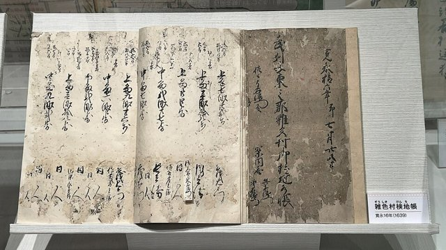
1582–1598 年，豐臣秀吉在統一戰爭間隙推行全國「太閣檢地」——**以一間（約 1.8 公尺）竿丈量每一塊水田、評定上中下田等級、核定石高（產量），並把耕作者登記為「一地一作人」**。配合刀狩令（1588）、人掃令（1591），完成「兵農分離＋身份凍結」。這不是技術測量，而是一次**全國資產大審計**：誰欠秀吉多少米，從此白紙黑字。這樁案件連接（[豐臣秀吉的統一](https://chad-liu.github.io/books/html/1-3.日本歷史/1590-豐臣秀吉的統一.html)）與（[關原之戰](https://chad-liu.github.io/books/html/1-3.日本歷史/1600-關原之戰.html)）的財政底座。

[→ 對外連結：太閣檢地：丈量全國的權力資產負債表](https://chad-liu.github.io/books/html/1-3.日本歷史/1598-太閣檢地.html)

## 1582-03 | 甲州征伐與武田騎馬隊終局
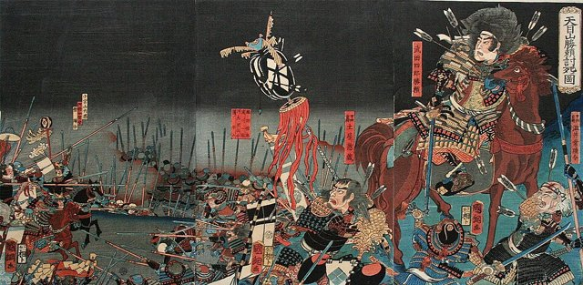
1582 年 3 月，織田信長（10 萬）＋德川家康（5 萬）分路攻**武田**（勝賴）——**甲州征伐**（天目山，勝賴自殺，武田滅）；此前：1575 **長篠之戰**（武田勝賴 1.5 萬騎，織田—德川 3.8 萬，3,000 鐵炮，三段擊，柵欄，馬場—內藤—山縣戰死，武田四名臣盡喪）——**武田騎馬隊的葬禮**；此後：1582 木曾義昌倒戈—高遠城—天目山（勝賴—信勝自殺）——**武田 80 年終**。這樁案件是「戰術代差的死亡證明」：**鐵炮（3,000）vs 騎馬（衝鋒）**。

[→ 對外連結：甲州征伐：武田騎馬隊的終局](https://chad-liu.github.io/books/html/1-3.日本歷史/1582-甲州征伐與武田騎馬隊終局.html)

## 1582-06-21 | 本能寺之變
1582 年 6 月 2 日（天正十年六月二日）凌晨，織田信長宿於京都本能寺、僅率百餘人——家臣**明智光秀**率 1.3 萬大軍包圍：「敵在本能寺！」信長自殺（一說切腹後寺焚）、嫡子信忠二條御所自殺——**統一天下前夜，主君被家臣弒殺**。此後羽柴秀吉「中國大返」（十日內回師）擊殺光秀（山崎合戰）——**十三天的天下**。這樁案件是日本史最大懸案：**光秀為什麼謀反？**——四百年來十餘種假說，無一定論。

[→ 對外連結：本能寺之變：史上最著名的「為什麼」](https://chad-liu.github.io/books/html/1-3.日本歷史/1582-本能寺之變.html)

## 1590 | 豐臣秀吉統一全國

1590 年小田原征伐（北條氏滅亡）——**豐臣秀吉完成日本統一**（戰國時代終結）。秀吉出身尾張農民（足輕→信長家臣→天下人）——日本史上唯一的「平民天下人」。此後八年（1590–1598）：太閤檢地、刀狩、戶口調查、文祿慶長之役（[壬辰戰爭](https://chad-liu.github.io/books/html/1-3.日本歷史/1592-壬辰戰爭.html)）——**統一的制度化與對外膨脹的雙軌**。這樁案件是「流動性的頂點與終結」：秀吉用下剋上的梯子爬上頂點，然後**親手抽掉梯子**（兵農分離的固定化）。

[→ 對外連結：豐臣秀吉的統一：農民出身者的天下布武](https://chad-liu.github.io/books/html/1-3.日本歷史/1590-豐臣秀吉的統一.html)

## 1592 | 出兵朝鮮
1592–1598 年，豐臣秀吉兩度出兵朝鮮（文祿之役 1592、慶長之役 1597）——動員約 20–30 萬日軍，一度攻陷漢城、平壤，直逼鴨綠江；明朝出兵援朝、李舜臣水軍斷補給——戰爭陷入僵持，秀吉病死（1598）後撤兵。這樁案件是東亞史上最大規模的國際戰爭之一（參戰三國、死亡軍民數十萬），**也是豐臣政權的自殺**：七年戰爭透支財政、離間武將，為關原（[關原之戰](https://chad-liu.github.io/books/html/1-3.日本歷史/1600-關原之戰.html)）埋下火藥。

[→ 對外連結：壬辰戰爭：七年戰爭拖垮豐臣](https://chad-liu.github.io/books/html/1-3.日本歷史/1592-壬辰戰爭.html)

## 1600 | 關原之戰
1600 年 9 月 15 日（慶長五年），美濃關原——德川家康東軍約 7–10 萬 vs 石田三成西軍約 8 萬——**六小時決戰**，小早川秀秋倒戈（問鐵炮）引發連鎖叛變，西軍崩潰。此後家康沒收改易 87 家大名、配分領地——**江戶幕府的領地基礎**。這樁案件是日本史上「決戰時間最短、後果最長」的戰役：**六小時買下二百六十年的和平**。

[→ 對外連結：關原之戰：六小時決定二百六十年](https://chad-liu.github.io/books/html/1-3.日本歷史/1600-關原之戰.html)

## 1603 | 江戶幕府成立

1603 年，德川家康任征夷大將軍、開設**江戶幕府**——此後至 1868（十五代），日本進入**二百六十年的和平**（Pax Tokugawa）。幕藩體制：幕府直轄（天領約 400 萬石）＋約 260 藩（大名領）——**中央—地方的封建聯邦**；士農工商身份制、參勤交代、寺請制——**全套社會控制工程**。這樁案件是「和平的組織技術」：如何用制度讓武士不打仗、讓大名不造反、讓社會不流動——二百六十年。

[→ 對外連結：江戶幕府：二百六十年的和平工程](https://chad-liu.github.io/books/html/1-3.日本歷史/1603-江戶幕府.html)

## 1635 | 參勤交代制度化
第三代將軍德川家光把參勤交代制度化，要求大名隔年往返江戶與領地，妻兒則長住江戶，藉此削弱大名的財力。

## 1637 | 島原之亂
九州島原、天草的農民與天主教徒不堪重稅與迫害起事，幕府以大軍鎮壓，此後更加嚴厲地禁止天主教。

## 1641 | 鎖國體制完成

1639 年，幕府驅逐葡萄牙船——**鎖國體制完成**：此後至 1854（黑船），日本僅保留長崎（荷蘭＋中國）、對馬（朝鮮）、薩摩（琉球）、松前（蝦夷）四個窗口——**貿易與外交的幕府壟斷**。這樁案件常被誤讀為「閉關自守」——真相是**主權的精密工程**：在禁教（[天主教傳來](https://chad-liu.github.io/books/html/1-3.日本歷史/1549-天主教傳來.html)）與島原之亂（1637–38）的教訓上，幕府選擇「可控的開放」——**不是關門，是只開一扇自己守的門**。

[→ 對外連結：鎖國體制：主權的兩百年實驗](https://chad-liu.github.io/books/html/1-3.日本歷史/1639-鎖國體制.html)

## 1688 | 元祿文化

1688–1704（元祿年間），江戶、大坂、京都的町人文化爆炸：**井原西鶴**的浮世草子、**近松門左衛門**的人形淨瑠璃與歌舞伎、**松尾芭蕉**的俳諧——**商人階級的第一次文化親政**。這樁案件是和平的紅利兌現（[江戶幕府](https://chad-liu.github.io/books/html/1-3.日本歷史/1603-江戶幕府.html)）：參勤交代催生的貨幣經濟＋百萬人口江戶的消費市場——**町人用錢買下文化的發言權**。

[→ 對外連結：元祿文化：和平第一代的消費革命](https://chad-liu.github.io/books/html/1-3.日本歷史/1688-元祿文化.html)

## 1707 | 富士山寶永大噴發

富士山最近一次大噴發，火山灰一路飄到江戶。

## 1716 | 享保改革
第八代將軍德川吉宗推動享保改革，整頓財政、獎勵新田開發、放寬洋書進口，帶動「蘭學」興起。後來的寬政改革、天保改革都想仿效，卻未能解決幕府財政的根本問題。

## 1787 | 寬政改革與江戶的危機
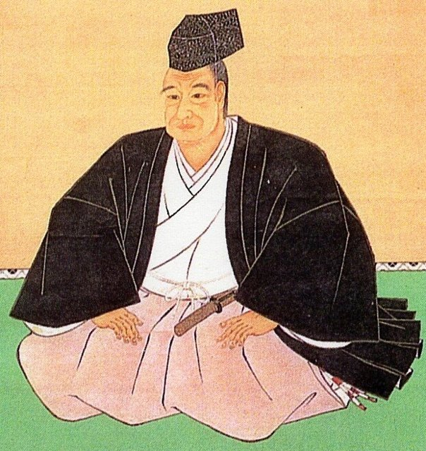
1787–1793 年，老中**松平定信**推行**寬政改革**：儉約令、棄捐令（免除旗本債務）、圍米（儲備）、出版統制（「白河の清きに魚も棲みかねて」——狂歌諷刺）。這是江戶幕府三大改革（享保、寬政、天保）的中樞——**和平工程的老化與修補**。這樁案件的真相是「系統性老化」：貨幣經濟侵蝕米本位、武士貧困化、天明大飢饉（1782–88 死者數十萬）——**改革修的是症狀，不是結構**。

[→ 對外連結：寬政改革與江戶的危機：和平工程的老化](https://chad-liu.github.io/books/html/1-3.日本歷史/1787-寬政改革與江戶的危機.html)

## 1804 | 化政文化

以江戶為中心的町人文化進入高峰，葛飾北齋的〈富嶽三十六景〉、歌川廣重的〈東海道五十三次〉等浮世繪，以及歌舞伎、滑稽本大受歡迎。各地的寺子屋也讓庶民識字率大幅提高。

## 1853-07-08 | 黑船來航

1853 年 7 月 8 日，美國東印度艦隊司令**馬修・培理**（Matthew Perry）率四艘黑色軍艦（蒸汽船）駛入浦賀——**黑船來航**。翌年《日美和親條約》（神奈川條約）開下田、箱館；1858《日美修好通商條約》（不平等條約：領事裁判權＋關稅自主喪失）。這樁案件是鎖國總帳的結清（[鎖國體制](https://chad-liu.github.io/books/html/1-3.日本歷史/1639-鎖國體制.html)）：**工業革命的軍事—工業複合體 vs 前近代的武士政權**——代差的數學一次兌現。

[→ 對外連結：黑船來航：工業革命的砲艦叩關](https://chad-liu.github.io/books/html/1-3.日本歷史/1853-黑船來航.html)

## 1858 | 安政條約
1858 年 7 月，幕府代表井伊直弼（大老）在**未得天皇敕許**的情況下與美國總領事哈里斯（Townsend Harris）簽訂《日美修好通商條約》，隨後荷、俄、英、法比照——**安政五國條約**。開港開市、領事裁判權、關稅自主喪失一次到齊；接著井伊以「安政大獄」鎮壓尊攘派（吉田松陰處刑），1860 年 3 月自己在櫻田門外被水戶、薩摩浪士刺殺——**幕末內戰的開幕鈴聲**。這樁案件是 [黑船來航](https://chad-liu.github.io/books/html/1-3.日本歷史/1853-黑船來航.html) 的外壓轉為內爆的正式立案：**強迫開國的人，被自己人開了膛**。

[→ 對外連結：安政五國條約與安政大獄：一份沒有敕許的合約與一場自爆](https://chad-liu.github.io/books/html/1-3.日本歷史/1858-安政五國條約與安政大獄.html)

## 1867-11-09 | 大政奉還

在薩摩、長州等倒幕勢力的壓力下，第十五代將軍德川慶喜把政權交還明治天皇。年底朝廷發布「王政復古大號令」，延續260多年的江戶幕府結束。

## 1868-01 | 戊辰戰爭
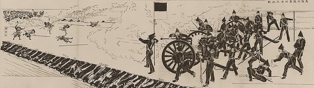
1868 年 1 月鳥羽伏見開戰，舊幕府軍一敗塗地、慶喜逃回江戶；4 月西鄉隆盛與勝海舟會談、**江戶無血開城**；但清算未完——上野戰爭（彰義隊）、北越戰爭、會津若松籠城（白虎隊）、奧羽越列藩同盟，直到 1869 年 6 月五稜郭箱館戰爭、榎本武揚投降——**戊辰戰爭一年半終結二百六十年的幕府**，舊幕府勢力被徹底清算。這樁案件是 [明治維新](https://chad-liu.github.io/books/html/1-3.日本歷史/1868-明治維新.html) 的軍事卷：**革命最貴的部分不是開城，是「讓所有潛在復辟者歸零」**。

[→ 對外連結：戊辰戰爭：一年半的總清算](https://chad-liu.github.io/books/html/1-3.日本歷史/1868-戊辰戰爭.html)

## 1868-04 | 明治維新

1868 年 1 月鳥羽伏見之戰、4 月江戶無血開城、9 月改元明治——**江戶幕府滅亡、王政復古**。此後二十年：版籍奉還（1869）、廢藩置縣（1871）、地租改正（1873）、徵兵令（1873）、殖產興業、文明開化、1889 大日本帝國憲法——**從封建聯邦到中央集權民族國家的全套重寫**。這樁案件是日本史上第二次「文明跳躍」（第一次是大化革新 [大化革新](https://chad-liu.github.io/books/html/1-3.日本歷史/0645-大化革新.html)）：**同樣的移植公式，更快的速度、更大的規模**。

[→ 對外連結：明治維新：二百六十年的系統一次重啟](https://chad-liu.github.io/books/html/1-3.日本歷史/1868-明治維新.html)

## 1871 | 廢藩置縣
廢除諸藩、改設府縣，由中央派任知事，建立中央集權國家。同年岩倉使節團出訪歐美，考察西方制度。此後陸續實施學制（1872）、徵兵令（1873）與地租改正（1873）。

## 1871-12 | 岩倉使節團

1871 年 11 月，右大臣**岩倉具視**為名譽全權大使，率木戶孝允、大久保利通、伊藤博文等政府核心＋隨員百餘人出訪，考察美國與歐洲共 **12 國，歷時一年十個月**（1871–73）。原定任務是修約交涉——**徹底失敗**；轉為制度考察後，反而成為明治國家建設的總源頭：學制、徵兵、殖產興業、憲法構想都在這兩年定稿。這樁案件是 [明治維新](https://chad-liu.github.io/books/html/1-3.日本歷史/1868-明治維新.html) 的取材卷：**派出整個政府，回國時帶回的是一套設計圖**。

[→ 對外連結：岩倉使節團：人類史上最大規模的制度逆向工程](https://chad-liu.github.io/books/html/1-3.日本歷史/1871-岩倉使節團.html)

## 1873 | 地租改正
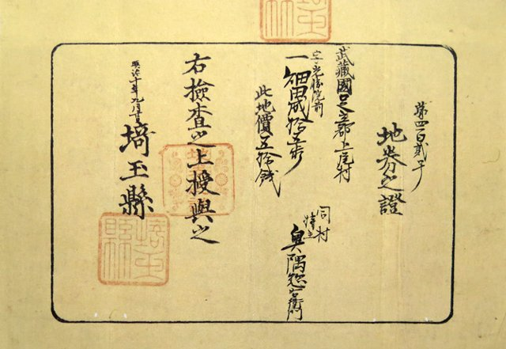
1873 年 7 月，地租改正條例頒布——**廢石高米貢、改按地價 3% 課貨幣稅、發放地券確認私有產權**。這是明治維新（[明治維新](https://chad-liu.github.io/books/html/1-3.日本歷史/1868-明治維新.html)）最關鍵也最痛的一刀：把江戶三百藩各行其是的實物稅，一夜換成全國統一的現金稅。沒有這條繩，殖產興業、徵兵制、岩倉使節團的帳單全付不出；有了這條繩，農民暴動（地租改正反對一揆）席捲東北，第二年稅率即被迫降到 2.5%。**現代日本的財產權與稅制，都從這張地券開始**。

[→ 對外連結：地租改正：明治政府的財政救命繩](https://chad-liu.github.io/books/html/1-3.日本歷史/1873-地租改正.html)

## 1874 | 自由民權運動
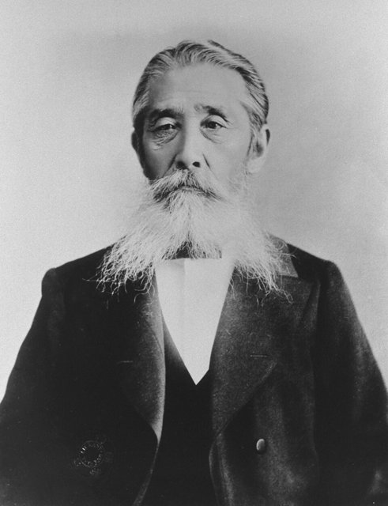
1874 年 1 月，板垣退助、後藤象二郎、江藤新平、副島種臣提交**《民選議院設立建白書》**——「人民有參政權」首次成為國家議程。此後十五年：愛國公黨、立志社（高知）、國會期成同盟、私自憲法草案、請願浪潮，直到 1881 年「國會開設之敕諭」（承諾 1890 開議）、1889 年大日本帝國憲法頒布——**立憲不是天皇的恩賜，是民權派用請願與壓力逼出來的時間表**。這樁案件是 [明治維新](https://chad-liu.github.io/books/html/1-3.日本歷史/1868-明治維新.html) 的對照卷：移植的憲政理念在日本本土變異，再從民間反輸回政府。

[→ 對外連結：自由民權運動：從下面逼出來的憲法時間表](https://chad-liu.github.io/books/html/1-3.日本歷史/1874-自由民權運動.html)

## 1877 | 西南戰爭

1877.2–9，西鄉隆盛率薩摩士族約3萬舉兵，圍熊本、戰田原坂，9.24城山自刃——**日本最後一場內戰，政府動員6萬徵兵＋軍艦鐵道，耗費4200萬圓（年財政七成）**。前案維新（見 [明治維新](https://chad-liu.github.io/books/html/1-3.日本歷史/1868-明治維新.html)）講了開國，後案憲法（見 [大日本帝國憲法](https://chad-liu.github.io/books/html/1-3.日本歷史/1889-大日本帝國憲法.html)）講了立憲，中間獨缺：**拿刀推翻幕府的武士，為何九年後被自己建的徵兵軍隊消滅？**本案是維新後果的收尾。

[→ 對外連結：西南戰爭與士族終結：武士階級的訃告](https://chad-liu.github.io/books/html/1-3.日本歷史/1877-西南戰爭與士族終結.html)

## 1879 | 琉球處分
日本廢除琉球藩，改設沖繩縣，琉球王國滅亡。此前1874年日本以八瑤灣事件為由出兵臺灣（牡丹社事件），1875年又以《樺太千島交換條約》取得千島群島。

## 1882 | 日本銀行
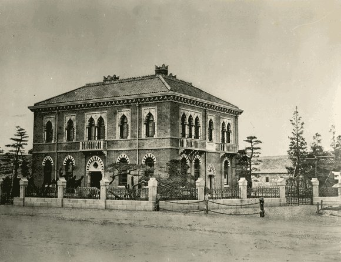
1882 年 10 月，日本銀行（日銀）開業——**全國 153 家國立銀行濫發紙幣、西南戰爭軍費引爆通脹（紙幣貶值 1.7 倍）之後，松方正義用比利時國家銀行為藍本，一次收回發鈔權**。1884 年兌換銀券、1897 年金本位，日本第一次擁有現代貨幣主權。這樁案件是地租改正（[地租改正](https://chad-liu.github.io/books/html/1-3.日本歷史/1873-地租改正.html)）的金融下半場：**稅收到錢之後，錢本身也得是真的**。

[→ 對外連結：日本銀行：松方正義的中央銀行賭局](https://chad-liu.github.io/books/html/1-3.日本歷史/1882-日本銀行.html)

## 1889-02-11 | 大日本帝國憲法

1889 年 2 月 11 日（紀元節），明治天皇頒布《大日本帝國憲法》——亞洲第一部成文憲法。天皇「總攬統治權」、議會權限有限、內閣對天皇而非議會負責；次年帝國議會開幕。這樁案件夾在 [地租改正](https://chad-liu.github.io/books/html/1-3.日本歷史/1873-地租改正.html) 的財政革命與 [甲午戰爭](https://chad-liu.github.io/books/html/1-3.日本歷史/1894-甲午戰爭.html) 的帝國擴張之間——**維新十年只解決了錢與兵，「國家由誰說了算」這個最後的問題，為何選了普魯士的答案？**

[→ 對外連結：大日本帝國憲法：普魯士式立憲的安裝](https://chad-liu.github.io/books/html/1-3.日本歷史/1889-大日本帝國憲法.html)

## 1894 | 甲午戰爭
1894–1895 年，日清為朝鮮控制權開戰——**日本海陸全勝**（豐島海戰、平壤、黃海海戰、威海衛），1895《馬關條約》：清賠款 2 億兩、割台灣、承認朝鮮獨立。但三國干涉（俄德法）迫使日本歸還遼東（加賠 3,000 萬兩）——**勝利的果實被部分沒收**。這樁案件是明治工業化（[明治維新](https://chad-liu.github.io/books/html/1-3.日本歷史/1868-明治維新.html)）的第一次實戰驗收：**二十年殖產興業的答卷**——也是「臥薪嘗膽」（俄國）的起點。

[→ 對外連結：甲午戰爭：工業化的第一次期中考](https://chad-liu.github.io/books/html/1-3.日本歷史/1894-甲午戰爭.html)

## 1902 | 日英同盟
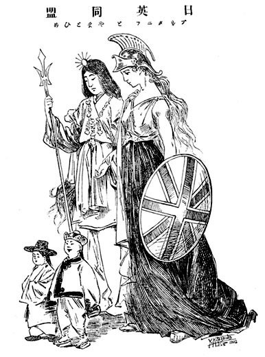
1902.1.30，英國與日本簽訂第一次英日同盟——**全球霸主首次放棄「光榮孤立」**，與亞洲新興國家結盟。目標只有一個：俄國。英俄大博弈從中亞延伸到遠東（滿洲、朝鮮），英國要人看守遠東後門，日本要人背書對俄開賭——**同盟是一筆分工契約**。日本得到兩樣東西：外交後盾（開戰時盟國牽制）與倫敦金融市場（發債融資戰費）——[日俄戰爭](https://chad-liu.github.io/books/html/1-3.日本歷史/1904-日俄戰爭.html) 的勝利，一半是在倫敦簽發的。1905、1911 兩次續約升級（從同盟保衛到共同防禦印度），直到華盛頓會議（1921）決定廢盟、1923 失效——**便車路線終點站**。

[→ 對外連結：日英同盟：光榮孤立的終結與便車的開出](https://chad-liu.github.io/books/html/1-3.日本歷史/1902-日英同盟.html)

## 1904 | 日俄戰爭
1904–1905 年，日俄為滿韓霸權開戰——**日本慘勝**：旅順攻堅（死傷 6 萬）、奉天會戰（動員 50 萬）、對馬海戰（殲滅波羅的海艦隊）——1905《樸茨茅斯條約》：俄承認日本在韓國的優勢、讓渡旅順大連與南滿鐵路、割南樺太——**但無賠款**。國民暴動（日比谷燒打事件）——「勝而無利」的憤怒。這樁案件是「小國擊敗帝國」的精算：**英日同盟＋財政動員＋情報的勝利，也是指數級國力差的警示**。

[→ 對外連結：日俄戰爭：小國擊敗帝國的精算](https://chad-liu.github.io/books/html/1-3.日本歷史/1904-日俄戰爭.html)

## 1910 | 日韓合併
日本與大韓帝國簽訂《日韓合併條約》，朝鮮半島成為日本的殖民地，直到1945年。

## 1912 | 大正時代開始
明治天皇駕崩，大正天皇即位。同年第一次護憲運動推翻藩閥內閣，政黨政治逐漸成形。

## 1914 | 參加第一次世界大戰
1914.8，日本以履行英日同盟為名對德宣戰——攻佔青島、接收南洋群島；1915 對華二十一條要求（五九國恥）；同時歐洲列強自顧不暇，退出亞洲市場——**日本接手，出口暴增，從債務國翻身為債權國**：「船成金」「成金景氣」。1918 米騷動（[米騷動](https://chad-liu.github.io/books/html/1-3.日本歷史/1918-米騷動.html)）戳破繁榮的分配面；1919 巴黎和會：五強席位＋山東繼承（引爆五四）＋人種差別條款被拒。**一戰是日本的套利窗口：政治上擴張、經濟上暴富、外交上卻同時得罪中西兩方**——繁榮與孤立同時到帳。

[→ 對外連結：一次大戰與日本的躍進：歐洲自爆、日本套利](https://chad-liu.github.io/books/html/1-3.日本歷史/1914-一次大戰與日本的躍進.html)

## 1915 | 山口組
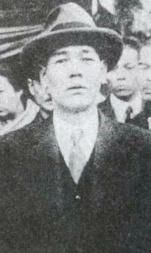
1915 年，山口春吉在神戶創立山口組（碼頭苦力掮客）。此後百年：田岡一雄（三代目，1960s 巔峰，會員逾萬）、宅見若頭遇刺（1997，分裂）、六代目司忍（2005–，分裂出神戶山口組 2015）。鼎盛時（1980s）日本黑道會員逾 9 萬（一說），年入數千億日圓（一說，覺醒劑、賭博、土木）。**碼頭苦力掮客如何變成跨國黑幫？黑道與日本社會是什麼關係——寄生、共生，還是影子政府？**

> **黑幫為何在日本合法存在（指定暴力團）？當警察給黑幫發「合法」牌照，法律與黑道的邊界在哪裡？**

[→ 對外連結：山口組：碼頭苦力與黑道帝國](https://chad-liu.github.io/books/html/1-3.日本歷史/1915-山口組.html)

## 1918 | 米騷動
1918 年 7–9 月，富山縣主婦阻米船外運（米價飛漲，援俄西伯利亞出兵+投機），暴動蔓延：逾 70 萬人（一說）、36 座城市+鄉村（全國三分之二府縣，一說），寺內內閣總辭（史上首次因民亂倒閣），米價平抑。**主婦攔船，為何能倒一個內閣？**

> **米價是政權的溫度計嗎？當主婦都能算出誰在囤米，政府的算術失靈在哪一格？**

[→ 對外連結：米騷動：米價與一億國民的怒火](https://chad-liu.github.io/books/html/1-3.日本歷史/1918-米騷動.html)

## 1923-09-01 | 關東大地震
1923 年 9 月 1 日 11 時 58 分，相模灣 M7.9 強震＋火災旋風——**死者失蹤者約 10.5 萬、東京橫濱化為焦土**。震後的混亂中爆發**朝鮮人與社會主義者屠殺**（自警團＋軍警、死者數千）與**龜戶事件**（軍隊殺害工運人士）。這樁案件是「天災的社會審計」：**地震暴露大正民主的脆弱、點燃排外與鎮壓的火焰**——關東大地震是昭和軍國主義的助產士之一。

[→ 對外連結：關東大地震：天災引爆的現代性危機](https://chad-liu.github.io/books/html/1-3.日本歷史/1923-關東大地震.html)

## 1925 | 普通選舉法
1925.3，加藤高明護憲三派內閣（憲政會・政友會・政友本黨）同時通過兩部法律：**普通選舉法**（25 歲以上男子普選、納稅額門檻廢除——選民從約 300 萬暴增至約 1,250 萬）與**治安維持法**（取締「國体變革」與「私有財產否定」）——**同一個月立法，飴與鞭成對出貨**。這是普選運動三十年（[自由民權運動](https://chad-liu.github.io/books/html/1-3.日本歷史/1874-自由民權運動.html) 的延長線）的兌現日，也是思想鎮壓制度化（特高警察）的啟用日。1928 首次普選＋三一事件；三一五・四一六大檢舉——**普選的門開得越大，思想的門關得越緊**——政黨政治頂點與脆弱性的雙重寫真，通往 [滿洲事變與軍國主義](https://chad-liu.github.io/books/html/1-3.日本歷史/1931-滿洲事變與軍國主義.html) 的前奏。

[→ 對外連結：普選法與治安維持法：飴與鞭的雙胞胎立法](https://chad-liu.github.io/books/html/1-3.日本歷史/1925-普選法與治安維持法.html)

## 1926-12-25 | 昭和時代開始
大正天皇駕崩，裕仁即位為昭和天皇。不久後的昭和金融恐慌（1927）與世界經濟大恐慌（1930）重創日本經濟，軍部與右翼勢力趁勢崛起。

## 1930 | 昭和恐慌與金解禁
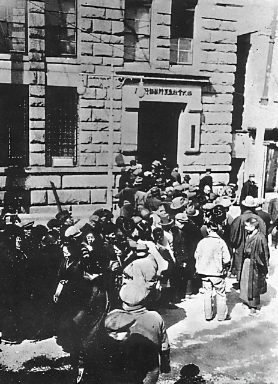
1929.11，濱口雄幸民政黨內閣宣布**金解禁**（1930.1 執行）：解除 1917 以來的金本位禁輸，並以**舊平價**復歸——等於日圓實質升值近一成。兩週前，華爾街已崩盤（1929.10.24）——**兩件巨災以直角相遇**：升值砍出口，大恐慌砍外需，出口腰斬、失業暴增、農村賣兒賣女。井上準之助（大藏相・日銀總裁）堅持緊縮——1931.11 被右翼刺殺；同年 12 月，**高橋是清接任：切斷金本位＋日圓貶值＋赤字公債＋軍擴財政**——日本成為世界最早脫離恐慌的國家，**凱因斯式政策的先手**。但軍費的後門由此打開——1936 二二六事件高橋被殺（[二二六事件](https://chad-liu.github.io/books/html/1-3.日本歷史/1936-二二六事件.html)），剎車拔除。恐慌→農村絕望→青年將校的溫床——經濟危機與軍事冒險的因果鏈，在此案完整現形。

[→ 對外連結：昭和恐慌與金解禁：最壞時機的直角相遇](https://chad-liu.github.io/books/html/1-3.日本歷史/1930-昭和恐慌與金解禁.html)

## 1931-09-18 | 九一八事變
1931 年 9 月 18 日，關東軍炸毀南滿鐵路柳條湖段、自導自演——**滿洲事變**爆發，五個月佔領全滿洲，1932 建「滿洲國」。此後：五一五事件（1932 犬養毅被殺）、二二六事件（1936）、中日戰爭（1937）、太平洋戰爭（1941）——**十五年戰爭的開幕**。這樁案件是「下剋上的全國版」（戰國的幽靈、[應仁之亂與戰國時代](https://chad-liu.github.io/books/html/1-3.日本歷史/1467-應仁之亂與戰國時代.html)）：**前線軍官綁架國家**——統帥權獨立＋政黨政治崩壞的共犯結構。

[→ 對外連結：滿洲事變與軍國主義：下剋上的全國版](https://chad-liu.github.io/books/html/1-3.日本歷史/1931-滿洲事變與軍國主義.html)

## 1936-02-26 | 二二六事件
1936 年 2 月 26 日凌晨，東京大雪。皇道派青年將校率約 1,480 名士兵佔領永田町一帶，襲殺大藏大臣高橋是清、內大臣齋藤實、教育總監渡邊錠太郎，首相岡田啟介倖免。四天後，叛軍在天皇震怒與海軍艦隊壓境下不戰而降；統帥權干犯的罪名使領導者被從嚴處決，**皇道派自此瓦解，統制派獨攬軍權**。偵探的結論：這場「失敗的政變」反而是軍部獨裁的完成式——**叛亂者想救的「昭和維新」，被它的鎮壓者以更激進的形式實現**。

[→ 對外連結：二二六事件：雪夜的槍聲如何裝好戰爭的最後一道螺絲](https://chad-liu.github.io/books/html/1-3.日本歷史/1936-二二六事件.html)

## 1937-07-07 | 中日戰爭全面爆發
1937 年 7 月 7 日盧溝橋事件——**中日全面戰爭**爆發：淞滬會戰（死傷 40 萬級）、南京（大屠殺的爭議）、武漢會戰後陷入僵持——**日本陷入「支那泥沼」**：投入百萬大軍、戰費膨脹、國際孤立（美國廢商約 1939、凍結資產＋石油禁運 1941）——**通往太平洋戰爭（[太平洋戰爭](https://chad-liu.github.io/books/html/1-3.日本歷史/1941-太平洋戰爭.html)）的直路**。這樁案件是「勝利的泥沼化」：戰術全勝、戰略全敗。

[→ 對外連結：中日戰爭：泥沼的數學](https://chad-liu.github.io/books/html/1-3.日本歷史/1937-中日戰爭.html)

## 1940 | 大政翼贊會與新體制
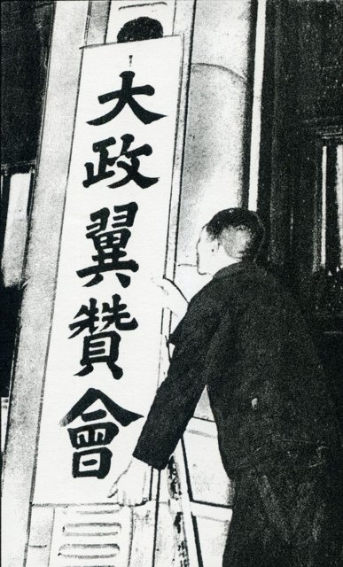
1940 年 10 月 12 日，近衛文麿第二次內閣催生**大政翼贊會**——政黨在數月內**自願解散**、併入一國一黨的「新體制」，**政黨政治正式終結**（[二二六事件](https://chad-liu.github.io/books/html/1-3.日本歷史/1936-二二六事件.html) 後軍部獨大的一步收束）。同期的配套：經濟新體制（重要產業統制團體、卡達化）、日德意三國同盟（1940.9）、日蘇中立條約（1941.4）、國家總動員法行使下的統制經濟（物價、配給、勞動動員）與「一億一體」動員體制。這樁案件是「制度的自殺」：**沒有政變、沒有解散國會的軍刀——政黨排隊自我消滅**。

[→ 對外連結：大政翼贊會與新體制：無政變的政變](https://chad-liu.github.io/books/html/1-3.日本歷史/1940-大政翼贊會與新體制.html)

## 1941-12-08 | 太平洋戰爭
1941 年 12 月 8 日（夏威夷 7 日），日本海軍奇襲**珍珠港**、同時登陸馬來亞——**太平洋戰爭**爆發。初期連勝（半年席捲東南亞），1942.6 中途島轉折，此後瓜島、塞班、硫磺島、沖繩的消耗戰——1945.8 原子彈＋蘇聯參戰 → **8 月 15 日投降**（[日本投降與占領改革](https://chad-liu.github.io/books/html/1-3.日本歷史/1945-日本投降與占領改革.html)）。這樁案件是「國力差的豪賭」：**工業生產 10:1 的對手，用奇襲與精神論挑戰**——數學從第一天就寫好結局。

[→ 對外連結：太平洋戰爭：豪賭的四年](https://chad-liu.github.io/books/html/1-3.日本歷史/1941-太平洋戰爭.html)

## 1943 | 跳島戰術與太平洋反攻
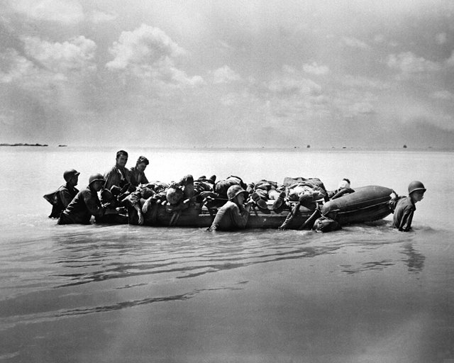
1943–1945 年，美軍太平洋戰場推行**跳島戰術**（Island Hopping，尼米茲—麥克阿瑟之爭）——**跳過日軍要塞、奪關鍵機場**（瓜島—塔拉瓦—塞班—萊特—琉球）；此前：1942 瓜島（六個月）、1943 塔拉瓦（「地獄」，76 小時）——**代價的覺醒**；此後：1944 萊特灣（史上最大海戰）、1945 硫磺島—沖繩（20 萬死）——**攻日跳板**。這樁案件是「選擇性戰爭」：**不打每一個島（日軍 70 萬）——餓死它們**。

[→ 對外連結：美械與跳島：太平洋戰爭的跳島戰術](https://chad-liu.github.io/books/html/1-3.日本歷史/1943-跳島戰術與太平洋反攻.html)

## 1945-03-10 | 東京大空襲與原子彈
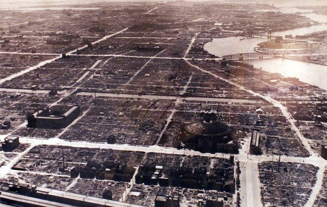
1945 年 3 月 9 日深夜至 10 日，**334 架 B-29** 從馬里亞納起飛，對東京下町執行李梅的低空夜間燒夷轟炸——約 **10 萬平民一夜死亡**。此後大阪、名古屋等城市輪番燒夷，全國 **200+ 城市**、總計約 **50 萬平民死**。8 月 6 日廣島、9 日長崎**原子彈**（曼哈頓計畫），8 月 8 日蘇聯參戰 → 8.15 玉音放送（[日本投降與占領改革](https://chad-liu.github.io/books/html/1-3.日本歷史/1945-日本投降與占領改革.html)）。這樁案件是「火力的數學」：**木造城市 × 燒夷彈 × 低空夜間投擲 = 史上最大的單夜屠殺**——而核武的意義超越火力，是對「本土決戰」敘事本身的打擊。

[→ 對外連結：東京大空襲與原子彈：城市火力學的極限](https://chad-liu.github.io/books/html/1-3.日本歷史/1945-東京大空襲與原子彈.html)

## 1945-08-15 | 日本投降

1945 年 8 月 15 日，昭和天皇玉音放送——**日本投降**；9 月 2 日密蘇里號降伏文書——**GHQ 佔領**（麥克阿瑟）開始。此後七年（至 1952 舊金山和約）：**非軍事化＋民主化的全套工程**——剝奪軍部、解散財閥、農地改革、婦女參政、1947 和平憲法（主權在民＋第九條）、東京審判。這樁案件是「外部強制移植」的極致：**戰敗國用七年安裝民主**——成功到成為範本，也留下憲法與基地的未解習題。

[→ 對外連結：日本投降與占領改革：從帝國到民主的七年](https://chad-liu.github.io/books/html/1-3.日本歷史/1945-日本投降與占領改革.html)

## 1947-04 | 勞動三法
1946–1949 年，GHQ 主導下《勞動組合法》（1945）、《勞動關係調整法》（1946）、《勞動基準法》（1947）相繼成立——**史稱「勞動三法」**。加上 1947 年《獨占禁止法》與財閥解體，戰前「女工—臨時工—高流動」的日企，一夜被套上美式集體談判＋解僱限制。弔詭的是：美國人帶來的工會法，十年後長成全世界最「不美國」的終身雇用＋年功序列＋企業別工會。這樁案件是戰後奇蹟（[戰後經濟奇蹟](https://chad-liu.github.io/books/html/1-3.日本歷史/1955-戰後經濟奇蹟.html)）與豐田生產方式（[豐田生產方式](https://chad-liu.github.io/books/html/1-3.日本歷史/1980-豐田生產方式.html)）的人力底座。

[→ 對外連結：勞動三法：終身雇用的制度地基](https://chad-liu.github.io/books/html/1-3.日本歷史/1947-勞動三法.html)

## 1947-05-03 | 日本國憲法施行

在麥克阿瑟領導的盟軍總司令部（GHQ）佔領下，日本推行非軍事化與民主化改革：解散財閥、農地改革、賦予女性參政權。新憲法確立主權在民、基本人權與放棄戰爭的和平主義，天皇成為「日本國及日本國民統合的象徵」。

## 1952-04-28 | 舊金山和約生效
1951 年 9 月 8 日，舊金山——**48 國簽署和平條約**（蘇聯、波蘭、捷克拒簽），**同日**日美安保條約簽字：講和與結盟綁成一組交割。1952.4.28 生效——佔領終結、主權恢復，但沖繩・小笠原・奄美仍置於美國施政之下。吉田茂的選擇——**輕武裝、經濟優先、對美從屬（吉田路線）**——把佔領的偶然變成戰後的常數。這樁案件是「獨立的交易」：**用主權的殘缺與基地的永久，換取復興的時間與安全的外包**（[日本投降與占領改革](https://chad-liu.github.io/books/html/1-3.日本歷史/1945-日本投降與占領改革.html)）。

[→ 對外連結：舊金山和約與日美安保：從屬的契約化](https://chad-liu.github.io/books/html/1-3.日本歷史/1951-舊金山和約與日美安保.html)

## 1955 | 55年體制
1955 年 10 月，左右社會黨統一（眾參兩院過半衝擊）→ 同年 11 月，自由黨＋民主黨合併為**自由民主黨**——**保守合同**。此後形成「**五五體制**」：自民黨一黨獨大＋社會黨半壁的對峙，延續 38 年（至 1993）。派閥＝黨內保險絲、族議員、利益誘導政治與官僚（法務、通產）＋財界三角——政治的穩定結構與高度成長**互為齒輪**（[戰後經濟奇蹟](https://chad-liu.github.io/books/html/1-3.日本歷史/1955-戰後經濟奇蹟.html)）。這樁案件是「競爭的內化」：**表面上一黨執政，實際上競爭被搬進黨內**——1993 年體制崩壞證明，這台機器的燃料（成長）一旦見底，齒輪就反咬。

[→ 對外連結：五五體制與自民黨：一黨獨大的三十八年](https://chad-liu.github.io/books/html/1-3.日本歷史/1955-五五體制與自民黨.html)

## 1955 | 戰後經濟奇蹟
1955–1973 年，日本實質 GDP 年均成長約 10%——**高度經濟成長**：1964 東京奧運（新幹線開通）、1968 GDP 世界第二（超西德）。這樁案件是「焦土的複利」：韓戰特需（1950–53）的點火＋吉田路線（輕武裝）＋通產省的產業政策＋終身僱用＋國民的儲蓄—教育投資——**十九年從廢墟到世界第二**。兇手不是奇蹟，是**後發優勢＋制度設計＋人口紅利的三重奏**。

[→ 對外連結：戰後經濟奇蹟：從焦土到世界第二](https://chad-liu.github.io/books/html/1-3.日本歷史/1955-戰後經濟奇蹟.html)

## 1960 | 安保鬥爭與所得倍增計畫
岸信介內閣修訂美日安保條約，引發日本戰後最大規模的抗議運動。繼任的池田勇人提出「所得倍增計畫」，日本進入經濟高速成長期。

## 1964-10-10 | 東京奧運與東海道新幹線

1964.10.1，東京奧運開幕前9天，東海道新幹線（東京—新大阪515公里）通車，最高時速210公里——**世界第一條高速鐵路**。總裁十河信二（「新幹線之父」）、總工程師島秀雄（車輛輕量＋動力分散）、3,800億日圓超支（國鐵債務黑洞的起點）。這樁案件是「黑船—鐵道國有—彈丸列車計劃中斷—戰後復活」的百年鐵道執念：1940彈丸列車（戰爭腰斬）、1957年動力分散試驗車、1964通車。此前：1955高度成長點火（見[戰後經濟奇蹟](https://chad-liu.github.io/books/html/1-3.日本歷史/1955-戰後經濟奇蹟.html)）；此後：山陽—東北—上越延伸、1987國鐵分割民營。偵探的問題：**在航空將興、赤字已現時，為何賭上國運修一條「虧本」的新幹線？**

[→ 對外連結：東海道新幹線通車：子彈列車的賭注](https://chad-liu.github.io/books/html/1-3.日本歷史/1964-東海道新幹線通車.html)

## 1972 | 沖繩返還；中日建交
美國把沖繩的行政權交還日本。同年田中角榮訪問北京，日本與中華人民共和國建交，並與中華民國斷交。

## 1973 | 石油危機
1973 年 10 月，第四次中東戰爭爆發，OPEC 對支援以色列的國家實施石油禁運，油價四個月內從每桶約 3 美元漲到 11 美元。日本 99.7% 的石油靠進口（八成來自中東），恐慌搶購：衛生紙從超市貨架消失，「狂乱物価」成年度流行語；1974 年日本 GDP 首度出現戰後負成長（−1.2%），通膨 23%。這樁案件夾在 [戰後經濟奇蹟](https://chad-liu.github.io/books/html/1-3.日本歷史/1955-戰後經濟奇蹟.html) 的黃金十八年與 [豐田生產方式](https://chad-liu.github.io/books/html/1-3.日本歷史/1980-豐田生產方式.html) 的精實革命之間——**一場中東戰爭，為何能讓世界第二大經濟體急煞車，又逼它換檔再起？**

[→ 對外連結：石油危機：高速成長的急煞車](https://chad-liu.github.io/books/html/1-3.日本歷史/1973-石油危機.html)

## 1980 | 豐田生產方式
1980年，美國 NBC 播出《日本能、我們為何不能》、哈佛學者寫《美國衰退》——**豐田生產方式（TPS）**成為美歐解剖的對象：看板（kanban）、準時化（JIT）、自働化（jidoka）、改善（kaizen）。1973石油危機中豐田唯一盈利（→1979「日本第一」）、1980年代日本車美國市占超20%（→貿易摩擦、廣場協議伏筆，見[廣場協議與泡沫](https://chad-liu.github.io/books/html/1-3.日本歷史/1985-廣場協議與泡沫.html)）。源頭：豐田喜一郎（Just-in-Time）、大野耐一（超級市場啟發，1950年代）。偵探的問題：**缺錢缺料的小廠，為何能用「零庫存」打敗福特的大量生產？**

[→ 對外連結：豐田生產方式：看板與準時的世界征服](https://chad-liu.github.io/books/html/1-3.日本歷史/1980-豐田生產方式.html)

## 1985 | 廣場協議與泡沫經濟
1985 年 9 月，G5 廣場飯店協議——**美元貶值、日圓升值**（1 美元 240→120 日圓、兩年倍升）。日本為緩和升值蕭條而金融緩和（公定步合 2.5%）——**過剩流動性湧入股票與土地**：1989 日經 38,915、東京地價「可買下全美國」——**人類史上最大資產泡沫**。1991 泡沫崩潰（[泡沫崩潰與失落的三十年](https://chad-liu.github.io/books/html/1-3.日本歷史/1991-泡沫崩潰與失落的三十年.html)）。這樁案件是「政策的連鎖誤判」：升值→緩和→泡沫——每一步理性，加總是災難。

[→ 對外連結：廣場協議與泡沫：日圓升值吹出的巨大泡泡](https://chad-liu.github.io/books/html/1-3.日本歷史/1985-廣場協議與泡沫.html)

## 1989-01-07 | 平成時代開始
在位62年的昭和天皇駕崩，明仁即位，隔天改元平成。年底日經指數創下38,915點的歷史高點。

## 1991 | 泡沫經濟破滅
1991 年地價下跌開始——**泡沫崩潰**：日經從 38,915 跌至 14,000（1992）、土地跌七成（六大都市）；不良債權（1998 估 100 兆日圓級）→ 1997 三洋證券、北海道拓殖銀行、山一證券倒閉；此後三十年（1991–2020s）：零成長、通縮、零利率、就職冰河期、少子高齡化——**失落的三十年**。這樁案件是「資產負債表衰退」（辜朝明）的教科書：**全民還債不花錢，貨幣政策失效**。

[→ 對外連結：泡沫崩潰與失落的三十年：資產負債表的長期衰退](https://chad-liu.github.io/books/html/1-3.日本歷史/1991-泡沫崩潰與失落的三十年.html)

## 1993 | 55年體制瓦解
自民黨在眾議院選舉中失去過半席次，細川護熙組成非自民聯合政府，自民黨38年的連續執政告終；不過隔年就重返執政。

## 1995 | 阪神大地震與地鐵沙林毒氣事件
1995.1.17阪神大地震（M7.3、6434死）＋3.20地下鐵沙林事件（14死、6300傷）——**泡沫崩潰第四年（見 [泡沫崩潰與失落的三十年](https://chad-liu.github.io/books/html/1-3.日本歷史/1991-泡沫崩潰與失落的三十年.html)），富裕日本連遭天災與人災**。前案泡沫講了錢，後案三一一（見 [三一一大地震](https://chad-liu.github.io/books/html/1-3.日本歷史/2011-三一一大地震.html)）講了複合災害，中間獨缺：**1995為何是「戰後共識崩解之年」？**本案追查基礎設施神話與安全神話的同時破產。

[→ 對外連結：阪神大地震與奧姆真理教：富裕國的雙重衝擊](https://chad-liu.github.io/books/html/1-3.日本歷史/1995-阪神大地震與奧姆真理教.html)

## 2001 | 小泉純一郎內閣
小泉純一郎出任首相，推動郵政民營化等結構改革，執政五年半，是戰後任期較長的首相之一。

## 2011-03-11 | 東日本大震災
2011 年 3 月 11 日 14 時 46 分，東北太平洋 M9.0 強震＋最高 40 公尺海嘯——**死者失蹤者約 2.2 萬**；福島第一核電廠氫爆＋爐心熔毀（INES 7 級）——**人類史上第二次七級核災**。此後：全核電停機、能源進口暴增、復興增稅、災區重建（至今）、核電存廢的國論兩分。這樁案件是「複合災害」（cascading disaster）的範本：**地震→海嘯→核災→能源危機→財政負擔的連鎖**——每一環都可分析，每一環都未充分準備。

[→ 對外連結：三一一大地震：複合災害與能源的抉擇](https://chad-liu.github.io/books/html/1-3.日本歷史/2011-三一一大地震.html)

## 2012-12 | 安倍晉三再度執政
安倍晉三第二次出任首相，推動以大規模量化寬鬆與日圓貶值為核心的「安倍經濟學」，並在2015年通過允許行使集體自衛權的安保法制。他成為日本憲政史上任期最長的首相。

## 2019-05-01 | 令和時代開始
明仁天皇依特別法生前退位，這是兩百多年來第一次；德仁天皇即位，改元令和。

## 2021 | 東京奧運
因新冠疫情延後一年舉行的東京奧運，在大多數場館無觀眾的情況下舉辦。

## 2022-07-08 | 安倍晉三遇刺
前首相安倍晉三在奈良為參議院選舉助選演說時遭槍擊身亡，是二二六事件以來第一位遇刺身亡的前首相。

## 2025-10 | 首位女性首相
自民黨總裁高市早苗當選日本歷史上第一位女性內閣總理大臣，自民黨與日本維新會組成聯合政府。
