<!--
內容整理自本機筆記〈日本歷史時間列表：從繩文時代到令和時代〉（圖表\日本歷史時間列表：從繩文時代到令和時代.md）與中文維基百科「日本歷史」條目（CC BY-SA 4.0），以台灣用語改寫摘要。
https://zh.wikipedia.org/zh-tw/日本历史
兩份資料的分期略有出入，處理方式如下：
- 彌生時代的起點：筆記採傳統的「約前300年」，維基百科採近年碳定年研究的「約前10世紀」；時期色帶採較新的說法，並在事件中註明兩說。
- 佛教傳入有538年與552年兩說；鎌倉幕府成立常見1185年與1192年兩說，時期色帶以1185年劃分。
- 南北朝（1336～1392）與室町時代重疊，時期色帶以南北朝合一（1392）與應仁之亂（1467）切分。
- 神武天皇即位（前660年）出自《古事記》與《日本書紀》的神話，並非信史。
各事件的精確日期為補充。
圖片皆為 Wikimedia Commons 上的公有領域（含CC0）作品（封面：葛飾北齋〈神奈川沖浪裏〉）。部分配圖年份與事件不完全相同：化政文化配歌川廣重〈東海道五十三次・日本橋〉（1830年代）、黑船來航配1854年培里再訪時的日本繪卷、明治維新配1873年的明治天皇、大政奉還配後世所繪的二條城大政奉還圖、新憲法施行配1946年公布時銀座街頭的照片、日本投降配密蘇里號上的降書簽字照片。
-->

# Periods
- 約3.8萬～1.6萬年前 | 舊石器時代 | #8d6e63
  人類以狩獵採集維生，使用打製石器；約3萬4千年前起，小刀型石器與後來由西伯利亞傳入的細石刃在列島各地流傳。
- -14000 ~ -1000 | 繩文時代 | #b08900
  冰期結束、氣候轉暖，人們製作繩紋陶器，住在豎穴式住居，以狩獵、採集、漁撈為生，留下大量貝塚與土偶。
- -1000 ~ 250 | 彌生時代 | #5c940d
  水田稻作、青銅器與鐵器從大陸與朝鮮半島傳入，聚落擴大、貧富分化，各地出現小「國」，邪馬台國女王卑彌呼見於中國史書。
- 250 ~ 592 | 古墳時代 | #2b8a3e
  各地興建巨大的前方後圓墳，以近畿為中心的大和王權逐漸擴張，倭五王遣使中國南朝，佛教與漢字傳入。
- 592 ~ 710 | 飛鳥時代 | #0b7285
  聖德太子與大化革新仿效隋唐制度，建立以天皇為中心的中央集權律令國家。
- 710 ~ 794 | 奈良時代 | #1864ab
  以平城京為都，律令制度鼎盛，佛教成為國家宗教，編纂《古事記》與《日本書紀》。
- 794 ~ 1185 | 平安時代 | #5f3dc4
  遷都平安京（京都），藤原氏攝關政治與院政相繼，假名文學與國風文化興盛，武士勢力崛起。
- 1185 ~ 1333 | 鎌倉時代 | #862e9c
  源賴朝在鎌倉建立第一個武家政權，北條氏以執權掌握實權，兩度擊退蒙古來襲。
- 1333 ~ 1392 | 建武新政與南北朝 | #a61e4d
  後醍醐天皇推翻鎌倉幕府、恢復天皇親政，但很快失敗；足利尊氏另立北朝、開設室町幕府，南北兩朝對立近60年。
- 1392 ~ 1467 | 室町時代 | #c92a2a
  足利義滿統一南北朝，與明朝勘合貿易，北山文化、東山文化與禪宗、能樂、茶道、水墨畫發展。
- 1467 ~ 1573 | 戰國時代 | #e8590c
  應仁之亂後幕府權威崩解，各地大名「下剋上」、群雄割據，鐵砲與天主教傳入。
- 1573 ~ 1603 | 安土桃山時代 | #f59f00
  織田信長、豐臣秀吉相繼統一天下，推行檢地與刀狩，豐臣政權兩度出兵朝鮮。
- 1603 ~ 1868 | 江戶時代 | #364fc7
  德川幕府以幕藩體制統治兩百六十多年，實行鎖國，町人文化、浮世繪與歌舞伎繁榮，末期因黑船來航被迫開國。
- 1868 ~ 1912 | 明治時代 | #c2255c
  明治維新推動廢藩置縣、殖產興業、富國強兵與立憲，日本迅速工業化，並在甲午、日俄戰爭後走向帝國擴張。
- 1912 ~ 1926 | 大正時代 | #ae3ec9
  政黨政治與「大正民主」發展，一戰帶來經濟繁榮，但也經歷米騷動與關東大地震。
- 1926 ~ 1989 | 昭和時代 | #495057
  前期軍部崛起、發動侵略戰爭並在二戰戰敗；戰後在新憲法下民主化，經濟高速成長成為世界第二大經濟體。
- 1989 ~ 2019 | 平成時代 | #1c7ed6
  泡沫經濟破滅後經歷「失落的年代」，55年體制瓦解，並遭遇阪神與東日本兩次大地震。
- 2019 ~ 2026 | 令和時代 | #0ca678
  德仁天皇即位，面對新冠疫情、人口減少與高齡化、財政負擔與安全環境變化等長期挑戰。

# Events

## 約3.8萬年前 | 列島上的早期人類
日本列島較可靠的人類定居證據可追溯到距今約3.8萬至3.9萬年前。沖繩出土的「港川人」化石約有1萬8千年歷史。

## -14000 | 繩文時代開始 {label=約前1.4萬年}
約1萬多年前末次冰期結束、氣候轉暖，除琉球群島外，列島進入繩文時代。人們製作表面有繩紋的陶器，住在半地穴式的豎穴住居，使用弓箭狩獵、捕魚與採集，留下許多貝塚與造型獨特的土偶，新潟出土的「火焰型土器」是代表作。

## -660 | 神武天皇即位的傳說 {label=前660年（傳說）}
依《古事記》與《日本書紀》的記載，第一代天皇神武天皇在前660年2月11日即位，這被當作傳統的建國之始。這主要是神話而非信史，但今天日本仍以2月11日為「建國紀念之日」。

## -1000 | 彌生時代開始 {label=約前10世紀}
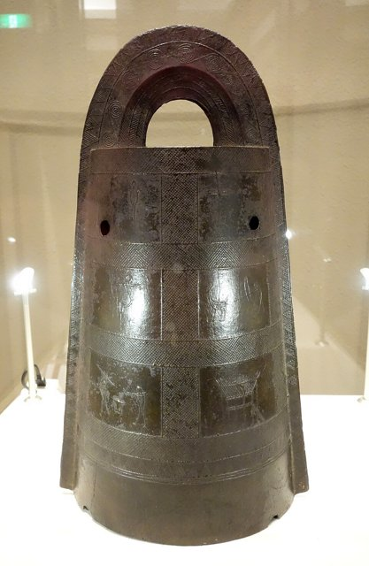
水田稻作從北九州向東擴散，青銅器與鐵器傳入，通常認為與來自朝鮮半島和中國的移民有關。社會出現貧富分化、環濠聚落與地區性的政治集團。彌生時代的起點傳統上定為約前300年，近年碳定年研究則把它往前推到約前10世紀。「彌生」之名來自1884年在東京本鄉彌生町首次發現這種陶器。

## 57 | 漢委奴國王金印
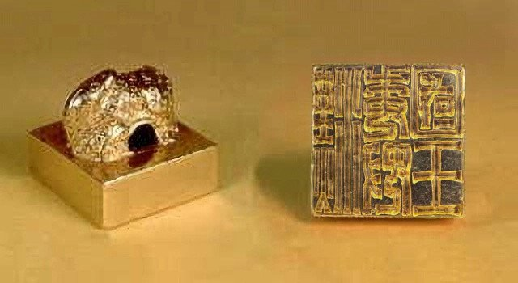
倭奴國遣使東漢朝貢，光武帝賜予金印。1784年在九州志賀島出土的「漢委奴國王」金印，被認為就是這枚印。

## 239 | 卑彌呼遣使曹魏
《魏志倭人傳》記載，2世紀末倭國大亂後，邪馬台國女王卑彌呼統治諸國，她以「鬼道」治眾，遣使曹魏並獲封「親魏倭王」。邪馬台國究竟在九州還是近畿，至今仍有爭論。

## 250 | 古墳時代開始 {label=約3世紀中葉}
最古老的大型前方後圓墳箸墓古墳出現，墓主可能就是卑彌呼。以奈良為中心的大和王權逐漸擴張，巨大的古墳象徵統治者的權力；全國各地修建的古墳超過十萬座。

## 400 | 好太王碑與倭五王 {label=約4世紀末～5世紀}
高句麗的好太王碑記載，4世紀末倭國曾與高句麗交戰。5世紀初，大阪的百舌鳥、古市古墳群興建，其中大仙陵古墳（傳仁德天皇陵）是日本最大的古墳；同時「倭五王」多次遣使中國南朝。

## 538 | 佛教傳入
百濟聖明王把佛像與佛經獻給大和朝廷（另一說為552年）。支持佛教的蘇我氏與維護傳統神道的物部氏激烈對立，587年蘇我馬子消滅物部守屋，取得朝政主導權。

## 593 | 聖德太子攝政
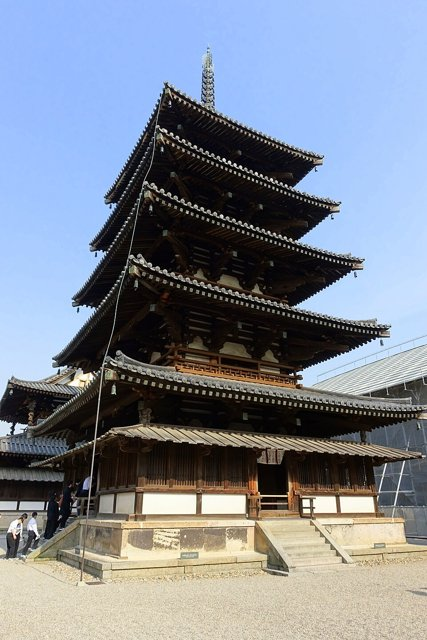
推古天皇即位，姪子聖德太子擔任攝政，與蘇我馬子共同執政。他興建四天王寺、法隆寺，弘揚佛教。

## 603 | 冠位十二階與十七條憲法
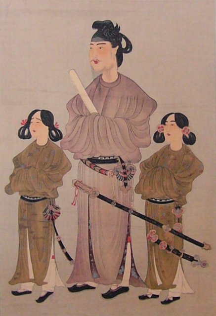
聖德太子制定冠位十二階（603）與十七條憲法（604），依才能而非出身任用官員，奠定漢式官僚制度的基礎，並開始使用「天皇」名號。

## 607 | 遣隋使
小野妹子出使隋朝，國書中「日出處天子致書日沒處天子」一句讓隋煬帝不悅。此後日本持續派遣使節與留學生學習中國制度。

## 645 | 乙巳之變與大化革新
中大兄皇子與中臣鎌足（後來的藤原鎌足）在宮中刺殺蘇我入鹿，蘇我氏滅亡。隔年頒布革新詔書，仿效隋唐推行公地公民、班田收授、戶籍與租庸調等制度，邁向中央集權。

## 663 | 白村江之戰
唐朝滅百濟後，日本出兵約4萬人援助百濟復國，在朝鮮半島的白村江被唐與新羅聯軍擊敗。此後日本加強國防，並更積極地吸收唐朝制度。

## 672 | 壬申之亂
天智天皇死後，其弟大海人皇子起兵擊敗天智之子大友皇子，即位為天武天皇，強化天皇權威。這時期鑄造了日本最早的錢幣「富本錢」。

## 701 | 大寶律令
頒布大寶律令，律令國家的體制正式完成。

## 710 | 遷都平城京
元明天皇遷都平城京（今奈良），仿照唐長安城規劃棋盤狀街道，奈良時代開始。

## 712 | 《古事記》與《日本書紀》
現存最古老的史書《古事記》（712）與第一部官修正史《日本書紀》（720）相繼完成，記錄神話與天皇系譜。

## 752 | 東大寺大佛開眼
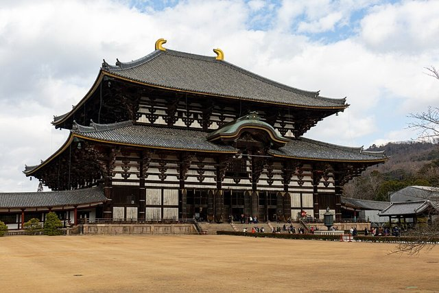
聖武天皇為以佛法鎮護國家，在各地興建國分寺，並在平城京建東大寺、鑄造盧舍那大佛。753年唐朝高僧鑑真歷經五次失敗終於東渡日本，傳授戒律。

## 794 | 遷都平安京
桓武天皇為擺脫奈良佛教勢力的干政，先遷都長岡京（784），再遷都平安京（今京都），平安時代開始。此後京都作為首都長達一千多年。

## 894 | 停派遣唐使
菅原道真建議停派遣唐使，日本在吸收唐文化的基礎上，發展出獨特的國風文化，假名文字也在這時期成熟。

## 1008 | 《源氏物語》
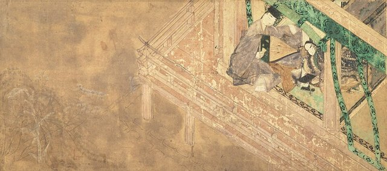
宮廷女官紫式部寫成長篇小說《源氏物語》，與清少納言的隨筆《枕草子》同為平安時代女性假名文學的代表。這時藤原道長權傾一時，攝關政治達到全盛。

## 1086 | 院政開始
白河天皇讓位後以上皇身分繼續掌握實權，開啟「院政」。院政時代被視為中世的開端，莊園制度確立，公家、武家、寺家三大勢力並立。

## 1167 | 平清盛出任太政大臣
在保元、平治之亂中崛起的平清盛，成為第一位出任太政大臣的武士，並透過聯姻成為天皇的外戚，建立第一個武家政權「平氏政權」。

## 1185 | 壇之浦之戰，源平合戰結束
源賴朝之弟源義經在壇之浦消滅平氏。源賴朝在各地設置守護、地頭，鎌倉幕府的實質統治從此開始。

## 1192 | 源賴朝受封征夷大將軍
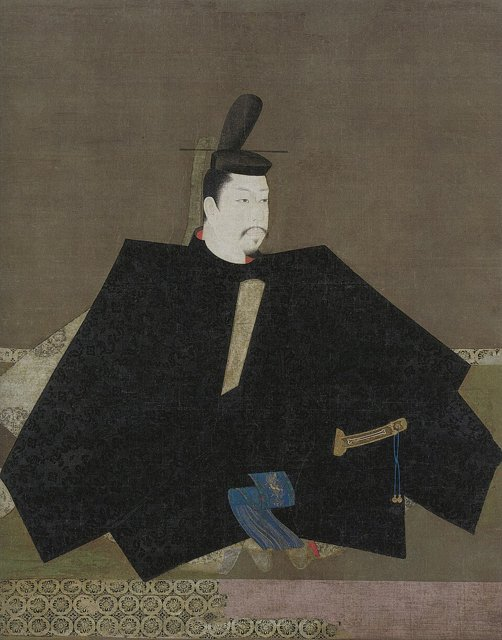
源賴朝受封征夷大將軍，這也是過去常用來標示鎌倉幕府成立的年份。

## 1221 | 承久之亂
後鳥羽上皇起兵討伐幕府，被北條義時、泰時父子擊敗，三位上皇被流放。北條氏以「執權」身分世襲掌握幕府實權，將軍淪為傀儡。

## 1274 | 文永之役（第一次蒙古來襲）
元世祖忽必烈派遣蒙古、高麗聯軍進攻九州博多灣，日軍苦戰，元軍隨後撤退。

## 1281 | 弘安之役（第二次蒙古來襲）
元朝再派十多萬大軍來襲，遭遇颱風損失慘重而敗退，日本人稱之為「神風」。戰後幕府無力賞賜出征的御家人，統治基礎逐漸動搖。

## 1333 | 鎌倉幕府滅亡；建武新政
後醍醐天皇起兵倒幕，足利尊氏倒戈、新田義貞攻陷鎌倉，鎌倉幕府滅亡。後醍醐天皇推行建武新政、恢復天皇親政，但因賞罰不公引發武士不滿，三年後就失敗了。

## 1336 | 南北朝分立
足利尊氏擁立光明天皇（北朝），1338年受封征夷大將軍，在京都開設室町幕府。後醍醐天皇帶著三神器退往奈良吉野（南朝），南北兩朝對立。

## 1392 | 南北朝合一
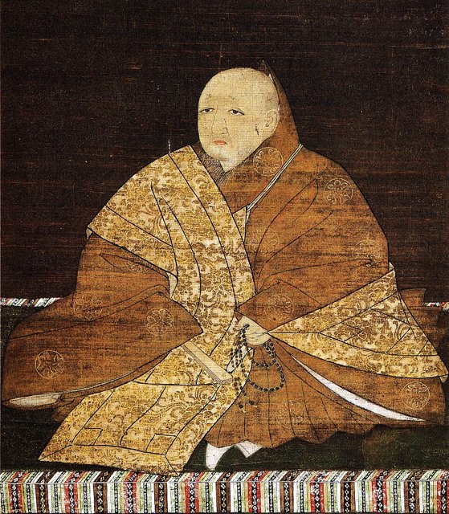
第三代將軍足利義滿促成南朝把三神器交給北朝，南北朝統一。義滿在京都北山興建金閣（鹿苑寺），其時代的文化被稱為「北山文化」。

## 1404 | 勘合貿易
足利義滿受明朝冊封為「日本國王」，以勘合符與明朝進行朝貢貿易，大量明朝銅錢流入日本，帶動商品經濟發展。

## 1467 | 應仁之亂
第八代將軍足利義政的繼承問題與管領家的內鬥，引發長達11年的應仁之亂，京都化為焦土，幕府權威一落千丈，各地大名紛紛回到領國，戰國時代開始。義政隱居東山，興建銀閣（慈照寺），孕育了侘寂美學的「東山文化」。

## 1543 | 鐵砲傳入
葡萄牙人漂流到種子島，傳入火繩槍（鐵砲），很快就在各地仿製，改變了戰爭的方式。

## 1549 | 沙勿略傳入天主教
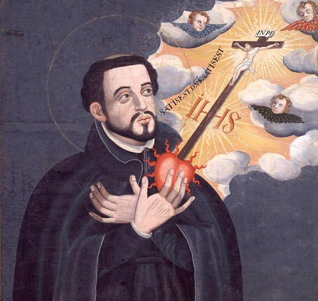
耶穌會傳教士方濟·沙勿略抵達鹿兒島，天主教開始在日本傳播，部分大名也受洗成為「吉利支丹大名」。

## 1560 | 桶狹間之戰
尾張的織田信長以少數兵力奇襲擊敗今川義元，從此崛起。

## 1573 | 室町幕府滅亡
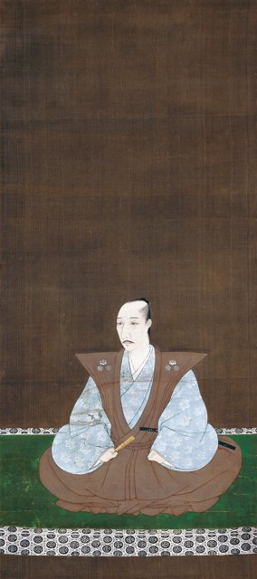
織田信長放逐第十五代將軍足利義昭，室町幕府滅亡。1575年他在長篠之戰以大量鐵砲擊敗武田軍，1576年起興建安土城。

## 1582 | 本能寺之變
織田信長在京都本能寺遭部將明智光秀襲擊身亡。羽柴秀吉（後來的豐臣秀吉）迅速回師，在山崎之戰擊敗明智光秀，繼承了信長的霸業。

## 1590 | 豐臣秀吉統一全國
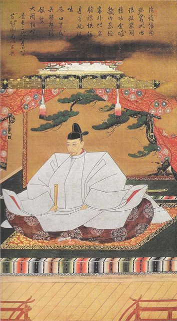
秀吉在大坂築城、出任關白，獲天皇賜姓豐臣，1590年攻下小田原北條氏，大致完成全國統一。他推行「太閤檢地」與「刀狩令」，確立兵農分離的身分秩序。

## 1592 | 出兵朝鮮
豐臣秀吉兩度出兵朝鮮（文祿·慶長之役，1592～1598），遭朝鮮與明朝聯軍抵抗，秀吉死後撤軍，豐臣政權也因此元氣大傷。

## 1600 | 關原之戰
秀吉死後，五大老之首德川家康與石田三成等西軍在關原決戰，家康大獲全勝，成為實際的最高統治者。

## 1603 | 江戶幕府成立
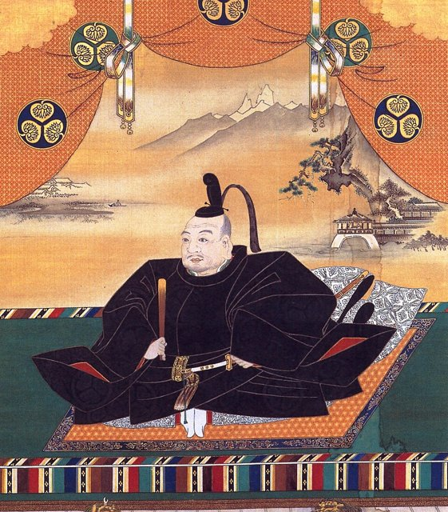
德川家康受封征夷大將軍，在江戶（今東京）開設幕府，江戶時代開始。1615年大坂之役消滅豐臣氏，並頒布《武家諸法度》控制大名。

## 1635 | 參勤交代制度化
第三代將軍德川家光把參勤交代制度化，要求大名隔年往返江戶與領地，妻兒則長住江戶，藉此削弱大名的財力。

## 1637 | 島原之亂
九州島原、天草的農民與天主教徒不堪重稅與迫害起事，幕府以大軍鎮壓，此後更加嚴厲地禁止天主教。

## 1641 | 鎖國體制完成
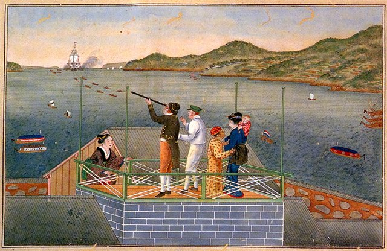
荷蘭商館遷到長崎出島，幕府只允許荷蘭與中國商船在長崎貿易，並透過對馬（朝鮮）、薩摩（琉球）、松前（蝦夷）三個窗口對外往來，「鎖國」體制完成。

## 1688 | 元祿文化
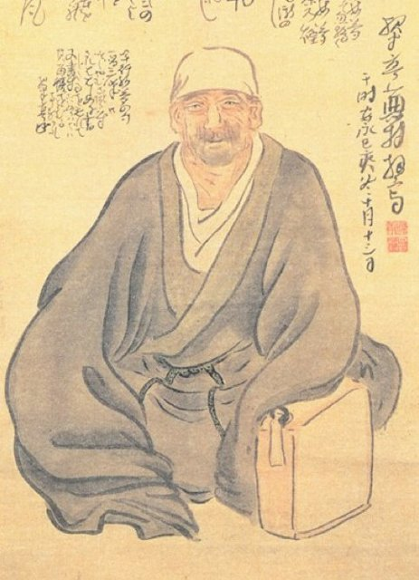
第五代將軍德川綱吉時期經濟繁榮，以大阪、京都為中心的町人文化興盛：井原西鶴的浮世草子、松尾芭蕉的俳句、近松門左衛門的人形淨瑠璃都在這時誕生。綱吉頒布「生類憐憫令」，被稱為「犬將軍」。

## 1707 | 富士山寶永大噴發
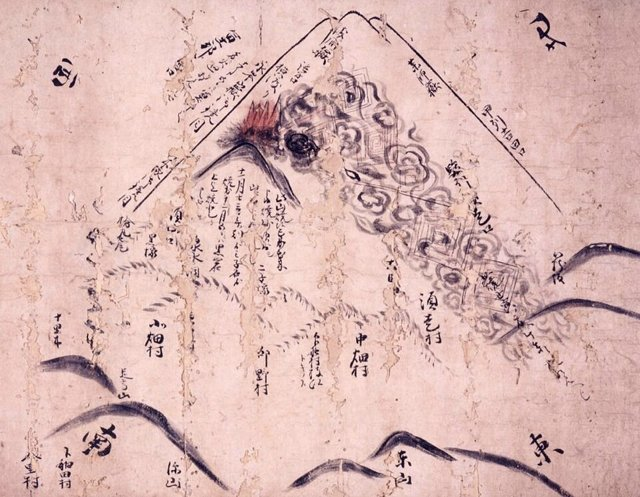
富士山最近一次大噴發，火山灰一路飄到江戶。

## 1716 | 享保改革
第八代將軍德川吉宗推動享保改革，整頓財政、獎勵新田開發、放寬洋書進口，帶動「蘭學」興起。後來的寬政改革、天保改革都想仿效，卻未能解決幕府財政的根本問題。

## 1804 | 化政文化
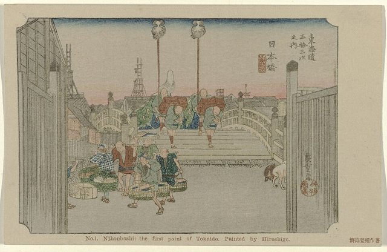
以江戶為中心的町人文化進入高峰，葛飾北齋的〈富嶽三十六景〉、歌川廣重的〈東海道五十三次〉等浮世繪，以及歌舞伎、滑稽本大受歡迎。各地的寺子屋也讓庶民識字率大幅提高。

## 1853-07-08 | 黑船來航

美國海軍准將培里率領四艘黑色軍艦駛入江戶灣浦賀，要求日本開國。隔年簽訂《神奈川條約》（日美和親條約），開放下田、箱館兩港，鎖國體制瓦解。

## 1858 | 安政條約
大老井伊直弼未經天皇同意，與美國簽訂《日美修好通商條約》等不平等條約，引發尊王攘夷派的強烈反彈。1860年井伊直弼在江戶城櫻田門外遇刺。

## 1867-11-09 | 大政奉還

在薩摩、長州等倒幕勢力的壓力下，第十五代將軍德川慶喜把政權交還明治天皇。年底朝廷發布「王政復古大號令」，延續260多年的江戶幕府結束。

## 1868 | 明治維新

新政府軍在戊辰戰爭中擊敗舊幕府軍，明治天皇發布《五條御誓文》，改元明治，遷都東京。新政府推動「富國強兵」、「殖產興業」、「文明開化」，日本全面走向近代化。

## 1871 | 廢藩置縣

廢除諸藩、改設府縣，由中央派任知事，建立中央集權國家。同年岩倉使節團出訪歐美，考察西方制度。此後陸續實施學制（1872）、徵兵令（1873）與地租改正（1873）。

## 1877 | 西南戰爭

維新功臣西鄉隆盛率領不滿的鹿兒島士族起兵，被新式的徵兵軍隊擊敗，這是日本最後一場內戰。

## 1879 | 琉球處分
日本廢除琉球藩，改設沖繩縣，琉球王國滅亡。此前1874年日本以八瑤灣事件為由出兵臺灣（牡丹社事件），1875年又以《樺太千島交換條約》取得千島群島。

## 1889-02-11 | 大日本帝國憲法

頒布以普魯士憲法為範本的《大日本帝國憲法》（明治憲法），天皇為國家元首，隔年召開第一屆帝國議會，日本成為亞洲第一個立憲國家。

## 1894 | 甲午戰爭
日本與清朝為爭奪朝鮮爆發甲午戰爭，日軍大勝。1895年簽訂《馬關條約》，日本取得臺灣、澎湖與鉅額賠款，臺灣成為日本第一個殖民地。

## 1904 | 日俄戰爭
日本與俄國為爭奪中國東北與朝鮮開戰，日軍在旅順、奉天與對馬海峽獲勝，1905年簽訂《樸資茅斯條約》，取得南樺太（庫頁島南部）。亞洲國家擊敗歐洲強國，震驚世界。

## 1910 | 日韓合併
日本與大韓帝國簽訂《日韓合併條約》，朝鮮半島成為日本的殖民地，直到1945年。

## 1912 | 大正時代開始
明治天皇駕崩，大正天皇即位。同年第一次護憲運動推翻藩閥內閣，政黨政治逐漸成形。

## 1914 | 參加第一次世界大戰
日本以英日同盟為由對德宣戰，攻佔德國在中國的租借地青島，1915年向中華民國提出「二十一條要求」。大戰期間日本經濟空前繁榮。

## 1918 | 米騷動
米價飆漲引發全國性的米騷動，參與者超過兩百萬人，寺內內閣因此下台，原敬組成日本第一個正式的政黨內閣。

## 1923-09-01 | 關東大地震
規模7.9的大地震重創東京與橫濱，死亡與失蹤人數超過十萬，經濟遭受重大打擊。

## 1925 | 普通選舉法
實施25歲以上男性普選，「大正民主」達到高峰；但同年也通過了壓制社會運動的《治安維持法》。

## 1926-12-25 | 昭和時代開始
大正天皇駕崩，裕仁即位為昭和天皇。不久後的昭和金融恐慌（1927）與世界經濟大恐慌（1930）重創日本經濟，軍部與右翼勢力趁勢崛起。

## 1931-09-18 | 九一八事變
關東軍炸毀南滿鐵路柳條湖段，藉口進攻中國東北，隔年扶植滿洲國。1933年日本退出國際聯盟。

## 1936-02-26 | 二二六事件
陸軍皇道派青年軍官發動政變失敗，此後軍部更加掌控政府，政黨政治衰落，國家走向軍國主義。

## 1937-07-07 | 中日戰爭全面爆發
盧溝橋事變後，日本全面侵略中國，佔領上海、南京等地，戰事陷入長期消耗。

## 1941-12-08 | 太平洋戰爭
日本在1940年與德、義結成三國同盟，1941年12月（日本時間8日）偷襲珍珠港，對美、英宣戰，迅速佔領東南亞。1942年中途島海戰大敗，成為戰局的轉捩點。

## 1945-08-15 | 日本投降

美軍攻下硫磺島與沖繩，並對日本本土城市大規模轟炸。8月6日、9日廣島與長崎遭原子彈轟炸，蘇聯也對日宣戰。昭和天皇在8月15日透過廣播宣布接受《波茨坦宣言》，9月2日簽署降書，第二次世界大戰結束。

## 1947-05-03 | 日本國憲法施行

在麥克阿瑟領導的盟軍總司令部（GHQ）佔領下，日本推行非軍事化與民主化改革：解散財閥、農地改革、賦予女性參政權。新憲法確立主權在民、基本人權與放棄戰爭的和平主義，天皇成為「日本國及日本國民統合的象徵」。

## 1952-04-28 | 舊金山和約生效
1951年簽訂的《舊金山和約》生效，日本恢復主權，同時與美國簽訂《日美安保條約》。韓戰帶來的「特需」讓日本經濟迅速復甦。

## 1955 | 55年體制
保守派政黨合併成立自由民主黨，與統一的日本社會黨對峙，形成自民黨長期執政的「55年體制」，一直延續到1993年。1956年日本加入聯合國。

## 1960 | 安保鬥爭與所得倍增計畫
岸信介內閣修訂美日安保條約，引發日本戰後最大規模的抗議運動。繼任的池田勇人提出「所得倍增計畫」，日本進入經濟高速成長期。

## 1964-10-10 | 東京奧運與東海道新幹線
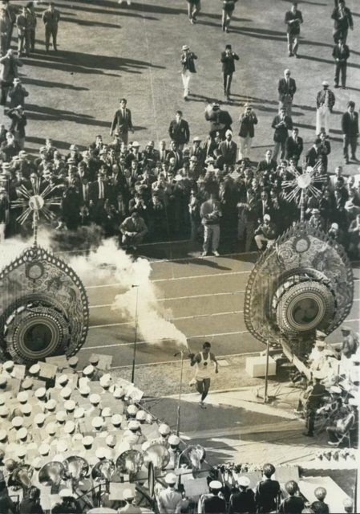
亞洲第一次奧運在東京開幕，開幕前世界第一條高速鐵路東海道新幹線通車。1968年日本國民生產毛額躍居資本主義世界第二。1970年舉辦大阪萬國博覽會。

## 1972 | 沖繩返還；中日建交
美國把沖繩的行政權交還日本。同年田中角榮訪問北京，日本與中華人民共和國建交，並與中華民國斷交。

## 1973 | 石油危機
第一次石油危機爆發，日本結束年成長近10%的高速成長期，轉為穩定成長，但仍是世界第二大經濟體。

## 1985 | 廣場協議與泡沫經濟
廣場協議後日圓大幅升值，日本銀行降息寬鬆，股市與房地產飆漲，形成「泡沫經濟」。

## 1989-01-07 | 平成時代開始
在位62年的昭和天皇駕崩，明仁即位，隔天改元平成。年底日經指數創下38,915點的歷史高點。

## 1991 | 泡沫經濟破滅
股價與地價暴跌，銀行累積大量不良債權，日本進入低成長與通貨緊縮的「失落的年代」。

## 1993 | 55年體制瓦解
自民黨在眾議院選舉中失去過半席次，細川護熙組成非自民聯合政府，自民黨38年的連續執政告終；不過隔年就重返執政。

## 1995 | 阪神大地震與地鐵沙林毒氣事件
1月17日阪神淡路大地震造成六千多人死亡；3月奧姆真理教在東京地下鐵施放沙林毒氣，社會陷入不安。

## 2001 | 小泉純一郎內閣
小泉純一郎出任首相，推動郵政民營化等結構改革，執政五年半，是戰後任期較長的首相之一。

## 2011-03-11 | 東日本大震災
規模9.0的大地震與巨大海嘯侵襲東北地方太平洋沿岸，死亡與失蹤者約兩萬人，並引發福島第一核電廠事故，對日本的能源政策與地方重建影響深遠。

## 2012-12 | 安倍晉三再度執政
安倍晉三第二次出任首相，推動以大規模量化寬鬆與日圓貶值為核心的「安倍經濟學」，並在2015年通過允許行使集體自衛權的安保法制。他成為日本憲政史上任期最長的首相。

## 2019-05-01 | 令和時代開始
明仁天皇依特別法生前退位，這是兩百多年來第一次；德仁天皇即位，改元令和。

## 2021 | 東京奧運
因新冠疫情延後一年舉行的東京奧運，在大多數場館無觀眾的情況下舉辦。

## 2022-07-08 | 安倍晉三遇刺
前首相安倍晉三在奈良為參議院選舉助選演說時遭槍擊身亡，是二二六事件以來第一位遇刺身亡的前首相。

## 2025-10 | 首位女性首相
自民黨總裁高市早苗當選日本歷史上第一位女性內閣總理大臣，自民黨與日本維新會組成聯合政府。
