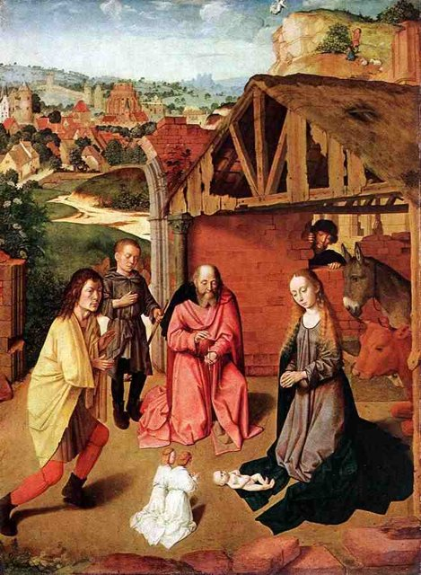
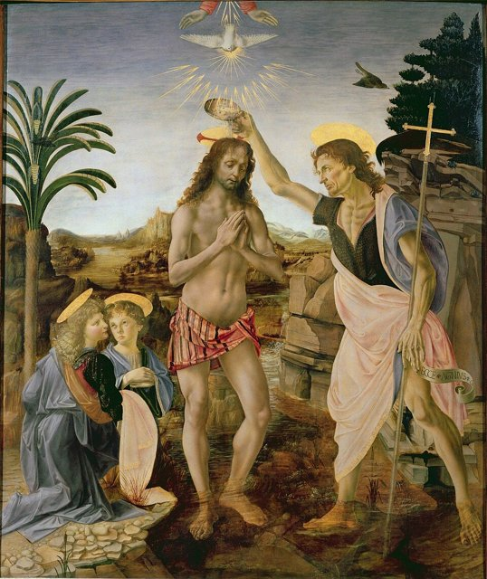
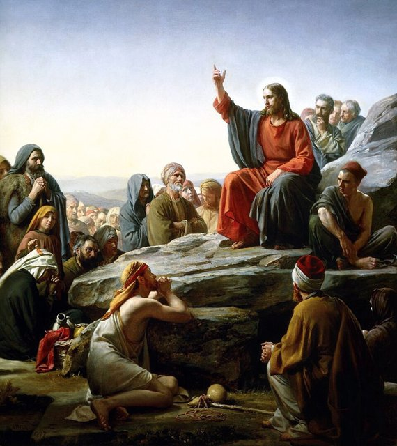
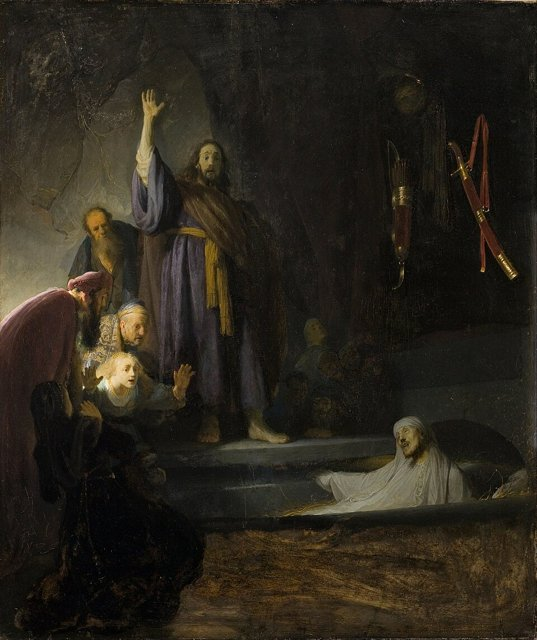
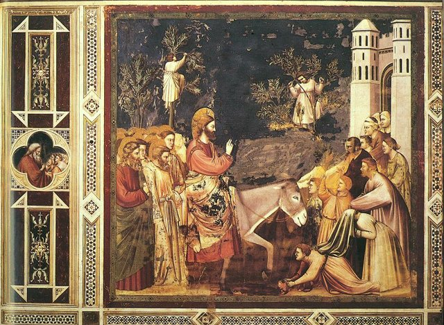
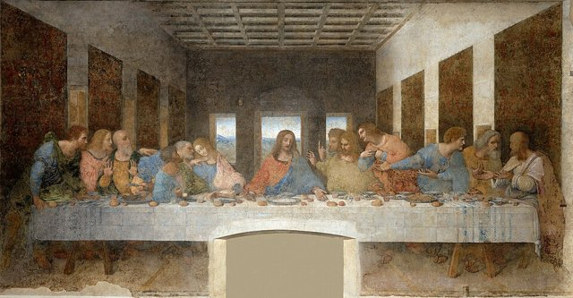
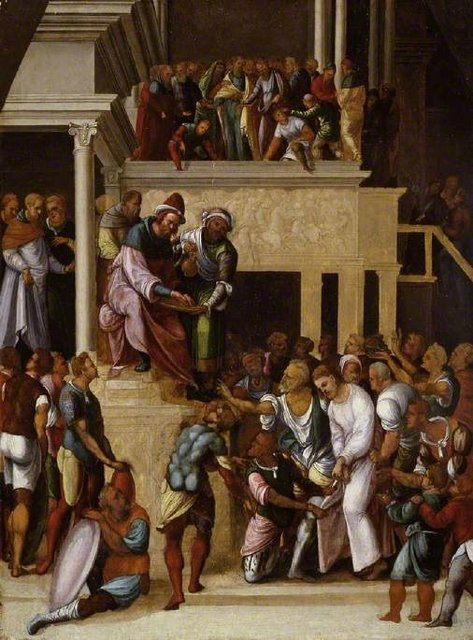
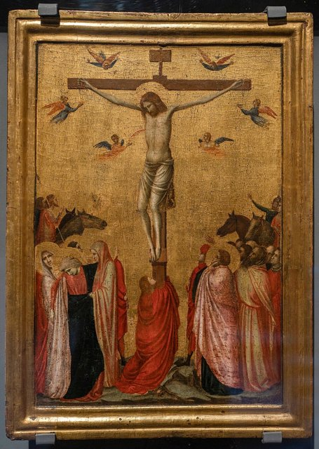
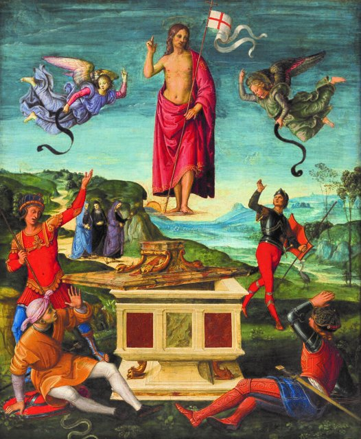
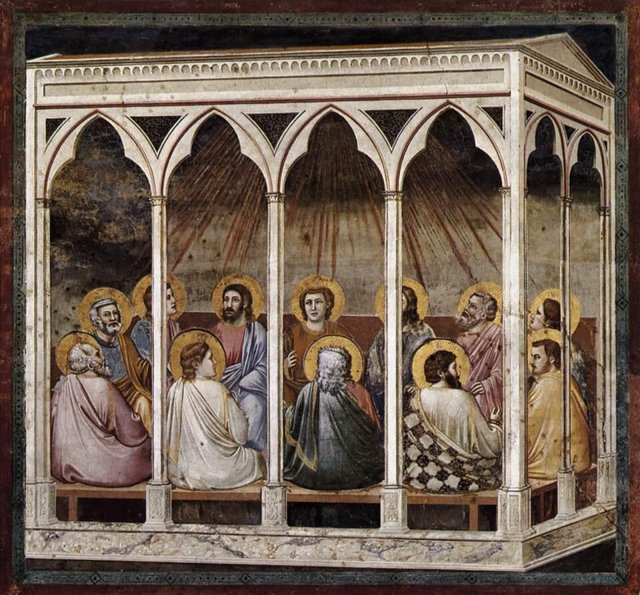

<!--
內容整理自 D:\Books\md\歷史\人物\思想家\耶穌基督生平大事記.md（Books 的人物頁為 D:\Books\html\2-6.西方宗教\耶穌基督(約前4~30).html，另有〈基督教的形成與早期教義爭論〉），並整合中文維基百科〈耶穌〉條目，以自己的話改寫。
時期依筆記的章節歸納：降生以前的歷史背景、出生與童年、施洗約翰與公開傳道、前往耶路撒冷、受審與受難、復活與升天、升天後的初代教會與基督宗教的形成。筆記的「登山寶訓」「比喻」「神蹟」「宗教宣告」「十架七言」「重要人物關係」「節日」「對世界歷史的影響」寫進相關事件，不另立事件。「耶穌會」「耶穌受難日」放入 notNames，避免人名索引把機構與節日名稱算成提到耶穌本人。
本檔案依福音書與基督宗教傳統敘述事件，並按筆記的提醒區分歷史與信仰：主流歷史學界接受耶穌是第一世紀真實存在的猶太人物，也接受他在彼拉多任內被羅馬政權處死；神蹟、復活與升天屬於信仰的敘事，歷史研究只能研究早期門徒的復活信念與見證，無法以一般歷史方法直接證實超自然的事件。所有年份都是約數。
兩份資料出入與處理方式：
- 生卒年：筆記寫約公元前6年—公元30／33年；維基百科寫約前6年至前4年—30年或33年。這裡 born 採前4年（希律大帝在前4年去世，《馬太福音》把出生置於他在位期間）、died 採30年，這是兩份資料並列的年代範圍中較晚的出生與較早的死亡，自動計算約33歲，與筆記的「約33歲」相符；其他可能的年份（前6年、公元33年）都在描述中說明，不當成定論。
- 出生地：筆記寫伯利恆是福音書記載的出生地、歷史研究對其仍有討論；維基百科寫耶穌是第一世紀羅馬猶太行省的猶太傳道者，在拿撒勒成長，照此。耶穌出生第八天受割禮、四十天時在聖殿行獻禮（維基百科）；筆記把這些事件寫在「約公元8年」，與「十二歲在聖殿」的年份混淆，這裡把割禮與獻禮寫進出生事件，「約公元8年」只用於十二歲與教師討論律法。
- 童年與成長：筆記寫約公元12–27年在拿撒勒生活，福音書沒有詳細記載，傳統上認為他可能從事木匠或建築相關工作，照此。
- 公開傳道：筆記寫約27年施洗約翰開始傳道、約27–29年耶穌接受洗禮並開始公開傳道；耶穌被視為「約30歲」開始（路加福音），照此。筆記說傳道的時間約兩到三年，結束於約30／33年。
- 十二門徒：筆記列彼得、安得烈、雅各（西庇太之子）、約翰、腓力、巴多羅買、多馬、馬太、亞勒腓的兒子雅各、達太、奮銳黨的西門與加略人猶大，照此簡述，不逐一寫成事件。
- 登山寶訓與比喻：登山寶訓（《馬太福音》5–7章）的「八福」等倫理教導與好撒馬利亞人、浪子、撒種、迷失的羊、芥菜種、財主與拉撒路、葡萄園工人的比喻，筆記詳細列出，這裡簡述。
- 神蹟：筆記把水變酒、醫治、平靜風浪、五餅二魚、海面行走、拉撒路復活寫成「重要的神蹟」，但提醒超自然事件無法以一般歷史方法驗證，這裡標明「福音書記載」，不當成歷史的結論。
- 最後一週：筆記寫約30／33年騎驢進入耶路撒冷（棕枝主日）、潔淨聖殿、與宗教領袖辯論、預言聖殿被毀、猶大以三十塊銀錢出賣耶穌、最後晚餐（洗腳、設立聖餐、預言彼得不認主、新命令）、客西馬尼園祈禱與被捕，照此；筆記也寫《約翰福音》把潔淨聖殿放在傳道初期，其他福音書放在最後一週，這裡兩處簡述。
- 受審與受難：筆記寫耶穌先在猶太宗教領袖前受審、彼得三次不認主、猶大後悔，再被送到羅馬總督本丟彼拉多面前，被指控為「猶太人的王」，彼拉多又把他送到希律安提帕，最後在群眾的壓力下釋放巴拉巴、判耶穌釘十字架；他遭鞭打、戴荊棘冠冕、背負十字架到各各他（骷髏地）、與兩名犯人一同被釘，十字架上的牌子寫著「猶太人的王」，死前說了「十架七言」，死後福音書記載遍地黑暗、聖殿幔子裂為兩半、百夫長宣認他，亞利馬太的約瑟請求安葬，墓口以大石封住，祭司長要求看守墳墓；年份是30年或33年，兩說並列，這裡寫30年。
- 復活與升天：筆記寫受難後第三日墳墓空了，抹大拉的馬利亞與門徒遇見復活的耶穌，在以馬忤斯顯現、向多馬顯現，《哥林多前書》15章（保羅）提到曾一次向五百多位弟兄顯現，頒布「大使命」，復活後約四十日在橄欖山一帶升天；《使徒行傳》記載升天後門徒回耶路撒冷等待聖靈降臨，照此。
- 初代教會：筆記寫約30／33年五旬節聖靈降臨、約30–35年彼得公開傳道與耶路撒冷教會形成、約35年司提反殉道與掃羅迫害基督徒、約33–36年掃羅在大馬士革路上歸信（後以保羅之名聞名）、約46–57年保羅三次傳教旅行、約49年耶路撒冷會議（討論外邦人是否必須遵守全部猶太律法）、約60–62年保羅在羅馬被拘禁、約64–67年保羅可能在羅馬殉道，照此。
- 帝國與教會：筆記寫64年尼祿迫害基督徒、70年羅馬軍隊摧毀耶路撒冷第二聖殿、1–2世紀基督宗教傳遍羅馬帝國、313年米蘭敕令、325年尼西亞大公會議（基督的神性與聖父、聖子的關係，尼西亞信經）、380年狄奧多西一世頒布帖撒羅尼迦敕令，尼西亞基督宗教成為羅馬帝國的官方宗教，照此。
- 影響：筆記寫達文西《最後的晚餐》、米開朗基羅《最後的審判》、拉斐爾《基督變容》、卡拉瓦喬《聖多馬的懷疑》、林布蘭《浪子回頭》、魯本斯《下十字架》等；這裡只在簡短的影響段落提到。
- 人名與其他時間軸一致：穆罕默德（亞伯拉罕諸教）；達文西（Data 為 Leonardo）、米開朗基羅、拉斐爾的時間軸不放在 see: 中。
圖片來源（皆為 Wikimedia Commons 公有領域／CC0 作品；畫像、手抄本與雕像多為後世的作品，不代表事件當時的樣貌）：
- js-cover.jpg：Christ Icon Sinai 6th century.jpg（西奈山聖凱瑟琳修道院的基督聖像（6世紀））
- js-nativity.jpg：David Nativity 1490.jpg（耶穌誕生（傑拉爾德·大衛繪，約1490年））
- js-baptism.jpg：Andrea del Verrocchio, Leonardo da Vinci - Baptism of Christ - Uffizi.jpg（《基督受洗》（韋羅基奧與達文西））
- js-sermon.jpg：Bloch-SermonOnTheMount.jpg（《登山寶訓》（卡爾·布洛赫繪））
- js-lazarus.jpg：Rembrandt Harmensz. van Rijn - The Raising of Lazarus - Google Art Project.jpg（《拉撒路復活》（林布蘭繪））
- js-entry.jpg：Giotto - Scrovegni - -26- - Entry into Jerusalem.jpg（《進入耶路撒冷》（喬托繪））
- js-supper.jpg：Leonardo da Vinci (1452-1519) - The Last Supper (1495-1498).jpg（《最後的晚餐》（達文西繪））
- js-pilate.jpg：Lodovico Mazzolino (c.1480-c.1530) - Christ before Pilate - M.55 - Fitzwilliam Museum.jpg（《基督在彼拉多面前》（馬佐利諾繪））
- js-cross.jpg：Crucifixion of Strasbourg - Giotto.jpg（《釘十字架》（喬托工坊））
- js-resurrection.jpg：Rafael - ressureicaocristo01.jpg（《基督復活》（拉斐爾繪））
- js-pentecost.jpg：Giotto di Bondone - No. 39 Scenes from the Life of Christ - 23. Pentecost - WGA09227.jpg（《五旬節》（喬托繪））
- js-paul.jpg：El Greco - Saint Paul (Bartholomew).jpg（聖保羅像（葛雷柯繪））
- js-nicaea.jpg：Nicaea icon.jpg（尼西亞大公會議的聖像）
-->

# Periods
- -4 ~ 7 | 降生與童年 | #868e96
  生於猶太地區的伯利恆，在拿撒勒成長，出生時猶太社會處於羅馬的統治之下；希律大帝去世後，一家人離開埃及，定居加利利。
- 8 ~ 26 | 少年與青年 | #2f9e44
  十二歲在耶路撒冷聖殿與教師討論律法，之後在拿撒勒生活，福音書沒有詳細記載。
- 27 ~ 29 | 受洗與公開傳道 | #e8590c
  約三十歲時受施洗約翰洗禮、在曠野受試探，開始公開宣講「上帝的國」，召集十二門徒。
- 29 ~ 30 | 受難週與復活 | #c92a2a
  進入耶路撒冷，與宗教領袖衝突加劇，最後晚餐、被捕、受審與釘十字架，信徒相信他在第三日復活。
- 30 ~ 380 | 初代教會與基督宗教的形成 | #7048e8
  門徒在五旬節後傳播信仰，保羅向外邦人傳教，歷經迫害，到4世紀成為羅馬帝國的國教。

# Events

## -4 | 出生於伯利恆 {label="約前6–前4年（傳統說法）"}

耶穌（Jesus）出生於猶太地區的伯利恆，傳統上認為出生在馬槽。當時猶太民族處於羅馬帝國的統治之下：前63年龐培攻入耶路撒冷，前37年希律大帝在羅馬支持下成為猶太王，並大規模擴建耶路撒冷的第二聖殿；猶太社會存在著對民族獨立、宗教復興與彌賽亞降臨的期待，並有法利賽人、撒都該人、奮銳黨等群體，立場各不相同。羅馬皇帝奧古斯都在位時出生，耶穌傳道與受難時的皇帝則是提庇留。
根據福音書，天使加百列向馬利亞報喜，天使也在夢中向約瑟顯現，使他接受馬利亞懷孕的事實；天使向牧羊人宣告救主降生，東方博士循著星象朝拜，獻上黃金、乳香與沒藥；耶穌在出生第八天受割禮，四十天時在耶路撒冷聖殿接受奉獻，西面與女先知亞拿認出他將有特殊的救贖使命。他的出生年份一般推測為前6至前4年，因為《馬太福音》把這件事置於希律大帝統治期間。主流的歷史學界接受耶穌是第一世紀真實存在的猶太人物，福音書記載的出生地伯利恆，歷史研究仍有討論。

## -4 | 逃往埃及與定居拿撒勒 {label="約前4年前後"}
根據《馬太福音》，希律大帝因害怕新生的「猶太人之王」威脅自己的統治，下令殺害伯利恆及周邊兩歲以下的男孩；天使警告約瑟，一家人逃往埃及避難。前4年希律大帝去世，王國由兒子們分別治理，約瑟一家離開埃及，因顧慮希律之子亞基老的統治，改往加利利，定居於拿撒勒。

## 8 | 十二歲在聖殿 {label="約公元8年（十二歲）"}
耶穌十二歲時隨父母前往耶路撒冷過逾越節，留在聖殿中與教師討論律法，展現非凡的理解能力；這是四部福音書中唯一較詳細記載的少年事件。此後直到公開傳道以前，聖經沒有連續的生平記錄，只能知道他在拿撒勒成長（約12–27年），熟悉猶太宗教傳統，傳統上認為他可能從事木匠或建築相關的工作。

## 27 | 施洗約翰開始傳道 {label="約公元27年"}
施洗約翰在約旦河附近的曠野傳道，呼籲人們悔改，預備迎接上帝的國，為前來悔改的人施行洗禮，並宣告彌賽亞即將來臨，說自己不是基督，只是為那位將來的人預備道路。

## 28 | 受洗與曠野受試探 {label="約公元27–29年（約三十歲）"}

耶穌來到約旦河，接受施洗約翰的洗禮，福音書記載聖靈彷彿鴿子降在他身上，天上有聲音宣告他是上帝所喜悅的愛子；之後他進入曠野，禁食四十晝夜，受到魔鬼試探，但拒絕以權力、財富與神蹟滿足私慾。他開始公開傳道，宣講：「天國近了，你們應當悔改。」

## 28 | 召集十二門徒 {label="約公元28年"}
耶穌選召十二位門徒，建立傳道團體，象徵重新召聚以色列的十二支派，包括彼得（西門，漁夫，後來成為初代教會的領袖）、安得烈、雅各與約翰（西庇太的兒子）、腓力、巴多羅買、多馬、馬太（原為稅吏）、亞勒腓的兒子雅各、達太、奮銳黨的西門，以及後來出賣他的加略人猶大。他以加利利為主要活動區域，在各城鎮宣講上帝的國；《約翰福音》記載他在迦拿的婚宴上把水變成酒，是第一個神蹟，並在耶路撒冷聖殿驅逐兌換銀錢與販賣牲畜的人，與尼哥底母談論重生，與撒馬利亞婦人在雅各井旁交談，突破猶太人與撒馬利亞人之間的隔閡。

## 29 | 登山寶訓與比喻 {label="約公元28–30年"}

耶穌醫治痲瘋病人、癱瘓者與失明者，福音書記載他平靜風浪、以五餅二魚餵飽群眾、在海面上行走；他在山上教導門徒與群眾，《馬太福音》第五至第七章的登山寶訓提出基督宗教最重要的倫理原則，如八福、愛仇敵、不要論斷、「己所欲，施於人」。他也常用比喻傳達思想：好撒馬利亞人（真正的鄰人之愛不受民族與宗教的界線限制）、浪子回頭、撒種、迷失的羊、芥菜種、財主與拉撒路，以及葡萄園工人。他也宣告：「我是生命的糧」「我是世界的光」「我是好牧人」「我是道路、真理、生命」「我是復活與生命」。

## 29 | 與宗教領袖的衝突 {label="約公元28–30年"}
耶穌批評部分宗教領袖重視外在的儀式，卻忽略公義、憐憫與信實，他在安息日醫治病人，與部分猶太宗教領袖發生爭執；他的教導、群眾的影響力與對聖殿活動的批評，使祭司階層對他產生敵意。約29至30年，加利利的統治者希律安提帕下令處死施洗約翰。

## 30 | 拉撒路復活與預告受難 {label="約公元29–30／33年"}

《約翰福音》記載，耶穌使已死四日的拉撒路復活，使群眾更加相信他；他多次告訴門徒，自己將被交給宗教領袖，遭受苦難、死亡，並在第三日復活，與門徒前往耶路撒冷準備過逾越節。

## 30 | 榮耀進城 {label="約公元30／33年（棕枝主日）"}

耶穌騎驢進入耶路撒冷，群眾揮舞棕樹枝迎接他，稱頌他為奉主名而來的王；他在聖殿驅逐做買賣的人，批評聖殿被變成交易場所，與祭司長、文士及法利賽人辯論納稅、復活、誡命與彌賽亞等問題，並預言聖殿將被毀；加略人猶大與祭司長接觸，答應以三十塊銀錢出賣耶穌。

## 30 | 最後晚餐 {label="約公元30／33年"}

耶穌與門徒在耶路撒冷共進逾越節晚餐：他親自為門徒洗腳，展現謙卑與服事的精神，宣告門徒中有人將出賣他、猶大離席，他拿起餅與杯，分給門徒，賦予身體與血的象徵意義，設立聖餐（成為基督宗教聖餐禮的起源，天主教、東正教與多數新教教會都以不同的形式保留），預言彼得在雞叫以前三次否認他，並給予門徒新的命令：彼此相愛。

## 30 | 客西馬尼園與被捕 {label="約公元30／33年"}
晚餐後，耶穌帶門徒前往橄欖山附近的客西馬尼園，因即將面臨的苦難極度憂傷，祈求上帝的旨意成就；深夜猶大帶領祭司長一行人前來，以親吻作為辨認記號，耶穌被逮捕，門徒四散逃離，彼得拔刀抵抗，被耶穌制止。

## 30 | 受審 {label="約公元30／33年"}

耶穌先被帶到大祭司面前受審，被指控言論涉及褻瀆上帝，彼得因恐懼而三次否認認識他，雞叫之後想起耶穌的預言，痛哭；猶大發現耶穌被定罪後悔恨，把銀錢退還給祭司長，後來自盡（《馬太福音》）。猶太宗教領袖把耶穌交給羅馬總督本丟·彼拉多，指控他是「猶太人的王」，把罪名轉為挑戰羅馬統治；彼拉多把他送到當時在耶路撒冷的希律安提帕那裡，最後面臨群眾的壓力，在逾越節釋放巴拉巴，判耶穌釘十字架。

## 30 | 釘十字架與死亡 {label="約公元30年或33年"}

耶穌遭鞭打、戴上荊棘冠冕被士兵嘲弄，背負十字架前往各各他（骷髏地），途中西門被要求協助背負；他與另外兩名犯人一同被釘十字架，上面的牌子寫著「猶太人的王」，他為迫害者祈求寬恕，並把母親馬利亞託付給所愛的門徒，在十字架上死亡。他留下「十架七言」：「父啊，赦免他們」「今日你要同我在樂園裡了」「母親，看，你的兒子」「我的上帝，我的上帝，為什麼離棄我」「我渴了」「成了」「父啊，我將我的靈魂交在你手裡」。福音書記載死亡時遍地黑暗、聖殿的幔子從上到下裂為兩半，羅馬的百夫長宣認他是上帝的兒子（或義人）。耶穌在彼拉多任內遭羅馬政權處死，是歷史研究高度接受的結論。

## 30 | 安葬與復活 {label="受難後第三日"}

亞利馬太的約瑟向彼拉多請求領取耶穌的遺體，把他安放在新的墳墓中，墓口以大石封住，祭司長與法利賽人要求看守墳墓，防止遺體被移走。受難後第三日清晨，幾位婦女前往墳墓，發現石頭已經移開，墳墓是空的；根據福音書，抹大拉的馬利亞最先遇見復活的耶穌，他也向門徒顯現，在前往以馬忤斯的路上向兩名門徒顯現，向起初懷疑的多馬顯示傷痕，向彼得與其他門徒顯現；保羅在《哥林多前書》15章也提到他曾一次向五百多位弟兄顯現。耶穌復活是基督宗教最核心的信仰，歷史研究可以研究門徒的復活信念與早期的見證，但無法以歷史方法直接證實超自然的復活。

## 30 | 大使命與升天 {label="復活後約四十日"}
耶穌繼續向門徒顯現，講論上帝國的事，並頒布「大使命」（《馬太福音》第二十八章）：前往萬民之中，使萬民成為門徒。之後他帶領門徒到伯大尼附近或橄欖山一帶升天，天使告訴門徒，他將來還要再來；門徒返回耶路撒冷，等待聖靈降臨。

## 33 | 五旬節與耶路撒冷教會 {label="約公元30／33–35年"}

根據《使徒行傳》，五旬節那天聖靈降臨在門徒身上，門徒開始公開傳道；彼得在耶路撒冷宣講耶穌復活，吸引大量民眾加入，初代基督徒共同生活、祈禱與分享財物，形成耶路撒冷教會。

## 35 | 司提反殉道與掃羅歸信 {label="約公元33–36年"}
司提反因宣講耶穌而遭迫害殉道，成為基督宗教傳統中的第一位殉道者；積極迫害基督徒的掃羅，在前往大馬士革的路上經歷異象，成為耶穌的追隨者，後來以保羅之名聞名，成為向外邦人傳播基督信仰的重要人物。

## 49 | 保羅的傳教旅行 {label="約公元46–57年"}
保羅三次傳教旅行：約46–48年前往塞浦路斯與小亞細亞建立教會；約49年耶路撒冷會議討論外邦人是否必須遵守全部猶太律法才能成為基督徒；約49–52年第二次傳教到馬其頓、雅典與哥林多；約53–57年第三次傳教，在小亞細亞持續建立教會；約60–62年他在羅馬被拘禁，約64–67年可能在羅馬殉道（確切年份不明）。

## 64 | 尼祿迫害基督徒
羅馬皇帝尼祿統治期間，羅馬城內的基督徒遭受迫害；70年羅馬軍隊摧毀耶路撒冷第二聖殿，猶太戰爭造成猶太社會的重大變化，也深刻影響早期基督教的發展。1至2世紀，基督徒群體逐漸傳播到羅馬帝國各地，在地中海世界增加。

## 313 | 米蘭敕令
君士坦丁大帝與李錫尼共同承認基督宗教及其他宗教的合法地位。325年尼西亞大公會議討論基督的神性與聖父、聖子的關係，形成尼西亞信經的重要基礎；380年狄奧多西一世頒布帖撒羅尼迦敕令，尼西亞基督宗教成為羅馬帝國的官方宗教。耶穌的生平與故事也成為西方藝術最重要的題材之一，如達文西《最後的晚餐》、米開朗基羅《最後的審判》、拉斐爾《基督變容》、卡拉瓦喬《聖多馬的懷疑》、林布蘭《浪子回頭》，影響了倫理、哲學、教育與歐洲中世紀的政治與社會。
