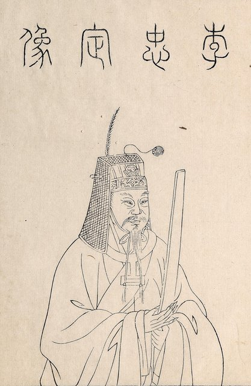
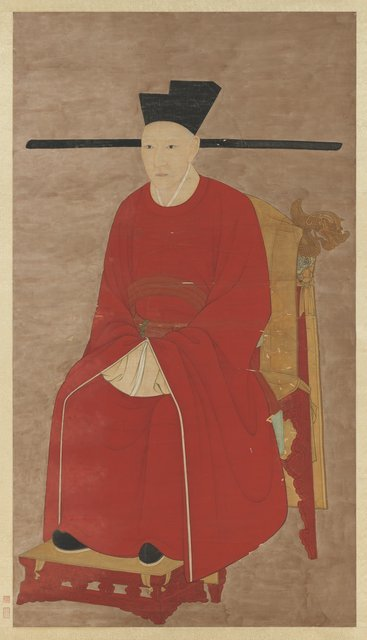
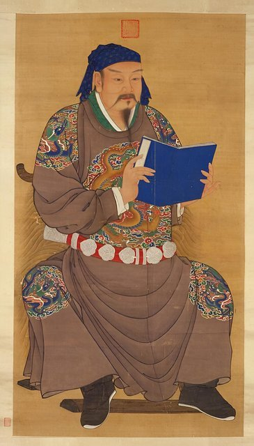

<!--
內容整理自本機筆記〈北宋靖康之變大事記——從聯金滅遼、金軍兩次南下，到北宋滅亡與南宋建立（1115—1127年）〉（D:\Books\md\歷史\東方歷史\北宋靖康之變大事記.md），以自己的話改寫；只依這份筆記，沒有另外合併其他資料。
時期依筆記的八個部分：金朝崛起與海上之盟、聯金滅遼失敗、第一次南下與第一次圍城、第一次圍城後的失誤、第二次南下、第二次圍城、二帝被俘與北宋滅亡、南宋建立。
處理方式：
- 筆記的許多日期是概數（「1125年秋」「1126年1月」「1126年1月31日前後」「1126年春夏」「1126年夏秋」「1126年12月9日前後」「12月中旬」「12月中下旬」「12月下旬」「1127年1月」「1127年春」「1127年下半年」），用 label 保留筆記的說法；時間軸上為了排序才放在相近的月份或日期（例如12月中旬放在12月15日、中下旬放在12月20日、下旬放在12月25日；張邦昌建立大楚與二帝北遷筆記只寫1127年或春天，這裡排在1127年3月，但標籤只寫筆記的說法），不代表確切日期。
- 開封外城陷落：筆記寫「1127年1月9日（靖康元年閏十一月二十五日）」，照寫。
- 筆記說明開封陷落（1127年1月）與金朝正式廢黜二帝（1127年2月）不是同一時間，內文保留這個區分。
- 與〈北宋新舊黨爭大事記〉在1126年（欽宗即位、解除黨禁）與1127年（靖康之變）有交集；黨禁的部分留在那條時間軸，這裡不重複。
- 筆記第九部分（主要人物表）、第十部分（完整時間軸總表）、第十一部分（歷史影響）、第十二部分（為什麼會發生）、第十三部分（總結）是整理與評論，不單列事件；「為什麼會發生」的五個層面寫進開封外城陷落那一則，「歷史影響」與核心教訓寫進最後一則。
- 筆記中的網頁引用連結（含追蹤參數）未收錄。
- 圖片皆為 Wikimedia Commons 上的公有領域（含 CC0）作品，縮成最長邊 640px 的 JPEG。
- jingkang-qingming.jpg：Along the River During the Qingming Festival (detail of original).jpg（北宋張擇端《清明上河圖》局部，北宋汴京的繁華，封面）
- dangzheng-huizong.jpg：宋徽宗像（與北宋新舊黨爭大事記共用）
- jingkang-ligang.jpg：李綱.jpg（李綱像）
- jingkang-kaifeng.jpg：Kaifeng in Northern Song Dynasty a.jpg（北宋東京開封城的復原模型；CC0）
- dangzheng-qinzong.jpg：宋欽宗像（與北宋新舊黨爭大事記共用）
- jingkang-gaozong.jpg：Song Gaozong.png（宋高宗像）
- jingkang-yuefei.jpg：明人《岳飞像》轴.jpg（明人所繪岳飛像）
-->

# Periods
- 1115 ~ 1120 | 金朝崛起與海上之盟 | #868e96
  女真建立金朝、遼朝衰退；北宋為收復燕雲與金朝結盟攻遼，卻低估金朝、高估自己，為日後的南侵埋下伏筆。
- 1121 ~ 1123 | 聯金滅遼失敗與戰略困境 | #e8590c
  宋軍在攻遼行動中表現不佳，金朝取得主導權；張覺事件削弱互信，北宋北方的戰略環境反而更危險。
- 1125 ~ 1126-02 | 金軍第一次南下與第一次開封圍城 | #1864ab
  金軍分東西兩路南下，徽宗傳位欽宗，李綱主持守城，金軍在議和後撤退，北宋付出苛刻的條件。
- 1126-03 ~ 1126-08 | 第一次圍城後的戰略失誤 | #5c940d
  李綱被排斥、備戰不足、履約困難，北方防線沒有恢復，錯失整頓國防的時機。
- 1126-09 ~ 1126-11 | 金軍第二次南下 | #862e9c
  太原失守，宋軍援救北方重鎮失敗，北宋已無法像第一次那樣迅速集結兵力。
- 1126-12 ~ 1127-01-09 | 第二次開封圍城 | #c92a2a
  金軍兩路會合、全面包圍開封，議和更加困難，守城危機加劇，最後外城被攻破。
- 1127-01-09 ~ 1127-05 | 二帝被俘與北宋滅亡 | #0b7285
  金軍控制開封，徽、欽二帝與大量皇族被押往北方，張邦昌建立大楚，北宋政權崩潰。
- 1127-05 ~ 1127-12 | 南宋建立與初期危機 | #a61e4d
  趙構在應天府即位，宋朝政權在南方延續，但仍要面對金軍的威脅與重建中央政府的難題。

# Events

## 1115 | 完顏阿骨打建立金朝
女真族原本分布在東北地區，長期受遼朝控制，各部逐漸壯大後開始反抗遼朝。1115年（北宋政和五年），女真首領完顏阿骨打建立金朝並稱帝，後世稱金太祖。金朝逐漸成為遼朝在東北最重要的軍事對手，東北亞的政治與軍事格局因此發生重大變化：北宋原本長期面對遼朝的軍事壓力，如今出現了另一個能夠挑戰遼朝的政權，為日後聯金滅遼的外交策略創造了條件。

## 1115 ~ 1119 | 金朝持續擴張，遼朝國勢衰退
金軍不斷擊敗遼軍、逐步擴大控制範圍，遼朝內部的政治與軍事問題日益嚴重，北宋朝廷開始關注金朝崛起所帶來的戰略機會，希望借助金朝的軍事力量，收復長期被遼朝控制的燕雲地區。然而北宋雖有相當的經濟實力，軍事能力卻未必足以獨立完成這個戰略目標；這種軍事實力與戰略野心之間的落差，成為後來靖康之變的重要背景。

## 1120 | 海上之盟
（宣和二年）宋徽宗與金太祖完顏阿骨打約定聯合攻遼，史稱「海上之盟」：金朝從北方攻擊遼朝，北宋從南方配合進攻，遼朝滅亡後雙方重新分配相關領土，北宋希望藉此收復燕雲十六州一帶的失地。燕雲地區有重要的戰略價值，遼朝控制這一帶，北宋北方就缺乏有利的天然防線、長期面臨騎兵南下的威脅，北宋希望藉由聯合金朝，改變長期受遼牽制的局面。但北宋低估了金朝的軍事實力，也高估了自己的軍事能力；遼朝逐漸衰亡時，北宋不僅沒能充分利用戰略機會，反而暴露了軍隊訓練、指揮與作戰能力的問題，也讓金朝看清北宋的弱點。海上之盟原本是北宋改變北方戰略局勢的外交安排，最後卻使金朝有機會進一步南下，成為靖康之變的重要前奏。

## 1121 ~ 1122 | 北宋與金朝共同攻遼 {label=1121～1122年}
金朝持續對遼發動攻勢，北宋也試圖從南方進軍、收復燕雲地區，但宋軍在相關軍事行動中表現不佳，沒能達成預期目標，金朝逐漸取得對遼戰爭的主導權。聯金滅遼的戰略，原本建立在雙方共同削弱遼朝的基礎上，但雙方軍事實力差距明顯，北宋沒能藉由這場戰爭建立足以自保的北方防線。

## 1122 | 遼朝衰亡，金朝控制北方重要地區
（宣和四年）遼朝在金軍攻勢下持續失去領土，金朝逐步控制遼朝的重要政治與軍事據點，北宋雖然試圖收復燕京及周邊地區，軍事行動卻並不順利。北宋原本希望透過聯金滅遼恢復燕雲的控制權，但遼朝衰亡後，北方的戰略環境並沒有變得更安全，反而直接面對軍事實力更強的金朝。

## 1123 | 張覺事件加深宋金矛盾
（宣和五年）張覺原是遼朝的地方軍政人物，後來與金朝發生衝突，轉而歸附北宋；北宋接納張覺，容易被金朝視為違反雙方約定、干涉金朝控制地區的行為，在金朝施壓下，北宋最後處死張覺，試圖平息外交衝突。張覺事件削弱了宋金之間的互信，也成為金朝日後追究北宋責任、發動南侵的藉口之一；不過金朝南侵並非完全由張覺事件造成，更深層的原因，是金朝軍事力量迅速增長，而北宋的防禦能力與外交地位相對弱勢。

## 1125 | 金朝發動第一次攻宋戰爭 {label=1125年秋}
（宣和七年；金天會三年）金太宗完顏晟以張覺事件等問題為由，決定大舉南下攻宋，金軍分成東、西兩路：東路軍由完顏宗望率領，從燕山府、河北一帶突破北方防線，向開封推進；西路軍由完顏宗翰率領，從山西、太原一帶攻取北方軍事重鎮、牽制宋軍。北宋雖有繁榮的經濟與龐大的官僚體系，軍隊在野戰、指揮協調與防禦部署上卻有弱點，面對金軍快速進攻，北方防線迅速承受巨大壓力。第一次攻宋戰爭顯示，北宋已失去有效控制北方戰略局勢的能力，金軍得以深入宋境，把軍事壓力直接施加在首都開封。

## 1125-12 ~ 1126-01 | 金軍突破北方防線 {label=1125年底至1126年初}
金軍東路軍攻擊燕山府與河北地區，部分宋軍將領投降，北方防禦體系迅速瓦解；西路軍則攻擊山西，對太原形成威脅。北宋朝廷緊急調兵，希望阻止金軍繼續南下；東路軍的進展尤其迅速，讓首都面臨直接威脅，西路軍雖受到太原守軍的抵抗，也使北宋必須分散兵力應對。

## 1126-01 | 宋徽宗傳位給宋欽宗 {label=1126年1月}

金軍逼近首都，宋徽宗對局勢感到恐慌，1126年初把皇位傳給太子趙桓，是為宋欽宗，自己退位成為太上皇（北宋年號由宣和七年末轉入靖康元年初）。傳位一方面讓新皇帝出面承擔戰爭危機中的政治責任，另一方面也讓徽宗有機會離開首都、安排退路；不過他退位後仍保有相當的宮廷影響力，並非立即完全退出政治。這是靖康之變的重要政治轉折：北宋在外敵壓境時發生皇位交接，朝廷內部又有主戰、主和之爭，使軍事決策更加困難。

## 1126-01 | 金軍渡過黃河，宋徽宗一度南逃 {label=1126年1月}
金軍突破黃河沿線的部分防禦，宋徽宗一度離開開封、向南方避難，朝廷內部對是否堅守首都發生激烈爭論：部分官員主張遷都或南逃，李綱等人則主張堅守開封，整頓防禦、組織軍隊並穩定民心。李綱認為皇帝與朝廷若輕易放棄首都，會動搖軍民士氣，也可能使金軍更加深入宋境；在他等人的主張下，宋欽宗決定組織開封防禦。

## 1126-01-31 | 金軍抵達開封，第一次圍城戰開始 {label=1126年1月31日前後}

（靖康元年）金軍東路軍抵達開封附近，開始攻擊城門與城防設施，李綱組織守城軍隊、部署防禦並動員軍民，宋軍利用城牆、城門與守城武器抵抗。開封是北宋的政治、經濟與交通中心，城內人口眾多，城防與物資供應對守城作戰至關重要。李綱是第一次圍城戰中最重要的守城領導者之一，他組織防禦、穩定軍心，使金軍未能迅速攻破城池；這場戰役證明，金軍雖有強大的野戰能力，面對組織良好的城防，也不能立即取勝。

## 1126-02 | 第一次圍城戰結束，金軍撤退 {label=1126年2月}
金軍未能迅速攻下開封，宋軍持續防守、勤王援軍也陸續到達，雙方開始議和，北宋承諾支付大量金銀財物並接受其他政治與領土條件，金軍最終撤離開封。這份宣和和議的條件相當苛刻：金朝要求北宋支付巨額的黃金、白銀、絹帛等物資，割讓太原、中山、河間等地，還要派親王及重要官員到金營作為人質。第一次圍城以金軍撤退告終，首都暫時獲救，卻不是戰爭的真正結束，只是暫時的危機解除：北宋既沒有徹底擊敗金軍，也沒能建立足以阻止金軍再次南下的防禦體系。第一次圍城的教訓是，守住首都並不等於解除威脅，若沒有為下一場戰爭做好準備，短暫的和平反而可能成為更大危機的前奏。

## 1126-03 ~ 1126-08 | 李綱被排斥，北宋備戰不足 {label=1126年春夏}
第一次圍城後北宋朝廷暫時鬆了一口氣，但金軍只是撤退，並未放棄戰略壓力；這時北宋最重要的任務，本應是整頓軍隊、修復北方防線、確保糧草供應，為可能再次發生的戰爭做準備。然而李綱雖然仍主張積極備戰，朝廷內部部分官員卻擔心持續備戰增加財政負擔，也希望避免再次與金軍衝突，李綱與其他主戰官員受到政治壓力，後來被解除重要職務、調離中央權力核心。這反映北宋朝廷對金朝威脅的判斷存在重大分歧：主和者希望透過外交與財物交換維持和平，主戰者則認為只有加強軍事準備，才能避免金軍再次進攻；問題在於北宋沒能把短暫的和平轉成長期有效的國防準備。

## 1126-03 ~ 1126-08 | 北宋未能妥善履行宣和和議 {label=1126年春夏}
宣和和議要求北宋支付巨額財物並割讓部分北方重要地區，這些條件對北宋十分沉重，朝廷在履約、領土交割與軍事部署上都面臨困難；北宋對金朝的態度也存在矛盾，一方面希望避免戰爭，另一方面又試圖維持對北方地區的影響，這種外交上的反覆加深了雙方的不信任。

## 1126-06 ~ 1126-10 | 北方防線未能恢復 {label=1126年夏秋}
北宋試圖增援北方軍事重鎮，太原等地仍受到金軍威脅，宋軍援軍在行動中遭到挫敗，北方防禦體系逐漸惡化。第一次圍城結束後，北宋並沒有有效利用時間改善軍事部署；太原等重要據點一旦失守，金軍就更容易從山西方向向開封推進，這使得第二次金軍南下時，北宋將面對更加不利的戰略局勢。

## 1126-09 | 金軍再次大舉攻宋 {label=1126年9月}
（靖康元年）第一次圍城後宋金關係並未真正穩定：金朝對北宋的軍事與外交安排仍不滿意，宋廷也沒能妥善處理和議、領土與國防問題。1126年秋，金軍再次分東、西兩路大舉南下：東路軍由完顏宗望率領，從河北方向攻取真定等地、向開封推進；西路軍由完顏宗翰率領，從山西方向長期圍攻太原、突破山西防線。與第一次相比，這次金軍的攻勢更強，也更有系統地壓迫北宋的戰略要地。

## 1126-09 | 太原失守 {label=1126年9月}
太原是北宋西北方向的重要軍事據點，也是防守山西、阻止金軍南下的重要屏障。金軍西路軍持續圍攻太原，宋軍守將王稟率軍堅守，北宋曾派兵增援，但援軍未能有效解除圍城；太原經過長期抵抗，終於在1126年9月陷落。這是靖康之變的重要軍事轉折：太原原本能牽制金軍，讓北宋有更多時間調兵與防守，陷落後金軍西路便能進一步向南推進，北宋也失去了一道重要的戰略屏障。

## 1126-09 ~ 1126-11 | 宋軍援救北方重鎮失敗 {label=1126年秋}
金軍第二次南下期間，北宋曾試圖增援太原與其他北方據點，但由於軍事指揮不協調、援軍戰力不足與金軍攻勢強大，宋軍未能扭轉局勢。主要問題包括：北宋沒能建立統一而有效的戰區指揮、部分援軍被金軍擊敗、北方軍事重鎮逐一失守，以及宋廷對戰爭風險的判斷持續出現分歧。第二次南下時，北宋已不像第一次圍城時那樣，能夠迅速集結充足的兵力保衛首都。

## 1126-12-01 | 金軍逼近開封 {label=1126年12月}
完顏宗望率領的東路軍從河北方向南下，完顏宗翰率領的西路軍突破山西方向的防線，金軍兩路逐漸逼近北宋首都，北宋各地的勤王援軍受到阻截，開封的外部支援日益困難。與第一次圍城不同，這次金軍兩路兵力得以相互配合，對開封形成更嚴密的包圍。

## 1126-12-09 | 金軍抵達開封，第二次圍城戰展開 {label=1126年12月9日前後}
（靖康元年）金軍東路軍先抵達開封附近，開封進入第二次圍城戰，宋廷緊急組織守城、嘗試派使者與金軍議和，張叔夜等人率兵入援，成為守城的重要力量；但此時北宋能調動的軍事資源，已遠不如第一次圍城時充足。

## 1126-12-15 | 宋廷再次求和 {label=1126年12月中旬}
金軍包圍開封後，宋欽宗再次希望透過議和解除危機，宋廷派使者與金軍交涉，金朝提出割讓更多領土與其他條件，宋廷在是否接受條件、是否繼續抵抗等問題上反覆猶豫，金軍則繼續維持包圍並逐步加強攻城。這次議和更加困難：第一次圍城時金軍東路軍單獨抵達開封、西路軍仍受太原等地牽制；第二次太原已經失守，金軍兩路能夠相互配合，宋軍的外援也更難抵達，金軍在談判中具有更大的軍事優勢，宋廷能運用的外交空間相對有限。

## 1126-12-20 | 金軍兩路會合，開封陷入全面包圍 {label=1126年12月中下旬}
金軍西路軍抵達開封附近，東、西兩路完成會合，開封受到更全面的包圍，宋軍雖然持續防守，外部援軍卻難以有效進入。這是第二次圍城戰的關鍵階段：開封原本是北宋最重要的政治、經濟與交通中心，一旦被全面包圍，城內的糧食、軍事資源與援軍通道都受到嚴重限制，北宋的防禦逐漸陷入孤立。

## 1126-12-25 | 守城危機加劇 {label=1126年12月下旬}
金軍持續攻擊開封城防，宋軍試圖出城迎戰卻多次遭到挫敗，天候惡劣，軍民承受寒冷與糧食供應壓力，朝廷內部的軍事決策與議和策略仍存在矛盾。此時的開封已不只是面臨一般的軍事圍城，而是陷入國家政權可能崩潰的危機。

## 1127-01-09 | 開封外城陷落

（靖康元年閏十一月二十五日）這是靖康之變最具決定性的日期之一。金軍加強攻擊開封外城，宋廷部分決策者寄望於郭京所宣稱的「六甲神兵」——郭京聲稱可以透過道法組織特殊兵力擊退金軍，部分官員對此寄予希望，甚至因此改變了原有的守城部署，守軍因相關部署出現防禦漏洞，金軍趁機攻破外城、進入城內，開封的防禦體系迅速崩潰。開封外城陷落象徵北宋首都的主要防線被突破，此後宋軍雖仍有部分抵抗，已難以扭轉整體局勢；「靖康之變」之所以得名，與開封在靖康元年閏十一月二十五日被金軍攻破有直接關係。回頭看，這並不是單一戰役的失敗，而是幾個層面相互作用的結果：外交上，北宋聯金滅遼卻沒能評估金朝的實力，也沒有在遼亡後建立可靠的北方防線；軍事上，經濟繁榮不等於軍事強大，組織、野戰與指揮協調都有問題；決策上，朝廷在戰與和之間缺乏穩定的策略；第一次圍城後沒有有效備戰；危機中行政與指揮又未能協調。

## 1127-01-10 | 金軍控制開封，宋欽宗被迫議和 {label=1127年1月}
金軍進入開封、控制重要城區，宋廷試圖透過談判避免更嚴重的後果，宋欽宗前往金軍營地交涉，卻受到金軍控制，金軍持續要求北宋交出財物、皇族與其他重要人員。此時宋欽宗已無法像正常的皇帝那樣自由行使權力，開封陷落後，北宋中央政府的行政與軍事體系逐漸瓦解。

## 1127-01-20 | 宋徽宗、宋欽宗及皇族受到控制 {label=1127年1月}
宋徽宗被金軍控制、宋欽宗受到拘禁，大量趙宋皇族、后妃、公主與官員被迫交出，金軍還搜取開封的金銀財物、宮廷用品與其他物資。靖康之變不只是首都失守，也是一場針對北宋皇室與中央政治核心的全面打擊：在傳統王朝政治中，皇帝、宗室與中央官僚是政權延續的重要象徵，當皇帝被俘、皇族大量失去自由，北宋原有的統治體系就難以維持。

## 1127-02 | 金朝正式廢黜宋徽宗、宋欽宗 {label=1127年2月}

（靖康二年）金朝進一步控制北宋皇室與中央政權，正式宣布廢黜宋徽宗與宋欽宗，北宋的政治體制宣告終結。要注意開封城陷落的時間與二帝正式被廢的時間並不相同：1127年1月開封陷落，隨後金軍控制皇室與中央政權，到同年2月，金朝才正式宣布廢黜二帝。

## 1127-03 | 張邦昌建立「大楚」傀儡政權 {label=1127年}
金朝扶植張邦昌建立「大楚」政權，張邦昌在金軍控制下出任皇帝，金朝試圖藉此建立一個便於控制的政治架構，北宋原有的皇權體系遭到破壞。大楚並沒有獲得穩固的政治基礎，也沒能取代原本的宋朝皇室，存在的時間很短，隨著南宋建立，張邦昌的政治地位也迅速失去意義。

## 1127-03 | 宋徽宗、宋欽宗及大量皇族被押往北方 {label=1127年春}
金軍把宋徽宗、宋欽宗與大量皇族、后妃、官員押送往北方，大批皇室成員離開原有的生活環境、被帶往金朝控制地區，北宋皇室遭受重大打擊，中央政治核心徹底瓦解。徽、欽二帝北遷是靖康之變最具象徵性的事件：北宋滅亡不僅意味著首都失守，更意味著原有皇室的統治中心被摧毀，宋朝的政治必須在南方重新建立。

## 1127-05 | 趙構在應天府即位，南宋建立

（北宋年號靖康二年，南宋年號建炎元年）靖康之變後，宋徽宗之子趙構在南方積極組織力量，5月在應天府即位，是為宋高宗，南宋政權由此建立，宋朝的統治在南方延續。北宋雖然滅亡，並非所有宋朝官員、軍隊與地方行政機構都被金軍消滅；趙構是徽宗之子，在皇室成員大量被俘的情況下，具有延續宋朝皇統的政治條件，也得到部分官員與軍事力量的支持，逐漸建立新的中央政權。南宋的建立象徵宋朝由以開封為中心的北宋，轉變成以南方為主要統治區域的南宋；不過1127年並不代表宋金戰爭立即結束，此後雙方仍持續交戰，南宋也經歷了長期的軍事與政治危機。

## 1127-07 | 南宋面臨生存危機 {label=1127年下半年}

宋高宗需要整合各地勤王軍與地方勢力，北宋原有的行政體系受到嚴重破壞，金軍仍有強大的軍事威脅，南宋必須重新建立中央政府、軍事指揮與財政體系。南宋建立只是宋朝政權延續的開始，而不是危機的結束，宋高宗得在戰爭、遷都、軍隊整合與政治合法性之間尋求平衡，其後南宋逐漸以臨安為主要政治中心，形成與金朝長期對峙的局面。靖康之變的歷史影響深遠：北宋的中央統治機構被摧毀，宋朝只能在南方重建；宋朝皇室遭受重大打擊；宋金形成長期對峙；北方人口與文化發展受到衝擊，大量人口失去原有的生活環境、部分人被迫南遷、部分被金朝控制，南方逐漸成為宋朝文化與經濟的重要中心；它也成為宋代歷史記憶中的重大創傷，收復北方失地、迎回二帝成為後世不斷討論的政治議題，岳飛〈滿江紅〉「靖康恥，猶未雪」的名句便反映了這份記憶。不過這場事件的影響，不應只從民族情感或戰敗屈辱來理解，也必須分析北宋的制度問題、外交選擇與軍事決策。靖康之變的核心教訓是：國家的經濟繁榮與文化成就，並不能自動轉化為有效的國防能力；外交合作也不能取代對潛在威脅的判斷與自身軍事實力的建設。
