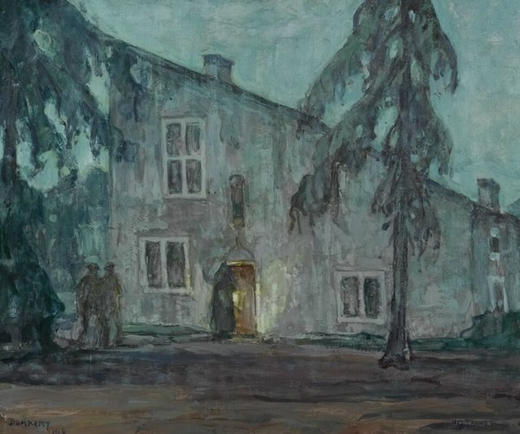
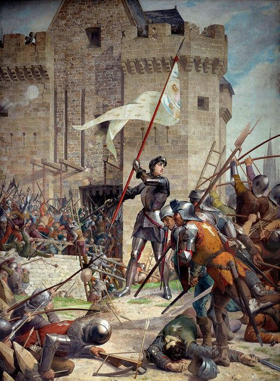
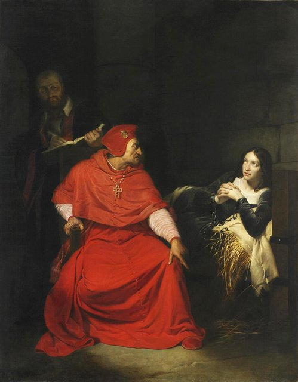
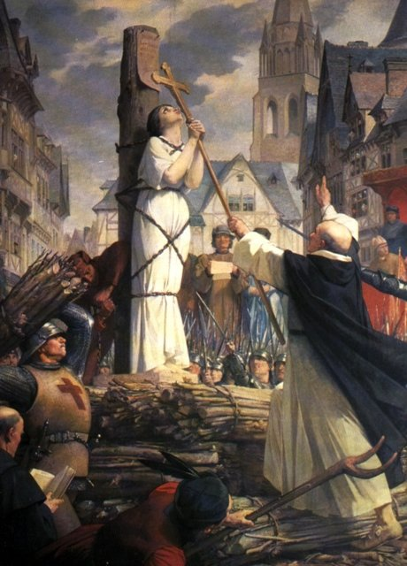

<!--
內容整理自 D:\Books\md\歷史\西方歷史\聖女貞德（joan_of_arc）生平大事記.md（Books 的人物頁為 D:\Books\html\1-1-2.西方歷史人物\聖女貞德(約1412~1431).html），並整合中文維基百科〈聖女貞德〉條目，以自己的話改寫。
筆記比較簡短（一張年表、五項重要事蹟、與百年戰爭的關係、歷史評價），維基百科有較多戰役與審判的細節，這裡兩者合併；時期歸納為：百年戰爭的背景、出身與聲音、從沃庫勒爾到希農、奧爾良與蘭斯加冕、受挫與被俘、審判與火刑、平反與封聖。
人名的分隔號用「·」：法文名 Jeanne d'Arc 譯作讓娜·達克，列入 aliases；威爾第的歌劇《聖女貞德》（VerdiWorks）會被人名索引算成提到她，這是合理的。
兩份資料出入與處理方式：
- 生年：筆記寫約1412年、確切日期沒有一致的史料；維基百科寫約1412年1月6日，這裡 born 採1412-01-06（傳統說法），網站自動算出逝世時約19歲，與筆記一致。出生地：筆記作多姆雷米（Domrémy），維基百科作棟雷米，照筆記。
- 父母：筆記寫父母是雅克·達爾克與伊莎貝爾·羅梅；維基百科寫母親伊莎貝拉·達克，照筆記。
- 聽見聲音：筆記寫約1425年（約13歲）開始表示聽見神聖的聲音，後來與聖彌額爾、聖加大利納與聖瑪加利大連結；維基百科寫1424年第一次遇見，這裡寫「約1424–1425年」。
- 沃庫勒爾：筆記寫1428年前往沃庫勒爾（維基百科作伏古勒），1429年2月在護送下前往希農面見王太子查理；維基百科補充她16歲時請親戚杜蘭德·拉蘇瓦帶她去見駐防指揮官博垂庫爾，起初被嘲笑，照此。
- 奧爾良：筆記寫1429年4月29日抵達、5月8日解圍，獲得「奧爾良少女」的稱號；維基百科補充法軍指揮官迪努瓦公爵等人起初沒有告知她就自行作戰，她主張直接攻擊英軍堡壘，5月7日進攻土列爾堡壘時肩膀中箭，拔箭後重返戰場，照此。
- 羅亞爾河戰役：維基百科補充6月12日攻下雅爾若、15日攻下默恩、17日攻下博讓西，她在雅爾若救了阿朗松公爵一命；筆記只寫6月18日帕提戰役，照兩者併寫。
- 加冕：筆記寫1429年7月17日查理七世在蘭斯大教堂加冕；維基百科摘要寫「7月16日」，但內文寫漢斯在7月16日開門、加冕典禮在隔天早晨舉行，照筆記寫7月17日。
- 巴黎：筆記寫1429年9月進攻巴黎失利、貞德受傷；維基百科寫9月8日進攻，並說查理傾向與勃艮第談判，勃艮第公爵利用談判暗中增援巴黎，照此。
- 被俘：筆記與維基百科同寫1430年5月23日在貢比涅（維基百科作康邊）被勃艮第軍俘虜；維基百科補充她為了確保所有人撤回城內而留在最後方，城門提前關閉，她因此被俘，之後被英方以重金買去，照此。
- 審判：筆記寫1431年1月至5月在魯昂接受教會法庭審判（異端、服裝與神聖啟示等問題）；維基百科寫審判於1431年1月9日在盧昂展開，由英國占領當局主導，程序雜亂無章，英方因無法以女巫定罪，改以她穿男裝定罪，照此。
- 火刑：筆記與維基百科同寫1431年5月30日在魯昂被處火刑；維基百科補充地點是老集市廣場，她請神父讓她握著小十字架，英兵為了證明她已死，又把屍體燒了一次，以免有人收集她的骨灰，照此。
- 平反：筆記寫1455–1456年教會重新審查、1456年撤銷原判；維基百科補充是在她年邁的母親與法國宗教裁判所首席法官布雷哈爾的請求下，教宗卡利克斯特三世授權重新審判，1452年開始調查、1455年11月正式裁決程序、分析115名證人的證詞，1456年6月（7月宣判）撤銷原判，照此。
- 百年戰爭：筆記寫百年戰爭（1337–1453年）與特魯瓦條約（1420年）的背景；維基百科補充1415年阿金庫爾戰役、1419年勃艮第公爵無畏的約翰在談判中被刺殺、勃艮第因此與英格蘭結盟、1422年英法兩王相繼去世，以及貞德死後1435年的阿拉斯條約使勃艮第倒向法國，照此寫進第一則與最後幾則事件。
- 封聖：筆記與維基百科同寫1909年宣福、1920年5月16日封聖；維基百科補充她的紀念日定在5月30日，照此。
圖片來源（皆為 Wikimedia Commons 公有領域／CC0 作品，縮成最長邊 640px）：
- joa-cover.jpg：Ingres coronation charles vii.jpg（安格爾〈貞德出席查理七世的加冕禮〉，1854年，羅浮宮）
- joa-domremy.jpg：Henry Ossawa Tanner - House of Joan of Arc (Domrémy), 1918. Oil on wood pane.jpg（亨利·奧薩瓦·坦納〈多姆雷米的貞德故居〉，1918年）
- joa-orleans.jpg：Lenepveu, Jeanne d'Arc au siège d'Orléans.jpg（勒內普沃〈奧爾良之圍中的貞德〉，先賢祠壁畫）
- joa-trial.jpg：Joan of arc interrogation.jpg（保羅·德拉羅什〈溫徹斯特樞機在獄中審問貞德〉，1824年）
- joa-stake.jpg：Joan of arc burning at stake.jpg（勒內普沃〈貞德在火刑柱上〉，先賢祠壁畫）
-->

# Periods
- 1412-01-06 ~ 1423 | 百年戰爭中的童年 | #868e96
  生於法國東北部多姆雷米的農村家庭，北法被英格蘭與勃艮第占領，王太子查理的王位受到挑戰。
- 1424 ~ 1429-02 | 聽見聲音 | #2f9e44
  自稱聽見聖彌額爾等聖人的聲音，要她趕走英格蘭人、帶王太子到蘭斯加冕。
- 1429-02 ~ 1429-09 | 奧爾良與蘭斯加冕 | #e8590c
  面見王太子、解除奧爾良之圍、在帕提戰役獲勝，護送查理七世到蘭斯加冕，是她事業的高峰。
- 1429-09 ~ 1430-05-23 | 受挫與被俘 | #f08c00
  進攻巴黎失利受傷，王室轉向談判，她在貢比涅被勃艮第軍俘虜。
- 1430-05-23 ~ 1431-05-30 | 審判與火刑 | #c92a2a
  被交給英方，在魯昂受教會法庭審判，以異端罪名被處火刑。
- 1431-05-30 ~ 1920 | 平反與封聖 | #495057
  百年戰爭在她死後22年結束，教會1456年撤銷原判，1909年宣福，1920年封聖。

# Events

## 1412-01-06 | 出生於多姆雷米 {label="約1412年（傳統說法為1月6日）"}

貞德（Jeanne d'Arc）生於法國東北部多姆雷米的農村家庭，父母是雅克·達爾克與伊莎貝爾·羅梅，確切的出生日期沒有一致的史料記載。當時英法百年戰爭（1337–1453年）已打了七十多年：法王查理六世患有精神病，勃艮第公爵與奧爾良公爵爭奪權力；英王亨利五世趁機入侵，1415年在阿金庫爾大勝，佔領法國北部；1419年王太子查理在談判中讓勃艮第公爵無畏的約翰遭到刺殺，新任勃艮第公爵菲利普三世因此與英格蘭結盟。

## 1420 | 特魯瓦條約
王后伊莎貝拉簽下《特魯瓦條約》，承認查理六世死後由英王亨利五世與他的繼承人繼承法國王位，法國內部因此分裂，王太子查理的王位主張受到挑戰；1422年英法兩王相繼去世，英國由襁褓中的亨利六世繼位，由貝德福公爵攝政，王太子查理只控制羅亞爾河以南的地區。

## 1424 | 聽見聖人的聲音 {label="約1424–1425年（約十三歲）"}
貞德表示，自己在村後的大樹下聽見神聖的聲音、看見異象，後來她把這些聲音與天使聖彌額爾、聖加大利納與聖瑪加利大連結，要她趕走英格蘭人，並帶領王太子到蘭斯接受加冕。

## 1428 | 前往沃庫勒爾
當時英軍正在圍攻羅亞爾河畔的戰略要地奧爾良，「整個王國的命運都繫在奧爾良上」。十六歲的貞德請親戚杜蘭德·拉蘇瓦帶她前往附近的沃庫勒爾，向駐防指揮官博垂庫爾說明來意，希望他帶她去見王太子查理，起初被嘲笑，但她沒有放棄。

## 1429-02 | 前往希農面見王太子
1429年2月，貞德在護送下離開沃庫勒爾，前往希農面見王太子查理，說服查理與他的顧問，並接受教會人士的詢問與審查，最後獲得兵權。

## 1429-04-29 | 抵達奧爾良
貞德抵達被英軍圍困的奧爾良，加入法軍的救援行動，以旗幟與信念鼓舞士兵；法軍指揮官迪努瓦公爵等人起初沒有告知她就自行作戰，她大為不滿，主張直接猛攻英軍的堡壘，每一場小規模戰鬥都身處最前線，隨身帶著醒目的旗幟。她在戰場上的實際領導能力一直有爭論，士兵與將領常把她帶來的勝利歸於上帝的力量。

## 1429-05-08 | 解除奧爾良之圍

法軍攻陷幾座堡壘後，英軍集中兵力防守控制奧爾良聯外橋梁的石造堡壘土列爾；5月7日法軍進攻土列爾，貞德肩膀中箭被抬離前線，她把箭拔出後重返戰場，領導最後的攻勢。隔天英軍解除圍城，這是百年戰爭的重要轉折，也是她最具代表性的軍事成就，她因此獲得「奧爾良少女」的稱號。

## 1429-06-18 | 帕提戰役
法軍在6月12日攻下雅爾若（貞德警告阿朗松公爵閃避來襲的砲彈，救了他一命，她自己在攀爬攻城梯時頭盔被石頭擊中，仍繼續戰鬥）、15日攻下默恩、17日攻下博讓西；18日英國援軍抵達，法軍在帕提戰役大勝，被看作是阿金庫爾戰役的逆轉，打開了通往蘭斯的道路，原本謹慎的將領也轉而支持她。

## 1429-07-17 | 查理七世在蘭斯加冕
法軍一路北上，沿途城鎮大多不戰而降，簽下特魯瓦條約的特魯瓦也在圍城四天後投降；7月16日蘭斯打開城門，隔天早晨王太子在蘭斯大教堂加冕為查理七世，貞德在加冕儀式上也有一席之地，宣布上帝的意志已經實現。這次加冕強化了查理的王位正當性，是她事業的高峰。

## 1429-09-08 | 進攻巴黎失利
貞德與阿朗松公爵極力主張進攻巴黎，查理七世卻傾向與勃艮第談判休戰，勃艮第公爵利用談判作為緩兵之計，暗中增援巴黎；9月8日法軍進攻巴黎失利，貞德受傷，此後王室採取較謹慎的軍事與外交策略，她的影響力逐漸下降。1429年11月與12月她在沒有戰事的盧瓦爾河畔度過，1430年3月前往馬恩河畔拉尼。

## 1430-05-23 | 在貢比涅被俘
貞德前往貢比涅抵擋英格蘭與勃艮第的攻勢，在一場小規模戰鬥中下令撤退，自己留在最後方確保所有人退回城內，但城裡因害怕英軍跟著闖入，提早關上城門，她與剩餘的後衛部隊被勃艮第軍俘虜；勃艮第當時與英格蘭結盟，不久英格蘭以重金把她買去。

## 1431-01-09 | 魯昂的審判

審判在英國占領當局主導下於魯昂展開，涉及異端、她穿男裝以及她所聲稱的神聖啟示等問題，程序在許多方面雜亂無章。英方原本打算以女巫定罪，但檢查發現她仍是處女（當時傳說女巫會與惡魔交媾），於是改以她不穿女裝定罪；這場審判出自政治目的，貝德福公爵宣稱法國王位應屬於他的姪兒亨利六世，而貞德破壞了這一切。

## 1431-05-30 | 在魯昂被處火刑

貞德在魯昂的老集市廣場被處火刑，年約19歲。她被綁在火刑柱上不斷祈禱，請旁邊的神父讓她握著一個小十字架；火點燃後幾分鐘就結束了，英兵把焦黑的屍體露出來，向群眾證明她已死，又再燒了一次，以免有人收集她的骨灰。她至死仍堅稱自己的信仰與使命。

## 1435 | 阿拉斯條約
百年戰爭在貞德死後又持續22年。1435年法國在《阿拉斯條約》中使勃艮第倒向法國，英國攝政的貝德福公爵也在同年去世，年僅十歲的亨利六世無人輔政；1453年百年戰爭結束，查理七世保住了法國王位。

## 1456 | 平反審判
戰爭結束後，在貞德年邁的母親與法國宗教裁判所首席法官布雷哈爾的請求下，教宗卡利克斯特三世授權重新審判，1452年開始調查，1455年11月正式展開，神學家小組分析了115名證人的證詞，1456年撤銷原有的定罪，後世稱為「平反審判」。教會也因她在奧爾良的事蹟，把奧爾良列為朝聖地點之一。

## 1909 | 宣福
在奧爾良主教杜龐盧等人的努力下，教宗庇護十世為貞德宣福，成為真福，這是正式封聖前的重要程序。16世紀以後，她先後被天主教同盟與傳統天主教徒當作象徵，後來也成為法國民族認同的重要象徵。

## 1920-05-16 | 封聖
教宗本篤十五世冊封貞德為聖人，紀念日定在5月30日，她成為天主教會最受歡迎的聖人之一，也是法國的主保聖人。她的軍事生涯只有短短兩年，卻以年輕女性的身分在百年戰爭中成為法國軍事與政治的象徵。
