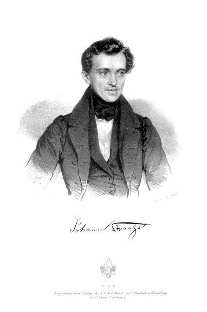
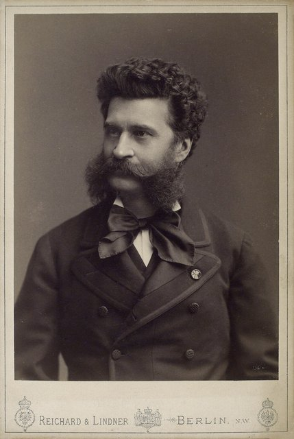
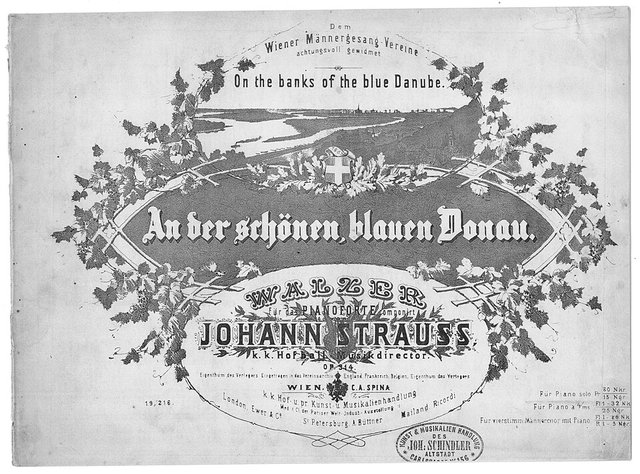
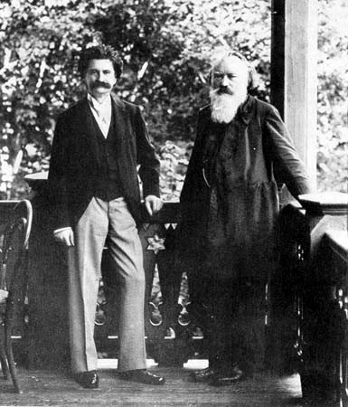
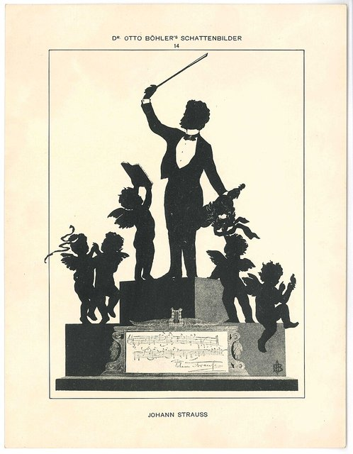

<!--
內容整理自中文維基百科「小約翰·史特勞斯」與英文維基百科「Johann Strauss II」條目（CC BY-SA 4.0），並以台灣用語改寫摘要。
https://zh.wikipedia.org/zh-tw/小约翰·施特劳斯
https://en.wikipedia.org/wiki/Johann_Strauss_II
兩者不一致處以英文條目為準：出任宮廷舞會音樂總監為1863年（中文條目作1862年）；去世時享年73歲（中文條目作74歲）。
《藍色多瑙河》、《蝙蝠》、《維也納森林的故事》、《皇帝圓舞曲》等作品的首演日期，係依一般公認的史實補充。
圖片皆為 Wikimedia Commons 上的公有領域（含PD-US）作品（封面：盧克哈特所攝肖像）。
-->

# Periods
- 1825 ~ 1844 | 童年：父親反對的音樂夢
  圓舞曲作曲家老約翰·史特勞斯的長子。父親希望他當銀行家，他只能偷偷跟父親樂團的首席學小提琴；父親拋家另組家庭後，他才在母親支持下專心走音樂路。
- 1844 ~ 1849 | 「史特勞斯家族內戰」
  19歲在多瑪耶爾賭場出道，和父親在維也納樂壇正面對決。1848年革命時他站在革命派一邊，父親則效忠皇室、寫下《拉德茨基進行曲》。
- 1849 ~ 1872 | 圓舞曲之王@Vienna
  父親死後合併兩支樂團，巡演奧地利、德國、波蘭與俄國，名聲超越父親。弟弟約瑟夫、愛德華加入家族事業，《藍色多瑙河》讓他成為「圓舞曲之王」，並當上宮廷舞會音樂總監。
- 1872 ~ 1899 | 輕歌劇與晚年
  轉向輕歌劇，寫出《蝙蝠》、《吉普賽男爵》等名作。到美國指揮上千人的「怪獸音樂會」，三度結婚，晚年在第三任妻子阿黛勒的鼓勵下再創高峰，名列當時歐洲最知名的人物之一。

# Events

## 1825-10-25 | 出生@聖烏爾里希
生於維也納近郊的聖烏爾里希（今屬維也納諾伊鮑區），是圓舞曲作曲家老約翰·史特勞斯和妻子安娜的長子。他的曾祖父是匈牙利猶太人，後來把他的音樂捧為「最德國」的納粹曾試圖掩蓋這個事實。弟弟約瑟夫與愛德華後來也都成為輕音樂作曲家。

## 1832 | 偷學小提琴
父親希望他將來當銀行家，不准他學音樂，他只好偷偷跟父親樂團的首席小提琴阿蒙學琴。有一天父親發現他在練琴，狠狠打了他一頓，說要「把音樂從這孩子身上打出去」。父親其實只是不希望兒子過音樂家那種辛苦的生活。

## 1842 | 父親拋家

父親為了情婦特蘭普施離開家庭，在母親支持下，他終於能專心追求作曲家的夢想。他跟霍夫曼學對位與和聲，跟作曲家德雷克斯勒學和聲，宮廷歌劇院的芭蕾排練師柯爾曼也為他寫了很好的推薦信。1844年他寫下唯一的宗教作品。

## 1844-10 | 多瑪耶爾賭場出道
父親在維也納娛樂場所影響力很大，各家都不敢和他簽約，最後他說服了希青區的多瑪耶爾賭場讓他演出。他在旅店招募樂手組成自己的樂團，首演了作品1的圓舞曲等曲子，樂評一致讚美：「史特勞斯這個名字將在他兒子身上延續下去……三拍子會在他身上找到穩固的立足點。」父親氣得從此不再到多瑪耶爾演出，媒體把這場父子對決稱為「史特勞斯家族內戰」。

## 1846 | 第二維也納市民軍團樂隊長
獲得這個自蘭納去世後空缺兩年的榮譽職位，是他的第一個重要職務。他起初覺得在維也納很難出頭，到外地演出後才漸漸贏得觀眾。

## 1848 | 站在革命派一邊
1848年革命期間，他寫了同情革命的《自由之歌圓舞曲》、《學生進行曲》等作品，還因公開演奏《馬賽曲》被捕，後來獲判無罪。據中文條目，他出獄後還把《馬賽曲》的旋律塞進《鞭打波爾卡》裡回敬。這個立場讓皇室兩度拒絕讓他擔任宮廷舞會音樂總監。父親則始終效忠皇室，寫下獻給拉德茨基元帥的《拉德茨基進行曲》。

## 1849 | 父親去世，合併樂團
父親死於猩紅熱，他把父子兩人的樂團合併，展開更多巡演。他也寫了好幾首獻給新皇帝法蘭茲·約瑟夫的愛國進行曲，大概是想討好新君主。

## 1853 | 精神崩潰；弟弟約瑟夫接手
長期的身心壓力讓他精神崩潰，醫生要他到鄉間休養七週。家人說服原本當工程師的弟弟約瑟夫放棄工作，暫時代他指揮樂團。據中文條目，他後來承認：「約瑟夫是我們兩人中比較有天分的，我只是比較受歡迎而已。」

## 1856 | 俄國帕夫洛夫斯克之夏
接受聖彼得堡皇村鐵路公司的委託，到帕夫洛夫斯克的遊樂場演出，此後每年都去俄國，直到1865年。1865年他在帕夫洛夫斯克公園指揮了年輕的柴可夫斯基的《性格舞曲》，這是柴可夫斯基的作品第一次公開演出。

## 1862 | 與耶蒂結婚；愛德華加入樂團

與歌手耶蒂·特雷夫茲結婚，兩人共度到1878年她去世。同年27歲的弟弟愛德華正式加入家族樂團擔任指揮，和約瑟夫一起帶領樂團到1870年。三兄弟有時在維也納人民公園舉行露天音樂會，演奏新曲讓觀眾猜是誰寫的。

## 1863 | 宮廷舞會音樂總監
屢次因為和官方的衝突被拒絕後，他終於當上這個原本專為父親設立的宮廷舞會音樂總監，一直擔任到1871年。

## 1867-02-15 | 《藍色多瑙河》首演

原本是為維也納男聲合唱協會寫的合唱圓舞曲，首演反應普通；同年在巴黎萬國博覽會以管弦樂版演出後轟動歐洲，讓他贏得「圓舞曲之王」的稱號。這年8到10月他也應邀到倫敦柯芬園指揮樂季演出，大受好評。

## 1868 | 《維也納森林的故事》
這時期的名作還有《醇酒、美人與歌》，連華格納都承認自己很喜歡這首圓舞曲。

## 1870 | 弟弟約瑟夫去世
約瑟夫去世時，他沒有出席葬禮，之前母親的葬禮他也沒去。他很難面對悲傷，習慣用逃避來應對。

## 1872 | 美國波士頓的「怪獸音樂會」
應邀到波士頓參加世界和平紀念音樂節，指揮一千多名樂手演出《藍色多瑙河》。當時名人常被索取一綹頭髮當紀念，據說他的僕人乾脆剪下他的黑色紐芬蘭犬的毛，當作「正宗史特勞斯頭髮」送給女粉絲，需求多到大家擔心狗要被剪禿了。

## 1874-04-05 | 輕歌劇《蝙蝠》首演
在維也納河畔劇院首演，是他最著名的輕歌劇。在輕歌劇領域，他最大的對手是在巴黎成名的奧芬巴哈。1888年他親自指揮了《蝙蝠》的第200場演出。

## 1878 | 妻子去世，閃電再婚
4月妻子耶蒂去世，他也沒有出席葬禮，由弟弟愛德華處理後事。七週後他就娶了女演員莉莉·迪特里希，但兩人在身分與見解上差異很大，莉莉又有外遇，1882年兩人離婚。

## 1885-10-24 | 《吉普賽男爵》首演
在60歲生日前夕，他在維也納河畔劇院親自指揮首演，與《蝙蝠》並列他最受歡迎的輕歌劇。

## 1887 | 改信新教、入籍外國，娶阿黛勒
天主教會不准他離婚再娶，他索性改變宗教與國籍，1月成為薩克森－科堡－哥達公國的公民，8月娶了寡婦阿黛勒·多伊奇，並收養了她的女兒愛麗絲。阿黛勒讓他晚年的創作再度湧現。

## 1889 | 《皇帝圓舞曲》
晚年名作，同時期還有《皇家慶典圓舞曲》與輕歌劇《森林主人》。據中文條目，到1890年代他已是歐洲第三知名的人物，僅次於維多利亞女王與俾斯麥。

## 1892 | 獻給布拉姆斯的圓舞曲

好友布拉姆斯是他的忠實樂迷，他把圓舞曲《擁抱吧，千萬生民！》獻給布拉姆斯。傳說阿黛勒請布拉姆斯在扇子上簽名，布拉姆斯沒有照慣例寫自己的名曲，而是寫下《藍色多瑙河》的開頭幾小節，旁邊註明：「可惜，不是約翰尼斯·布拉姆斯寫的。」

## 1899-06-03 | 逝世@維也納

他一生飽受各種病痛、恐懼症與疑病症所苦，5月底罹患呼吸道疾病，轉為胸膜肺炎，在維也納去世，享年73歲，臨終前仍在寫芭蕾《灰姑娘》。他安葬在維也納中央公墓的榮譽墓區，與貝多芬、舒伯特、布拉姆斯比鄰。樂評家漢斯立克寫道，他的離世將是維也納最後快樂時光的終結。

## 1901-02-13 | 史特勞斯樂團解散
弟弟愛德華在巡演過全球840個城市後，出人意料地解散了史特勞斯樂團，還把樂器拿去典當。1907年他依照與約瑟夫的約定，在維也納一家工廠的熔爐裡燒掉了大部分家族樂團的原始樂譜，以防被其他作曲家冒名，所以今天聽到的許多史特勞斯作品可能和當年的版本略有不同。

## 1929 | 維也納新年音樂會的前身
指揮家克勞斯與維也納愛樂舉辦了一場全史特勞斯作品的特別音樂會，演變成今天每年的維也納新年音樂會，史特勞斯家族的作品至今仍是主角。指揮家博斯科夫斯基還延續史特勞斯家族一邊拉小提琴一邊指揮的傳統。
