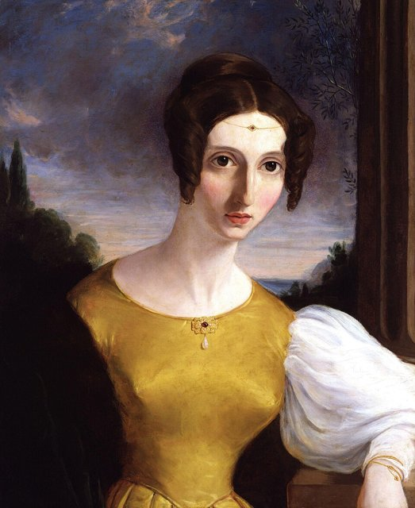
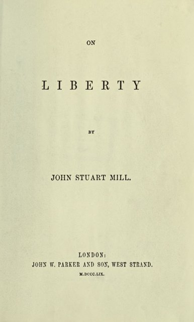
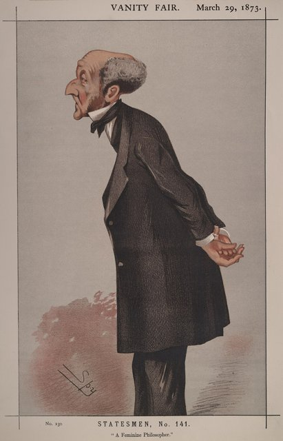

<!--
內容整理自 D:\Books\md\歷史\人物\思想家\約翰・斯圖亞特・彌爾生平大事記.md（Books 的人物頁為 D:\Books\html\4-1-2.經濟學家\約翰・斯圖亞特・彌爾(1806~1873).html），並整合中文維基百科〈約翰·斯圖亞特·密爾〉條目，以自己的話改寫。
時期依筆記的生平時間軸歸納：父親的教育、東印度公司與精神危機、主要著作、國會議員與晚年。
兩份資料出入與處理方式：
- 卒日：筆記寫5月7日或8日；維基百科寫1873年5月7日，died 依此。
- 譯名：Books 作彌爾，維基百科作彌爾或穆勒；這裡標題用彌爾，別名列入穆勒。他的父親詹姆斯·穆勒（彌爾）列入 notNames，避免人名索引誤配。
- 筆記1861年與1863年《功利主義》分列（期刊連載與出版成書），合為一則。
- 人名與其他時間軸一致：李嘉圖（Ricardo）；邊沁、哈麗雅特·泰勒沒有獨立時間軸。古典學派的整體發展見 ClassicalEconomics。
圖片來源（皆為 Wikimedia Commons 公有領域／CC0 作品，縮成最長邊 640px）：
- ce-mill.jpg：John Stuart Mill by London Stereoscopic Company, c1870.jpg（約翰·斯圖亞特·彌爾，約1870年的照片（與古典經濟學派時間軸共用））
- jsm-harriet.jpg：Harriet Mill from NPG.jpg（哈麗雅特·泰勒·彌爾像（英國國家肖像館））
- jsm-liberty.jpg：On Liberty (first edition title page via facsimile).jpg（《論自由》1859年初版書名頁）
- jsm-vanityfair.jpg：John Stuart Mill, Vanity Fair, 1873-03-29.jpg（《浮華世界》雜誌的彌爾漫畫像，1873年3月29日）
-->

# Periods
- 1806 ~ 1822 | 父親的天才教育 | #868e96
  父親詹姆斯·穆勒以邊沁的功利主義為藍圖，讓他三歲學希臘文、十三歲讀李嘉圖，不上學、不與同齡孩子往來，要把他培養成改革的接班人。
- 1823 ~ 1842 | 東印度公司與精神危機 | #1971c2
  十七歲進入東印度公司，參與哲學激進派的論戰；二十歲陷入精神危機，從詩歌中重新發現情感，結識一生的知己哈麗雅特·泰勒。
- 1843 ~ 1864 | 主要著作 | #2b8a3e
  《邏輯體系》《政治經濟學原理》《論自由》《功利主義》《代議制政府論》相繼出版，成為維多利亞時代最具影響力的思想家。
- 1865 ~ 1873 | 國會議員與晚年 | #5f3dc4
  當選西敏市議員，在國會提案給予女性選舉權；出版《婦女的屈從地位》，晚年在法國亞維儂度過。

# Events

## 1806-05-20 | 出生於倫敦
約翰·斯圖亞特·彌爾生於倫敦的潘頓維爾，是歷史學家、經濟學家詹姆斯·穆勒的長子。父親出身蘇格蘭的貧困家庭，是邊沁的摯友與功利主義的推手，著有《英屬印度史》，也是李嘉圖的好友。

## 1809 | 三歲學希臘文
父親親自教育他：三歲學希臘文，讀伊索寓言與色諾芬；八歲學拉丁文、幾何與代數，十二歲前讀完大量古希臘羅馬典籍與歷史，再學邏輯。他從不上學，也很少與同齡孩子玩耍，日後在《自傳》中說自己「從來不是個孩子」。

## 1819 | 研讀政治經濟學
十三歲時，父親每天散步時為他講解政治經濟學，要他寫下摘要，作為父親撰寫《政治經濟學要義》的基礎；他系統閱讀了斯密與李嘉圖的著作，李嘉圖也常到家中作客。1820年至1821年他到法國住了一年，對法國的思想與政治產生終生的興趣。

## 1823 | 進入東印度公司
十七歲的彌爾進入父親任職的東印度公司，在印度事務部撰寫與印度土邦往來的公文，一做三十五年，升到審查官。他同時與青年激進派組織辯論會，1824年參與創辦《西敏寺評論》，撰文鼓吹議會改革與功利主義。

## 1826 | 精神危機
二十歲的彌爾陷入嚴重的憂鬱：他問自己，如果所有理想的改革都實現了，會因此快樂嗎？答案是否定的。在長達數月的低潮中，他讀到華茲華斯的詩，重新體會到感情、想像與美的價值，此後修正了邊沁與父親純粹理性計算的功利主義，強調個人的內在修養。

## 1830 | 結識哈麗雅特·泰勒

彌爾結識已婚的哈麗雅特·泰勒，兩人展開二十年密切的精神友誼，引起社交圈的非議。泰勒聰慧而有主見，對他關於自由、婚姻與女性平權的思想有深刻的影響。1836年父親去世，彌爾的思想更加獨立。

## 1843 | 《邏輯體系》
彌爾出版《邏輯體系》，系統整理歸納推理與科學方法，提出尋找因果關係的「彌爾五法」，並討論社會科學的方法論。這本書成為大學的標準教科書，奠定了他在哲學界的地位。

## 1848 | 《政治經濟學原理》
彌爾出版《政治經濟學原理》，以兩年時間寫成，整合斯密、李嘉圖以來的古典經濟學，成為此後半個世紀英語世界最主要的經濟學教科書。他提出重要的區分：財富的生產受自然法則支配，財富的分配卻是人類制度的選擇，可以透過改革使其更公平。他支持合作社、遺產稅與小農土地所有權，也討論未來可能出現的「靜止狀態」。

## 1851 | 與哈麗雅特結婚
哈麗雅特的丈夫在1849年去世，兩年後彌爾與她結婚。彌爾在婚前寫下聲明，放棄當時法律賦予丈夫對妻子財產與人身的一切權利。

## 1858 | 退休與喪妻
英國政府在印度民族起義後收回東印度公司的統治權，彌爾撰寫為公司辯護的請願書後退休。同年十一月，夫婦在法國旅行時，哈麗雅特在亞維儂病逝。彌爾在當地買下一棟能望見她墓地的房子，此後每年有大半時間住在那裡。

## 1859 | 《論自由》

彌爾出版與妻子共同構思的《論自由》，提出「傷害原則」：只有為了防止傷害他人，才能正當地干涉個人的自由；思想與言論的自由尤其重要，因為被壓制的意見可能是對的，即使是錯的也能讓真理更加清楚。他也警告「多數的暴政」與社會輿論對個性的壓迫。同年達爾文出版《物種起源》。

## 1861 | 《功利主義》與《代議制政府論》
彌爾在期刊連載《功利主義》（1863年出版成書），主張快樂不只有數量的差別，也有品質的高下：「做一個不滿足的人，勝過做一隻滿足的豬」；同年出版《代議制政府論》，討論比例代表制、公民參與與保護少數。

## 1865 | 當選西敏市議員
彌爾在幾乎不競選的情況下，當選代表西敏市的自由黨國會議員。他在國會支持愛爾蘭的土地改革與比例代表制，並帶頭追究牙買加總督艾爾鎮壓莫蘭特灣起義的暴行。

## 1867-05-20 | 女性選舉權提案
國會審議第二次改革法案時，彌爾提出修正案，把法案中的「男人」改為「人」，讓女性也能投票。修正案以73票對196票被否決，卻是英國國會第一次正式辯論女性選舉權，成為婦女參政運動的重要起點。1868年他競選連任失利，離開國會。

## 1869 | 《婦女的屈從地位》
彌爾出版《婦女的屈從地位》，主張男女在法律、教育、職業與政治上應享有完全平等的權利，認為女性被排除在外不僅是不公，也是整個社會才智的浪費。這本書被譯成多國語言，是女性主義思想的經典。

## 1873-05-07 | 逝世於亞維儂

彌爾在法國亞維儂因丹毒去世，享年六十六歲，與妻子合葬。同年他的《自傳》出版。他把古典經濟學、功利主義與自由主義結合，關心分配正義與社會改革，是古典自由主義最重要的思想家之一。
