<!--
內容整理自本機筆記〈卡夫卡生平大事記〉（圖表\卡夫卡生平大事記.md）與中文維基百科「法蘭茲·卡夫卡」條目（CC BY-SA 4.0），以台灣用語改寫摘要。
https://zh.wikipedia.org/zh-tw/弗兰兹·卡夫卡
史料與日期說明：
- 標籤：卡夫卡是布拉格出身、以德語寫作的作家，國籍上屬奧匈帝國，後為捷克斯洛伐克，因此標為「德語文學」，與歌德的「德國文學」分開。
- 人名依筆記作馬克斯·布羅德、費莉絲·鮑爾、米蕾娜·耶森斯卡、朵拉·迪亞曼特（維基百科作布洛德、菲利斯·鮑爾卡、米萊娜·傑森斯卡）。
- 結核病：維基百科寫1917年被診斷出「喉頭」結核；他1917年8月咯血後診斷出的是肺結核，結核病擴散到喉部是1924年的事，此處依此。
- 《觀察》：筆記寫1913年出版；這本書在1912年12月上市，版權頁印的是1913年，此處採1912年12月。
- 維基百科引述布羅德的說法，稱卡夫卡與格蕾特·布洛赫有一個私生子，學界普遍認為缺乏證據，未採用。
- 1909年在布雷西亞看飛行表演、1911年意第緒語劇團、1912年一夜寫成《判決》、1914年婚約在柏林旅館被當面解除、1915年獲轉贈馮塔納獎獎金、1916年在黃金巷寫作、1917年在祖勞的鄉居、1922年提前退休、1924年最後一本書《飢餓藝術家》的校對等細節，係依維基百科與一般公認的史實補充。
- 他的三個妹妹後來死於納粹大屠殺，只在最後一則事件中陳述事實。
圖片來源（皆為 Wikimedia Commons 公有領域／CC0 作品）：
- kaf-cover.jpg：Franz Kafka, 1923.jpg
- kaf-father.jpg：Hermann Kafka.jpg
- kaf-sisters.jpg：Franz Kafka with his sisters.jpg
- kaf-kinsky.jpg：Prague Palace Kinsky PC.jpg
- kaf-1906.jpg：Franz Kafka (1906) (2).jpg
- kaf-1910.jpg：Franz Kafka (1910).jpg
- kaf-betrachtung.jpg：Kafka Betrachtung 1912.jpg
- kaf-felice.jpg：Franz Kafka with Felice Bauer (1917).jpg
- kaf-letter.jpg：De Kafka Brief an den Vater 001.jpg
- kaf-schloss.jpg：Franz Kafka - Das Schloss, 1926. Schutzumschlag.jpg
- kaf-dora.jpg：Dora Diamantova (1898 1952) BW Orig.png
- kaf-notebook.jpg：Kafka's notebook.JPG
- kaf-prozess.jpg：Kafka Der Prozess 1925.jpg
-->

# Periods
- 1883 ~ 1907 | 布拉格的猶太少年與法學生 | #f08c00
  生於布拉格老城一個講德語的猶太商人家庭，在嚴厲的父親陰影下長大，讀德語學校，大學唸法律，結識終生摯友布羅德。
- 1907 ~ 1912 | 白天的公務員、夜裡的作家 | #495057
  進入勞工意外保險機構工作，白天處理工傷案件，夜裡寫作；開始寫日記，與布羅德四處旅行。
- 1912 ~ 1917 | 創作爆發與兩次婚約 | #1c7ed6
  認識費莉絲後一夜寫成《判決》，接著完成《變形記》、動筆《審判》；與費莉絲兩度訂婚又兩度解約。
- 1917 ~ 1923 | 肺結核與《城堡》 | #2f9e44
  診斷出肺結核，在療養與工作之間掙扎；寫下《給父親的信》，與米蕾娜熱烈通信，開始創作《城堡》，提前退休。
- 1923 ~ 1924 | 柏林與最後的時光 | #343a40
  與朵拉在柏林共同生活，完成他想要的獨立生活，不久病情惡化，在維也納近郊的療養院去世。

# Events

## 1883-07-03 | 出生@布拉格
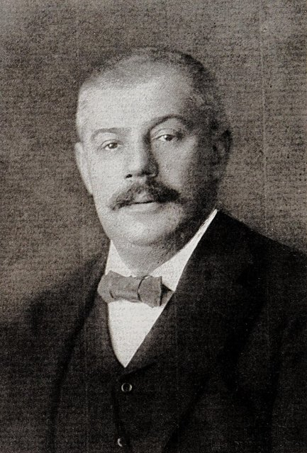
生於奧匈帝國波希米亞王國首府布拉格的老城廣場旁，是家中長子。兩個弟弟都在嬰兒時夭折，下面還有三個妹妹。父親赫爾曼出身鄉下屠夫家庭，白手起家開了一間服飾雜貨批發店，個性強悍專斷；母親朱莉出身富裕而有教養的猶太家庭。當時布拉格大多數居民說捷克語，說德語的猶太人夾在捷克人與德意志人之間，這種「不屬於任何一邊」的處境，影響了他一生的身分認同。

## 1889-09 | 德語小學
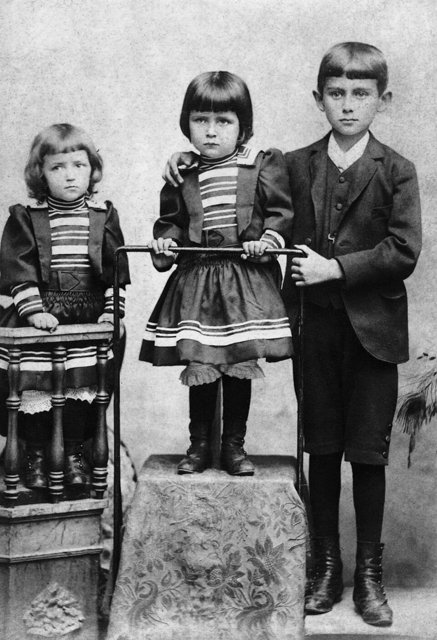
進入布拉格肉市街的德語男子小學。他後來回憶，每天早上家裡的廚娘都恐嚇要向老師告狀，讓他一路上提心吊膽。13歲時他依傳統舉行猶太成年禮，但此後對宗教儀式一直很疏離。

## 1893-09 | 舊城德語文理中學
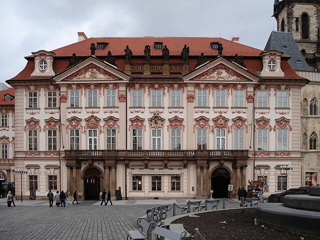
進入以嚴格著稱的舊城德語文理中學，就在老城廣場的金斯基宮內——父親的店舖也開在同一棟建築的一樓。他學了八年拉丁文與希臘文，也學捷克語，成績優良，私下熱愛閱讀斯賓諾莎、達爾文與尼采。

## 1901-11 | 布拉格德語大學
進入布拉格的德語查理－斐迪南大學，先讀化學，兩週後轉讀法律，中間一度改讀德國文學，最後在父親的期望下還是讀了法律，因為法律的出路比較穩定。

## 1902-10 | 結識布羅德
在大學的學生社團聽了一場關於叔本華的演講後，與同學馬克斯·布羅德攀談，兩人從此成為終生的摯友。布羅德後來回憶，卡夫卡沉默寡言，但一開口就意味深長。他們一起讀柏拉圖、福樓拜，也一起旅行。

## 1906-06 | 取得法學博士
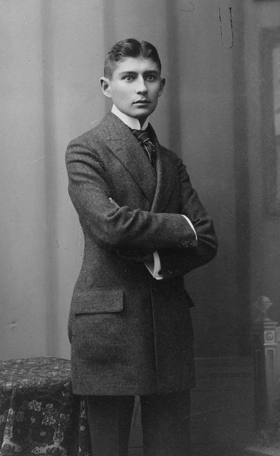
取得法學博士學位，之後在布拉格的法院進行一年的無薪實習。

## 1907-10 | 第一份工作
進入義大利忠利保險公司的布拉格分公司，每天從早上八點工作到晚上六點，幾乎沒有時間寫作，讓他苦惱不已。

## 1908-03 | 首次發表作品
在慕尼黑的文學雙月刊《海波里昂》發表八篇短篇散文，後來收入《觀察》。這是他第一次在刊物上發表作品。

## 1908-07 | 勞工意外保險機構
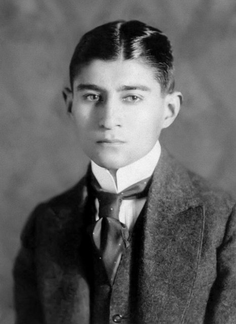
轉到半官方的「波希米亞王國勞工意外保險機構」任職，負責評估工廠的危險等級、處理工傷賠償的申訴，並撰寫機構年報。這份工作只上半天班（早上八點到下午兩點），讓他能在晚上寫作。他工作認真，一路升遷，上司都很欣賞他，但他始終把這份工作視為「謀生的職業」，與他真正的志業相對立。這些官僚文書的經驗，日後化為《審判》與《城堡》中那些無法穿透的體制。

## 1909-09 | 布雷西亞的飛行表演
與布羅德兄弟到義大利北部旅行，在布雷西亞觀看了一場國際飛行表演，寫成報導〈布雷西亞的飛機〉，被認為是德語文學中最早描寫飛機的作品之一。這一年前後他也開始持續寫日記，記錄夢境、生活片段與寫作的掙扎。

## 1911-10 | 意第緒語劇團
在布拉格一家咖啡館看了來自東歐的意第緒語劇團演出，深受震撼，與演員勒維結為好友，開始研究東歐猶太人的文化與歷史，重新思考自己的猶太身分。同年他陪布羅德遊歷巴黎，年底又被父親要求成為妹夫開辦的石棉工廠的合夥人，為此苦惱不已。

## 1912-08-13 | 認識費莉絲
在布羅德家中認識來自柏林的速記員費莉絲·鮑爾，此後五年寫給她的信多達五百多封，有時一天寫兩三封。

## 1912-09-22 | 一夜寫成《判決》
從晚上十點寫到清晨六點，一口氣寫完短篇小說〈判決〉：一位年輕人被父親判處溺死，他便衝出家門跳河。他在日記中說：「只有這樣才能寫作，只有在這樣的連貫中，身體與靈魂完全敞開。」他把這篇小說獻給費莉絲。隨後他開始寫長篇小說《失蹤者》（後來以《美國》之名出版）。

## 1912-11 | 寫作《變形記》
在三週內寫出中篇小說《變形記》：推銷員格里高爾·薩姆沙一天早上醒來，發現自己變成了一隻巨大的甲蟲；他擔心的不是自己的身體，而是上班會遲到。家人從同情、嫌惡到把他當成負擔，最後他孤獨地死去，家人反而如釋重負。卡夫卡從未解釋這場變形的原因，而是讓荒誕的事件在冷靜精確的敘述中自然發生。

## 1912-12 | 第一本書《觀察》
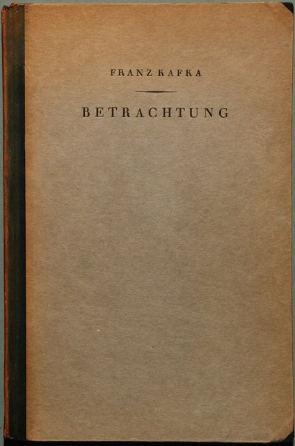
出版第一本書——短篇散文集《觀察》（版權頁印1913年），只印了八百本，用了特大號字體讓篇幅看起來厚一些。他半開玩笑地對布羅德說，在書店裡賣出去的十一本中，有十本是他自己買的。

## 1914-08 | 解除婚約，動筆《審判》
6月他與費莉絲在柏林訂婚，7月卻在柏林一家旅館裡，被費莉絲、她的妹妹與好友格蕾特·布洛赫當面質問，婚約當場解除，他在日記中稱之為「旅館裡的法庭」。一個月後第一次世界大戰爆發，他因工作被列為不可或缺的人員而免服兵役，並開始寫作長篇小說《審判》：銀行職員約瑟夫·K在30歲生日的早上莫名其妙地被捕，卻始終不知道自己犯了什麼罪。

## 1915-10 | 《變形記》出版
《變形記》在文學期刊上發表，隨後出版單行本。他特別交代出版社，封面上絕對不能畫出那隻昆蟲。同年，作家斯特恩海姆把自己得到的德國馮塔納文學獎獎金轉贈給他，這是他生前得到的最大肯定。

## 1916-11 | 黃金巷的小屋
妹妹奧特拉在布拉格城堡下方的黃金巷租了一間小屋，他晚上到那裡寫作，在這個冬天寫出了〈鄉村醫生〉等一系列短篇，後來集結成《鄉村醫生》出版。

## 1917-08 | 咯血與肺結核
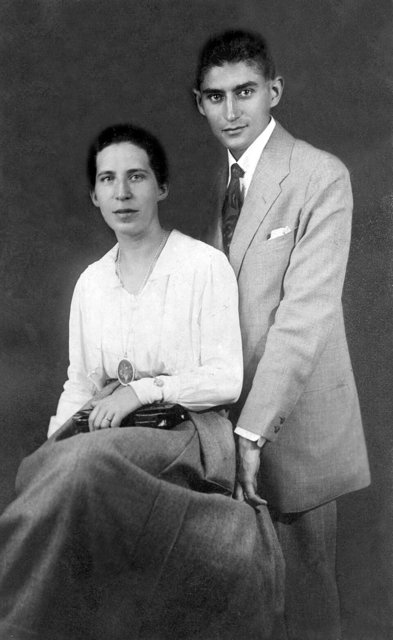
7月第二次與費莉絲訂婚，8月卻在夜裡咯血，隨後被診斷出肺結核。他向保險機構請了長假，到妹妹奧特拉經營農場的鄉村祖勞休養，形容那幾個月是他一生中最快樂的時光。12月，他以生病為由第二次解除與費莉絲的婚約。

## 1919-11 | 《給父親的信》
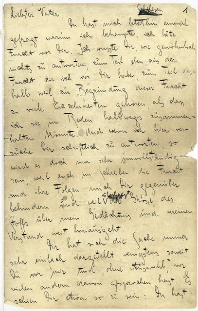
與布拉格一位鞋匠的女兒茱莉·沃里策克訂婚，父親強烈反對，婚事最終告吹。11月他寫下一百多頁的《給父親的信》，開頭寫道：「最親愛的父親：你最近問我，為什麼我說我怕你。」信中細數父親的專斷如何讓他從小就感到恐懼與自卑。他把信交給母親轉交，母親卻沒有交出去，父親始終沒有讀到這封信。

## 1920-04 | 米蕾娜
在義大利梅拉諾療養期間，開始與捷克記者米蕾娜·耶森斯卡通信。米蕾娜是他作品的第一位捷克語譯者，兩人熱烈通信，但她已婚且不願離開丈夫，這段感情在一年多後結束。他後來把自己的日記全部交給了她保管。同年5月，短篇集《鄉村醫生》出版。

## 1922-01 | 動筆《城堡》
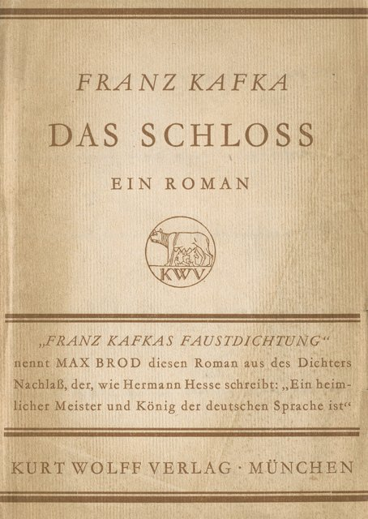
在山區療養地開始寫作長篇小說《城堡》：土地測量員K應聘來到一座村莊，卻怎麼也進不了俯視村莊的城堡，也無法確認自己究竟有沒有被聘用。同年他寫下短篇〈飢餓藝術家〉，7月因病情惡化從保險機構提前退休，結束了將近十五年的公務員生涯。

## 1923-07 | 認識朵拉
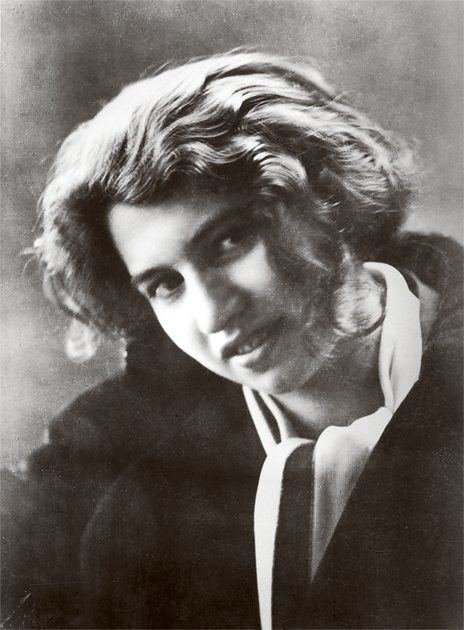
在波羅的海海濱的度假地米里茨，認識了在猶太兒童夏令營工作的25歲女子朵拉·迪亞曼特，兩人一見鍾情。他開始認真學習希伯來文，夢想與朵拉移居巴勒斯坦，在特拉維夫開一家餐館，她當廚師、他當服務生。

## 1923-09 | 搬到柏林
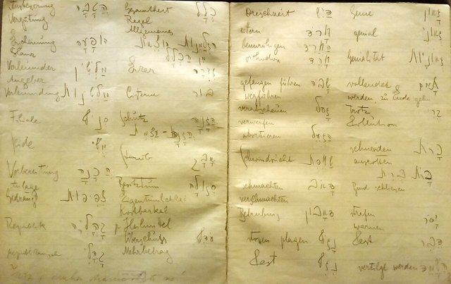
不顧家人反對，與朵拉搬到柏林郊區同居，這是他第一次真正離開父母的家獨立生活。當時德國正值惡性通貨膨脹，兩人生活拮据，冬天常常付不起暖氣費。據朵拉回憶，他曾因為不滿意而讓她當面燒掉了許多手稿。

## 1924-03 | 回到布拉格
病情急遽惡化，被布羅德接回布拉格的父母家。他在這裡寫下最後一篇小說〈女歌手約瑟芬，或耗子民族〉。

## 1924-04 | 維也納近郊的療養院
結核病已擴散到喉部，他住進維也納近郊基爾林的霍夫曼療養院，由朵拉與年輕的醫生朋友克洛普施托克照顧。他幾乎無法說話和進食，只能在紙條上寫字與人溝通，並在病榻上校對短篇集《飢餓藝術家》的校樣——故事裡的主角，正是一個因為找不到喜歡的食物而餓死的人。

## 1924-06-03 | 逝世@基爾林
在療養院去世，再過一個月就滿41歲。6月11日他被安葬在布拉格的新猶太公墓。他生前曾兩度要求布羅德在他死後燒掉所有的日記、書信與未出版的手稿，「不要讀，全部燒掉」。他的父母後來也葬在他的墓旁；三個妹妹，包括最疼愛他的奧特拉，在二次大戰中死於納粹大屠殺。

## 1925 | 布羅德違背遺願出版遺稿
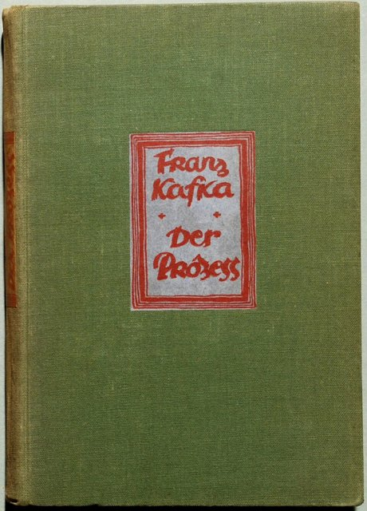
布羅德沒有遵守他的遺願，而是著手整理他的遺稿，陸續出版了《審判》（1925年）、《城堡》（1926年）與《美國》（1927年）。1939年納粹佔領布拉格前夕，布羅德帶著一整箱手稿搭上最後一班火車逃往巴勒斯坦，讓這些作品得以保存。卡夫卡從此聲名大噪，卡繆、沙特、馬奎斯都深受他影響，英文甚至出現了「卡夫卡式的」（Kafkaesque）一詞，用來形容荒謬而令人無力的處境。
