<!--
內容整理自本機筆記〈康德生平大事記（1724–1804）〉（圖表\康德生平大事記（1724–1804）.md）與中文維基百科「伊曼努爾·康德」條目（CC BY-SA 4.0），以台灣用語改寫摘要。
https://zh.wikipedia.org/zh-tw/伊曼努尔·康德
兩份資料的出入與處理：
- 離開教職：筆記寫1796年停止授課，維基百科寫1797年辭去教職。他在1796年夏天上完最後一堂課，1797年正式退休，兩件事分開列出。
- 享年：維基百科寫80歲（虛歲），依周歲為79歲，採筆記的說法。
- 維基百科一句「反對種族融合，支持蓄奴」過於簡化。學界一般指出他1770至1780年代的人類學與地理學著作含有種族階序的觀點，至今受到批評；但他在1790年代的《永久和平論》等著作中明確批判歐洲的殖民掠奪。此處以這個較完整的說法呈現。
- 母親1737年去世、最早畫像出自凱瑟林伯爵夫人、1764年《論優美感和崇高感》、1772年致赫茲的信、1796年最後一堂課的日期、臨終遺言「這樣很好」、1794年腓特烈·威廉二世的宗教禁令、《遺著》、墓碑上的「頭上的星空與心中的道德律」、2024年300週年等細節，係依一般公認的史實補充。
- 圖片皆為 Wikimedia Commons 上的公有領域作品（封面：貝克1768年所繪康德像）。腓特烈學院配後來重建的校舍明信片、柯尼斯堡大學配約1850年的舊校舍素描、俄軍佔領事件配後世所繪〈康德為俄國軍官講課〉、擔任校長事件配德斯特林1892年所繪〈康德與他的餐友〉、《實用觀點下的人類學》配巴爾杜1798年製作的康德大理石胸像、逝世事件配1842年的康德故居版畫；三大批判等著作配初版書名頁。
-->

# Periods
- 1724-04-22 ~ 1746 | 童年與求學 | #8d6e63
  生於柯尼斯堡的馬鞍匠家庭，在虔敬主義的家庭與學校中長大，進入柯尼斯堡大學學習哲學、數學與物理，接觸萊布尼茲與牛頓的學說。
- 1746 ~ 1755 | 鄉間家庭教師 | #2b8a3e
  父親去世後中斷學業，在東普魯士鄉間的牧師與貴族家中擔任家庭教師，一邊研究自然科學與哲學。他後來說這是一生中最安穩富裕的時光。
- 1755 ~ 1770 | 私人講師與前批判時期 | #1864ab
  回到柯尼斯堡大學擔任靠學生學費維生的私人講師，教授地理、數學、物理、邏輯等多門課程，研究從自然科學逐漸轉向形上學的界限，受到休謨與盧梭的深刻影響。
- 1770 ~ 1781 | 教授與「沉默的十年」 | #862e9c
  就任邏輯與形上學教授，區分感性與知性，接著十年幾乎沒有出版新作，專心思考人類知識的條件與界限。
- 1781 ~ 1796 | 批判哲學的成熟 | #c92a2a
  接連出版三大批判，分別處理知識、道德與美感判斷，建立完整的哲學體系，並寫作啟蒙、歷史、宗教與永久和平等論著，成為德國最負盛名的哲學家。
- 1796 ~ 1804-02-12 | 晚年 | #495057
  停止授課，仍持續出版法哲學與人類學著作，並試圖補足自然哲學體系，但體力與記憶逐漸衰退，在柯尼斯堡去世。

# Events

## 1724-04-22 | 出生@柯尼斯堡
生於東普魯士柯尼斯堡（今俄羅斯加里寧格勒）普列戈利亞河上的克奈普霍夫島，父親喬治是製作皮面馬鞍的工匠。他在九個孩子中排行第四，因生日在普魯士曆上是「以馬內利日」而取名伊曼努爾。全家信奉重視內心虔誠與道德的虔敬主義。他晚年說母親「為我種下第一粒善的種子……她的教誨對我一生都有極大的影響」。

## 1732 | 腓特烈學院
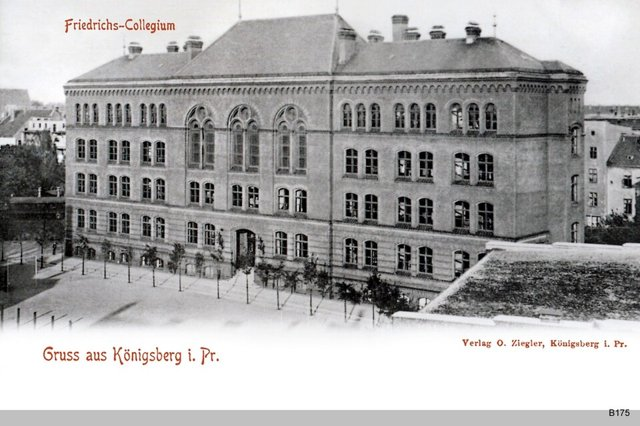
在母親支持下進入虔敬主義牧師舒爾茨主持的腓特烈學院，接受以拉丁文與古典文學為主的嚴格教育，他後來對學校過度強調宗教儀式頗有微詞。1737年母親去世，他才13歲。

## 1740 | 進入柯尼斯堡大學
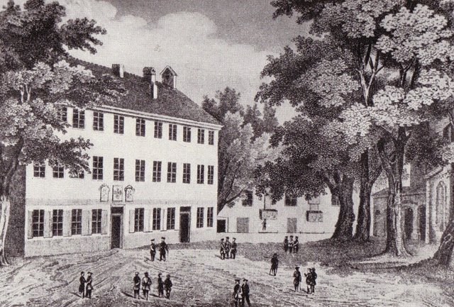
進入柯尼斯堡大學，邏輯與形上學教授克努岑引導他認識萊布尼茲—沃爾夫的理性主義與牛頓物理學，他很快對自然科學產生濃厚興趣。同年腓特烈大帝即位，普魯士的學術環境迎來轉機。

## 1746 | 父親去世；第一篇論文
完成第一部著作《論對活力的正確評價》，試圖調和笛卡兒與萊布尼茲對「動能」的爭論，並以德文而非拉丁文寫成。同年父親去世，家中經濟困難，加上論文未獲老師接受，他中斷學業離開柯尼斯堡。

## 1747 | 鄉間家庭教師
依照當時貧窮大學生的慣例到鄉間擔任家庭教師，先後在牧師安德施、地主馮·許爾森與凱瑟林伯爵家中教書，最遠也沒有離開東普魯士。現存最早的康德畫像，就出自凱瑟林伯爵夫人之手。

## 1755 | 《自然通史與天體理論》；取得學位成為講師
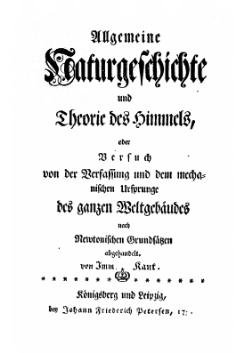
出版《自然通史與天體理論》，以牛頓力學解釋太陽系如何從旋轉的星雲中自然形成，這就是後來的「康德—拉普拉斯星雲假說」；他也主張不能僅憑宇宙的秩序推斷上帝必然存在。同年回到柯尼斯堡大學，以拉丁文論文《論火》取得碩士學位，再以另一篇論文取得授課資格，成為私人講師，薪水由選課的學生支付，聽眾多到要在寄居的教授家中上課。

## 1756 | 申請教授落空
致函國王申請遞補教授空缺，並提交論文《物理單子論》，但當局取消了補缺制度，他未能如願。為了生計，他每週授課多達二十多小時，教授自然地理、數學、力學、物理、邏輯、倫理學等，其中他最喜愛自然地理學，是德國最早把地理學獨立開課的人。

## 1758 | 俄軍佔領柯尼斯堡
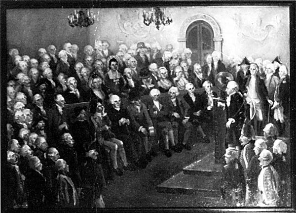
七年戰爭中俄軍佔領東普魯士，柯尼斯堡全體市民（包括他）向俄國女皇伊莉莎白宣誓效忠。他向女皇申請邏輯與形上學教授席位，也沒有成功。俄國佔領持續到1762年。

## 1762 | 讀盧梭《愛彌兒》
他讀到盧梭的《愛彌兒》，據說入迷到錯過了每天固定的散步時間，這是他規律生活中著名的例外。此後他書房唯一的裝飾就是盧梭的畫像。他說盧梭讓他學會尊重人，認為盧梭發現了人類共有的天性，可以和發現自然規律的牛頓相提並論。

## 1764 | 《論優美感和崇高感》
出版《論優美感和崇高感的考察》，以生動的文筆討論美感、性格與民族差異，是他當時最受歡迎的作品之一。

## 1766 | 《視靈者的夢》
以瑞典神祕主義者史威登堡的「通靈」為題，寫下《以形上學之夢來闡釋的一個視靈者之夢》，諷刺那些超出經驗、無法驗證的形上學思辨，開始深入反省形上學的界限。他後來說，是休謨把他從「獨斷論的迷夢」中喚醒。

## 1770 | 就任邏輯與形上學教授
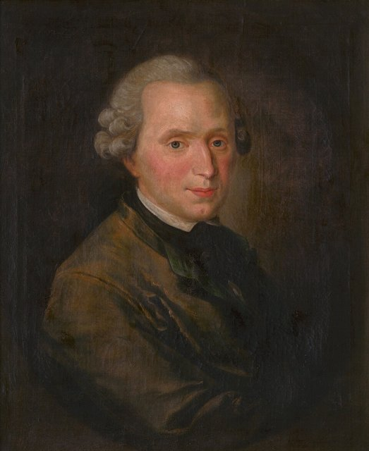
46歲終於獲任柯尼斯堡大學邏輯與形上學教授，並以就職論文《論感性界與理智界的形式及原理》首次明確區分感性與知性，提出空間與時間是人類感性的形式，為批判哲學奠定基礎。

## 1772 | 「沉默的十年」
他在寫給學生赫茲的信中提出了困擾他的根本問題：我們心中的概念，憑什麼能與外在的對象相符？此後將近十年，他幾乎沒有出版任何重要新作，全心思考人類知識的條件與界限。

## 1781 | 《純粹理性批判》
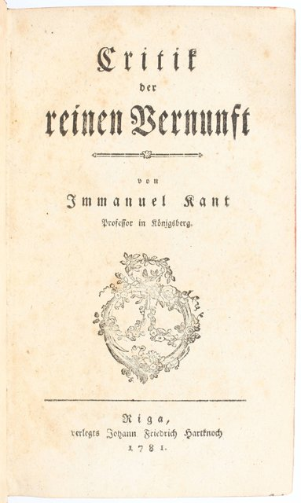
出版《純粹理性批判》，探討人類如何可能擁有不依賴經驗的「先天綜合知識」。他主張不是我們的認識符合對象，而是對象必須符合我們認識的形式（空間、時間與十二範疇），這被稱為哲學上的「哥白尼式轉向」；同時也指出理性一旦越出經驗範圍去談上帝、靈魂、宇宙整體，就會陷入「二律背反」。這部書起初因艱澀難懂而反應冷淡。1787年他出版大幅修訂的第二版。

## 1783 | 《未來形上學導論》
為了回應讀者的誤解，出版篇幅較短的《任何一種能夠作為科學出現的未來形上學導論》，協助讀者理解《純粹理性批判》的要旨。

## 1784 | 〈答「何謂啟蒙？」〉
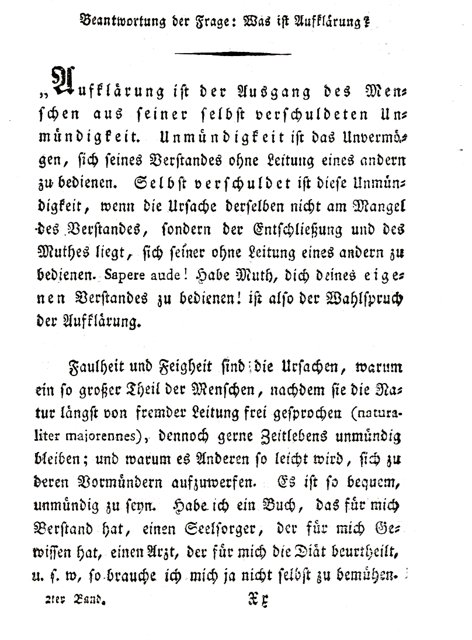
在《柏林月刊》發表〈答「何謂啟蒙？」〉：「啟蒙就是人類脫離自己所加諸自己的未成年狀態」，並提出啟蒙的格言：「勇於運用你自己的理智！」（Sapere aude）。同年也發表〈世界公民觀點下的普遍歷史理念〉。

## 1785 | 《道德形上學奠基》
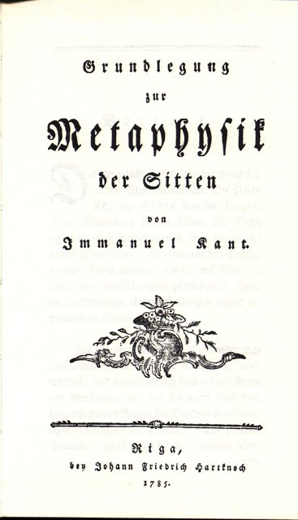
系統探討道德法則與善良意志，提出「定言令式」：只依照你同時能意願它成為普遍法則的準則去行動；並主張要把人（無論是自己或他人）永遠當作目的，而不只是手段。

## 1786 | 擔任大學校長
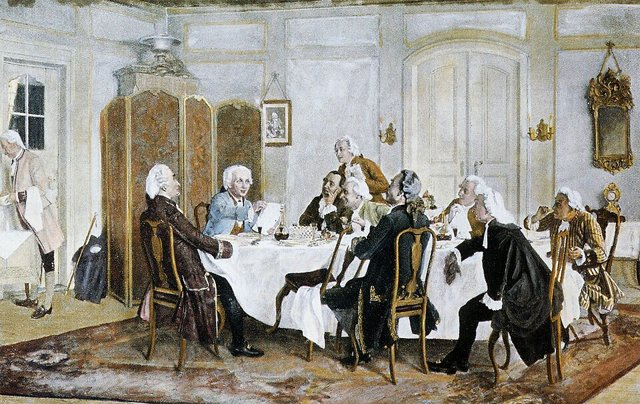
首次出任柯尼斯堡大學校長（1788年再任），同年出版《自然科學的形上學基礎》。他的哲學此時已在德國各大學廣為傳授，成為學界爭論的焦點。

## 1788 | 《實踐理性批判》
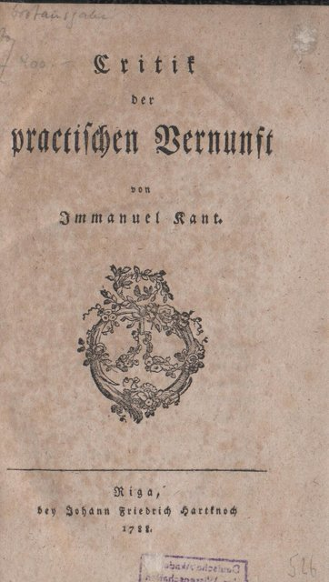
深入討論自由、道德法則與至善，論證自由、上帝與靈魂不朽雖然無法被理論證明，卻是道德實踐必要的「設準」。書中結語寫道：「有兩樣東西，我們愈是經常而持久地思考，就愈使心靈充滿常新而日增的讚嘆與敬畏：頭上的星空，和心中的道德律。」

## 1790 | 《判斷力批判》
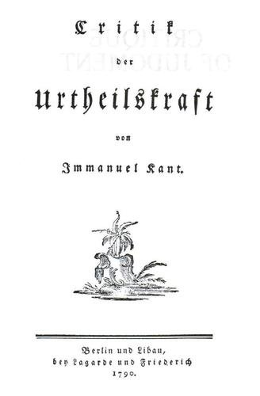
探討美感判斷、崇高感與自然的目的論，嘗試連結自然的必然與道德的自由。這部書與前兩部合稱「三大批判」，三大批判的出版標誌著他哲學體系的完成。

## 1793 | 《單純理性限度內的宗教》
主張宗教的核心是道德，教會儀式與教條都應以理性的道德為衡量標準。保守的普魯士國王腓特烈·威廉二世對此不滿，1794年下令禁止他再發表宗教方面的言論，他承諾以「陛下忠實的臣民」身分遵守，直到國王去世後才在1798年的《學院之爭》中重新討論。

## 1795 | 《永久和平論》
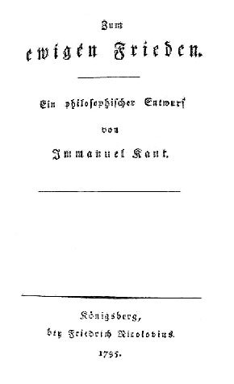
以和約的形式提出世界永久和平的條件：各國實行共和制、建立自由國家的聯盟、尊重世界公民的友好款待權，並批判歐洲列強在海外的殖民掠奪。這部作品被視為國際聯盟與聯合國理念的先驅。他也支持法國大革命的共和理想。

## 1796 | 停止授課
1796年7月23日上完最後一堂課，結束四十多年的教學生涯，1797年正式退休。

## 1797 | 《道德形上學》
出版《道德形上學》，分為法權論與德行論兩部分，討論法律、財產、國家與個人德行。

## 1798 | 《實用觀點下的人類學》
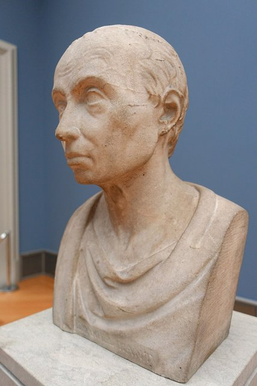
出版根據他數十年人類學講課整理的《實用觀點下的人類學》，被視為他學說的總結。同年出版《學院之爭》。晚年他還試圖寫作連結自然科學與哲學的著作，但未能完成，殘稿後來以《遺著》（Opus postumum）出版。

## 1804-02-12 | 逝世@柯尼斯堡
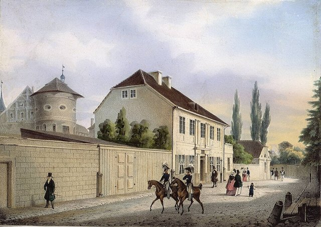
晚年體力與記憶逐漸衰退，在柯尼斯堡家中去世，享年79歲，終身未婚，一生幾乎沒有離開過柯尼斯堡。據說他最後一句話是：「這樣很好。」（Es ist gut.）葬禮十分隆重，他被安葬在柯尼斯堡大教堂，墓旁銘刻著《實踐理性批判》中「頭上的星空，和心中的道德律」的名句。他規律的生活也成為傳說：據說鄰居會在他每天下午固定散步經過時對錶。

他的批判哲學影響了費希特、謝林、黑格爾的德國觀念論與19世紀後期的新康德主義，被認為是繼蘇格拉底、柏拉圖、亞里斯多德之後最具影響力的西方思想家之一。2024年是他的誕辰300週年，他的墓至今仍在加里寧格勒的大教堂旁。
