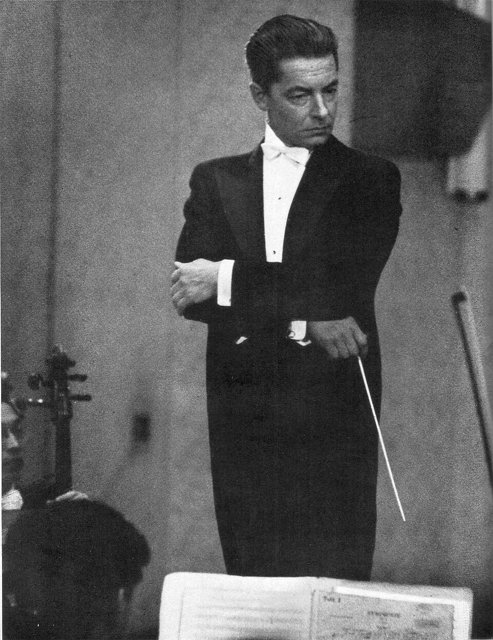
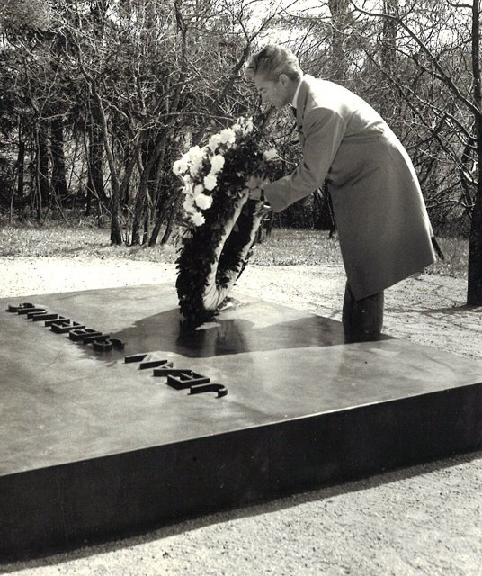

<!--
內容整理自本機筆記〈卡拉揚（Herbert von Karajan）生平大事記〉（D:\Books\md\音樂\表演家\卡拉揚（Herbert von Karajan）生平大事記.md），以自己的話改寫。
時期依筆記的七個階段，第五、六階段（接掌柏林愛樂、藝術帝國）合併。
處理方式：
- 筆記的總年表把1978年寫成「獲得中風」，內文是1978年9月在柏林排練期間中風，這裡依內文。
- 筆記把1948年合作的樂團寫成「倫敦愛樂管弦樂團（Philharmonia Orchestra）」，而1946年寫的是李格創立的「愛樂管弦樂團（Philharmonia Orchestra）」，兩者是同一個樂團，這裡統一寫「愛樂管弦樂團（Philharmonia Orchestra）」。
- 筆記對納粹黨籍的敘述（1935年入黨、戰後受指揮禁令）依筆記並陳，也保留筆記「藝術成就與政治經歷不能完全切割」的提醒。
- 筆記的「主要藝術特色」「代表錄音」「與福特萬格勒的比較」「歷史評價」寫進時期說明與最後一則事件，不另立事件；筆記裡寫給讀者的話（「你前面詢問過福特萬格勒」）未收錄。
- 人名用·分隔（筆記作・）；福特萬格勒、理查·史特勞斯與其他時間軸一致。
圖片（Wikimedia Commons 公有領域或 CC0）：
- kar-cover.jpg：Herbert von Karajan 1963.jpg（卡拉揚在史基浦機場，1963年6月24日）
- kar-1954.jpg：Herbert von Karajan Conducts in NHK Symphony Orchestra, Tokyo 1954 (01) Scan10015.jpg（卡拉揚在東京指揮NHK交響樂團，1954年4月）
- kar-1965.jpg：Herbert-von-Karajan-1965-Ainola.jpg（卡拉揚在芬蘭耶爾文佩祭拜西貝流士之墓，1965年5月16日）
-->

# Periods
- 1908 ~ 1928 | 薩爾斯堡的鋼琴學生@薩爾斯堡 | #868e96
  生在莫札特的故鄉，四歲學鋼琴、八歲進莫札特音樂院；對機械與科技的興趣讓他一度進維也納工業大學，這份興趣後來延續到他對錄音與影像的投入。
- 1929 ~ 1936 | 烏爾姆與亞琛的劇院歷練 | #1971c2
  1929年第一次公開指揮就被烏爾姆劇院看中，在歌劇院學會排練、配合歌手與調度舞台；1935年二十七歲成為亞琛的音樂總監，是德國最年輕的音樂總監之一。
- 1937 ~ 1945 | 國際成名與納粹時期 | #c92a2a
  在維也納國立歌劇院、柏林愛樂與柏林國立歌劇院相繼成名，並與德意志留聲機簽約；他1935年加入納粹黨，事業的快速上升與當時的政治環境密不可分，成為終身的爭議。
- 1946 ~ 1954 | 戰後審查與復出 | #e8590c
  戰後受到指揮禁令，與製作人李格和愛樂管弦樂團合作灌錄唱片；1947年重回維也納愛樂的指揮台，一步步恢復國際聲望，福特萬格勒1954年去世後成為柏林愛樂的接班人選。
- 1955 ~ 1974 | 柏林愛樂與藝術帝國 | #2f9e44
  1955年出任柏林愛樂的藝術總監與終身首席指揮，同時掌握薩爾斯堡音樂節與維也納國立歌劇院；創辦復活節音樂節、基金會、指揮比賽與樂團學院，並投入歌劇與音樂影像。
- 1975 ~ 1989 | 錄音科技與晚年 | #5f3dc4
  健康漸衰，卻更積極擁抱數位錄音、CD 與影像製作；與柏林愛樂因邁耶事件關係惡化，1989年4月辭去職務，7月在薩爾斯堡附近去世。

# Events

## 1908-04-05 | 出生@薩爾斯堡
生於奧匈帝國的薩爾斯堡（今屬奧地利），出生時的名字是 Heribert Ritter von Karajan，後來以 Herbert von Karajan 聞名。父親恩斯特是醫師，母親瑪莎有斯洛伐克的家族背景。家中有文化與音樂氣氛，而薩爾斯堡本身就是莫札特的出生地、歐洲重要的音樂城市。

## 1912 | 開始學鋼琴
四歲左右跟著法蘭茲·萊德溫卡學鋼琴，鋼琴讓他熟悉和聲、節奏、樂句與作品的結構。

## 1916 | 進入莫札特音樂院
進入薩爾斯堡的莫札特音樂院，學鋼琴、和聲、作曲與室內樂，老師有萊德溫卡、法蘭茲·紹爾與伯恩哈德·鮑姆加特納。他一開始並不是以指揮為唯一目標，而是從鋼琴與音樂理論出發，後來才逐步轉向管弦樂指揮。

## 1926 | 赴維也納深造
念完薩爾斯堡的人文中學後，最初進了維也納工業大學的相關學程，對技術、機械與工程有興趣，同時在維也納音樂與表演藝術學院繼續學習鋼琴與指揮。他對科技的興趣沒有因為成為指揮家而消失，日後表現在他對立體聲錄音、音樂影像與數位媒體的投入上。

## 1929-01-22 | 第一次公開指揮
在莫札特音樂院舉行首次公開指揮，由音樂院管弦樂團演奏。觀眾席中有德國烏爾姆市立劇院的藝術主管，看出了他的才華，邀他試演並聘為劇院的首席指揮之一。這是他從音樂系學生變成職業指揮家的起點。1930年至1932年，他在烏爾姆累積歌劇經驗，熟悉排練、與歌手合作、舞台調度與樂團管理，練出快速排練、精確控制與整體音響規劃的能力。

## 1933 | 薩爾斯堡音樂節
夏天第一次正式參與薩爾斯堡音樂節，為馬克斯·萊因哈特導演的歌德《浮士德》配樂。從此他與薩爾斯堡音樂節建立長期聯繫，此後數十年薩爾斯堡一直是他的藝術基地。

## 1934 | 轉往亞琛劇院
烏爾姆的合約結束後，他到亞琛市立劇院應試並獲聘為首席指揮。同年8月21日，在薩爾斯堡的私人音樂聚會中，他第一次與維也納愛樂的音樂家合作。

## 1935 | 亞琛音樂總監，加入納粹黨
二十七歲獲任亞琛劇院的音樂總監，是德國最年輕的音樂總監之一，取得更大的藝術自主權，可以規劃歌劇曲目與管弦樂演出，也為他日後進入柏林國立歌劇院與柏林愛樂鋪路。同一年，他加入了納粹黨。

## 1937-06-01 | 維也納國立歌劇院初登場
第一次在維也納國立歌劇院指揮，曲目是華格納的《崔斯坦與伊索德》，這是他進入維也納重要歌劇舞台的關鍵一步。

## 1938-04-08 | 首次指揮柏林愛樂
這一年是早期事業的轉折點。4月8日第一次與柏林愛樂合作，受到高度關注；當時柏林愛樂的主要指揮是福特萬格勒，兩人日後的關係成為德國指揮史的重要篇章：福特萬格勒以速度彈性與即時張力著稱，卡拉揚則逐漸發展出音響精緻、控制精確、重視整體一致的風格。9月他在柏林國立歌劇院指揮貝多芬的《費黛里奧》；10月21日指揮《崔斯坦與伊索德》取得國際性的突破，並與德意志留聲機公司簽下第一份錄音合約，從此不再只靠現場演出建立聲望。

## 1939 | 柏林國立歌劇院體系
獲任柏林國立歌劇院的指揮，並指揮普魯士國立管弦樂團的交響音樂會，同時與亞琛保持聯繫。他在德國音樂體制中的地位快速上升。

## 1940-05-09 | 米蘭史卡拉歌劇院
第一次在米蘭的史卡拉歌劇院指揮，事業開始深入德國以外的歐洲歌劇界。1941年他帶柏林國立歌劇院相關樂團赴羅馬與佛羅倫斯演出，1942年與第二任妻子安妮塔·古特曼結婚，1943年與阿姆斯特丹的皇家大會堂管弦樂團合作演出與錄音。這些成就都發生在納粹政權與戰爭的背景下；他有正式的黨籍，這點和沒有入黨、曾與文化政策衝突的福特萬格勒並不相同，但評價他不能只看職務與黨籍，還要考察個人動機、實際行動，以及他的音樂活動如何被當時的政治環境影響或利用。

## 1945-02-18 | 戰爭末期
1944年他仍在歐洲各地指揮；1945年2月18日最後一次指揮柏林國立管弦樂團，戰爭接近尾聲時，他大部分時間在義大利活動。納粹德國戰敗後，他的公開指揮事業受到政治審查影響。

## 1946 | 指揮禁令與李格
戰後因納粹黨籍受盟軍審查。1月他和維也納愛樂舉行戰後音樂會，隨後被指揮禁令限制，無法正常公開指揮。同年秋天，他開始與英國唱片製作人華特·李格合作，並與李格創立的愛樂管弦樂團（Philharmonia Orchestra）建立重要的藝術夥伴關係。李格對錄音製作眼光敏銳，卡拉揚對樂團音響要求極高，兩人促成許多代表性的唱片錄音。

## 1947-10-26 | 重返指揮舞台
10月指揮禁令解除，10月26日在維也納音樂之友協會大樓指揮維也納愛樂演出布魯克納《第八號交響曲》，象徵他戰後重新取得公開指揮的機會。復出不代表納粹時期的爭議消失，只是他重新取得從事音樂工作的資格。

## 1948 | 與愛樂管弦樂團合作
4月11日第一次指揮愛樂管弦樂團，並開始定期參與瑞士琉森音樂節，同時與維也納交響樂團建立長期合作。他的事業從德語地區擴展到英國與其他歐洲國家。1949年赴古巴、阿根廷等地巡演，逐步恢復國際指揮家的地位。

## 1950 | 首次在拜魯特指揮
第一次在拜魯特華格納音樂節指揮，進入德國歌劇藝術的最高層級。1951年他指揮《紐倫堡的名歌手》，並參與《尼貝龍指環》系列演出，鞏固了他在德國歌劇界的地位。

## 1953-09-08 | 戰後首次指揮柏林愛樂
戰後第一次與柏林愛樂合作演出，是日後接掌樂團的重要前奏。

## 1954-11-30 | 福特萬格勒逝世

4月至5月，他與NHK交響樂團展開第一次日本巡演，接著與愛樂管弦樂團巡演歐洲。11月30日福特萬格勒去世，柏林愛樂必須尋找新的主要指揮，卡拉揚成為最重要的接班人選之一。

## 1955-05-25 | 簽約接掌柏林愛樂
這年年初他率柏林愛樂赴美巡演，大獲成功，與樂團的關係更加穩固。5月25日簽約出任柏林愛樂的藝術總監與首席指揮，並獲得終身任命。接掌之後，他逐步把樂團塑造成兼具精確度、音響之美與國際影響力的世界級樂團。

## 1956 | 薩爾斯堡音樂節與維也納國立歌劇院
開始擔任薩爾斯堡音樂節的藝術總監，希望把它提升為歌劇、交響樂與音樂錄音的國際中心；同年也獲任維也納國立歌劇院的藝術總監，1956年宣布、1957年正式上任。他同時掌握柏林愛樂、薩爾斯堡音樂節與維也納國立歌劇院的藝術資源。

## 1957-04-02 | 領導維也納國立歌劇院
以華格納《女武神》的演出，正式展開維也納國立歌劇院藝術總監的任期。同年秋天他第一次率柏林愛樂訪問日本，拓展亞洲的觀眾。

## 1958 | 德意志留聲機的錄音合約
與第二任妻子離婚，10月6日與艾莉葉特·穆雷結婚；同年與德意志留聲機簽下五年錄音合約，重要計畫是錄製貝多芬九首交響曲的完整版本。他不想只留下零散的現場演出，而希望以系統性的錄音建立長期有價值的作品集。

## 1959 | 維也納愛樂世界巡演
與維也納愛樂展開世界巡演，足跡遍及印度、菲律賓、中國、日本與美國，擴大了歐洲古典音樂在世界各地的影響。

## 1960-07-26 | 薩爾斯堡大音樂廳
指揮理查·史特勞斯的《玫瑰騎士》，為薩爾斯堡新建的大音樂廳揭幕，大幅提升這座城市舉辦大型歌劇與音樂會的能力。

## 1963-10-15 | 柏林愛樂音樂廳落成
柏林愛樂音樂廳舉行開幕音樂會，曲目包括貝多芬《第九號交響曲》。這座由建築師漢斯·夏隆設計的音樂廳，舞台居中、觀眾席環繞，改變了傳統音樂廳的空間安排，也成為柏林愛樂與卡拉揚時代的重要象徵。

## 1964 | 離開維也納國立歌劇院
宣布辭去維也納國立歌劇院藝術總監的職務，但仍與薩爾斯堡音樂節保持密切合作，並透過演出、錄音與音樂節活動繼續影響歐洲歌劇界。

## 1965 | 歌劇與音樂會影像

更積極地參與歌劇與音樂會的電影拍攝，與法國導演亨利-喬治·克魯佐合作。他不滿足於唱片的聲音記錄，希望連演奏者的動作、舞台氣氛、燈光與視覺構圖，都成為音樂欣賞的一部分。

## 1967-03-19 | 薩爾斯堡復活節音樂節
第一屆薩爾斯堡復活節音樂節開幕，開幕歌劇是華格納《女武神》，由柏林愛樂擔任主要樂團，也舉行交響音樂會。和一般音樂節不同，它讓同一支樂團長時間投入歌劇製作，從排練、演出到錄音，形成完整的藝術計畫。

## 1968 | 卡拉揚基金會
在柏林成立以自己命名的基金會，後來支持音樂研究、指揮比賽與相關文化活動。1969年舉辦國際指揮比賽，為年輕指揮家提供登上國際舞台的機會，基金會也推動與音樂心理學有關的研究。

## 1970 | 貝多芬九首交響曲巡演
與柏林愛樂赴日本巡演，演出貝多芬九首交響曲；同年在維也納音樂節期間也指揮貝多芬九首交響曲。以完整作曲家作品為主題的演出，成為他建立藝術品牌的重要方式。

## 1972 | 柏林愛樂管弦樂團學院
推動成立柏林愛樂管弦樂團學院，培養年輕管弦樂演奏家，讓學員了解大型職業樂團的演奏標準、排練方式與合作要求。這項制度延續至今，學院後來以他的名字命名。

## 1973 | 聖靈降臨節音樂節
推動薩爾斯堡聖靈降臨節音樂節的發展，演出布魯克納等作曲家的重要作品；同年獲得柏林榮譽市民。他的影響力已不只來自指揮，也來自音樂節制度、人才培養與音樂文化傳播。1974年他又帶柏林愛樂赴美巡演。

## 1975 | 健康開始影響工作
12月因嚴重的椎間盤問題接受大型手術，工作安排受到影響，仍持續規劃歌劇製作、錄音與國際演出。1976年他在復活節音樂節推出華格納《羅恩格林》。

## 1977-04-13 | 西門子音樂獎
獲得恩斯特·馮·西門子音樂獎，是國際音樂界的重要榮譽之一。1978年他又得到薩爾斯堡大學與牛津大學的榮譽博士學位，但9月在柏林排練期間中風，健康問題越來越明顯地影響工作。

## 1979 | 柏林愛樂首赴北京
柏林愛樂赴東京巡演，並第一次到北京演出，對中國與歐洲古典音樂的交流具有象徵意義。

## 1980 | 數位錄音
開始積極接觸數位錄音技術，早期的重要計畫包括莫札特《魔笛》。他相信新技術能更精確地保存音樂細節，帶給聽眾更好的聆聽體驗。

## 1981-04-15 | 推廣 CD
在薩爾斯堡復活節音樂節期間，與索尼的高層一同參與 CD 數位音訊系統的公開展示。CD 以數位方式儲存、播放時唱針不必接觸唱片、便於大量複製與保存、有利於唱片公司重新發行經典錄音。他積極支持 CD，顯示他不只關心演奏，也關心音樂如何被保存、傳播與消費。

## 1982 | Telemondial 與邁耶事件
成立影音製作公司 Telemondial，要把重要的歌劇與音樂會錄成高品質的影像，長期保存自己的藝術成果。同年他想聘單簧管演奏家薩賓娜·邁耶進入柏林愛樂，遭到樂團內部反對，雙方在聘用程序、樂團傳統與藝術領導權上產生嚴重分歧，成為他晚年與柏林愛樂關係惡化的重要原因。

## 1984 | 與柏林愛樂的衝突加深
邁耶事件持續影響他與樂團的關係，雙方一度恢復部分合作，但信任已不如從前。這場衝突提出了一個問題：當指揮家擁有極大的藝術權力時，樂團成員是否仍應保有對人事與組織決策的自主權？他藝術成就很高，強勢的領導風格也使他容易與樂團發生權力衝突。1983年4月5日他慶祝七十五歲生日，已是全球最具知名度的古典音樂指揮家之一。

## 1987-01-01 | 維也納新年音樂會
第一次、也是唯一一次指揮維也納愛樂的新年音樂會。這場以約翰·史特勞斯家族的圓舞曲、波卡舞曲為主的傳統音樂會，因他的參與與國際唱片和電視傳播更緊密地連結。1985年與1986年，他仍參與復活節音樂節與錄音，但健康狀況轉差，開始更加重視保存影音紀錄。

## 1988 | 八十歲與最後的演出
4月5日慶祝八十歲生日，唱片公司推出紀念作品集；5月最後一次赴日本演出；8月28日最後一次在薩爾斯堡音樂節指揮，曲目是布拉姆斯《德意志安魂曲》；12月31日進行最後一場柏林音樂會。健康已不如從前，他仍努力完成重要的錄音與演出計畫。

## 1989-04-24 | 辭去柏林愛樂職務
3月27日最後一次指揮柏林愛樂。長期以來與樂團的矛盾，加上人事與藝術管理的分歧，使雙方關係難以維繫，4月24日他宣布辭去柏林愛樂的藝術領導職務，結束了數十年的密切合作。

## 1989-07-16 | 逝世@阿尼夫
在薩爾斯堡附近的阿尼夫住所因心臟衰竭去世，享年81歲，當時還在籌備威爾第《假面舞會》的製作。他以精緻飽滿的樂團音響、圓潤連貫的弦樂與高度的整體一致聞名，代表曲目以貝多芬、布拉姆斯、布魯克納、華格納與理查·史特勞斯為核心；他把錄音視為可以反覆修訂、長期保存的藝術成果，積極參與電影、電視、雷射影碟與 CD 的發展。與福特萬格勒相比，福特萬格勒更值得從現場的張力與結構發展理解，他則代表把指揮藝術、樂團音響、錄音工業與現代媒體結合起來的另一條道路。他最深遠的影響，不只在如何指揮，更在於改變了現代人聆聽、保存與傳播古典音樂的方式。
