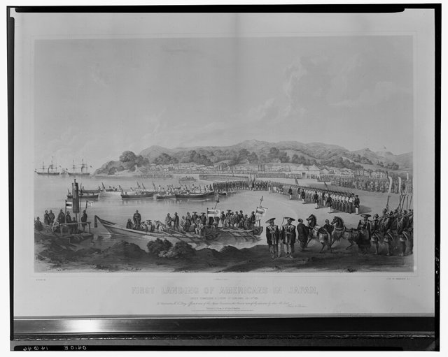
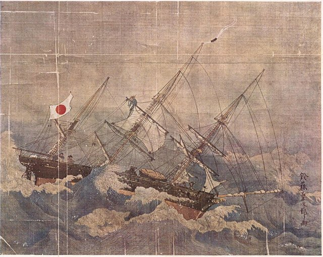
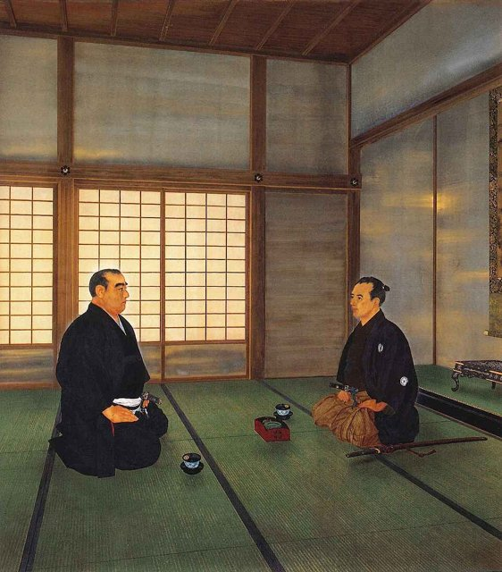

<!--
內容整理自 D:\Books\html\1-3-1.日本歷史人物\勝海舟(1823~1899).html（沒有對應的 md 筆記），並整合中文維基百科〈勝海舟〉條目，以自己的話改寫。
時期依頁面的階段歸納：出生與少年、黑船來航與海軍學習、咸臨丸與幕府海軍改革、復用與江戶無血開城、明治政府時期、晚年。
兩份資料出入與處理方式：
- 生卒：生於文政六年一月三十日，西曆1823年3月12日，兩份都寫3月12日（維基百科摘要把它當成和曆日期，這裡視為西曆）。去世：維基百科簡歷作1899年1月19日、正文作21日，一般記為明治三十二年一月十九日，採1月19日，享年75歲。
- 和曆與西曆：頁面與維基百科的幕末日期多為和曆。這裡與〈明治維新大事記〉時間軸一致，有月日的改用西曆：咸臨丸萬延元年一月十三日出航（西曆1860年2月4日）、二月二十六日抵舊金山（西曆3月17日）；江戶會談慶應四年三月十三、十四日（西曆1868年4月5、6日）；江戶開城四月十一日（西曆5月3日）。頁面寫「1860年2月抵達舊金山」「1868年4月11日開城」，都是和曆月日。
- 開設蘭學塾：頁面寫1850年前後，維基百科作1846年遷居赤坂田町之後，只寫約年。
- 神戶海軍操練所：頁面寫1864年創設，維基百科作1863年2月受命兼管海警與神戶操練所的營運，1864年正式開設；這裡寫在1864年並說明。
- 與坂本龍馬相識：頁面寫1863年；〈坂本龍馬生平〉時間軸依一般記載寫在1862年（文久二年十二月），這裡與該時間軸一致，寫在1862年。
- 1873年：頁面作參議兼海軍卿，維基百科摘要作海軍大臣；明治初年的官職是「海軍卿」，採頁面。
- 頁面後段（1890年代）的甲午戰爭、馬關條約與勝海舟本人關係不大，只在最後一則事件提及；頁面的歷史評價寫進時期說明。
- 人名與其他時間軸一致：坂本龍馬、西鄉隆盛、德川慶喜、榎本武揚、山岡鐵舟、大久保利通、木戶孝允、馬修·培里（頁面作・）。
圖片來源（皆為 Wikimedia Commons 公有領域／CC0 作品；註明「共用」者沿用其他時間軸已有的圖片）：
- kk-cover.jpg：Katsu Yasuyoshi.jpg（勝海舟（勝安芳））
- kk-perry.jpg：First landing of Americans in Japan, under Commodore M.C. Perry at Gore-Hama July 14th 1853 - W. Heine del. ; E. Brown Jr. direxit. ; lith. of Sarony & Co. N.Y. LCCN2007686806.jpg（海涅〈美國人首次登陸日本〉，培里在久里濱上岸，1853）
- kk-kanrin.jpg：Kanrin-Maru-Artwork-by-Suzufuji-Yujiro-c1860.jpg（鈴藤勇次郎〈咸臨丸難航圖〉，約1860）
- meiji-edo-castle.jpg（明治神宮聖德記念繪畫館的〈江戶開城談判〉，後世所繪（與明治維新大事記時間軸共用））
-->

# Periods
- 1823-03-12 ~ 1853 | 出生與少年 | #868e96
  生於江戶本所的貧窮旗本家庭，十五歲繼承家督；學劍與禪，自學荷蘭語與西洋兵學，開設蘭學塾。
- 1853 ~ 1862 | 黑船與海軍學習 | #1971c2
  培里來航後上書海防意見，入長崎海軍傳習所學習航海與造船，1860年以咸臨丸艦長身分橫渡太平洋。
- 1862 ~ 1868 | 幕府海軍改革 | #0b7285
  任軍艦奉行，收坂本龍馬為門生，創設跨藩的神戶海軍操練所，被免職後又復用，赴長州交涉停戰。
- 1868 ~ 1875 | 江戶無血開城與明治政府 | #c92a2a
  戊辰戰爭中出任陸軍總裁，與西鄉隆盛談判，江戶和平開城；之後照顧舊幕臣，入明治政府任海軍大輔、參議兼海軍卿。
- 1875 ~ 1899-01-19 | 晚年 | #495057
  辭去官職，任元老院議官、樞密顧問官，受封伯爵，為西鄉隆盛的名譽發聲，口述回憶留下《冰川清話》。

# Events

## 1823-03-12 | 出生於江戶本所
勝海舟生於江戶本所龜澤町，通稱麟太郎。父親勝小吉是性格豪放、生活拮据的下級旗本，勝家不是掌握重要職位的高級武家。他年幼時曾因家族關係進入江戶城，擔任將軍家子弟的學友，較早接觸幕府上層社會。

## 1838 | 繼承家督
父親隱退，十五歲的勝海舟繼承家督，俸祿只有四十石，必須在有限的資源中安排自己的教育。他師從島田虎之助學劍，也修習禪學，培養臨事沉著的性格，這對他日後面對幕末危機的處事風格有所影響。

## 1846 | 學習蘭學，開設私塾 {label="1840年代"}
西方船艦頻繁出現在日本周邊海域，勝海舟學習荷蘭語、蘭學與西洋兵學，體認到傳統武士的軍事制度已不足以應付蒸汽船與現代火炮。他在江戶赤坂田町開設蘭學與兵法私塾，研究西洋兵制、海軍制度與國際局勢。

## 1853 | 黑船來航與海防意見書

美國海軍准將馬修·培里率艦隊抵達浦賀，要求日本開國。勝海舟向幕府提出海防意見書，主張引進西方軍艦、建立海軍、培養專業人才，受到老中阿部正弘、大久保忠寬賞識。1854年日美和親條約簽訂，鎖國體制開始瓦解。

## 1855 | 長崎海軍傳習所
幕府在長崎設立海軍傳習所，由荷蘭教官教授航海、造船、炮術、蒸汽機械與海軍操練，勝海舟被派往學習，逐漸成為幕府海軍改革的重要人才。1856年他回到江戶，任講武所炮術師範，參與軍艦操練所的教育工作，主張建立完整的海軍教育體系，而不只是購買外國軍艦。

## 1860-02-04 | 咸臨丸橫渡太平洋

幕府派使節赴美交換日美修好通商條約的批准書，勝海舟擔任隨行的咸臨丸艦長，從品川出航。航程遭遇惡劣天候，美國海軍軍官約翰·布魯克等人協助操船，咸臨丸在3月17日抵達舊金山，完成橫渡太平洋，6月回到江戶。
他觀察了美國的城市、港口與工業，了解美國的政治制度與社會，認為日本應優先學習西方制度、發展國力，而不是停留在攘夷的口號。

## 1862 | 軍艦奉行並，收坂本龍馬為門生
勝海舟任軍艦奉行並，進入幕府海軍的決策核心，主張建立統一的海軍教育制度，打破各藩各自培養人才的局面，以能力而非出身與藩籍選拔人才。
土佐脫藩浪士坂本龍馬來訪，原本對他抱持懷疑，聽了他對世界局勢與海軍建設的見解後，拜他為師，成為他最重要的門生之一。

## 1864 | 神戶海軍操練所
勝海舟獲幕府支持，在神戶開設海軍操練所，招收幕臣與各藩青年，培養航海、操船與炮術人才，坂本龍馬擔任私塾的塾頭。操練所不受藩籍限制，反映他以國家整體利益取代藩際對立的構想。這一年他也初次會見薩摩的西鄉隆盛，對西鄉的判斷與人格印象深刻。
池田屋事件、禁門之變後，幕府警戒倒幕勢力，操練所部分學員與尊王攘夷活動有關，勝海舟在11月被免去軍艦奉行，操練所隨後關閉。

## 1866 | 復職，長州停戰交涉
第二次長州征伐失利，幕府重新起用勝海舟為軍艦奉行。他前往與長州藩交涉停戰，認為幕府與長州長期內戰只會削弱日本面對列強的能力，主張以協商取代武力，並進行制度改革。1867年11月，將軍德川慶喜大政奉還；勝海舟不是主要策劃者，但他長期主張改革、避免內戰。

## 1868-02 | 陸軍總裁
1月鳥羽伏見之戰，幕府軍戰敗，德川慶喜退回江戶後表示恭順。勝海舟被任命為陸軍總裁，處理江戶防衛與善後；他認為若新政府軍攻入江戶，將造成城市破壞與大量平民傷亡，保護江戶市民、避免長期內戰，比維護幕府政權更重要。

## 1868-04-06 | 與西鄉隆盛會談

新政府軍由西鄉隆盛率領準備總攻江戶。在山岡鐵舟先到駿府與西鄉會面鋪路後，勝海舟於慶應四年三月十三、十四日在江戶的薩摩藩邸與西鄉會談，說明強攻將使江戶陷入戰火，提出和平交接江戶城的方案，雙方商定德川慶喜的處置、城池交接與幕府軍解散等條件，西鄉把結果帶回新政府。

## 1868-05-03 | 江戶無血開城
江戶城依協議交給新政府軍，德川慶喜已前往水戶謹慎，雙方沒有在江戶決戰。這次交接避免了人口眾多的江戶陷入戰火，減少平民傷亡與財產損失，也讓新政府順利接管幕府的政治中心，成為以談判避免城市戰爭的代表事件。
但並非所有舊幕府勢力都接受：彰義隊在上野抵抗、被新政府軍擊敗，榎本武揚則率艦隊北上，在北海道繼續作戰。

## 1869 | 照顧舊幕臣
戊辰戰爭結束，德川家移居靜岡，大批舊幕臣失去職位與收入。勝海舟奔走協助他們謀生，與德川家及新政府保持聯絡，希望新政府不要對舊幕臣過度嚴厲。

## 1872 | 海軍大輔
勝海舟進入明治政府，任海軍大輔，把幕府時代累積的海軍知識帶入新政府的海軍建設；1873年升任參議兼海軍卿，是海軍行政的最高主管。同年明治六年政變，西鄉隆盛等人因征韓論離開政府，勝海舟此後漸漸淡出政策核心，1875年辭去參議與海軍卿，轉任元老院議官。

## 1877 | 西南戰爭
西鄉隆盛在鹿兒島起兵，兵敗身亡。勝海舟對西鄉懷有深厚的敬意，此後持續為他的名譽與歷史評價發聲。

## 1887 | 受封伯爵
勝海舟受封伯爵，從幕府時代的下級旗本，成為明治華族制度中的高級爵位持有人；1888年任樞密顧問官，重新進入國家最高層級的諮詢體系。

## 1899-01-19 | 逝世
勝海舟晚年持續評論政治，關注明治政府對舊幕府人物的態度，整理幕末史料，口述回憶留下《冰川清話》；他也在甲午戰爭前後對日本的對外戰爭抱持審慎態度。1899年1月，他因腦溢血去世，享年75歲。
他從幕府海軍的建設者，變成以協商避免內戰的談判者，又在明治政府中延續海軍事業，是幕末到明治轉型中少見的跨陣營人物。
