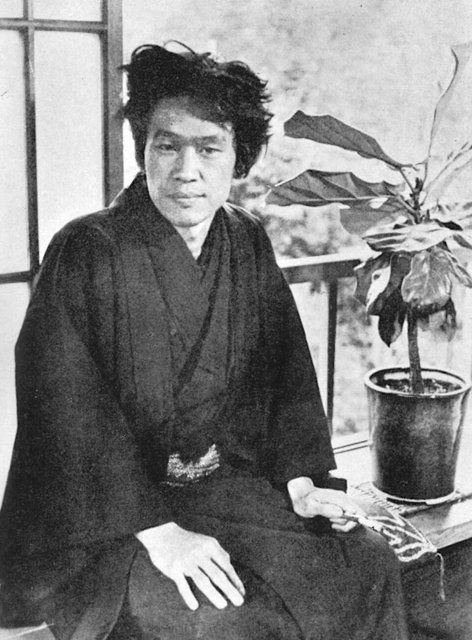
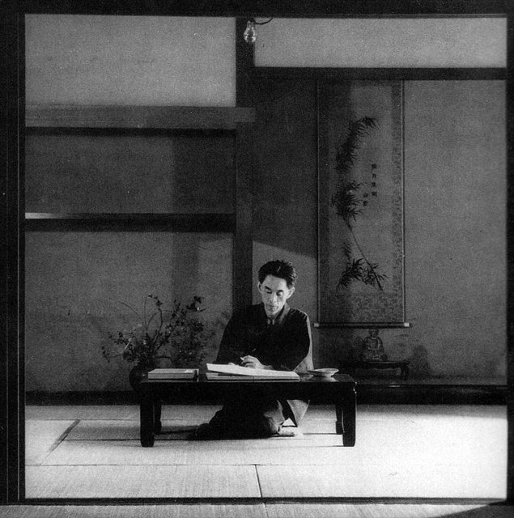

<!--
內容整理自 D:\Books\html\6-4.日本文學家\川端康成.html（沒有對應的 md 筆記），並整合中文維基百科〈川端康成〉條目，以自己的話改寫。
時期依生平歸納：失去至親的童年、一高與帝大、新感覺派、《雪國》與戰爭、戰後的高峰、諾貝爾獎與晚年。
兩份資料出入與處理方式：
- 生卒：1899年6月14日生於大阪；1972年4月16日在逗子的工作室公寓以煤氣自盡、未留遺書，兩份一致。頁面提醒死因因未留遺書而有爭議，照此審慎寫法。
- 喪親：頁面寫父母在他兩歲前相繼死於肺結核、七歲喪祖母、姊姊在他十歲時病逝、十六歲送走祖父；依一般記載父親1901年、母親1902年、祖母1906年、姊姊1909年、祖父1914年5月去世，與頁面相符。
- 《雪國》：維基百科寫1934年開始連載、三年後出單行本並獲文藝懇話會賞、1947年定稿；一般記載第一篇連載刊於1935年1月，這裡寫1935年並說明。
- 提攜三島由紀夫：〈日本文學家總覽〉頁面說三島「十六歲投稿獲賞識」；一般記載是1946年三島帶著稿子拜訪川端，川端推薦《煙草》刊登在《人間》，寫在1946年。
- 諾貝爾獎：維基百科寫1968年10月17日宣布；12月的得獎演說題為〈美麗的日本與我〉（頁面作〈美麗日本的我〉，依台灣常見譯名）。
- 三島之死：維基百科寫川端是少數獲准進入現場的作家，照此。
- 人名與其他時間軸一致：三島由紀夫、橫光利一、芥川龍之介（芥川賞）、大江健三郎。
圖片來源（皆為 Wikimedia Commons 公有領域／CC0 作品；註明「共用」者沿用其他時間軸已有的圖片）：
- kw-cover.jpg：Yasunari Kawabata 1938.jpg（川端康成，1938年攝於鎌倉自宅）
- kw-yokomitsu.jpg：Riichi Yokomitsu 01.jpg（橫光利一，1937）
- kw-1946.jpg：Yasunari Kawabata c1946.jpg（1946年前後的川端康成）
- mi-kawabata.jpg：Mishima, Kawabata, Masugi.jpg（三島由紀夫與川端康成（升木同框），1951年《朝日畫報》（與三島由紀夫生平時間軸共用））
-->

# Periods
- 1899-06-14 ~ 1917 | 失去至親的童年 | #868e96
  兩歲前父母相繼病逝，祖母、姊姊、祖父也陸續去世，十六歲時已是家中唯一存活的人。
- 1917 ~ 1924 | 一高與帝大 | #2f9e44
  進入第一高等學校，伊豆之旅結識巡迴藝人；在東京帝國大學參與第六次《新思潮》，受菊池寬賞識。
- 1924 ~ 1935 | 新感覺派 | #1971c2
  與橫光利一創辦《文藝時代》，推動新感覺派，發表《伊豆的舞孃》。
- 1935 ~ 1945 | 《雪國》與戰爭 | #e8590c
  斷續連載《雪國》，任芥川賞評審；戰時沉浸於《源氏物語》等古典。
- 1945 ~ 1968 | 戰後的高峰 | #1864ab
  完成《雪國》，寫出《千羽鶴》《山之音》《睡美人》《古都》，任日本筆會會長，提攜三島由紀夫等後進。
- 1968 ~ 1972-04-16 | 諾貝爾獎與晚年 | #495057
  成為第一位獲得諾貝爾文學獎的日本人，三島自盡後身心俱疲，兩年後以煤氣自盡。

# Events

## 1899-06-14 | 出生於大阪
川端康成生於大阪市北區此花町，父親川端榮吉是醫生，也愛好漢詩與文人畫。

## 1901 | 父母雙亡
父親在1901年、母親在1902年相繼死於肺結核，兩歲的康成由祖父母帶回大阪府三島郡的老家撫養，姊姊芳子則寄養在親戚家。他對父母幾乎沒有任何記憶。

## 1906 | 祖母與姊姊去世
祖母在1906年去世，1909年姊姊芳子也病逝，兩人從小分開生活，一生只見過幾次面。康成從此與失明的祖父相依為命。

## 1914-05 | 祖父去世
十六歲時，祖父也去世了，康成成為家族中最後存活的一人，被同學戲稱為「參加葬禮的名人」。他在祖父臨終前寫下的日記，日後發表為《十六歲的日記》。此後他寄住在舅舅家與中學宿舍，1915年起在雜誌上發表俳句與短文。

## 1917 | 第一高等學校
川端考進東京的第一高等學校。1918年秋天他獨自到伊豆旅行，與一群巡迴藝人同行，對其中一名少年舞女產生淡淡的愛慕，這段經歷後來寫成《伊豆的舞孃》。

## 1920 | 東京帝國大學
川端進入東京帝國大學英文科，後來轉到國文科。1921年他與同學創辦第六次《新思潮》，發表《招魂祭一景》，受到菊池寬的賞識，從此得到菊池的照顧。同年他與一名少女伊藤初代訂婚，不久被對方取消婚約，這段打擊在他早期的作品中反覆出現。

## 1924 | 《文藝時代》與新感覺派

川端從帝大畢業，與橫光利一等人創辦同人雜誌《文藝時代》，以新奇的比喻與感覺性的文體，對抗當時流行的寫實主義與無產階級文學，被稱為「新感覺派」。

## 1926 | 《伊豆的舞孃》
川端發表《伊豆的舞孃》，寫一名孤獨的高中生在伊豆旅途中與舞女薰之間純淨的感情，成為他最早的代表作，日後多次被拍成電影。同年他參與編劇的前衛電影《瘋狂的一頁》上映，並與秀子結婚。

## 1935 | 《雪國》開始連載
川端開始在多種雜誌上斷續發表《雪國》的各章，寫東京的舞蹈評論家島村三次到越後湯澤的溫泉鄉，與藝妓駒子、少女葉子之間的感情（維基百科作1934年動筆）。開頭「穿過縣界長長的隧道，便是雪國」成為日本文學最有名的開場白之一。同年他擔任新設立的芥川賞評審委員。1937年《雪國》出版單行本，獲文藝懇話會賞。

## 1941 | 訪問滿洲
川端應關東軍的邀請訪問滿洲。戰爭期間他很少寫應時的文字，而是沉浸在《源氏物語》等古典之中；1944年以《故園》等作品獲菊池寬賞。

## 1946 | 推薦三島由紀夫

二十一歲的三島由紀夫帶著稿子拜訪川端，川端推薦他的短篇《煙草》刊登在雜誌《人間》上，此後一路提攜三島，兩人維持了二十多年的師友之情。

## 1947 | 《雪國》定稿
歷經十三年的斷續寫作與修訂，《雪國》完成定稿。1948年川端出任日本筆會會長，任期長達十七年，致力於日本文學的國際交流。

## 1949 | 《千羽鶴》與《山之音》
川端開始連載寫茶道世家情愛糾葛的《千羽鶴》，以及寫一名老人面對衰老與家庭變化的《山之音》（至1954年），這兩部作品被視為他戰後的代表作。1961年他又發表寫老人與沉睡少女的《睡美人》。

## 1961 | 《古都》，文化勳章
川端住到京都，連載以京都四季與祇園祭為背景、寫一對失散雙胞胎姊妹的《古都》。同年他獲頒文化勳章。

## 1968-10-17 | 諾貝爾文學獎
瑞典學院宣布川端以《雪國》《千羽鶴》《古都》獲得諾貝爾文學獎，他是第一位得獎的日本人，也是繼泰戈爾之後第二位獲獎的亞洲作家。12月他在斯德哥爾摩以〈美麗的日本與我〉為題演講，引用道元、明惠等人的和歌與禪宗思想，向世界介紹日本的美學傳統。

## 1970-11-25 | 三島由紀夫自盡

三島由紀夫在自衛隊市谷駐屯地發表演說後切腹自盡。川端趕到現場，是少數獲准進入的作家之一。多年提攜的後輩之死，對他造成很大的衝擊，此後他擔任三島葬禮的治喪委員長。

## 1972-04-16 | 逝世
三島死後約十七個月，川端在神奈川縣逗子的工作室公寓以煤氣自盡，享年72歲，沒有留下遺書。他的死因至今仍有不同的說法，也有人認為是意外。
