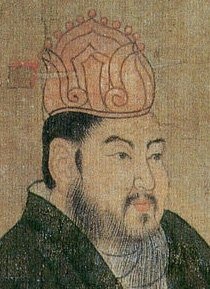
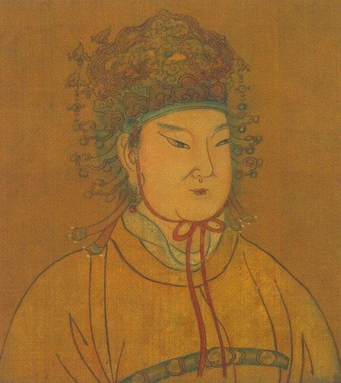
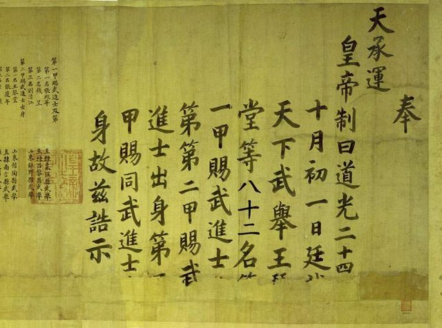
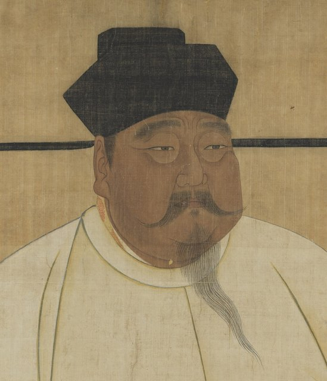
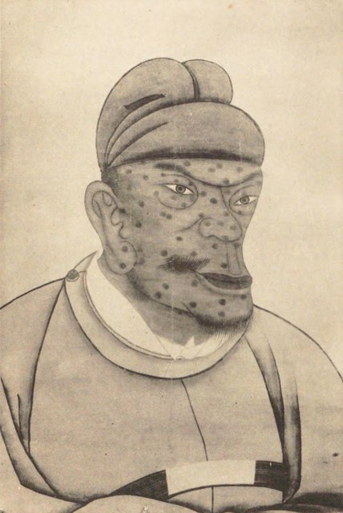
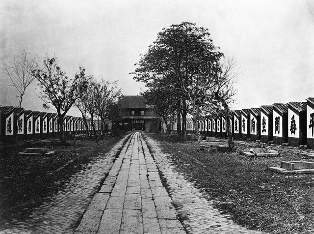
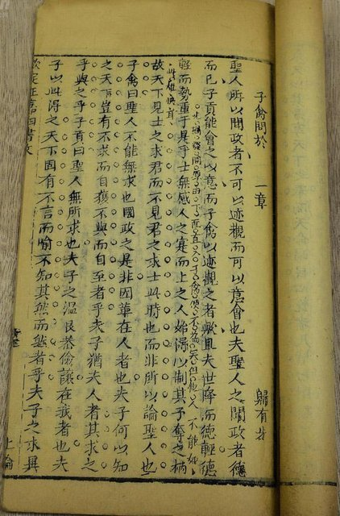
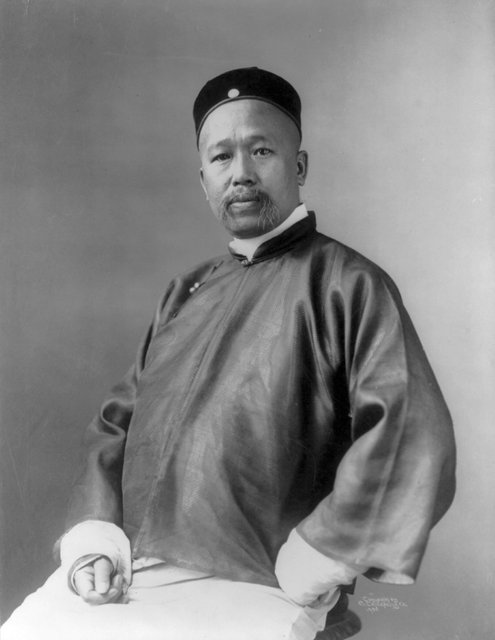

<!--
內容整理自本機筆記〈中國科舉制度大事記：從隋唐創立到清末廢除〉（D:\Books\md\歷史\東方歷史\中國科舉制度大事記.md），以自己的話改寫；只依這份筆記，沒有另外合併其他資料。
時期依筆記的朝代順序（漢、魏晉南北朝、隋、唐、宋、元、明、清）。
處理方式：
- 筆記對年份的說法一向保守（「605年前後」「690年前後」「587年前後」「10—11世紀」），時間軸照寫，用 label 保留「前後」；筆記也一再強調科舉是逐步形成、並非某一年一次創立，殿試與八股文同樣是長期演變，內文照這個說法寫。
- 隋朝：筆記把「結束南北分裂」放在581年；隋建國是581年、滅陳完成統一是589年，這裡內文並列兩個年份。
- 時期邊界：魏晉南北朝止於隋建國的581年（筆記作220—589）；宋止於元建國的1271年（南宋延續到1279年），讓時期彼此不重疊；五代十國（907—960）筆記沒有寫，這裡不列時期。
- 明清考試流程：筆記第九節用文字流程圖畫出「童生到進士」的晉級路線，這裡改寫進15世紀那一則的內文，功名比較表（秀才、舉人、貢士、進士、狀元、榜眼、探花）也併在同一則。
- 筆記第十節（科舉的五個歷史影響）、第十一節（與現代考試制度比較）、第十二節（總結與十個節點）屬於評論性整理，不是事件，沒有單獨列出；要點分散寫進各朝代與1905年的說明。
- 筆記結尾的「延伸參考資料」與網頁引用連結（含追蹤參數）未收錄。
- 圖片皆為 Wikimedia Commons 上的公有領域（含 CC0）作品，縮成最長邊 640px 的 JPEG。
- keju-palace.jpg：Palastexamen-SongDynastie.jpg（宋代殿試場景，封面）
- keju-sui.jpg：Sui Yangdi Tang portrait detail.jpg（唐代帝王圖卷中的隋煬帝像局部）
- keju-wu.jpg：則天大聖皇帝像圖.jpg（武則天像）
- keju-wuju.jpg：道光二十四年武殿試大金榜.jpg（道光二十四年（1844）武殿試金榜，借來說明武舉）
- keju-taizu.jpg：Song Taizu (cropped).jpg（宋太祖像）
- keju-hongwu.jpg：Hongwu Emperor from the collection of Temple of Confucius, Qufu.png（明太祖朱元璋像，曲阜孔廟舊藏，1915年出版品轉載）
- keju-cells.jpg：Exam cells-large.jpg（貢院號舍，1873年攝；借來說明明清的鄉試與會試考場）
- keju-sishu.jpg：《欽定四書文》书影.jpg（《欽定四書文》書影，清代官方編選的八股文範文集）
- keju-kang.jpg：Kang Yu-wei cph.3a45114.jpg（康有為，1905年攝，美國國會圖書館藏）
-->

# Periods
- -206 ~ 220 | 漢代：察舉與徵辟 | #8d5524
  還沒有科舉，官員主要靠地方推薦（察舉）與長官徵召（徵辟）產生，太學培養研習儒家經典的士人；選才高度依賴推薦者的判斷。
- 220 ~ 581 | 魏晉南北朝：九品中正制與門第 | #5f3dc4
  以家世、品行與才能評定等第的九品中正制盛行，門閥士族的影響越來越深，也讓中央政府更想找一條能跨越地方門第的選才路。
- 581 ~ 618 | 隋：科舉的開端 | #c92a2a
  隋統一後削弱門第對仕途的壟斷，隋煬帝時設進士科，被視為科舉正式形成的標誌。
- 618 ~ 907 | 唐：逐步發展 | #e8590c
  進士、明經、明法、明算與武舉等科目逐漸形成定期考試；科舉成為重要的入仕途徑，但門蔭與推薦仍並存。
- 960 ~ 1271 | 宋：成熟與完善 | #1864ab
  為了壓抑將領與地方勢力而擴大文官制度；殿試、糊名、謄錄與三年一試讓科舉更制度化，士人階層隨之擴大。
- 1271 ~ 1368 | 元：中斷與恢復 | #0b7285
  元初沒有全面恢復科舉，1315年才恢復，並依族群與地域分別取士。
- 1368 ~ 1644 | 明：定型與八股文 | #2b8a3e
  鄉試、會試、殿試的階梯完整定型，四書五經成為考試核心，八股文逐漸成形；制度更標準化，內容也漸趨僵化。
- 1644 ~ 1912 | 清：延續、改革與廢除 | #862e9c
  沿用明制；甲午戰敗後科舉成為改革焦點，經戊戌變法、新政與八股退場，1905年下令廢除。

# Events

## -206 ~ 220 | 漢代：察舉與徵辟
漢代還沒有後世意義的科舉，官員主要靠察舉與徵辟產生。察舉是由地方官考察並推薦人才，常見的名目有孝廉、茂才；徵辟則是皇帝或高官直接徵召人才任職。朝廷同時設立太學，培養研習儒家經典的士人。這套辦法開始把儒家經學、品德評價與仕途連在一起，但人才能不能出頭，仍高度取決於推薦者的眼光。

## 220 ~ 589 | 魏晉南北朝：九品中正制盛行
魏文帝曹丕時，陳群提出九品中正制：朝廷設置中正官評定地方人物，依品行、才能與家世定出等第，官府再把評定結果當作任官的重要依據。隨著門閥士族壯大，家世對仕途的影響越來越大。這段歷史也說明了科舉後來為什麼重要：中央政府需要一種更能掌握在自己手中、又能跨越地方門第限制的選才方式。不過科舉並不是某一年突然取代九品中正制，而是在選官方式慢慢轉變的過程中形成的。

## 581 | 隋朝建立
楊堅建立隋朝，後來滅陳（589年），結束南北分裂、重新統一中國。統一之後，中央需要更有效率的官僚體系，也想降低高門士族對官職分配的壟斷，於是逐步調整選官方式，朝著以考試選才的方向發展。

## 587 | 選官制度改革 {label=587年前後}
隋文帝推動選官改革，削弱單靠門第決定仕途的舊模式。學界對科舉正式始於哪一年、制度該怎麼定義，看法並不完全一致，所以不宜把所有改革都歸成某一個創制年份。

## 605 | 隋煬帝設立進士科 {label=605年前後}

隋煬帝時期設立進士科，通常被視為科舉正式形成的重要標誌，透過考試選才的方式從此有了較明確的制度地位。隋朝的貢獻是讓選官從重視門第與推薦，逐步轉向重視考試，同時加強中央對人才選拔的掌控，也為唐代的發展打下基礎。隋朝雖然短暫，卻替延續一千多年的科舉開了頭。

## 618 | 唐朝建立，科舉逐步發展
唐朝承繼隋代的做法，考試逐漸定期舉行，考生可以從不同科目爭取入仕資格：進士科考詩賦與策論，社會地位最高；明經科考儒家經典；明法科考法律；明算科考算學；武舉則考武藝與軍事能力。各科的內容與重要性隨時期而變。不過唐代官員仍有門蔭、推薦等其他來源，並不是人人都要經科舉出身。王維、白居易、韓愈、柳宗元等文人都與科舉文化關係密切，使文學才能和仕途緊緊相連。

## 690 | 武則天擴大科舉的運用 {label=690年前後}

武則天為了建立自己的政治支持力量，積極運用各種選才方式，科舉在人才選拔中的作用更受重視，也強化了皇帝對選才的掌握。殿試的起源，歷來有不同的界定方式；武則天時期是相關制度發展的重要階段，但後世成熟的殿試不能簡單算成某一年一次完成。

## 702 | 設立武舉

武則天時期設立武舉，把考試選才的理念擴展到軍事人才。這說明科舉不只和文學、儒家經典有關，也曾用來選拔軍事人才。

## 960 | 宋朝建立，擴大文官制度
宋朝建立後面對一個核心問題：怎麼降低軍事將領與地方勢力對政權的影響，建立更穩定的中央官僚體系？科舉成了重要的工具，宋朝逐步擴大文官制度，讓更多經由考試取得資格的士人進入政府。

## 973 | 宋太祖親自主持殿試

因為錄取過程引發爭議，宋太祖親自主持進一步的考試，成為殿試制度發展的里程碑。殿試後來成為科舉的最高層級，由皇帝主持或以皇帝名義舉行，讓考生與皇權之間建立更直接的關係。

## 10c ~ 11c | 糊名、謄錄等防弊措施 {label=10～11世紀}
宋代逐步採用多種考試防弊辦法：糊名是把試卷上的考生姓名遮起來，減少考官辨認考生的機會；謄錄是由專人重新謄寫試卷，避免考官從筆跡認出考生；此外還有考試分級與定期舉行等安排。這些措施無法完全消除舞弊，卻能減少部分徇私的情況。

## 1066 | 三年一試的固定週期
宋代科舉逐漸形成較固定的考試週期，後來以三年一試為主要模式。定期考試讓考生能安排長期的讀書與應考，也讓政府較有規律地補充官僚人才。宋代科舉帶來幾項長期影響：文官政治更成熟，非高門出身者更有機會進入官僚體系，書院與家塾因科舉需求而發展，官員選拔也更依賴中央訂定的標準，皇權因此進一步集中。范仲淹、王安石、蘇軾、司馬光等人的仕途，都與科舉文化有不同程度的關聯。但科舉並不等於現代意義的完全平等，家庭財力、教育資源、性別與社會身分仍會影響一個人有沒有機會應考。

## 1271 | 元朝建立，科舉一度中斷
元朝由蒙古人建立，並沒有立刻全面恢復宋代的科舉。政府用多種途徑選官，包括任用蒙古貴族與軍事群體、推薦等，因此元朝前期的科舉不像宋代那樣持續發展。

## 1315 | 元仁宗恢復科舉
延祐二年（1315年），元仁宗恢復科舉考試，是元代科舉史上的大事。元代科舉有鮮明的時代特徵：不同群體分別應試，錄取名額與考試安排受身分及地域影響，儒家經典仍是重要內容，科舉也沒有完全取代其他入仕途徑。恢復科舉讓傳統考試制度得以延續，也為明代進一步制度化提供了基礎。

## 1368 | 明朝建立

明太祖朱元璋建立明朝，重視儒家教育與官僚制度，科舉逐漸成為選拔文官的重要制度，考試程序、內容與取士規範也比以往更統一。

## 15c | 鄉試、會試、殿試的層級定型 {label=15世紀}

明代科舉形成完整的考試階梯：童生先經童試取得生員資格（俗稱秀才）；鄉試通常每三年在各省舉行，考中者稱舉人；會試通常在鄉試次年春季由中央主持，考中者稱貢士；最後是殿試，排定進士名次，第一名狀元、第二名榜眼、第三名探花。清代沿用同一條路線：童生 → 童試 → 生員（秀才） → 鄉試 → 舉人 → 會試 → 貢士 → 殿試 → 進士。要注意「考中功名」和「取得官職」是兩回事，中了舉人或進士，不代表馬上有實缺，仍受職缺與官制影響；而「童試」是後人對一連串入學考試的統稱，具體名稱因時期與地方而異。

## 1368 ~ 1644 | 八股文逐步定型 {label=明代}
明代科舉以四書五經為核心，並逐漸形成嚴格的文章規範，也就是八股文：必須依循指定經典與官方認可的解釋，文章結構與行文格式都有明確限制。八股文不是某一年突然出現，而是長期演變的結果。它讓人才選拔更標準化，卻也帶來問題：學習內容集中在指定經典與官方解釋，考生容易把目標局限在取得功名，文章的表達受到限制，家庭經濟與教育資源仍影響應考機會。明代科舉的核心矛盾，在於提高了選拔標準的一致性，卻也可能使教育內容趨於僵化。

## 1644 | 清朝入主中原，沿用明代科舉

清朝建立全國統治後延續明代的科舉，用來吸納漢人士人、維持官僚運作；科舉既是選官工具，也是清廷與士人階層建立政治聯繫的方式。清代基本沿用明代的考試層級與經典教育，以四書五經為依據，八股文仍是文科的重要文體，鄉試、會試依制度定期舉行；進士等功名是取得官職的重要途徑，但並非人人立刻獲得實缺。

## 1895 | 甲午戰爭失敗
清朝在甲午戰爭中敗給日本，暴露出軍事、教育與國家治理的重大問題。許多改革者開始反思傳統教育，認為光靠經典訓練與八股文，難以培養現代國家需要的人才。

## 1898 | 戊戌變法

康有為、梁啟超等改革者主張改革教育與科舉，反映知識界希望改變傳統教育內容、引入新學的趨勢。戊戌變法很快失敗，相關改革並沒有立刻全面實現。

## 1901 | 清廷推動新政，書院改學堂
清廷開始推動一系列制度改革，教育是其中重要的一環：傳統書院逐步改設為新式學堂，教育內容納入新的學科與知識。國家培養人才的方式，正從傳統經典教育逐步轉向近代學校教育。

## 1902 ~ 1904 | 科舉考試內容與方式的改革
清廷逐步調整科舉考試的內容與方式，傳統的八股文退出了考試制度。

## 1904 | 甲辰科：最後一次科舉
1904年舉行的甲辰科，成為科舉廢除前最後一次正式的科舉考試。

## 1905 | 清廷下令廢除科舉
清廷下令自下一科起停止科舉考試，正式終結傳統的科舉制度；這項決定與新式學堂的推廣、教育制度改革及國家現代化的需求密切相關。廢除科舉不只是取消一種考試，更意味著中國傳統教育與官僚人才選拔體系開始進入全面轉型。科舉最重要的歷史意義，是把教育、人才選拔、官僚治理與社會流動緊密連結：它在一定程度上打破了世襲門第對官職的壟斷，為中央政府提供較穩定的人才來源，也塑造了重視讀書與考試的文化；但它同時受到皇權、階層差異與經典教育的限制，到了明清，考試內容與形式日益僵化，更難回應近代國家對新知識與新型人才的需求。
