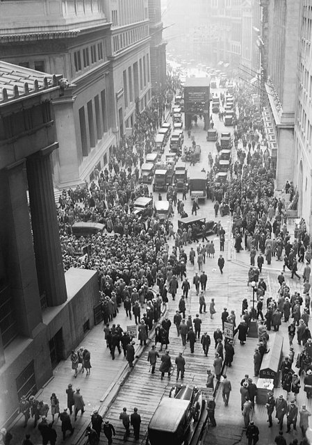
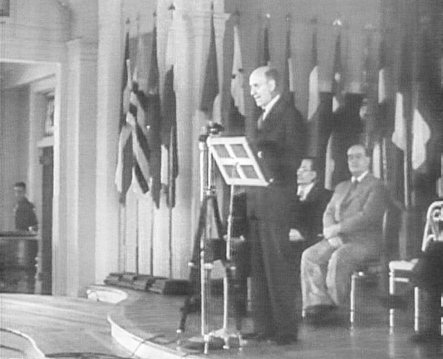

<!--
內容整理自本機筆記〈凱因斯學派（Keynesian School of Economics）非常完整詳細大事記〉（D:\Books\md\歷史\術語\經濟學\凱因斯學派.md；html 版在 D:\Books\html\4-1-1.經濟學派），並參考中文維基百科〈凱恩斯主義〉條目，以自己的話改寫。
時期依筆記的篇章：凱因斯思想的形成（1883－1929）、大蕭條與凱因斯革命（1929－1945）、黃金時代（1946－1969）、停滯性通膨的挑戰（1970－1989）、分化與復興（1990－）。
處理方式：
- 1883年凱因斯出生、1911年任《經濟學期刊》編輯、1913年《印度通貨與金融》寫進第一則事件。
- 筆記把貨幣學派（1963、1968）、理性預期與盧卡斯批判（1976）、新凱因斯學派列入凱因斯學派的挑戰與分化，這裡只簡述，詳見「貨幣學派」「新興古典學派」「新凱因斯學派」時間軸。
- 1937年的 IS-LM 模型依通行說法寫希克斯的〈凱因斯先生與古典學派〉。
- 2009年美國經濟刺激方案、2020年疫情紓困依筆記寫入；2021年以後的通膨反彈與升息寫進最後一則事件。
- 人名依 Books 原稿與台灣慣用譯名：凱因斯、薩繆爾森、希克斯、明斯基、傅利曼；凱因斯在其他時間軸也寫作凱恩斯（人名索引兩者都比對）。
圖片來源（皆為 Wikimedia Commons 公有領域／CC0 作品，縮成最長邊 640px）：
- ke-keynes.jpg：John Maynard Keynes (1929).jpg（凱因斯，1929）
- ke-crash.jpg：Crowd outside nyse.jpg（1929年股災時聚集在紐約證券交易所外的人群）
- ke-brettonwoods.jpg：Morgenthau Bretton Woods opening 1944.jpg（美國財政部長摩根索在布列敦森林會議開幕時致詞，1944年7月）
- ke-samuelson.jpg：Paul A. Samuelson, economist, edited.jpg（保羅·薩繆爾森）
-->

# Periods
- 1883 ~ 1928 | 凱因斯思想的形成 | #868e96
  劍橋出身的凱因斯在財政部與和會中親歷戰爭與賠款問題，批評凡爾賽和約與重返金本位，開始懷疑自由放任能否自動恢復充分就業。
- 1929 ~ 1945 | 大蕭條與凱因斯革命 | #1971c2
  股市崩盤與大蕭條讓古典理論束手無策；凱因斯的《通論》以有效需求不足解釋失業，主張政府擴大支出，二戰的動員與布列敦森林會議讓他的理論付諸實踐。
- 1946 ~ 1969 | 凱因斯主義的黃金時代 | #2f9e44
  各國以充分就業為政策目標，薩繆爾森的新古典綜合派成為主流，菲利普斯曲線提供通膨與失業的取捨，甘迺迪、詹森政府的減稅與支出把凱因斯政策推到高峰。
- 1970 ~ 1989 | 停滯性通膨與挑戰 | #c92a2a
  石油危機帶來通膨與失業同時上升，凱因斯模型失靈；貨幣學派、理性預期學派相繼挑戰，柴契爾與雷根轉向市場與貨幣緊縮。後凱因斯學派與新凱因斯學派各自發展。
- 1990 ~ 2026 | 分化與復興 | #5f3dc4
  新凱因斯模型成為中央銀行的主流框架；2008年金融海嘯與2020年疫情後，大規模財政刺激與量化寬鬆讓凱因斯的思想重新受到重視。

# Events

## 1919 | 《和平的經濟後果》
約翰·梅納德·凱因斯（1883年生於劍橋）出身劍橋大學，師從馬歇爾，1911年起主編《經濟學期刊》，1913年出版《印度通貨與金融》。第一次世界大戰期間他在英國財政部負責對外財政，戰後以財政部首席代表出席巴黎和會，因反對對德國的鉅額賠款而辭職，寫下《和平的經濟後果》，警告懲罰性的條約會拖垮德國與整個歐洲經濟，埋下新衝突的種子。這本書暢銷各國，使他一舉成名。

## 1923 | 《貨幣改革論》
凱因斯出版《貨幣改革論》，主張以物價穩定而非匯率或黃金為貨幣政策的目標，留下名言：「長期來看，我們都死了。」——意思是經濟學家不能只說長期會自動恢復均衡，而要面對眼前的問題。

## 1925 | 反對重返金本位
英國財政大臣邱吉爾宣布以戰前的平價恢復金本位，英鎊被高估，出口受挫、失業上升。凱因斯寫〈邱吉爾先生的經濟後果〉批評這項決定；1926年他發表〈自由放任的終結〉，主張國家應處理個人無法處理的問題，如儲蓄與投資的協調。

## 1929-10-24 | 華爾街股災與大蕭條

紐約股市在「黑色星期四」與隨後的「黑色星期二」崩盤，引發大蕭條：1929年至1933年間美國約九千家銀行倒閉，工業生產減少近一半，失業率升到約25%，危機透過金本位與貿易保護蔓延全球。古典理論認為工資與價格會自動調整、恢復充分就業，現實卻是長期大量失業，經濟學面臨嚴重危機。1930年凱因斯出版《貨幣論》，仍在舊框架中尋找答案。

## 1933 | 羅斯福新政
小羅斯福就任美國總統，推行新政：公共工程、以工代賑、農業調整、銀行改革與社會安全制度，雖然當時並非依據凱因斯理論設計，卻是政府積極干預經濟的實驗。凱因斯在1933年發表公開信給羅斯福，鼓勵以舉債支出刺激復甦，1934年兩人在白宮會面。同時，劍橋的年輕經濟學家康恩在1931年提出「乘數」概念，凱因斯的「劍橋圈子」逐步發展出新理論。

## 1936-02 | 《就業、利息和貨幣通論》
凱因斯出版《就業、利息和貨幣通論》，被稱為「凱因斯革命」。他推翻薩伊法則：產出與就業取決於社會的「有效需求」，即消費與投資的總和；投資受企業家難以預測的「動物本能」左右，儲蓄增加反而可能使所得減少（節儉的矛盾）；工資下降不一定能消除失業，經濟可能長期停在「非自願失業」的均衡。因此在不景氣時，政府應以擴大支出彌補民間需求的不足，支出會透過乘數效果放大所得。現代總體經濟學由此誕生。

## 1937 | 希克斯的 IS-LM 模型
英國經濟學家希克斯發表〈凱因斯先生與古典學派〉，以 IS 曲線（商品市場均衡）與 LM 曲線（貨幣市場均衡）的交點概括《通論》的理論，後經漢森推廣，成為此後數十年經濟學教科書的標準模型。同年美國過早緊縮財政與貨幣，經濟再度衰退，被視為凱因斯理論的反面例證。

## 1940 | 《如何支付戰費》
第二次世界大戰爆發後，凱因斯出版《如何支付戰費》，主張以強制儲蓄與租稅抑制戰時通膨，並首次系統使用國民所得帳的概念。英美的戰時動員使失業迅速消失，大規模政府支出結束大蕭條，似乎證實了凱因斯的理論。英國在1941年的預算首次以國民所得分析為基礎。

## 1944-07 | 布列敦森林會議

四十四國代表在美國新罕布夏州布列敦森林開會，設計戰後的國際貨幣體系。凱因斯提出設立國際清算聯盟與國際貨幣「班科」的方案，最終美國代表懷特的方案勝出：各國貨幣釘住美元、美元可兌換黃金，並成立國際貨幣基金與世界銀行。1946年4月凱因斯因心臟病去世，享年六十二歲。

## 1946 | 美國《就業法》
美國國會通過《就業法》，把「最大就業、生產與購買力」列為聯邦政府的責任，並設立總統經濟顧問委員會；英國在1944年的就業白皮書也承諾維持「高而穩定的就業」。戰後各國普遍以凱因斯式的需求管理調節景氣，福利國家迅速擴張。

## 1948 | 薩繆爾森《經濟學》

麻省理工學院的薩繆爾森出版教科書《經濟學》，把凱因斯的總體理論與新古典的個體價格理論結合，稱為「新古典綜合」：在充分就業以前靠政府需求管理，達到充分就業後市場機制有效運作。這本書此後數十年在全球售出數百萬冊，薩繆爾森在1970年成為第一位獲得諾貝爾經濟學獎的美國人。英國的瓊·羅賓遜、卡爾多等劍橋學者則認為這扭曲了凱因斯，後來發展為後凱因斯學派。

## 1958 | 菲利普斯曲線
紐西蘭經濟學家菲利普斯根據英國近百年的資料，發現失業率與工資上漲率呈反向關係。1960年薩繆爾森與索洛把它轉成通膨與失業的取捨：政府可以用較高的通膨換取較低的失業。菲利普斯曲線成為凱因斯政策的重要工具。

## 1964 | 甘迺迪—詹森減稅
甘迺迪政府的經濟顧問海勒、托賓等人推動大規模減稅以刺激需求，在甘迺迪遇刺後由詹森於1964年簽署，美國經濟隨後持續擴張，失業率降到4%以下。1965年《時代》雜誌以凱因斯為封面，引用「我們現在都是凱因斯主義者了」。但越戰與「大社會」計畫的支出也埋下通膨的隱憂。

## 1973-10 | 石油危機與停滯性通膨
1971年布列敦森林體系瓦解，1973年第四次中東戰爭引發石油危機，油價在數月內翻了四倍。西方國家陷入通膨與失業同時上升的「停滯性通膨」，菲利普斯曲線的取捨關係失靈，擴張需求只會推高通膨。凱因斯學派遭受重大挑戰：傅利曼的貨幣學派早在1968年就預言了這種情況，1976年盧卡斯批判又質疑凱因斯式大型計量模型的政策分析。詳見「貨幣學派」「新興古典學派」時間軸。

## 1979 | 政策典範的轉移
英國柴契爾政府上台，美國聯準會主席伏克爾大幅緊縮貨幣，1981年雷根推行減稅與鬆綁管制，政策重心從需求管理轉向控制通膨與改善供給。凱因斯學派在學術上分化：後凱因斯學派強調不確定性與金融的不穩定；1980年代興起的新凱因斯學派則接受理性預期，以價格僵固性的微觀基礎重建凱因斯的結論。

## 1986 | 明斯基《穩定不穩定的經濟》
後凱因斯學派的明斯基出版《穩定不穩定的經濟》，提出「金融不穩定假說」：經濟繁榮時，借貸者從保守的避險融資逐步轉向投機性融資與龐氏融資，穩定本身孕育了不穩定，最終以資產價格崩跌與債務緊縮收場。他的理論當時被主流忽視，2008年金融海嘯後，資產突然崩盤的時刻被稱為「明斯基時刻」。

## 2008-09-15 | 金融海嘯與凱因斯的復興
雷曼兄弟破產，美國次級房貸危機演變為全球金融海嘯。各國政府大規模紓困與擴大支出，美國在2009年通過約7,870億美元的《美國復甦與再投資法》，聯準會把利率降到接近零並實施量化寬鬆，凱因斯的財政刺激與「流動性陷阱」概念重新受到重視。2010年代，歐洲的撙節政策與緩慢復甦，引發財政政策是否過早收縮的辯論。

## 2020-03 | 新冠疫情的財政擴張
疫情使全球經濟驟停，美國通過約2.2兆美元的《新冠病毒援助、救濟和經濟安全法》等多輪紓困，各國發放現金、補貼薪資與企業，是二戰以來規模最大的財政擴張。2021年至2022年通膨大幅反彈，美國通膨一度超過9%，各國央行急速升息，財政擴張的規模與時機再度成為爭論的焦點。凱因斯學派今日的研究課題包括財政與貨幣政策的配合、不平等、綠色投資與人工智慧對就業的影響。
