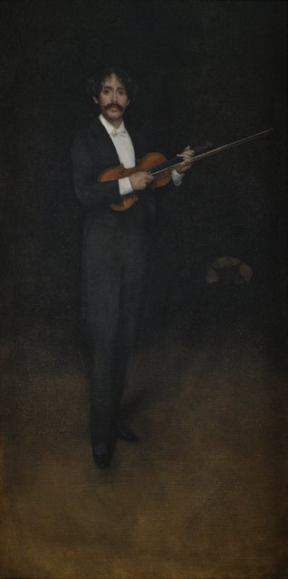
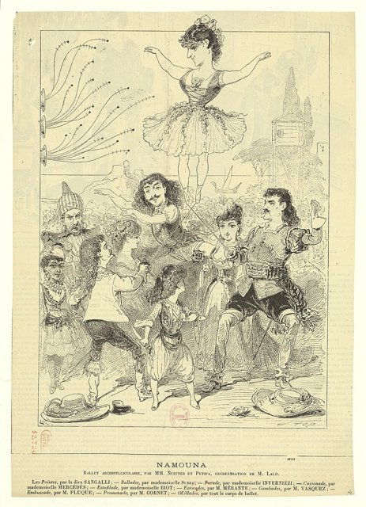
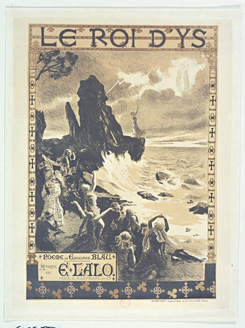

<!--
內容整理自本機筆記〈拉羅主要作品〉（D:\Books\md\音樂\拉羅主要作品.md；知識圖譜的「5-2.音樂家作品」尚無這份筆記的網頁版），做法比照「貝多芬主要作品」。
- 每首作品一則事件，日期採「創作時間」（多年創作的作品以區間呈現；「年代」以十年計、「世紀」以百年計，修訂或出版年份只寫在顯示文字裡），事件顏色依筆記的類別段落區分：協奏曲與管弦樂作品、歌劇與芭蕾舞劇、室內樂作品、小提琴與鋼琴作品、藝術歌曲、合唱與其他聲樂作品、鋼琴作品及其他作品。
- 「約」、「前後」、修訂、出版等不是單純年份的寫法，以原文作為顯示文字。
- 作品編號是目錄編號，不等於創作順序，時間軸依創作時間排序；筆記中只是表格序號的「編號」欄不列為作品編號。
- 筆記的推薦清單、依年代整理的總覽與編號說明，和前面的作品表重複，未另立事件。
- 時期沿用「拉羅生平」時間軸的主要時期（重疊的細分時期不列）。
- 筆記推薦清單中的作品另註明順序。
- 以 follows 排在「拉羅生平」之後；生平事件見該時間軸。
圖片來源（皆為 Wikimedia Commons 公有領域／CC0 作品，沿用生平時間軸的圖片）：
- lalo-cover.jpg：Édouard Lalo.jpg（拉羅像）（與拉羅生平共用）
- lalo-sarasate.jpg：Whistler - Arrangement in Black Portrait of Señor Pablo de Sarasate, 1884, 96.2.jpg（惠斯勒〈黑色的編排：薩拉沙泰像〉，1884）（與拉羅生平共用）
- lalo-namouna.jpg：Namouna, ballet archipelliculaire, par MM. Nuitter et Petipa, orchestration de M. Lalo - les pointes par la diva Sangalli, ballades par mademoiselle Subra, parade par mademoiselle Invernizzi... - estampe - Lefman... - btv1b53116941c.jpg（《戲劇畫報》上的芭蕾舞劇《納穆娜》，1882）（與拉羅生平共用）
- lalo-roidys.jpg：Le Roi d'Ys. Poème de Edouard Blau. Musique de E. Lalo Paris, G. Hartmann et Cie affiche, Aug. F. Gorguet.jpg（戈爾蓋所繪歌劇《伊斯王》海報（裁去色票））（與拉羅生平共用）
-->

# Periods
- 1823 ~ 1838 | 里爾的童年@里爾 | #868e96
  生於法國北部里爾，祖先來自西班牙；在里爾音樂學院學小提琴與大提琴，十五歲就在小提琴比賽中得到一等獎。
- 1839 ~ 1864 | 巴黎的弦樂演奏者@巴黎 | #1971c2
  不顧父親希望他從軍的意願，隻身前往巴黎；以演奏與教學維生，參與創立阿爾曼戈四重奏，在歌劇當道的法國推廣德奧室內樂，作曲卻長期不順，一度幾乎停筆。
- 1865 ~ 1873 | 重返創作 | #2f9e44
  娶了女中音朱莉·貝斯尼耶·德·馬利尼，重新投入歌曲與歌劇創作；歌劇《費斯科》得獎卻無法上演，普法戰爭後他參與法國民族音樂協會，轉向管弦樂。
- 1874 ~ 1887 | 《西班牙交響曲》與國際聲譽 | #e8590c
  為薩拉沙泰寫的《西班牙交響曲》讓他在五十歲出頭才揚名國際，接著寫出大提琴協奏曲、《挪威幻想曲》、芭蕾舞劇《納穆娜》與G小調交響曲。
- 1888 ~ 1892 | 《伊斯王》與晚年 | #862e9c
  多年未能上演的歌劇《伊斯王》終於在喜歌劇院首演成功；晚年健康衰退，仍構思新作，1892年在巴黎去世。

# Events

## 1873 ~ 1874 | Op. 20 F大調小提琴協奏曲（Violin Concerto in F major） {color=#c92a2a}
類別：小提琴協奏曲（協奏曲與管弦樂作品）。

## 1874 | Op. 21 D小調《西班牙交響曲》（Symphonie espagnole） {color=#c92a2a}

類別：小提琴與管弦樂（協奏曲與管弦樂作品）。入門推薦聆聽第 1 首。

## 1876 ~ 1877 | D小調大提琴協奏曲（Cello Concerto in D minor） {color=#c92a2a}
類別：大提琴協奏曲（協奏曲與管弦樂作品）。

## 1875 | Op. 27 熱情快板（Allegro appassionato） {color=#c92a2a label="約1875"}
類別：大提琴與管弦樂；改編自 Op. 16（協奏曲與管弦樂作品）。

## 1878 | 挪威幻想曲（Fantaisie norvégienne） {color=#c92a2a}
類別：小提琴與管弦樂（協奏曲與管弦樂作品）。

## 1878 ~ 1879 | 挪威狂想曲（Rapsodie norvégienne） {color=#c92a2a label="約1878–1879"}
類別：管弦樂（協奏曲與管弦樂作品）。

## 1879 | Op. 29 俄羅斯協奏曲（Concerto russe） {color=#c92a2a}
類別：小提琴協奏曲（協奏曲與管弦樂作品）。

## 1885 ~ 1886 | G小調交響曲（Symphonie en sol mineur） {color=#c92a2a}
類別：交響曲（協奏曲與管弦樂作品）。

## 1884 | D小調諧謔曲（Scherzo in D minor） {color=#c92a2a}
類別：管弦樂（協奏曲與管弦樂作品）。

## 1888 ~ 1889 | 鋼琴協奏曲（Piano Concerto in F minor） {color=#c92a2a label="約1888–1889"}
類別：鋼琴協奏曲（協奏曲與管弦樂作品）。

## 1866 ~ 1868 | 《菲耶斯克》（Fiesque） {color=#1971c2}
類別：三幕大歌劇；生前未正式上演（歌劇與芭蕾舞劇）。

## 1881 ~ 1882 | 《納穆娜》（Namouna） {color=#1971c2}

類別：芭蕾舞劇（歌劇與芭蕾舞劇）。入門推薦聆聽第 4 首。

## 1875 ~ 1888 | 《伊斯王》（Le Roi d’Ys） {color=#1971c2}

類別：三幕歌劇（歌劇與芭蕾舞劇）。入門推薦聆聽第 3 首。

## 1891 ~ 1892 | 《雅克雷之亂》（La Jacquerie） {color=#1971c2}
類別：四幕歌劇；未完成，由 Arthur Coquard 接續完成（歌劇與芭蕾舞劇）。

## 1891 | 《尼祿》（Néron） {color=#1971c2 label="約1891"}
類別：啞劇／舞台音樂，取材自早期作品（歌劇與芭蕾舞劇）。

## 1849 ~ 1851 | Op. 7 C小調第一號鋼琴三重奏（Piano Trio No. 1 in C minor） {color=#e67700 label="約1849–1851"}
類別：鋼琴、小提琴、大提琴（室內樂作品）。

## 1850 ~ 1859 | B小調第二號鋼琴三重奏（Piano Trio No. 2 in B minor） {color=#e67700 label="約1850年代初"}
類別：鋼琴三重奏（室內樂作品）。

## 1853 | Op. 12 D大調小提琴奏鳴曲（Violin Sonata in D major） {color=#e67700}
類別：小提琴與鋼琴（室內樂作品）。

## 1854 | Op. 14 兩首小品（2 Pièces） {color=#e67700}
類別：小提琴或大提琴與鋼琴（室內樂作品）。

## 1856 | Op. 16 大提琴與鋼琴熱情快板（Allegro） {color=#e67700 label="約1856"}
類別：大提琴與鋼琴（室內樂作品）。

## 1856 | A小調大提琴奏鳴曲（Cello Sonata in A minor） {color=#e67700 label="約1856"}
類別：大提琴與鋼琴（室內樂作品）。

## 1856 | Op. 18 《巴黎之夜》（Soirées parisiennes） {color=#e67700}
類別：小提琴與鋼琴；與 Charles Wehle 合作（室內樂作品）。

## 1859 | Op. 19 降E大調弦樂四重奏（String Quartet in E-flat major） {color=#e67700}
類別：弦樂四重奏（室內樂作品）。

## 1880 | Op. 26 A小調第三號鋼琴三重奏（Piano Trio No. 3 in A minor） {color=#e67700}
類別：鋼琴、小提琴、大提琴（室內樂作品）。

## 1884 | Op. 45 降E大調弦樂四重奏（修訂版） {color=#e67700}
類別：弦樂四重奏；由 Op. 19 修訂（室內樂作品）。

## 1848 | Op. 1（早期目錄亦有不同編號標示） A大調原創幻想曲（Fantaisie originale） {color=#2f9e44 label="約1848"}
類別：小提琴與鋼琴（小提琴與鋼琴作品）。

## 1848 | Op. 2 C小調莊嚴快板（Allegro maestoso） {color=#2f9e44 label="約1848"}
類別：小提琴與鋼琴（小提琴與鋼琴作品）。

## 1848 | Op. 4 兩首即興曲（Impromptus） {color=#2f9e44 label="約1848"}
類別：小提琴與鋼琴（小提琴與鋼琴作品）。

## 1850 ~ 1851 | Op. 8 兩首即興曲：田園曲、詼諧曲（Pastorale; Scherzo alla Pulcinella） {color=#2f9e44 label="約1850–1851"}
類別：小提琴與鋼琴（小提琴與鋼琴作品）。

## 1882 | 《吉他》（Guitare） {color=#2f9e44 label="約1882"}
類別：小提琴與鋼琴（小提琴與鋼琴作品）。

## 1848 | 《丑角》（Arlequin） {color=#2f9e44 label="約1848"}
類別：小提琴與鋼琴；亦有其他編制版本（小提琴與鋼琴作品）。

## 1848 ~ 1849 | Op. 5 《新手》（Le novice） {color=#862e9c label="約1848–1849"}
類別：男中音與鋼琴（藝術歌曲、合唱與其他聲樂作品）。

## 1856 | Op. 17 六首歌曲（Mélodies, 6） {color=#862e9c label="約1856以前"}
類別：聲樂與鋼琴（藝術歌曲、合唱與其他聲樂作品）。

## 1848 ~ 1849 | 《沙漠告別》（Adieux au désert） {color=#862e9c label="約1848–1849"}
類別：藝術歌曲（藝術歌曲、合唱與其他聲樂作品）。

## 1860 | 《月下敘事曲》（Ballade à la lune） {color=#862e9c label="約1860"}
類別：藝術歌曲（藝術歌曲、合唱與其他聲樂作品）。

## 1872 | 《晨歌》（Aubade） {color=#862e9c label="約1872"}
類別：聲樂與鋼琴（藝術歌曲、合唱與其他聲樂作品）。

## 1884 | Op. 31 《布列塔尼之歌》（Chant breton） {color=#862e9c}
類別：聲樂、鋼琴與長笛或雙簧管（藝術歌曲、合唱與其他聲樂作品）。

## 1884 | Op. 33 《海》（Marine） {color=#862e9c}
類別：聲樂與鋼琴（藝術歌曲、合唱與其他聲樂作品）。

## 1884 | Op. 34 《救主啊，求你垂憐》（O salutaris） {color=#862e9c}
類別：女聲合唱與管風琴（藝術歌曲、合唱與其他聲樂作品）。

## 1884 | Op. 35 《讓我們跳舞》（Dansons） {color=#862e9c}
類別：女高音、次女高音與鋼琴；改編自《納穆娜》（藝術歌曲、合唱與其他聲樂作品）。

## 1873 | Op. 32 《母親與孩子》（La mère et l’enfant）：〈浪漫曲〉、〈小夜曲〉 {color=#0c8599}
類別：四手聯彈鋼琴（鋼琴作品及其他作品）。

## 1850 ~ 1892 | 《巴黎之夜》中的選曲及舞台音樂改編 {color=#0c8599 label="19世紀後半"}
類別：改編作品（鋼琴作品及其他作品）。

## 1882 | 《納穆娜》組曲相關選曲 {color=#0c8599 label="1882之後"}
類別：芭蕾音樂／管弦樂改編（鋼琴作品及其他作品）。

## 1872 | 《菲耶斯克》中的《兩首晨歌》（Aubades） {color=#0c8599 label="約1872"}
類別：十件樂器合奏；改編自歌劇（鋼琴作品及其他作品）。
