<!--
內容整理自本機筆記《法律與制度史》（D:\Books\md\歷史\世界史\法律與制度史，網頁版在知識圖譜的「1-6-4.法律與制度史」）。
- 65個年份檔各成一則事件，說明採用該檔的「案件摘要」，數學式轉成文字；結尾以「→ 對外連結」連到知識圖譜上的完整案件卷宗（在新分頁開啟）。
- 1601伊莉莎白濟貧法、1834濟貧法兩檔沒有「案件摘要」小節，改採開頭的「案發現場」段落；1096十字軍與救贖經濟學的摘要只剩零散的驚嘆號提示，內文依該檔主題與 README 簡述改寫。
- 1807有兩個檔案（廢除奴隸貿易法案、英國廢奴與奴隸貿易法）談同一件事，合併成一則事件，兩個連結都保留。
- 時期依 README「案件卷宗」的分段，以下一段第一個事件的年代為界首尾相接。README 另有一段「制度因素補篇」（1842所得稅、1890反托拉斯、1913聯準會、1934證交法、1973 FASB），這裡依年代分別落入對應的時期；1096、1150、1601、1648、1833、1834、1949等檔案不在 README 的表格內，也依年代歸入。
- 前3000、前1754、750、1140等年份是約略年代，以「約…年」顯示；1150的普通法成形於亨利二世在位期間（1154–1189），以區間表示。
- 1494複式簿記、1602荷蘭東印度公司、1694英格蘭銀行、1720之後的金融監管、1868明治維新、1917俄國革命、1995 WTO等案件，也出現在金融經濟史、商業貿易史、世界發展史等時間軸，各自保留。
圖片來源（皆為 Wikimedia Commons 公有領域／CC0 作品；註明「共用」者沿用其他時間軸已有的圖片）：
- ss-uruk.jpg（記錄大麥與二粒小麥分配的楔形文字帳目泥板（與其他時間軸共用））
- fe-hammurabi.jpg（羅浮宮的漢摩拉比法典石碑（與其他時間軸共用））
- lh-solon.jpg：Solon writing laws for Athens.jpg（〈梭倫為雅典立法〉，19世紀版畫）
- lh-twelve.jpg：Loix des Douze Tables.jpg（〈十二銅表法〉，18世紀版畫，描繪銅表公開張貼）
- wd-qin.jpg（秦始皇像（19世紀）（與其他時間軸共用））
- wb-augustus.jpg（第一門的奧古斯都像（與其他時間軸共用））
- lh-caracalla.jpg：(Venice) Portrait of Caracalla - Venice National Archaeological Museum.jpg（卡拉卡拉像，威尼斯國家考古博物館藏）
- eu-justinian.jpg（拉溫納聖維塔教堂的查士丁尼一世鑲嵌畫（與其他時間軸共用））
- cs-baghdad.jpg（曼蘇爾時代巴格達「圓城」的平面圖（與其他時間軸共用））
- wangan-shenzong.jpg（宋神宗像，國立故宮博物院藏（與其他時間軸共用））
- cru-clermont.jpg（《海外征程》15世紀抄本插圖：克萊蒙會議（與其他時間軸共用））
- lh-gratian.jpg：Bifolium with the Decretals of Gratian MET LC 1990 217s21.jpg（格拉提安《教會法彙纂》抄本殘頁，頁邊畫著親等樹狀圖）
- lh-becket.jpg：King Henry II England and Thomas Becket.jpg（亨利二世與坎特伯里大主教貝克特，中世紀抄本插圖）
- eu-magna.jpg（1215年《大憲章》（大英圖書館藏）（與歐洲史時間軸共用））
- lh-tyler.jpg：Peasants' Revolt (death of Wat Tyler).jpg（1381年農民起義：瓦特·泰勒之死，傅華薩《編年史》抄本插圖）
- fe-pacioli.jpg（傳巴爾巴里所繪〈帕西奧利與一位年輕人〉，1495（與其他時間軸共用））
- lh-machiavelli.jpg：Portrait of Niccolò Machiavelli by Santi di Tito.jpg（提托〈馬基維利像〉）
- fe-beurs.jpg（約伯·貝克海德〈阿姆斯特丹交易所的證券經紀人〉，17世紀（與其他時間軸共用））
- lh-grotius.jpg：Michiel Jansz van Mierevelt - Hugo Grotius.jpg（米勒費爾特〈格勞秀斯像〉）
- eu-munster.jpg（特博赫〈明斯特和約的宣誓〉，1648（與其他時間軸共用））
- bc-billofrights.jpg（1689年《權利法案》原件（與其他時間軸共用））
- fe-boe.jpg（1694年英格蘭銀行特許狀用印（19世紀插圖）（與其他時間軸共用））
- lh-sophia.jpg：Sophia Electress of Hanover.jpg（漢諾威選侯夫人蘇菲亞，《嗣位法》指定的繼承人）
- lh-montesquieu.jpg：Montesquieu - Versailles MV 2976.png（孟德斯鳩像，1728）
- lh-blackstone.jpg：Sir William Blackstone from NPG.jpg（布萊克斯通像，國家肖像館藏）
- ami-constitution.jpg（克里斯蒂〈美國憲法簽署現場〉，1940（與其他時間軸共用））
- fr-rights.jpg（勒巴比耶〈人權與公民權宣言〉，1789（與其他時間軸共用））
- wd-codecivil.jpg（《法國民法典》1804年版書名頁（與其他時間軸共用））
- aod-brookes.jpg（布魯克斯號奴隸船的裝載圖，1787（與其他時間軸共用））
- eu-vienna.jpg（維也納會議，19世紀彩色版畫（與其他時間軸共用））
- bc-reform.jpg（海特〈1833年的下議院〉局部，改革法案後的第一屆下議院（與其他時間軸共用））
- lh-andover.jpg：The Andover Bastille.png（〈安多佛的巴士底〉：1840年代安多佛濟貧院醜聞的諷刺畫）
- fe-peel.jpg（重開所得稅的首相皮爾（與其他時間軸共用））
- meiji-charter-oath.jpg（五條御誓文，明治神宮聖德記念繪畫館後世所繪（與明治維新大事記共用））
- lh-berne.jpg：Joseph Ferdinand Keppler - The Pirate Publisher - Puck Magazine - Restoration by Adam Cuerden.jpg（開普勒〈海盜出版商〉，《帕克》雜誌，1886，諷刺國際盜版）
- lh-octopus.jpg：Standard oil octopus loc color.jpg（〈標準石油章魚〉政治漫畫，1904，章魚觸手伸向各產業與政府）
- lh-hague.jpg：The First International Peace Conference, the Hague, May - June 1899 HU67224.jpg（1899年第一次海牙和平會議的會場）
- lh-bgb.jpg：Bgb 1896.jpg（《德國民法典》早期版本的封面）
- fe-fed.jpg（1913年12月24日報紙報導威爾遜總統簽署聯邦準備法（與其他時間軸共用））
- wd-lenin.jpg（1920年列寧在莫斯科演說（與其他時間軸共用））
- lh-weimar.jpg：Weimarer Verfassung.JPG（魏瑪憲法的國家機構示意圖）
- lh-league.jpg：Volkerenbond,Volkenbond organisatie voor Internationale Samenwerking opgericht op 25 januari 1919, SFA022825169.jpg（國際聯盟早期在日內瓦的總部（威爾遜宮））
- fe-fdr.jpg（1933年3月12日羅斯福總統第一次爐邊談話（與其他時間軸共用））
- lh-nuremberg.jpg：Defendants in the dock at the Nuremberg Trials.jpg（紐倫堡審判中坐在被告席的納粹戰犯）
- lh-udhr.jpg：Eleanor Roosevelt and United Nations Universal Declaration of Human Rights in Spanish 09-2456M original.jpg（羅斯福夫人手持西班牙文版《世界人權宣言》）
- lh-brown.jpg：Brown vs Board of Education - rubrum.jpg（布朗訴教育局案判決書首頁，1954年5月17日）
- lh-rome.jpg：Римський договір.jpg（1957年簽署《羅馬條約》的會場）
- fe-enron.jpg（安隆2000年版的《道德規範》手冊（與其他時間軸共用））
- lh-gdpr.jpg：Gdpr Europe.jpg（歐盟旗幟與 GDPR 標誌示意圖）
-->

# Periods
- -3000 ~ -221 | 前奏：法典與神廟經濟 | #b08900
  文字起源於記帳，泥板會計把國家的統治能力和記帳能力綁在一起；漢摩拉比把刑罰與物價寫成公開的石柱，梭倫以廢除債奴與財產分級重組政治權利，十二銅表法則讓羅馬的法律第一次被寫下來、公開張貼。
- -221 ~ 1069 | 古典帝國與官僚制 | #e67700
  秦以郡縣、戶籍與上計建立官僚帝國，奧古斯都用直接稅與帝國財庫換掉稅包商；卡拉卡拉擴大公民權也擴大稅基，查士丁尼把千年羅馬法整理成可檢索的法典，唐律與伊斯蘭法則各自發展出另外兩套古典法系。
- 1069 ~ 1689 | 中世紀到文藝復興：憲政萌芽與會計革命 | #1971c2
  王安石試行國家金融化，教會法與羅馬法在大學復活，英格蘭以巡迴法官與陪審鑄出普通法；大憲章把「王在法下」寫成可信的承諾，黑死病後的工資管制卻輸給供需。複式簿記、特許公司、國際法與威斯特伐利亞體系，則為近代國家與市場準備了工具。
- 1689 ~ 1900 | 憲政革命與法典化 | #c92a2a
  光榮革命讓議會主權與公債信用綁在一起，孟德斯鳩的三權分立、美國憲法與人權宣言把權力制衡寫成制度；拿破崙法典、德國民法典與明治維新輸出了大陸法的模板，公司登記、所得稅、工廠視察與反托拉斯則把國家的觸角伸進經濟。
- 1900 ~ 1991 | 危機、行政國家與人權法 | #862e9c
  計畫經濟、魏瑪憲法的崩潰與大蕭條，逼出行政國家與金融監管；二戰之後，紐倫堡審判、世界人權宣言與一連串國際公約把個人權利推向超國家層次，歐洲共同市場則走出第一個超國家法律秩序。
- 1991 ~ 2018 | 全球化與資訊時代的制度補丁 | #0c8599
  蘇聯解體使轉型國家面臨制度真空，WTO 把貿易爭端司法化；版權、會計與金融監管在平台、造假與金融海嘯之後一再補丁，GDPR 則把資料保護升格為基本權利。

# Events

## -3000 | 泥板會計與神廟制度 {label="約前3000年"}
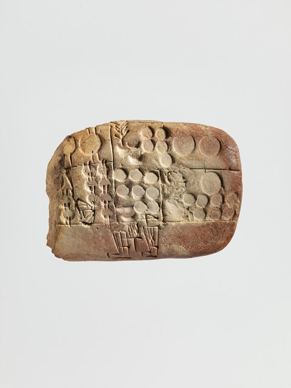
約前 3300–3000 年，美索不達米亞的烏魯克出現人類最早的文字，但第一批泥板不是詩歌或國王事蹟，而是記帳單：多少大麥、多少啤酒、多少勞工，歸誰所有。
施密特–貝瑟拉特（Denise Schmandt-Besserat）的陶籌理論指出，楔形文字由會計演化而來：計數用的黏土籌碼，先裝進泥封球，再把籌碼的形狀壓印在泥板上。
一千年後的烏爾第三王朝把這套做法升級為國家核算體系：神廟經濟、賦役登記、書吏學校、年度彙算。
文字是會計的副產品，國家的統治能力始於國家的記帳能力。

[→ 對外連結：前3000 - 泥板會計與神廟制度](https://chad-liu.github.io/books/html/1-6-4.法律與制度史/-3000-泥板會計與神廟制度.html)

## -1754 | 漢摩拉比法典 {label="約前1754年"}
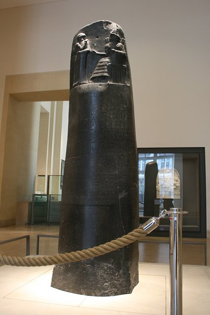
巴比倫王漢摩拉比把 282 條法規刻在 2.25 公尺高的玄武岩石柱上，頂端浮雕是太陽神沙瑪什授法給國王，石柱公開立在神廟，任何人都看得到、聽得到。
成文法典等於把威嚇數學化：懲罰被寫死、被公開，人們可以事先估算「被抓的機率乘以罰額，是否大於犯罪的收益」。
法典同時規定利率上限（白銀 20%、穀物約 33%）與物價，是人類第一次用法律直接調控市場參數。
法律是一種資訊技術，統治的效率取決於被統治者能否事先知道規則。

[→ 對外連結：前1754 - 漢摩拉比法典](https://chad-liu.github.io/books/html/1-6-4.法律與制度史/-1754-漢摩拉比法典.html)

## -594 | 梭倫改革 {label="前594年"}
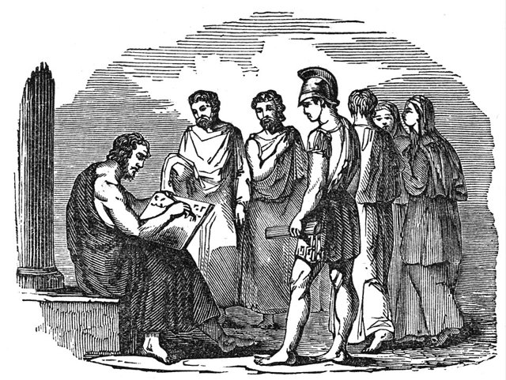
雅典瀕臨內戰，債務危機把平民逼成債奴。梭倫被任命為執政官並獲得特別授權，做了兩件前所未有的事：
**卸下重負（seisachtheia）**：廢除債務奴役，禁止以人身作為借貸擔保，並贖回被賣到海外的雅典公民；
**按財產分級**：把公民依財產而非血緣分成四級，重新分配政治權利。
他自稱是「站在貴族與平民之間，用強力擋住任何一方的不義」，混合憲政的理念由此成形，兩千年後成為孟德斯鳩分權制衡的先聲。

[→ 對外連結：前594 - 梭倫改革](https://chad-liu.github.io/books/html/1-6-4.法律與制度史/-594-梭倫改革.html)

## -450 | 十二銅表法 {label="前451–450年"}
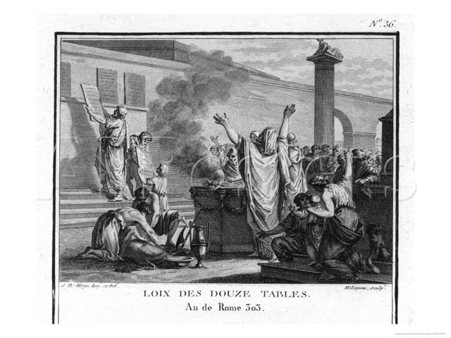
羅馬設立十人委員會，把習慣法編成十二塊銅表，公開立在廣場的演講台旁。這是羅馬的第一部成文法，也是平民用近六十年的抗爭換來的成果。
法律公開就有可預期性，這是法治（rule of law）的原型；傳說執政官也宣布銅表法對全體人民有效，包括立法者本身。
羅馬法另一項特色是程式訴訟：把訴訟拆成「法律問題」（交給裁判官）與「事實問題」（交給審判員），司法分工自此成形。

[→ 對外連結：前450 - 十二銅表法](https://chad-liu.github.io/books/html/1-6-4.法律與制度史/-450-十二銅表法.html)

## -221 | 秦制與官僚帝國 {label="前221年"}
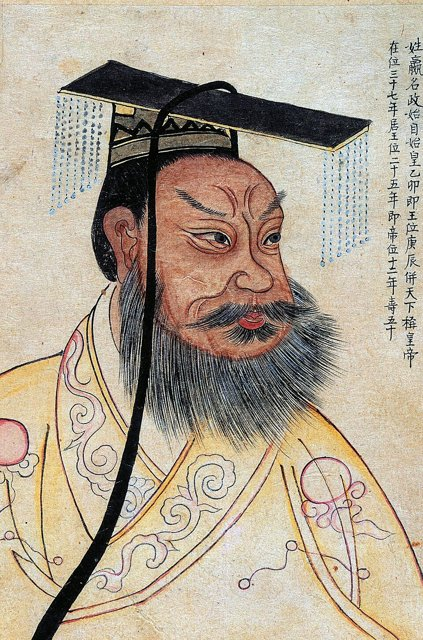
秦王政統一六國。這則案件看的是法律、會計與考核制度：商鞅變法建立的**上計**，要求郡縣每年把戶口、墾田、錢穀出入編成計簿，上報中央，由丞相年度稽核，是國家會計與政績考核的第一次全國化。
1975 年出土的睡虎地秦簡顯示秦律相當精密：《效律》專門核驗帳目與庫存，等於一部審計法；另有什伍連坐、官吏連坐，以及簡牘、封泥、郵驛組成的文書行政。
文書、上計、連坐，是秦處理委託–代理問題的三件套；帝國的統治能力，就是記帳與考核的能力。

[→ 對外連結：前221 - 秦制與官僚帝國](https://chad-liu.github.io/books/html/1-6-4.法律與制度史/-221-秦制與官僚帝國.html)

## -27 | 奧古斯都元首制 {label="前27年"}
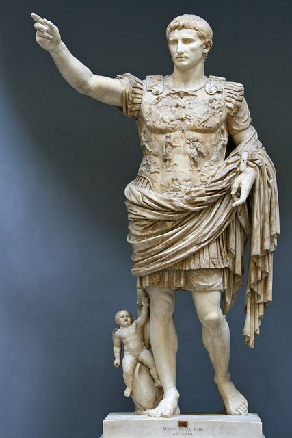
元老院授予屋大維「奧古斯都」的稱號，羅馬共和國名義上被「恢復」，實際上他以元首（princeps，第一公民）的身分，把執政官權力、行省統帥權與護民官權集於一身，是披著共和外衣的君主制。
這則案件關注的是制度技術：奧古斯都終結了稅包制，改由官員直接徵稅，並以人口普查掌握稅基；同時把帝國財庫（fiscus）與公共金庫（aerarium）分開。
帝國由三樣東西撐起：共和外衣提供正當性，直接稅官僚提供汲取能力，羅馬和平提供紅利。

[→ 對外連結：前27 - 奧古斯都元首制](https://chad-liu.github.io/books/html/1-6-4.法律與制度史/-027-奧古斯都元首制.html)

## 212 | 卡拉卡拉敕令

羅馬皇帝卡拉卡拉頒布《安東尼努斯敕令》，帝國境內所有自由居民一次獲得羅馬公民權。權利從此來自普遍的法律，而不是出身與血統，可說是梅因「從身分到契約」命題的預演。
慷慨背後是財政考量：公民才需要繳遺產稅與釋奴稅（各 5%），擴大公民權就是擴大稅基。
代價也同樣真實：三世紀銀幣不斷減重、通貨膨脹，「人人皆公民」和「錢越來越薄」是同一枚硬幣的兩面。

[→ 對外連結：212 - 卡拉卡拉敕令](https://chad-liu.github.io/books/html/1-6-4.法律與制度史/0212-卡拉卡拉敕令.html)

## 529 | 查士丁尼法典

東羅馬皇帝查士丁尼一世授權特里波尼安組成委員會，頒布《查士丁尼法典》；533 年完成《學說彙纂》（50 卷，摘錄 39 位法學家約兩百萬行）與教科書《法學階梯》，534 年修訂法典，死後再彙編《新律》。四者合稱《國民法大全》。
這是法律史上規模最大的系統化與存檔：三百年來混亂的敕令與法學意見，被去除重複與矛盾，變得可以檢索。
西羅馬已亡，這批檔案成為羅馬法唯一的原始碼倉庫；十二世紀被博洛尼亞重新發現，後來發展出整個大陸法系。

[→ 對外連結：529 - 查士丁尼法典](https://chad-liu.github.io/books/html/1-6-4.法律與制度史/0529-查士丁尼法典.html)

## 653 | 唐律疏議與律令制
唐高宗頒布《唐律疏議》：律文 502 條、12 篇，附有與律文同等效力的官方注釋「疏」，是現存最早、最完整的東亞法典。
它是律（刑罰）、令（制度）、格（補充）、式（細則）四位一體的法律體系的頂點，像是律令國家的作業系統。
對內，法律儒家化，德主刑輔、一準乎禮；對外，影響大化改新（645）與日本《大寶律令》（701），形成涵蓋日本、新羅、渤海、越南的東亞律令圈。中華法系與羅馬法系、普通法並列為世界三大法系。

[→ 對外連結：653 - 唐律疏議與律令制](https://chad-liu.github.io/books/html/1-6-4.法律與制度史/0653-唐律疏議與律令制.html)

## 750 | 伊斯蘭法與沙里亞體系 {label="約750年"}
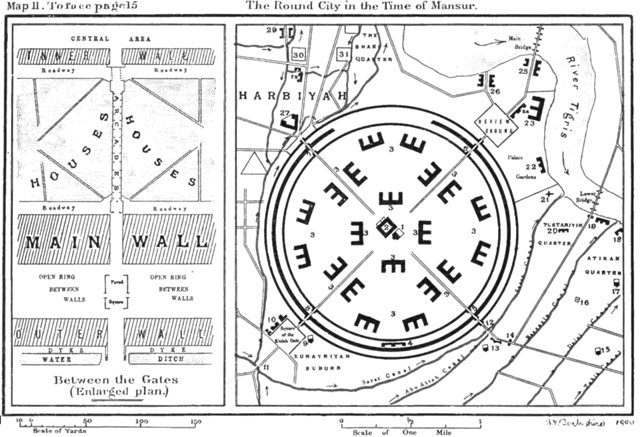
阿拔斯王朝建都巴格達，伊斯蘭法（沙里亞）經四大法學派體系化。在沒有教會、沒有議會的社會裡，由烏里瑪（學者）用法學意見治理日常生活。
《古蘭經》的法律經文只有約 500 節，卻長成涵蓋婚姻、商事與刑罰的完整法系，靠的是類比（qiyas）、公議（ijma）與瓦克夫（宗教基金）三件套。
它補上了唐律到王安石之間約四百年的空白：中華法系之外，另一套活著的古典法系。

[→ 對外連結：750 - 伊斯蘭法與沙里亞體系](https://chad-liu.github.io/books/html/1-6-4.法律與制度史/0750-伊斯蘭法與沙里亞體系.html)

## 1069 | 王安石變法
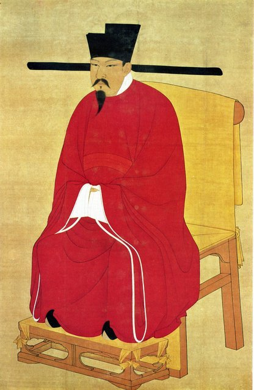
宋神宗任命王安石為參知政事，設制置三司條例司，推行史上最早的大規模國家市場干預實驗：青苗法（國家農貸）、免役法（以錢代役）、市易法（國家平抑物價）、保甲法（民兵）、方田均稅法（土地丈量）。
目標是「民不加賦而國用饒」，做法是金融化：用國家的信用與規模，把收稅改造成放貸、經營與中介。
結果歲入確實大增，但地方執行扭曲、資訊不對稱與政治反撲接連而來：1076 年王安石罷相，1085 年神宗去世後新法盡廢。

[→ 對外連結：1069 - 王安石變法](https://chad-liu.github.io/books/html/1-6-4.法律與制度史/1069-王安石變法.html)

## 1096 ~ 1291 | 十字軍與救贖經濟學
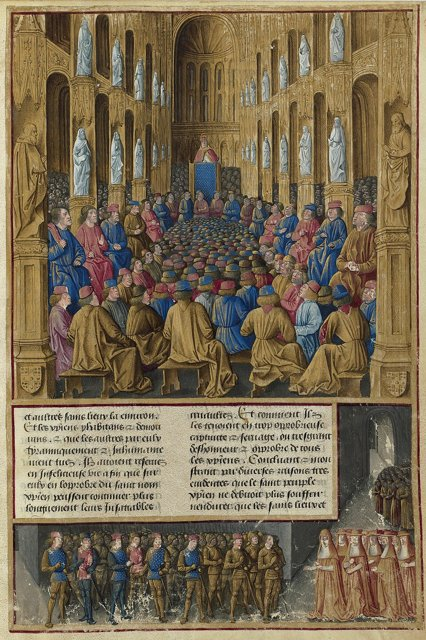
1095 年克萊蒙會議上，教宗烏爾班二世號召東征，此後約兩百年共有九次較大的遠征，1099 年攻陷耶路撒冷，1291 年阿卡陷落為止。
這則案件把十字軍看成「信仰的經濟學」：赦罪與救贖是動員的貨幣，教會用它換取騎士、資金與運輸；聖殿、醫院、條頓等騎士團則成為最早的跨國軍事與金融組織之一。
失敗之後留下的遺產，包括教會徵稅的先例、騎士團的銀行業務，以及義大利商人在地中海東岸建立的商業網路。

[→ 對外連結：1096 - 十字軍與救贖經濟學](https://chad-liu.github.io/books/html/1-6-4.法律與制度史/1096-十字軍與救贖經濟學.html)

## 1140 | 教會法與大學興起 {label="約1140年"}
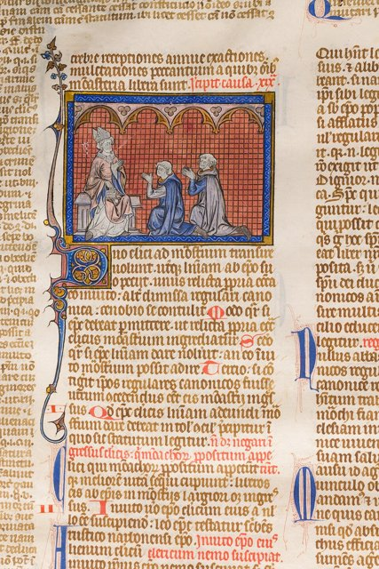
波倫亞修士格拉提安編成《教會法彙纂》（Decretum），把一千年的教父言論與會議決議縫成一套可引用的體系；同一時期，波倫亞大學正在講授查士丁尼的《國民法大全》。
教會法與羅馬法在同一間教室復活：教會法院用它審理婚姻、遺囑與異端，世俗君主則請法學畢業生來當法官。
這是王安石到大憲章之間缺失的一環：沒有這間教室，就沒有普通法與大陸法共同的語法。

[→ 對外連結：1140 - 教會法與大學興起](https://chad-liu.github.io/books/html/1-6-4.法律與制度史/1140-教會法與大學興起.html)

## 1154 ~ 1189 | 普通法與陪審制

亨利二世登基時，英格蘭的法律是一張碎片化的地圖：各郡習慣、莊園法庭與教會法庭各自為政。到他去世時，王國已被新的司法技術縫合：巡迴法官帶著國王令狀走遍各郡，1159 年起以陪審團宣誓陳情取代神判，1166 年《克拉倫登巡迴審判令》建立重罪起訴的常規程序。
各地判決累積在中央檔案（plea rolls）中，被比對與援引，先例因此成為法律。
英格蘭不靠立法、不靠羅馬法，只用「法官、陪審、記錄」三件套，鑄出世界最大的非成文法系，陪審制也成為五百年後憲政的伏筆。

[→ 對外連結：1150 - 普通法與陪審制](https://chad-liu.github.io/books/html/1-6-4.法律與制度史/1150-普通法與陪審制.html)

## 1215-06-15 | 大憲章

英格蘭貴族、教士與市民在蘭尼米德草地強迫約翰王蓋印《大憲章》，共 63 條。最重要的是第 39 條：任何自由人，非經同儕的合法裁判或依國家法律，不得被逮捕、監禁、沒收財產、剝奪法律保護或流放。
這不是民主宣言，多數條款是封建特權的細目；它的意義在於，建立了對統治者的可信承諾機制，即「王在法下」。
諾斯與溫加斯特（North & Weingast, 1989）主張：限制王權會降低國家的借貸利率；從 1215 年到 1694 年英格蘭銀行成立，這條因果線走了四百七十九年。

[→ 對外連結：1215 - 大憲章](https://chad-liu.github.io/books/html/1-6-4.法律與制度史/1215-大憲章.html)

## 1351 | 勞工法令與工資管制
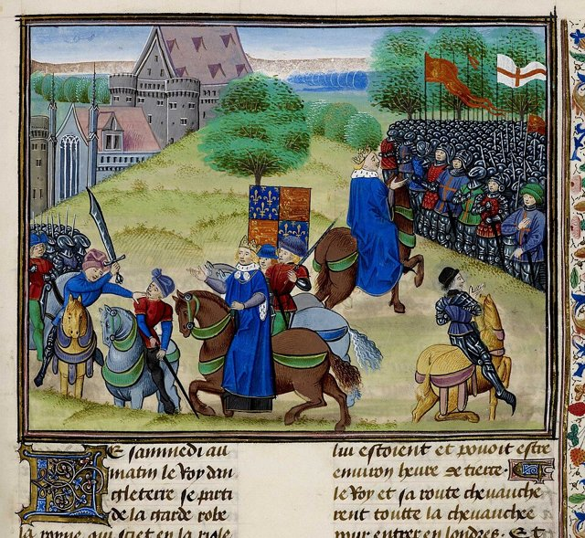
黑死病奪走英格蘭近半人口，工資翻倍，農民用腳投票。愛德華三世接連頒布 1349 年的《勞工法令》與 1351 年的《勞工法》，把工資凍結在疫情前水準、禁止農民流動，違者烙印或監禁。
這是國家第一次全面干預勞動力市場。人口驟減使工資上升，立法凍薪卻執行失敗，最後引爆 1381 年農民起義，農奴制也隨之瓦解。
法令全盤失敗，卻留下一個延續七百年的判例：法律擋不住供需，壓得越狠，反彈越猛。

[→ 對外連結：1351 - 勞工法令與工資管制](https://chad-liu.github.io/books/html/1-6-4.法律與制度史/1351-勞工法令與工資管制.html)

## 1494 | 複式簿記

方濟各會修士兼數學家帕西奧利（Luca Pacioli）在威尼斯出版《算術、幾何、比與比例概要》，系統介紹複式簿記：每筆交易記兩次（借方等於貸方），帳本能自我校驗，資產等於負債加權益。
這不是數學發明，威尼斯商人已經用了約兩百年；關鍵在標準化與出版，讓可驗證的帳本從商人的秘技變成資本主義與國家財政的基礎設施。
沒有複式簿記，就沒有大企業、沒有審計，也沒有能被信任的國家債務。

[→ 對外連結：1494 - 複式簿記](https://chad-liu.github.io/books/html/1-6-4.法律與制度史/1494-複式簿記.html)

## 1532 | 馬基維利《君主論》
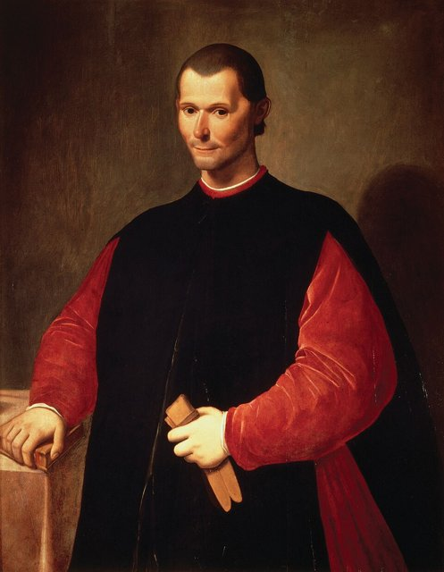
《君主論》在作者去世五年後出版。馬基維利 1513 年寫成，獻給梅迪奇家族，本來是一封求職信，卻意外成為現代政治學的出生證明。
核心主張是把政治從神學道德中切開，探討政治「是什麼」，而不是「應該是什麼」。判準不是救贖，而是有效性：君主的首要之務是維持國家。
一個統治者為了成功，必須學會「不善良」，這句話震撼西方五百年。

[→ 對外連結：1532 - 馬基維利《君主論》](https://chad-liu.github.io/books/html/1-6-4.法律與制度史/1532-馬基維利君主論.html)

## 1601 | 伊莉莎白濟貧法
英國《濟貧法》以教區為單位，向有產者徵收濟貧稅，救濟「值得幫助的窮人」（老弱病殘），「不值得的」壯丁與流浪者則遭鞭打並遣返原籍。
背景是修道院解散（1536–1540）後教會救濟崩潰、圈地使農民失地流浪，以及 1590 年代的饑荒。這套體系延續三百年，直到 1834 年的新濟貧法。
當教區為窮人買單，窮人也就被拴在教區了：救濟變成了戶籍。

[→ 對外連結：1601 - 伊莉莎白濟貧法](https://chad-liu.github.io/books/html/1-6-4.法律與制度史/1601-伊莉莎白濟貧法.html)

## 1602 | 荷蘭東印度公司與股份制
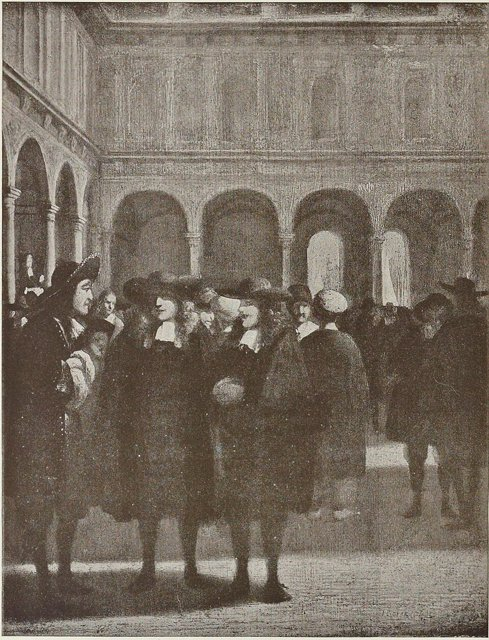
荷蘭聯省議會頒發特許狀（octrooi）給荷蘭東印度公司（VOC）。六個城市的商人集資 650 萬荷盾，換得亞洲香料貿易的排他權。
這是世界上第一個永久資本的股份有限公司：特許狀這份法律文件，賦予公司法人人格、有限責任與永久資本，創造出一個不會因創辦人死亡而消失的「不死之人」。
公司從此可以比任何人、任何王朝活得更久，現代公司制度由此誕生。

[→ 對外連結：1602 - 荷蘭東印度公司與股份制](https://chad-liu.github.io/books/html/1-6-4.法律與制度史/1602-荷蘭東印度公司與股份制.html)

## 1625 | 格勞秀斯與國際法
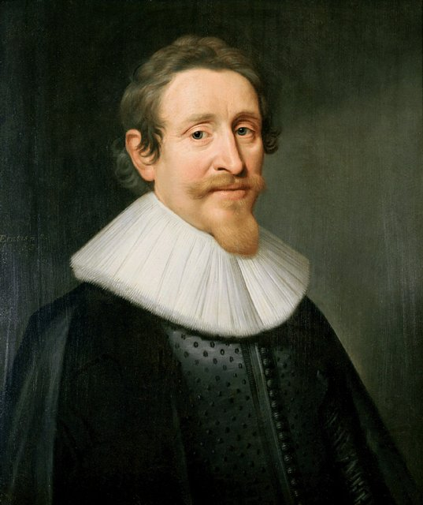
格勞秀斯的《戰爭與和平法》在巴黎出版，是國際法的奠基之作。
核心命題是：即使國家之上沒有世界政府、沒有共同的立法者，國家之間仍存在可以推導的法律義務，來源不是上帝或教宗，而是自然法。
戰爭本身也要受法律審查，他區分了正義開戰（jus ad bellum）與戰中法（jus in bello）。

[→ 對外連結：1625 - 格勞秀斯與國際法](https://chad-liu.github.io/books/html/1-6-4.法律與制度史/1625-格勞秀斯與國際法.html)

## 1648 | 威斯特伐利亞條約與主權國家體系

1618–1648 年的三十年戰爭以神聖羅馬帝國為主戰場，日耳曼地區的人口被削去四分之一以上；它同時是宗教戰（天主教對新教）、王朝戰（哈布斯堡對波旁）與帝國憲政危機。
1648 年的《威斯特伐利亞和約》（明斯特與奧斯納布呂克兩約）終結了這場戰爭，並寫下現代國際法的起源文件。
在沒有世界政府的條件下，如何讓主權國家共存？答案是三個發明：主權平等、宗教內政化、領土完整不可侵犯，全都是對戰爭恐怖的回應。

[→ 對外連結：1648 - 威斯特伐利亞條約與主權國家體系](https://chad-liu.github.io/books/html/1-6-4.法律與制度史/1648-威斯特伐利亞條約與主權國家體系.html)

## 1689 | 權利法案與議會主權

英國議會通過《權利法案》，同時接受威廉與瑪麗為共同君主，這是光榮革命的憲政結算：國王統治，但議會立法。
主權從國王個人轉移到「國王在議會中」（King-in-Parliament）。更深的影響在財政：議會主權是政府債務的可信承諾，英國公債利率因此下降約 5 個百分點，憲政改革同時也是金融改革。

[→ 對外連結：1689 - 權利法案與議會主權](https://chad-liu.github.io/books/html/1-6-4.法律與制度史/1689-權利法案與議會主權.html)

## 1694 | 英格蘭銀行
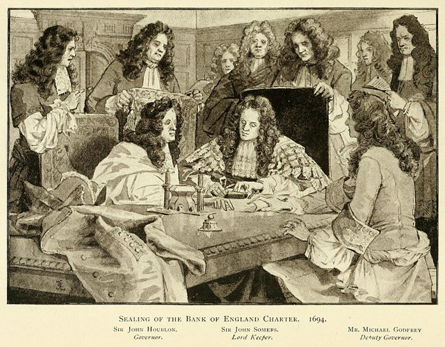
威廉·佩特森（William Paterson）提案，英國議會通過，英格蘭銀行成立。約 1,200 位股東集資 120 萬鎊，以年息 8% 借給政府，換得特許狀與存款、貼現、發行銀行券的權利。
這是銀行與國家的共生契約：英國從此能以約 3% 的利率打仗，法國卻要付 6% 以上。
制度就是融資成本，融資成本就是國家能力。

[→ 對外連結：1694 - 英格蘭銀行](https://chad-liu.github.io/books/html/1-6-4.法律與制度史/1694-英格蘭銀行.html)

## 1701 | 嗣位法與司法獨立
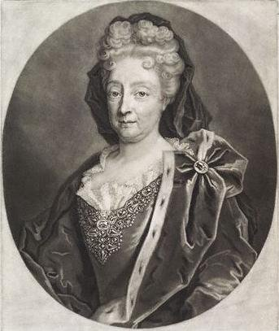
英國議會通過《嗣位法》（Act of Settlement），表面上規定王位由漢諾威選侯家系繼承，真正的關鍵在第 7 條：法官改為「行為良好即續任」，非經兩院同意不得免職，薪水也確定支付。
此前法官任期取決於國王的意願，判國王敗訴，隔天就可能丟職。1689 年的《權利法案》管住了立法與稅，1701 年這一條管住了裁判者本身。
法官不再怕國王，是後來司法審查的物理前提。

[→ 對外連結：1701 - 嗣位法與司法獨立](https://chad-liu.github.io/books/html/1-6-4.法律與制度史/1701-嗣位法與司法獨立.html)

## 1748 | 孟德斯鳩三權分立
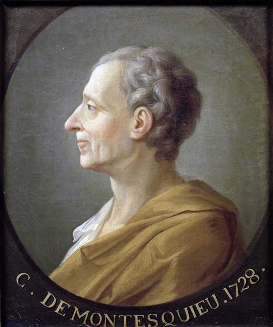
《論法的精神》在日內瓦匿名出版，系統化了三權分立學說。
核心命題：一切有權力的人都容易濫用權力，要防止濫用，就必須以權力約束權力。自由不是天賦的，而是制度設計出來的。

[→ 對外連結：1748 - 孟德斯鳩三權分立](https://chad-liu.github.io/books/html/1-6-4.法律與制度史/1748-孟德斯鳩三權分立.html)

## 1765 | 布萊克斯通釋義與普通法移植 {label="1765–1769年"}
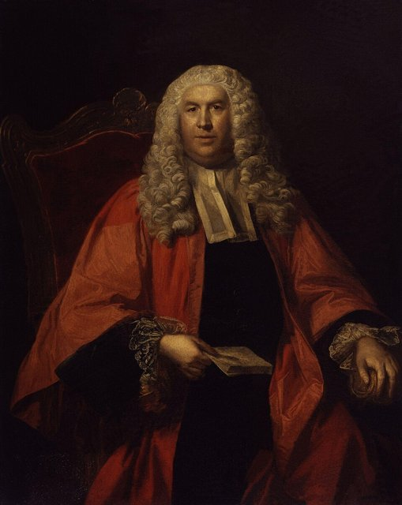
牛津教授布萊克斯通出版四卷《英格蘭法釋義》，把混亂的令狀與判例寫成人人讀得懂的體系書，美國開國者人手一部，傑佛遜稱它是「美國少年的人手之書」。
一本英國本土的法學教科書，如何變成普通法全球移植（美國、印度、香港）的作業系統？答案是清晰的敘事與正當性：「議會主權、人身保護、私有財產」被寫成英格蘭的古老憲法。
它補上了孟德斯鳩到美國憲法之間缺失的傳動軸。

[→ 對外連結：1765 - 布萊克斯通釋義與普通法移植](https://chad-liu.github.io/books/html/1-6-4.法律與制度史/1765-布萊克斯通釋義與普通法移植.html)

## 1787-05 | 美國憲法

55 位代表在費城獨立廳閉門開會，把《邦聯條例》換成一部成文憲法，是世界上第一部由人民批准、可以修正、高於所有法律的根本大法。
麥迪遜在《聯邦黨人文集》第 51 號寫道：「如果人都是天使，就不需要政府了。」憲法不假設人性本善，而是設計一套讓惡互相抵銷的機器，以野心制衡野心。
憲法不只是法律條文，而是「制定規則的規則」。

[→ 對外連結：1787 - 美國憲法](https://chad-liu.github.io/books/html/1-6-4.法律與制度史/1787-美國憲法.html)

## 1789-08-26 | 法國大革命與人權宣言
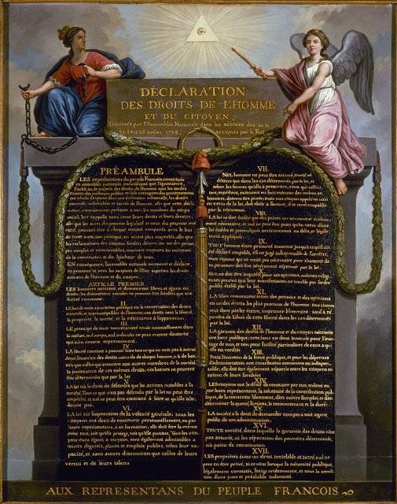
制憲國民議會通過 17 條的《人權與公民權宣言》。同年 7 月 14 日攻陷巴士底獄後，舊制度的合法性金字塔在幾週內崩塌。
第 1 條宣告人們生而自由、權利平等；第 3 條宣告主權在民；第 6 條宣告法律是普遍意志的表達，在法律面前人人平等。
這是把權利的來源從上帝與國王，搬到「人」本身，政治權威的合法性基礎因此被重寫。

[→ 對外連結：1789 - 法國大革命與人權宣言](https://chad-liu.github.io/books/html/1-6-4.法律與制度史/1789-法國大革命與人權宣言.html)

## 1804-03-21 | 拿破崙法典

《法國民法典》（1807 年起稱 Code Napoléon）施行，共 2,281 條，用平易的法語寫成，統一全法國的民事法律。
拿破崙自述：「我的真正光榮不是打了四十場勝仗，滑鐵盧會抹去這一切；但我的民法典，沒有任何東西能抹去。」
它把革命的平等原則「編譯」成可執行的日常法律，兩個世紀內成為全球 70 多個國家法律體系的共同祖先。

[→ 對外連結：1804 - 拿破崙法典](https://chad-liu.github.io/books/html/1-6-4.法律與制度史/1804-拿破崙法典.html)

## 1807-03-25 | 英國廢除奴隸貿易
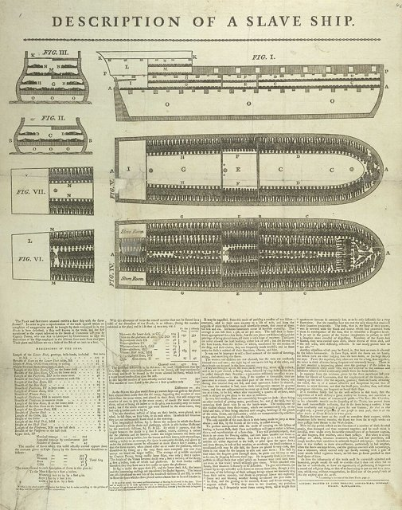
《廢除奴隸貿易法案》獲御准，自 1808 年 5 月起，英國船隻載運奴隸即屬重罪；1833 年《廢奴法》進一步在英屬殖民地解放約 80 萬名奴隸，並以兩千萬鎊（約當歲入四成）賠償奴隸主，而不是奴隸。此後英國海軍西非艦隊數十年間攔截約 1,600 艘奴隸船。
一個靠三角貿易起家的帝國，為什麼在利潤仍在時立法自斷財源？答案是三股力量咬合：四十年的威爾伯福斯道德動員、1770 年代後奴隸貿易利潤下滑，以及海地革命帶來的政治恐懼。
英國最後成為全球廢奴的執法者，執行的形態也成了帝國主義的新變體。

[→ 對外連結：1807 - 廢除奴隸貿易法案](https://chad-liu.github.io/books/html/1-6-4.法律與制度史/1807-廢除奴隸貿易法案.html)
[→ 對外連結：1807 - 英國廢奴與奴隸貿易法](https://chad-liu.github.io/books/html/1-6-4.法律與制度史/1807-英國廢奴與奴隸貿易法.html)

## 1815 | 維也納體系

滑鐵盧之後，俄、普、奧、英四大戰勝國，加上憑「正統原則」擠進決策圈的戰敗國法國（塔列朗），簽署《維也納會議最後議定書》，重畫拿破崙打亂的歐洲地圖：波蘭被瓜分，德意志組成 39 邦的邦聯，瑞士永久中立。
更關鍵的是發明了不需要世界政府的和平機制：大國一致、定期會盟（congress system）與均勢。此後歐洲大國之間近百年（至 1914）沒有全面戰爭。

[→ 對外連結：1815 - 維也納體系](https://chad-liu.github.io/books/html/1-6-4.法律與制度史/1815-維也納體系.html)

## 1832-06-07 | 改革法案與議會民主

《議會改革法案》在貴族院以 9 票之差驚險通過：56 個選民不足 2,000 人的「口袋選區」被廢除，曼徹斯特、伯明罕、里茲等工業新城首度取得席次，選民從約 50 萬增至約 80 萬（約成年男性的七分之一）。
背景是全國處在暴動邊緣：布里斯托焚城三日，諾丁漢城堡被燒，中產階級公開談論「巴黎式解決」，加上 1830 年法國七月革命的衝擊。
議會用讓步買下了革命：工業財富沒有政治席次，造成正當性危機，改革法案之後由憲章運動接棒。

[→ 對外連結：1832 - 改革法案與議會民主](https://chad-liu.github.io/books/html/1-6-4.法律與制度史/1832-改革法案與議會民主.html)

## 1833 | 工廠法與勞動監管
英國《工廠法》首次建立常設的勞動執法機構：設四名工廠視察官，有權隨時進廠檢查、傳喚證人、提起訴訟；規定紡織廠不得僱用九歲以下兒童，九至十三歲兒童每日工時以九小時為限，每週要上學兩小時，並禁止夜間工作。
此前 1802、1819、1825、1831 年的法案近乎廢紙，正因為沒有人去查。1833 年的發明不是新規則，而是「國家監管者」這個職業，也是現代行政國家的第一份常設監管崗位。
自由放任的契約原則與工廠現實碰撞，逼出了「契約自由的法定邊界」。

[→ 對外連結：1833 - 工廠法與勞動監管](https://chad-liu.github.io/books/html/1-6-4.法律與制度史/1833-工廠法與勞動監管.html)

## 1834 | 濟貧法
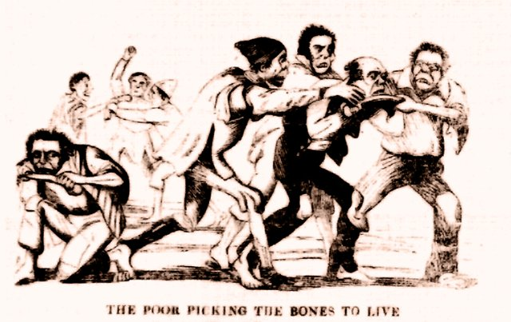
英國《新濟貧法》把教區合併為 600 多個濟貧聯盟，興建工作院，並採「劣等處遇原則」：院內待遇必須比最低工資的工作更差，失業者進院勞動換取食宿。
背景是舊濟貧法（1601 年的伊莉莎白濟貧法與 1795 年的斯品漢蘭制工資補貼）的財政負擔、拿破崙戰爭後的蕭條，以及 1830 年的農村騷亂（斯溫暴動，農民搗毀打穀機）。
當法律規定「救濟必須比工作更慘」，窮人是被救了，還是被嚇退了？福利的初衷是救人，卻被設計成嚇人。

[→ 對外連結：1834 - 濟貧法](https://chad-liu.github.io/books/html/1-6-4.法律與制度史/1834-濟貧法.html)

## 1842 | 所得稅與現代稅制
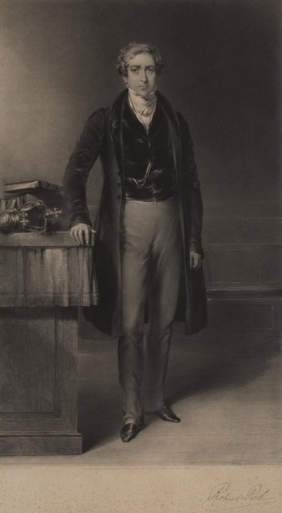
英國首相皮爾重開所得稅：年收入 150 鎊以上，每鎊課 7 便士（約 2.9%）。本意是彌補廢除《穀物法》前的關稅損失，原定五年落日，沒想到一路徵收到今天。
關鍵是預扣、申報、累進三件套：雇主代扣、納稅人自行申報、差別稅率，國家第一次有能力「看見每個人的收入」。
相較於奧古斯都的人頭稅與王安石的免役錢，這一回稅基從人頭與財產轉向所得流，成為大政府的財源。

[→ 對外連結：1842 - 所得稅與現代稅制](https://chad-liu.github.io/books/html/1-6-4.法律與制度史/1842-所得稅與現代稅制.html)

## 1862 | 英國公司法與有限責任
1855 年英國《有限責任法》與 1862 年《公司法》建立一般登記制：任何公民付少量規費、備一份章程、由 7 人簽名，就能設立有限責任的法人公司，不需國王特許，也不需國會專法。
設立公司從特權變成權利，再配上有限責任，股東最多損失出資額，不連帶個人財產。現代公司制度與資本市場的出廠設定，在此完成。

[→ 對外連結：1862 - 英國公司法與有限責任](https://chad-liu.github.io/books/html/1-6-4.法律與制度史/1862-英國公司法與有限責任.html)

## 1868 | 明治維新

倒幕聯軍擊潰德川幕府（戊辰戰爭），明治政府成立，以「富國強兵、殖產興業、文明開化」為綱領，在約三十年內完成中央集權、地稅改革、憲政、法典與產業五大制度移植。
這是一場有管理的制度採購案：憲法學普魯士，民法先試法國再改德國，海軍學英國，陸軍學法德，大學學美德，銀行學美國，是葛申克隆（Gerschenkron）所說後發優勢的經典案例。

[→ 對外連結：1868 - 明治維新](https://chad-liu.github.io/books/html/1-6-4.法律與制度史/1868-明治維新.html)

## 1883-03-20 | 巴黎公約
11 國在巴黎簽署《保護工業產權巴黎公約》，專利與商標第一次有了跨國護照。核心兩條：國民待遇（外國人與本國人同權）與優先權（在本國申請後 12 個月內到別國申請，日期回溯）。
推動的背景包括：1873 年維也納世博會上外國發明家因怕被抄襲而拒絕參展、各國專利互不承認、工業品跨國仿冒猖獗，以及自由貿易擴張。
這是知識產權國際化的第一步。

[→ 對外連結：1883 - 巴黎公約](https://chad-liu.github.io/books/html/1-6-4.法律與制度史/1883-巴黎公約.html)

## 1886-09-09 | 伯恩公約
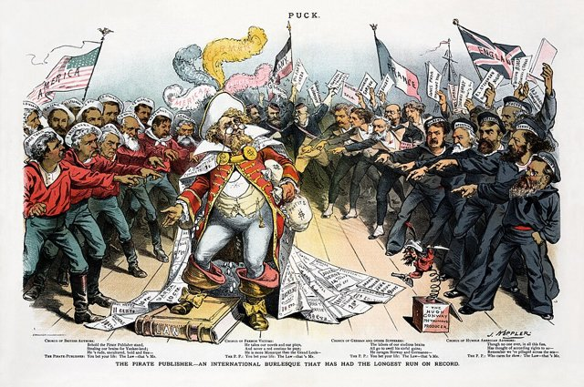
10 國在伯恩簽署《保護文學藝術作品伯恩公約》。版權第一次不需要註冊、繳存，也不必在每個國家逐一辦理手續：作品完成即自動受保護，且在所有成員國有效。
背景包括狄更斯的作品在美國盜印成風、雨果領銜的國際文學協會遊說、各國版權互不承認，以及輪轉印刷機讓盜版一夜遍地。
繼巴黎公約管專利與商標之後，文字、音樂與美術的權利也拿到了跨國護照。

[→ 對外連結：1886 - 伯恩公約](https://chad-liu.github.io/books/html/1-6-4.法律與制度史/1886-伯恩公約.html)

## 1890-07-02 | 謝爾曼反托拉斯與競爭監管
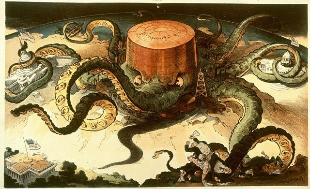
美國《謝爾曼反托拉斯法》禁止限制貿易的合謀與壟斷企圖，一句「every contract in restraint of trade」把標準石油與鐵路托拉斯送上被告席。
公司從特許（1602）到登記（1862）一路做大，國家第一次說「大到一定程度就違法」。1911 年標準石油被拆成 34 家，公司治理的外部邊界在此劃定。
這條路徑是競爭的法律化：鐵路、電報與有限責任催生托拉斯壟斷，再由反托拉斯法與拆分建立競爭秩序，後來演變為消費者福利標準。

[→ 對外連結：1890 - 謝爾曼反托拉斯與競爭監管](https://chad-liu.github.io/books/html/1-6-4.法律與制度史/1890-謝爾曼反托拉斯與競爭監管.html)

## 1899-07-29 | 海牙公約
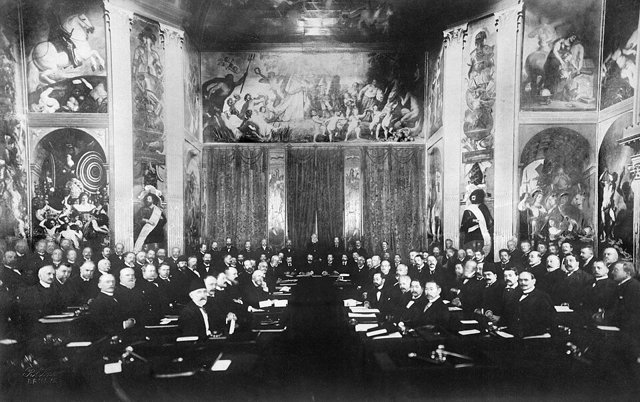
26 國在海牙簽署《陸戰法規與慣例公約》及三項宣言，其中一條今日看來近乎預言：禁止使用「唯一目的為散布窒息性或有毒氣體」的投射物，達姆彈也在禁止之列。
當時無煙火藥、機槍與重炮剛把殺傷力推上工業量級，沙皇尼古拉二世以「軍費壓垮財政」為由召集會議，和平主義的外衣下其實有財政算計。各國一邊簽字、一邊擴軍，但戰爭第一次有了成文的說明書，區分、比例、必要三原則要把無限戰爭變成有限戰爭，至少在紙面上。

[→ 對外連結：1899 - 海牙公約](https://chad-liu.github.io/books/html/1-6-4.法律與制度史/1899-海牙公約.html)

## 1900-01-01 | 德國民法典施行
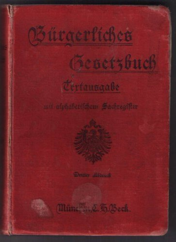
《德國民法典》（BGB）在德意志帝國全境施行。從 1874 年草案委員會成立算起，歷時 26 年、兩次全面翻修，共 2,385 條，是史上工程期最長、抽象度最高的民法典。
它採五編制：總則、債、物、家、繼承，像一座概念金字塔。以「法律行為」與「請求權」兩個抽象概念，把民法統一成一棵概念樹，法學從法條集合升級為演繹公理系統。
精確性被推到極致，可讀性被犧牲，卻成為東亞民法體系的共同祖先。

[→ 對外連結：1900 - 德國民法典施行](https://chad-liu.github.io/books/html/1-6-4.法律與制度史/1900-德國民法典施行.html)

## 1913-12-23 | 聯邦儲備與最後貸款人
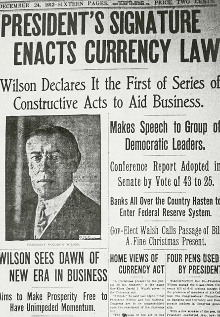
美國《聯邦儲備法》設立 12 家地區儲備銀行與聯邦儲備理事會，讓美元有了「彈性通貨」。直接起因是 1907 年大恐慌：尼克伯克信託擠兌，J.P. 摩根自掏腰包救市，國家信用竟繫於一位七十歲的銀行家。
這是最後貸款人（lender of last resort）的制度化，把摩根的個人金庫變成國家的貼現窗口。相較於英格蘭銀行，美聯儲的獨門發明是分權式央行（華盛頓加 12 家區行），是政治妥協的產物。

[→ 對外連結：1913 - 聯邦儲備與最後貸款人](https://chad-liu.github.io/books/html/1-6-4.法律與制度史/1913-聯邦儲備與最後貸款人.html)

## 1917 | 俄國革命與計畫經濟
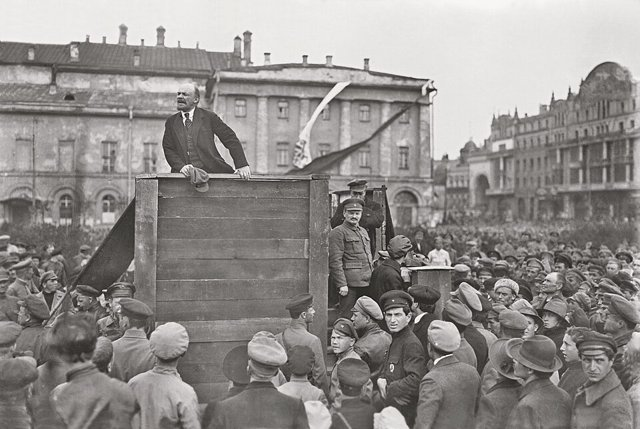
11 月布爾什維克奪權，廢除私有制，土地國有、銀行收歸國有；接著是 1918–1921 年戰時共產主義，1921 年新經濟政策（NEP）退卻，1928 年起史達林推行五年計畫。
計畫經濟試圖用物資平衡表和國家計畫委員會（Gosplan）取代價格，但米塞斯（1920）與哈耶克立刻指出：沒有私有制就沒有真正的價格，沒有價格就沒有經濟計算。
這是二十世紀最重大的制度實驗，也引出最深刻的經濟學辯論。

[→ 對外連結：1917 - 俄國革命與計畫經濟](https://chad-liu.github.io/books/html/1-6-4.法律與制度史/1917-俄國革命與計畫經濟.html)

## 1919-08 | 魏瑪憲法
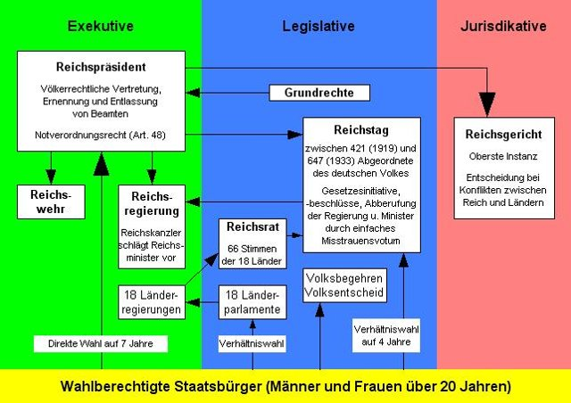
魏瑪憲法生效，是德國第一部民主憲法：比例代表制、公民投票條款、基本權利目錄，以及第 48 條的總統緊急命令權。
悲劇在於，這部最民主的憲法給了敵人摧毀憲法的合法工具：比例代表制導致政黨碎片化，第 48 條與選舉制度被希特勒利用，最後走向 1933 年的授權法，民主被合法地埋葬。
制度設計的缺陷，等於給獨裁者遞刀。

[→ 對外連結：1919 - 魏瑪憲法](https://chad-liu.github.io/books/html/1-6-4.法律與制度史/1919-魏瑪憲法.html)

## 1920-01-10 | 國際聯盟與集體安全

《凡爾賽條約》生效，國際聯盟成立，人類第一次為「戰爭非法化」設立常設機構：大會、理事會、常設法院與委任統治。
懷抱十四點原則的設計，為何二十年後仍看著二戰爆發？答案是無牙的執行加上大國缺席：美國不加入、蘇聯遲到、日本與德國退出，1935 年制裁義大利時，因石油禁運不全而破功。
這是海牙公約到紐倫堡審判、聯合國之間缺失的驗屍報告，聯合國的否決權設計便是從中學到的教訓。

[→ 對外連結：1920 - 國際聯盟與集體安全](https://chad-liu.github.io/books/html/1-6-4.法律與制度史/1920-國際聯盟與集體安全.html)

## 1933 | 新政與行政國家
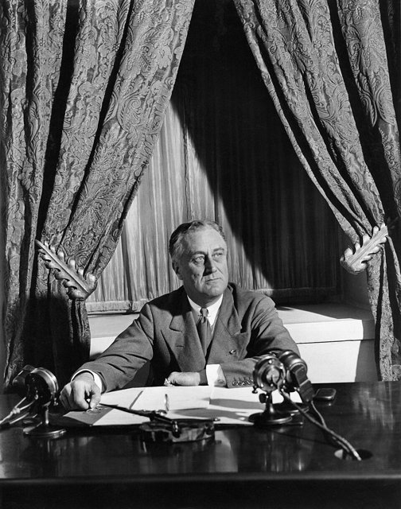
羅斯福「新政百日」（3–6 月）通過 15 項重大法案，包括格拉斯–斯蒂格爾法、聯邦存款保險公司（FDIC）、農業調整法、全國工業復興法與田納西河谷管理局；1935 年再通過社會安全法與瓦格納法。
失業率高達 25% 的危機，催生了委任立法與獨立機關，國會立法、專家執行、法院審查的三層結構成形。
新政不只救經濟，更創造了新的政府形態：行政國家是二十世紀美國憲法最大的調適，也埋下日後雪佛龍原則被推翻的伏筆。

[→ 對外連結：1933 - 新政與行政國家](https://chad-liu.github.io/books/html/1-6-4.法律與制度史/1933-新政與行政國家.html)

## 1934-06-06 | 證券交易法與披露監管
美國《證券交易法》設立證券交易委員會（SEC），要求上市公司註冊、定期披露（10-K、10-Q），並將內線交易入罪。
1929 年股災證明了「買者自負」在資訊不對稱面前是個笑話：發起人用假帳把垃圾賣成黃金。1933 年《證券法》管發行，1934 年管交易，兩部曲把財報從老闆的宣傳單，變成有刑責的法律文件。
1973 年的 FASB 與 2002 年的薩班斯法案，都是它的子孫。

[→ 對外連結：1934 - 證券交易法與披露監管](https://chad-liu.github.io/books/html/1-6-4.法律與制度史/1934-證券交易法與披露監管.html)

## 1945 | 紐倫堡審判 {label="1945–1946年"}
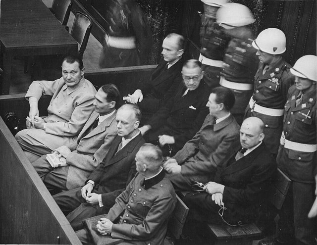
紐倫堡國際軍事法庭審判納粹主要戰犯：24 名被告，12 人被判死刑；首創危害和平罪、戰爭罪與違反人道罪三大罪名。
核心命題是：違反國際法的是人，而不是抽象的國家；「我只是執行命令」不再構成抗辯。國家主權加上上級命令免責，被個人刑事責任與國際刑法取代。
紐倫堡是現代國際刑法的誕生證書，也是法律實證主義的危機時刻。

[→ 對外連結：1945 - 紐倫堡審判](https://chad-liu.github.io/books/html/1-6-4.法律與制度史/1945-紐倫堡審判.html)

## 1948-12-10 | 世界人權宣言
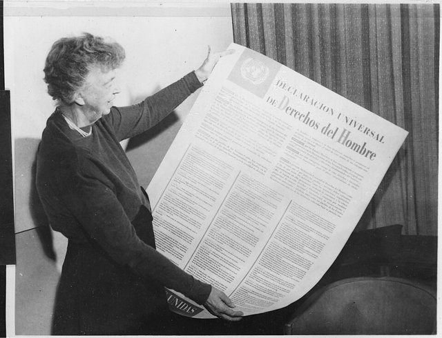
聯合國大會以 48 票贊成、0 票反對（8 票棄權，含蘇聯集團、南非與沙烏地阿拉伯）通過《世界人權宣言》，共 30 條，涵蓋公民政治權利與社會經濟權利。
第 1 條宣告：人人生而自由，在尊嚴和權利上一律平等。個人權利的來源，從國家轉為「人的身分本身」，人權也從主權內政變成國際關切。
宣言雖無強制力，卻成為戰後國際秩序的規範憲章，與所有後續人權法的母法。

[→ 對外連結：1948 - 世界人權宣言](https://chad-liu.github.io/books/html/1-6-4.法律與制度史/1948-世界人權宣言.html)

## 1949-08-12 | 日內瓦公約與戰爭人道法
四部日內瓦公約（保護戰傷病者、海難者、戰俘與平民）通過，戰爭人道法重建。
前史包括 1864 年首部公約（索爾費里諾戰役、杜南特與紅十字）、1899–1907 年海牙公約，以及 1915 年毒氣戰；之後是二戰的無差別戰爭。往後還有 1977 年附加議定書、1990 年代的前南與盧安達法庭，以及 1998 年的國際刑事法院。
這是「災難配疫苗」：二戰的暴行清單，被寫成四部公約。法律總是追著戰爭跑。

[→ 對外連結：1949 - 日內瓦公約與戰爭人道法](https://chad-liu.github.io/books/html/1-6-4.法律與制度史/1949-日內瓦公約與戰爭人道法.html)

## 1950-11-04 | 歐洲人權公約
十二個西歐國家在羅馬簽署《歐洲保障人權與基本自由公約》（ECHR），1953 年生效，1959 年常設的歐洲人權法院在史特拉斯堡開庭。
這是全球第一部允許個人起訴國家、且判決有拘束力的國際人權公約。在此之前，國際法是國家之間的法律，個人是缺席者。七十年後，法院累計審理逾百萬件案件，對四十六個成員國的立法與行政發揮實際改寫力。
在以「不干涉內政」為基石的主權體系裡，國家為什麼同意被超國家法庭約束？這是本案要追查的謎題。

[→ 對外連結：1950 - 歐洲人權公約](https://chad-liu.github.io/books/html/1-6-4.法律與制度史/1950-歐洲人權公約.html)

## 1954-05-17 | 布朗案
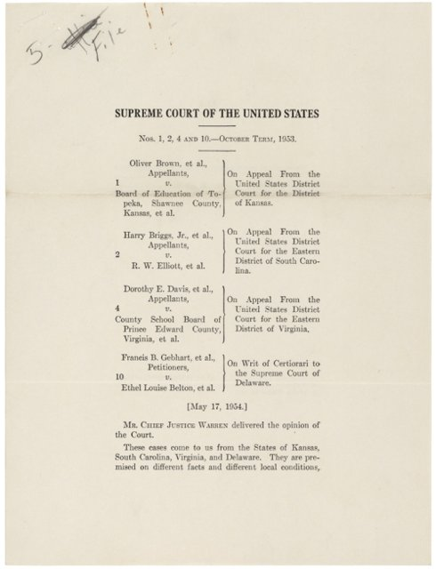
美國最高法院在「布朗訴教育局」案一致裁定：公立學校的種族隔離違反第十四修正案，推翻 1896 年普萊西案「隔離但平等」的先例。
促成判決的是三股力量：NAACP 費時二十年的訴訟工程、社會科學證據（克拉克的娃娃實驗），以及沃倫法院的制度策略。
這一案審理的是：司法如何推翻自己，以及整個南方的社會秩序。

[→ 對外連結：1954 - 布朗案](https://chad-liu.github.io/books/html/1-6-4.法律與制度史/1954-布朗案.html)

## 1957-03-25 | 羅馬條約
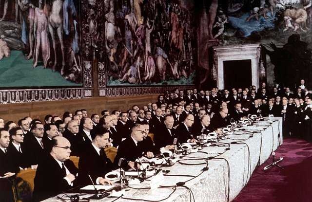
法、德、義、荷、比、盧六國簽署《羅馬條約》，成立歐洲經濟共同體（EEC），建立共同市場、四大自由，以及執委會、部長理事會與法院等超國家機構。
邏輯是先經濟後政治的外溢（spillover）：用經濟整合逐步吸走政治衝突的燃料。1963 年的 Van Gend en Loos 案與 1964 年的 Costa v ENEL 案，把條約變成新型的法律秩序，確立法律優先與直接效力。
歐盟法是主權讓渡史上最深的一次實驗。

[→ 對外連結：1957 - 羅馬條約](https://chad-liu.github.io/books/html/1-6-4.法律與制度史/1957-羅馬條約.html)

## 1966-12-16 | 人權兩公約
聯合國大會一致通過《公民與政治權利國際公約》（ICCPR）與《經濟、社會與文化權利國際公約》（ICESCR），把 1948 年《世界人權宣言》的道德宣示，拆成兩部有法律約束力的條約：前者即時生效，後者漸進實現，各設監督委員會與國家報告制度。
從 1948 到 1966 年，歷經 18 年的冷戰談判，宣言（軟法）因東西分裂而一分為二，再變成兩公約（硬法）。
人權自此從內政變成條約義務，個人可以拿著公約去日內瓦告自己的國家。

[→ 對外連結：1966 - 人權兩公約](https://chad-liu.github.io/books/html/1-6-4.法律與制度史/1966-人權兩公約.html)

## 1973 | FASB與會計準則私有化
財務會計準則委員會（FASB）成立：7 名全職委員、獨立經費、法定壟斷，美國「公認會計原則」（GAAP）的立法權從政府（SEC）讓渡給私營專家機構。
起因是 1960 年代會計原則委員會（APB）被批為「大公司俱樂部」，加上 1969 年 Continental Vending 案審計師入獄，公信力破產。處方是獨立、全職與公開程序。
利潤的定義權被外包給專家；此後每一次泡沫（儲貸危機、安然、次貸）都是對 FASB 準則的壓力測試。

[→ 對外連結：1973 - FASB與會計準則私有化](https://chad-liu.github.io/books/html/1-6-4.法律與制度史/1973-FASB與會計準則私有化.html)

## 1979-12-18 | 消除對婦女歧視公約
聯合國通過《消除對婦女一切形式歧視公約》（CEDAW），現有 188 個締約國，可說是婦女版的《世界人權宣言》長出牙齒。
從 1804 年拿破崙法典的「妻無行為能力」，到 1948 年人權宣言的性別平等口號，為何還要再等三十年才有硬法？答案是去殖民化、第二波女權運動與發展中國家婦女運動三股力量匯流。
這一案是法律卷「兩性線」（夫權走向平等）的收尾。

[→ 對外連結：1979 - 消除對婦女歧視公約](https://chad-liu.github.io/books/html/1-6-4.法律與制度史/1979-消除對婦女歧視公約.html)

## 1991-12-26 | 蘇聯解體與轉型
蘇聯正式解體：15 個共和國、2.9 億人口、74 年的計畫經濟，一夜之間失去憲法基礎。接下來十年，是史上最大規模的制度實驗：俄羅斯採休克療法，中國走漸進轉型，同一個起點、兩種藥方，結局是寡頭經濟與世界工廠。
這不只是經濟學的案子，而是制度經濟學的案子：私有化沒有財產權制度，等於把房子送給沒有門鎖的人。

[→ 對外連結：1991 - 蘇聯解體與轉型](https://chad-liu.github.io/books/html/1-6-4.法律與制度史/1991-蘇聯解體與轉型.html)

## 1995-01-01 | WTO成立
世界貿易組織（WTO）在日內瓦成立，接手運作 48 年的 GATT，成為史上第一個有強制管轄權的多邊經貿組織。
核心變革只有一條：爭端解決從外交否決變成司法判決。專家小組裁決加上上訴機構，採「反向共識」，敗訴方無法否決。
這是貿易的憲法化，但也埋下 2020 年代上訴機構癱瘓的伏筆。

[→ 對外連結：1995 - WTO成立](https://chad-liu.github.io/books/html/1-6-4.法律與制度史/1995-WTO成立.html)

## 1998-10-28 | DMCA與數位版權
美國《數位千禧年著作權法》（DMCA）生效：一邊給版權人「反規避」的利劍（破解 DRM 即屬違法），一邊給平台「避風港」（接到通知即下架便可免責）。
促成它的力量包括：Napster（1999）前夜的恐慌、好萊塢與唱片業的國會動員、1996 年 WIPO 網路條約的履約壓力，以及當時網路平台尚未壯大。
「通知—下架」四個字，意外寫下 YouTube、Facebook、Google 的創業許可證，平台帝國的地基是一部版權法。

[→ 對外連結：1998 - DMCA與數位版權](https://chad-liu.github.io/books/html/1-6-4.法律與制度史/1998-DMCA與數位版權.html)

## 2002-07-30 | 薩班斯法案
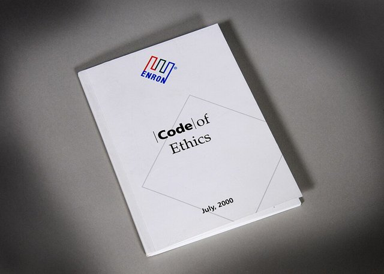
小布希簽署《薩班斯–奧克斯利法案》（SOX）。安然（2001 年 12 月破產，資產 630 億美元）與世界通訊（2002 年 7 月爆發 38 億美元造假）之後，這是 1933–34 年證券法以來最全面的公司治理改造。
重點包括第 404 條內部控制、公開公司會計監督委員會（PCAOB），以及執行長簽證。
一句話：「你簽的字，就是你的刑責」。會計從專業判斷變成法律文件，公司治理走向刑事化。

[→ 對外連結：2002 - 薩班斯法案](https://chad-liu.github.io/books/html/1-6-4.法律與制度史/2002-薩班斯法案.html)

## 2010-07-21 | 多德–弗蘭克法案
歐巴馬簽署《多德–弗蘭克華爾街改革與消費者保護法》，長達 848 頁，是 1933 年格拉斯–斯蒂格爾法以來最大的金融監管。
針對 2008 年危機，它導入系統重要性金融機構（SIFI）、沃爾克規則、消費者金融保護局（CFPB）與壓力測試，走向宏觀審慎監管。
從「管機構」到「管系統」：單家銀行安全不等於系統安全，個體審慎的加總也不等於宏觀審慎。

[→ 對外連結：2010 - 多德–弗蘭克](https://chad-liu.github.io/books/html/1-6-4.法律與制度史/2010-多德弗蘭克.html)

## 2018-05-25 | GDPR

歐盟《通用資料保護規則》（GDPR）生效，取代 1995 年的資料保護指令，是史上最強、罰則最重的資料保護法：罰款可達全球營收的 4% 或 2,000 萬歐元（取其高者）。
核心是同意、可攜與被遺忘權。個人資料是人的延伸，人的權利跟著資料走；資料保護從消費者保護升格為基本權利。
這是演算法時代的憲法補丁。

[→ 對外連結：2018 - GDPR](https://chad-liu.github.io/books/html/1-6-4.法律與制度史/2018-GDPR.html)
