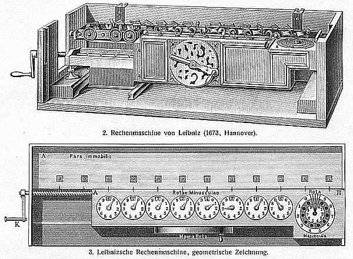
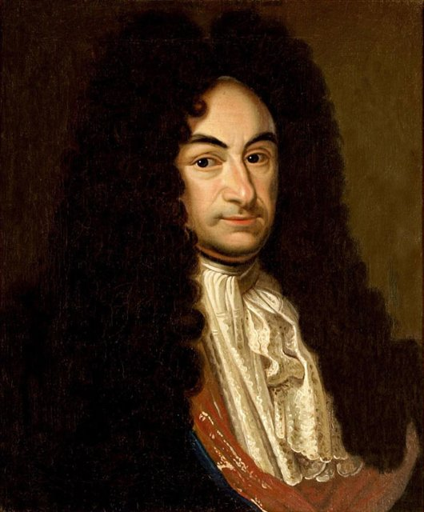
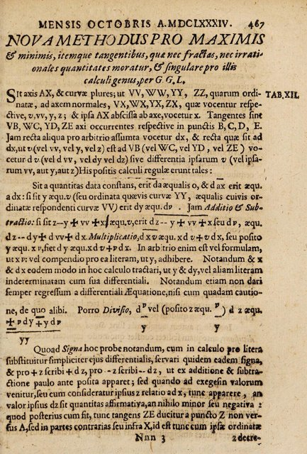
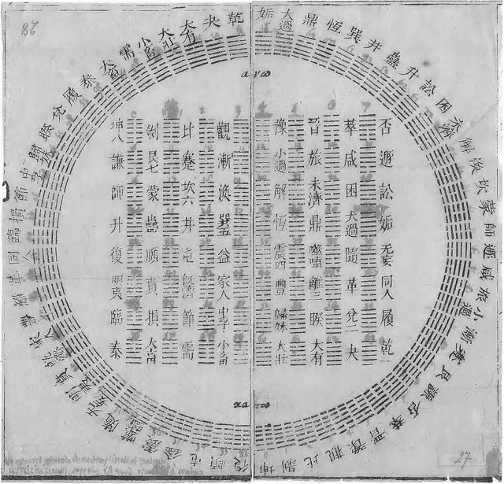
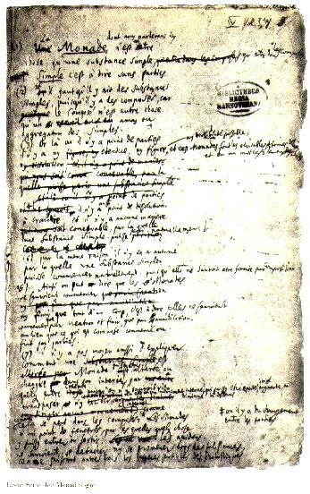
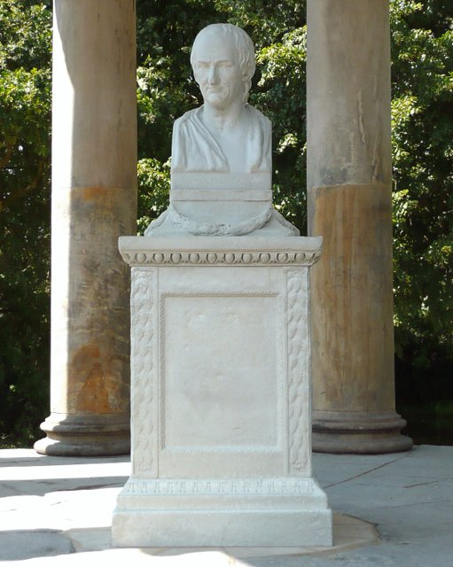

<!--
內容整理自本機筆記〈萊布尼茲生平大事記（1646–1716）〉（圖表\萊布尼茲生平大事記（1646–1716）.md）與中文維基百科「萊布尼茲」條目（CC BY-SA 4.0），以台灣用語改寫摘要。
https://zh.wikipedia.org/zh-tw/戈特弗里德·莱布尼茨
史料與日期說明：
- 生日採新曆（格里曆）1646年7月1日；萊比錫當時仍用舊曆，記為6月21日。
- 會見史賓諾莎的地點：筆記寫阿姆斯特丹，維基百科寫海牙；史賓諾莎晚年住在海牙，一般說法是1676年11月在海牙會面，此處依此。
- 維基百科寫他1676年轉任漢諾威時服務的是恩斯特·奧古斯特公爵；實際上當時的公爵是約翰·腓特烈，1679年他去世後才由弟弟恩斯特·奧古斯特繼位，此處依一般說法修正。
- 阿爾特多夫大學的法學博士：維基百科寫1666年，筆記寫1667年；他1666年底提交論文、1667年2月獲頒學位，此處採1667年2月。
- 維基百科提到1701年「普魯士國王腓特烈·威廉一世」在宴會上問他對牛頓的看法；腓特烈·威廉一世1713年才即位，年代與人物對不上，未採用這則軼事。
- 1673年在倫敦展示計算機並當選皇家學會會員、1697年《中國近事》、1703年以伏羲六十四卦說明二進位、1711年會見彼得大帝、1712年皇家學會調查委員會、萊布尼茲—克拉克通信等細節，係依一般公認的史實補充。
- 《人類理智新論》1765年出版、伏爾泰1759年在《憨第德》中諷刺「最佳可能世界」等身後事，為避免壓縮橫向檢視，併入相關事件的說明。
圖片來源（皆為 Wikimedia Commons 公有領域／CC0 作品）：
- lei-cover.jpg：Christoph Bernhard Francke - Bildnis des Philosophen Leibniz (ca. 1695).jpg
- lei-reckoner.jpg：Leibniz Stepped Reckoner drawing.png
- lei-hannover.jpg：Leibniz Hannover.jpg
- lei-nova.jpg：Leibniz-Acta-1684-NovaMethodus.jpg
- lei-iching.jpg：Diagram of I Ching hexagrams owned by Gottfried Wilhelm Leibniz, 1701.jpg
- lei-monad.jpg：Leibniz Monadology 1.jpg
- lei-bust.jpg：Leibnizbüste Leibniztempel.jpg
-->

# Periods
- 1646 ~ 1667 | 萊比錫的少年天才 | #f08c00
  生於萊比錫的教授家庭，父親早逝後在家中藏書室自學拉丁文與希臘文，14歲進入萊比錫大學，20歲出頭就拿到法學博士。
- 1667 ~ 1676 | 美因茲與巴黎 | #1c7ed6
  進入美因茲選侯的宮廷從事法律與外交工作，奉派前往巴黎，在惠更斯指導下鑽研數學，發明微積分並設計計算機。
- 1676 ~ 1700 | 漢諾威的宮廷學者 | #2f9e44
  為漢諾威公爵家族擔任圖書館長、法律顧問與家族史官，同時發表微積分論文、寫成《形上學論》《新系統》，並與全歐學者通信。
- 1700 ~ 1716 | 晚年的聲望與孤寂 | #7048e8
  創立柏林科學院，出版《神義論》、寫下《單子論》，卻捲入與牛頓陣營的微積分優先權之爭；漢諾威選侯成為英王後將他留在原地，晚景冷清。

# Events

## 1646-07-01 | 出生@萊比錫
生於神聖羅馬帝國薩克森地區的萊比錫，正值三十年戰爭的最後階段。父親弗里德里希是萊比錫大學的倫理學教授，母親凱薩琳娜·施馬克也出身學者家庭，祖上三代都曾在薩克森政府任職。

## 1652-09 | 父親去世
父親去世，留下一間私人藏書室。年幼的他獲准自由進出，大量閱讀古代歷史、拉丁文學與教父著作；12歲時已自學拉丁文，並開始學習希臘文，這種廣泛自學的習慣伴隨了他一生。

## 1661-04 | 進入萊比錫大學
14歲進入萊比錫大學，主修哲學與法律，接觸亞里斯多德與經院哲學，也開始讀到培根、霍布斯、笛卡兒等近代思想家。他後來回憶，少年時曾在萊比錫郊外的玫瑰谷散步，反覆思索該保留經院哲學的「實體形式」，還是改採機械論的自然觀。

## 1663-05 | 學士論文《論個體化原理》
完成學士論文《論個體化原理》，討論一個事物憑什麼成為獨一無二的「這一個」——這個問題後來成為他單子論的核心之一。同年夏天他到耶拿大學短暫進修，跟數學家魏格爾學習，第一次接觸到用數學方法處理哲學問題。

## 1666 | 《論組合術》
發表《論組合術》，構想把所有複雜概念拆解成少數基本概念，再用類似算術的規則組合推理——這就是他一生追求的「普遍文字」與「理性演算」的起點，被視為數理邏輯與電腦科學的遠祖。同年他申請萊比錫大學的法學博士，據說因為年紀太輕而被拒。

## 1667-02 | 阿爾特多夫大學法學博士
轉往紐倫堡附近的阿爾特多夫大學，以討論疑難法律案件的論文獲頒法學博士，答辯表現讓校方當場想聘他為教授，他卻婉拒，寧可投身更廣闊的世界。不久結識前美因茲首相博因堡男爵，經其引薦進入美因茲選侯約翰·菲利普的宮廷，從事法律改革與外交工作，並嘗試促成天主教與新教的和解。

## 1671 | 《新物理假說》
發表《新物理假說》與《抽象運動論》，分別題獻給巴黎的科學院與倫敦的皇家學會，開始在歐洲學界嶄露頭角。

## 1672-03 | 出使巴黎
奉命前往巴黎，任務是勸說法王路易十四放棄進攻荷蘭與德意志諸邦，轉而出兵埃及。這個外交計畫沒有成功，但他從此進入巴黎的學術圈，結識哲學家馬勒伯朗士與荷蘭數學家惠更斯。在惠更斯的指導下，他從幾乎不懂高等數學，迅速躍升到歐洲數學的最前線。

## 1673-01 | 倫敦與計算機

隨外交使團前往倫敦，向皇家學會展示自己設計的計算機模型。不同於帕斯卡只能加減的計算機，他的機器採用「階梯軸」設計，可以做乘除運算，這種結構一直沿用到二十世紀的機械計算機。同年4月他當選皇家學會會員。博因堡男爵已在前一年底去世，美因茲選侯也在這年2月過世，他失去了在巴黎的靠山。

## 1675-11 | 發明微積分
1675年10月底，他在筆記中第一次寫下積分符號「∫」（取自拉丁文 summa「總和」的字首 S），11月又引入微分記號「dx」，完成了一套系統的微積分方法。牛頓在1660年代中期已經發展出自己的「流數法」，但沒有發表；兩人各自獨立發明了微積分，而萊布尼茲設計的符號更簡潔好用，一直沿用到今天。

## 1676-11 | 會見史賓諾莎，轉往漢諾威

在巴黎找不到正式職位，只好接受不倫瑞克－呂訥堡公爵約翰·腓特烈的聘任。前往漢諾威途中，他先到倫敦，再經荷蘭，在海牙與史賓諾莎會面數日，討論哲學並閱讀了《倫理學》的手稿。12月抵達漢諾威，擔任宮廷圖書館長與法律顧問，此後四十年都在這個家族服務。

## 1680 | 哈茨山礦坑的風車計畫
約1680至1686年間，他花了大量心力在哈茨山的銀礦，設計以風車驅動抽水機排除礦坑積水。由於技術困難與礦工的反對，計畫最後失敗，但他在礦區觀察到的化石與地層，後來寫成討論地球歷史的《原始地球》。

## 1684-10 | 發表微分學論文

在萊比錫的學術期刊《學者學報》發表〈求極大值與極小值的新方法〉，這是世界上第一篇公開發表的微積分論文，兩年後又發表積分學的論文。牛頓的《自然哲學的數學原理》直到1687年才出版，這個發表時間的先後，日後成為優先權之爭的焦點。

## 1686 | 《形上學論》
寫成《形上學論》，提出每個個體實體都包含了它一生所有遭遇的「完整概念」，並把手稿摘要寄給神學家阿爾諾討論。前一年，新繼位的恩斯特·奧古斯特公爵委託他編寫韋爾夫家族的歷史，這項工程直到他去世都沒有完成。

## 1689 | 義大利之行與中國
為了蒐集家族史料，他在1687至1690年間遊歷德意志南部、維也納與義大利。在羅馬，他結識剛從北京返回的耶穌會傳教士閔明我，聽聞康熙皇帝與中國的種種，從此對中國的語言、哲學與科學產生濃厚興趣，往後與多位在華傳教士長期通信。

## 1695 | 《新系統》與前定和諧
在法國的《學者期刊》發表〈自然與實體交流的新系統〉，公開提出「前定和諧」：心靈與身體並不直接互相作用，而像兩座由上帝事先校準好的時鐘，各自運行卻永遠步調一致。這套理論讓他的哲學廣為歐洲學界所知。

## 1697 | 《中國近事》
編輯出版《中國近事》，收錄在華傳教士的報告，並在序言中主張：歐洲擅長思辨與數學，中國則在實踐倫理與治國上勝過歐洲，雙方應該互派人員、交流知識。他是當時最熱心推動中西文化交流的歐洲學者之一。

## 1700-07 | 創立柏林科學院
說服布蘭登堡選侯腓特烈三世（後來的普魯士國王腓特烈一世）與熱愛哲學的選侯夫人索菲·夏洛特，在柏林成立科學學會，並擔任首任院長；這就是後來普魯士科學院的前身。他也四處奔走，希望在德勒斯登、維也納與俄國設立類似的學術機構。

## 1703 | 二進位與《易經》

發表〈論二進位算術〉，說明只用0與1就能表示所有數字。在華傳教士白晉寄給他伏羲六十四卦的排列圖，他驚喜地發現卦象的陰陽爻排列恰好對應0到63的二進位數，認為這證明了古代中國人早已掌握這套原理。二進位後來成為現代電腦的基礎。

## 1704 | 《人類理智新論》
以對話體寫成《人類理智新論》，逐章回應洛克的《人類理解論》，主張心靈並非一張白紙，而像一塊帶有紋理的大理石，天生就具備理性的傾向。書稿完成時洛克恰好去世，他不願被說成攻擊死者，便沒有出版，這部書直到1765年才問世，並影響了年輕的康德。

## 1710 | 《神義論》
為紀念1705年早逝的普魯士王后索菲·夏洛特，出版生前唯一的哲學專著《神義論》，回應「上帝既然全善全能，世界為何有惡」：上帝在無數可能的世界中，選擇了整體而言最好的一個，惡是為了更大的善而無法避免的部分。這個「最佳可能世界」的主張，後來被伏爾泰在小說《憨第德》（1759年）中大加嘲諷。

## 1711-10 | 會見彼得大帝
在托爾高首度會見俄國沙皇彼得大帝，此後又多次見面，被任命為沙皇的樞密顧問，向他建議改革法律與教育、在俄國設立科學院；彼得大帝去世前不久籌設的聖彼得堡科學院，實現了他的構想。

## 1713 | 微積分優先權之爭
英國方面指控他抄襲牛頓。他向皇家學會申訴，學會於1712年成立委員會調查，但委員會實際上由牛頓主導，1713年初發表的報告認定牛頓才是「第一發明人」，並暗示他剽竊。這場爭論讓英國數學界長期拒用他更便利的符號，因而落後歐陸數十年。今天一般公認兩人是各自獨立發明微積分。

## 1714 | 《單子論》

1712至1714年間他待在維也納，獲任神聖羅馬帝國的宮廷顧問，並在這裡寫下《單子論》與《自然與恩典原理》，以精簡的條文總結他的哲學：世界由無數沒有廣延、彼此「沒有窗戶」的單純實體「單子」構成，每個單子都從自己的角度映照整個宇宙。同年8月，漢諾威選侯喬治·路德維希繼承英國王位，成為英王喬治一世，卻不准他隨行前往倫敦，命他留在漢諾威完成家族史。

## 1715-11 | 與克拉克的通信
透過威爾斯王妃卡洛琳，與牛頓的支持者克拉克展開一系列書信辯論，爭論空間與時間是否絕對存在、上帝是否需要不時「修理」宇宙；他主張空間只是事物之間的關係。這組通信至今仍是物理學與哲學的經典文獻。同一時期，他寫下長信《論中國人的自然神學》，為中國思想與基督教的相容性辯護。

## 1716-11-14 | 逝世@漢諾威

因痛風與腎結石病逝於漢諾威。當時英王喬治一世正好就在漢諾威，宮廷卻沒有人出席他的葬禮，只有秘書為他送行。他留下約二十萬頁手稿與一萬五千多封書信，至今仍在整理出版；漢諾威收藏的萊布尼茲書信已列入聯合國教科文組織的世界記憶名錄。他的思想經由沃爾夫系統化，成為康德之前德國大學的主流哲學。
