<!--
內容整理自 D:\Books\html\9-2.藝術家 的〈達文西生平大事記（1452—1519）〉與〈達文西知識圖譜〉兩份頁面，以自己的話改寫；兩頁沒有對應的 md 筆記。
時期依生平的地點與階段歸納：芬奇與佛羅倫斯、第一次米蘭、流動的年月（曼圖亞、威尼斯、佛羅倫斯、波吉亞）、第二次米蘭、羅馬、法國。
處理方式：
- 兩頁都強調作品年代多為藝術史學界的推定，個別作品的完成程度、委託細節與創作年代有不同說法；「約」「前後」的年份照寫，用 label 保留。
- 「知識圖譜」的內容（手稿逾七千頁、估計僅存原量的四分之一；解剖逾三十具遺體；心臟主動脈瓣膜渦流；「鏡像字」；手稿的散佚與重新發掘；《大西洋古抄本》）沒有明確年份，併入相關事件（解剖研究、《最後的晚餐》、騎馬像、遺囑與逝世），不另立事件；知識圖譜自己也說明部分內容是學界較普遍接受的推論而非確證。
- 知識圖譜把弟子寫作梅爾茲、生平大事記寫作梅爾齊，這裡統一為梅爾齊；人名用·分隔（原稿作・）。美第奇依本站既有寫法統一為梅迪奇，法蘭索瓦一世與 Renaissance 時間軸一致。
- 知識圖譜提到的學者尚·保羅·李希特是十九世紀整理達文西手稿的學者，與鋼琴家李希特無關，已在 Richter 時間軸以 notNames 排除。
- 生平大事記的「重要藝術作品」「科學與工程研究」「與米開朗基羅、拉斐爾比較」「歷史地位」寫進時期說明與最後一則事件，不另立事件；快速複習表與總結未收錄。
圖片（皆為 Wikimedia Commons 上的公有領域或 CC0 作品，縮成最長邊 640px 的 JPEG）：
- leo-cover.jpg：Leonardo da Vinci - presumed self-portrait - WGA12798.jpg（達文西的推定自畫像（紅粉筆素描））
- leo-annunciation.jpg：Leonardo da Vinci - Annunciation - WGA12677.jpg（《天使報喜》，約1472–1475）
- leo-ginevra.jpg：Leonardo da Vinci - Ginevra de' Benci - Google Art Project.jpg（《吉內薇拉·德·班琪肖像》，約1474–1478）
- leo-magi.jpg：Leonardo da Vinci - Adorazione dei Magi - Google Art Project.jpg（未完成的《三博士來朝》，1481–1482）
- leo-rocks.jpg：Leonardo Da Vinci - Vergine delle Rocce (Louvre).jpg（《岩間聖母》（羅浮宮版））
- leo-flight.jpg：Design for a Flying Machine.jpg（飛行器的設計手稿）
- leo-vitruvian.jpg：0 The Vitruvian Man - by Leonardo da Vinci.jpg（《維特魯威人》，約1490）
- leo-ermine.jpg：Leonardo da Vinci - Portrait of Cecilia Gallerani (Lady with an Ermine) - WGA12698.jpg（《抱銀鼠的女子》（塞西莉亞·加萊拉尼肖像），1490年代）
- leo-supper.jpg：Leonardo da Vinci - The Last Supper high res.jpg（《最後的晚餐》，1495–1498）
- leo-imola.jpg：Leonardo da Vinci - RCIN 912284, A map of Imola 1502.jpg（伊莫拉的地圖，1502）
- leo-mona.jpg：Mona Lisa.jpg（《蒙娜麗莎》）
- leo-anghiari.jpg：Peter Paul Ruben's copy of the lost Battle of Anghiari.jpg（魯本斯依達文西已佚的《安吉亞里之戰》所作的摹本）
- leo-anne.jpg：Leonardo da Vinci - Virgin and Child with St Anne C2RMF retouched.jpg（《聖母子與聖安妮》）
- leo-codex.jpg：Codex Atlanticus f1069 recto.png（《大西洋古抄本》的一頁）
- leo-death.jpg：Francois Ier Leonard de Vinci-Jean Auguste Dominique Ingres.jpg（安格爾〈法蘭索瓦一世接受達文西的臨終嘆息〉，19世紀畫作（傳說中的場景））
-->

# Periods
- 1452 ~ 1481 | 芬奇與佛羅倫斯 | #868e96
  生於芬奇附近，約十四歲進入韋羅基奧工作室學習繪畫、雕塑與工藝，約1472年加入畫家組織；《天使報喜》與《吉內薇拉·德·班琪肖像》是早期作品。
- 1482 ~ 1499 | 第一次米蘭時期 | #1971c2
  為盧多維科·斯福爾扎工作，同時做宮廷慶典、軍事工程與建築，也展開解剖、飛行與幾何研究；《岩間聖母》《維特魯威人》《最後的晚餐》屬於這一段。
- 1500 ~ 1505 | 流動的年月 | #e8590c
  法軍攻下米蘭後離開，經曼圖亞、威尼斯回到佛羅倫斯，為切薩雷·波吉亞做軍事工程與地圖，開始《蒙娜麗莎》，並接下《安吉亞里之戰》壁畫。
- 1506 ~ 1512 | 第二次米蘭時期 | #2f9e44
  回到米蘭，米蘭逐漸成為研究與工作的主要基地，繼續深化解剖、水流與地質的研究。
- 1513 ~ 1516 | 羅馬 | #7048e8
  進入朱利亞諾·德·梅迪奇的支持圈，羅馬聚集了米開朗基羅與拉斐爾，但他在此時期的藝術成果不如米蘭時期突出。
- 1517 ~ 1519 | 法國 | #c92a2a
  受法蘭索瓦一世邀請，定居克洛呂塞，右臂受限但仍持續研究，1519年去世。

# Events

## 1452-04-15 | 出生於芬奇附近
出生於托斯卡尼的芬奇鎮附近，當時屬佛羅倫斯共和國的勢力範圍。「達文西」原意是「來自芬奇的人」，不是現代意義上完全相同的固定姓氏；他的全名 Leonardo di ser Piero da Vinci，大意是「芬奇的瑟皮耶羅之子李奧納多」。父親瑟皮耶羅·達文西是公證人，母親卡特琳娜的確切身分與背景仍有爭議。由於父母未婚，他沒有照父親家庭的安排接受典型的拉丁文人文教育。佛羅倫斯是當時藝術、商業、金融與人文學術的重要中心，為他日後的發展提供了深厚的文化環境。

## 1457 | 童年成長與藝術興趣 {label=約1457—1466年}
在芬奇與周邊地區成長，托斯卡尼的丘陵、溪流、植物與動物，構成他早年生活的自然環境。約1466年前後，父親注意到他的繪畫才能，安排他前往佛羅倫斯接受藝術訓練。

## 1466 | 進入韋羅基奧工作室 {label=約1466年起}
進入安德烈亞·德爾·韋羅基奧的工作室學習。工作室除了繪畫，也涉及雕塑、金屬工藝、材料運用與機械製作，這種實作訓練幫助他建立藝術與技術並重的工作方式。他日後自稱「無學之人」（omo sanza lettere），意指沒有受過拉丁文的古典學術訓練；早年只接受工坊學徒式的教育，反而使他不受經院哲學框架的束縛，習慣直接向自然提問，但這不代表他缺乏系統性的觀察方法。

## 1472 | 加入佛羅倫斯畫家組織 {label=約1472年}
登記加入與聖路加相關的佛羅倫斯畫家組織，逐漸取得獨立執業的藝術家身分。他仍可能繼續與韋羅基奧工作室合作，因為取得資格不代表必須立刻離開原有的工作環境。

## 1472 ~ 1475 | 《天使報喜》 {label=約1472—1475年}
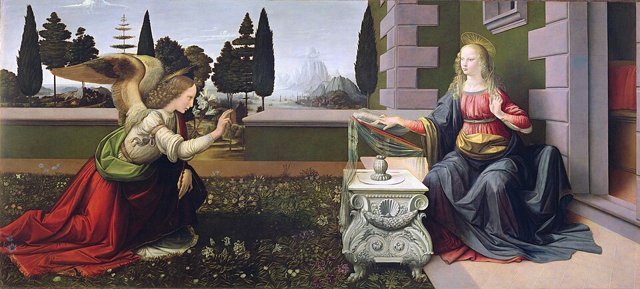
這件早期重要作品描繪天使加百列向聖母瑪利亞宣告耶穌將降生的場景，畫中可見他對透視空間、自然景觀、人物姿態與光影質感的探索。

## 1474 ~ 1478 | 《吉內薇拉·德·班琪肖像》 {label=約1474—1478年}
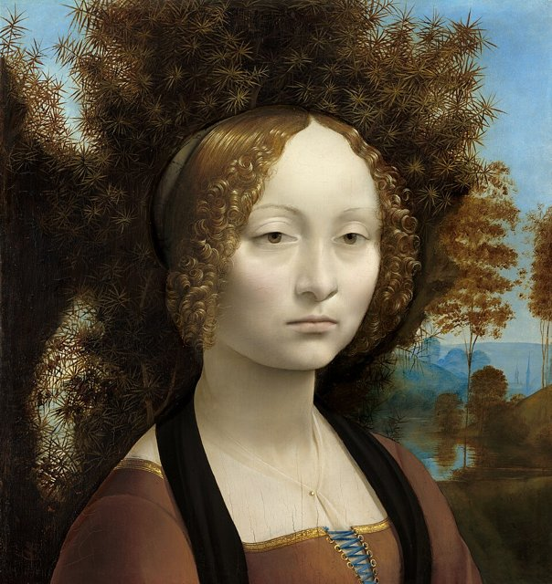
這幅早期肖像畫以人物面容、植物背景與細膩的光影著稱，不只記錄外貌，也嘗試透過表情、光線與畫面氣氛呈現人物的個性。

## 1478 | 逐漸獨立接受委託 {label=1478年左右}
逐步建立自己的藝術家身分，但他經常同時研究多種問題，不少作品未能依原定計畫完成：跨領域的探索使他累積廣泛的知識，卻也影響部分委託工作的進度。

## 1481 ~ 1482 | 《三博士來朝》
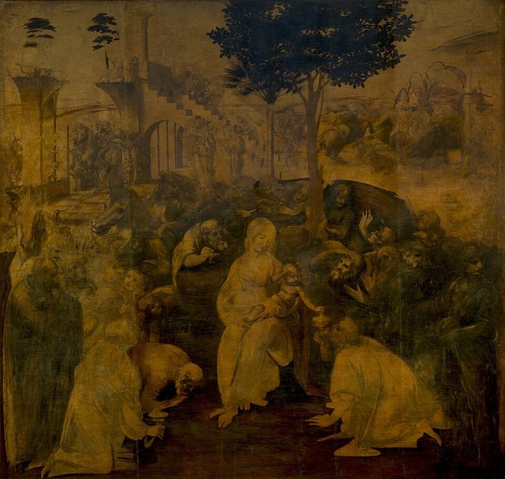
受託為聖多納托修道院創作《三博士來朝》（Adoration of the Magi），描繪東方三博士朝拜聖嬰耶穌的場景。作品雖未完成，仍展現了複雜群像、透視空間、人物情緒與建築背景的構思。

## 1482 | 前往米蘭，進入斯福爾扎宮廷 {label=約1482年}
離開佛羅倫斯，前往米蘭為公爵盧多維科·斯福爾扎工作。除了繪畫，他也參與軍事工程、建築、城市規劃、宮廷慶典與雕塑設計，並持續研究人體、光學、幾何與水流。

## 1483 | 《岩間聖母》 {label=1483年起}
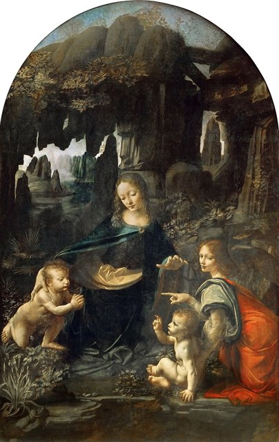
這件宗教畫以聖母、聖嬰與其他人物置身岩石景觀為題材，採用金字塔式構圖、柔和的明暗過渡與自然地貌，呈現人物、環境與光影的融合。現存的重要版本分別收藏於巴黎羅浮宮與倫敦國家美術館。

## 1485 ~ 1490 | 研究飛行器與機械裝置 {label=約1485—1490年}
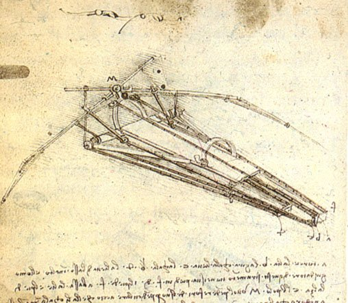
留下大量機械設計圖，構想仿鳥飛行裝置、旋翼式飛行器、齒輪傳動、起重機、運輸機械與軍事防禦裝置，顯示他試圖分析力、運動與結構之間的關係；但不能把概念草圖直接視為已成功運作的發明，許多構想未能成為可實際運作的飛行器。他觀察鳥類飛行的肌肉結構，既為設計飛行器，也為理解「運動」本身的物理原理。

## 1487 ~ 1490 | 系統性研究人體解剖 {label=約1487—1490年}
觀察並記錄骨骼、肌肉、關節、心臟、血管與身體運動，也研究面部表情與人體比例。對他而言，繪圖不只是藝術表現，也是分析人體結構的研究方法。他親自在停屍間與醫院解剖了三十多具遺體，橫跨各年齡層，包括一名自稱「百歲人」的老人與一名胎兒，當時這類解剖研究極為罕見且具爭議性。他記錄了血管壁增厚的現象，是已知最早的相關臨床觀察之一；也正確描繪主動脈瓣膜開合時形成的血流渦流，這個機制直到二十世紀才由流體力學實驗正式證實，領先正式醫學文獻約四百年。他原計畫把三十年來的解剖觀察整理成系統性著作並公開出版，草稿反覆增補卻始終沒有定稿，也沒有發表，因此這些發現幾乎沒有進入當時的醫學教科書。

## 1490 | 《維特魯威人》 {label=約1490年}
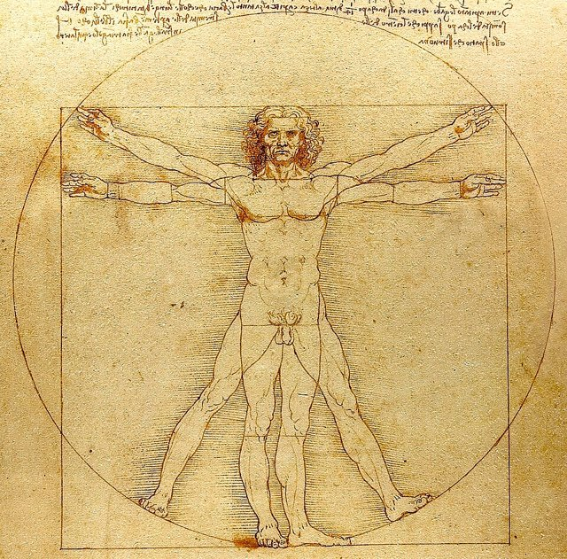
這幅著名的素描把男性人體置於圓形與正方形之中，探索人體比例與幾何形式的關係，思想背景來自古羅馬建築師維特魯威對人體比例與建築比例的論述，反映文藝復興對數學、自然與人體秩序的關注。它今日常被當成「人文主義」的象徵印在各種商品上，但本身其實是一份嚴謹的比例測量筆記，附有大量文字註記與計算。

## 1490 | 與數學家交流，創作肖像畫 {label=1490年代}
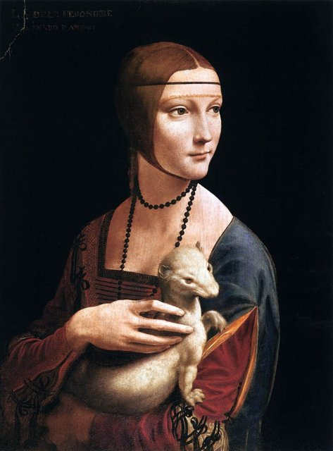
與數學家盧卡·帕喬利等人交流，持續研究比例、幾何與透視。同一時期的重要肖像畫《抱銀鼠的女子》（Lady with an Ermine）通常被認為描繪塞西莉亞·加萊拉尼，展現他對人物動態、手部結構與心理表現的掌握；人物的轉身、手勢與動物的形態，傳達出生命感。

## 1495 ~ 1498 | 《最後的晚餐》
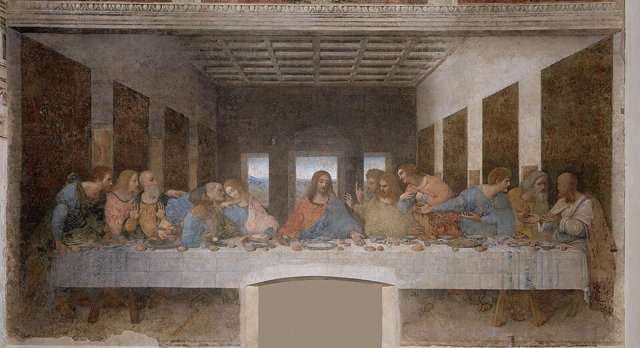
在米蘭聖瑪利亞感恩教堂的修道院餐廳創作《最後的晚餐》，描繪耶穌宣布有人將出賣他的時刻，以透視線條聚焦耶穌，並透過十二名門徒的表情、手勢與姿態呈現不同的反應。他為了更細膩的層次表現，捨棄傳統的濕壁畫技法，改用實驗性的蛋彩混合技法，使作品能反覆修改，但顏料附著力不足，完成不久壁畫就開始剝落損壞。

## 1498 | 設計斯福爾扎騎馬雕像 {label=1490年代後期}
研究馬匹的解剖、姿勢、肌肉與大型青銅雕塑的製作方式，計畫製作巨型的騎馬紀念像。他完成了足尺的黏土模型，卻因法軍入侵、青銅原料被挪用鑄砲而從未澆鑄，模型後來也遭士兵當箭靶而損毀。

## 1499 | 米蘭政局改變，離開城市
法國軍隊入侵米蘭，盧多維科·斯福爾扎的統治被推翻。達文西失去重要的宮廷支持者，離開米蘭，開始在不同城市尋找新委託的流動生涯。

## 1500 | 經曼圖亞、威尼斯後返回佛羅倫斯
離開米蘭後，曾前往曼圖亞與威尼斯，之後回到佛羅倫斯。他繼續研究建築、軍事工程、地圖繪製與機械，也為曼圖亞侯爵夫人伊莎貝拉·德斯特的肖像準備相關稿件。

## 1502 | 為切薩雷·波吉亞從事軍事工程
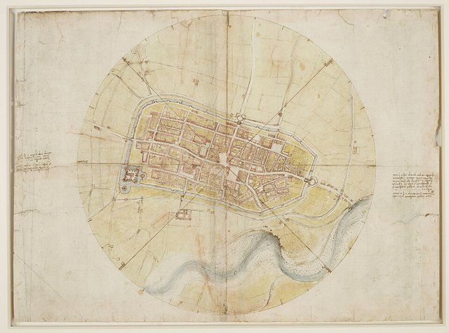
擔任軍事工程師與地圖繪製者，視察據點、研究城防、繪製地形圖並提出工程構想；他的地圖不只是地理紀錄，也反映他對測量、空間與地形的分析。

## 1503 | 開始創作《蒙娜麗莎》 {label=約1503年起}
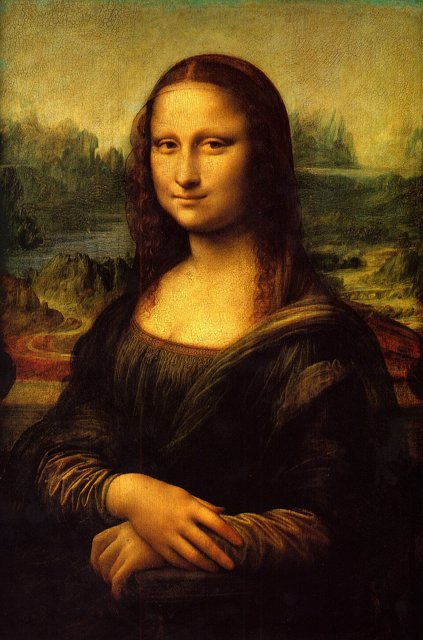
畫中人物通常被認為是佛羅倫斯商人之妻麗莎·蓋拉爾迪尼，但委託的細節與各階段的完成時間仍有討論。作品以暈塗法、微妙的表情、景觀背景與人物心理表現聞名，是西方藝術史最具代表性的肖像畫之一。

## 1503 ~ 1506 | 《安吉亞里之戰》壁畫計畫
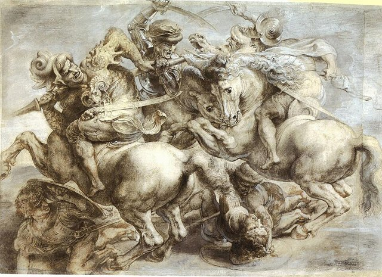
佛羅倫斯政府委託他在舊宮大議會廳創作描繪1440年安吉亞里戰役的壁畫。他著重戰鬥中的馬匹、人物扭轉與情緒衝突，但實驗性的技法未達預期，作品沒有以原定的形式完成，原作後來的狀態仍是藝術史的研究議題。

## 1504 | 父親去世
父親瑟皮耶羅去世，達文西的家庭關係與財產繼承問題進入新的階段。

## 1504 ~ 1506 | 持續研究《聖母子與聖安妮》
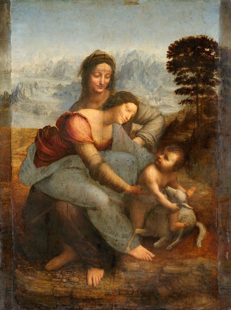
持續發展《聖母子與聖安妮》的相關作品，以人物交錯的身體姿態、視線與動作建立連續的構圖，呈現他對人體、心理與畫面平衡的長期探索。

## 1506 | 再次前往米蘭
受邀重返米蘭，進入第二次米蘭時期。他在佛羅倫斯與米蘭之間往返，但米蘭逐漸成為研究與工作的主要基地。

## 1508 ~ 1513 | 深化解剖、水流與地質研究
持續研究骨骼、肌肉、心臟與血管，也觀察水流、渦旋、河川侵蝕、沉積物、岩石與化石。這些筆記顯示他試圖從長期觀察中理解人體與自然環境的運作規律。他研究水流漩渦，同時用於畫布上鬈髮的畫法與河道治理的工程設計；他觀察岩層與化石的成因，也記錄植物向光性等現象。

## 1513 | 前往羅馬
義大利政治局勢持續變動，達文西離開米蘭前往羅馬，進入朱利亞諾·德·梅迪奇的支持圈。羅馬聚集了米開朗基羅、拉斐爾等重要藝術家，但他在此時期的藝術成果不如米蘭時期突出。1513至1516年，他持續探索人體、幾何、機械與自然現象，晚年愈來愈投入長期的研究與觀察，而不是大量接受傳統的繪畫委託，因此留下許多研究圖稿，也有部分計畫未能完成。據說教宗利奧十世曾感嘆「這個人什麼事都做不完」。

## 1516 | 接受法蘭索瓦一世的邀請
接受法國國王法蘭索瓦一世的邀請，離開義大利前往法國。法國王室重視義大利文藝復興的文化，他的聲望與跨領域的才能受到國王賞識。

## 1516 | 定居克洛呂塞城堡莊園 {label=1516年末—1517年}
定居於法國安布瓦斯附近的克洛呂塞（Clos Lucé），在宮廷支持下繼續從事繪畫、建築與工程相關工作，享有相對安定的生活條件。

## 1517 | 晚年健康轉差，仍持續研究 {label=1517年起}
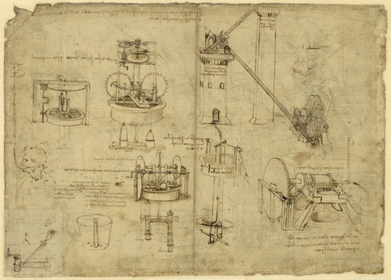
歷史記錄指出他的右臂活動受到限制，具體病因無法確定；由於他慣用左手，仍可能繼續繪圖、書寫與指導助手，也持續研究洪水、暴風、水流、機械與自然形態。他慣以左手由右至左書寫，字形左右顛倒、須對著鏡子才能正常閱讀，稱為「鏡像字」（Scrittura Speculare）；學界普遍認為這是左撇子書寫的自然習慣（可避免墨跡被手掌拖抹），而不是刻意加密，但客觀上確實大幅提高了他人閱讀手稿的難度。

## 1519-04-23 | 訂立遺囑
安排財產與作品的處理方式，並把大量圖稿、筆記與其他資料留給弟子兼助手弗朗切斯科·梅爾齊。

## 1519-05-02 | 在法國逝世，享年67歲@安布瓦斯
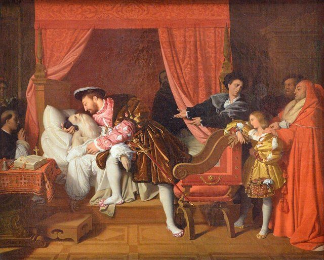
在法國安布瓦斯附近去世。他留下的不只是少數傳世名畫（一生完成的作品不足二十幅），還有大量的繪圖、筆記、工程構想與科學研究資料；手稿現存七千多頁，估計只有原始總量的四分之一。梅爾齊繼承了全部手稿，其後人卻把手稿逐漸拆散變賣，流散到歐洲各地的收藏；十九世紀，學者尚·保羅·李希特等人開始系統性地整理、翻譯與出版，達文西的科學與工程成就才重新受到矚目，後來醫學史與工程史的學者陸續證實他觀察的準確性。存世最大宗的手稿彙編是《大西洋古抄本》，現藏米蘭的安波羅修圖書館。他有些洞見領先數百年，但在他活著的時候並沒有兌現成影響力，這種「超前」是後見之明才看得出來的：手稿實際扮演的角色，是後世重新確認他有多超前，而不是推動當時科學進展的動力。他的重要性在於細緻的觀察、圖像記錄與跨領域的分析：把繪圖當作研究工具，探索光線、透視、水流、人體比例與機械運動的規律，體現文藝復興對人類知識與能力的重視。他留下三個面向：代表人物《蒙娜麗莎》與《最後的晚餐》；跨領域研究的典型，結合繪畫、解剖、機械、數學、建築與自然觀察；以及持續追問自然規律的精神。與米開朗基羅強調人體力量與戲劇張力、拉斐爾強調構圖均衡與和諧相比，他更重視自然觀察、科學研究與心理描寫。相傳他晚年說過「我從未完成一件作品」，這句話與其說是自謙，不如說是他工作模式的誠實總結：對把「觀察」視為終極目的的人而言，任何完成的作品都意味著提問的停止。
