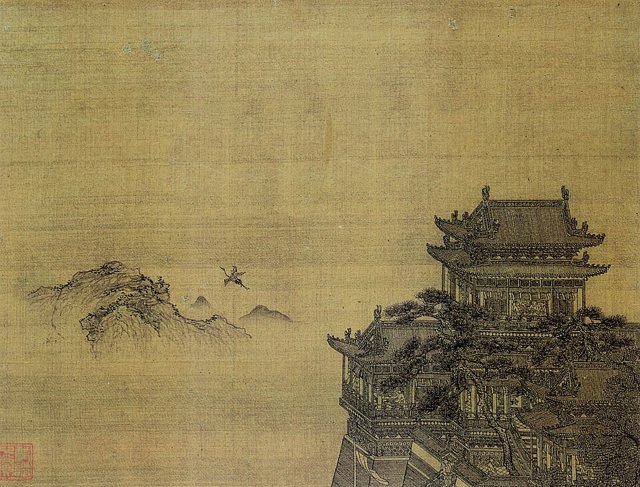
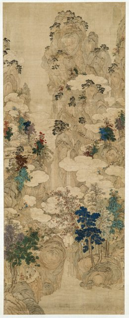
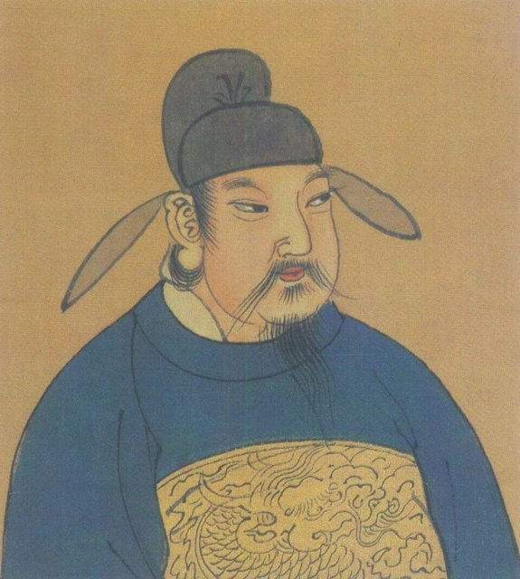

<!--
內容整理自 D:\Books\md\歷史\人物\中國\李白生平大事記（701－762年）.md（Books 的人物頁為 D:\Books\html\1-2-1.中國歷史人物\李白(701~762).html），並整合中文維基百科〈李白〉條目，以自己的話改寫。
時期依筆記的「五個重要階段」：蜀中成長、四方漫遊、翰林供奉、文學成熟、政治受難與晚年。筆記的「代表作品」「交遊人物」「文學特色」寫進相關事件與時期說明。
處理方式：
- 出生地與早年家世，筆記與維基百科都說歷來有爭議；這裡採傳統說法（生於西域碎葉，約五歲隨父遷居綿州昌隆縣青蓮鄉），並在內文註明。
- 賀知章稱李白為「謫仙人」，筆記放在交遊人物中，依維基百科放在742年入長安時。
- 744年離開長安與在洛陽結識杜甫，筆記分列兩則，這裡分開，杜甫一則寫進同遊梁宋與高適。
- 筆記中創作年代有爭議的作品（《靜夜思》《將進酒》《夢遊天姥吟留別》等），以「約」標示並寫進相近時期的事件。
- 「高力士脫靴」「賜金放還」，筆記說史實細節仍有爭議，內文照樣註明是傳說。
- 享年：筆記寫約62歲（虛歲），網站依生卒年自動計算的歲數為61歲。
- 人名與其他時間軸一致：杜甫（DuFu）；唐玄宗、楊貴妃、安祿山沒有獨立時間軸，唐朝背景見 ChineseHistory。
圖片來源（皆為 Wikimedia Commons 公有領域／CC0 作品，縮成最長邊 640px）：
- lb-cover.jpg：Liang Kai - Li Bai Strolling.jpg（梁楷〈太白行吟圖〉，南宋（東京國立博物館））
- lb-huanghelou.jpg：Xia Yong - Huang He Lou.jpg（夏永〈黃鶴樓圖〉，元代）
- lb-jiange.jpg：Jiange Pass in Sichuan.tif（〈劍閣圖〉，17世紀（瑞典遠東古物博物館），蜀道之險）
- lb-xuanzong.jpg：李隆基像.jpg（唐玄宗像）
-->

# Periods
- 701 ~ 724 | 蜀中成長 | #868e96
  約五歲隨父遷居蜀地，讀經史、習劍術、好任俠，也接觸道教與縱橫之學；遊歷成都、峨眉、青城，浪漫奔放的性格在山水之間養成。
- 725 ~ 741 | 出蜀漫遊與求仕 | #1971c2
  仗劍去國，沿長江東下，遊遍江南、荊楚、齊魯，在安陸成家，四處投詩干謁，希望經由舉薦一展抱負，詩歌中理想與懷才不遇並存。
- 742 ~ 744 | 供奉翰林 | #e67700
  奉詔入長安，受唐玄宗賞識，卻只是陪侍宮廷的文學侍從；個性不受拘束，與權貴不合，兩年後離京。
- 744 ~ 755 | 李杜相逢與四方漫遊 | #2f9e44
  在洛陽結識杜甫，與高適同遊梁宋；此後往來河南、山東、江浙，名篇迭出，晚年北遊幽州，已察覺安祿山的威脅。
- 756 ~ 762 | 永王之禍與晚年 | #c92a2a
  安史之亂中加入永王李璘幕府，永王兵敗後下獄、長流夜郎，途中遇赦東歸；晚年貧病，投靠族叔李陽冰，病逝當塗。

# Events

## 701 | 出生 {label="701年（武周長安元年）"}
李白字太白，祖籍隴西成紀（今甘肅秦安一帶）。依傳統說法，他出生在西域的碎葉城（今吉爾吉斯托克馬克附近），當時屬唐朝安西都護府；父親李客的家世與早年經歷，史料都不完整，出生地至今仍有爭議。

## 705 | 遷居蜀中 {label="約705年"}
約五歲時隨父親遷居綿州昌隆縣青蓮鄉（今四川江油青蓮鎮），後來自號「青蓮居士」即由此而來。他自幼讀經史、涉獵諸子百家，也學劍術、好任俠，個性豪爽不拘禮法；約720年起遊歷成都、峨眉山、青城山，接觸道教與隱逸文化，開始展現寫詩的才華。

## 725 | 辭親遠遊 {label="725年（開元十三年）"}
約二十五歲時離開四川，沿長江三峽東下，經荊門、江陵，此後一生多在漫遊中度過。他遊覽山水、結交名士、訪求道術，也尋找政治上的出路；726年至727年遊歷廬山、金陵、揚州等地，大量山水詩的素材由此而來。

## 727 | 安陸成婚 {label="727年（開元十五年）"}

在湖北安陸娶前宰相許圉師的孫女許氏為妻，此後約十年以安陸為據點，往來湖北、河南、山東，向地方官員獻詩文求舉薦。約730年代在黃鶴樓送別敬重的前輩詩人孟浩然，寫下〈黃鶴樓送孟浩然之廣陵〉。

## 735 | 遊太原與漫遊齊魯 {label="735–741年"}
應友人之邀到太原，此後往來山西、河南、山東，與各地文人、隱士、道士交往，詩名日盛。這時期的詩，豪放不羈、積極入世與追求自由交織在一起，仍期待有朝一日能被朝廷重用。

## 742 | 奉詔入長安 {label="742年（天寶元年）"}

四十二歲的李白經道士吳筠等人推薦，受唐玄宗徵召入長安，供奉翰林。老詩人賀知章讀了他的詩，驚嘆他是「謫仙人」（從天上貶到人間的仙人），「詩仙」之名即源於此。〈蜀道難〉約作於這個時期。但翰林供奉只是陪侍宮廷寫詩作文的侍從，並沒有參與政事的實權。

## 743 | 〈清平調詞〉 {label="743年（天寶二年）"}

相傳玄宗與楊貴妃在宮中賞牡丹，命李白作詩，他寫下〈清平調詞三首〉，以華麗的辭藻與典故描寫楊貴妃之美。又相傳他醉後要宦官高力士為他脫靴，表現他不向權貴低頭的形象，但這類故事的史實細節仍有爭議。

## 744 | 離開長安 {label="744年（天寶三載）"}
李白個性豪放、不受禮法拘束，在宮中受到權貴排擠，政治上又無法真正有所作為，終於離開朝廷，傳說是玄宗「賜金放還」。〈行路難〉約作於此時，「長風破浪會有時，直掛雲帆濟滄海」，寫出失意中仍不放棄的抱負。

## 744 | 洛陽結識杜甫 {label="744年夏"}
離開長安後，李白在洛陽結識小他十一歲的杜甫，兩人一見如故，又與高適同遊梁宋（今河南開封、商丘一帶），飲酒賦詩、談論理想。隔年李白與杜甫在山東再度同遊後分別，此後未再相見，杜甫卻終生懷念他，留下許多寄贈、懷念李白的詩。李白豪放浪漫，杜甫沉鬱寫實，後世並稱「李杜」。

## 745 | 〈夢遊天姥吟留別〉 {label="約745年"}
與杜甫分別後，李白繼續遊歷齊魯、登泰山、訪道教名山，後南下吳越。〈夢遊天姥吟留別〉以夢境寫仙境，結尾「安能摧眉折腰事權貴，使我不得開心顏」，是他蔑視權貴、追求自由的宣言。此後數年往來河南、山東、江浙，寫下大量樂府、歌行與絕句，〈月下獨酌〉等以飲酒寫孤獨與精神自由的作品，多出自中年時期。

## 752 | 北遊幽州與〈將進酒〉 {label="約751–753年"}
李白北上幽州（今北京一帶），親眼看到安祿山的勢力日益坐大，對唐朝的政局與邊防感到憂慮。〈將進酒〉約作於這前後，「天生我材必有用，千金散盡還復來」，以縱酒高歌寫人生短暫與懷才不遇。

## 755 | 安史之亂爆發 {label="755年（天寶十四載）"}
安祿山在范陽起兵，唐朝由盛轉衰，洛陽、長安相繼陷落。李白此時不在朝廷，帶著家人避亂南下，隱居廬山一帶，仍希望能參與平亂、報效國家。〈贈汪倫〉約作於這前後。

## 756 | 加入永王幕府 {label="756年（至德元年）"}
玄宗逃往四川，太子李亨在靈武即位，是為唐肅宗。玄宗之子永王李璘奉命出鎮江陵、組織軍隊，邀請李白入幕。李白以為可以藉此平定叛亂，寫下〈永王東巡歌〉，表達報國之志；但永王擁兵東下，與肅宗朝廷的衝突已經埋下。

## 757 | 下獄潯陽，長流夜郎 {label="757年（至德二載）"}
年初，永王被肅宗視為叛亂而兵敗被殺，李白受到牽連，被捕下獄於潯陽（今江西九江）。經御史中丞宋若思等人營救出獄，一度入宋若思幕府，但最後仍被判長流夜郎（今貴州一帶）。年近六十，政治理想受到沉重打擊。

## 759 | 遇赦東歸 {label="759年（乾元二年）"}
李白在758年溯長江西行，經三峽前往夜郎；隔年行至白帝城附近，遇朝廷大赦獲釋，立即乘船東下，寫下〈早發白帝城〉：「朝辭白帝彩雲間，千里江陵一日還」，以輕快的筆調寫重獲自由的喜悅。此後往來湖北、湖南、江西、安徽，生活日益困頓。

## 761 | 請纓從軍 {label="761年（上元二年）"}
李白住在金陵一帶，聽說名將李光弼率軍出征討伐叛軍，以六十一歲之齡請纓從軍，但因病半途折返，未能實現建功立業的願望。

## 762 | 病逝當塗 {label="762年（寶應元年）"}
李白晚年到安徽當塗，投靠擔任當塗縣令的族叔李陽冰，不久病逝，享年約六十二歲（虛歲）。臨終前將詩稿託付李陽冰，李陽冰編成《草堂集》並作序，李白的作品因此得以流傳。後來民間流傳他醉後入水撈月而死的傳說，並非史實。他以奔放的想像、自然的語言與自由的精神開拓了古典詩歌的境界，與杜甫並列為中國詩歌最重要的兩位代表。
