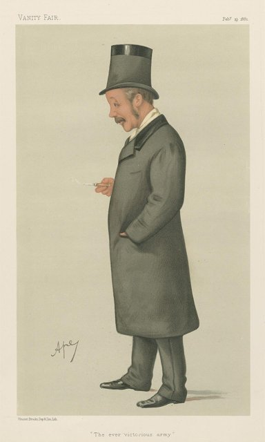
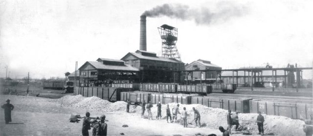
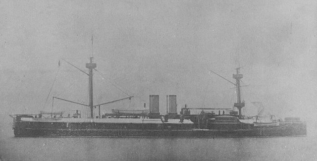
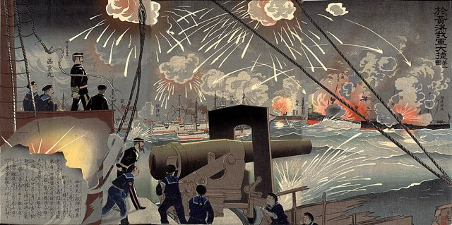
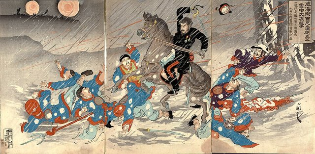
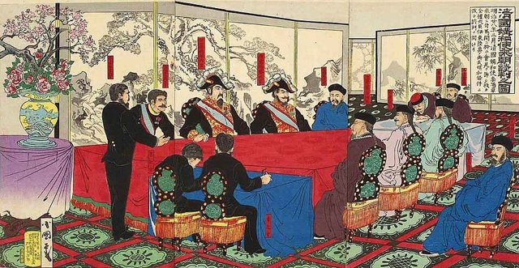
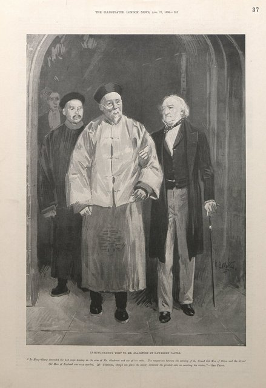
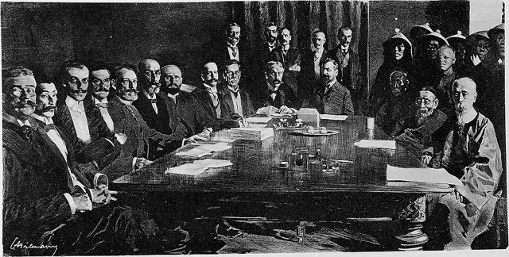

<!--
內容整理自 D:\Books\html\1-2-1.中國歷史人物\李鴻章(1823~1901).html（沒有對應的 md 筆記），並整合中文維基百科〈李鴻章〉條目，以自己的話改寫。
時期依頁面「總結」的四個階段，並拆出北洋海軍與甲午兩段：科舉入仕、淮軍與平定內亂、直隸總督與洋務、中法戰爭與北洋海軍、甲午戰爭與馬關條約、最後的外交危機。
兩份資料出入與處理方式：
- 生卒：兩份一致，道光三年正月初五（1823年2月15日）生於合肥，光緒二十七年九月二十七日（1901年11月7日）卒於北京，享年78歲（虛歲79），諡文忠。
- 科舉：頁面寫1840年考取秀才、1843年取得優貢、1845年赴京拜入曾國藩門下、1847年中進士；維基百科補充1844年順天鄉試中舉，並寫1847年中進士後受業於曾國藩門下。舉人採維基百科的1844年；拜師的年份兩說並存，事件寫在1845年並註明。
- 淮軍：頁面寫1861年開始籌組、1862年率軍赴上海；維基百科作1862年編成淮勇五營、同年任江蘇巡撫，兩者相容，分成兩則。1864年5月11日攻克常州、1865年9月奏准成立江南製造總局，取自維基百科。
- 輪船招商局：頁面沒有；維基百科寫1872年李鴻章反駁停造輪船之議，招商局1873年正式成立，採1873年。頁面寫1872年支持幼童赴美留學，維基百科沒有，照頁面。
- 開平礦務局：頁面寫1878年前後，維基百科未載年份，採頁面。唐胥鐵路（1881）頁面沒有，常見記載為1881年通車，併入電報的事件。
- 中法：頁面寫1884年中法戰爭爆發、1885年簽訂《中法新約》；維基百科補充1884年5月11日與福祿諾簽《中法會議簡明條款》（李福協定）、1885年6月9日在天津簽中法新約，採維基百科的日期。
- 甲午：頁面寫1894年7月開戰、9月黃海海戰、1895年初威海衛北洋海軍覆滅；維基百科補充1895年3月24日在馬關遇刺（左頰中彈），頁面只說「遭日本人槍擊受傷」，採維基百科日期。
- 1896年：頁面寫赴俄國參加尼古拉二世加冕、簽《中俄密約》；維基百科補充出訪俄、德、荷、比、法、英、美等國，6月3日簽中俄密約。
- 1898年：頁面寫德國強占膠州灣（1897）與戊戌變法；維基百科補充1898年3月6日李鴻章與德國簽《膠澳租借條約》、6月9日與英國簽《展拓香港界址專條》，併入1897年的事件。
- 1899–1900年：頁面說李鴻章「當時主要在南方處理政務」；維基百科補充1899年10月出督兩廣，1900年7月被召回北京議和。
- 頁面的「總表」「主要成就與歷史爭議」「與曾國藩、左宗棠、張之洞的比較」「總結」寫進時期說明與相關事件，不另立事件。
- 人名與其他時間軸一致：曾國藩、洪秀全、戈登、伊藤博文、慶親王奕劻、張之洞、劉坤一、康有為、梁啟超、慈禧太后、光緒帝。
圖片來源（皆為 Wikimedia Commons 公有領域／CC0 作品；註明「共用」者沿用其他時間軸已有的圖片）：
- lhz-cover.jpg：Li Hung Chang in 1896.jpg（李鴻章，1896）
- lhz-gordon.jpg：Carlo Pellegrini - Vanity Fair, Military and Navy, ^The Ever Victorious Army^, Lt Colonel Charles George Gordon - B1979.14.403 - Yale Center for British Art.jpg（《浮華世界》的戈登漫畫像，題為「常勝軍」，1881）
- lhz-kaiping.jpg：Tangshan Mine, Kaiping.jpg（開平礦務局的唐山礦）
- lhz-dingyuan.jpg：Dingyuan (ship, 1884) - NH 1926 - cropped.jpg（北洋海軍旗艦定遠號）
- lhz-yellowsea.jpg：Battle of the Yellow Sea by Korechika.jpg（日本浮世繪：黃海海戰）
- lhz-weihai.jpg：Battle of Weihaiwei (land).jpg（日本浮世繪：威海衛之戰）
- lhz-shimonoseki.jpg：Scene of signing Treaty of Shimonoseki pictorial.jpg（日本繪畫：馬關條約的簽約場面）
- lhz-gladstone.jpg：Li-hung-chang's visit to Mr. Gladstone at Hawarden Castle. (1896).jpg（1896年李鴻章訪問格萊斯頓的哈瓦登城堡）
- lhz-boxer.jpg：Signing of the Boxer Protocol 7 September 1901.jpg（1901年9月7日簽訂《辛丑條約》）
-->

# Periods
- 1823-02-15 ~ 1853 | 科舉入仕 | #868e96
  生於合肥的士紳家庭，父親李文安是清朝官員；中舉、中進士入翰林院，拜入曾國藩門下，接觸經世致用的思想。
- 1853 ~ 1870 | 淮軍與平定內亂 | #e8590c
  回鄉辦團練受挫後入曾國藩幕府，組建淮軍赴上海，攻取蘇州、常州，又平定捻軍，從部屬成長為能獨立掌握軍隊與地方的重臣。
- 1870 ~ 1884 | 直隸總督與洋務 | #1971c2
  天津教案後接任直隸總督兼北洋大臣達二十五年，推動海防、輪船招商局、開平礦務、電報與鐵路，也處理日本出兵臺灣、煙台條約與朝鮮問題。
- 1884 ~ 1894 | 中法戰爭與北洋海軍 | #2f9e44
  中法戰爭後簽中法新約，設天津武備學堂，北洋海軍1888年成軍，一度被視為亞洲較有實力的海軍。
- 1894 ~ 1896 | 甲午戰爭與馬關條約 | #c92a2a
  甲午戰爭中北洋海軍覆滅，李鴻章赴日議和，遇刺受傷，簽訂割讓臺灣、澎湖的《馬關條約》。
- 1896 ~ 1901-11-07 | 最後的外交危機 | #495057
  出訪歐美、簽中俄密約，眼見列強爭奪租借地；義和團事件中參與東南互保，最後與列強議和，簽訂《辛丑條約》後去世。

# Events

## 1823-02-15 | 出生於安徽合肥
李鴻章生於安徽合肥縣磨店鄉，字少荃（一說子黻、漸甫），號儀叟。父親李文安透過科舉取得功名，家族重視儒學教育，希望子弟經科舉進入官場。他的早年是典型清代讀書人的發展模式，沒有特別的軍事經歷。

## 1840 | 考取秀才
李鴻章取得秀才資格，進入科舉士人的行列，1843年又取得優貢資格，持續準備更高層級的考試，開始接觸更廣的士人網絡。

## 1844 | 順天鄉試中舉
李鴻章在順天鄉試（甲辰恩科）考中舉人，取得參加會試的資格。

## 1845 | 拜入曾國藩門下 {label="1845–1847年"}
李鴻章到北京準備會試，透過師友關係拜入曾國藩門下（維基百科作1847年中進士後受業）。曾國藩重視經世致用，主張研究經典也要思考如何用於行政、軍事與國家治理；這段師生關係對李鴻章的影響遠超一般的學術傳承，後來成為他建立淮軍的重要條件。

## 1847 | 中進士，入翰林院
李鴻章考中進士，入翰林院任庶吉士，從地方士人變成正式官員。在京期間，他熟悉奏摺、公文與行政程序，這些經驗後來成為他調度軍需、任命官員、外交談判時的重要優勢。
1850年前後，洪秀全的拜上帝會在廣西發展，1851年建立太平天國，這場內戰將把他從文官變成軍事領袖。

## 1853 | 回鄉辦團練
太平天國勢力擴張到安徽，李鴻章奉命回鄉協助辦理團練。他缺乏軍事指揮經驗，戰事中並非屢戰屢勝，逐漸體認到軍事行動除了勇氣與紀律，也需要情報、補給、戰略部署，以及對地方社會與政治情勢的理解。

## 1858 | 入曾國藩幕府
在軍事活動中受挫後，李鴻章於1858年冬進入曾國藩幕府，襄辦營務，負責公文、奏摺與軍政協調，展現出行政能力與處理複雜事務的才幹。

## 1861 | 籌組淮軍
曾國藩支持李鴻章回安徽，以淮河流域的地方團練與士紳網絡招募兵員，組建新軍，1862年編成淮勇五營，即淮軍。淮軍重視地方將領的指揮權，也逐步吸收西方槍炮與軍事技術，這是他政治生涯的重要轉折。

## 1862 | 率淮軍赴上海，任江蘇巡撫
李鴻章率淮軍到上海抵抗太平軍，同年任江蘇巡撫。上海是重要的通商口岸，清廷、地方士紳與外國勢力都不願它落入太平軍之手。他利用上海的特殊環境接觸西方軍事技術，改善淮軍的裝備與訓練。
上海周邊還有外國人參與組織的「常勝軍」，淮軍曾與他們在特定戰事中合作，但雙方的組織、指揮與政治目的並不相同。

## 1863 | 攻取蘇州與殺降爭議

淮軍與相關部隊攻取太平天國在江南的重要據點蘇州。城破後發生殺害降將的事件，李鴻章與常勝軍將領戈登因此發生衝突，這件事長期影響他的歷史評價：當軍事勝利、將領的承諾與政治考量互相衝突時，統帥如何處置投降者？
江南人口密集、經濟發達，長期戰亂使城市、農村與商業遭受重大損失。

## 1864-05-11 | 攻克常州
淮軍攻克常州。同年7月，曾國藩的湘軍攻陷天京，太平天國中央政權覆滅，淮軍在江南戰場的作戰對清廷平亂有重要貢獻，李鴻章的政治地位大幅提升。

## 1865 | 江南製造總局與剿捻
1865年9月，李鴻章奏准在上海成立江南製造總局，開始把精力投入軍事工業與洋務事業。同年起他受命參與剿捻：捻軍在安徽、河南、山東、江蘇一帶高度機動，考驗的是情報、騎兵機動、補給與跨地區協同，而不是傳統的城市攻防。
1867年，他升任湖廣總督，繼續參與剿捻。

## 1868 | 平定捻軍
東捻、西捻的主要勢力相繼被清軍擊敗，清廷重新取得華北與中原部分地區的控制權，李鴻章因軍功更受重用；剿捻並不是他一人完成，曾國藩與其他將領也在不同階段參與。
此時他已不只是曾國藩提攜的部屬，而是能獨立掌握軍隊、地方行政與中央政治資源的重臣。淮軍凝聚力強，但濃厚的地方性與將領私人網絡，也使清廷中央更難直接控制軍隊。

## 1870 | 直隸總督兼北洋大臣
天津教案後，曾國藩的處置引發爭議，李鴻章接任直隸總督，並兼北洋通商大臣，此後長達二十五年掌握北方軍政與外交，成為清廷處理外國交涉最重要的人物之一。
1872年，清廷開始分批派遣幼童赴美留學，這項計畫與曾國藩、容閎的倡議密切相關，也得到他的支持。

## 1873 | 輪船招商局
1872年有人上疏請停造輪船，李鴻章力陳反對；1873年，輪船招商局正式成立，洋務運動開始從軍事工業擴展到民用企業。

## 1874 | 日本出兵臺灣
日本以琉球漂流民在臺灣遇害為由，出兵臺灣南部，事件牽涉琉球的地位、臺灣原住民族地區的管轄，以及清日兩國對東亞秩序的不同理解。清廷經交涉支付款項，日軍撤離。
明治維新後的日本正積極擴張，此後李鴻章處理對日外交，必須同時考量臺灣、琉球與朝鮮。清廷對海防更加重視，他主張強化海軍、建造軍艦、修築軍港；朝中對國防資源該優先海防還是陸防仍有分歧。

## 1876-09-13 | 煙台條約
李鴻章與英國公使威妥瑪在煙台簽訂《煙臺條約》，處理英國翻譯官馬嘉理在雲南被殺的事件，內容涉及道歉、賠款與通商，反映英國利用外交與軍事優勢要求清廷讓步。

## 1878 | 開平礦務局

李鴻章支持創辦開平礦務局。煤炭是蒸汽機、鐵路與近代工業的能源，發展煤礦既能供應工業與軍事，也能減少對外國能源的依賴。

## 1881 | 津滬電報線與唐胥鐵路
李鴻章支持建立近代電報系統，1880年設天津電報總局，1881年天津至上海的電報線完成，是中國近代通信史的重要進展：訊息傳遞大幅加快，有助於清廷指揮軍事、處理外交與協調各地。同年，為運送開平的煤，唐山至胥各莊的鐵路通車。

## 1882 | 朝鮮壬午兵變
朝鮮發生壬午兵變，清朝派兵介入，加強對朝鮮事務的影響力；日本也積極擴大在朝鮮的勢力，清日兩國在朝鮮的競爭日益激烈，這成為1894年甲午戰爭的重要背景。李鴻章是清廷處理朝鮮問題的主要決策者之一。

## 1884-05-11 | 李福協定與中法戰爭
法國擴張在越南的勢力，清朝視越南為朝貢體系的一部分。李鴻章在天津與法國代表福祿諾簽訂《中法會議簡明條款》，但雙方隨即再起衝突，戰火延伸到越南、廣西、臺灣與東南沿海。
清軍在部分陸上戰事取得成果，整體情勢卻不理想。這場戰爭顯示，洋務運動雖引進西方技術，還不足以建立能在各個戰場與列強抗衡的軍事體系。

## 1885-06-09 | 中法新約與武備學堂
李鴻章在天津與法國公使巴特納簽訂《中法新約》，清朝承認法國對越南的保護權，傳統宗主權實質上喪失；條約的形成涉及清廷多方決策，不能把責任全歸於他一人。
同年，他支持設立天津武備學堂，培養具有戰術、操練、測繪等新式知識的軍官，表示他不只重視購買武器，也想培養能操作與管理近代軍隊的人才。

## 1888 | 北洋海軍成軍

李鴻章長期推動的北洋海軍正式成軍，擁有定遠、鎮遠等大型軍艦，建立了軍官、港口與訓練體系，一度被視為亞洲較有實力的近代海軍，是洋務運動的重要成就。
但海軍的實力不只取決於軍艦數量，還需要維修、彈藥、訓練、指揮與穩定的財政。1889到1893年，清廷財政有限，北洋海軍在這些方面都有不同程度的問題，到甲午戰爭時全面暴露。

## 1894-07 | 甲午戰爭爆發
朝鮮東學黨之亂，朝鮮政府請清朝出兵，日本也隨即出兵，雙方在朝鮮半島的軍力迅速增加，交涉未能避免戰爭，7月豐島海戰後戰爭全面展開。
李鴻章長期負責朝鮮事務，傾向避免與日本全面開戰，希望以外交手段維持局勢；但清廷內部對日本實力的判斷與是否開戰並不一致，戰爭一爆發，他就必須承擔北洋海軍與軍事部署的責任。甲午戰爭是對他外交判斷與多年軍事建設的雙重檢驗。

## 1894-09 | 黃海海戰

北洋海軍與日本聯合艦隊在黃海交戰，雙方都有損失，北洋海軍沒有立即覆滅，但此後失去主動權，暴露出軍艦性能、火炮使用、射擊訓練與指揮制度的問題。年底，日軍向遼東半島與東北推進，清軍在陸上連連失利。

## 1895-02 | 威海衛之戰，北洋海軍覆滅

1895年初，日軍進攻北洋海軍的基地威海衛，清軍在陸上與海上相繼失利，北洋海軍的主要作戰力量覆滅，李鴻章多年經營的海軍建設遭到重大打擊。
失敗的原因不只一項：全國軍事力量分散、缺乏統一指揮；維修、彈藥與訓練受到財政限制；日本海軍在訓練與協同作戰上占優勢；清廷對戰爭規模與後果的估計不足。

## 1895-03-24 | 馬關遇刺
戰敗後，李鴻章奉命前往日本下關（馬關），與首相伊藤博文談判，希望盡量降低割地與賠款。3月24日，他在談判期間遭日本人槍擊，左頰中彈受傷，事件引起國際關注，也影響了談判的氣氛與進程。

## 1895-04-17 | 馬關條約

李鴻章與日本簽訂《馬關條約》：清朝承認朝鮮獨立，割讓臺灣、澎湖與遼東半島（遼東因俄、德、法三國干涉而歸還），支付巨額賠款，並開放更多通商權利。
臺灣與澎湖從此進入五十年的日本統治；清朝在東亞的地位重挫，日本成為東亞強權，列強也更看清清朝的弱點，加速爭奪在華利益。李鴻章作為簽約代表，長期被視為割地賠款的象徵；但條約的形成也取決於清廷的戰略判斷、軍事失敗、財政能力與國際環境。

## 1896-06-03 | 出訪歐美，簽中俄密約

李鴻章出使俄國，參加尼古拉二世的加冕典禮，接著訪問德、荷、比、法、英、美等國。6月3日，他與俄國簽訂《中俄密約》，清廷希望藉俄國制衡日本，俄國則藉此擴大在東北的鐵路與戰略利益。清朝想利用列強之間的矛盾，列強也利用清朝的弱勢擴張權益。

## 1897 | 德國強占膠州灣
德國以傳教士遇害為由出兵占領膠州灣，1898年3月6日李鴻章與德國簽訂《膠澳租借條約》，6月9日又與英國簽訂《展拓香港界址專條》。俄、英、法、德等國相繼擴大租借地與勢力範圍，瓜分危機加劇。
同年，光緒帝支持康有為、梁啟超推動戊戌變法，很快被慈禧太后為首的保守勢力推翻。李鴻章長期支持洋務、重視技術與實業，但他代表的改革路線，與主張深入改革政治制度的維新派並不相同。

## 1899-10 | 出督兩廣
李鴻章出任兩廣總督。這時義和團運動在華北擴大，與民間信仰、反教會情緒、地方社會矛盾及列強在華特權交織，清廷內部對如何處置義和團出現嚴重分歧。

## 1900 | 東南互保與奉召議和
義和團圍攻北京使館區，清廷向列強宣戰，八國聯軍攻入北京，清廷出逃。李鴻章在南方，與張之洞、劉坤一等督撫協調「東南互保」，與外國維持地方秩序，避免戰火蔓延到東南，也顯示地方督撫已有相當大的自主權。
7月他被召回北京，與慶親王奕劻共同主持對列強的議和，這是他外交生涯的最後一項任務。清朝軍事力量已遭重創，談判籌碼極少。

## 1901-09-07 | 辛丑條約

清朝與十一國簽訂《辛丑條約》：賠款白銀4.5億兩並加計利息分期償還，懲處列強認定負有責任的官員，承認外國在北京使館區駐兵，清朝在軍事與外交上受到更多限制。賠款加重了財政與民眾的負擔，也迫使清廷之後推動新政。
李鴻章的外交生涯以沉重的妥協告終：他熟悉交涉，卻無法用外交手腕彌補軍事、財政與制度上的弱勢。

## 1901-11-07 | 病逝於北京
簽約兩個月後，李鴻章在北京去世，享年78歲，諡文忠。他一生經歷太平天國、捻軍、洋務運動、中法戰爭、甲午戰爭與義和團事件，幾乎參與了晚清所有重要的內政與外交危機。
他的地位具有雙重性：積極推動近代軍事與工業建設，卻沒能阻止清朝在國際競爭中持續失利。單靠購買軍艦、設立工廠與引進技術，不足以解決清朝在政治制度、財政、軍事組織與外交戰略上的根本問題；理解他，也是理解一個傳統帝國為何開始改革仍難以扭轉國勢。
